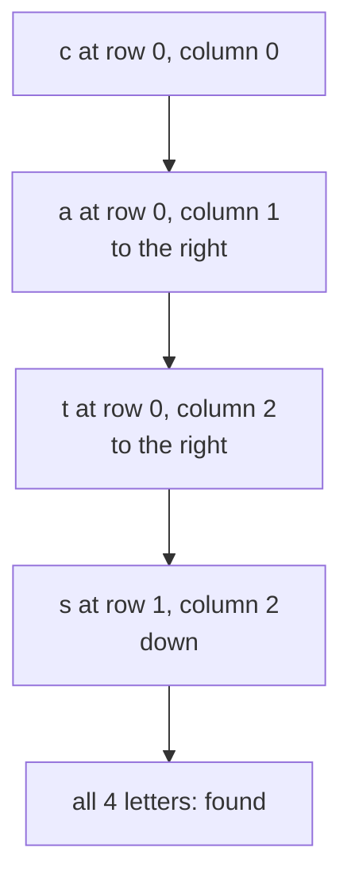
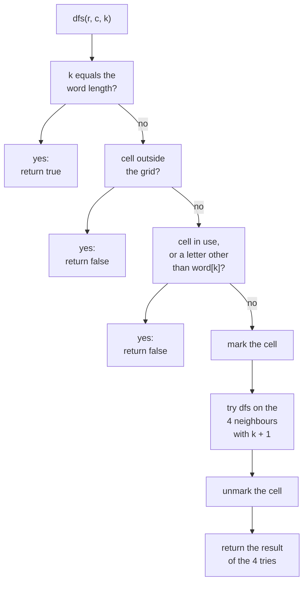

> [!tldr] Quick read
> - Any cell of the grid can hold the first letter. From there I step to an edge-adjacent cell holding the next letter, never stepping back onto a cell already on the current path.
> - This is [[en/concepts/backtracking|backtracking]] on a grid: mark the cell, try four directions, then [[en/concepts/visit-and-restore|restore the cell]] before stepping back. Skip the restore and a failed branch blocks the right one.
> - The mark can live in a separate `visited` table, or I can overwrite the cell itself with `#` and write the old letter back. The second way needs no extra memory.
> - Two cheap prunings: count letters first and return `false` at once if one is missing; and reverse the word when its last letter is rarer than its first, so there are fewer starting points. On a trap grid the call count drops from 5,172 to 20.

> [!info] Context
> This is LeetCode problem 79 at [[en/posts/2026-11-28-neetcode-permutations-search|station MISC-02: Backtracking: Permutations and Search]] on **the NeetCode Line: Mixed Techniques**. I picture a printed letter puzzle, and my job is to check whether a word lies on it along a winding path. You only need 2-D arrays and recursive functions.

> [!abstract]- Quick glossary for this post (click to open)
> - An edge-adjacent cell is the cell directly above, below, left or right. Diagonal cells do not count.
> - A simple path is a path that visits no cell twice.
> - DFS (depth-first search) follows one direction to the end before coming back to try another. Here each step deeper adds one letter of the word.
> - [[en/concepts/grid-graph|Grid as a graph]]: each cell is a vertex, each pair of edge-adjacent cells is an edge.
> - The [[en/concepts/choice-tree|choice tree]] of this problem has the starting cell as its root, one level per letter, and one branch per direction.

## Picture it first: searching a letter puzzle with coins

I have a letter puzzle and a handful of coins. I find the first letter and put a coin on it. I look at the four cells around it, and on one that holds the next letter and has no coin yet, I put the next coin. When I get stuck, I lift the last coin and try another direction. Once there is a coin for every letter, the word is found.

| Everyday life | Concept |
|---|---|
| The letter puzzle | The m × n `board` |
| A cell with a coin on it | A cell on the current path, which may not be reused |
| Put a coin down, look at the four cells around | Mark the cell, recurse in four directions |
| Lift the coin when stuck | Restore the old letter before backtracking |
| A coin on every letter of the word | `k` equals the word length, return `true` |
| Count the letters on the sheet before searching | Pruning by letter frequency |
| Start from the rarer letter | Reverse the word when its last letter is rarer than its first |

Take the self-made grid below. The word `cats` goes `c → a → t`, then down to `s`:

```text
c a t
o d s
g e n
```



## The problem: can the word be found on the grid

Given an m × n grid of English letters (upper or lower case), with 1 ≤ m, n ≤ 6, and a word of 1–15 letters, return `true` if there is a simple path through edge-adjacent cells whose letters spell exactly the word. Each cell may be used once per path. On the grid above, for example, `dog` is there (`d → o → g`), but `tact` is not, because the grid has only one `t`. [Original LeetCode 79](https://leetcode.com/problems/word-search/)

I used to think that as soon as the next letter showed up in a neighbouring cell, I could just step there and never come back. But one cell can have two neighbours with the same letter. Pick the wrong one and I only get stuck a few steps later, and at that point I have to back up and try the other one.

## How it works

### DFS with a visited table

The function `dfs(r, c, k)` asks: can the rest of the word, starting at letter k, be spelled if that letter goes in cell (r, c)? The checks inside one call, in order:



The outer loop calls `dfs(r, c, 0)` for every cell. The bounds check must come before reading `board[r][c]`, because the four directions can point outside the grid.

Let L be the word length. There are m·n starting points. The first step has 4 directions, and every later step has at most 3, because the direction it came from is a marked cell. The time is O(m·n·3^L) in the worst case. The recursion stack is at most L + 1 deep, plus the O(m·n) `visited` table.

### Marking on the grid itself

Instead of keeping a separate table, I overwrite the cell in use with `#`, a character never found in the word, and keep the old letter in a variable `saved`. A `#` cell automatically fails to match any letter, so the "already used" condition folds into the letter comparison. Before returning, found or not, I write `saved` back. The grid is unchanged after each search, and the only extra memory is the O(L) stack.

This is the same idea as [[en/concepts/visit-and-restore|visit-and-restore]]: shared state may change only while I am on the path, and it must be put back exactly as it was when I leave the path.

### Pruning before the search

Two cheap steps before the DFS loop:

1. Count how often each letter appears on the grid and in the word. If the word needs three `e`s and the grid has two, return `false` without taking a single step. The count costs O(m·n + L).
2. If the word's last letter appears less often than its first, reverse the word and search for that. A path that spells the word forwards spells the reversed word backwards, so the answer does not change. The number of real starting points (cells matching the first letter) goes down.

The measurement in the file: a 4 × 4 grid of `a`s, with a `b` in the bottom-right corner walled off by two `c`s, searching for `aaaaaaab`. The letter count passes because the grid has one `b`, but no path reaches the `b` from an `a`. The unpruned version walks every seven-`a` path from 13 starting cells: 5,172 calls. The version that reverses the word to `baaaaaaa` has one starting cell, and all four of its neighbours hold the wrong letter: 20 calls. The count includes calls that stop at the bounds check; it is the number of times the function is entered, not running time.

When many words must be found on the same grid, repeating the DFS for each word is expensive. The problem [[en/problems/word-search-ii|Word Search II]] puts the words in a prefix tree and searches them all in one pass.

## Runnable example

[TypeScript](../code/neetcode-word-search/search.ts) · [Python](../code/neetcode-word-search/search.py) · [Go](../code/neetcode-word-search/search.go) · [Java](../code/neetcode-word-search/search.java) · [JavaScript](../code/neetcode-word-search/search.js) · [PHP](../code/neetcode-word-search/search.php) · [Rust](../code/neetcode-word-search/word_search.rs)

```ts
function existInPlace(board: Board, word: string): boolean {
    const rows = board.length, cols = board[0].length
    function dfs(r: number, c: number, k: number): boolean {
        calls++
        if (k === word.length) return true
        if (r < 0 || c < 0 || r >= rows || c >= cols) return false
        if (board[r][c] !== word[k]) return false
        const saved = board[r][c]
        board[r][c] = '#'
        let found = false
        for (const [dr, dc] of DIRS) {
            if (dfs(r + dr, c + dc, k + 1)) {
                found = true
                break
            }
        }
        board[r][c] = saved
        return found
    }
    for (let r = 0; r < rows; r++) {
        for (let c = 0; c < cols; c++) {
            if (dfs(r, c, 0)) return true
        }
    }
    return false
}
```

```python
def exist_in_place(board, word):
    rows, cols = len(board), len(board[0])

    def dfs(r, c, k):
        global calls
        calls += 1
        if k == len(word):
            return True
        if r < 0 or c < 0 or r >= rows or c >= cols:
            return False
        if board[r][c] != word[k]:
            return False
        saved = board[r][c]
        board[r][c] = '#'
        found = False
        for dr, dc in DIRS:
            if dfs(r + dr, c + dc, k + 1):
                found = True
                break
        board[r][c] = saved
        return found

    return any(dfs(r, c, 0) for r in range(rows) for c in range(cols))
```

```go
func existInPlace(board [][]byte, word string) bool {
	rows, cols := len(board), len(board[0])
	var dfs func(r, c, k int) bool
	dfs = func(r, c, k int) bool {
		calls++
		if k == len(word) {
			return true
		}
		if r < 0 || c < 0 || r >= rows || c >= cols {
			return false
		}
		if board[r][c] != word[k] {
			return false
		}
		saved := board[r][c]
		board[r][c] = '#'
		found := false
		for _, d := range dirs {
			if dfs(r+d[0], c+d[1], k+1) {
				found = true
				break
			}
		}
		board[r][c] = saved
		return found
	}
	for r := 0; r < rows; r++ {
		for c := 0; c < cols; c++ {
			if dfs(r, c, 0) {
				return true
			}
		}
	}
	return false
}
```

```java
static boolean existInPlace(char[][] board, String word) {
    for (int r = 0; r < board.length; r++)
        for (int c = 0; c < board[0].length; c++)
            if (dfsInPlace(board, word, r, c, 0)) return true;
    return false;
}

static boolean dfsInPlace(char[][] board, String word, int r, int c, int k) {
    calls++;
    if (k == word.length()) return true;
    if (r < 0 || c < 0 || r >= board.length || c >= board[0].length) return false;
    if (board[r][c] != word.charAt(k)) return false;
    char saved = board[r][c];
    board[r][c] = '#';
    boolean found = false;
    for (int[] d : DIRS) {
        if (dfsInPlace(board, word, r + d[0], c + d[1], k + 1)) {
            found = true;
            break;
        }
    }
    board[r][c] = saved;
    return found;
}
```

```js
function existInPlace(board, word) {
    const rows = board.length, cols = board[0].length
    function dfs(r, c, k) {
        calls++
        if (k === word.length) return true
        if (r < 0 || c < 0 || r >= rows || c >= cols) return false
        if (board[r][c] !== word[k]) return false
        const saved = board[r][c]
        board[r][c] = '#'
        let found = false
        for (const [dr, dc] of DIRS) {
            if (dfs(r + dr, c + dc, k + 1)) {
                found = true
                break
            }
        }
        board[r][c] = saved
        return found
    }
    for (let r = 0; r < rows; r++) {
        for (let c = 0; c < cols; c++) {
            if (dfs(r, c, 0)) return true
        }
    }
    return false
}
```

```php
function existInPlace(array &$board, string $word): bool {
    $rows = count($board);
    $cols = count($board[0]);
    $dfs = function (int $r, int $c, int $k) use (&$dfs, &$board, $word, $rows, $cols): bool {
        global $calls;
        $calls++;
        if ($k === strlen($word)) return true;
        if ($r < 0 || $c < 0 || $r >= $rows || $c >= $cols) return false;
        if ($board[$r][$c] !== $word[$k]) return false;
        $saved = $board[$r][$c];
        $board[$r][$c] = '#';
        $found = false;
        foreach (DIRS as [$dr, $dc]) {
            if ($dfs($r + $dr, $c + $dc, $k + 1)) {
                $found = true;
                break;
            }
        }
        $board[$r][$c] = $saved;
        return $found;
    };
    for ($r = 0; $r < $rows; $r++) {
        for ($c = 0; $c < $cols; $c++) {
            if ($dfs($r, $c, 0)) return true;
        }
    }
    return false;
}
```

```rust
fn exist_in_place(board: &mut Vec<Vec<u8>>, word: &[u8]) -> bool {
    fn dfs(board: &mut Vec<Vec<u8>>, word: &[u8], r: i32, c: i32, k: usize) -> bool {
        tick();
        if k == word.len() {
            return true;
        }
        if r < 0 || c < 0 || r as usize >= board.len() || c as usize >= board[0].len() {
            return false;
        }
        let (ru, cu) = (r as usize, c as usize);
        if board[ru][cu] != word[k] {
            return false;
        }
        let saved = board[ru][cu];
        board[ru][cu] = b'#';
        let mut found = false;
        for (dr, dc) in DIRS {
            if dfs(board, word, r + dr, c + dc, k + 1) {
                found = true;
                break;
            }
        }
        board[ru][cu] = saved;
        found
    }
    for r in 0..board.len() {
        for c in 0..board[0].len() {
            if dfs(board, word, r as i32, c as i32, 0) {
                return true;
            }
        }
    }
    false
}
```

The tabs show the version that marks the grid itself. The downloadable files also hold the `visited` version, the pruned version and an enumerator that acts as referee. The enumerator ignores letters while walking: it generates every simple path exactly as long as the word, joins the letters on the path and compares the whole string. The second line checks the three versions against it on every 2 × 2 and 2 × 3 grid of `a` and `b`, for every `a`/`b` word of length 1–4, and checks that the grid is restored after each search. All seven languages print the same output. The program prints in Vietnamese: "ca đúng" means "cases correct", "đối chiếu liệt kê mọi đường đi" means "checked against enumerating every path", and the last line reports the call counts without pruning ("không cắt nhánh") and with the reversed word ("đảo từ").

```text
12/12 ca đúng
2400/2400 ca đúng (đối chiếu liệt kê mọi đường đi)
Lưới 4×4 toàn a, b ở góc bị c chắn, từ aaaaaaab: không cắt nhánh 5172 lượt gọi, đảo từ 20 lượt gọi
```

Run with `node search.ts`, `python3 search.py`, `go run search.go`, `java search.java`, `node search.js`, `php -d xdebug.mode=off search.php` or `rustc --edition 2021 -O word_search.rs -o /tmp/word_search && /tmp/word_search`.

## Misconceptions and common traps

- **Forgetting to restore the cell.** I ran the version without the restore line on the grid `aa / ab` with the word `aaab`. The right answer is `true` (bottom-left `a` → top-left `a` → top-right `a` → `b`). The version that forgets to restore leaves `#` on the cells of the first failed branch, so the right branch has no cells left to walk and the result is `false`.
- **Reading the cell before checking bounds.** From a cell on the edge, the four directions point outside the grid. Read `board[r][c]` first and Python silently reads a cell from the other end when the index is −1, while Java, Go and Rust stop the program with an index out of range.
- **Returning early and skipping the restore.** When the word is found, I still write `saved` back before returning `true`; otherwise the caller's grid is left with `#` marks.
- **Greedily following the first matching direction.** Stepping into the first neighbour with the right letter and never coming back misses the right path. Every matching direction must be tried.
- **Java:** `board[r][c]` is a `char`, so comparing it with `word.charAt(k)` using `!=` compares values. Cutting the letter with `word.substring(k, k + 1)` gives a `String`, and comparing `String`s with `==` compares references.
- **PHP:** arrays passed to a function are copied, so the overwriting version takes `array &$board` and the closure uses `use (&$board)`. I ran a version whose closure captures `$board` by value: each call marks its own private copy, deeper calls never see the mark, and the word `aba` on the one-row grid `a b` returns `true` even though the `a` is used twice.
- **Rust:** the recursive function takes `&mut Vec<Vec<u8>>`. You cannot hold a reference `&board[r][c]` while recursing with `&mut board`, so the version in the tab copies the byte into `saved` (`u8` is `Copy`), writes `#`, recurses, then writes it back.
- **Python:** the word has at most 15 letters, so recursion goes at most 16 levels deep, far from the default limit of 1,000.

## Self-check questions

> [!question]- Why does every step after the first have at most 3 directions?
> One of the four neighbours is the cell the path just came from, which is still marked. It always fails the letter comparison, so only three directions can continue.

> [!question]- Why does reversing the word not change the answer?
> Walking a path that matches `word` backwards gives a path that matches the reversed word, through the same cells and still without repeats. The two questions have the same answer; only the number of starting points differs.

> [!question]- What must the marker character satisfy?
> It must never appear in the word being searched. The problem uses only English letters, so `#` never matches `word[k]`.

> [!question]- When should I switch to the Word Search II approach?
> When many words must be found on the same grid. A prefix tree lets each DFS search every word with the same beginning at once, instead of running again for each word.

## References

- [LeetCode 79](https://leetcode.com/problems/word-search/)
- [Jeff Erickson, Algorithms, Backtracking chapter](https://jeffe.cs.illinois.edu/teaching/algorithms/book/02-backtracking.pdf)
- [PHP: anonymous functions and `use` by reference](https://www.php.net/manual/en/functions.anonymous.php) · [Rust Book: references and borrowing](https://doc.rust-lang.org/book/ch04-02-references-and-borrowing.html) · [Java String.charAt](https://docs.oracle.com/en/java/javase/21/docs/api/java.base/java/lang/String.html#charAt(int))
