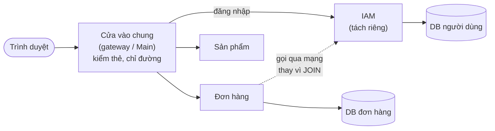

> [!tldr] Đọc nhanh
> - [[microservices|Microservices]] đổi độ phức tạp *trong code* lấy độ phức tạp *trên mạng*: mỗi JOIN cũ thành một lời gọi mạng, mỗi transaction cũ thành một saga. Nên bắt đầu bằng modular monolith và chỉ tách khi có lý do.
> - [[api-gateway|API Gateway]] là cửa vào chung trước các service: định tuyến, xác thực, giới hạn tốc độ, gộp response. Đừng để logic nghiệp vụ lọt vào đó.
> - [[api-versioning|API versioning]]: thay đổi *thêm vào* thì không cần version mới; thay đổi *phá vỡ* thì cần, và cách tốt nhất là để code lõi chỉ biết bản mới, còn rìa chuyển đổi cho client cũ.
> - [[openapi|OpenAPI]] là hợp đồng máy đọc được: sinh tài liệu, sinh client, kiểm tra request và test hợp đồng từ cùng một nguồn.

> [!info] Bối cảnh
> Ví dụ lấy từ **flash-sale**, trang bán hàng giảm giá giờ vàng mình tự viết. Hiện nó là **một** ứng dụng (mình gọi là *Main*). Trong repo có một bản thiết kế, chưa làm, để tách phần đăng nhập và phân quyền (gọi là **IAM**, Identity and Access Management) ra thành ứng dụng riêng. Bạn không cần đọc code dự án. Bài dùng bản thiết kế này như một ví dụ thực tế cho cả bốn khái niệm.

> [!abstract]- Từ điển nhanh cho bài này (bấm để mở)
> - **Monolith**: toàn bộ hệ thống là một ứng dụng, deploy một lần.
> - **Modular monolith**: vẫn là một ứng dụng, nhưng code chia thành các khu có ranh giới rõ (đơn hàng, thanh toán, sản phẩm…).
> - **Service**: một ứng dụng chạy riêng, có database riêng, nói chuyện với các service khác qua mạng.
> - **gRPC**: cách gọi hàm giữa các service qua mạng, gọn và nhanh (xem [[2026-11-18-api-styles|ga 2]]).
> - **JOIN**: câu SQL ghép dữ liệu từ hai bảng, ví dụ đơn hàng kèm tên người mua.
> - **Transaction**: nhóm thao tác database "hoặc thành công hết, hoặc không có gì xảy ra".
> - **Saga**: cách làm thay transaction khi các bước nằm ở nhiều service. Bước sau lỗi thì chạy bước "hoàn tác" cho các bước trước.
> - **Private key / public key**: cặp khóa. Khóa riêng dùng để ký, chỉ một nơi giữ. Khóa công khai dùng để kiểm chữ ký, ai giữ cũng được.
> - **Rolling deploy**: thay dần từng bản đang chạy bằng bản mới, nên có lúc bản cũ và bản mới chạy song song.
> - **Swagger UI**: trang web tự sinh từ file OpenAPI, cho phép đọc tài liệu và thử gọi API.

## Hình dung trước: từ siêu thị tới trung tâm thương mại

| Đời thường | Khái niệm |
|---|---|
| Một siêu thị lớn: một kho, một hệ thống thu ngân, một ông quản lý | Monolith |
| Vẫn một siêu thị, nhưng chia khu rõ ràng: khu điện tử không lấy hàng từ kệ khu thực phẩm | Modular monolith (flash-sale hiện tại) |
| Trung tâm thương mại: mỗi cửa hàng tự có kho và nhân viên, tự mở cửa đóng cửa. Muốn hỏi hàng của cửa hàng khác thì phải gọi điện | [[microservices\|Microservices]] |
| Cửa chính có quầy thông tin và bảo vệ: kiểm vé, chỉ đường tới đúng cửa hàng | [[api-gateway\|API Gateway]] |
| Đổi sang ổ cắm điện kiểu mới nhưng phát **adapter** cho thiết bị cũ, để ai cũng còn cắm được | [[api-versioning\|API Versioning]] |
| Bản đồ và danh bạ in sẵn ở cửa: cửa hàng nào ở đâu, bán gì, giờ mở cửa | [[openapi\|OpenAPI]] |

Chỗ cần để ý nhất là câu "muốn hỏi thì phải gọi điện". Trong siêu thị, nhân viên chỉ cần quay sang kệ bên cạnh. Ở trung tâm thương mại, mỗi câu hỏi là một cuộc gọi: có độ trễ, có thể không ai nghe máy, và hai cửa hàng không thể cùng "tính tiền chung một hóa đơn". Toàn bộ cái giá của microservices nằm ở câu đó.



## Vấn đề: API không còn là một khối

Năm ga trước nhìn API từ góc một request. Ga cuối nhìn từ trên cao: chuyện gì xảy ra khi hệ thống lớn dần, nhiều team, nhiều client, và một phần hệ thống muốn tách ra chạy riêng?

Flash-sale đang ở đúng thời điểm đó. Nó là một **modular monolith**: một ứng dụng NestJS, nhưng chia module theo miền nghiệp vụ (`auth`, `product`, `cart`, `order`, `payment`, `flash-sale`, `search`…), giao tiếp qua service và sự kiện, đã có sẵn outbox và RabbitMQ. Trong repo có một bản thiết kế (Phase 18, **chưa triển khai**) tách phần định danh và phân quyền thành `iam-service` riêng. Bài này dùng bản thiết kế đó làm ví dụ, vì nó chạm đúng cả bốn khái niệm của ga.

<figure class="figure-map" style="--ar: 1 / 1">
<div class="frame"><iframe data-archify="../diagrams/api-architecture/iam-extraction.html" title="Sơ đồ kiến trúc: bản thiết kế tách IAM service khỏi flash-sale" loading="lazy"></iframe></div>
<figcaption><span><b>Hình 1.</b> Theo bản thiết kế, Main vẫn là cửa vào duy nhất của trình duyệt, tự kiểm JWT bằng public key, và chỉ gọi IAM qua gRPC cho đăng nhập và tra cứu user.</span><a href="../diagrams/api-architecture/iam-extraction.html" target="_blank" rel="noopener">Mở toàn màn hình</a></figcaption>
</figure>

## Microservices: tách để được gì, mất gì

[[microservices|Microservices]] là kiểu kiến trúc mà mỗi service sở hữu một năng lực nghiệp vụ, **sở hữu dữ liệu riêng**, triển khai độc lập, nói chuyện với nhau qua mạng. Lợi ích thật nằm ở *tổ chức*: team A deploy service của mình mà không phải chờ team B, mỗi service scale theo tải riêng, một service sập không kéo theo tất cả.

Bản thiết kế tách IAM liệt kê thẳng thắn những thứ phải trả:

Bảng dưới đọc từng dòng theo kiểu "trước đây làm thế này, sau khi tách phải làm thế kia":

| Trong monolith | Sau khi tách IAM |
|---|---|
| `orders JOIN users` trong một câu SQL | Gọi `GetUsersByIds` qua gRPC rồi tự ghép; "N+1 is a hard no" |
| Khóa ngoại `order.userId → users.id` | *Soft FK*: chỉ còn cột UUID, DB không còn bảo đảm user tồn tại |
| Duyệt seller: đổi role + tạo shop trong một transaction | `SetUserRole` qua gRPC rồi tạo shop: **không nguyên tử**, cần saga ở phase sau |
| Kiểm JWT bằng secret chung (HS256) | IAM ký bằng private key, Main kiểm bằng public key (RS256) |

Hai quyết định trong thiết kế mình thấy rất đáng học:

- **Đường nóng không phụ thuộc IAM.** "Đường nóng" là những request chạy liên tục, như xem sản phẩm hay đặt hàng. Mỗi request đã đăng nhập chỉ cần kiểm chữ ký JWT tại chỗ (public key) và tra blocklist trong Redis dùng chung. IAM chết thì không đăng nhập mới được, nhưng người đã đăng nhập vẫn mua hàng bình thường. Thiết kế cố ý *không* có RPC `ValidateToken`: gọi IAM ở mỗi request là biến IAM thành điểm chết của cả hệ thống.
- **Strangler fig** (tên một loài cây đa bóp cổ: mọc bao quanh cây chủ, tới khi cây chủ mục đi thì nó đứng thay chỗ): không viết lại từ đầu, mà rút dần từng phần ra khỏi monolith, giữ nguyên giao diện bên ngoài (`/auth/*` vẫn ở Main, chỉ chuyển tiếp vào IAM).

Ví dụ ở cuối bài đo cái giá của JOIN biến thành lời gọi mạng: 20 đơn hàng, gọi `GetUser` từng cái là 20 lần gọi, tối thiểu 100ms chỉ riêng độ trễ mạng (giả định 5ms mỗi lần); gọi gộp `GetUsersByIds` là 1 lần, 5ms.

Martin Fowler có một bài tên *MonolithFirst*: hầu hết hệ thống microservices thành công đều bắt đầu từ một monolith đã quá lớn, còn hầu hết hệ thống bắt đầu bằng microservices từ đầu đều gặp rắc rối, vì ranh giới giữa các service rất khó đoán đúng trước khi hiểu miền nghiệp vụ. Modular monolith của flash-sale là cách chuẩn bị: ranh giới module đã rõ, sau này tách ra chỉ là đổi lời gọi hàm thành lời gọi mạng.

## API Gateway: một cửa vào cho nhiều service

Khi có nhiều service, client không nên phải biết `catalog` ở đâu, `order` ở đâu, mỗi cái xác thực ra sao. [[api-gateway|API Gateway]] là một tầng đứng trước, làm những việc chung:

- **Định tuyến**: `/api/v1/products/*` → catalog, `/api/v1/orders/*` → order.
- **Xác thực ở rìa**: kiểm token một lần, chuyển danh tính vào trong (header nội bộ), service phía sau không phải tự làm lại.
- **Giới hạn tốc độ, TLS, CORS, log, tracing** tại một chỗ.
- **Gộp response** (mẫu *Backend for Frontend*): trang chi tiết đơn cần cả order lẫn sản phẩm, gateway gọi song song hai service rồi trả một response. Ví dụ cuối bài: gọi lần lượt ~100ms, gateway gọi song song ~60ms.
- **Chuyển đổi giao thức**: nhận REST/JSON từ trình duyệt, gọi gRPC phía trong.

Flash-sale chưa có gateway riêng (bản thiết kế hẹn tới Phase 19), nhưng các việc đó đang được chia cho hai chỗ:

- **Ingress NGINX** làm phần hạ tầng: TLS, định tuyến theo host và path, giới hạn 100 request/giây, giới hạn body 10MB, timeout 30 giây, thêm header bảo mật.
- Trong bản thiết kế, **Main** làm "auth facade": nhận `/auth/*` từ trình duyệt, giữ cookie và CSRF ở rìa, gọi IAM qua gRPC. Trình duyệt chỉ thấy một origin.

Bẫy lớn nhất của gateway là nó dần dần chứa logic nghiệp vụ ("gateway kiểm tra luôn tồn kho cho nhanh"), rồi trở thành một monolith mới mà team nào cũng phải sửa. Gateway nên "ngốc": định tuyến, kiểm tra, chuyển tiếp. Nó cũng là điểm chết duy nhất, nên phải chạy nhiều bản và phải nhanh.

## API Versioning: đổi hợp đồng mà không làm hỏng ai

Client cũ (app mobile chưa cập nhật, script của đối tác) vẫn sẽ gọi API của mình nhiều tháng sau khi mình đổi nó. [[api-versioning|Versioning]] là cách cho phép thay đổi mà không phá vỡ họ.

Hình dung app trên điện thoại của bạn: bạn chưa cập nhật app sáu tháng, nó vẫn gọi API theo cách sáu tháng trước. Nếu backend đổi tên field `total` thành `amount`, app của bạn hỏng ngay, dù bạn chẳng làm gì sai.

**Bước một là phân loại thay đổi:**

| Không phá vỡ (thêm vào) | Phá vỡ |
|---|---|
| Thêm endpoint mới | Xóa hoặc đổi tên endpoint, field |
| Thêm field mới vào response | Đổi kiểu field (`total: number` → `total: object`) |
| Thêm tham số *tùy chọn* | Thêm tham số *bắt buộc* |
| Thêm giá trị enum mới (nếu client bỏ qua giá trị lạ) | Đổi ý nghĩa của một giá trị, đổi status code |

Phần lớn thay đổi trong thực tế thuộc cột trái, và không cần version mới. Đây cũng chính là tư duy của ADR *expand-contract* trong flash-sale, chỉ khác là áp cho schema DB: khi Kubernetes rolling deploy, pod cũ và pod mới chạy song song vài phút, nên mọi thay đổi schema phải đi qua bốn bước *thêm → ghi cả hai → backfill → xóa cái cũ*, không bao giờ đổi tên cột trong một bước. API cũng vậy: thêm field mới, cho client chuyển dần, rồi mới bỏ field cũ.

**Bước hai là chọn nơi đặt version** khi thật sự phải phá vỡ:

- **Trên URL**: `/api/v1/...`, `/api/v2/...`. Flash-sale đặt `setGlobalPrefix('api/v1')` từ ngày đầu. Dễ thấy, dễ định tuyến, dễ cache; nhưng v2 thường thành một bản sao lớn của v1.
- **Trong header**: `Accept: application/vnd.example.v2+json` hoặc `Api-Version: 2026-09-01`. URL sạch, nhưng khó thử trên trình duyệt.
- **Theo ngày, chuyển đổi ở rìa** (cách của Stripe): mỗi tài khoản gắn với ngày version lúc bắt đầu tích hợp. Code lõi chỉ biết dạng mới nhất; mỗi thay đổi phá vỡ đi kèm một hàm "hạ cấp" response, được áp ngược lần lượt cho client cũ. Ví dụ cuối bài cài đúng ý này: client `2026-01-15` nhận `total` là số và `status: COMPLETED`, client `2026-10-01` nhận dạng mới nhất, từ cùng một object lõi.

**Bước ba là ngừng hỗ trợ có báo trước**: header `Deprecation` (RFC 9745) báo endpoint sắp bỏ, `Sunset` (RFC 8594) báo ngày tắt hẳn, kèm link tài liệu chuyển đổi. Và đo xem còn ai gọi bản cũ trước khi tắt.

## OpenAPI: hợp đồng mà máy đọc được

Ở [[2026-11-18-api-foundations|ga 1]], backend gửi lỗi trong field `msg`, frontend lại đọc `message`. Hai bên "thỏa thuận bằng miệng" và hiểu khác nhau. OpenAPI là bản hợp đồng **viết ra giấy**, và cả người lẫn máy đều đọc được.

[[openapi|OpenAPI]] (trước gọi là Swagger) là một định dạng YAML/JSON mô tả API: endpoint, tham số, header, schema request và response, các status code, cách xác thực. Bản 3.1 dùng thẳng JSON Schema 2020-12 cho phần schema.

Flash-sale theo hướng *code-first*: viết decorator trong controller, `@nestjs/swagger` sinh ra spec và trang tài liệu ở `/api/docs`:

```ts
// rút gọn từ checkout.controller.ts
@ApiOperation({ summary: 'Tạo orders từ giỏ hàng. Reserve inventory atomic + idempotent retry.' })
@ApiHeader({ name: 'Idempotency-Key', required: true, description: 'Gửi cùng key khi retry để tránh trùng đơn' })
@ApiResponse({ status: 201, description: '{ groupId, orders[], totalAmount }' })
@ApiResponse({ status: 409, description: 'Có sản phẩm hết hàng tại bước reserve' })
@ApiResponse({ status: 422, description: 'Cart validation fail' })
@Post()
checkout(...) {}
```

Trang Swagger UI cần script inline nên được nới CSP riêng. Comment trong code ghi rằng trang này sẽ chỉ mở cho mạng nội bộ bằng allowlist IP ở ingress, nhưng khi đọc manifest mình thấy allowlist mới có ở ingress của Kibana và Grafana, chưa có ở ingress của API. Đó là việc cần làm trước khi lên production: tài liệu API công khai là bản đồ miễn phí cho người muốn dò lỗ hổng.

Giá trị thật của OpenAPI không nằm ở trang tài liệu, mà ở chỗ một file dùng được cho nhiều việc:

- **Sinh kiểu và client** cho frontend (`openapi-typescript`, `orval`…), để frontend và backend không lệch nhau. Lỗi `msg` và `message` ở ga 1 sẽ thành lỗi biên dịch nếu schema lỗi được khai báo và frontend dùng kiểu sinh ra.
- **Kiểm tra request** theo spec ở gateway hoặc middleware. Ví dụ cuối bài kiểm tra một request checkout thiếu `Idempotency-Key` và `items` rỗng.
- **Mock server** cho frontend làm việc trước khi backend xong.
- **Contract test** và **lint** (Spectral) trong CI: đổi spec theo kiểu phá vỡ thì CI báo.

Một điểm mình nhận ra khi đọc lại: Swagger của flash-sale mô tả *khi nào* trả `409` nhưng không mô tả *body lỗi trông ra sao*. Chính khoảng trống đó để lọt lỗi ở ga 1. Code-first tiện, nhưng chỉ đúng tới mức mình chịu viết decorator đầy đủ; *design-first* (viết spec trước, sinh code sau) buộc phải nghĩ về hợp đồng trước khi viết code.

## Ví dụ chạy được

File `gateway.ts` gồm bốn phần: một gateway nhỏ định tuyến và chặn request chưa xác thực, versioning theo ngày kiểu Stripe, kiểm tra request theo một đoạn spec OpenAPI, và phép đo N+1 so với gọi gộp.

```ts
const changes = [
  { version: "2026-06-01", desc: "total thành object {amount, currency}", down: (o: any) => ({ ...o, total: Number(o.total.amount) }) },
  { version: "2026-09-01", desc: "status PAID đổi tên từ COMPLETED", down: (o: any) => ({ ...o, status: o.status === "PAID" ? "COMPLETED" : o.status }) },
]
function render(clientVersion: string) {
  return changes
    .filter((c) => c.version > clientVersion) // áp ngược các thay đổi mới hơn version của client
    .reverse()
    .reduce((o, c) => c.down(o), latest as any)
}
```

```text
$ node gateway.ts
===== 1. API Gateway: một cửa vào, nhiều service phía sau =====
/api/v1/products/42  → {"status":200,"body":{"service":"catalog","path":"/42"}}
/api/v1/orders       → {"status":401,"note":"chặn ngay ở gateway, service không phải tự kiểm tra"}
/api/v2/unknown      → {"status":404}
client tự gọi lần lượt: ~100ms | gateway gọi song song rồi gộp: ~60ms

===== 2. Versioning kiểu Stripe: theo ngày, chuyển đổi ở rìa =====
Api-Version: 2026-01-15 → {"id":"ord_1","total":1990000,"status":"COMPLETED"}
Api-Version: 2026-07-01 → {"id":"ord_1","total":{"amount":"1990000","currency":"VND"},"status":"COMPLETED"}
Api-Version: 2026-10-01 → {"id":"ord_1","total":{"amount":"1990000","currency":"VND"},"status":"PAID"}

===== 3. OpenAPI: hợp đồng máy đọc được =====
request đúng → []
request sai  → [ 'thiếu header Idempotency-Key', 'items cần ít nhất 1 phần tử' ]
status code đã khai báo: 201, 400, 401, 409, 422

===== 4. Microservices: mỗi JOIN cũ giờ là một lời gọi mạng =====
N+1:   20 lần gọi gRPC, tối thiểu 100ms chỉ riêng độ trễ mạng
batch: 1 lần gọi gRPC cho 7 user khác nhau, tối thiểu 5ms
```

Toàn bộ file: <a href="../code/api-architecture/gateway.ts">code/api-architecture/gateway.ts</a>.

## Hiểu lầm và bẫy hay gặp

### "Microservices cho dễ scale"

Một monolith stateless chạy 20 pod sau load balancer (ga 5) scale rất tốt. Microservices giải quyết bài toán *nhiều team cùng sửa một codebase* và *các phần có nhu cầu tài nguyên khác nhau*, không phải bài toán "nhiều request".

### Distributed monolith

Tách thành nhiều service nhưng service nào cũng gọi đồng bộ service khác, dùng chung một database, phải deploy cùng nhau. Có đủ nhược điểm của cả hai kiến trúc mà không có ưu điểm nào. Dấu hiệu: một tính năng nhỏ cần sửa và deploy ba service.

### Tăng version cho mọi thay đổi

Thêm một field không cần `v2`. Mỗi version là một nhánh code phải bảo trì và test; Stripe giữ hàng trăm "version" nhưng chỉ một codebase, nhờ chuyển đổi ở rìa.

### Spec OpenAPI viết tay rồi để đó

Spec lệch với code còn tệ hơn không có spec, vì người đọc tin nó. Spec phải được *sinh ra* từ code, hoặc code phải được *kiểm tra* theo spec trong CI.

### Gateway làm mọi thứ

Mỗi logic nghiệp vụ thêm vào gateway là một lý do để mọi team phải chờ nhau deploy gateway. Giữ nó ở mức định tuyến, xác thực, giới hạn, quan sát.

## Câu hỏi tự kiểm tra

> [!question]- Vì sao bản thiết kế không có RPC `ValidateToken` gọi sang IAM?
> Gọi IAM ở mỗi request biến IAM thành điểm chết của cả hệ thống và thêm độ trễ mạng vào mọi request. Kiểm chữ ký bằng public key ngay tại Main và tra blocklist trong Redis dùng chung là đủ.

> [!question]- Thêm field `estimatedDeliveryAt` vào response đơn hàng có cần `/api/v2` không?
> Không. Thêm field là thay đổi không phá vỡ, miễn là client bỏ qua field lạ (điều nên nói rõ trong tài liệu API).

> [!question]- Khác nhau giữa code-first và design-first với OpenAPI?
> Code-first sinh spec từ code (nhanh, luôn khớp code nhưng chỉ đầy đủ khi decorator đầy đủ). Design-first viết spec trước rồi sinh code hoặc kiểm tra code theo spec (buộc thống nhất hợp đồng trước, hợp khi nhiều team cùng dùng).

> [!question]- Sau khi tách IAM, trang "danh sách đơn hàng" cần tên người mua. Lấy thế nào cho đúng?
> Gom mọi `userId` của trang, gọi một lần `GetUsersByIds`, rồi ghép trong bộ nhớ. Không gọi `GetUser` cho từng đơn.

## Tham khảo

- [microservices.io: API Gateway pattern](https://microservices.io/patterns/apigateway.html) và [Backends for Frontends](https://samnewman.io/patterns/architectural/bff/)
- [Martin Fowler & James Lewis: Microservices](https://martinfowler.com/articles/microservices.html), [MonolithFirst](https://martinfowler.com/bliki/MonolithFirst.html), [StranglerFigApplication](https://martinfowler.com/bliki/StranglerFigApplication.html)
- [Stripe: APIs as infrastructure: future-proofing Stripe with versioning](https://stripe.com/blog/api-versioning)
- [RFC 9745: The Deprecation HTTP Response Header Field](https://www.rfc-editor.org/rfc/rfc9745) và [RFC 8594: The Sunset HTTP Header Field](https://www.rfc-editor.org/rfc/rfc8594)
- [OpenAPI Specification 3.1.0](https://spec.openapis.org/oas/v3.1.0.html) và [NestJS: OpenAPI](https://docs.nestjs.com/openapi/introduction)
- [Stoplight Spectral](https://github.com/stoplightio/spectral)
