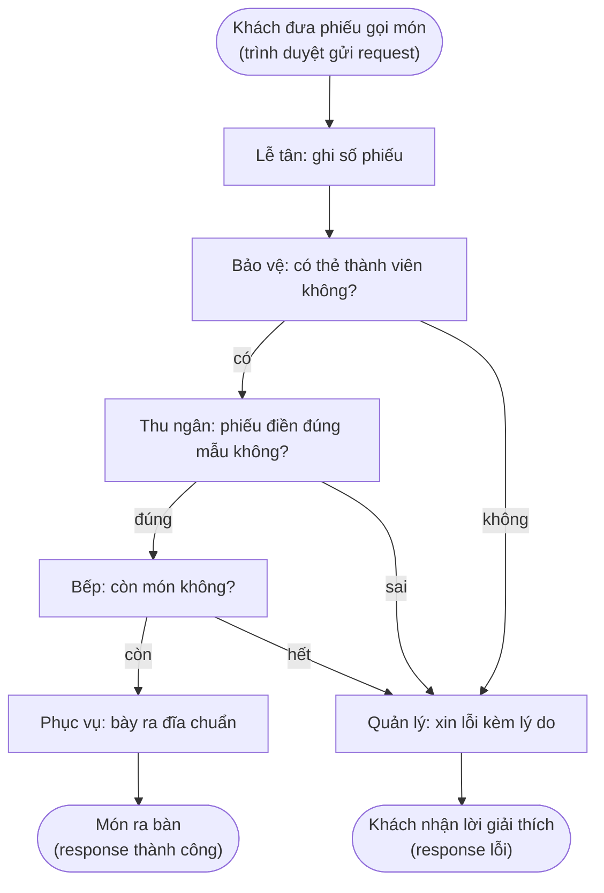
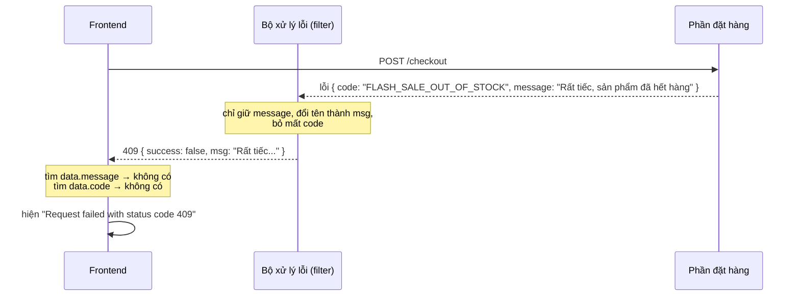

> [!tldr] Đọc nhanh
> - Một [[endpoint|endpoint]] là cặp *method + đường dẫn*: `POST /api/v1/checkout` khác hẳn `GET /api/v1/checkout`.
> - Mỗi request đi qua một chuỗi bước cố định: middleware → guard → pipe → handler → interceptor, lỗi ở bất kỳ đâu rơi vào exception filter ([[request-response|request-response]]).
> - Method nói lên *ý định* và các cam kết đi kèm (safe, idempotent), header mang *ngữ cảnh*, body JSON mang *dữ liệu*, status code là *kết luận* ([[http-methods]], [[headers]], [[json]], [[status-codes]]).
> - Phần dễ sai nhất là [[error-handling|xử lý lỗi]]: backend của mình làm rơi mất mã lỗi, nên người dùng chỉ thấy "Request failed with status code 409".

> [!info] Bối cảnh: flash-sale là gì, và bạn cần biết gì để đọc bài
> Cả series lấy ví dụ từ **flash-sale**, một trang bán hàng giảm giá giờ vàng mình tự viết. Đúng 21:00 mở bán, mỗi sản phẩm chỉ có vài trăm suất, và hàng nghìn người cùng bấm "Mua ngay". Phần chạy trên máy chủ (*backend*) viết bằng **NestJS**, một framework của Node.js. Phần chạy trong trình duyệt (*frontend*) gọi backend qua API.
>
> Bạn **không cần** biết NestJS hay đọc code của dự án. Mỗi khi bài nhắc tới một tên riêng trong dự án, ngay bên cạnh có giải thích nó làm gì bằng lời thường. Đoạn code trích từ dự án chỉ để minh họa. Phần "Ví dụ chạy được" là TypeScript thuần, tự chạy độc lập bằng `node`.

> [!abstract]- Từ điển nhanh cho bài này (bấm để mở)
> - **API**: "quầy giao dịch" của một chương trình. Chương trình khác gửi yêu cầu theo đúng mẫu thì nhận về kết quả, không cần biết bên trong làm gì.
> - **Client / server**: bên hỏi / bên trả lời. Trình duyệt, app điện thoại hay `curl` đều là client.
> - **HTTP**: ngôn ngữ chung mà client và server dùng để nói chuyện trên web.
> - **Framework**: bộ khung code dựng sẵn (NestJS, Express, Spring…). Mình chỉ viết phần nghiệp vụ, còn framework lo việc nhận và trả request.
> - **Redis / Postgres**: hai loại cơ sở dữ liệu. Redis giữ dữ liệu trong RAM nên rất nhanh và hay dùng làm bộ nhớ tạm. Postgres lưu bền trên đĩa.
> - **Pod**: một bản đang chạy của backend. Flash-sale chạy nhiều pod giống hệt nhau để chia tải.
> - **axios**: thư viện mà frontend dùng để gửi request. Khi gặp lỗi, câu mặc định của nó là "Request failed with status code …".

## Hình dung trước: gọi món ở nhà hàng

Trước khi vào chữ nghĩa, mình thấy dễ nhất là coi một lần gọi API như **gọi món ở nhà hàng**:

| Ở nhà hàng | Trong API | Khái niệm |
|---|---|---|
| Món trên thực đơn, ví dụ "món số 12, gọi thêm" | Địa chỉ cộng hành động: `POST /api/v1/checkout` | [[endpoint\|Endpoint]] |
| Gọi món thì phải chờ phục vụ mang ra. Mỗi lần gọi là một lần nhận | Gửi một request thì nhận đúng một response | [[request-response\|Request-Response]] |
| "Gọi món", "hỏi giá", "hủy món" là những việc khác nhau | `POST` tạo mới, `GET` đọc, `DELETE` xóa… | [[http-methods\|HTTP Methods]] |
| Thông tin ghi ở góc phiếu: số bàn, thẻ thành viên, "phiếu này là gọi lại" | `Authorization`, `Idempotency-Key`, `Content-Type`… | [[headers\|Headers]] |
| Nội dung phiếu gọi món, viết theo mẫu chung | Body dạng `{"items": ["SKU-1"]}` | [[json\|JSON]] |
| Phục vụ báo "có ngay", "hết món", "bạn chưa đặt bàn" | `201`, `409`, `401` | [[status-codes\|Status Codes]] |
| Hết món thì phải nói *món nào* hết, để khách chọn món khác | Lỗi có `code` rõ ràng để client biết xử lý | [[error-handling\|Error Handling]] |

Và trước khi bếp nấu, phiếu gọi món đi qua vài người, mỗi người kiểm một việc:



Phần còn lại của bài là phiên bản "kỹ thuật" của đúng câu chuyện này.

## Vấn đề: "gọi API" là gọi cái gì?

Mình viết backend flash-sale bằng NestJS khá lâu rồi, nhưng thú thật là phần lớn các mảnh như guard, interceptor, filter mình viết theo mẫu. Khi bắt đầu tuyến [[api-concepts|API Concepts]], mình quyết định không học bảy khái niệm nền một cách rời rạc, mà theo chân **đúng một request**: người dùng bấm "Đặt hàng" trong giỏ hàng.

Frontend gửi đi thế này (mình chú thích từng dòng ngay bên dưới):

```http
POST /api/v1/checkout HTTP/1.1
Host: api.example.com
Authorization: Bearer eyJhbGciOi...
Idempotency-Key: 550e8400-e29b-41d4-a716-446655440000
Content-Type: application/json

{"items": ["SKU-1"], "addressId": "addr_9"}
```

Đọc từng dòng bằng lời thường:

- `POST /api/v1/checkout`: "tôi muốn **tạo** một đơn hàng" (POST) ở địa chỉ `/api/v1/checkout`.
- `Host`: gửi tới máy chủ nào.
- `Authorization: Bearer …`: "đây là thẻ chứng minh tôi đã đăng nhập" (ga 3 giải thích thẻ này).
- `Idempotency-Key`: "đây là mã số của lần bấm này. Nếu tôi lỡ gửi lại thì đừng tạo đơn thứ hai" (ga 4).
- `Content-Type`: "phần nội dung bên dưới viết bằng JSON".
- Dòng trống, rồi tới **body**: mua sản phẩm `SKU-1`, giao tới địa chỉ `addr_9`.

Và nhận về:

```http
HTTP/1.1 201 Created
Content-Type: application/json
X-Correlation-ID: req-6f1c…

{"success": true, "data": {"groupId": "grp_1", "totalAmount": "1990000.00"}, "msg": "Đặt hàng thành công"}
```

Đọc bằng lời thường: `201 Created` nghĩa là "đã tạo xong". `X-Correlation-ID` là mã tra cứu của request này, giống mã vận đơn. Body cho biết đơn thuộc nhóm `grp_1`, tổng tiền 1.990.000đ.

Mọi khái niệm của ga này đều nằm trong hai khối chữ trên. Phần còn lại của bài đi lần lượt từng mảnh.

## Cơ chế: request đi qua những trạm nào

Đây là phiên bản kỹ thuật của chuỗi "lễ tân → bảo vệ → thu ngân → bếp → phục vụ" ở trên. Framework nào cũng có chuỗi trạm như vậy, chỉ khác tên gọi. NestJS gọi chúng là middleware, guard, pipe, handler, interceptor và exception filter. Express thì gọi tất cả là middleware. Bạn chỉ cần nhớ **mỗi trạm làm một việc, và trạm nào phát hiện lỗi thì chuyển thẳng sang trạm báo lỗi**.

| Trạm (tên NestJS) | Ở nhà hàng | Việc nó làm trong flash-sale | Tên lớp trong code |
|---|---|---|---|
| Middleware | Lễ tân ghi số phiếu | Đọc hoặc sinh mã tra cứu `X-Correlation-ID` để dòng log nào cũng có mã này | `CorrelationIdMiddleware` |
| Guard | Bảo vệ | Ai đang gọi? Gọi quá nhiều chưa? Có quyền đặt hàng không? | `JwtAuthGuard`, `RateLimitGuard`, `PoliciesGuard` |
| Pipe | Thu ngân kiểm phiếu | Chặn body sai kiểu hoặc có field lạ | `ValidationPipe` |
| Handler | Bếp | Làm việc chính: kiểm `Idempotency-Key`, gọi phần đặt hàng | `CheckoutController.checkout` |
| Interceptor | Phục vụ bày món | Bọc kết quả vào một "vỏ" chung `{ success, data, msg }` | `TransformInterceptor` |
| Exception filter | Quản lý xử lý sự cố | Biến mọi lỗi thành một response lỗi | `HttpExceptionFilter` |

Cột cuối chỉ để ai muốn đối chiếu với code. Đọc bài không cần nhớ cột này.

<figure class="figure-map" style="--ar: 1 / 1">
<div class="frame"><iframe data-archify="../diagrams/api-foundations/request-lifecycle.html" title="Sơ đồ tuần tự: vòng đời request POST /checkout trong NestJS" loading="lazy"></iframe></div>
<figcaption><span><b>Hình 1.</b> Một request checkout đi qua lễ tân, bảo vệ, kiểm tra body, xử lý rồi đóng gói kết quả; khi hết hàng, lỗi rẽ sang trạm báo lỗi. Dòng chữ nhỏ trong mỗi ô là tên lớp tương ứng trong NestJS.</span><a href="../diagrams/api-foundations/request-lifecycle.html" target="_blank" rel="noopener">Mở toàn màn hình</a></figcaption>
</figure>

Điểm mình mới hiểu ra: thứ tự này quyết định cả *bảo mật* lẫn *hiệu năng*. Guard chạy trước pipe, giống như bảo vệ đứng trước thu ngân. Một request không có token bị trả `401` ngay ở cửa, server không tốn công đọc và kiểm tra body. Rate limit (giới hạn số lần gọi) cũng nằm ở guard, nên request spam bị chặn trước khi chạm vào database.

## Endpoint: địa chỉ cộng với động từ

Một [[endpoint]] là điểm vào cụ thể của API. Trong flash-sale, đường dẫn đầy đủ được ghép từ ba chỗ:

```ts
app.setGlobalPrefix('api/v1')          // main.ts
@Controller('checkout')                 // checkout.controller.ts
export class CheckoutController {
  @Post()                               // → POST /api/v1/checkout
  checkout(...) {}

  @Post('preview-discount')             // → POST /api/v1/checkout/preview-discount
  previewDiscount(...) {}
}
```

Vài quy ước mình thấy đáng giữ:

- **Đường dẫn là danh từ, method là động từ.** `POST /orders` thay vì `POST /createOrder`. Flash-sale có vài endpoint dạng hành động như `POST /flash-sale/campaigns/:id/queue/join`; với những thao tác không phải CRUD, dùng một danh từ con (`/queue/join`, `/orders/:id/cancel`) là cách nhiều API lớn chọn.
- **Prefix phiên bản** `/api/v1` đặt từ ngày đầu, để sau này còn đường lùi (xem ga 6).
- **Path param cho danh tính, query param cho bộ lọc**: `/campaigns/:id/queue/position` so với `/products?categoryId=...&limit=20`.

## Request-Response: một hỏi, một đáp, không nhớ gì

HTTP là giao thức [[request-response]]: client mở lời, server trả lời đúng một response cho mỗi request, rồi coi như xong. Server **không nhớ** request trước (stateless). Vì vậy mỗi request phải tự mang đủ ngữ cảnh: ai gọi (token), gọi lần thứ mấy (idempotency key), thuộc luồng nào (correlation id).

Một request gồm bốn phần: method, target (đường dẫn + query), headers, body tùy chọn. Response gồm status code, headers, body tùy chọn. Hết. Mọi framework, từ Express tới NestJS, chỉ là cách tổ chức code quanh bốn phần này.

Hệ quả thực tế của tính stateless: flash-sale chạy nhiều pod sau load balancer, request sau có thể rơi vào pod khác request trước. Thứ gì cần "nhớ" giữa các request (phiên đăng nhập, giỏ hàng, hàng chờ) đều nằm trong Redis hoặc Postgres, không nằm trong bộ nhớ của process.

## HTTP Methods: động từ kèm cam kết

[[http-methods|Method]] không chỉ là nhãn. RFC 9110 gắn cho mỗi method hai tính chất mà client, proxy và trình duyệt đều dựa vào:

| Method | Dùng cho | Safe (không đổi state) | Idempotent (gọi N lần = 1 lần) |
|---|---|---|---|
| `GET` | Đọc tài nguyên | ✓ | ✓ |
| `HEAD` | Như GET nhưng chỉ lấy header | ✓ | ✓ |
| `POST` | Tạo mới, hoặc hành động không khớp method nào | ✗ | ✗ |
| `PUT` | Ghi đè toàn bộ tài nguyên | ✗ | ✓ |
| `PATCH` | Sửa một phần | ✗ | không bảo đảm |
| `DELETE` | Xóa | ✗ | ✓ |
| `OPTIONS` | Hỏi server hỗ trợ gì (CORS preflight) | ✓ | ✓ |

Hai chỗ trong flash-sale cho thấy cam kết này có tác dụng thật:

- `CsrfGuard` bỏ qua `GET`, `HEAD`, `OPTIONS` vì chúng là *safe*: không đổi state thì không có gì để giả mạo.
- `POST /checkout` **không idempotent**: mạng chập chờn khiến client gửi lại là có thể tạo hai đơn. Vì vậy endpoint này bắt buộc header `Idempotency-Key` và trả `400` nếu thiếu. Cơ chế đầy đủ nằm ở ga 4 ([[idempotency]]).

Còn một ca thú vị: `POST /checkout/preview-discount` chỉ *tính thử* giảm giá, không ghi gì vào DB, đúng ra là thao tác đọc. Nó vẫn dùng `POST` vì cần gửi danh sách mã giảm giá trong body. `GET` có body thì RFC 9110 nói rõ là không có ngữ nghĩa, nhiều proxy bỏ đi. Đây là lựa chọn thực dụng phổ biến; cái giá là response không được cache tự động như `GET`. (HTTP đang chuẩn hóa method `QUERY` cho đúng trường hợp này: đọc an toàn nhưng có body.)

## Headers: ngữ cảnh đi kèm request

[[headers|Header]] là metadata dạng `Tên: giá trị`, không phân biệt hoa thường ở tên. Chỉ trong một request checkout của flash-sale đã có đủ các nhóm:

- **Định dạng**: `Content-Type: application/json` nói body là gì; `Accept` nói client muốn nhận gì.
- **Xác thực**: `Authorization: Bearer <access token>`. `JwtAuthGuard` tách chuỗi theo khoảng trắng và chỉ nhận kiểu `Bearer`.
- **Ngữ nghĩa nghiệp vụ**: `Idempotency-Key` (tên theo quy ước của Stripe, đang được IETF chuẩn hóa).
- **Truy vết**: `X-Correlation-ID`. Middleware đọc giá trị do upstream gửi, nếu không có thì sinh `req-<uuid>`, rồi **ghi lại vào response**. Khi người dùng báo lỗi, chỉ cần mã này là tìm được toàn bộ log của request đó.
- **Bảo mật** (do server gửi): Helmet thêm `Strict-Transport-Security`, `Content-Security-Policy: default-src 'none'`, `X-Frame-Options: DENY`… API chỉ trả JSON nên CSP siết hết mức.
- **Giới hạn tốc độ**: `X-RateLimit-Limit`, `X-RateLimit-Remaining`, `Retry-After` (ga 4).

Một điều nhỏ mà quan trọng: tiền tố `X-` cho header tự đặt đã bị khuyến nghị bỏ từ RFC 6648 (2012), nhưng `X-Correlation-ID`, `X-RateLimit-*` thì vẫn quá phổ biến để đổi. Header mới thì nên đặt tên không có `X-`.

## JSON: định dạng chung, nhưng chỉ có một kiểu số

[[json|JSON]] thắng XML vì gọn và map thẳng vào object của JavaScript. Nhưng nó chỉ có sáu kiểu: string, number, boolean, null, object, array. Không có kiểu ngày, không có kiểu decimal, và number trong thực tế bị parse thành số thực 64-bit.

Flash-sale tính tiền bằng `Prisma.Decimal`, và controller `preview-discount` có một dòng comment rất đúng:

```ts
// Serialize Decimal → string for HTTP transport (JSON không có Decimal type)
totalDiscount: result.totalDiscount.toString(),
finalAmount: result.finalAmount.toString(),
```

Ví dụ ở cuối bài cho thấy vì sao: `0.1 + 0.2` ra `0.30000000000000004`, và một id lớn như `9007199254740993` bị JSON.parse đọc thành `…992`. Quy tắc mình rút ra: **tiền và id lớn đi dưới dạng string**; ngày tháng đi dưới dạng chuỗi ISO 8601 (`2026-11-18T08:00:00Z`).

Flash-sale còn bọc mọi response thành công trong một "vỏ" chung:

```json
{ "success": true, "data": { ... }, "msg": "Đặt hàng thành công" }
```

Vỏ này tiện cho frontend (luôn đọc `data`), nhưng nó lặp lại thông tin mà status code đã nói (`success` chính là `status < 400`). Riêng webhook của cổng thanh toán thì phải tắt vỏ bằng `@SkipResponseTransform()`, vì VNPay và MoMo yêu cầu response đúng định dạng của họ.

## Status Codes: kết luận ở dòng đầu tiên

[[status-codes|Status code]] là thứ đầu tiên client đọc, trước cả body. Năm nhóm: `1xx` thông tin, `2xx` thành công, `3xx` chuyển hướng, `4xx` lỗi do phía gọi, `5xx` lỗi do server. Swagger của endpoint checkout khai báo đúng những mã mà mình nghĩ một API đặt hàng cần:

| Mã | Khi nào trong flash-sale | Client nên làm gì |
|---|---|---|
| `201 Created` | Tạo đơn thành công | Chuyển sang trang thanh toán |
| `400 Bad Request` | Thiếu `Idempotency-Key`, body sai | Sửa request, **không** retry nguyên xi |
| `401 Unauthorized` | Không có hoặc sai token | Refresh token rồi thử lại |
| `403 Forbidden` | Có token nhưng thiếu quyền `order:create` | Báo không có quyền |
| `409 Conflict` | Hết hàng ở bước giữ kho | Báo hết hàng, cập nhật giỏ |
| `422 Unprocessable Content` | SKU hoặc shop đã ngừng bán | Báo sản phẩm không còn hợp lệ |
| `429 Too Many Requests` | Vượt token bucket | Chờ đúng `Retry-After` giây |
| `500` / `503` | Lỗi server, phụ thuộc chết | Có thể retry với backoff |

Hai cặp hay nhầm: `401` là "tôi không biết bạn là ai", `403` là "tôi biết bạn là ai, nhưng bạn không được làm việc này". Còn `400` là request *sai hình thức*, `422` là request đúng hình thức nhưng *sai về nghiệp vụ*. Phân biệt rõ để client biết có nên retry hay không: `4xx` gần như không bao giờ nên retry nguyên xi (trừ `408`, `429`), `5xx` thì có thể.

## Error Handling: chỗ mình tìm ra lỗi thật

Đây là phần mình học được nhiều nhất, vì nó lộ ra một lỗi trong chính dự án.

Các exception nghiệp vụ trong flash-sale được viết cẩn thận, mỗi cái có `code` riêng để frontend dịch ra câu thân thiện:

```ts
export class FlashSaleOutOfStockException extends ConflictException {
  constructor() {
    super({ code: 'FLASH_SALE_OUT_OF_STOCK', message: 'Rất tiếc, sản phẩm đã hết hàng' })
  }
}
```

Nhưng `HttpExceptionFilter`, tức "người quản lý" mà mọi lỗi phải đi qua trước khi ra ngoài, chỉ lấy đúng `message`:

```ts
// rút gọn từ http-exception.filter.ts
const body = exception.getResponse()
message = Array.isArray(body.message) ? body.message[0] : body.message
response.status(status).json(ResponseDto.error(null, message))
// → { success: false, data: null, msg: "Rất tiếc, sản phẩm đã hết hàng" }
```

Nghĩa là `code` (và các field như `maxUserPerSku`, `currentStatus`) **bị bỏ rơi**, lỗi validation có nhiều dòng thì chỉ còn dòng đầu. Trong khi đó, frontend lại tìm `message` và `code`:

```ts
// rút gọn từ trang quản lý voucher ở frontend
const data = err.response?.data
if (typeof data?.message === 'string') return data.message
if (data?.code) return data.code
return err.message // "Request failed with status code 409"
```

Backend gửi `msg`, frontend đọc `message`. Không khớp. Vẽ ra thì thấy rõ chỗ thông tin bị rơi:



Giống nhà hàng mà bếp báo "hết món số 12", quản lý ra bàn chỉ nói "có lỗi", còn khách thì đang chờ nghe chữ "món" nên không hiểu gì. Mình dựng lại đúng tình huống này trong ví dụ dưới đây và kết quả đúng như dự đoán: mọi lỗi đều hiện ra thành câu mặc định của axios.

Bài học không nằm ở chuyện đặt tên `msg` hay `message`, mà ở chỗ **lỗi là một phần của hợp đồng API**, cần định dạng cố định như response thành công. RFC 9457 (Problem Details) đã chuẩn hóa định dạng đó:

```json
{
  "type": "https://example.com/problems/OUT_OF_STOCK",
  "title": "Rất tiếc, sản phẩm đã hết hàng",
  "status": 409,
  "code": "OUT_OF_STOCK",
  "correlationId": "req-demo-7"
}
```

với `Content-Type: application/problem+json`. `type`, `title`, `status`, `detail`, `instance` là các field chuẩn; muốn thêm `code`, `errors`, `correlationId` thì cứ thêm (spec cho phép extension member). Frontend dịch theo `code`, còn `title` là câu dự phòng.

Thêm ba nguyên tắc mình thấy flash-sale đã làm đúng:

- **Bắt mọi thứ** (`@Catch()` để trống), để không bao giờ lộ stack trace ra ngoài.
- **Lỗi 500 thì log đầy đủ** (kèm correlation id), nhưng chỉ trả "Internal server error" cho client.
- **Fail fast**: thiếu `Idempotency-Key` thì trả `400` ngay ở controller, trước khi đụng tới service.

## Ví dụ chạy được

File `pipeline.ts` dựng lại pipeline bằng `node:http` thuần: middleware correlation id, guard, validate, handler, interceptor, và hai phiên bản filter (kiểu flash-sale và kiểu RFC 9457). Client gọi bằng `fetch` rồi chạy đúng logic hiển thị lỗi của frontend.

```ts
// Filter giống flash-sale: chỉ giữ message (phần tử đầu), làm rơi code
function envelopeFilter(err: unknown) {
  const status = err instanceof HttpError ? err.status : 500
  const m = err instanceof HttpError ? err.body.message : "Internal server error"
  return { status, type: "application/json", body: { success: false, data: null, msg: Array.isArray(m) ? m[0] : m } }
}

// Frontend sau khi sửa: dịch theo code, không phụ thuộc câu chữ của backend
function getProblemMessage(data: any): string {
  return MESSAGES[data?.code] ?? data?.title ?? "Có lỗi xảy ra"
}
```

```text
$ node pipeline.ts
========== Filter kiểu flash-sale ==========

# Thành công
201 Created | application/json | X-Correlation-ID: req-demo-1
{"success":true,"data":{"orderId":"ord_1","total":"1990000.00"},"msg":"Đặt hàng thành công"}

# Thiếu token
401 Unauthorized | application/json | X-Correlation-ID: req-demo-2
{"success":false,"data":null,"msg":"Token không tồn tại"}
→ người dùng thấy: "Request failed with status code 401"

# Body sai
400 Bad Request | application/json | X-Correlation-ID: req-demo-3
{"success":false,"data":null,"msg":"items không được rỗng"}
→ người dùng thấy: "Request failed with status code 400"

# Hết hàng
409 Conflict | application/json | X-Correlation-ID: req-demo-4
{"success":false,"data":null,"msg":"Rất tiếc, sản phẩm đã hết hàng"}
→ người dùng thấy: "Request failed with status code 409"

========== Filter RFC 9457 ==========

# Thiếu token
401 Unauthorized | application/problem+json | X-Correlation-ID: req-demo-5
{"type":"https://example.com/problems/UNAUTHENTICATED","title":"Token không tồn tại","status":401,"code":"UNAUTHENTICATED","correlationId":"req-demo-5"}
→ người dùng thấy: "Bạn cần đăng nhập lại"

# Body sai
400 Bad Request | application/problem+json | X-Correlation-ID: req-demo-6
{"type":"https://example.com/problems/error","title":"Validation failed","status":400,"code":"VALIDATION_FAILED","errors":["items không được rỗng","property coupon should not exist"],"correlationId":"req-demo-6"}
→ người dùng thấy: "Validation failed"

# Hết hàng
409 Conflict | application/problem+json | X-Correlation-ID: req-demo-7
{"type":"https://example.com/problems/OUT_OF_STOCK","title":"Rất tiếc, sản phẩm đã hết hàng","status":409,"code":"OUT_OF_STOCK","correlationId":"req-demo-7"}
→ người dùng thấy: "Sản phẩm vừa hết hàng, bạn chọn sản phẩm khác nhé"

========== JSON và tiền ==========
0.1 + 0.2 = 0.30000000000000004
JSON.parse('{"id": 9007199254740993}').id = 9007199254740992
JSON.parse('{"total": "1990000.00"}').total = 1990000.00
```

Để ý ca "Body sai": filter kiểu cũ chỉ giữ lỗi đầu tiên, còn lỗi thứ hai (`coupon` là field lạ) biến mất. Toàn bộ file: <a href="../code/api-foundations/pipeline.ts">code/api-foundations/pipeline.ts</a>, chạy bằng `node pipeline.ts` (Node 22.6 trở lên).

## Hiểu lầm và bẫy hay gặp

### "Lỗi thì cứ trả 200 kèm `success: false`"

Nhiều API làm vậy cho "dễ xử lý" ở frontend. Cái giá: proxy, CDN, công cụ giám sát và thư viện retry đều nhìn status code chứ không đọc body. Trả `200` cho lỗi thì dashboard báo 100% thành công trong khi người dùng đang không đặt được hàng.

### Frontend và backend tự thống nhất định dạng lỗi "bằng miệng"

Chính là lỗi của flash-sale ở trên. Định dạng lỗi phải nằm trong hợp đồng (OpenAPI ở ga 6) và có test, giống như response thành công.

### `GET` có body

Một số client cho phép gửi, nhưng proxy và cache có thể bỏ body hoặc từ chối request. Cần gửi điều kiện phức tạp thì dùng `POST` (như `preview-discount`) và chấp nhận mất cache tự động.

### Gửi tiền dạng number

`1990000` thì không sao, nhưng `19.99 * 3` thì có. Đi đường JSON, tiền nên là string (hoặc số nguyên theo đơn vị nhỏ nhất, như Stripe dùng xu).

### Chỉ log message, quên correlation id

Khi có 50 pod và hàng nghìn request mỗi giây, "lỗi lúc 10h05" là vô nghĩa. Trả `X-Correlation-ID` về client và ghi nó vào mọi dòng log mới tìm ra được đúng request bị lỗi.

## Câu hỏi tự kiểm tra

> [!question]- Request không có token tới `POST /checkout`: `ValidationPipe` có chạy không?
> Không. Guard chạy trước pipe, `JwtAuthGuard` ném `UnauthorizedException` và luồng nhảy thẳng sang exception filter.

> [!question]- Vì sao `POST /checkout` cần `Idempotency-Key` còn `PUT /addresses/9` thì không?
> `POST` không idempotent: gửi lại có thể tạo đơn thứ hai. `PUT` ghi đè toàn bộ tài nguyên, gửi lại cùng nội dung cho cùng kết quả.

> [!question]- User có token hợp lệ nhưng role `BUYER` gọi API quản trị. Trả `401` hay `403`?
> `403 Forbidden`: server biết người gọi là ai, nhưng họ không có quyền.

> [!question]- Vì sao flash-sale gửi `totalAmount` là `"1990000.00"` thay vì `1990000`?
> JSON chỉ có một kiểu number (số thực 64-bit), dễ sai số với tiền có phần thập phân. String giữ nguyên độ chính xác, client tự parse bằng thư viện decimal.

> [!question]- Sửa lỗi "người dùng chỉ thấy Request failed with status code 409" thế nào?
> Thống nhất một định dạng lỗi (ví dụ RFC 9457) có `code` ổn định; filter giữ lại `code` và toàn bộ danh sách lỗi; frontend dịch theo `code`, dùng `title` làm dự phòng.

## Tham khảo

- [RFC 9110: HTTP Semantics](https://www.rfc-editor.org/rfc/rfc9110): method, tính safe và idempotent, ý nghĩa các status code.
- [RFC 9457: Problem Details for HTTP APIs](https://www.rfc-editor.org/rfc/rfc9457)
- [RFC 8259: JSON](https://www.rfc-editor.org/rfc/rfc8259#section-6): ghi chú về độ chính xác của number.
- [RFC 6648: Deprecating the "X-" Prefix](https://www.rfc-editor.org/rfc/rfc6648)
- [NestJS: Request lifecycle](https://docs.nestjs.com/faq/request-lifecycle) và [Exception filters](https://docs.nestjs.com/exception-filters)
- [MDN: HTTP request methods](https://developer.mozilla.org/en-US/docs/Web/HTTP/Reference/Methods) và [HTTP response status codes](https://developer.mozilla.org/en-US/docs/Web/HTTP/Reference/Status)
- [IETF draft: The HTTP QUERY Method](https://datatracker.ietf.org/doc/draft-ietf-httpbis-safe-method-w-body/)
