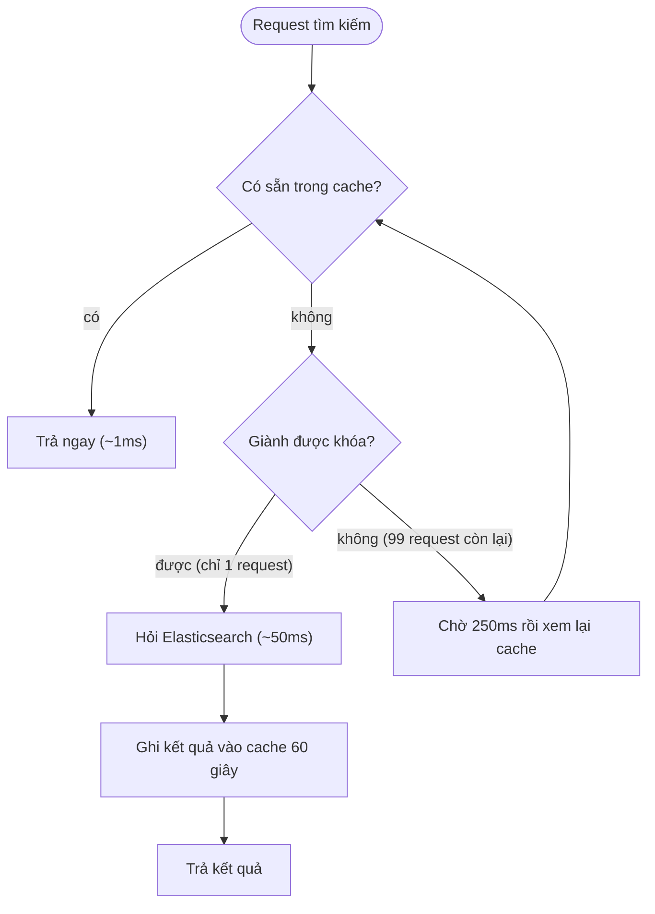
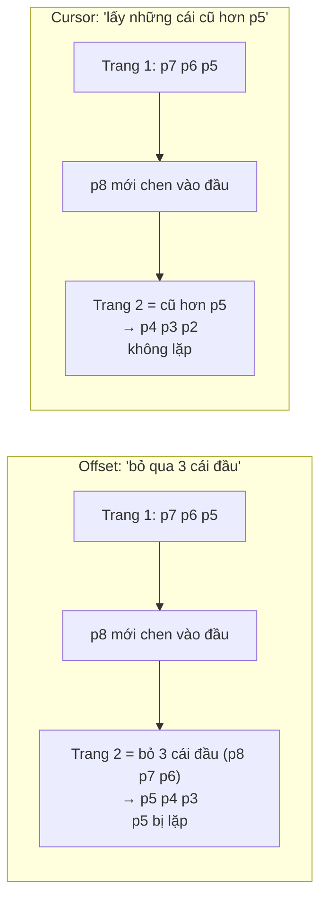
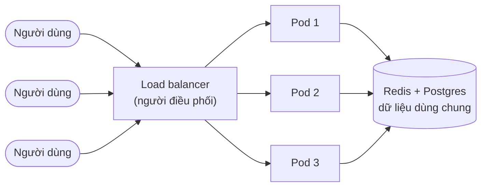

> [!tldr] Đọc nhanh
> - [[caching|Cache]] nhanh nhất là request không bao giờ tới server; cache khó nhất là biết khi nào bỏ nó đi. Khi cache trống, 100 request đồng thời có thể thành 100 truy vấn DB (*stampede*); một khóa ngắn hạn biến nó thành 1.
> - [[pagination|Phân trang]] bằng `OFFSET` chậm dần và lặp hoặc sót bản ghi khi dữ liệu thay đổi; phân trang bằng **cursor** (keyset) ổn định và nhanh đều.
> - [[filtering-sorting|Lọc và sắp xếp]]: query string luôn là *string*, `Boolean("false")` là `true`; sort phải theo whitelist và luôn có trường phụ để thứ tự xác định.
> - [[load-balancing|Load balancing]] chia request cho nhiều pod; chỉ làm được khi pod *stateless*, và thuật toán chia quan trọng khi request nặng nhẹ khác nhau.

> [!info] Bối cảnh
> Ví dụ lấy từ **flash-sale**, trang bán hàng giảm giá giờ vàng mình tự viết. Trang tìm kiếm sản phẩm đọc từ **Elasticsearch** (một cỗ máy tìm kiếm chuyên dụng), kết quả được nhớ tạm trong **Redis**. Backend chạy thành nhiều bản giống nhau trên **Kubernetes**. Bạn không cần biết các công cụ này. Mỗi đoạn có giải thích bằng lời thường trước khi vào code.

> [!abstract]- Từ điển nhanh cho bài này (bấm để mở)
> - **Redis**: cơ sở dữ liệu trong RAM, đọc ghi rất nhanh, hay dùng làm cache.
> - **Elasticsearch (ES)**: phần mềm chuyên tìm kiếm văn bản, như "tai nghe bluetooth giá dưới 500k".
> - **Postgres**: cơ sở dữ liệu chính, lưu bền trên đĩa.
> - **TTL**: thời gian sống của một mục cache, hết hạn thì tự xóa.
> - **CDN**: mạng máy chủ đặt gần người dùng, giữ sẵn bản sao ảnh và trang tĩnh.
> - **Pod / Kubernetes**: pod là một bản đang chạy của backend. Kubernetes là hệ thống bật, tắt và theo dõi các pod.
> - **Ingress**: cửa vào của cụm Kubernetes, nhận request từ Internet rồi chia cho các pod.
> - **Index (database)**: mục lục giúp database tìm nhanh, khỏi phải đọc từng dòng.
> - **DTO**: lớp mô tả dữ liệu mà một endpoint nhận vào, kèm luật kiểm tra.
> - **Query string**: phần sau dấu `?` trên URL, ví dụ `?page=2&sort=price_asc`.

## Hình dung trước: một siêu thị giờ cao điểm

| Đời thường | Khái niệm |
|---|---|
| Nhân viên quầy dán tờ giấy "giá vàng hôm nay" lên bàn, thay vì gọi điện hỏi ngân hàng mỗi khi có khách hỏi. Hết ngày thì gỡ ra viết lại | [[caching\|Caching]] (tờ giấy là cache, "hết ngày" là TTL) |
| Đọc sách theo kiểu "đọc tiếp từ trang 41", nhưng ai đó vừa chèn 5 trang mới vào đầu sách | [[pagination\|Phân trang offset]]: trang 41 bây giờ là nội dung khác, bạn đọc lặp hoặc bỏ sót |
| Kẹp **bookmark** vào đúng dòng đang đọc dở | [[pagination\|Phân trang cursor]]: chèn bao nhiêu trang vào đầu sách cũng không lạc chỗ |
| Bảo nhân viên kho "lấy giúp tai nghe, giá thấp tới cao", chọn từ danh sách có sẵn | [[filtering-sorting\|Lọc và sắp xếp]] |
| Nhiều quầy thu ngân. Người điều phối chỉ khách vào quầy đang vắng nhất | [[load-balancing\|Load balancing]] |

Ví dụ tờ giấy còn cho thấy một rủi ro: tờ giấy vừa bị gỡ xuống, 100 khách cùng hỏi giá. Nếu cả 100 người cùng gọi ngân hàng thì ngân hàng nghẽn. Cách khôn hơn là cử **một** người đi hỏi, 99 người kia đứng chờ nghe lại. Đó chính là "khóa chống stampede" ở bên dưới:



## Vấn đề: đọc nhiều hơn ghi hàng trăm lần

Trong một đợt flash sale, số lần *xem* sản phẩm và *tìm kiếm* lớn hơn số lần *đặt hàng* hàng trăm lần. Ba ga trước nói về chuyện làm đúng (đúng hợp đồng, đúng người, đúng một lần). Ga này nói về chuyện làm **nhanh** khi đông người, và hầu hết các kỹ thuật đều nhắm vào đường đọc.

<figure class="figure-map" style="--ar: 1 / 1">
<div class="frame"><iframe data-archify="../diagrams/api-performance/search-read-path.html" title="Sơ đồ tuần tự: đường đọc của API tìm kiếm qua load balancer, cache Redis và Elasticsearch" loading="lazy"></iframe></div>
<figcaption><span><b>Hình 1.</b> Request tìm kiếm đi qua ingress tới một pod bất kỳ; lần đầu cache trống nên phải giành khóa và hỏi Elasticsearch, lần sau đọc thẳng từ Redis.</span><a href="../diagrams/api-performance/search-read-path.html" target="_blank" rel="noopener">Mở toàn màn hình</a></figcaption>
</figure>

## Caching: nhớ lại câu trả lời

[[caching|Cache]] đổi *độ tươi* của dữ liệu lấy *tốc độ*. Có nhiều tầng, càng gần người dùng càng rẻ:

| Tầng | Ví dụ | Ai điều khiển |
|---|---|---|
| Trình duyệt | Ảnh sản phẩm, response `GET` có `Cache-Control` | Header HTTP do server gửi |
| CDN, reverse proxy | Ảnh, trang tĩnh, API công khai | Header HTTP, cấu hình CDN |
| Ứng dụng | Redis: kết quả tìm kiếm, quyền của role | Code của mình |
| Cơ sở dữ liệu | Buffer pool của Postgres | DB tự lo |

**Cache HTTP** (RFC 9111) chạy bằng header: `Cache-Control: max-age=60` cho phép dùng lại trong 60 giây; `ETag` + `If-None-Match` cho phép server trả `304 Not Modified` không kèm body khi dữ liệu chưa đổi. Flash-sale hiện không đặt các header này cho API: dữ liệu gắn với người dùng (giỏ hàng, đơn hàng) không nên cache ở tầng chung, còn dữ liệu công khai thì đang cache ở Redis. Đây là chỗ mình ghi lại để làm sau: trang danh sách sản phẩm công khai hoàn toàn có thể có `Cache-Control: public, max-age=30` và để CDN gánh bớt.

**Cache ở ứng dụng** thì flash-sale dùng nhiều, theo mẫu *cache-aside*: đọc cache trước, thiếu thì đọc nguồn rồi ghi vào cache.

```ts
// rút gọn từ search-cache.service.ts: getOrFetch(key, ttl = 60s, fetcher)
const cached = await redis.get(key)
if (cached) return JSON.parse(cached)                              // 1. trúng cache

const token = randomUUID()
const acquired = await redis.set(`lock:${key}`, token, 'EX', 5, 'NX') === 'OK'  // 2. giành khóa
if (!acquired) {
  for (let i = 0; i < 3; i++) {                                    // 3. không giành được: chờ người kia
    await sleep(250)
    const polled = await redis.get(key)
    if (polled) return JSON.parse(polled)
  }
}
try {
  const value = await fetcher()                                    // 4. hỏi Elasticsearch
  await redis.set(key, JSON.stringify(value), 'EX', ttl)
  return value
} finally {
  if (acquired) await redis.eval(RELEASE_IF_TOKEN_MATCHES, 1, `lock:${key}`, token)
}
```

Bước 2 và 3 chống **cache stampede** (cảnh "giẫm đạp" ở tờ giấy giá vàng): một từ khóa "hot" vừa hết hạn, hàng trăm request cùng thấy cache trống và cùng đập vào Elasticsearch. Có khóa thì chỉ một request đi hỏi, số còn lại chờ tối đa 750ms rồi đọc kết quả từ cache. Ví dụ ở cuối bài: 100 request đồng thời khi cache trống, không khóa là 100 truy vấn, có khóa là 1.

Hai chi tiết tinh tế:

- **Khóa có token**: chỉ ai giành được khóa mới được xóa khóa, và kiểm tra token bằng script Lua cho nguyên tử. Không có token thì request A chậm quá 5 giây, khóa hết hạn, B giành khóa, rồi A xong việc và xóa mất khóa của B.
- **Key cache được chuẩn hóa**: các tham số tìm kiếm được sắp xếp theo tên rồi hash SHA-256. `?q=tai+nghe&sort=sold` và `?sort=sold&q=tai+nghe` dùng chung một mục cache.

Còn một mẫu nữa là **invalidation chủ động**: quyền của mỗi role được cache trong Redis một giờ, nhưng khi admin sửa quyền thì `invalidateCache(role)` xóa ngay, kể cả cache của các role cha trong cây kế thừa. TTL là lưới an toàn; xóa chủ động mới là cơ chế chính.

## Pagination: chia nhỏ danh sách

Không API nào nên trả về "tất cả sản phẩm". [[pagination|Phân trang]] có hai trường phái:

Nhìn bằng hình trước khi đọc chữ. Danh sách mới nhất lên đầu, mỗi trang 3 sản phẩm, và trong lúc bạn xem trang 1 thì có sản phẩm `p8` mới được đăng:



**Offset**: `?page=3&limit=20` → `OFFSET 40 LIMIT 20`. Dễ làm, cho phép nhảy tới trang bất kỳ. Nhưng có hai vấn đề:

- **Chậm dần**: `OFFSET 100000` buộc DB đọc rồi bỏ 100.000 dòng.
- **Lặp hoặc sót khi dữ liệu thay đổi**: ví dụ cuối bài, đang xem trang 1 (p7, p6, p5) thì có sản phẩm mới; trang 2 với offset 3 trả về p5 lần nữa.

**Cursor (keyset)**: "cho tôi 20 bản ghi *sau bản ghi này*". Flash-sale dùng cách này cho danh sách sản phẩm:

```ts
// rút gọn từ product.repository.ts: sắp xếp (createdAt DESC, id DESC)
where: cursor ? {
  OR: [
    { createdAt: { lt: cursor.createdAt } },
    { createdAt: cursor.createdAt, id: { lt: cursor.id } },   // cùng createdAt thì so id
  ],
} : {},
orderBy: [{ createdAt: 'desc' }, { id: 'desc' }],
take: limit + 1,                                              // lấy dư 1 để biết còn trang sau không
```

- Cursor là `{ id, createdAt }` của bản ghi cuối, mã hóa base64url để client coi nó là chuỗi mờ, không tự chế ra.
- **Khóa phụ `id`** là bắt buộc: nhiều sản phẩm tạo cùng một mili-giây mà chỉ so `createdAt` thì sẽ sót.
- Lấy `limit + 1` bản ghi: có bản ghi thứ `limit + 1` nghĩa là `hasMore = true`, khỏi cần `COUNT(*)` tốn kém.
- `limit` mặc định 20, tối đa 100; cursor hỏng trả `400`.

Tìm kiếm trên Elasticsearch dùng cùng ý tưởng với `search_after`: cursor là mảng giá trị sort của hit cuối, và mọi kiểu sort đều kết thúc bằng `productId` làm khóa phụ.

Cái giá của cursor: không nhảy được tới "trang 37", và cursor gắn với *một* thứ tự sắp xếp cụ thể. Với danh sách cuộn vô hạn như sàn thương mại điện tử, đó là cái giá đáng trả.

## Filtering và Sorting: một lỗi thật, một lần mình đọc nhầm

[[filtering-sorting|Lọc và sắp xếp]] nghe đơn giản: thêm vài query param. Đọc lại code, mình tìm ra một lỗi thật thuộc loại "không báo lỗi gì, chỉ trả sai kết quả", và suýt công bố thêm một lỗi không có thật.

### Lỗi thật: `Boolean("false")` là `true`

Nói bằng lời: trên URL, mọi thứ đều là **chữ**. `?isFlashSale=false` gửi lên server là chuỗi năm ký tự `"false"`, không phải giá trị đúng/sai. Muốn có giá trị đúng/sai thì phải tự đổi. Cách đổi nhanh nhất trong JavaScript là `Boolean(x)`, và cách này trả `true` cho mọi chuỗi không rỗng, kể cả chính chuỗi `"false"`.

DTO tìm kiếm (lớp mô tả các tham số mà endpoint nhận) khai báo:

```ts
@IsOptional()
@Type(() => Boolean)     // class-transformer gọi Boolean(value)
@IsBoolean()
isFlashSale?: boolean;
```

Query string thì luôn là string. `?isFlashSale=false` → `Boolean("false")` → `true` (chuỗi không rỗng nào cũng là `true`). Kết quả: người dùng muốn *bỏ* sản phẩm flash sale lại nhận về *chỉ* sản phẩm flash sale, và `@IsBoolean()` vẫn vui vẻ cho qua vì giá trị đã là boolean. Giao diện web hiện chỉ gửi `isFlashSale=true` hoặc không gửi gì nên người dùng chưa gặp, nhưng bất kỳ client nào khác (app mobile, đối tác, chính mình khi test bằng Postman) gửi `false` đều nhận kết quả ngược. Cách sửa là chuyển đổi tường minh:

```ts
// common/decorators/to-boolean.decorator.ts (rút gọn)
export const ToBoolean = () =>
  Transform(({ value }) => {
    if (value === 'true' || value === '1' || value === true) return true
    if (value === 'false' || value === '0' || value === false) return false
    return value // giá trị lạ để @IsBoolean() từ chối với 400
  })
```

Mình đã sửa lỗi này trong flash-sale (áp cho cả bốn field boolean trong ba DTO), kèm test cho `true`, `1`, `false`, `0` và giá trị lạ.

### Đính chính: lỗi "tham số bị bỏ qua" không có thật

Bản đầu của bài này viết rằng API danh sách sản phẩm nhận `sort`, `shopId`, `isFlashSale`, `minPrice`, `maxPrice` nhưng bỏ qua tất cả trừ `categoryId`. Khi bắt tay vào sửa, mình mới thấy mình đã đọc nhầm hàm: `ProductService.findAllCursor` đúng là chỉ dùng `categoryId`, nhưng đó là code cũ, chỉ còn test gọi tới. Controller thật đọc từ `ProductViewRepository`, một bảng read model đã denormalize sẵn `minPrice`, `isFlashSale`, `avgRating`, và áp dụng đủ mọi bộ lọc lẫn bốn kiểu sort, mỗi kiểu có index riêng.

Bài học vẫn đáng giữ, chỉ là theo hướng khác: **code chết mà vẫn có test là cái bẫy cho người đọc**, kể cả chính tác giả vài tháng sau. Muốn biết một endpoint làm gì, hãy đi từ controller xuống, đừng tìm theo tên hàm.

### Những gì nên làm, theo tài liệu và phần làm đúng trong flash-sale

- **Whitelist trường sort**: search dùng enum `relevance | sold | price_asc | price_desc | newest | rating`, mỗi giá trị ánh xạ sang một mảng sort cố định. Không bao giờ ghép thẳng tên cột từ query vào câu truy vấn.
- **Luôn có khóa phụ** để thứ tự xác định: `[{ minPrice: 'asc' }, { productId: 'asc' }]`.
- **Giới hạn đầu vào**: `q` tối đa 100 ký tự và khớp một regex chỉ cho chữ, số và vài dấu câu; `minPrice ≥ 0`.
- **Denormalize thứ cần lọc**: listing đọc từ bảng `product_view` có sẵn `min_price`, `is_flash_sale`, `avg_rating` cùng index cho từng kiểu sort; search lọc danh mục theo mảng `categoryPath` lưu sẵn trong document thay vì JOIN cây danh mục lúc truy vấn.
- **Index theo đúng bộ lọc hay dùng**: lọc trên cột không có index thì mọi thứ khác đều vô nghĩa.

## Load Balancing: nhiều pod, một địa chỉ

Một pod Node.js xử lý được có hạn. Giống siêu thị đông khách thì mở thêm quầy thu ngân, và cần một người đứng đầu hàng chỉ khách vào quầy nào:



Mấu chốt nằm ở hộp dưới cùng: các quầy không giữ sổ sách riêng mà cùng ghi vào một cuốn sổ chung. Nhờ vậy khách quay lại quầy nào cũng được phục vụ như nhau. [[load-balancing|Load balancing]] cho phép chạy nhiều bản sao và chia request cho chúng. Trong flash-sale trên Kubernetes có hai tầng:

- **Ingress NGINX** (tầng 7, hiểu HTTP): kết thúc TLS, chia request theo round robin (mặc định của ingress-nginx), giới hạn tốc độ ở rìa.
- **Service ClusterIP** (tầng 4, chỉ thấy kết nối TCP): kube-proxy chọn một pod khỏe trong danh sách endpoint.

Và mấy thứ khiến load balancing hoạt động trơn tru:

- **Pod stateless**: phiên đăng nhập, hàng chờ, cache, rate limit đều ở Redis, nên request nào rơi vào pod nào cũng được. WebSocket thì dùng Redis adapter để pod A phát tin tới client đang nối với pod B (ga 2).
- **Readiness probe** `GET /health/ready` mỗi 5 giây: pod chưa sẵn sàng hoặc đang tắt thì bị rút khỏi danh sách nhận request.
- **`preStop: sleep 15`**: trước khi pod nhận tín hiệu tắt, chờ 15 giây để mọi load balancer kịp cập nhật danh sách, tránh gửi request vào pod đã đóng.
- **HPA** từ 3 tới 20 pod, thêm pod khi CPU trung bình vượt 70%; giảm pod chậm (chờ 5 phút ổn định) để không dao động lên xuống.

### Thuật toán chia có quan trọng không?

Khi mọi request tốn thời gian như nhau, round robin là đủ. Khi không như vậy, nó có thể rất tệ. Ví dụ cuối bài mô phỏng 30 request, cứ request thứ ba là một request nặng 300ms (xuất báo cáo), còn lại 20ms, chia cho 3 pod:

- **Round robin**: request nặng luôn rơi vào cùng một pod (vì chu kỳ 3 trùng số pod). Pod đó gánh tới 10 request đồng thời, hai pod kia chỉ 1.
- **Least connections**: gửi tới pod đang có ít request nhất. Cả ba pod cùng gánh tối đa 4.

Các thuật toán khác: *weighted* (pod mạnh nhận nhiều hơn), *IP hash / consistent hashing* (cùng người dùng luôn vào cùng pod, hữu ích cho cache cục bộ hoặc sticky session), *EWMA* (theo độ trễ gần đây, ingress-nginx có hỗ trợ).

## Ví dụ chạy được

File `perf.ts` gồm bốn thí nghiệm: offset vs cursor, cache stampede có và không có khóa, ép kiểu query string, round robin vs least connections.

```ts
// Keyset giống flash-sale: WHERE (createdAt < c.createdAt) OR (createdAt = c.createdAt AND id < c.id)
const cursorPage = (c: P | null, limit: number) =>
  newestFirst().filter((p) => !c || p.createdAt < c.createdAt || (p.createdAt === c.createdAt && p.id < c.id)).slice(0, limit)
```

```text
$ node perf.ts
===== 1. Offset vs cursor khi có sản phẩm mới chen vào =====
offset: trang 1 p7,p6,p5 | trang 2 p5,p4,p3 ← p5 lặp lại
cursor: trang 1 p7,p6,p5 | trang 2 p4,p3,p2 ← không lặp

===== 2. Cache-aside và cache stampede =====
100 request đồng thời khi cache trống, không lock → 100 query xuống DB
100 request đồng thời khi cache trống, có lock   → 1 query xuống DB

===== 3. Filtering: query string luôn là string =====
?isFlashSale=false → Boolean("false") = true, so sánh === "true" = false
?minPrice=100000 → typeof = string, Number() = 100000
sort=price_asc có trong whitelist? true | sort=password? false

===== 4. Load balancing: round robin vs least connections =====
round robin       → số request đồng thời cao nhất mỗi pod: 10 / 1 / 1
least connections → số request đồng thời cao nhất mỗi pod: 4 / 4 / 4
```

Toàn bộ file: <a href="../code/api-performance/perf.ts">code/api-performance/perf.ts</a>.

## Hiểu lầm và bẫy hay gặp

### Cache mọi thứ, quên invalidation

"There are only two hard things in Computer Science: cache invalidation and naming things." Trước khi cache, hãy trả lời: dữ liệu cũ bao lâu thì chấp nhận được, và ai xóa cache khi dữ liệu đổi. Với giá và tồn kho trong flash sale, câu trả lời thường là "không cache", hoặc cache vài giây.

### Cache kết quả của đường lùi

Khi Elasticsearch hỏng và search lùi về Postgres, kết quả kém hơn. Flash-sale đánh dấu những kết quả này `__noCache` để không ghi vào cache, nếu không thì kết quả kém sẽ ở lại 60 giây sau khi ES đã hồi phục.

### Cursor không có khóa phụ

Sắp theo `createdAt` mà không có `id` đi kèm: các bản ghi trùng thời điểm sẽ bị sót hoặc lặp ở ranh giới trang.

### Nhận tham số mà không dùng

Validate xong mà bỏ qua còn tệ hơn không nhận: client tin rằng mình đang lọc. Flash-sale không mắc lỗi này (xem phần đính chính ở trên), nhưng một hàm cũ trong repo thì có, và nó suýt khiến mình kết luận sai.

### Sticky session để "chữa" trạng thái trong bộ nhớ

Gắn người dùng vào một pod cố định thì mất cân bằng tải, và pod đó chết là mất phiên. Đưa trạng thái ra Redis hoặc DB rồi để load balancer chia tự do.

## Câu hỏi tự kiểm tra

> [!question]- Vì sao khóa chống stampede của flash-sale cần một token ngẫu nhiên?
> Để chỉ người giành được khóa mới xóa được nó. Không có token, request chậm quá TTL của khóa có thể xóa nhầm khóa mà request khác vừa giành.

> [!question]- Đang xem trang 1 thì có 5 sản phẩm mới được đăng. Offset và cursor khác nhau thế nào ở trang 2?
> Offset bị đẩy lùi 5 vị trí nên lặp lại 5 sản phẩm cuối của trang 1. Cursor lấy "sau bản ghi cuối đã thấy" nên không lặp; sản phẩm mới chỉ xuất hiện khi tải lại từ đầu.

> [!question]- `?isFlashSale=0` thì `@Type(() => Boolean)` cho ra gì?
> `true`, vì `"0"` là chuỗi không rỗng. Chỉ chuỗi rỗng mới thành `false`.

> [!question]- Vì sao readiness probe quan trọng với load balancing?
> Load balancer chỉ gửi request tới pod đang "ready". Pod đang khởi động, đang mất kết nối DB, hoặc đang tắt sẽ bị rút khỏi danh sách nên không nhận request rồi trả lỗi.

## Tham khảo

- [RFC 9111: HTTP Caching](https://www.rfc-editor.org/rfc/rfc9111) và [MDN: HTTP caching](https://developer.mozilla.org/en-US/docs/Web/HTTP/Guides/Caching)
- [Redis: Distributed locks](https://redis.io/docs/latest/develop/clients/patterns/distributed-locks/)
- [Slack Engineering: Evolving API Pagination at Slack](https://slack.engineering/evolving-api-pagination-at-slack/)
- [Use The Index, Luke: Paging Through Results](https://use-the-index-luke.com/sql/partial-results/fetch-next-page)
- [Elasticsearch: Paginate search results (search_after)](https://www.elastic.co/docs/reference/elasticsearch/rest-apis/paginate-search-results)
- [class-transformer #306: chuyển chuỗi sang boolean](https://github.com/typestack/class-transformer/issues/306)
- [Kubernetes: Service](https://kubernetes.io/docs/concepts/services-networking/service/) và [ingress-nginx: load-balance](https://kubernetes.github.io/ingress-nginx/user-guide/nginx-configuration/configmap/#load-balance)
