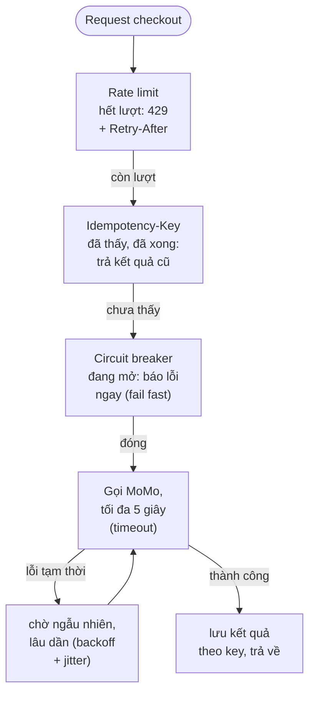
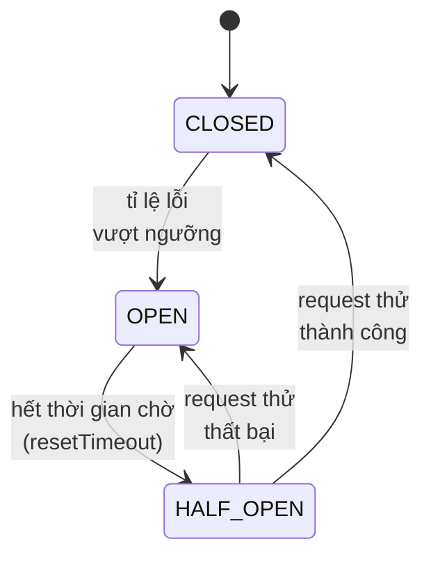

> [!tldr] Đọc nhanh
> - [[concepts/idempotency|Idempotency]]: gửi lại một request không được gây tác dụng phụ lần hai. `POST` cần `Idempotency-Key`; server ghi key **trước** khi làm việc, lưu response, trả lại khi gặp lại key.
> - [[concepts/timeouts|Timeout]]: mọi lời gọi ra ngoài phải có hạn chót, nếu không một dependency chậm sẽ kéo cả hệ thống chậm theo.
> - [[concepts/retries-with-backoff|Retry với backoff]]: chỉ retry lỗi tạm thời, chờ lâu dần theo cấp số nhân và **thêm jitter** để các client không retry cùng lúc.
> - [[concepts/circuit-breaker|Circuit breaker]]: dependency lỗi liên tục thì ngừng gọi một lúc, trả lỗi ngay (fail fast), rồi thử lại bằng một request duy nhất.
> - [[concepts/rate-limiting|Rate limiting]] từ chối phần vượt mức (`429`); [[concepts/throttling|throttling]] làm chậm hoặc xếp hàng phần vượt mức. Flash-sale dùng cả hai.

> [!info] Bối cảnh
> Ví dụ lấy từ **flash-sale**, trang bán hàng giảm giá giờ vàng mình tự viết: đúng 21:00 mở bán, hàng nghìn người tranh vài trăm suất, rồi trả tiền qua MoMo hoặc VNPay. Đây đúng là kiểu hệ thống mà "thỉnh thoảng hỏng" sẽ thành "chắc chắn hỏng". Bạn không cần đọc code dự án. Đoạn code trích chỉ để minh họa, còn mỗi cơ chế đều có giải thích bằng lời thường trước.

> [!abstract]- Từ điển nhanh cho bài này (bấm để mở)
> - **Dependency**: thứ bên ngoài mà hệ thống của mình phải gọi tới, như cổng thanh toán, database hay hàng đợi tin nhắn.
> - **Redis**: cơ sở dữ liệu trong RAM, rất nhanh. Ở đây dùng làm bộ nhớ chung cho mọi bản backend.
> - **`SET … NX`**: lệnh Redis "chỉ ghi nếu chưa có". Hai người cùng ghi thì đảm bảo chỉ một người thắng.
> - **TTL**: thời gian sống của một mục dữ liệu, hết hạn thì tự xóa.
> - **Interceptor / decorator**: trong NestJS, interceptor là đoạn code bọc quanh endpoint (chạy trước và sau). Decorator `@Something()` là nhãn dán lên hàm để bật nó.
> - **Pod**: một bản đang chạy của backend. Có nhiều pod giống nhau chạy cùng lúc.
> - **Lua script**: đoạn code nhỏ chạy *bên trong* Redis, chạy trọn vẹn một lần, không bị chen ngang.
> - **opossum**: thư viện circuit breaker cho Node.js.
> - **BullMQ**: thư viện chạy việc nền định kỳ, dùng Redis.
> - **Sorted set**: danh sách trong Redis tự sắp xếp theo điểm số, ở đây là thời điểm xếp hàng.

## Hình dung trước: đặt bánh qua điện thoại

Sáu khái niệm của ga này giống những phép lịch sự khi gọi điện đặt bánh sinh nhật:

| Đời thường | Khái niệm | Nếu thiếu thì sao |
|---|---|---|
| Đọc **mã đơn** "đơn số 123" mỗi lần gọi lại. Tiệm tra mã thấy đã làm rồi thì không làm thêm cái thứ hai | [[concepts/idempotency\|Idempotency]] | Rớt cuộc gọi, gọi lại, nhận hai cái bánh và trả tiền hai lần |
| Chờ máy tối đa 1 phút, không ai nghe thì cúp | [[concepts/timeouts\|Timeout]] | Cầm máy chờ cả buổi, không làm được việc khác |
| Máy bận thì gọi lại sau 1 phút, rồi 2, rồi 4 phút. Mỗi người lệch nhau vài giây | [[concepts/retries-with-backoff\|Retry + backoff + jitter]] | Cả trăm người cùng gọi lại đúng một giây, tổng đài nghẽn thêm |
| Cầu dao nhảy khi chập điện. Đợi một lúc rồi bật thử một lần | [[concepts/circuit-breaker\|Circuit breaker]] | Cứ bật lại liên tục, cháy luôn cả nhà |
| Bảo vệ chỉ cho 10 người mỗi phút vào cửa hàng, quá thì mời về | [[concepts/rate-limiting\|Rate limiting]] | Một người (hoặc một bot) chiếm hết quầy |
| Ngân hàng phát **số thứ tự**, ai cũng được phục vụ, chỉ phải chờ | [[concepts/throttling\|Throttling]] | Cả nghìn người chen vào quầy một lúc |

Ghép lại, một lời gọi từ backend ra cổng thanh toán đi qua các lớp bảo vệ theo thứ tự này:



## Vấn đề: mọi thứ đều có thể hỏng giữa chừng

Ở ga 1 mình thấy `POST /checkout` bắt buộc `Idempotency-Key`; ở ga 2, webhook của MoMo có thể tới hai lần. Ga này gom tất cả những tình huống "không có gì sai trong code, nhưng hệ thống vẫn hỏng":

- Request thanh toán bị timeout. Client không biết server **chưa làm** hay **đã trừ tiền nhưng phản hồi rơi giữa đường**.
- Cổng thanh toán chậm 30 giây. Mỗi request checkout giữ một kết nối DB và một slot xử lý trong suốt 30 giây đó.
- Cổng thanh toán sập hẳn. Mỗi request vẫn cố gọi, chờ timeout, retry, chờ timeout tiếp.
- 9 giờ tối, flash sale mở, 10.000 người cùng bấm "Mua ngay".

Mình từng nghĩ những chuyện này thuộc về "hạ tầng". Đọc kỹ code flash-sale mới thấy phần lớn nằm trong chính ứng dụng: một interceptor, vài service nhỏ, một script Lua.

## Idempotency: một chìa khóa cho mỗi ý định

Câu hỏi khó nhất của mọi request thanh toán: **request bị timeout thì tiền đã trừ chưa?** Client không thể biết. Có thể server chưa nhận được, cũng có thể server đã trừ tiền xong nhưng câu trả lời rơi dọc đường. Gửi lại thì có nguy cơ trừ hai lần, không gửi thì có nguy cơ mất đơn. Idempotency key giải quyết đúng chỗ này: gửi lại thoải mái, vì server nhận ra "lần này là lần trước".

Client sinh một chuỗi ngẫu nhiên cho *mỗi ý định thanh toán* và gửi kèm header `Idempotency-Key`. Mọi lần retry của cùng ý định đó dùng lại đúng chuỗi này. Sơ đồ dưới đây đi qua tình huống mất phản hồi rồi retry; bạn có thể kéo, phóng to, bấm vào từng mũi tên để xem chi tiết.

<figure class="figure-map" style="--ar: 1 / 1">
<div class="frame"><iframe data-archify="../diagrams/api-reliability/retry.html" title="Sơ đồ tuần tự: retry an toàn với Idempotency-Key" loading="lazy"></iframe></div>
<figcaption><span><b>Hình 1.</b> Lần gọi đầu đã trừ tiền nhưng phản hồi bị mất; lần retry chỉ đọc lại kết quả.</span><a href="../diagrams/api-reliability/retry.html" target="_blank" rel="noopener">Mở toàn màn hình</a></figcaption>
</figure>

Flash-sale cài cơ chế này thành một interceptor (đoạn code bọc quanh endpoint, chạy trước và sau nó) tên `IdempotencyInterceptor`. Muốn bật cho endpoint nào thì dán nhãn `@UseIdempotency()` lên endpoint đó. Logic bằng lời thường: *giành mã → nếu mã đã xong thì trả lại kết quả cũ → nếu chưa thì làm → làm xong thì lưu kết quả → lỗi thì nhả mã ra*. Code rút gọn:

```ts
// rút gọn từ idempotency.interceptor.ts
const key = request.headers['idempotency-key']
const endpoint = `${request.method} ${request.route.path}`   // "POST /orders/:id/cancel", không phải URL cụ thể
const requestHash = hashRequestBody(request.body)           // body đã chuẩn hóa thứ tự key rồi mới hash

const result = await idempotency.claim(key, user.id, endpoint, requestHash)  // giành quyền nguyên tử
if (!result.firstTime && result.cached) {
  response.status(result.cached.statusCode)
  return of(result.cached.responseBody)                     // trả lại y nguyên lần đầu
}
try {
  const body = await firstValueFrom(next.handle())
  await idempotency.complete(key, user.id, endpoint, response.statusCode, body)
  return of(body)
} catch (err) {
  await idempotency.release(key, user.id, endpoint)          // lỗi thì nhả key cho lần thử sau
  throw err
}
```

- **Phạm vi của key là `(key, userId, endpoint)`**: hai người dùng vô tình sinh trùng key cũng không đụng nhau.
- **Hash body đã chuẩn hóa**: `{"a":1,"b":2}` và `{"b":2,"a":1}` là cùng một request; cùng key mà body khác thì từ chối.
- **Lỗi thì nhả key**: nếu controller ném lỗi (ví dụ hết hàng), key được giải phóng, client được phép thử lại thật sự. Chỉ kết quả *thành công* mới được lưu để phát lại.

Bản rút gọn chạy được (dùng `Map` thay cho Redis):

```ts
async function createPayment(key: string, body: { amount: number }) {
  const raw = JSON.stringify(body)
  const saved = store.get(key)

  if (saved?.status === "processing") return { code: 409, data: "đang xử lý, thử lại sau" }
  if (saved?.status === "done") {
    if (saved.body !== raw) return { code: 422, data: "key đã dùng cho request khác" }
    return { code: 201, data: saved.response } // trả lại kết quả cũ
  }

  store.set(key, { status: "processing" }) // Redis: SET key processing NX EX 86400
  const response = await chargeCard(body.amount)
  store.set(key, { status: "done", body: raw, response })
  return { code: 201, data: response }
}
```

```text
$ node idempotency.ts
{ code: 201, data: { id: 'ch_1', amount: 100000 } } { code: 201, data: { id: 'ch_1', amount: 100000 } } { code: 422, data: 'key đã dùng cho request khác' } số lần trừ tiền: 1
```

Toàn bộ file: <a href="../code/api-reliability/idempotency.ts">code/api-reliability/idempotency.ts</a>.

## Timeouts: không chờ vô hạn

Một lời gọi không có [[concepts/timeouts|timeout]] là một lời hứa chờ mãi mãi. Hình dung một quán có 10 nhân viên. Mỗi người gọi điện cho nhà cung cấp rồi cầm máy chờ, mà nhà cung cấp không nghe máy. Mười người cầm mười cái điện thoại, và khách mới vào quán không còn ai phục vụ. Khi dependency chậm, mỗi request đang chờ giữ một kết nối, một ít bộ nhớ, có khi cả một transaction. Hết tài nguyên thì cả những endpoint *không liên quan* cũng chết theo. Đây là kiểu sự cố dây chuyền mà Amazon gọi là "brownout lan rộng".

Flash-sale đặt timeout cho từng dependency, mỗi cái một con số khác nhau:

```ts
// rút gọn từ resilience.config.ts
'momo-charge':      { timeout: 5000 },  // cổng thanh toán: chấp nhận chậm hơn
'vnpay-charge':     { timeout: 5000 },
'rabbitmq-publish': { timeout: 2000 },
'es-bulk-index':    { timeout: 3000 },
'es-search':        { timeout: 1500 },  // tìm kiếm: chậm thì thà trả lỗi, có đường lùi xuống Postgres
```

Và timeout xuất hiện ở mọi tầng, không chỉ trong code:

- Ingress NGINX: `proxy-read-timeout: 30` giây cho cả request.
- Kubernetes: readiness probe `timeoutSeconds: 3`.
- Graceful shutdown: chờ request đang chạy tối đa 20 giây rồi mới đóng kết nối DB.

Cách chọn con số mà Amazon Builders' Library gợi ý: đo độ trễ của dependency, đặt timeout quanh percentile cao (ví dụ p99.9) để chỉ cắt những request thật sự bất thường. Một nguyên tắc nữa: **timeout của tầng ngoài phải dài hơn tổng thời gian tầng trong có thể mất**, kể cả retry. Nếu ingress cắt ở 30 giây mà bên trong retry 3 lần × 5 giây cộng thời gian chờ backoff thì vẫn ổn; nếu bên trong retry 10 lần thì ingress sẽ trả lỗi trong khi bên trong vẫn đang hì hục làm.

## Retries with Backoff: thử lại, nhưng có kỷ luật

Lỗi mạng chập chờn, `503` khi pod đang khởi động, timeout lẻ tẻ: thử lại thường là thành công. Nhưng [[concepts/retries-with-backoff|retry]] sai cách thì biến một sự cố nhỏ thành sự cố lớn: dependency đang quá tải, mọi client đồng loạt gửi gấp ba lượng request.

`RetryService` của flash-sale làm đủ ba việc:

```ts
// rút gọn từ retry.service.ts (mặc định: 3 lần, base 200ms, tối đa 5s, full jitter)
for (let attempt = 1; attempt <= maxAttempts; attempt++) {
  try { return await action() }
  catch (err) {
    if (attempt === maxAttempts || !isRetryable(err)) throw err
    const exp = Math.min(maxDelayMs, baseDelayMs * 2 ** (attempt - 1))
    await sleep(Math.random() * exp)          // full jitter: chờ ngẫu nhiên trong [0, exp)
  }
}
```

1. **Chỉ retry lỗi tạm thời.** `isRetryable` trả `true` cho lỗi mạng (`ECONNRESET`, `ETIMEDOUT`…), `5xx`, timeout; trả `false` cho mọi `4xx` và khi circuit breaker đang mở. Retry `400` thì lần sau vẫn `400`.
2. **Exponential backoff**: 200ms, 400ms, 800ms… cho dependency thời gian hồi phục.
3. **Jitter**: nếu 1.000 client cùng lỗi lúc 9:00:00 và cùng chờ đúng 200ms, chúng lại đổ vào cùng lúc 9:00:00.200. Ví dụ ở cuối bài in ra: không jitter, ba client cùng retry ở 200/400/800/1600ms; có jitter, chúng tản ra thành 120/179/682…, 35/211/219…, 173/189/200…

Và điều kiện tiên quyết: **chỉ retry thao tác idempotent**, hoặc thao tác có idempotency key. Đây là lý do idempotency đứng đầu ga này.

## Circuit Breaker: ngừng gọi thứ đang hỏng

Retry giúp vượt qua lỗi *thoáng qua*. Khi dependency *sập hẳn*, retry chỉ làm mọi request chậm thêm (chờ timeout × số lần retry) rồi vẫn lỗi. [[concepts/circuit-breaker|Circuit breaker]] (Michael Nygard mô tả trong *Release It!*, Martin Fowler phổ biến) là cầu dao điện cho lời gọi từ xa:



- **CLOSED**: gọi bình thường, đếm lỗi.
- **OPEN**: không gọi nữa, trả lỗi ngay. Dependency có thời gian thở, request của mình không phải chờ timeout.
- **HALF_OPEN**: hết thời gian chờ, cho *một* request đi thử. Thành công thì đóng lại, thất bại thì mở tiếp.

Ví dụ trong flash-sale: MoMo sập. Không có breaker, mỗi request thanh toán chờ đủ 5 giây timeout, retry 3 lần, rồi mới báo lỗi. Người dùng chờ gần 20 giây chỉ để nghe "lỗi". Có breaker, sau vài lỗi đầu tiên mọi request sau được báo lỗi ngay lập tức, kiểu "MoMo đang bảo trì, bạn chọn VNPay nhé".

Flash-sale dùng thư viện `opossum`, cấu hình mặc định: mở khi **≥ 50% lỗi** trong cửa sổ 10 giây, nhưng chỉ khi có **ít nhất 5 request** (để 1 lỗi trên 1 request không làm mở cầu dao), chờ **30 giây** rồi thử lại. RabbitMQ nhạy hơn: ngưỡng 30%, chờ 15 giây.

Chi tiết mình thấy tinh tế nhất là thứ tự lồng nhau:

```ts
// resilient-call.service.ts
execute(name, action, opts) {
  return this.cb.fire(name, () => this.retry.execute(action, opts.retry), opts.cb)  // CB(Retry(action))
}
```

Retry nằm **bên trong** circuit breaker: breaker chỉ thấy kết quả cuối cùng sau khi đã retry, nên một lỗi thoáng qua được retry thành công không bị đếm là lỗi. Và khi breaker đang mở thì không có retry nào chạy cả. Nếu đảo ngược (`Retry(CB(action))`), mỗi lần retry lại đụng vào breaker đang mở, sinh ra một chuỗi lỗi vô nghĩa.

## Rate Limiting: từ chối phần vượt mức

[[concepts/rate-limiting|Rate limiting]] bảo vệ hệ thống khỏi bị dùng quá mức, dù là do bot, do bug ở client hay do một người bấm liên tục. Phần vượt mức bị từ chối ngay với `429 Too Many Requests`. Flash-sale có **bốn** lớp giới hạn, và mỗi lớp dùng một thuật toán khác:

| Lớp | Thuật toán | Ví dụ |
|---|---|---|
| Ingress NGINX | Leaky bucket theo IP | `limit-rps: 100` |
| `RateLimitGuard` (toàn cục) | Sliding window log trên Redis sorted set | Mặc định 100 request / 60s theo user hoặc IP; `queue/join` chỉ 5 request / 10s |
| `TokenBucketGuard` (theo route) | Token bucket, script Lua chạy nguyên tử trong Redis | Checkout: 10 token, hồi 1 token mỗi ~6s |
| Đăng nhập | Bộ đếm cố định theo email và IP | 5 lần sai / 15 phút |

Token bucket là thuật toán mình thích nhất vì cho phép **burst** (dồn dập một lúc) hợp lý. Hình dung một chiếc **xô đựng xu**: xô chứa tối đa 10 xu, cứ 6 giây được thả thêm 1 xu, mỗi request phải bỏ 1 xu. Bấm liên tục 10 lần thì vẫn qua vì xô đang đầy. Lần thứ 11 thì xô hết, phải chờ xu mới. Dưới đây là phần lõi của script Lua chạy trong Redis:

```lua
-- rút gọn từ token-bucket.lua
local tokens  = tonumber(data[1]) or capacity
local elapsed = math.max(0, (now - updated) / 1000)
tokens = math.min(capacity, tokens + elapsed * rate)   -- hồi token theo thời gian đã trôi qua
if tokens >= cost then tokens = tokens - cost; allowed = 1 end
```

Người dùng thật thao tác dồn dập vài lần rồi nghỉ: token bucket cho qua hết. Bot gửi đều đặn liên tục: hết token là bị chặn. Script chạy trong Redis nên nhiều pod cùng dùng chung một xô và không có race condition.

Hai chi tiết vận hành đáng học:

- **Báo cho client biết**: guard gửi `X-RateLimit-Limit`, `X-RateLimit-Remaining`, `X-RateLimit-Reset`, và `Retry-After` khi bị chặn. Client tử tế sẽ chờ đúng chừng đó thay vì retry mù.
- **Fail open**: Redis chết thì `THROTTLER_FAIL_OPEN=true` cho request đi qua thay vì chặn tất cả. Đây là lựa chọn có chủ đích: mất rate limit vài phút còn hơn mất cả trang web. Endpoint nhạy cảm như đăng nhập có thể chọn ngược lại.

## Throttling: xếp hàng thay vì đuổi về

Hai từ này hay bị dùng lẫn. Cách mình phân biệt: [[concepts/rate-limiting|rate limiting]] **từ chối** phần vượt mức, [[concepts/throttling|throttling]] **làm chậm** phần vượt mức: xếp hàng, giãn ra, giảm chất lượng. Kết quả cuối cùng: rate limit trả `429`, throttling trả kết quả nhưng muộn hơn.

Ví dụ rõ nhất trong flash-sale là **hàng chờ ảo**. Lúc mở bán, không thể cho 10.000 người cùng vào checkout (kho, DB, cổng thanh toán đều không chịu nổi), nhưng cũng không thể trả `429` cho 9.950 người. Thay vào đó:

1. `POST /queue/join`: người mua được thêm vào Redis sorted set theo thời điểm join.
2. Cứ mỗi `queueIntervalMs` (ví dụ 5 giây), một job BullMQ `ZPOPMIN` lấy `queueBatchSize` (ví dụ 50) người đầu hàng, cấp cho họ checkout token có hạn.
3. Server đẩy `checkout_ready` qua WebSocket (ga 2) cho đúng những người đó.
4. Thời gian chờ ước tính: `ceil(vị trí / 50) × 5 giây`, người thứ 120 chờ khoảng 15 giây.

Tải vào checkout luôn bị chặn trên ở 50 người mỗi 5 giây, bất kể bao nhiêu người đang chờ. Không ai bị từ chối, chỉ phải chờ.

## Ví dụ chạy được

File `resilience.ts` gồm năm thí nghiệm: timeout, retry có và không có jitter, circuit breaker với đồng hồ giả, token bucket theo đúng logic file Lua, và hàng chờ. Số ngẫu nhiên dùng PRNG có seed để lần chạy nào cũng ra cùng kết quả.

```ts
fire(dependencyUp: boolean): string {
  if (this.state === "OPEN") {
    if (clock - this.openedAt < this.resetMs) return "fail fast (không gọi)"
    this.state = "HALF_OPEN"
  }
  this.calls++
  const trial = this.state === "HALF_OPEN" ? " (thử 1 request)" : ""
  if (dependencyUp) { this.state = "CLOSED"; this.failures = 0; return "ok" + trial }
  this.failures++
  if (this.state === "HALF_OPEN" || this.failures >= this.threshold) { this.state = "OPEN"; this.openedAt = clock }
  return "lỗi" + trial
}
```

```text
$ node resilience.ts
===== 1. Timeout: không chờ vô hạn =====
gọi cổng thanh toán: timeout sau 100ms
→ trả lỗi sau ~100ms thay vì giữ thread/connection 300ms

===== 2. Retry: exponential backoff, có và không có jitter =====
client A: không jitter 200/400/800/1600ms | full jitter 120/179/682/1072ms
client B: không jitter 200/400/800/1600ms | full jitter 35/211/219/1000ms
client C: không jitter 200/400/800/1600ms | full jitter 173/189/200/1411ms
retry 503? true | retry 400? false | retry 409? false

===== 3. Circuit breaker =====
t= 0s dependency chết → lỗi                      state=CLOSED
t= 1s dependency chết → lỗi                      state=CLOSED
t= 2s dependency chết → lỗi                      state=OPEN
t= 3s dependency chết → fail fast (không gọi)    state=OPEN
t=10s dependency chết → fail fast (không gọi)    state=OPEN
t=33s dependency chết → lỗi (thử 1 request)      state=OPEN
t=64s dependency sống → ok (thử 1 request)       state=CLOSED
t=65s dependency sống → ok                       state=CLOSED
8 request, chỉ 6 lần gọi thật xuống dependency

===== 4. Rate limiting: token bucket (như token-bucket.lua) =====
12 request cùng lúc: 10 qua, 2 bị 429, Retry-After: 7s
sau 7 giây: qua (đã hồi 1 token)

===== 5. Throttling: hàng chờ flash sale, mỗi 5s cho 50 người vào =====
người thứ 1 chờ ~5s, người thứ 51 ~10s, người thứ 120 ~15s
tick 1 (t=5s): cho 50 người vào checkout, còn 70 người chờ
tick 2 (t=10s): cho 50 người vào checkout, còn 20 người chờ
tick 3 (t=15s): cho 20 người vào checkout, còn 0 người chờ
không ai bị từ chối; tải vào checkout luôn ≤ 50 người / 5s
```

Breaker trong ví dụ mở sau 3 lỗi liên tiếp cho dễ theo dõi; opossum thật tính theo *tỉ lệ* lỗi trong cửa sổ thời gian. Toàn bộ file: <a href="../code/api-reliability/resilience.ts">code/api-reliability/resilience.ts</a>.

## Hiểu lầm và bẫy hay gặp

### Ghi idempotency key sau khi trừ tiền

Nếu hai request cùng key tới gần như cùng lúc, cả hai đều thấy "chưa có key" và cùng trừ tiền. Phải giành key bằng thao tác nguyên tử (`SET … NX`, hoặc `INSERT` với ràng buộc unique) **trước** khi làm việc có tác dụng phụ.

### Cùng key, khác nội dung

Client lỗi có thể dùng lại key cũ cho một khoản tiền khác. Server so dấu vân tay của body và trả `422` thay vì lặng lẽ trả kết quả cũ.

### TTL của key quá ngắn

Key hết hạn trước khi client retry thì request lặp lại được coi là mới. TTL cần dài hơn khoảng thời gian retry tối đa của client, thường là 24 giờ.

### Retry ở mọi tầng

Client retry 3 lần, gateway retry 3 lần, service retry 3 lần: một lỗi ở đáy thành 27 request. Chỉ retry ở *một* tầng, thường là tầng gần dependency nhất, và các tầng khác tôn trọng `Retry-After`.

### Timeout ngoài ngắn hơn timeout trong

Ingress cắt ở 30 giây nhưng service bên trong vẫn chạy tiếp tới 60 giây. Client nhận lỗi, retry, và giờ có hai request cùng làm một việc. Hạn chót phải giảm dần từ ngoài vào trong.

### Coi rate limit là tính năng bảo mật

Rate limit theo IP không chặn được botnet hàng nghìn IP. Nó giảm tải và làm chậm kẻ dò mật khẩu, nhưng không thay được xác thực, CAPTCHA hay phát hiện bất thường.

## Câu hỏi tự kiểm tra

> [!question]- `PUT /users/42` có cần Idempotency-Key không?
> Thường là không. `PUT` ghi đè toàn bộ tài nguyên nên gửi lại cùng nội dung cho cùng kết quả.

> [!question]- Retry tới khi request đầu còn đang `processing` thì trả gì?
> `409 Conflict` kèm gợi ý thử lại sau, để không chạy hai lần song song.

> [!question]- Ai sinh Idempotency-Key, client hay server?
> Client, vì chỉ client biết hai request là cùng một ý định.

> [!question]- Vì sao flash-sale đặt retry *bên trong* circuit breaker?
> Để breaker chỉ đếm kết quả cuối cùng (lỗi thoáng qua đã được retry thành công thì không tính), và khi breaker mở thì không lãng phí lần retry nào.

> [!question]- 10.000 người bấm "Mua ngay" cùng lúc. Vì sao hàng chờ (throttling) tốt hơn trả `429` (rate limiting) trong trường hợp này?
> Đây là người mua thật, không phải bot. Trả `429` khiến họ bấm lại liên tục (càng tăng tải) và trải nghiệm tồi; hàng chờ giữ tải vào checkout ổn định mà vẫn phục vụ hết mọi người theo thứ tự.

## Tham khảo

- [Stripe API: Idempotent requests](https://docs.stripe.com/api/idempotent_requests)
- [IETF draft: The Idempotency-Key HTTP Header Field](https://datatracker.ietf.org/doc/draft-ietf-httpapi-idempotency-key-header/)
- [MDN: Idempotent](https://developer.mozilla.org/en-US/docs/Glossary/Idempotent)
- [Amazon Builders' Library: Timeouts, retries, and backoff with jitter](https://aws.amazon.com/builders-library/timeouts-retries-and-backoff-with-jitter/)
- [AWS Architecture Blog: Exponential Backoff And Jitter](https://aws.amazon.com/blogs/architecture/exponential-backoff-and-jitter/)
- [Martin Fowler: CircuitBreaker](https://martinfowler.com/bliki/CircuitBreaker.html) và [opossum](https://nodeshift.dev/opossum/)
- [Stripe: Scaling your API with rate limiters](https://stripe.com/blog/rate-limiters)
- [RFC 6585: status code 429](https://www.rfc-editor.org/rfc/rfc6585#section-4) và [IETF draft: RateLimit header fields](https://datatracker.ietf.org/doc/draft-ietf-httpapi-ratelimit-headers/)
