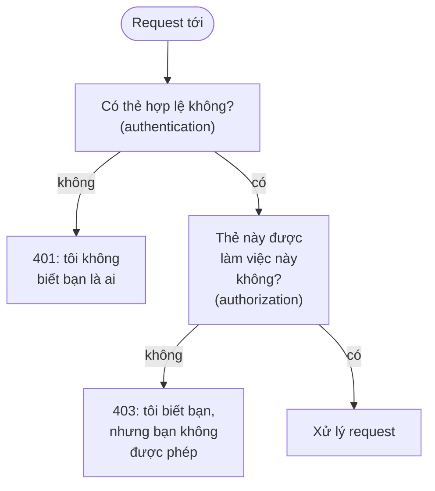
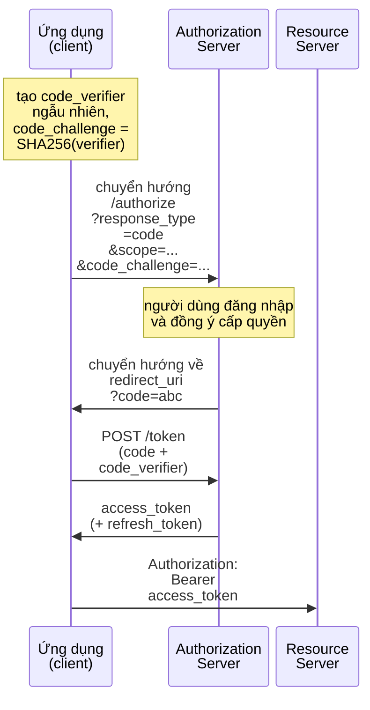
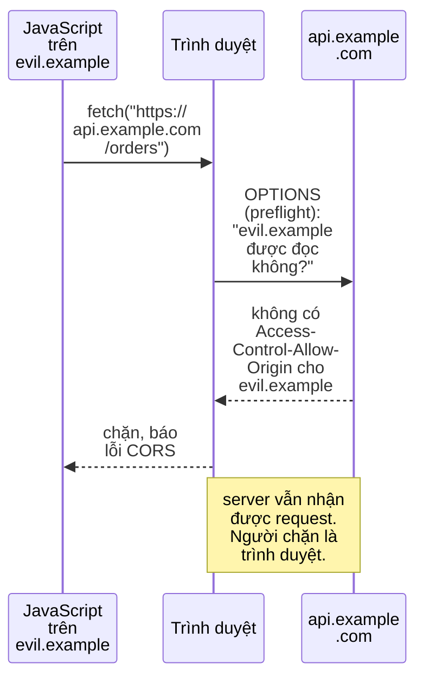

> [!tldr] Đọc nhanh
> - [[concepts/authentication|Authentication]] trả lời "bạn là ai" (`401`), [[concepts/authorization|authorization]] trả lời "bạn được làm gì" (`403`). Hai bước, hai guard, hai mã lỗi.
> - [[concepts/jwt|JWT]] chỉ được **ký**, không được mã hóa: ai cũng đọc được payload. Chữ ký chỉ chống *sửa*, không chống *đọc*.
> - Access token ngắn (15 phút) + refresh token dài (7 ngày) được **xoay vòng**: dùng một lần là hết; dùng lại token cũ nghĩa là có kẻ gian, thu hồi cả phiên.
> - [[concepts/api-keys|API key]] định danh *ứng dụng*, [[concepts/oauth-2|OAuth 2.0]] cho phép *ủy quyền* truy cập thay người dùng mà không đưa mật khẩu.
> - [[concepts/https-tls|HTTPS]] bảo vệ đường truyền; [[concepts/cors|CORS]] là luật của *trình duyệt*, không phải tường lửa của server.

> [!info] Bối cảnh
> Ví dụ lấy từ **flash-sale**, trang bán hàng giảm giá giờ vàng mình tự viết (backend NestJS, dữ liệu phiên đăng nhập để trong Redis). Bạn không cần đọc code dự án. Bài kể lại cách nó đăng nhập, cấp "thẻ" cho người dùng và phát hiện thẻ bị đánh cắp.

> [!abstract]- Từ điển nhanh cho bài này (bấm để mở)
> - **Token**: một chuỗi ký tự server cấp sau khi đăng nhập, giống thẻ ra vào. Request sau chỉ cần đưa thẻ, không phải gửi lại mật khẩu.
> - **Hash**: biến một chuỗi thành "dấu vân tay" cố định, không đảo ngược được. Lưu hash của mật khẩu thay vì mật khẩu.
> - **bcrypt**: hàm hash dành cho mật khẩu, cố ý chạy chậm (~100ms) để kẻ gian không thử được hàng tỷ mật khẩu.
> - **Chữ ký (HMAC, RSA)**: chuỗi tính từ nội dung và một khóa bí mật. Ai sửa nội dung thì chữ ký không còn khớp.
> - **base64 / base64url**: cách viết dữ liệu bất kỳ bằng chữ cái và số. Đây *không* phải mã hóa, ai cũng giải ra được.
> - **Redis**: cơ sở dữ liệu trong RAM, rất nhanh. Flash-sale dùng nó để nhớ phiên đăng nhập nào còn hiệu lực.
> - **Cookie `httpOnly`**: cookie mà JavaScript trên trang không đọc được, chỉ trình duyệt tự gửi đi.
> - **XSS**: kẻ gian chèn được đoạn script của họ vào trang của mình.
> - **CSRF**: trang web khác lừa trình duyệt của bạn gửi request tới trang của mình, kèm luôn cookie của bạn.
> - **Origin**: bộ ba giao thức + tên miền + cổng, ví dụ `https://shop.example.com`.

## Hình dung trước: ra vào một tòa nhà văn phòng

Bảo mật API có rất nhiều thuật ngữ, nhưng gần như khái niệm nào cũng có một "bản sao" ở tòa nhà văn phòng:

| Ở tòa nhà | Trong API | Khái niệm |
|---|---|---|
| Lễ tân kiểm tra căn cước: "anh là ai?" | Kiểm email và mật khẩu | [[concepts/authentication\|Authentication]] |
| Thẻ khách có dấu mộc của tòa nhà, ghi tên và tầng được vào. Ai nhìn cũng đọc được, nhưng không làm giả được dấu mộc | Token chứa `{ sub, role }` kèm chữ ký | [[concepts/jwt\|JWT]] |
| Thẻ chỉ quẹt mở được tầng 3. Vào tầng 3 rồi cũng chỉ mở được phòng của mình | Kiểm role, rồi kiểm "đơn hàng này có phải của bạn không" | [[concepts/authorization\|Authorization]] |
| Thẻ nhà thầu cấp cho *công ty* dịch vụ vệ sinh, không ghi tên người | Chuỗi bí mật gắn với một ứng dụng | [[concepts/api-keys\|API Keys]] |
| Đưa chìa khóa "valet" cho nhân viên giữ xe: nổ máy được, mở cốp thì không | Cho ứng dụng khác quyền hạn chế, không đưa mật khẩu | [[concepts/oauth-2\|OAuth 2.0]] |
| Xe chở tiền bọc thép, không ai nhìn vào được | Mã hóa đường truyền | [[concepts/https-tls\|HTTPS và TLS]] |
| Phụ huynh dặn con: "chỉ nhận đồ từ người quen". Người lạ vẫn tới gõ cửa được, chỉ là đứa trẻ không nhận | Trình duyệt chặn trang lạ đọc response | [[concepts/cors\|CORS]] |

Hai bước quan trọng nhất luôn đi theo thứ tự này:



## Vấn đề: endpoint public trên Internet

Ở ga 1, request checkout mang header `Authorization: Bearer eyJ...`. Mình biết phải gửi nó, nhưng khi tự hỏi thì không trả lời trọn được: token đó chứa gì, ai kiểm tra, hết hạn thì sao, bị lộ thì sao, và vì sao gọi từ Postman thì được còn từ trang web khác thì trình duyệt chặn?

OWASP xếp **Broken Object Level Authorization** và **Broken Authentication** ở hai vị trí đầu trong danh sách rủi ro bảo mật API năm 2023. Phần lớn sự cố không đến từ thuật toán mã hóa yếu, mà từ những chỗ kiểm tra bị thiếu hoặc đặt sai thứ tự.

## Cơ chế: vòng đời của một phiên đăng nhập trong flash-sale

<figure class="figure-map" style="--ar: 1 / 1">
<div class="frame"><iframe data-archify="../diagrams/api-security/token-rotation.html" title="Sơ đồ tuần tự: đăng nhập, gọi API, xoay refresh token và phát hiện reuse" loading="lazy"></iframe></div>
<figcaption><span><b>Hình 1.</b> Đăng nhập tạo một phiên trong Redis; mỗi lần refresh xóa token cũ, nên token bị đánh cắp dùng lại sẽ làm lộ ra kẻ gian và thu hồi cả phiên.</span><a href="../diagrams/api-security/token-rotation.html" target="_blank" rel="noopener">Mở toàn màn hình</a></figcaption>
</figure>

Tóm tắt bằng lời: đăng nhập xong, bạn nhận **hai** thẻ. *Thẻ ngày* (access token) dùng cho mọi request nhưng chỉ sống 15 phút. *Phiếu đổi thẻ* (refresh token) sống 7 ngày, chỉ dùng để xin thẻ ngày mới khi thẻ cũ hết hạn. Server ghi trong Redis những phiên nào còn hiệu lực. Bảng dưới là chi tiết kỹ thuật:

| Mảnh | Giá trị | Nằm ở đâu phía client |
|---|---|---|
| Access token (JWT, HS256) | `{ sub, role, sid, tokenType: "access" }`, sống 15 phút | Bộ nhớ JS, gửi qua header `Authorization` |
| Refresh token (JWT, secret riêng) | `{ sub, sid, tokenType: "refresh" }`, sống 7 ngày | Cookie `httpOnly`, `Secure`, `SameSite=Lax`, `Path=/api/v1/auth/refresh` |
| Phiên | `session:{sid}` trong Redis (allowlist) | Không có |
| Refresh token hiện hành | `refresh_token:{sid}` = SHA-256 của token | Không có |

## Authentication: chứng minh mình là ai

[[concepts/authentication|Authentication]] là bước đổi một bằng chứng (mật khẩu, mã OTP, chứng chỉ, token) lấy danh tính. Hàm `login` của flash-sale có ba chi tiết mình thấy rất đáng học:

```ts
// rút gọn từ auth.service.ts
const [emailAttempts, ipAttempts] = await Promise.all([redis.get(emailKey), redis.get(ipKey)])

const user = await prisma.user.findUnique({ where: { email } })
// LUÔN chạy bcrypt, kể cả khi email không tồn tại, để thời gian phản hồi như nhau
const valid = await bcrypt.compare(password, user?.password ?? DUMMY_HASH)

if (emailAttempts >= 5) throw new UnauthorizedException('Tạm khóa 15 phút')
if (ipAttempts >= 20) throw new UnauthorizedException('IP tạm khóa 1 giờ')
if (!user || !valid) {
  await incrementLoginAttempts(emailKey, ipKey)
  throw new UnauthorizedException('Email hoặc mật khẩu không chính xác')
}
```

1. **Chống dò email bằng thời gian**: nếu email không tồn tại mà trả lời ngay, còn email có thật thì mất ~100ms cho bcrypt, kẻ tấn công đo thời gian là biết email nào đã đăng ký. So với một `DUMMY_HASH` giúp hai nhánh tốn thời gian như nhau.
2. **Thông báo lỗi giống nhau** cho "sai email" và "sai mật khẩu", cũng vì lý do trên.
3. **Giới hạn số lần thử theo cả email lẫn IP**: chặn dò mật khẩu một tài khoản, và chặn một IP dò nhiều tài khoản.

Sau bước này, server đã biết người gọi là ai. Nhưng HTTP là stateless (ga 1), nên phải có cách để các request sau *không* phải gửi lại mật khẩu. Đó là việc của token.

## JSON Web Token: tấm thẻ có chữ ký

Một [[concepts/jwt|JWT]] (RFC 7519) gồm ba phần base64url nối bằng dấu chấm: `header.payload.signature`. Server ký `header.payload` bằng secret; ai sửa một ký tự trong payload thì chữ ký không còn khớp.

Ví dụ ở cuối bài cho thấy ba điều mình từng hiểu sai:

- **Payload ai cũng đọc được**: chỉ cần base64-decode. Không bao giờ để mật khẩu, số điện thoại, địa chỉ vào JWT.
- **Sửa `role: BUYER` thành `ADMIN` thì chữ ký sai**, server từ chối.
- **Tấn công `alg: none`**: kẻ gian đổi header thành "không ký" và bỏ chữ ký. Thư viện cũ từng chấp nhận. Cách chặn là server *tự quy định* thuật toán chấp nhận (RFC 8725 khuyến nghị đúng điều này), không tin header của token.

JWT hấp dẫn vì là token *tự chứa*: server kiểm chữ ký là biết ai, không cần tra DB. Nhưng chính vì thế mà **không thu hồi được** trước khi hết hạn. Flash-sale xử lý bằng cách lai: `JwtAuthGuard` sau khi kiểm chữ ký còn tra `session:{sid}` trong Redis (allowlist) và `blocklist:sid:{sid}`. Đăng xuất hay phát hiện bất thường chỉ cần `DEL session:{sid}` là mọi access token của phiên đó vô hiệu ngay. Cái giá là mỗi request thêm một lệnh `GET` tới Redis, khoảng dưới 1ms, đổi lại được khả năng thu hồi tức thì.

Thêm hai chi tiết đúng sách:

- Access và refresh token ký bằng **hai secret khác nhau** và có `tokenType` riêng; guard từ chối refresh token dùng làm access token.
- Giới hạn **5 thiết bị** mỗi user: phiên thứ 6 đẩy phiên cũ nhất ra (Redis sorted set `user_sessions:{userId}`).

### Refresh token rotation và phát hiện reuse

Access token ngắn hạn để nếu bị lộ thì thiệt hại chỉ kéo dài 15 phút. Refresh token dài hạn nên nguy hiểm hơn nhiều. Flash-sale áp dụng đúng khuyến nghị của OAuth 2.0 Security BCP (RFC 9700):

```ts
// rút gọn từ auth.service.ts: refreshTokens()
const stored = await redis.getdel(`refresh_token:${sid}`)   // nguyên tử: đọc rồi xóa
if (!stored || !timingSafeEqual(hash(stored), hash(incoming))) {
  await revokeSession(userId, sid, 'refresh_token_reuse_detected')
  throw new UnauthorizedException('Refresh token không hợp lệ')
}
return generateTokens(userId, role, sid) // cấp cặp token mới, lưu hash của refresh token mới
```

Mỗi refresh token chỉ dùng được **một lần**. Giống phiếu gửi xe: đổi phiếu lấy xe xong thì phiếu bị thu lại. Ai cầm phiếu đã thu tới đòi xe thì chắc chắn có chuyện. Kể thành chuyện thì như sau:

| Bước | Người dùng thật | Kẻ gian | Server đang nhớ phiếu nào |
|---|---|---|---|
| 1 | Đăng nhập, nhận phiếu `r1` | | `r1` |
| 2 | | Trộm được `r1` (ví dụ qua máy tính dùng chung) | `r1` |
| 3 | Thẻ ngày hết hạn, đưa `r1` đổi lấy thẻ mới và phiếu `r2` | | `r2` (đã xóa `r1`) |
| 4 | | Đưa `r1` ra đổi | Không khớp `r2`. **Báo động: có hai người cùng giữ phiếu của một phiên** |
| 5 | Phải đăng nhập lại | Bị đá ra | Xóa cả phiên |

Người dùng thật chịu phiền một chút (đăng nhập lại), đổi lại kẻ gian mất quyền truy cập. Nếu kẻ gian đổi phiếu *trước* thì sao? Khi đó tới lượt người dùng thật cầm phiếu cũ, và báo động vẫn kêu y như vậy.

Hai chi tiết nhỏ: server chỉ lưu **hash** của refresh token (lộ Redis cũng không dùng được), và so sánh bằng `timingSafeEqual` để không rò rỉ thông tin qua thời gian so sánh.

## Authorization: được phép làm gì

[[concepts/authorization|Authorization]] chạy *sau* authentication. Flash-sale có hai lớp:

- **Theo vai trò (RBAC)**: `@RequirePermissions('order:create')` + `PoliciesGuard`. Quyền của mỗi role được cache trong Redis set `perms:{role}` một giờ; kiểm tra là một lệnh `SISMEMBER`. Admin đổi quyền thì gọi `invalidateCache(role)` xóa cache (kể cả role cha trong cây kế thừa).
- **Theo sở hữu**: `OwnershipGuard` kiểm tra đơn hàng, shop… có thuộc về người gọi không.

Lớp thứ hai là thứ hay bị quên nhất. Có quyền `order:read` không có nghĩa là được đọc *mọi* đơn. Nếu `GET /orders/ord_123` chỉ kiểm tra role, người dùng A đổi id trên URL là đọc được đơn của B. Đây chính là lỗi đứng đầu OWASP API Top 10 (BOLA).

## API Keys: định danh ứng dụng, không phải người

[[concepts/api-keys|API key]] là một chuỗi bí mật dài hạn gắn với *ứng dụng* hoặc *tài khoản tích hợp*, gửi qua header (thường là `Authorization: Bearer sk_...` hoặc `X-API-Key`). Flash-sale chỉ dùng API key theo chiều *đi ra*: gọi SendGrid để gửi email. Nó không cấp API key cho ai, vì chưa có đối tác nào tích hợp vào.

Nếu một ngày cần cấp API key cho seller tự động hóa đơn hàng, các nguyên tắc mình rút ra từ tài liệu của Stripe và GitHub:

- Chỉ hiển thị key **một lần** lúc tạo; DB chỉ lưu hash (giống cách flash-sale lưu refresh token).
- Có tiền tố dễ nhận diện (`sk_live_`, `ghp_`) để công cụ quét secret phát hiện khi bị commit nhầm lên Git.
- Gắn **scope** (`orders:read`) và cho phép thu hồi, xoay vòng.
- Không bao giờ dùng API key trong code chạy ở trình duyệt hay app mobile: ai cũng lấy ra được.

## OAuth 2.0: ủy quyền mà không đưa mật khẩu

[[concepts/oauth-2|OAuth 2.0]] (RFC 6749) giải bài toán: ứng dụng X muốn truy cập dữ liệu của bạn ở dịch vụ Y, nhưng bạn không muốn đưa mật khẩu Y cho X. Flash-sale chưa có "Đăng nhập bằng Google", nên phần này mình học từ tài liệu.

Luồng nên dùng hiện nay là **Authorization Code + PKCE**:



Bốn vai: *resource owner* (người dùng), *client* (ứng dụng), *authorization server* (nơi đăng nhập và cấp token), *resource server* (API giữ dữ liệu). **Scope** giới hạn token làm được gì. **PKCE** chống việc kẻ gian chặn được `code` trên đường chuyển hướng rồi đổi lấy token: họ không có `code_verifier`.

Hai điều mình từng hiểu sai:

- **OAuth là ủy quyền, không phải đăng nhập.** Access token nói "được phép đọc lịch", không nói "đây là anh Dương". Phần đăng nhập là **OpenID Connect**, một lớp bên trên OAuth, thêm `id_token` (một JWT mô tả danh tính).
- **Implicit flow và Password grant đã bị khuyến nghị bỏ** trong RFC 9700, kể cả cho SPA. SPA hiện nay dùng Authorization Code + PKCE.

## HTTPS và TLS: đường truyền không ai đọc trộm

Mọi thứ ở trên vô nghĩa nếu token đi qua mạng dưới dạng chữ thường. [[concepts/https-tls|HTTPS]] là HTTP chạy trên TLS. TLS 1.3 (RFC 8446) cung cấp ba thứ: **mã hóa** (không ai đọc được), **toàn vẹn** (không ai sửa được), **xác thực server** (chứng chỉ chứng minh đúng là `api.example.com`, không phải kẻ giả mạo ở giữa).

Trong flash-sale, TLS được xử lý ở rìa:

- Ingress NGINX trên Kubernetes giữ chứng chỉ, do cert-manager tự xin và gia hạn từ Let's Encrypt. Pod bên trong nói HTTP thường (TLS termination tại ingress).
- `app.set('trust proxy', 1)` để `req.ip` lấy đúng IP của client từ `X-Forwarded-For`, thay vì IP của ingress. Thiếu dòng này thì rate limit theo IP sẽ coi mọi người dùng là một.
- Helmet gửi `Strict-Transport-Security: max-age=31536000; includeSubDomains`: trình duyệt nhớ trong một năm là domain này chỉ được dùng HTTPS, chặn kiểu tấn công hạ cấp về HTTP.
- Cookie refresh token có cờ `Secure` ở production: không bao giờ được gửi qua HTTP thường.

## CORS: luật của trình duyệt

Đây là khái niệm mình hiểu sai lâu nhất. Mình từng nghĩ CORS *bảo vệ server*. Nhớ lại hình ảnh phụ huynh và đứa trẻ ở đầu bài: người lạ vẫn tới gõ cửa được, chỉ là đứa trẻ (JavaScript trong trình duyệt) không được nhận đồ. Thật ra **[[concepts/cors|CORS]] bảo vệ người dùng trong trình duyệt**, và nó là một cách *nới lỏng* Same-Origin Policy chứ không phải siết thêm.

Mặc định, JavaScript trên `https://evil.example` không được đọc response từ `https://api.example.com` (khác origin). CORS là cách server nói "origin này được phép đọc":

```ts
// main.ts của flash-sale
app.enableCors({
  origin: configService.getOrThrow('FRONTEND_URL'), // đúng một origin, không phải '*'
  credentials: true,                                // cho phép gửi kèm cookie
})
```

Với request "không đơn giản" (method khác GET/POST/HEAD, hoặc có header như `Authorization`, hoặc `Content-Type: application/json`), trình duyệt gửi trước một request `OPTIONS` (*preflight*) để hỏi. Server trả `Access-Control-Allow-Origin` khớp origin thì trình duyệt mới gửi request thật.

Vẽ ra cho dễ thấy *ai* đang chặn:



Ba hệ quả:

- **`curl`, Postman, server khác không bị CORS chặn**, vì chúng không phải trình duyệt. CORS không thay được authentication.
- **`credentials: true` không đi được với `origin: '*'`**: trình duyệt từ chối. Phải liệt kê origin cụ thể.
- **CORS không chống CSRF.** Một form HTML trên trang khác vẫn gửi được `POST` kèm cookie tới API của mình (trình duyệt chỉ chặn *đọc* response, không chặn *gửi*). Vì refresh token nằm trong cookie, flash-sale thêm `CsrfGuard` theo kiểu double-submit cookie: request ghi phải mang header CSRF khớp với cookie CSRF, thứ mà trang khác không đọc được.

## Ví dụ chạy được

File `tokens.ts` tự viết JWT HS256 bằng `node:crypto` (không dùng thư viện) để thấy rõ từng bước, rồi mô phỏng refresh token rotation đúng như flash-sale, API key lưu hash, và quyết định CORS.

```ts
function verify(token: string) {
  const [h, b, s] = token.split(".")
  const header = JSON.parse(Buffer.from(h, "base64url").toString())
  if (header.alg !== "HS256") return { ok: false, reason: `alg ${header.alg} không được chấp nhận` }
  const expected = createHmac("sha256", SECRET).update(`${h}.${b}`).digest()
  const got = Buffer.from(s ?? "", "base64url")
  if (got.length !== expected.length || !timingSafeEqual(got, expected)) return { ok: false, reason: "chữ ký sai" }
  const claims = JSON.parse(Buffer.from(b, "base64url").toString())
  if (claims.exp <= now) return { ok: false, reason: "token hết hạn" }
  return { ok: true, claims }
}
```

```text
$ node tokens.ts
===== 1. JWT chỉ được ký, không được mã hóa =====
access token: eyJhbGciOiJIUzI1NiIsInR5cCI6IkpXVCJ9.eyJ…
ai cũng đọc được payload: {"sub":"user_42","role":"BUYER","sid":"s1","iat":1800000000,"exp":1800000900}

===== 2. Sửa payload hoặc đổi alg đều bị chặn =====
đổi role thành ADMIN  → { ok: false, reason: 'chữ ký sai' }
alg: none, bỏ chữ ký  → { ok: false, reason: 'alg none không được chấp nhận' }
token hợp lệ          → true
16 phút sau           → { ok: false, reason: 'token hết hạn' }

===== 3. Refresh token rotation + phát hiện reuse =====
người dùng refresh: 200, nhận refresh token mới
kẻ gian dùng r1: 401, refresh token đã dùng rồi → REUSE, thu hồi phiên s1
người dùng refresh lần sau: 401, phiên đã bị thu hồi

===== 4. API key: lưu hash, so khớp bằng hash =====
key đúng → { owner: 'shop_7', scopes: [ 'orders:read' ] }
key sai  → 401

===== 5. CORS chỉ là luật của trình duyệt =====
từ shop.example.com → Access-Control-Allow-Origin: https://shop.example.com, Allow-Methods: POST, Allow-Credentials: true
từ evil.example     → không trả Access-Control-Allow-Origin → trình duyệt chặn JS đọc response
curl/Postman        → không gửi preflight; server vẫn nhận request như thường
```

Toàn bộ file: <a href="../code/api-security/tokens.ts">code/api-security/tokens.ts</a>. Đây là code học tập; production thì dùng thư viện đã được kiểm định (`jose`, `@nestjs/jwt`).

## Hiểu lầm và bẫy hay gặp

### Lưu access token trong `localStorage`

Bất kỳ đoạn script nào chạy trên trang (kể cả từ một thư viện bị chèn mã độc, tức XSS) đều đọc được `localStorage`. Flash-sale để refresh token trong cookie `httpOnly` (JavaScript không đọc được), access token ngắn hạn trong bộ nhớ. Không có cách nào miễn nhiễm hoàn toàn với XSS, nhưng cách này giới hạn thiệt hại.

### Chỉ kiểm tra role, quên kiểm tra quyền sở hữu

`order:read` đúng role nhưng đọc đơn của người khác. Mỗi endpoint nhận id tài nguyên đều cần câu hỏi "tài nguyên này có thuộc về người gọi không".

### Mở CORS `*` cho "chạy được trước đã"

Với API dùng cookie thì `*` đằng nào cũng không hoạt động. Với API dùng token trong header thì `*` cho phép mọi trang web gọi API *bằng token mà trang đó có được*; vấn đề thật nằm ở chỗ token rò rỉ, nhưng không có lý do gì để mở rộng hơn mức cần.

### JWT không thu hồi được thì kéo dài thời hạn cho tiện

Access token 7 ngày bị lộ là 7 ngày kẻ gian dùng thoải mái. Giữ access token ngắn, và nếu cần thu hồi ngay thì thêm allowlist hoặc blocklist như flash-sale.

### Dùng OAuth access token như bằng chứng đăng nhập

Access token có thể được cấp cho ứng dụng khác rồi đem tới API của mình. Muốn biết *ai đăng nhập*, dùng `id_token` của OpenID Connect và kiểm tra `aud` đúng là ứng dụng của mình.

## Câu hỏi tự kiểm tra

> [!question]- Vì sao `login` vẫn chạy bcrypt khi email không tồn tại?
> Để thời gian phản hồi của "email không tồn tại" và "sai mật khẩu" như nhau; nếu không, kẻ tấn công đo thời gian là biết email nào đã đăng ký.

> [!question]- JWT của flash-sale đã có chữ ký, vì sao guard còn tra `session:{sid}` trong Redis?
> Chữ ký chỉ chứng minh token do server cấp, không cho phép thu hồi trước hạn. Allowlist trong Redis cho phép đăng xuất, đá thiết bị, và thu hồi phiên khi phát hiện reuse có tác dụng ngay lập tức.

> [!question]- Kẻ gian lấy được refresh token cũ và dùng *trước* người dùng thật. Chuyện gì xảy ra?
> Kẻ gian nhận cặp token mới. Lần refresh tiếp theo của người dùng thật dùng token đã bị xóa → hash không khớp → phát hiện reuse → thu hồi cả phiên, kẻ gian mất quyền truy cập trong vòng tối đa 15 phút (thời hạn access token).

> [!question]- Server bật CORS chỉ cho `https://shop.example.com`. Kẻ gian dùng `curl` gọi API được không?
> Được. CORS do trình duyệt thực thi; `curl` không quan tâm. Muốn chặn thì phải nhờ authentication và authorization.

> [!question]- Sự khác nhau giữa OAuth 2.0 và OpenID Connect?
> OAuth 2.0 cấp access token để *truy cập tài nguyên* (ủy quyền). OpenID Connect thêm `id_token` để *xác định người dùng là ai* (đăng nhập).

## Tham khảo

- [RFC 7519: JSON Web Token](https://www.rfc-editor.org/rfc/rfc7519) và [RFC 8725: JWT Best Current Practices](https://www.rfc-editor.org/rfc/rfc8725)
- [RFC 6749: OAuth 2.0](https://www.rfc-editor.org/rfc/rfc6749), [RFC 7636: PKCE](https://www.rfc-editor.org/rfc/rfc7636), [RFC 9700: OAuth 2.0 Security Best Current Practice](https://www.rfc-editor.org/rfc/rfc9700)
- [OpenID Connect Core](https://openid.net/specs/openid-connect-core-1_0.html)
- [RFC 8446: TLS 1.3](https://www.rfc-editor.org/rfc/rfc8446) và [MDN: Strict-Transport-Security](https://developer.mozilla.org/en-US/docs/Web/HTTP/Reference/Headers/Strict-Transport-Security)
- [MDN: Cross-Origin Resource Sharing (CORS)](https://developer.mozilla.org/en-US/docs/Web/HTTP/Guides/CORS)
- [OWASP API Security Top 10 (2023)](https://owasp.org/API-Security/editions/2023/en/0x11-t10/)
- [OWASP Cheat Sheet: Cross-Site Request Forgery Prevention](https://cheatsheetseries.owasp.org/cheatsheets/Cross-Site_Request_Forgery_Prevention_Cheat_Sheet.html)
- [Stripe: API keys](https://docs.stripe.com/keys)
