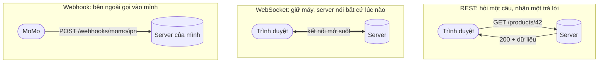
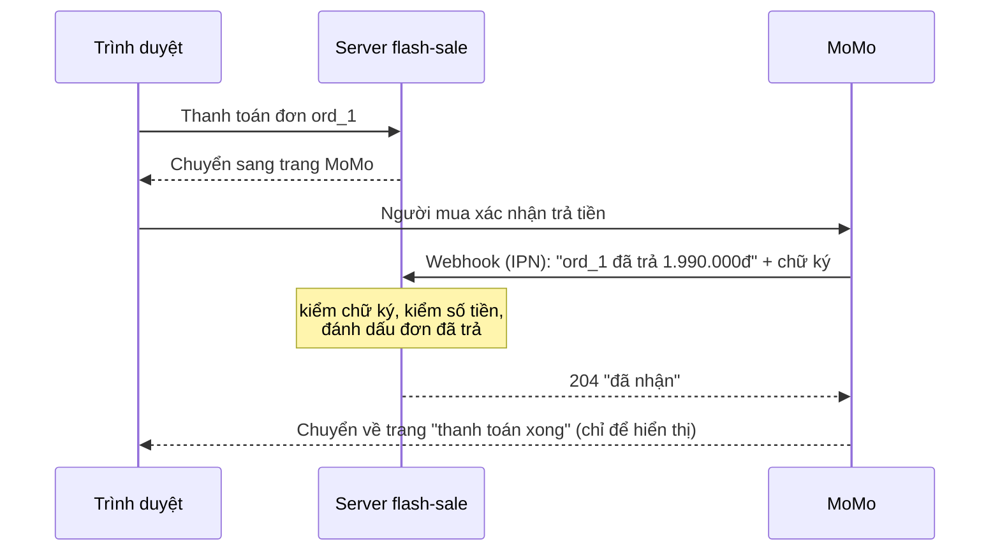

> [!tldr] Đọc nhanh
> - Không có kiểu API "tốt nhất"; mỗi kiểu trả lời một câu hỏi khác: *ai mở lời* và *dữ liệu đi một chiều hay hai chiều*.
> - [[rest|REST]]: client hỏi, server đáp, tài nguyên có URL riêng; mặc định cho API công khai.
> - [[graphql|GraphQL]]: client tự chọn field cần lấy qua một endpoint duy nhất; hợp khi nhiều loại client cần dữ liệu khác nhau.
> - [[grpc|gRPC]]: hợp đồng `.proto`, nhị phân, HTTP/2; hợp cho gọi nội bộ giữa các service.
> - [[websockets|WebSockets]]: kết nối mở liên tục, server đẩy tin bất cứ lúc nào. [[webhooks|Webhooks]]: hệ thống *bên ngoài* gọi ngược vào mình khi có sự kiện.

> [!info] Bối cảnh
> Ví dụ lấy từ **flash-sale**, trang bán hàng giảm giá giờ vàng mình tự viết: đúng giờ mở bán, hàng nghìn người tranh vài trăm suất. Vì quá đông, người mua phải vào một **hàng chờ ảo** trước, tới lượt mới được thanh toán. Thanh toán đi qua ví **MoMo** hoặc **VNPay**. Bạn không cần đọc code dự án. Tên riêng nào xuất hiện cũng có giải thích bằng lời thường.

> [!abstract]- Từ điển nhanh cho bài này (bấm để mở)
> - **Endpoint, request, status code**: xem [[2026-11-18-api-foundations|ga 1]].
> - **Polling**: client cứ vài giây hỏi lại một lần "có gì mới chưa?".
> - **Push**: server chủ động gửi tin cho client mà không chờ client hỏi.
> - **Service**: một chương trình chạy riêng, làm một phần việc của hệ thống (đăng nhập, thanh toán…).
> - **Protobuf (Protocol Buffers)**: cách đóng gói dữ liệu thành dãy byte gọn, máy đọc nhanh nhưng người không đọc được.
> - **HTTP/2**: phiên bản HTTP cho phép nhiều request chạy song song trên cùng một kết nối.
> - **Socket.IO**: thư viện dựng sẵn trên WebSocket, có thêm tự kết nối lại, chia phòng (room)…
> - **Redis Pub/Sub**: một "loa phát thanh" trong Redis. Một nơi phát tin, mọi nơi đang nghe đều nhận được.
> - **IPN**: tên các cổng thanh toán Việt Nam đặt cho webhook báo kết quả thanh toán.
> - **HMAC / chữ ký**: một chuỗi tính từ nội dung tin nhắn và một mật khẩu chung. Sửa nội dung thì chuỗi không còn khớp.

## Hình dung trước: năm cách liên lạc với một quán cà phê

Mỗi kiểu API giống một cách liên lạc khác nhau. Câu hỏi để phân biệt chỉ có hai: **ai mở lời**, và **nói xong thì gác máy hay giữ máy**.

| Đời thường | Kiểu API | Ai mở lời | Hợp với |
|---|---|---|---|
| Ra quầy hỏi "cho một ly cà phê sữa", nhận ly rồi đi | [[rest\|REST]] | Khách | Hầu hết mọi việc hỏi-đáp |
| Điền phiếu, tự tick đúng những thứ mình muốn: "ít đá, thêm shot, không đường" | [[graphql\|GraphQL]] | Khách | Mỗi khách cần một kiểu dữ liệu khác nhau |
| Quầy và kho nói chuyện bằng bộ đàm, dùng mã số ngắn thay cho câu dài | [[grpc\|gRPC]] | Bộ phận nội bộ | Các service trong cùng hệ thống gọi nhau |
| Gọi điện cho quán rồi **giữ máy**, khi nào đồ xong quán nói luôn | [[websockets\|WebSockets]] | Cả hai, lúc nào cũng được | Server cần báo tin ngay khi có |
| Để lại số điện thoại, **ngân hàng tự gọi** báo "tiền đã vào tài khoản" | [[webhooks\|Webhooks]] | Hệ thống bên ngoài | Chờ kết quả từ một bên thứ ba |

Nếu không có WebSocket, cách duy nhất để biết "đồ xong chưa" là cứ hai phút lại chạy ra quầy hỏi (polling). Hỏi nhiều thì mệt, hỏi ít thì biết tin muộn.



## Vấn đề: một lượt mua, bốn kiểu giao tiếp

Ở ga 1 mình theo chân một request đặt hàng. Nhưng một lượt săn flash sale thật trong dự án của mình dài hơn nhiều:

1. Người mua bấm "Mua ngay" → vào **hàng chờ ảo**.
2. Chờ tới lượt. Server phải **báo** cho trình duyệt "đến lượt bạn rồi", chứ trình duyệt không biết lúc nào mà hỏi.
3. Vào checkout, tạo đơn, chuyển sang MoMo hoặc VNPay thanh toán.
4. Cổng thanh toán xử lý xong thì **gọi ngược** vào server của mình báo kết quả.
5. Server báo kết quả đơn cho trình duyệt.

Bước 1 và 3 là hỏi-đáp bình thường. Bước 2 và 5 là server chủ động nói. Bước 4 là một hệ thống khác chủ động nói. Mình từng nghĩ "API" đồng nghĩa với REST; hóa ra REST chỉ phủ được một nửa câu chuyện.

## Cơ chế: ai mở lời, dữ liệu đi chiều nào

<figure class="figure-map" style="--ar: 1 / 1">
<div class="frame"><iframe data-archify="../diagrams/api-styles/flash-sale-flow.html" title="Sơ đồ tuần tự: REST, WebSocket và webhook trong một lượt mua flash sale" loading="lazy"></iframe></div>
<figcaption><span><b>Hình 1.</b> Một lượt mua flash sale dùng REST cho hỏi-đáp, WebSocket để server đẩy tin, và webhook để cổng thanh toán báo kết quả.</span><a href="../diagrams/api-styles/flash-sale-flow.html" target="_blank" rel="noopener">Mở toàn màn hình</a></figcaption>
</figure>

| Kiểu | Ai mở lời | Kết nối | Định dạng | Flash-sale dùng cho |
|---|---|---|---|---|
| REST | Client | Mỗi request một lượt | JSON qua HTTP | Gần như mọi thứ: giỏ hàng, checkout, sản phẩm |
| GraphQL | Client | Mỗi request một lượt | JSON, client chọn field | Không dùng (giải thích bên dưới) |
| gRPC | Service gọi service | HTTP/2, giữ kết nối | Protobuf nhị phân | Bản thiết kế tách IAM service |
| WebSockets | Cả hai, bất cứ lúc nào | Mở liên tục | Frame tùy ý (Socket.IO: JSON) | Vị trí hàng chờ, tồn kho, kết quả đơn |
| Webhooks | Hệ thống bên ngoài | Mỗi sự kiện một request | Do bên gửi quy định | IPN từ MoMo, VNPay |

## REST: tài nguyên có địa chỉ, thao tác bằng method chuẩn

[[rest|REST]] không phải giao thức mà là một *phong cách kiến trúc* Roy Fielding mô tả năm 2000, gồm các ràng buộc: client-server, stateless, response có thể cache, giao diện thống nhất, hệ thống phân lớp. Trong thực tế, "REST API" thường có nghĩa:

- mỗi tài nguyên có URL riêng: `/products/42`, `/orders/ord_1`;
- dùng đúng method HTTP với ngữ nghĩa của nó (ga 1);
- dùng status code để kết luận;
- không giữ trạng thái phiên trên server giữa các request.

Flash-sale theo REST ở mức thực dụng: tài nguyên rõ ràng, method đúng, status code đầy đủ. Có vài endpoint dạng hành động như `POST /flash-sale/campaigns/:id/queue/join` vì "vào hàng chờ" không khớp gọn với CRUD. Phần "hypermedia" (response chứa link tới thao tác tiếp theo, ràng buộc khó nhất trong luận án của Fielding) thì gần như không API nào làm, kể cả các API lớn, và mình cũng không.

Điểm mạnh của REST là *ai cũng gọi được*: trình duyệt, `curl`, Postman, mọi ngôn ngữ. Cache HTTP, proxy, CDN đều hiểu nó sẵn. Điểm yếu lộ ra khi màn hình cần dữ liệu lắp ghép từ nhiều tài nguyên: hoặc gọi nhiều request (under-fetching), hoặc endpoint trả về quá nhiều field không dùng (over-fetching).

## GraphQL: client tự viết "đơn đặt hàng" cho dữ liệu

[[graphql|GraphQL]] (Facebook công bố năm 2015) đảo ngược quyền quyết định: server công bố một **schema có kiểu**, client gửi một câu query mô tả đúng hình dạng dữ liệu mình cần, thường qua một endpoint duy nhất `POST /graphql`:

```graphql
query {
  order(id: "ord_1") {
    status
    items { name qty }
  }
}
```

Server chạy các *resolver* cho từng field và trả về JSON đúng hình dạng đó. Trong ví dụ cuối bài, cùng một đơn hàng: REST trả về 442 byte, query GraphQL chỉ chọn `status` và `items { name qty }` thì còn 85 byte.

Cái giá phải trả, và cũng là lý do flash-sale không dùng:

- **Cache HTTP gần như mất tác dụng**: mọi thứ là `POST /graphql`, CDN không biết hai query có giống nhau không. Phải dùng persisted query hoặc cache ở tầng client.
- **N+1 ở resolver**: query 20 đơn hàng, mỗi đơn resolve `user` riêng là 21 câu SQL. Cần DataLoader để gom lại.
- **Query độc hại**: client có thể lồng sâu tùy ý. Phải giới hạn độ sâu và độ phức tạp.
- **Lỗi đi kèm `200 OK`**: lỗi nằm trong mảng `errors` của body, nên giám sát theo status code không còn đủ.

Flash-sale có một frontend web, các màn hình khá cố định, nên REST cộng vài endpoint "gộp sẵn" (như `preview-discount`) là đủ. GraphQL tỏa sáng khi có nhiều loại client (web, mobile, đối tác) mỗi bên cần một lát cắt dữ liệu khác nhau, như GitHub API v4 hay Shopify Storefront API.

## gRPC: hợp đồng chặt, nhị phân, cho service nói với service

[[grpc|gRPC]] (Google, 2015) gọi hàm ở máy khác như gọi hàm cục bộ. Hợp đồng viết bằng Protocol Buffers, rồi công cụ sinh code client và server cho từng ngôn ngữ. Flash-sale có một bản thiết kế (chưa merge) tách phần đăng nhập và phân quyền thành `iam-service`, giao tiếp qua gRPC:

```proto
service IamService {
  rpc Login(LoginRequest)         returns (AuthResult);
  rpc Refresh(RefreshRequest)     returns (AuthResult);
  rpc GetUser(GetUserRequest)     returns (UserReply);
  rpc GetUsersByIds(IdsRequest)   returns (UsersReply);   // gọi gộp, tránh N+1
  rpc SetUserRole(SetRoleRequest) returns (Empty);
}
```

Vì sao gRPC hợp cho đường nội bộ này:

- **Nhỏ và nhanh**: protobuf không gửi tên field, chỉ gửi số thứ tự field và giá trị. Trong ví dụ, `{id: 150, status: PAID}` là 5 byte `08 96 01 10 02`, bản JSON tương ứng là 26 byte.
- **HTTP/2**: một kết nối chạy song song nhiều lời gọi; hỗ trợ cả 4 kiểu: unary, server streaming, client streaming, bidirectional streaming.
- **Deadline có sẵn**: mỗi lời gọi mang theo hạn chót, lan truyền qua các service (rất hợp với ga 4).
- **Đổi hợp đồng là lỗi biên dịch**, không phải lỗi lúc chạy.

Điểm trừ: trình duyệt không gọi gRPC trực tiếp được (cần gRPC-Web và một proxy), payload nhị phân khó đọc khi debug. Vì vậy bản thiết kế giữ nguyên REST cho trình duyệt, còn gRPC chỉ chạy giữa Main và IAM.

## WebSockets: một kết nối mở để server nói trước

Với HTTP thường, server chỉ được nói khi client hỏi. Muốn biết "đến lượt chưa", client phải hỏi liên tục (polling). [[websockets|WebSocket]] (RFC 6455) giải quyết bằng cách *nâng cấp* một request HTTP thành kênh hai chiều lâu dài:

```http
GET /socket HTTP/1.1
Upgrade: websocket
Connection: Upgrade
Sec-WebSocket-Key: dGhlIHNhbXBsZSBub25jZQ==

HTTP/1.1 101 Switching Protocols
Upgrade: websocket
Sec-WebSocket-Accept: s3pPLMBiTxaQ9kYGzzhZRbK+xOo=
```

Sau `101`, hai bên gửi frame cho nhau tự do, không còn header lặp lại mỗi lần.

Flash-sale dùng **Socket.IO**, một thư viện xây trên WebSocket. Bằng lời thường thì nó làm thế này:

- Xác thực bằng JWT trong `handshake.auth.token` lúc kết nối; sai thì `disconnect()` ngay.
- Mỗi user vào một "phòng" (room) riêng tên `user:{userId}`. Mở nhiều tab thì tab nào cũng ở trong phòng đó, nên tab nào cũng nhận tin.
- Server đẩy các sự kiện `queue_position`, `checkout_ready`, `stock_update`, `order_result`, `campaign_ended`.
- Backend chạy nhiều bản (pod) cùng lúc. Trình duyệt của bạn có thể đang nối với bản B, trong khi bản A mới là bản biết "tới lượt bạn rồi". Vì vậy các bản nói chuyện với nhau qua "loa phát thanh" Redis Pub/Sub (lớp `RedisIoAdapter`): A phát tin, B nghe được và chuyển tới bạn.
- Vẫn giữ endpoint REST `GET /queue/position` (giới hạn 30 request mỗi 10 giây) làm **đường lùi** khi socket chưa kết nối hoặc người dùng tải lại trang.

Ví dụ ở cuối bài tính thử: theo dõi hàng chờ 60 giây, vị trí đổi 3 lần. Polling mỗi 2 giây tốn 30 request, 27 cái thừa, tin mới trễ tới 2 giây. WebSocket chỉ cần 1 kết nối và 3 message.

Một chi tiết mình từng nhầm: **Socket.IO không phải WebSocket thuần**. Nó có giao thức riêng bên trên (room, ack, tự kết nối lại, dự phòng bằng long-polling), nên một client WebSocket thuần không nói chuyện được với server Socket.IO. Nếu chạy nhiều node và bật long-polling thì còn cần sticky session ở load balancer.

## Webhooks: hệ thống khác gọi ngược vào mình

Khi người mua trả tiền trên trang MoMo, server của mình không biết lúc nào xong. [[webhooks|Webhook]] là hợp đồng ngược: mình đăng ký một URL, và *bên kia* gửi HTTP request tới URL đó khi có sự kiện. Các cổng thanh toán Việt Nam gọi nó là **IPN** (Instant Payment Notification).

Trình tự dễ hình dung nhất:



Chỗ đáng chú ý là **mũi tên webhook đi từ MoMo vào server**, không phải từ trình duyệt. Endpoint này ai trên Internet cũng gọi được, nên server phải tự hỏi "có đúng là MoMo gửi không?". Đây là việc của chữ ký.

Flash-sale có hai controller webhook (controller là lớp chứa các endpoint). Chúng cho thấy gần đủ mọi nguyên tắc. Các dòng bắt đầu bằng `@` là *decorator*, tức nhãn dán lên hàm để framework biết cách xử lý; mình chú thích nghĩa của từng nhãn ở cuối dòng:

```ts
// rút gọn từ momo-webhook.controller.ts
@Public()                 // không có JWT: bên gọi là MoMo, không phải người dùng
@CsrfExempt()             // không có cookie CSRF
@SkipResponseTransform()  // trả đúng định dạng MoMo yêu cầu, không bọc vỏ {success,data,msg}
@Post('ipn')
@HttpCode(204)            // MoMo coi 204 là "đã nhận"; mã khác thì MoMo gửi lại
@RateLimit({ max: 100, windowMs: 1_000 })
async handleIpn(@Body() body: MoMoIpnPayload) {
  await this.paymentService.handleWebhook('MOMO', toStringRecord(body))
}
```

Bên trong `handleWebhook` là bốn lớp kiểm tra:

1. **Xác thực chữ ký** (HMAC bằng secret chung với cổng thanh toán). Endpoint là public, ai cũng gọi được, nên chữ ký là thứ duy nhất chứng minh request đến từ MoMo.
2. **Idempotency lớp 1**: payment không còn `PENDING` thì trả "Already processed". Bên gửi webhook *luôn* có thể gửi lại.
3. **Đối chiếu số tiền** với payment trong DB, lệch thì từ chối.
4. **Idempotency lớp 2**: `INSERT` vào `payment_transactions` với `providerRef` là `UNIQUE`; hai webhook trùng tới cùng lúc thì một cái dính lỗi unique (`P2002`).

Và một nguyên tắc nằm ở controller VNPay: endpoint `return` (trình duyệt được chuyển về sau khi trả tiền) chỉ để **hiển thị**, không cập nhật đơn. Query string trên URL đó người dùng sửa được; chỉ IPN có chữ ký mới là nguồn sự thật.

## Ví dụ chạy được

File `styles.ts` gồm bốn thí nghiệm: chọn field kiểu GraphQL, mã hóa protobuf bằng tay, một webhook receiver có chữ ký và chống trùng, và phép tính polling so với push.

```ts
function receiveWebhook(raw: string, signature: string): number {
  const expected = Buffer.from(sign(raw), "hex")
  const got = Buffer.from(signature, "hex")
  if (expected.length !== got.length || !timingSafeEqual(expected, got)) return 401
  const event = JSON.parse(raw)
  if (processed.has(event.transId)) return 204 // đã xử lý: vẫn ACK để bên gửi thôi retry
  processed.add(event.transId)
  paidOrders++
  return 204
}
```

```text
$ node styles.ts
REST    GET /orders/ord_1 → 442 bytes
GraphQL { status items { name qty } } → 85 bytes: {"status":"PAID","items":[{"name":"Tai nghe","qty":1},{"name":"Ốp lưng","qty":2}]}

protobuf: 5 bytes [08 96 01 10 02]
JSON:     26 bytes {"id":150,"status":"PAID"}

giao lần 1           → 204
giao lại (retry)     → 204
body bị sửa số tiền  → 401
số đơn được đánh dấu đã trả: 1

polling mỗi 2s: 30 request, 3 lần có tin mới, 27 lần thừa
WebSocket: 1 kết nối, 3 message, độ trễ ~0s thay vì tới 2s
```

Toàn bộ file: <a href="../code/api-styles/styles.ts">code/api-styles/styles.ts</a>.

## Hiểu lầm và bẫy hay gặp

### Tin vào trang "thanh toán thành công" mà trình duyệt được chuyển về

Return URL đi qua trình duyệt, người dùng sửa được query string. Chỉ cập nhật đơn từ webhook đã xác thực chữ ký.

### Xử lý nặng ngay trong webhook handler

Bên gửi thường chỉ chờ vài giây. Handler chậm thì bị coi là thất bại và bị gửi lại, đúng lúc lần đầu còn đang chạy. Nguyên tắc: xác thực, ghi nhận (idempotent), trả `2xx` nhanh, việc nặng đẩy vào queue.

### Trả lỗi khi chữ ký sai thì bên gửi sẽ retry mãi

Flash-sale chọn trả `204` cho MoMo kể cả khi chữ ký sai (và ghi log lỗi). Lý do: chữ ký sai thì gửi lại bao nhiêu lần cũng sai, retry chỉ tốn tài nguyên. Ví dụ của mình trả `401` cho rõ ý; cả hai cách đều được, miễn là không xử lý request đó.

### Nghĩ GraphQL thay thế được REST cho mọi thứ

GraphQL giải quyết bài toán "nhiều client, nhiều hình dạng dữ liệu". Nó không giúp gì cho upload file, webhook, hay cache CDN, và đẩy độ phức tạp sang server (DataLoader, giới hạn độ sâu, phân quyền theo từng field).

### Dùng WebSocket cho thứ chỉ cần hỏi một lần

Kết nối mở liên tục tốn bộ nhớ trên server và phải xử lý kết nối lại, xác thực lại, scale qua nhiều pod. Nếu dữ liệu đổi vài phút một lần, polling hoặc Server-Sent Events (một chiều, chạy trên HTTP thường) đơn giản hơn nhiều.

## Câu hỏi tự kiểm tra

> [!question]- Vì sao `checkout_ready` phải đi qua WebSocket mà không trả trong response của `POST /queue/join`?
> Lúc join, server chưa biết khi nào tới lượt; sự kiện xảy ra sau đó vài giây tới vài phút, do worker quyết định. Chỉ kênh mà server được chủ động nói mới báo kịp.

> [!question]- Hai webhook giống hệt nhau tới cùng một lúc. Lớp kiểm tra nào trong flash-sale chặn được cái thứ hai?
> Kiểm tra trạng thái (lớp 1) có thể để lọt vì cả hai cùng đọc thấy `PENDING`. Ràng buộc `UNIQUE(providerRef)` trong transaction (lớp 2) mới chặn chắc chắn.

> [!question]- Trình duyệt có gọi thẳng `IamService.Login` qua gRPC được không?
> Không trực tiếp. Trình duyệt không điều khiển được HTTP/2 ở mức gRPC cần; phải qua gRPC-Web và proxy. Bản thiết kế để Main nhận REST từ trình duyệt rồi gọi IAM bằng gRPC.

> [!question]- Khi nào mình nên cân nhắc GraphQL cho flash-sale?
> Khi có thêm app mobile và đối tác, mỗi bên cần một lát cắt dữ liệu khác nhau, và việc thêm endpoint REST riêng cho từng màn hình bắt đầu tốn kém hơn chi phí vận hành GraphQL.

## Tham khảo

- [Roy Fielding, chương 5: Representational State Transfer](https://ics.uci.edu/~fielding/pubs/dissertation/rest_arch_style.htm)
- [GraphQL: Learn](https://graphql.org/learn/) và [GraphQL Specification](https://spec.graphql.org/)
- [gRPC: Core concepts](https://grpc.io/docs/what-is-grpc/core-concepts/) và [Protocol Buffers: Encoding](https://protobuf.dev/programming-guides/encoding/)
- [RFC 6455: The WebSocket Protocol](https://www.rfc-editor.org/rfc/rfc6455)
- [Socket.IO: Using multiple nodes](https://socket.io/docs/v4/using-multiple-nodes/)
- [Stripe: Receive webhook events](https://docs.stripe.com/webhooks) và [GitHub: Validating webhook deliveries](https://docs.github.com/en/webhooks/using-webhooks/validating-webhook-deliveries)
- [Standard Webhooks](https://www.standardwebhooks.com/)
