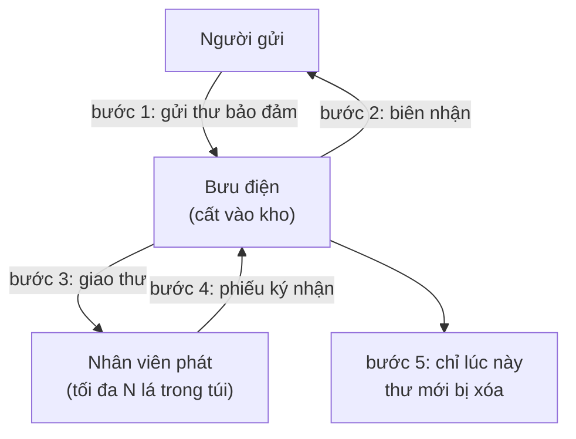

> [!tldr] Đọc nhanh
> - [[concepts/work-queue|Work queue]]: nhiều consumer cùng đọc một queue, broker chia tin cho họ. Muốn chia *công bằng* thì cần ack và prefetch.
> - [[concepts/consumer-acknowledgement|Consumer ack]]: consumer báo "xử lý xong" thì broker mới xóa tin. Chết trước khi ack, tin quay lại hàng và được [[concepts/redelivery|giao lại]] với cờ `redelivered = true`.
> - [[concepts/auto-ack|Auto-ack]] coi tin là xong ngay khi vừa gửi đi. Nhanh nhưng mất tin khi consumer chết, và NestJS bật nó **mặc định**.
> - [[concepts/prefetch|Prefetch]] giới hạn số tin chưa ack mà một consumer được giữ. Prefetch 1 chia việc theo ai rảnh; không đặt thì broker chia đều bất kể ai chậm.
> - [[concepts/publisher-confirms|Publisher confirm]] là biên nhận broker gửi cho producer. Ba điều kiện để tin sống qua lần broker khởi động lại: queue durable, tin [[concepts/message-persistence|persistent]], và có confirm.

> [!info] Bối cảnh
> Ga 4 của **tuyến RabbitMQ**. Ví dụ là **flash-sale**, trang bán hàng giảm giá giờ vàng mình tự viết: mỗi đơn đặt xong sinh ra một tin, các consumer trừ kho, gửi email, cập nhật tìm kiếm. Ở ga này, câu hỏi chỉ có một: làm sao để tin *không mất* trên đường từ producer tới lúc consumer làm xong. Bạn không cần biết code dự án.

> [!abstract]- Từ điển nhanh cho bài này (bấm để mở)
> - **Exchange, queue, binding, channel, connection**: xem [[posts/2026-11-21-rabbitmq-amqp-model|ga 2]].
> - **Worker**: một consumer làm một loại việc nặng (gửi email, xử lý ảnh).
> - **Round-robin**: chia lần lượt mỗi người một cái, hết vòng thì quay lại người đầu.
> - **Ghi xuống đĩa / fsync**: ghi dữ liệu từ RAM ra ổ cứng để mất điện không mất. `fsync` là lệnh ép hệ điều hành ghi thật xuống đĩa ngay.
> - **Buffer**: vùng nhớ đệm, dữ liệu chờ ở đó trước khi được gửi đi.
> - **Transaction (giao dịch)**: nhóm thao tác hoặc thành công hết, hoặc không cái nào có hiệu lực.
> - **NestJS**: framework Node.js mà flash-sale dùng. Xem [[posts/2026-11-18-api-foundations|tuyến API]].

## Hình dung trước: ký nhận và biên nhận

Bưu điện chuyên nghiệp có hai tờ giấy: **biên nhận** đưa cho người gửi, **phiếu ký nhận** của người nhận. Thiếu một trong hai là có chỗ cho thư thất lạc.

| Đời thường | Khái niệm |
|---|---|
| Nhiều nhân viên cùng lấy thư từ một hộc để đi phát | [[concepts/work-queue\|Work queue]] |
| Người nhận ký vào phiếu: "đã nhận và xử lý xong" | [[concepts/consumer-acknowledgement\|Consumer ack]] |
| Bưu tá ném thư qua cổng rồi đi luôn, không cần ai ký | [[concepts/auto-ack\|Auto-ack]] |
| Mỗi nhân viên cầm tối đa N lá thư chưa phát xong | [[concepts/prefetch\|Prefetch]] |
| Nhân viên ốm giữa ca, thư trong túi được trả về hộc cho người khác, có đóng dấu "phát lại" | [[concepts/redelivery\|Redelivery]] |
| Bưu điện đưa người gửi tờ biên nhận "đã nhận giữ thư" | [[concepts/publisher-confirms\|Publisher confirm]] |
| Thư bảo đảm: được cất vào kho có khóa, mất điện cũng còn | [[concepts/message-persistence\|Message persistence]] |



## Vấn đề: ba chỗ tin có thể mất

Mình từng nghĩ "đã có hàng đợi thì tin không mất". Sau một buổi tắt bật container cho vui, mình đếm được ba chỗ hở:

1. **Lúc gửi.** `publish` trả về ngay, nhưng tin mới chỉ nằm trong buffer của thư viện. Mạng rớt lúc đó, hoặc broker từ chối, producer không hề biết.
2. **Lúc broker khởi động lại.** Tin đã vào queue, nhưng queue hoặc tin không được đánh dấu bền. Khởi động lại là sạch trơn.
3. **Lúc consumer chết giữa chừng.** Broker giao tin, consumer nhận, đang xử lý thì pod bị tắt. Nếu broker đã xóa tin ngay lúc giao, việc đó biến mất.

Thêm một chuyện nữa không phải mất tin nhưng cũng hỏng: một worker chậm ôm hàng trăm tin trong khi worker nhanh ngồi chơi. Ga này đi lần lượt từ phía consumer (ack, prefetch) sang phía producer (confirm, persistent).

## Cơ chế

<figure class="figure-map" style="--ar: 1 / 1">
<div class="frame"><iframe data-archify="../diagrams/rabbitmq-ack-confirm/letter-life.html" title="Sơ đồ tuần tự: biên nhận, giao, consumer chết và giao lại" loading="lazy"></iframe></div>
<figcaption><span><b>Hình 1.</b> Broker chỉ xóa thư sau khi có phiếu ký nhận; nhân viên A chết trước khi ký thì thư được giao lại cho B với dấu "phát lại".</span><a href="../diagrams/rabbitmq-ack-confirm/letter-life.html" target="_blank" rel="noopener">Mở toàn màn hình</a></figcaption>
</figure>

### Work queue: nhiều người cùng làm một loại việc

[[concepts/work-queue|Work queue]] (còn gọi là *competing consumers*) là mẫu đơn giản nhất: một queue, nhiều consumer giống nhau cùng đăng ký. Broker chia tin cho họ; mỗi tin chỉ một consumer nhận. Muốn xử lý nhanh hơn thì chạy thêm consumer. Đây là cách "san tải" ở ga 1 thành hiện thực.

Mặc định broker chia kiểu **round-robin**: tin 1 cho A, tin 2 cho B, tin 3 cho A… bất kể A hay B đang bận. Hai phần dưới sửa chuyện đó.

### Consumer ack: chỉ xóa khi đã xong

[[concepts/consumer-acknowledgement|Consumer acknowledgement]] (ack) là cách consumer báo cho broker biết một tin đã được xử lý. Với **ack thủ công**:

1. Broker giao tin, đánh dấu tin là **unacked** (đã giao, chưa xác nhận). Tin vẫn nằm trong queue.
2. Consumer xử lý xong thì gửi `basic.ack`. Lúc này broker mới xóa tin.
3. Nếu channel hoặc connection của consumer đóng khi tin còn unacked (consumer chết, mất mạng, bị tắt), broker **trả tin về queue** và giao cho consumer khác.

Mỗi tin được giao kèm một **delivery tag**, con số tăng dần *trên từng channel*. Ack phải gửi trên đúng channel đã nhận tin; ack trên channel khác sẽ bị broker báo "unknown delivery tag" và đóng channel.

Ngoài `ack`, consumer có hai cách từ chối:

| Lệnh | Ý nghĩa | Ghi chú |
|---|---|---|
| `basic.ack` | xong việc, xóa tin | `multiple = true` xác nhận luôn mọi tin có tag nhỏ hơn hoặc bằng |
| `basic.reject` | từ chối **một** tin | `requeue = true`: trả lại queue; `false`: bỏ, hoặc chuyển sang hộc thư lỗi nếu có |
| `basic.nack` | từ chối, có thêm `multiple` | phần mở rộng của RabbitMQ; trong `amqplib`, `nack` mặc định `requeue = true` |

> [!warning] Requeue không phải retry
> Trả tin về queue (`requeue = true`) làm tin được giao lại **gần như ngay lập tức**. Nếu lỗi là do dữ liệu hỏng, tin sẽ quay vòng mãi: giao, lỗi, trả về, giao… Đó là vòng lặp nóng ăn hết CPU. Retry có độ trễ và giới hạn số lần là chuyện của [[posts/2026-11-21-rabbitmq-dlx-retry|ga 6]].

Quên ack cũng là một lỗi: tin nằm mãi ở trạng thái unacked, bộ nhớ broker tăng dần, và sau 30 phút (mặc định), broker cho rằng consumer đã treo. Quá hạn đó, broker hủy consumer hoặc đóng channel bằng lỗi `PRECONDITION_FAILED`, và tin unacked quay lại queue. Thời hạn chỉnh được bằng tham số `x-consumer-timeout` hoặc policy. Từ 4.3, chỉ quorum queue còn áp dụng thời hạn này.

### Auto-ack: nhanh và nguy hiểm

[[concepts/auto-ack|Auto-ack]] (cờ `noAck: true`) bảo broker coi tin là **xong ngay khi vừa gửi xuống mạng**. Không cần ack, nên nhanh hơn. Đổi lại:

- Consumer chết khi đang xử lý là tin mất, broker không giao lại.
- Prefetch không có tác dụng: broker đẩy tin xuống nhanh hết mức mạng cho phép, consumer chậm có thể bị ngập tới hết bộ nhớ.

Tài liệu RabbitMQ nói thẳng: chế độ này "nên được coi là không an toàn". Cẩn thận với mặc định của framework: `amqplib` mặc định `noAck: false` (ack thủ công), nhưng transport RabbitMQ của **NestJS** (`@nestjs/microservices`, `Transport.RMQ`) mặc định `noAck: true`. Muốn an toàn phải tự đặt `noAck: false` rồi ack trong handler. Flash-sale dùng thư viện khác (`@golevelup/nestjs-rabbitmq`), vốn ack thủ công: handler chạy xong không lỗi thì thư viện ack.

### Prefetch: mỗi người cầm tối đa N lá

[[concepts/prefetch|Prefetch]] (lệnh `basic.qos`) đặt số tin **chưa ack** tối đa mà broker được giao cho một consumer. Đủ N tin chưa ack thì broker ngừng giao cho consumer đó tới khi nó ack bớt.

- **Prefetch 1**: mỗi worker chỉ cầm một việc. Ai rảnh mới nhận việc mới, nên worker nhanh làm nhiều hơn worker chậm. Công bằng nhất, nhưng mỗi tin tốn một vòng mạng chờ.
- **Không đặt** (0 = không giới hạn): broker đẩy hết tin cho các consumer theo round-robin. Worker chậm ôm một đống việc trong khi worker nhanh ngồi chơi; và nếu queue có một triệu tin, consumer có thể bị đẩy một triệu tin vào RAM.
- **Khoảng 100–300**: tài liệu RabbitMQ nói đây thường là vùng cho throughput tốt nhất khi mỗi việc nhẹ. Flash-sale đặt 10.

Prefetch chỉ có tác dụng với ack thủ công. Có hai cách tính: theo từng consumer (mặc định của `amqplib`) hoặc theo cả channel (`global`). Cách `global` đã bị đánh dấu bỏ và **bị chặn mặc định từ RabbitMQ 4.3**; quorum queue và stream chưa bao giờ hỗ trợ nó.

Liên quan tới prefetch là **consumer priority**: consumer đăng ký với tham số `x-priority` cao hơn được giao tin trước; consumer ưu tiên thấp chỉ nhận khi các consumer ưu tiên cao đều đã đầy prefetch. Dùng khi có một nhóm máy mạnh muốn nhận việc trước, nhóm máy dự phòng chỉ làm khi quá tải.

### Redelivery: dấu "phát lại"

[[concepts/redelivery|Redelivery]] xảy ra khi tin unacked được trả về queue (consumer chết, hoặc bị `nack`/`reject` với `requeue = true`) rồi giao lại. Tin giao lại mang cờ `redelivered = true`. Broker cố đặt tin về đúng vị trí cũ trong hàng; không được thì đặt gần đầu hàng.

Ý nghĩa của cờ này *không đối xứng*:

- `redelivered = false`: chắc chắn tin **chưa từng** được giao cho ai.
- `redelivered = true`: tin **có thể** đã được xử lý một phần hoặc toàn bộ. Không phải chắc chắn đã xử lý.

Vì vậy cờ này không đủ để chống xử lý trùng; [[posts/2026-11-21-rabbitmq-delivery-guarantees|ga 5]] có cách làm đúng.

Có hai thông tin consumer hay gặp cùng lúc: **consumer tag** là tên của một lượt đăng ký `consume`, dùng để hủy đăng ký (`basic.cancel`). Và broker cũng có thể **tự hủy** consumer, ví dụ khi queue bị xóa; khi đó `amqplib` gọi callback với giá trị `null`, nên mọi handler nên bắt đầu bằng `if (!msg) return`.

### Publisher confirm: biên nhận cho người gửi

Phía producer có vấn đề ngược lại: `publish` chỉ đẩy tin vào buffer, không có gì đảm bảo broker đã nhận. [[concepts/publisher-confirms|Publisher confirms]] sửa chuyện này. Producer bật **confirm mode** trên channel (`createConfirmChannel` trong `amqplib`), và broker gửi lại một `basic.ack` cho mỗi tin (hoặc một lô tin) khi đã **nhận trách nhiệm** với tin đó:

- Tin không khớp binding nào: confirm ngay khi broker xác định không có queue nào (ga 3: biên nhận ≠ có người nhận).
- Tin persistent vào queue durable: confirm **sau khi đã ghi xuống đĩa**.
- Tin vào quorum queue (ga 7): confirm khi **đa số bản sao** đã nhận.

Broker trả `basic.nack` khi không thể nhận tin, ví dụ lỗi nội bộ của queue, hay queue đầy với chính sách `reject-publish` (ga 6). Nhận nack hoặc không nhận gì trong một khoảng thời gian thì producer nên gửi lại.

Hai cách chờ biên nhận:

- **Chờ từng tin**: gửi một tin, đợi confirm, gửi tin tiếp. Đơn giản nhưng chậm, vì mỗi tin tốn trọn một vòng mạng và một lần ghi đĩa. Tài liệu RabbitMQ gọi đây là mẫu nên tránh.
- **Theo lô / bất đồng bộ**: gửi nhiều tin, xử lý confirm khi chúng về. Broker gom ghi đĩa cho cả lô. Ví dụ bên dưới cho thấy nhanh hơn khoảng 10 lần.

Nếu đã dùng `mandatory` (ga 3), broker gửi `basic.return` **trước** `basic.ack`, nên producer biết tin bị trả về trước khi thấy biên nhận.

**Transaction** của AMQP (`tx.select`, `tx.commit`) cũng làm được việc "chắc chắn broker đã nhận", nhưng tài liệu RabbitMQ đo chậm hơn tới khoảng 250 lần. Dùng confirm.

Một cái bẫy nhỏ phía client: trong `amqplib`, `publish` trả `false` khi buffer ghi của socket đã đầy. Lúc đó nên chờ sự kiện `'drain'` rồi mới gửi tiếp; bỏ qua giá trị trả về thì tin dồn trong RAM của process.

### Message persistence: thư bảo đảm

[[concepts/message-persistence|Message persistence]] là tổng hợp ba điều kiện để tin sống qua lần broker khởi động lại:

1. **Queue durable** (hoặc quorum/stream, vốn luôn bền). Queue không bền bị xóa khi khởi động lại, kéo theo mọi tin bên trong.
2. **Tin persistent** (`delivery_mode = 2`, trong `amqplib` là `persistent: true`). Tin không bền trong queue bền vẫn mất khi khởi động lại.
3. **Publisher confirm**. RabbitMQ không `fsync` từng tin ngay khi nhận; có một khoảng ngắn tin đã được nhận nhưng chưa nằm trên đĩa. Confirm mới là lời hứa "đã ghi".

Tutorial chính thức nói rõ: đánh dấu persistent thôi "không đảm bảo hoàn toàn" tin không mất. Thiếu một trong ba điều kiện là có một khe hở. Và cả ba chỉ bảo vệ tin trên **một** node; node đó hỏng ổ đĩa thì cần bản sao ở node khác, chuyện của [[posts/2026-11-21-rabbitmq-queue-types|ga 7]].

## Ví dụ chạy được

Hai file, chạy với broker Docker như các ga trước:

```bash
docker run -d --rm --name atlas-rabbit -p 5673:5672 -p 15673:15672 rabbitmq:4-management
npm i amqplib
node work-queue.ts && PREFETCH=0 node work-queue.ts
node publisher-confirms.ts
```

### Work queue, prefetch và giao lại

[work-queue.ts](../code/rabbitmq-ack-confirm/work-queue.ts) có hai worker: "chậm" mất 300 ms mỗi việc, "nhanh" mất 50 ms. Gửi 20 việc rồi đếm ai làm bao nhiêu. Phần hai cho một worker nhận việc rồi đóng channel mà không ack.

```ts
async function worker(name: 'cham' | 'nhanh', ms: number) {
  const ch = await conn.createChannel();
  const pf = Number(process.env.PREFETCH ?? 1);
  if (pf > 0) await ch.prefetch(pf); // tối đa pf tin chưa ack trên consumer này (0 = không giới hạn)
  await ch.consume(Q, async (msg) => {
    if (!msg) return;
    await sleep(ms);
    count[name]++;
    ch.ack(msg);
  }, { noAck: false });
}

// Phần 2: consumer nhận nhưng không ack, rồi chết
crash.consume(Q, (msg) => { /* không ack! */ });
await crash.close(); // channel đóng → tin chưa ack quay lại hàng
const again = await pub.get(Q, { noAck: false });
```

```text
$ node work-queue.ts
prefetch=1, 20 việc -> { cham: 3, nhanh: 17 }
worker A nhận: viec-quan-trong redelivered = false
worker B nhận lại: viec-quan-trong redelivered = true

$ PREFETCH=0 node work-queue.ts
prefetch=0, 20 việc -> { cham: 10, nhanh: 10 }
worker A nhận: viec-quan-trong redelivered = false
worker B nhận lại: viec-quan-trong redelivered = true
```

Với prefetch 1, worker nhanh làm 17 việc, worker chậm 3. Không prefetch, broker chia đúng 10/10 dù một bên chậm gấp 6 lần, nên tổng thời gian bị kéo theo worker chậm. Phần hai chạy giống hệt hình 1: tin không ack quay lại hàng và mang dấu `redelivered = true`.

### Confirm từng tin, theo lô, và bị từ chối

[publisher-confirms.ts](../code/rabbitmq-ack-confirm/publisher-confirms.ts) gửi 2.000 tin persistent hai cách, rồi gửi 5 tin vào một queue chỉ chứa tối đa 3 tin với chính sách từ chối tin mới.

```ts
const ch = await conn.createConfirmChannel();
for (let i = 0; i < N; i++) {
  ch.sendToQueue(Q, Buffer.from(`m${i}`), { persistent: true });
  await ch.waitForConfirms(); // chờ từng tin
}
for (let i = 0; i < N; i++) ch.sendToQueue(Q, Buffer.from(`m${i}`), { persistent: true });
await ch.waitForConfirms(); // chờ cả lô

await ch.assertQueue(QL, { durable: true, arguments: { 'x-max-length': 3, 'x-overflow': 'reject-publish' } });
ch.sendToQueue(QL, Buffer.from(`don-${i}`), { persistent: true }, (err) => resolve(`don-${i}: ${err ? 'NACK' : 'ack'}`));
```

```text
$ node publisher-confirms.ts
chờ từng tin : 2000 tin trong 242 ms
chờ theo lô  : 2000 tin trong 27 ms
don-1: ack | don-2: ack | don-3: ack | don-4: NACK | don-5: NACK
messageCount trong queue = 3
```

Chờ theo lô nhanh hơn khoảng 9 lần, và đây mới là localhost; qua mạng thật, khoảng cách còn lớn hơn vì mỗi vòng chờ dài hơn. Phần sau cho thấy nack là thật: hai đơn cuối bị broker từ chối, producer biết ngay để xử lý thay vì tưởng đã gửi được. (Số đo là một lần chạy trên máy mình, chỉ để thấy tỉ lệ.)

## Hiểu lầm và bẫy hay gặp

### Dùng auto-ack vì "nhanh hơn"

Nhanh hơn cho tới lần đầu một pod bị tắt giữa chừng. Kiểm tra mặc định của thư viện: NestJS `Transport.RMQ` là `noAck: true`.

### Không đặt prefetch

Không giới hạn nghĩa là một consumer có thể bị đẩy hàng chục nghìn tin vào RAM, và worker chậm giữ việc trong khi worker nhanh rảnh. Luôn đặt prefetch hữu hạn.

### Ack trước khi xử lý xong

Ack ngay khi nhận rồi mới làm việc thì giống hệt auto-ack. Ack là việc **cuối cùng** của handler, sau khi đã ghi database xong.

### Requeue khi gặp mọi loại lỗi

Lỗi do dữ liệu (JSON hỏng, đơn không tồn tại) sẽ không bao giờ tự hết. Requeue chúng tạo vòng lặp nóng. Phân biệt lỗi tạm thời và lỗi vĩnh viễn; ga 6 có công cụ cho cả hai.

### Tin "confirm rồi" là tin "có người nhận rồi"

Confirm là biên nhận của broker, không phải của consumer. Tin không khớp binding nào vẫn được confirm.

### Chỉ đặt `persistent` mà quên queue durable, hoặc ngược lại

Cần cả ba: queue bền, tin bền, có confirm. Thiếu một là có lúc mất.

### Confirm từng tin trên đường nóng

Mỗi tin một vòng mạng và một lần ghi đĩa. Gửi theo lô hoặc xử lý confirm bất đồng bộ.

## Câu hỏi tự kiểm tra

> [!question]- Auto-ack nguy hiểm ở đâu?
> Tin bị coi là xong ngay khi được gửi đi. Consumer chết giữa chừng là mất tin. Ngoài ra prefetch không còn tác dụng nên consumer có thể bị ngập.

> [!question]- Hai worker, một chậm gấp 6 lần. Prefetch 1 và không prefetch khác nhau thế nào?
> Prefetch 1: worker chỉ nhận việc mới khi đã ack việc cũ, nên worker nhanh làm phần lớn (17/3 trong ví dụ). Không prefetch: broker chia đều 10/10 bất kể tốc độ, tổng thời gian bị kéo theo worker chậm.

> [!question]- Publisher confirm báo ack nghĩa là gì? Có nghĩa là consumer đã nhận tin không?
> Broker đã nhận trách nhiệm: đã ghi đĩa (tin persistent, queue durable) hoặc đa số bản sao đã nhận (quorum). Không liên quan tới consumer; tin unroutable cũng được ack.

> [!question]- Ba điều kiện để một tin sống qua lần broker khởi động lại?
> Queue durable (hoặc quorum/stream), tin persistent, và publisher confirm để biết tin đã thật sự được ghi.

> [!question]- Tin có `redelivered = true` thì chắc chắn đã được xử lý chưa?
> Không chắc. Nó chỉ cho biết tin từng được giao cho ai đó. `redelivered = false` thì chắc chắn chưa từng được giao.

> [!question]- Vì sao ack phải gửi trên đúng channel đã nhận tin?
> Delivery tag được đánh số riêng trên từng channel. Ack trên channel khác thì broker không nhận ra tag, báo lỗi và đóng channel.

## Tham khảo

- [RabbitMQ: Consumer Acknowledgements and Publisher Confirms](https://www.rabbitmq.com/docs/confirms)
- [RabbitMQ tutorial 2: Work Queues (JavaScript)](https://www.rabbitmq.com/tutorials/tutorial-two-javascript)
- [RabbitMQ: Consumers](https://www.rabbitmq.com/docs/consumers) và [Consumer Priorities](https://www.rabbitmq.com/docs/consumer-priority)
- [RabbitMQ: Publishers](https://www.rabbitmq.com/docs/publishers)
- [Release notes RabbitMQ 4.3](https://github.com/rabbitmq/rabbitmq-server/blob/main/release-notes/4.3.0.md) (global QoS, consumer timeout)
- [amqplib: Channel API](https://amqp-node.github.io/amqplib/channel_api.html)
- [NestJS: RabbitMQ transport](https://docs.nestjs.com/microservices/rabbitmq)
