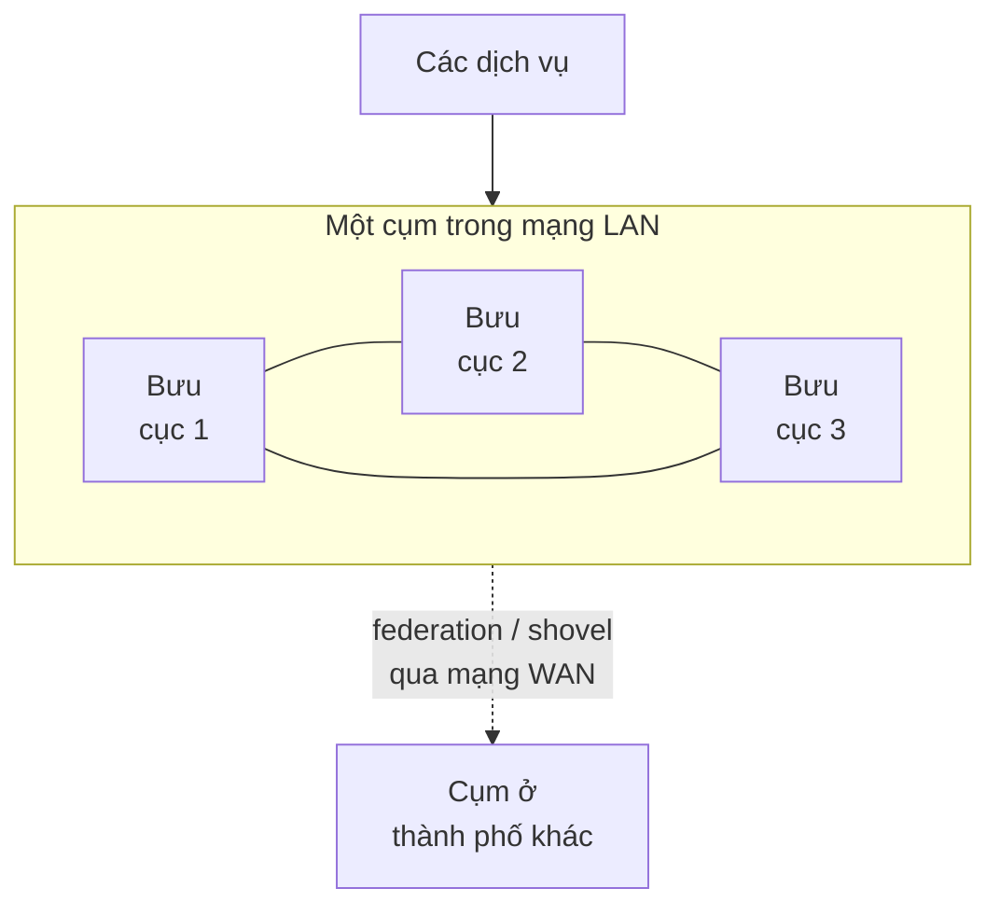

> [!tldr] Đọc nhanh
> - [[concepts/clustering|Cụm]] (cluster) là nhiều node RabbitMQ dùng chung một bộ siêu dữ liệu. Ứng dụng nối vào node nào cũng thấy mọi queue. Nhưng **nội dung** chỉ có bản sao nếu là quorum queue hoặc stream.
> - Từ RabbitMQ 4.3, siêu dữ liệu nằm trong [[concepts/khepri|Khepri]], một kho dùng Raft. Cụm cần **đa số node sống** để khởi động và để đổi cấu trúc, nên luôn dùng số node lẻ: 3 hoặc 5.
> - [[concepts/network-partition|Network partition]] (mạng bị chia cắt): từ 4.3 không còn các chiến lược `pause_minority`, `autoheal`… Raft quyết định: phía đa số chạy tiếp, phía thiểu số đứng im.
> - Cụm chỉ dành cho mạng LAN. Nối các cụm ở xa nhau thì dùng [[concepts/federation|federation]] (cụm xa tự kéo tin về khi có người cần) hoặc [[concepts/shovel|shovel]] (bơm tin một chiều từ nơi này sang nơi khác).
> - [[concepts/feature-flags|Feature flags]] cho phép các node khác phiên bản chạy chung trong lúc nâng cấp lần lượt (rolling upgrade). Bật rồi thì không tắt được.

> [!info] Bối cảnh
> Ga 8 của **tuyến RabbitMQ**. Ở [[posts/2026-11-21-rabbitmq-queue-types|ga 7]], quorum queue chép tin ra nhiều node. Ga này dựng chính các node đó: một cụm 3 node bằng Docker Compose, rồi tắt dần từng node. Ví dụ là **flash-sale**, trang bán hàng giảm giá giờ vàng mình tự viết, hiện chạy một node RabbitMQ duy nhất trong dev. Bạn không cần biết code dự án.

> [!abstract]- Từ điển nhanh cho bài này (bấm để mở)
> - **Quorum queue, Raft, leader, đa số**: xem [[posts/2026-11-21-rabbitmq-queue-types|ga 7]].
> - **Siêu dữ liệu (metadata)**: thông tin *về* hệ thống chứ không phải tin nhắn: user, vhost, exchange, queue, binding, policy.
> - **Erlang**: ngôn ngữ RabbitMQ được viết. Các node Erlang nói chuyện với nhau qua một cơ chế riêng.
> - **Erlang cookie**: một chuỗi bí mật; hai node chỉ nói chuyện được nếu có cùng cookie. Công cụ dòng lệnh cũng cần cookie này.
> - **LAN / WAN**: mạng nội bộ (nhanh, ổn định, cùng trung tâm dữ liệu) / mạng diện rộng (giữa các thành phố, chậm và chập chờn hơn).
> - **Docker Compose**: công cụ chạy nhiều container cùng lúc từ một file cấu hình.
> - **Kubernetes**: hệ thống chạy và điều phối container trên nhiều máy. **Pod** là một bản chạy của ứng dụng trong đó.
> - **Rolling upgrade**: nâng cấp từng máy một trong khi các máy khác vẫn phục vụ.

## Hình dung trước: chuỗi bưu cục và bưu điện thành phố khác

| Đời thường | Khái niệm |
|---|---|
| Ba bưu cục cùng một thành phố dùng chung sổ địa chỉ và danh bạ nhân viên; khách vào bưu cục nào cũng gửi được | [[concepts/clustering\|Clustering]] |
| Sổ địa chỉ chung, chỉ sửa được khi đa số trưởng bưu cục đồng ý | [[concepts/khepri\|Khepri]] |
| Đường dây điện thoại giữa các bưu cục bị đứt, mỗi nhóm tưởng nhóm kia đã đóng cửa | [[concepts/network-partition\|Network partition]] |
| Bưu điện Đà Nẵng nhờ Hà Nội gửi bản sao thư có liên quan, chỉ khi có người ở Đà Nẵng cần | [[concepts/federation\|Federation]] |
| Xe tải định kỳ chở thư từ kho cũ sang kho mới | [[concepts/shovel\|Shovel]] |
| Quy trình mới chỉ áp dụng khi mọi bưu cục đã được tập huấn | [[concepts/feature-flags\|Feature flags]] |



## Vấn đề: một node là một điểm chết

Flash-sale chạy một node RabbitMQ trong Docker. Node đó khởi động lại để nâng cấp mất 30 giây: 30 giây không ai gửi được sự kiện (outbox ở ga 5 giữ chúng lại, may mắn). Node đó hỏng ổ cứng: mất mọi tin chưa xử lý.

Mình từng nghĩ "thêm node thứ hai là xong". Đọc tài liệu mới thấy cụm 2 node là cấu hình **tệ nhất**: khi hai node mất liên lạc với nhau, không bên nào có đa số, và mọi thứ dùng Raft đều đứng. Câu hỏi thật là: cụm chép những gì, mất bao nhiêu node thì còn chạy, và khi mạng bị cắt thì ai được quyền quyết định.

## Cơ chế

<figure class="figure-map" style="--ar: 1 / 1">
<div class="frame"><iframe data-archify="../diagrams/rabbitmq-cluster/cluster.html" title="Sơ đồ kiến trúc: cụm ba node và một cụm ở xa nối bằng federation hoặc shovel" loading="lazy"></iframe></div>
<figcaption><span><b>Hình 1.</b> Trong cụm, các node chép siêu dữ liệu và bản sao quorum cho nhau qua Raft; giữa hai cụm ở xa, tin đi bằng federation hoặc shovel chứ không kéo một cụm qua WAN.</span><a href="../diagrams/rabbitmq-cluster/cluster.html" target="_blank" rel="noopener">Mở toàn màn hình</a></figcaption>
</figure>

### Cụm chép gì, không chép gì

[[concepts/clustering|Cụm]] RabbitMQ là một nhóm node ngang hàng (không có node "chính" cố định):

- **Siêu dữ liệu** (user, vhost, quyền, exchange, queue, binding, policy) được chép tới **mọi** node.
- **Nội dung queue** thì tùy loại: classic queue chỉ nằm trên một node; quorum queue và stream có bản sao trên nhiều node.
- Ứng dụng nối vào **node nào cũng được** và dùng được mọi queue; nếu queue nằm ở node khác, node nhận kết nối tự chuyển tin qua lại. Vì vậy thường đặt một load balancer hoặc tên DNS chung trước cụm, và cho client danh sách nhiều địa chỉ để tự nối lại khi một node chết.

Điều kiện để các node thành một cụm:

- **Chung Erlang cookie.** Công cụ `rabbitmqctl` cũng phải có cookie đó mới điều khiển được node.
- **Thấy nhau qua mạng** ở cổng 4369 (epmd, sổ địa chỉ của Erlang) và 25672 (giao tiếp giữa các node và với CLI), cộng các cổng AMQP 5672, quản trị 15672.
- **Tên node ổn định**, dạng `rabbit@<hostname>`. Đổi hostname là node thành người lạ.
- **Mạng LAN.** Tài liệu RabbitMQ nói rõ cụm không được thiết kế để kéo qua WAN.

Có hai cách ghép node: làm tay bằng `rabbitmqctl join_cluster rabbit@node1` (từ 4.1 không cần `reset` node trước khi ghép), hoặc **peer discovery** để node tự tìm nhau lúc khởi động. Peer discovery là cách nên dùng trong production, với nhiều nguồn: danh sách cố định trong file cấu hình (ví dụ bên dưới dùng cách này), DNS, Kubernetes, AWS, Consul, etcd. Từng có "RAM node" (node chỉ giữ siêu dữ liệu trong RAM); tính năng này đã bị gỡ, mọi node đều là disk node.

### Khepri: sổ địa chỉ dùng chung

Siêu dữ liệu của cụm cần một nơi lưu nhất quán. Lịch sử:

| Phiên bản | Kho siêu dữ liệu |
|---|---|
| 3.x | Mnesia, cơ sở dữ liệu có sẵn của Erlang |
| 3.13 | [[concepts/khepri\|Khepri]] thử nghiệm |
| 4.0 | Khepri được hỗ trợ chính thức |
| 4.2 | Khepri là mặc định cho cụm mới |
| 4.3 | **Mnesia bị gỡ**, Khepri là kho duy nhất |

Khepri dùng Raft, cùng thuật toán với quorum queue. Hệ quả: **cụm cần đa số node sống** để đổi siêu dữ liệu (tạo queue, thêm user, đổi policy), và để khởi động. Cụm 3 node mất 2 node thì node còn lại vẫn đọc được, nhưng không tạo được queue mới. Trên Kubernetes, tài liệu khuyên cho các pod khởi động song song (`podManagementPolicy: Parallel`) để chúng tìm thấy nhau mà có đa số, thay vì chờ từng pod một.

### Network partition: khi mạng bị cắt

[[concepts/network-partition|Network partition]] là khi các node vẫn sống nhưng không thấy nhau: dây mạng lỏng, switch hỏng, tường lửa đổi cấu hình. Mỗi nhóm node tưởng nhóm kia đã chết. Nguy hiểm là cả hai nhóm cùng nhận ghi, và khi nối lại thì dữ liệu mâu thuẫn.

- **Trước 4.3** (thời Mnesia), RabbitMQ có các chiến lược `cluster_partition_handling`: `ignore`, `pause_minority`, `pause_if_all_down`, `autoheal`. Nhiều bài viết, kể cả production checklist hiện tại của RabbitMQ, vẫn khuyên "không chắc thì chọn `pause_minority`".
- **Từ 4.3**, các chiến lược này bị gỡ. Khóa cấu hình vẫn được chấp nhận nhưng không còn tác dụng. Raft quyết định: phía có đa số bầu leader (nếu cần) và chạy tiếp; phía thiểu số không ghi được gì. Khi mạng nối lại, phía thiểu số tự bắt kịp.

Tin unacked trên leader cũ được trả về hàng khi có leader mới, nên consumer có thể nhận trùng (ga 5). Classic queue nằm ở phía thiểu số thì không dùng được cho tới khi nối lại.

| Số node | Đa số | Chịu được bao nhiêu node chết hoặc bị cắt |
|---|---|---|
| 1 | 1 | 0 |
| 2 | 2 | **0** |
| 3 | 2 | 1 |
| 5 | 3 | 2 |

### Federation và shovel: nối các cụm ở xa

Khi cần RabbitMQ ở nhiều trung tâm dữ liệu, mỗi nơi chạy một **cụm riêng**, và tin đi giữa các cụm bằng một trong hai plugin. Cả hai đều chạy được khi hai bên khác phiên bản, khác user, và chịu được mạng WAN chập chờn.

[[concepts/federation|Federation]]:

- **Federated exchange**: exchange ở cụm xuống (downstream) nhận bản sao những tin được gửi vào exchange cùng tên ở cụm nguồn (upstream). Hợp cho "phát sự kiện ra nhiều vùng".
- **Federated queue**: queue ở cụm xuống kéo tin từ queue cùng tên ở upstream **khi nó có consumer mà không có tin**. Hợp cho chia tải giữa các vùng.
- Cấu hình bằng policy và tham số, bất đồng bộ.

[[concepts/shovel|Shovel]]:

- Một tiến trình đơn giản: đọc từ một nguồn (queue hoặc exchange), gửi tới một đích (queue hoặc exchange), một chiều, có ack và confirm ở hai đầu.
- Nói được AMQP 0-9-1 lẫn AMQP 1.0, nên còn dùng để chuyển tin giữa hai hệ thống khác nhau.
- **Dynamic shovel** khai báo lúc chạy (qua CLI, HTTP API hay management UI) là cách hiện đại; static shovel viết trong file cấu hình. Từ 4.2 có **local shovel** chạy trong cùng một cụm.
- Hay dùng để: chuyển tin còn tồn khi đổi loại queue (ga 7), chuyển cụm khi nâng cấp kiểu blue-green, xả hộc thư lỗi về queue chính.

Quy tắc nhớ: **cụm** cho độ sẵn sàng trong một trung tâm dữ liệu; **federation/shovel** cho khoảng cách địa lý.

### Feature flags và nâng cấp

Các node trong cụm có thể khác phiên bản trong lúc nâng cấp lần lượt. [[concepts/feature-flags|Feature flags]] giữ cho chuyện đó an toàn: tính năng mới chỉ bật khi **mọi** node đã hỗ trợ nó.

- Nâng hết các node rồi chạy `rabbitmqctl enable_feature_flag all`.
- Một flag đã bật thì **không tắt được**. Có flag là bắt buộc (required) ở bản sau: phải bật trước khi nâng tiếp.

Song song là vòng đời của **tính năng bị bỏ**: `permitted_by_default` (vẫn chạy, có cảnh báo) → `denied_by_default` (bị chặn, bật lại được bằng cấu hình) → `disconnected` → `removed`. Lệnh `rabbitmq-diagnostics list_deprecated_features` liệt kê trạng thái; trên RabbitMQ 4.4.1 mình thấy queue không bền không độc quyền và global QoS đang `denied_by_default`, còn mirrored queue và RAM node đã `removed`. Chạy `rabbitmq-diagnostics check_if_any_deprecated_features_are_used` trước khi nâng.

Ba cách nâng cấp:

| Cách | Làm thế nào | Khi nào |
|---|---|---|
| **Rolling** (khuyên dùng) | nâng từng node, các node khác vẫn phục vụ | nâng giữa các bản liền kề |
| **Blue-green** (an toàn nhất) | dựng cụm mới bên cạnh, chuyển client và tin (shovel) sang | nhảy nhiều bản, hoặc từ 3.13 có bật Khepri |
| Grow-then-shrink | thêm node mới vào cụm rồi bỏ node cũ | tài liệu không khuyên |

Vài quy tắc cụ thể: từ 3.13, 4.0 hay 4.1 phải lên **4.2 trước** rồi mới lên 4.3/4.4. Trước khi dừng một node, chạy `rabbitmq-diagnostics check_if_node_is_quorum_critical`: nó báo nếu dừng node này sẽ làm quorum queue nào mất đa số. Sau khi nâng xong, `rabbitmq-queues rebalance all` để chia lại leader cho đều. Nâng Erlang cùng RabbitMQ theo bảng tương thích.

Flash-sale đang dùng image `rabbitmq:3-management-alpine`, tức dòng 3.13, đã hết hỗ trợ cộng đồng từ 30/09/2024. Đường lên 4.4 sẽ phải đi qua 4.2. May là code hiện tại không dùng queue không bền hay global QoS, hai thứ bị chặn từ 4.3.

## Ví dụ chạy được: tắt dần một cụm ba node

Thư mục [rabbitmq-cluster](../code/rabbitmq-cluster/quorum-failover.ts) có ba file: `compose.yaml` dựng 3 node, `rabbitmq.conf` cho chúng tìm nhau, và `quorum-failover.ts` tắt dần từng node.

```yaml
# compose.yaml
x-node: &node
  image: rabbitmq:4-management
  environment:
    RABBITMQ_ERLANG_COOKIE: atlas-demo-cookie   # mọi node (và CLI) phải dùng chung cookie
  volumes:
    - ./rabbitmq.conf:/etc/rabbitmq/rabbitmq.conf:ro
services:
  rmq1: { <<: *node, hostname: rmq1, ports: ["5674:5672"] }
  rmq2: { <<: *node, hostname: rmq2, ports: ["5675:5672"] }
  rmq3: { <<: *node, hostname: rmq3, ports: ["5676:5672"] }
```

```ini
# rabbitmq.conf: ba node tự tìm nhau bằng danh sách cố định
cluster_formation.peer_discovery_backend = classic_config
cluster_formation.classic_config.nodes.1 = rabbit@rmq1
cluster_formation.classic_config.nodes.2 = rabbit@rmq2
cluster_formation.classic_config.nodes.3 = rabbit@rmq3
loopback_users.guest = false   # chỉ cho demo: cho guest đăng nhập từ máy host
```

```bash
docker compose -p atlas-cluster up -d          # chờ ~30 giây
docker exec atlas-cluster-rmq1-1 rabbitmqctl cluster_status   # Running Nodes: rmq1, rmq2, rmq3
npm i amqplib && node quorum-failover.ts
docker compose -p atlas-cluster down
```

Script nối vào `rmq1`, tạo quorum queue 3 bản sao, rồi lần lượt: gửi một tin; tắt `rmq3` và gửi; tắt thêm `rmq2` và gửi; bật lại `rmq2`; bật lại `rmq3`. Mỗi lần gửi chờ biên nhận có giới hạn thời gian:

```ts
function publish(ch: amqp.ConfirmChannel, body: string, ms: number): Promise<string> {
  return new Promise((resolve) => {
    const timer = setTimeout(() => resolve(`${body}: CHƯA được xác nhận sau ${ms}ms`), ms);
    ch.sendToQueue(Q, Buffer.from(body), { persistent: true }, (err) => {
      clearTimeout(timer);
      resolve(`${body}: ${err ? 'bị từ chối (nack)' : 'đã xác nhận (ack)'}`);
    });
  });
}
docker(`stop ${node(2)}`);
const pending = publish(ch, 'don-3', 30000);
console.log(await Promise.race([pending, sleep(5000).then(() => 'don-3: sau 5 giây vẫn chưa có xác nhận, publisher phải chờ')]));
docker(`start ${node(2)}`);
console.log(await pending);
```

```text
$ node quorum-failover.ts
0) quorum queue 3 bản sao: leader=rabbit@rmq1, đang sống=rabbit@rmq1, rabbit@rmq2, rabbit@rmq3
   don-1: đã xác nhận (ack)
1) tắt rmq3, còn 2/3 node (vẫn là đa số): leader=rabbit@rmq1, đang sống=rabbit@rmq1, rabbit@rmq2
   don-2: đã xác nhận (ack)
2) tắt thêm rmq2, còn 1/3 node (mất đa số)
   don-3: sau 5 giây vẫn chưa có xác nhận, publisher phải chờ
3) bật lại rmq2, có lại đa số...
   don-3: đã xác nhận (ack)
   số tin trong queue: 3 | leader=rabbit@rmq1, đang sống=rabbit@rmq1, rabbit@rmq2
4) bật lại rmq3: leader=rabbit@rmq1, đang sống=rabbit@rmq1, rabbit@rmq2, rabbit@rmq3
```

Đây chính là bảng đa số ở trên, chạy thật:

- Mất 1/3 node: không ai nhận ra, `don-2` vẫn được xác nhận ngay.
- Mất 2/3 node: `rmq1` vẫn sống, connection vẫn mở, nhưng `don-3` **không được xác nhận**. Queue không dám ghi khi không có đa số. Producer dùng confirm biết điều đó; producer không dùng confirm sẽ tưởng đã gửi xong.
- Có lại đa số: biên nhận của `don-3` tới, và queue có đủ 3 tin. Không tin nào mất.
- `rmq3` bật lại thì tự bắt kịp và trở lại danh sách bản sao.

Script cố ý không bao giờ tắt `rmq1` vì nó đang giữ connection. Trong thực tế, client nên có danh sách nhiều node và tự nối lại; khi leader chết, hai node còn lại bầu leader mới như hình 1 ở ga 7.

## Hiểu lầm và bẫy hay gặp

### Cụm 2 node "để có dự phòng"

Đứt mạng giữa hai node là không bên nào có đa số: Khepri và mọi quorum queue cùng đứng. Dùng 3 hoặc 5 node.

### Kéo một cụm qua hai trung tâm dữ liệu

Độ trễ và mạng chập chờn của WAN làm Raft bầu lại leader liên tục. Mỗi nơi một cụm, nối bằng federation hoặc shovel.

### Cấu hình `pause_minority` trên 4.3+

Không còn tác dụng. Raft đã lo phần đó. Bài viết và checklist cũ chưa cập nhật.

### Nghĩ cụm làm classic queue sống sót

Classic queue chỉ nằm trên một node; node đó chết là queue không dùng được. Dữ liệu quan trọng phải ở quorum queue.

### Quên cookie khi dùng CLI

`rabbitmqctl` báo không nối được node, dù node đang chạy, chỉ vì CLI đọc cookie khác. Đặt cookie giống nhau cho cả node lẫn người dùng chạy CLI.

### Nâng cấp nhảy cóc

Từ 3.13 lên thẳng 4.4 là không được. Đi qua 4.2, bật đủ feature flags ở mỗi bước, kiểm tra tính năng bị bỏ trước khi nâng.

### Dừng node mà không kiểm tra quorum

Dừng một node khi một quorum queue chỉ còn đủ đa số nhờ node đó là làm queue đứng. Chạy `check_if_node_is_quorum_critical` trước.

## Câu hỏi tự kiểm tra

> [!question]- Cụm RabbitMQ chép những gì tới mọi node?
> Siêu dữ liệu: user, vhost, quyền, exchange, queue, binding, policy. Nội dung tin chỉ có bản sao nếu là quorum queue hoặc stream.

> [!question]- Vì sao không nên chạy cụm 2 node?
> Đa số của 2 là 2. Mất một node hoặc đứt mạng giữa hai node là không bên nào có đa số, nên Khepri và quorum queue đều ngừng ghi.

> [!question]- Trên RabbitMQ 4.4, khi mạng chia cụm 5 node thành nhóm 3 và nhóm 2, chuyện gì xảy ra?
> Nhóm 3 có đa số, tiếp tục chạy và bầu leader mới cho các quorum queue cần. Nhóm 2 không ghi được. Khi nối lại, nhóm 2 tự bắt kịp. Tin unacked có thể bị giao lại.

> [!question]- Federation và shovel khác nhau thế nào?
> Federation là quan hệ theo exchange hoặc queue: cụm xuống nhận bản sao tin từ upstream, với federated queue thì chỉ kéo khi có consumer cần. Shovel là một ống bơm một chiều từ nguồn tới đích, đơn giản và tổng quát hơn.

> [!question]- Trước khi nâng cấp rolling cần làm gì?
> Kiểm tra đường nâng cấp (qua 4.2 nếu cần), bật mọi feature flag, kiểm tra tính năng bị bỏ đang dùng, và trước khi dừng mỗi node chạy `check_if_node_is_quorum_critical`.

> [!question]- Trong ví dụ, vì sao `don-3` không được xác nhận dù `rmq1` vẫn sống?
> Quorum queue 3 bản sao cần đa số 2 để ghi. Chỉ còn 1 node nên lệnh ghi không thể có hiệu lực, broker không gửi biên nhận cho tới khi có lại đa số.

## Tham khảo

- [RabbitMQ: Clustering Guide](https://www.rabbitmq.com/docs/clustering)
- [RabbitMQ: Metadata Store (Khepri)](https://www.rabbitmq.com/docs/metadata-store)
- [RabbitMQ: Clustering and Network Partitions](https://www.rabbitmq.com/docs/partitions)
- [RabbitMQ: Federation](https://www.rabbitmq.com/docs/federation) và [Shovel](https://www.rabbitmq.com/docs/shovel)
- [RabbitMQ: Feature Flags](https://www.rabbitmq.com/docs/feature-flags) và [Deprecated Features](https://www.rabbitmq.com/docs/deprecated-features)
- [RabbitMQ: Upgrading](https://www.rabbitmq.com/docs/upgrade)
- [Release notes RabbitMQ 4.3](https://github.com/rabbitmq/rabbitmq-server/blob/main/release-notes/4.3.0.md)
