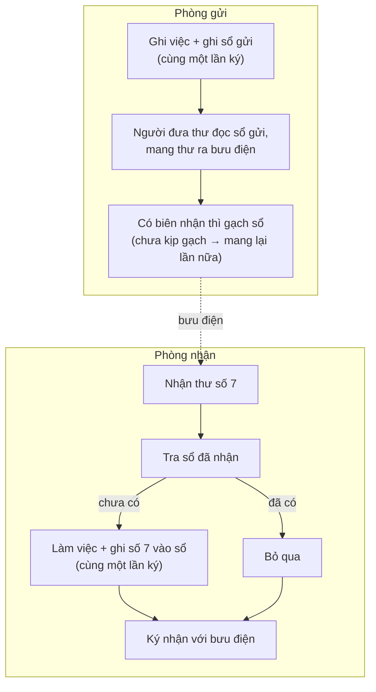

> [!tldr] Đọc nhanh
> - Có hai mức đảm bảo: **at-most-once** (không ack, không confirm: có thể mất, không trùng) và [[at-least-once-delivery|at-least-once]] (ack + confirm + tin bền: không mất, **có thể trùng**).
> - RabbitMQ không hứa [[exactly-once-delivery|exactly-once]]. "Đúng một lần" là việc của ứng dụng: at-least-once cộng [[idempotent-consumer|consumer idempotent]].
> - Consumer idempotent ghi mã sự kiện vào một bảng "đã xử lý" **trong cùng transaction** với việc nghiệp vụ; gặp lại mã cũ thì bỏ qua và vẫn ack.
> - [[transactional-outbox|Transactional outbox]] giải bài "ghi database rồi gửi tin": ghi sự kiện vào bảng outbox cùng transaction với dữ liệu, một tiến trình khác đọc outbox và gửi đi.
> - [[message-ordering|Thứ tự]] chỉ giữ trong một queue với một consumer; nhiều consumer, requeue hay priority đều đảo thứ tự. [[request-reply|Request-reply]] dùng `reply_to` + `correlation_id`.

> [!info] Bối cảnh
> Ga 5 của **tuyến RabbitMQ**. Ví dụ là **flash-sale**, trang bán hàng giảm giá giờ vàng mình tự viết. Khi khách hủy đơn, một sự kiện `order.cancelled` được gửi đi để dịch vụ kho **cộng lại** số lượng. Cộng thiếu thì hàng bị kẹt, cộng hai lần thì kho ảo, bán quá số có thật. Ga này chính là chuyện "không thiếu, không thừa". Đoạn code flash-sale trong bài đã rút gọn và đổi tên; bạn không cần biết dự án.

> [!abstract]- Từ điển nhanh cho bài này (bấm để mở)
> - **Ack, publisher confirm, persistent, redelivered**: xem [[2026-11-21-rabbitmq-ack-confirm|ga 4]].
> - **Transaction (giao dịch database)**: nhóm câu lệnh SQL hoặc cùng có hiệu lực, hoặc cùng bị hủy. Xem thêm [[dual-write|Ghi hai nơi]].
> - **Commit**: lệnh chốt transaction, mọi thay đổi chính thức có hiệu lực.
> - **Postgres**: hệ quản trị cơ sở dữ liệu flash-sale dùng.
> - **`ON CONFLICT DO NOTHING`**: câu `INSERT` của Postgres "nếu khóa đã tồn tại thì không làm gì", không báo lỗi.
> - **`FOR UPDATE SKIP LOCKED`**: khóa các dòng mình đọc, và bỏ qua dòng đang bị người khác khóa. Cho phép nhiều tiến trình cùng lấy việc mà không giẫm chân nhau.
> - **Cron job**: việc chạy định kỳ, ví dụ mỗi giây một lần.
> - **Idempotency**: làm một lần hay nhiều lần cho cùng kết quả. Xem [[idempotency|Idempotency]] ở tuyến API.
> - **UUID**: chuỗi ngẫu nhiên đủ dài để gần như không bao giờ trùng, dùng làm mã định danh.

## Hình dung trước: sổ gửi thư và sổ đã nhận

Một văn phòng làm việc cẩn thận có hai cuốn sổ: **sổ gửi** ở phòng gửi, **sổ đã nhận** ở phòng nhận.

| Đời thường | Khái niệm |
|---|---|
| Bưu điện hứa: thư bảo đảm thì không mất, nhưng thỉnh thoảng phát hai lần | [[at-least-once-delivery\|At-least-once delivery]] |
| Lời hứa "mỗi thư tới đúng một lần" mà không bưu điện nào dám ký | [[exactly-once-delivery\|Exactly-once delivery]] |
| Phòng nhận tra sổ: thư số 7 đã làm rồi thì cất đi, không làm lại | [[idempotent-consumer\|Idempotent consumer]] |
| Viết thư vào **sổ gửi** cùng lúc ghi việc vào sổ sách; người đưa thư đi theo sổ | [[transactional-outbox\|Transactional outbox]] |
| Một hàng người chờ một quầy thì đúng thứ tự; mở ba quầy thì ai xong trước không biết | [[message-ordering\|Message ordering]] |
| Gửi thư hỏi giá, ghi "trả lời về hộc số 12, mã câu hỏi A7" | [[request-reply\|Request-reply]] |



## Vấn đề: tin trùng đến từ đâu

Sau ga 4, mình tưởng đã xong: ack thủ công, confirm, persistent. Tin không mất nữa. Nhưng thử hình dung: khách hủy một đơn 2 cái, và kho được cộng 4. Không có dòng code nào cộng hai lần cả.

Mình từng nghĩ "đã ack thì không bao giờ nhận lại". Hóa ra chính các cơ chế chống mất tin là thứ sinh ra tin trùng:

1. **Consumer chết sau khi làm xong, trước khi ack.** Kho đã cộng, nhưng broker chưa nhận ack, nên giao lại cho consumer khác. Cộng lần hai.
2. **Producer gửi lại vì không thấy biên nhận.** Tin đã tới broker, nhưng biên nhận bị mất trên đường về (mạng chập chờn, producer khởi động lại). Producer an toàn thì phải gửi lại, và broker có hai bản.
3. **Cụm đổi leader** (ga 7, 8): khi node chính của một quorum queue mất liên lạc, các tin đang unacked được trả về hàng và giao lại.

Không có cấu hình nào của RabbitMQ tắt được cả ba. Phải sửa ở ứng dụng.

## Cơ chế

<figure class="figure-map" style="--ar: 4 / 5">
<div class="frame"><iframe data-archify="../diagrams/rabbitmq-delivery-guarantees/outbox-inbox.html" title="Sơ đồ tuần tự: outbox phía gửi và bảng đã xử lý phía nhận" loading="lazy"></iframe></div>
<figcaption><span><b>Hình 1.</b> Outbox bảo đảm sự kiện không mất dù broker sập lúc commit; bảng "đã xử lý" bảo đảm sự kiện tới hai lần vẫn chỉ cộng kho một lần.</span><a href="../diagrams/rabbitmq-delivery-guarantees/outbox-inbox.html" target="_blank" rel="noopener">Mở toàn màn hình</a></figcaption>
</figure>

### At-most-once và at-least-once

Tài liệu "Reliability" của RabbitMQ gọi tên hai mức:

| | At-most-once | [[at-least-once-delivery\|At-least-once]] |
|---|---|---|
| Cấu hình | auto-ack, không confirm, tin không bền | ack thủ công, confirm, queue bền, tin persistent |
| Mất tin | có thể | không (trong giới hạn bản sao, ga 7) |
| Trùng tin | không | **có thể** |
| Hợp với | số liệu đo đạc, log debug, dữ liệu mất vài điểm không sao | đơn hàng, thanh toán, tồn kho |

Hai mức là một đánh đổi: muốn không mất thì phải chấp nhận gửi lại khi nghi ngờ, và gửi lại thì có lúc thừa. Không có ô thứ ba.

### Vì sao không có exactly-once

[[exactly-once-delivery|Exactly-once]] nghĩa là mỗi tin được *xử lý* đúng một lần, kể cả khi mạng rớt, process chết, broker đổi node. Vấn đề cốt lõi: **việc xử lý và việc ack là hai thao tác ở hai hệ thống khác nhau** (database của bạn và RabbitMQ). Không có transaction nào bao trùm cả hai, nên luôn có một khoảnh khắc giữa "đã làm" và "đã báo". Chết đúng khoảnh khắc đó thì broker không thể biết việc đã xong hay chưa, và lựa chọn an toàn duy nhất là giao lại.

Tài liệu RabbitMQ không hứa exactly-once. Các hệ thống quảng cáo "exactly-once" thường chỉ đảm bảo trong phạm vi chính nó (ví dụ từ một topic này sang topic khác), không tới tận database của consumer. Cách thực tế ở mọi nơi là: **at-least-once + xử lý idempotent = hiệu quả như exactly-once**.

### Consumer idempotent: sổ "đã xử lý"

[[idempotent-consumer|Idempotent consumer]] là consumer mà nhận một tin hai lần cũng cho kết quả như nhận một lần. Có hai cách:

1. **Việc tự nhiên idempotent.** "Đặt trạng thái đơn = đã hủy" chạy hai lần vẫn là đã hủy. "Cộng kho thêm 2" thì không.
2. **Sổ đã xử lý (inbox / dedup table).** Mỗi sự kiện mang một mã duy nhất. Consumer ghi mã vào một bảng có khóa chính là mã đó; nếu ghi được thì làm việc, nếu mã đã có thì bỏ qua.

Điều quyết định là **ghi sổ và làm việc phải nằm trong cùng một transaction database**:

- Ghi sổ ở transaction riêng, *trước* khi làm việc: ghi xong sổ, làm việc thì lỗi. Lần giao lại thấy sổ đã có, bỏ qua. Việc **mất**.
- Ghi sổ *sau* khi làm việc, ở transaction riêng: làm xong, chết trước khi ghi sổ. Lần giao lại không thấy sổ, làm lần hai. **Trùng**.
- Cùng một transaction: hoặc cả hai có hiệu lực, hoặc không cái nào. Chết ở đâu cũng đúng.

Flash-sale làm đúng như vậy trong một lớp cha dùng chung cho mọi consumer. Rút gọn và đổi tên:

```ts
// minh họa, không chạy trực tiếp
const eventId = msg.properties.headers['x-event-id'] ?? msg.properties.messageId;
try {
  await db.$transaction(async (tx) => {
    // INSERT INTO processed_events (event_id, consumer) ... ON CONFLICT DO NOTHING RETURNING event_id
    const firstTime = await processedEvents.mark(tx, eventId, this.consumerName);
    if (!firstTime) return;          // đã xử lý rồi: bỏ qua
    await this.handle(payload, tx);  // việc nghiệp vụ, cùng transaction
  });
  return ACK;
} catch {
  return NACK_NO_REQUEUE;            // lỗi: chuyển sang hộc thư lỗi (ga 6)
}
```

Hai chi tiết đáng chép:

- Khóa chính của bảng là cặp **(mã sự kiện, tên consumer)**. Mỗi consumer giữ sổ riêng: dịch vụ kho đã xử lý `evt-7` không có nghĩa dịch vụ email đã xử lý.
- Gặp tin trùng vẫn **ack**. Không ack thì tin trùng quay về hàng mãi.

Mã sự kiện phải do **người tạo sự kiện** sinh ra và giữ nguyên khi gửi lại (ở flash-sale là mã dòng outbox). Đừng dựa vào cờ `redelivered`: ví dụ bên dưới cho thấy một tin trùng do producer gửi lại có `redelivered = false`.

### Transactional outbox: không mất ở phía gửi

Phía gửi có bài toán riêng, chính là [[dual-write|ghi hai nơi]]: hủy đơn trong database **và** gửi sự kiện cho RabbitMQ.

- Commit database rồi mới gửi: process chết giữa hai bước là đơn đã hủy nhưng sự kiện không bao giờ đi. Kho kẹt mãi.
- Gửi rồi mới commit: commit lỗi (ràng buộc dữ liệu, deadlock) là sự kiện đã đi cho một việc không xảy ra.

[[transactional-outbox|Transactional outbox]] chuyển việc "gửi" thành việc "ghi":

1. Trong **cùng transaction** với việc nghiệp vụ, ghi sự kiện vào bảng `outbox` (trạng thái PENDING).
2. Một tiến trình riêng, **relay**, định kỳ đọc các dòng PENDING, gửi chúng cho RabbitMQ với publisher confirm.
3. Có biên nhận thì đánh dấu dòng là PUBLISHED. Lỗi thì tăng số lần thử, chờ lâu dần rồi thử lại.

Relay chết sau khi có biên nhận nhưng trước khi đánh dấu thì lần sau sẽ gửi lại, nên outbox **luôn đi kèm** consumer idempotent. Hai mẫu này là một cặp.

Relay của flash-sale chạy mỗi giây, lấy tối đa 100 dòng bằng `FOR UPDATE SKIP LOCKED` để nhiều pod chạy song song không lấy trùng dòng, và gửi với `persistent: true`, `messageId` bằng mã dòng outbox:

```ts
// minh họa, không chạy trực tiếp
if (!amqp.connected) return;  // mất kết nối: để lần sau, đừng gửi lúc này
await amqp.publish(exchangeFor(event), event.type, event.payload, {
  messageId: event.id, persistent: true,
  headers: { 'x-event-id': event.id },
});
await outbox.markPublished(event.id);
```

Dòng đầu là một bài học thật. Thư viện kết nối mà dự án dùng (`amqp-connection-manager`) **giữ tin lại** khi mất kết nối và chỉ gửi khi kết nối lại, nên lời hứa `publish` không bao giờ xong trong lúc broker sập. Relay mà chờ nó thì treo cả vòng lặp. Kiểm tra kết nối trước và bỏ qua lượt này an toàn hơn, vì dòng outbox vẫn PENDING và lần sau sẽ được gửi.

Nhờ outbox, broker sập cũng không làm mất sự kiện: chúng nằm trong Postgres và được gửi khi broker sống lại.

### Thứ tự tin

[[message-ordering|Thứ tự]] trong RabbitMQ giữ được ở mức này: các tin gửi bởi **một producer trên một channel** vào **một queue** sẽ được giao theo đúng thứ tự gửi. Nhưng thứ tự bị đảo khi:

- **Nhiều consumer cùng đọc một queue**: tin 1 cho A, tin 2 cho B; B nhanh hơn thì tin 2 xong trước.
- **Requeue**: tin bị trả về được đặt lại vị trí cũ nếu có thể, không thì gần đầu hàng, nhưng trong lúc đó các tin sau đã được giao.
- **Priority** (ga 6): tin ưu tiên cao vượt lên trước.
- **Nhiều producer** hay nhiều channel: không có thứ tự chung giữa chúng.

Nếu thứ tự quan trọng (ví dụ "đặt" phải trước "hủy" của cùng một đơn), có ba hướng: một consumer duy nhất cho queue đó, dùng **Single Active Consumer** để vẫn có máy dự phòng ([[2026-11-21-rabbitmq-queue-types|ga 7]]), hoặc chia tin theo khóa bằng consistent hash exchange (ga 3) để mọi tin của một đơn vào cùng một queue. Cách bền nhất là làm consumer **không phụ thuộc thứ tự**: mang số phiên bản trong sự kiện và bỏ qua sự kiện cũ hơn trạng thái hiện tại.

### Request-reply: hỏi và chờ trả lời qua broker

Đôi khi cần hỏi qua broker và chờ câu trả lời (RPC). [[request-reply|Request-reply]] dùng hai property ở ga 2:

- `reply_to`: tên queue mà bên hỏi muốn nhận câu trả lời.
- `correlation_id`: mã của câu hỏi, để bên hỏi biết câu trả lời nào ứng với câu hỏi nào.

Bên trả lời xử lý xong thì gửi kết quả vào default exchange với routing key bằng `reply_to`, kèm đúng `correlation_id`.

RabbitMQ có sẵn một cách nhẹ hơn khai báo queue trả lời riêng: **Direct Reply-to**. Bên hỏi consume pseudo-queue `amq.rabbitmq.reply-to` (bắt buộc `noAck: true`, trên **cùng channel** dùng để gửi câu hỏi, và phải consume *trước* khi gửi). Câu trả lời đi thẳng về channel đó mà không qua queue thật nào. Đổi lại, nó là at-most-once: bên hỏi chết thì câu trả lời mất. Transport RabbitMQ của NestJS dùng Direct Reply-to làm mặc định cho `client.send()`.

Mình hiếm khi cần mẫu này. Nếu bên hỏi phải chờ câu trả lời mới đi tiếp, gọi HTTP/gRPC thẳng thường đơn giản hơn; RPC qua broker hợp khi muốn tận dụng work queue để chia câu hỏi cho nhiều worker.

## Ví dụ chạy được

Hai file, cùng broker Docker như các ga trước:

```bash
docker run -d --rm --name atlas-rabbit -p 5673:5672 -p 15673:15672 rabbitmq:4-management
npm i amqplib
node idempotent-consumer.ts
node rpc-direct-reply.ts
```

### Hai nguồn trùng, một sổ chống trùng

[idempotent-consumer.ts](../code/rabbitmq-delivery-guarantees/idempotent-consumer.ts) tạo cả hai nguồn trùng cùng lúc: producer gửi `evt-1` hai lần (như relay outbox gửi lại), và consumer A commit xong rồi chết trước khi ack. "Database" ở đây là một `Map` trong bộ nhớ với hàm `transaction` giả lập để ví dụ chạy độc lập.

```ts
transaction((tx) => {
  if (tx.processed.has(id)) { skipped = true; return; }
  tx.processed.add(id);   // ghi sổ
  tx.stock -= qty;        // việc nghiệp vụ, cùng transaction
});
if (label === 'A' && crashOnce) { crashOnce = false; c.close(); return; } // chết sau khi commit, trước khi ack
c.ack(msg);
```

```text
$ node idempotent-consumer.ts
[A] evt-1 redelivered=false → trừ kho 2; kho còn 98
[B] evt-1 redelivered=true → ĐÃ XỬ LÝ, bỏ qua; kho còn 98
[B] evt-1 redelivered=false → ĐÃ XỬ LÝ, bỏ qua; kho còn 98
[B] evt-2 redelivered=false → trừ kho 5; kho còn 93
Kết quả cuối: kho = 93 (đúng phải là 100 - 2 - 5 = 93)
```

`evt-1` tới ba lần: lần đầu, lần giao lại sau khi A chết (`redelivered=true`), và bản gửi lại của producer (`redelivered=false`). Dòng thứ ba là lý do không được dùng cờ `redelivered` để chống trùng. Kho cuối cùng vẫn đúng 93.

### Request-reply với Direct Reply-to

[rpc-direct-reply.ts](../code/rabbitmq-delivery-guarantees/rpc-direct-reply.ts) hỏi giá một sản phẩm qua broker:

```ts
await client.consume('amq.rabbitmq.reply-to', (msg) => {
  pending.get(msg.properties.correlationId)?.(msg.content.toString());
}, { noAck: true });               // phải consume trước khi gửi, noAck bắt buộc

client.sendToQueue(Q, Buffer.from(JSON.stringify({ sku })),
  { replyTo: 'amq.rabbitmq.reply-to', correlationId: id });

// phía server:
server.publish('', msg.properties.replyTo, Buffer.from(JSON.stringify({ sku, price })),
  { correlationId: msg.properties.correlationId });
```

```text
$ node rpc-direct-reply.ts
{"sku":"AO-THUN","price":99000} (4.4 ms)
{"sku":"KHONG-CO","price":0}
```

Một vòng hỏi-đáp mất vài mili giây trên máy mình. Nếu server không trả lời, câu hỏi chỉ hết hạn nhờ `setTimeout` 2 giây phía client; luôn đặt timeout cho RPC qua broker.

## Hiểu lầm và bẫy hay gặp

### "RabbitMQ đảm bảo mỗi tin được xử lý đúng một lần"

Không. Chỉ có at-most-once hoặc at-least-once. Hệ thống quan trọng chọn at-least-once và làm consumer idempotent.

### Chống trùng bằng `redelivered`

Cờ này không thấy được tin trùng do producer gửi lại. Dùng mã sự kiện do người tạo sinh ra.

### Ghi sổ dedup ngoài transaction

Ghi trước thì có thể mất việc, ghi sau thì có thể trùng việc. Cùng một transaction, không ngoại lệ.

### Sổ dedup trong RAM

Một `Set` trong bộ nhớ mất khi process khởi động lại, và mỗi pod có một `Set` riêng. Sổ phải nằm ở nơi bền và dùng chung: database của consumer, hoặc Redis với thời hạn đủ dài.

### Publish ngay trong transaction database

Gửi tin trước khi commit thì commit lỗi là sự kiện đã đi cho việc không xảy ra; consumer có thể đọc database và không thấy đơn. Dùng outbox.

### Outbox mà quên dọn

Bảng outbox lớn dần mãi. Xóa hoặc chuyển các dòng PUBLISHED đủ cũ sang kho lưu trữ, và cảnh báo khi số dòng PENDING hay FAILED tăng.

### Tin rằng hàng đợi luôn đúng thứ tự

Một queue nhiều consumer là đã đảo thứ tự. Thiết kế consumer chịu được thứ tự sai, hoặc dùng SAC/consistent hash có chủ đích.

## Câu hỏi tự kiểm tra

> [!question]- Kể ba nguồn gây trùng tin trong RabbitMQ.
> Consumer chết sau khi xử lý nhưng trước khi ack; producer gửi lại vì không nhận được biên nhận; leader của quorum queue thay đổi khi mạng chia cắt, các tin unacked được giao lại.

> [!question]- Vì sao bảng "đã xử lý" phải nằm cùng transaction với việc nghiệp vụ?
> Nếu tách ra, chết giữa hai bước sẽ cho một trong hai kết quả sai: đánh dấu xong nhưng việc chưa làm (mất), hoặc việc đã làm nhưng chưa đánh dấu (trùng).

> [!question]- Outbox giải quyết vấn đề gì và để lại vấn đề gì?
> Giải quyết "ghi hai nơi": sự kiện không mất khi commit database thành công mà gửi broker thất bại. Để lại: relay có thể gửi trùng, nên consumer phải idempotent.

> [!question]- Tin `redelivered = false` có chắc chưa được xử lý không?
> Chắc là chưa từng được *giao* lần nào ở queue này. Nhưng nó vẫn có thể là bản gửi lại của producer cho một sự kiện đã xử lý, nên không dùng để chống trùng được.

> [!question]- Một queue, ba consumer, prefetch 10. Có giữ được thứ tự "đặt trước, hủy sau" của cùng một đơn không?
> Không chắc. Hai tin có thể vào hai consumer khác nhau và tin hủy xong trước. Cần một consumer duy nhất (hoặc SAC), chia theo khóa đơn hàng, hoặc làm consumer bỏ qua sự kiện cũ hơn trạng thái hiện tại.

> [!question]- Direct Reply-to có những ràng buộc gì?
> Bên hỏi phải consume `amq.rabbitmq.reply-to` với `noAck: true`, trên cùng channel dùng để gửi câu hỏi, và trước khi gửi. Câu trả lời là at-most-once: bên hỏi chết thì mất.

## Tham khảo

- [RabbitMQ: Reliability Guide](https://www.rabbitmq.com/docs/reliability)
- [RabbitMQ: Consumer Acknowledgements and Publisher Confirms](https://www.rabbitmq.com/docs/confirms)
- [RabbitMQ: Queues](https://www.rabbitmq.com/docs/queues) (thứ tự tin)
- [RabbitMQ: Direct Reply-to](https://www.rabbitmq.com/docs/direct-reply-to) và [tutorial 6: RPC](https://www.rabbitmq.com/tutorials/tutorial-six-javascript)
- [microservices.io: Transactional outbox](https://microservices.io/patterns/data/transactional-outbox.html)
- [NestJS: RabbitMQ transport](https://docs.nestjs.com/microservices/rabbitmq)
