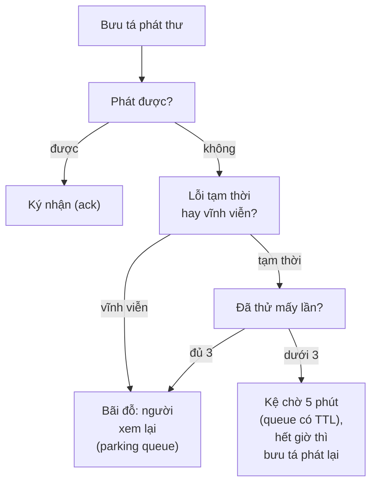

> [!tldr] Đọc nhanh
> - [[concepts/dead-letter-exchange|Dead letter exchange]] (DLX) là exchange nhận các tin "chết": bị từ chối không requeue, hết hạn, bị đẩy ra vì queue đầy, hoặc vượt số lần giao. DLX không có queue nào bind thì tin chết **mất im lặng**.
> - [[concepts/message-ttl|TTL]] đặt thời hạn sống cho tin (theo queue hoặc từng tin). Tin hết hạn chỉ bị xóa khi lên **đầu** hàng.
> - [[concepts/queue-length-limit|Giới hạn độ dài]] chặn queue phình vô hạn: bỏ tin cũ nhất (`drop-head`) hoặc từ chối tin mới (`reject-publish`).
> - [[concepts/delayed-retry|Retry có độ trễ]] = nack không requeue → DLX → queue chờ có TTL → hết hạn quay về queue chính; đếm số lần bằng header `x-death`. [[concepts/poison-message|Tin độc]] thử mãi không được thì chuyển sang "bãi đỗ".
> - [[concepts/delayed-message|Hẹn giờ giao tin]]: plugin delayed message đã ngừng bảo trì. RabbitMQ 4.4 làm sẵn trên quorum queue. [[concepts/priority-queue|Priority queue]] cho tin quan trọng chen lên trước khi hàng đang tồn.

> [!info] Bối cảnh
> Ga 6 của **tuyến RabbitMQ**. Ví dụ là **flash-sale**, trang bán hàng giảm giá giờ vàng mình tự viết: một consumer gọi cổng thanh toán, và cổng thanh toán thỉnh thoảng lỗi tạm thời. Lại có những tin lỗi *vĩnh viễn*, như sự kiện cho một đơn hàng đã bị xóa. Ga này phân biệt hai loại đó và cho mỗi loại một lối ra. Bạn không cần biết code dự án.

> [!abstract]- Từ điển nhanh cho bài này (bấm để mở)
> - **Ack, nack, reject, requeue**: xem [[posts/2026-11-21-rabbitmq-ack-confirm|ga 4]]. Tóm tắt: `nack`/`reject` với `requeue = false` nghĩa là "tin này tôi không xử lý được, đừng trả lại hàng".
> - **Exchange, binding, routing key, header**: xem [[posts/2026-11-21-rabbitmq-amqp-model|ga 2]] và [[posts/2026-11-21-rabbitmq-exchanges|ga 3]].
> - **Lỗi tạm thời / vĩnh viễn**: tạm thời là lỗi tự hết nếu chờ (mạng chập, dịch vụ khác đang khởi động lại); vĩnh viễn là thử bao nhiêu lần cũng lỗi (dữ liệu hỏng, đơn không tồn tại).
> - **Backoff**: chờ lâu dần giữa các lần thử. Xem [[concepts/retries-with-backoff|Retry with Backoff]] ở tuyến API.
> - **Policy**: cấu hình áp cho nhiều queue/exchange theo mẫu tên, đổi được lúc đang chạy. Chi tiết ở [[posts/2026-11-21-rabbitmq-operations|ga 9]].
> - **Epoch milliseconds**: thời điểm tính bằng số mili giây từ 1/1/1970, cách máy tính hay lưu thời gian.

## Hình dung trước: phòng thư lỗi của bưu điện

Bưu điện nào cũng có những lá thư không phát được. Bưu điện tốt không vứt chúng đi, cũng không cho bưu tá chạy đi chạy lại cùng một địa chỉ cả ngày.

| Đời thường | Khái niệm |
|---|---|
| Phòng "thư không phát được": mọi thư trả về đều chuyển tới đây | [[concepts/dead-letter-exchange\|Dead letter exchange]] |
| Thư ghi "quá ngày 15 thì hủy" | [[concepts/message-ttl\|Message TTL]] |
| Hộc thư chỉ chứa 100 lá; đầy thì bỏ lá cũ nhất hoặc từ chối nhận thêm | [[concepts/queue-length-limit\|Queue length limit]] |
| Nhà vắng chủ: để thư vào kệ "phát lại sau 5 phút", tối đa 3 lần | [[concepts/delayed-retry\|Delayed retry]] |
| Thư ghi địa chỉ không tồn tại: phát bao nhiêu lần cũng thất bại | [[concepts/poison-message\|Poison message]] |
| Thư hẹn "giao đúng sáng mùng 1" | [[concepts/delayed-message\|Delayed message]] |
| Thư hỏa tốc được xếp lên trước đống thư thường đang chờ | [[concepts/priority-queue\|Priority queue]] |



## Vấn đề: requeue không phải là retry

Ở ga 4, mình biết khi lỗi có thể trả tin về hàng (`requeue = true`). Mình từng nghĩ thế là có retry miễn phí. Thử với cổng thanh toán đang sập:

- Tin bị trả về và được giao lại **ngay**, trong vài mili giây. Cổng thanh toán chưa kịp sống lại.
- Consumer lỗi, trả về, nhận lại, lỗi… hàng nghìn lần mỗi giây. CPU của consumer và broker cùng lên 100%, log đầy.
- Nếu lỗi là vĩnh viễn (JSON hỏng), vòng lặp không bao giờ dừng, và các tin xếp sau bị kẹt.

Ngược lại, `requeue = false` mà không cấu hình gì thêm thì tin bị **bỏ**. Cả hai đều tệ. Thứ cần có: một lối ra cho tin lỗi, một khoảng chờ trước khi thử lại, và một giới hạn số lần thử.

## Cơ chế

<figure class="figure-map" style="--ar: 1 / 1">
<div class="frame"><iframe data-archify="../diagrams/rabbitmq-dlx-retry/retry-topology.html" title="Sơ đồ kiến trúc: retry có độ trễ bằng dead letter exchange, TTL và bãi đỗ" loading="lazy"></iframe></div>
<figcaption><span><b>Hình 1.</b> Thư lỗi đi một vòng qua hộc chờ có TTL rồi quay về hộc việc; lần thứ ba vẫn lỗi thì vào bãi đỗ thay vì quay vòng mãi.</span><a href="../diagrams/rabbitmq-dlx-retry/retry-topology.html" target="_blank" rel="noopener">Mở toàn màn hình</a></figcaption>
</figure>

### Dead letter exchange: phòng thư không phát được

[[concepts/dead-letter-exchange|Dead letter exchange]] không phải một loại exchange đặc biệt. Nó là một exchange bình thường (thường là fanout, topic hoặc direct) được **chỉ định** làm nơi nhận tin chết của một queue. Một tin bị "dead-letter" khi:

1. Consumer `reject` hoặc `nack` với `requeue = false`.
2. Tin hết hạn TTL.
3. Tin bị đẩy ra vì queue vượt giới hạn độ dài (`drop-head`, hoặc `reject-publish-dlx`).
4. Tin vượt số lần giao tối đa (delivery limit, chỉ quorum queue, [[posts/2026-11-21-rabbitmq-queue-types|ga 7]]).

Cấu hình bằng tham số của queue (`x-dead-letter-exchange`, tùy chọn `x-dead-letter-routing-key`) hoặc, nên hơn, bằng **policy** `dead-letter-exchange` để đổi được mà không khai báo lại queue. Nếu cả hai cùng có, tham số trên queue thắng. Không đặt routing key riêng thì tin chết giữ routing key gốc.

Mỗi lần chết, broker thêm (hoặc cập nhật) header **`x-death`** trên tin. Đó là một mảng, mỗi phần tử ứng với một cặp (queue, lý do), mới nhất đứng đầu:

| Trường | Ý nghĩa |
|---|---|
| `queue` | queue nơi tin chết |
| `reason` | `rejected`, `expired`, `maxlen` hoặc `delivery_limit` |
| `count` | số lần tin đã chết ở queue này vì lý do này |
| `exchange`, `routing-keys` | tin ban đầu được gửi tới đâu, với khóa gì |
| `time` | lần chết đầu tiên |

Thêm các header `x-first-death-queue`, `x-first-death-reason`, `x-last-death-…` để đọc nhanh.

> [!warning] DLX không có hộc thư thì thư lỗi mất
> DLX chỉ là exchange, và exchange không giữ tin (ga 2). Chỉ định DLX mà không bind queue nào vào nó, hoặc gõ sai tên DLX, thì tin chết **biến mất không một lời báo**. Flash-sale từng gặp đúng lỗi này; trong code dự án còn giữ một dòng chú thích kể lại, và từ đó các DLX được khai báo kèm một hộc thư lỗi (DLQ) bind với khóa `#` để hứng mọi routing key. Khi đọc lại phần khai báo để viết bài này, mình vẫn thấy một DLX chưa có DLQ nào đi kèm: lỗi này rất dễ tái phát.

Mặc định, việc chuyển tin sang DLX **không có publisher confirm** bên trong broker, nên trong vài tình huống hỏng hóc tin chết vẫn có thể mất. Quorum queue có chế độ an toàn hơn, *at-least-once dead-lettering* (ga 7).

Broker phát hiện vòng lặp dead-letter (tin chết quay về đúng queue cũ mà không có lần reject nào ở giữa) và bỏ tin. Vòng retry ở hình 1 không bị coi là vòng lặp vì mỗi lượt đều có một lần `rejected`.

### TTL: thời hạn sống của tin

[[concepts/message-ttl|Message TTL]] có hai cách đặt:

- **Theo queue**: tham số `x-message-ttl` hoặc policy `message-ttl`, mili giây. Mọi tin vào queue đó cùng hạn.
- **Theo từng tin**: property `expiration` lúc gửi, là **chuỗi** mili giây (`'5000'`, không phải số).

Có cả hai thì lấy giá trị nhỏ hơn. TTL bằng 0 nghĩa là tin hết hạn ngay nếu không giao được ngay cho một consumer.

Chi tiết quan trọng nhất: tin hết hạn **chỉ bị xóa (hoặc dead-letter) khi nó lên tới đầu hàng**. Với TTL theo queue, mọi tin cùng hạn nên thứ tự hết hạn trùng thứ tự trong hàng, không vấn đề gì. Với TTL theo từng tin, một tin hạn 1 giây nằm sau tin hạn 1 giờ sẽ **chờ cả giờ** mới được xử lý. Một tin bị requeue giữ nguyên hạn cũ.

Có một loại TTL thứ ba áp cho **chính queue**: `x-expires`. Queue không có consumer, không được khai báo lại, không ai `get` trong khoảng thời gian đó thì bị xóa. Tin bên trong queue bị xóa kiểu này **không** được dead-letter. Hay dùng cho queue tạm của từng phiên làm việc.

### Giới hạn độ dài: hộc thư có sức chứa

[[concepts/queue-length-limit|Queue length limit]] đặt bằng `x-max-length` (số tin) hoặc `x-max-length-bytes` (tổng dung lượng body), hoặc policy `max-length` / `max-length-bytes`. Chỉ tin **ready** (đang chờ) tính vào giới hạn, tin đã giao chưa ack thì không. Khi đầy, tham số `x-overflow` quyết định:

| `x-overflow` | Chuyện gì xảy ra | Publisher biết không? |
|---|---|---|
| `drop-head` (mặc định) | bỏ tin **cũ nhất** ở đầu hàng (dead-letter nếu có DLX) | không |
| `reject-publish` | từ chối tin **mới** | có, nhận `basic.nack` nếu dùng confirm |
| `reject-publish-dlx` | từ chối tin mới **và** dead-letter nó | có; không có trên quorum queue |

Chọn theo ý nghĩa của dữ liệu. Tin "giá mới nhất" thì `drop-head` hợp lý: tin cũ đã vô nghĩa. Đơn hàng thì `reject-publish`, để producer biết mà xử lý (ví dụ ga 4 có queue tối đa 3 tin, tin thứ 4 và 5 bị nack). Đặt giới hạn là cách rẻ nhất để một consumer chết không kéo cả broker vào cảnh báo bộ nhớ ([[posts/2026-11-21-rabbitmq-operations|ga 9]]).

### Retry có độ trễ: vòng qua hộc chờ

[[concepts/delayed-retry|Delayed retry]] kiểu cổ điển ghép ba thứ ở trên lại, chạy được trên mọi phiên bản RabbitMQ (hình 1):

1. Queue việc `work.q` có DLX là `retry.x`.
2. Consumer lỗi tạm thời: `nack(msg, false, false)`. Tin chết, sang `retry.x`, vào `retry.q`.
3. `retry.q` có TTL 5 giây, **không có consumer**, và DLX của nó trỏ ngược về `work.x`. Hết 5 giây, tin chết lần nữa và quay về `work.q`.
4. Consumer đọc `x-death` để biết đã thử mấy lần: phần tử có `queue = work.q`, `reason = rejected` cho `count` là số lần đã lỗi.
5. Đủ N lần thì consumer chép tin sang **bãi đỗ** (`parking.q`) rồi ack. Người vận hành xem lại, sửa dữ liệu, gửi lại bằng tay hoặc bằng công cụ.

Muốn backoff tăng dần (5 giây, 30 giây, 5 phút) thì cần **một queue chờ cho mỗi mức**, vì TTL chỉ xóa tin ở đầu hàng: trộn tin chờ 5 giây với tin chờ 5 phút trong cùng queue thì tin 5 giây kẹt sau tin 5 phút.

Từ **RabbitMQ 4.3**, quorum queue có retry có độ trễ dựng sẵn: tham số `x-delayed-retry-type` (`all`, `failed`, `returned` hoặc `disabled`), `x-delayed-retry-min` và `x-delayed-retry-max`. Tin bị trả về phải chờ `min(min × số lần giao, max)` mili giây trước khi được giao lại. Không cần queue chờ hay DLX riêng. Tài liệu chính về quorum queue chưa ghi giá trị mặc định của các tham số này, nên ví dụ bên dưới tự đặt.

Một cách nữa là retry ngay trong consumer (chờ rồi thử lại trước khi ack). Đơn giản, nhưng tin giữ trạng thái unacked lâu, chiếm chỗ prefetch, và có thể vượt thời hạn consumer timeout ở ga 4.

### Tin độc: biết lúc nào thì dừng

[[concepts/poison-message|Poison message]] là tin làm consumer lỗi mỗi lần xử lý: JSON hỏng, trường bắt buộc bị thiếu, tham chiếu tới thứ không còn tồn tại. Retry chỉ phí tài nguyên. Ba lớp phòng thủ:

- **Phân loại lỗi trong consumer**: lỗi kiểm tra dữ liệu thì chuyển thẳng bãi đỗ, không retry. Chỉ retry lỗi mạng, timeout, lỗi 5xx của dịch vụ khác.
- **Đếm lần thử** bằng `x-death` như trên.
- **Delivery limit** của quorum queue: broker tự dead-letter tin sau N lần giao thất bại (mặc định 20 từ 4.0). Ga 7 có một cái bẫy lớn ở đây: từ 4.3, `nack` có requeue **không** tính vào giới hạn này, chỉ `reject` mới tính.

Flash-sale chọn cách đơn giản nhất: mọi lỗi đều `nack` không requeue, tin đi thẳng hộc thư lỗi ngay lần đầu. Không có vòng lặp nóng, nhưng một lần chập mạng thoáng qua cũng đẩy tin vào DLQ, và phải có công cụ gửi lại. Tài liệu thiết kế của dự án ghi "requeue tối đa 3 lần rồi mới vào DLQ", còn code thì không làm vậy. Đọc code, đừng đọc thiết kế.

### Tin hẹn giờ

[[concepts/delayed-message|Delayed message]] là tin chỉ được giao sau một thời điểm, ví dụ "nhắc thanh toán sau 15 phút nếu đơn chưa trả tiền". Có ba cách, và cách phổ biến nhất trên mạng giờ là cách không nên dùng:

1. **Plugin delayed message exchange** (`x-delayed-message`, header `x-delay`). Plugin lưu tin chờ trên **một node** trong Mnesia, không hợp với lượng tin chờ lớn, không hỗ trợ `mandatory`. Đội RabbitMQ đã **ngừng bảo trì và lưu trữ (archive) repo** vì Mnesia bị gỡ khỏi RabbitMQ 4.3. Đừng dùng cho dự án mới.
2. **Queue chờ có TTL + DLX** như retry ở trên: được, nhưng mỗi khoảng chờ cần một queue.
3. **Quorum queue với `x-opt-delivery-time`** (từ **4.4**): gửi tin kèm header `x-opt-delivery-time` là thời điểm giao (epoch mili giây, kiểu số nguyên dài). Tin vào queue ngay, được nhân bản như mọi tin quorum, nhưng chỉ được giao khi tới giờ.

### Priority queue: thư hỏa tốc

[[concepts/priority-queue|Priority queue]] cho tin có `priority` cao được giao trước tin ưu tiên thấp **đang chờ trong cùng queue**:

- Classic queue: khai báo `x-max-priority` (1 đến 255; tài liệu khuyên dưới 10, mỗi mức thêm một hàng con và tốn thêm tài nguyên). Không khai báo thì queue không ưu tiên gì cả. Chỉ đặt được lúc khai báo, không đặt bằng policy.
- Quorum queue từ 4.3: luôn có 32 mức (0–31), **ưu tiên tuyệt đối**: còn tin ưu tiên cao là tin thấp phải chờ, có thể chờ mãi. Tin không đặt priority được coi là mức 4.

Priority chỉ có tác dụng khi **hàng đang tồn**. Hàng trống thì tin nào tới cũng được giao ngay. Prefetch lớn cũng làm priority kém hiệu quả: tin thường đã nằm sẵn trong bộ đệm của consumer trước khi tin hỏa tốc tới. Đừng nhầm với **consumer priority** ở ga 4, nơi *consumer* có thứ hạng chứ không phải tin.

## Ví dụ chạy được

Ba file, cùng broker Docker:

```bash
docker run -d --rm --name atlas-rabbit -p 5673:5672 -p 15673:15672 rabbitmq:4-management
npm i amqplib
node dlx-retry.ts && node queue-features.ts && node quorum-delays.ts
```

### Retry qua hộc chờ, rồi bãi đỗ

[dlx-retry.ts](../code/rabbitmq-dlx-retry/dlx-retry.ts) dựng đúng hình 1 với hộc chờ 500 ms và tối đa 3 lần thử. Phần hai thử delivery limit của quorum queue (chi tiết ở ga 7).

```ts
await ch.assertQueue('demo.work.q', { durable: true, deadLetterExchange: 'demo.retry.x' });
await ch.assertQueue('demo.retry.q', { durable: true, messageTtl: 500, deadLetterExchange: 'demo.work.x' });

await ch.consume('demo.work.q', (msg) => {
  const xdeath = (msg.properties.headers?.['x-death'] ?? []) as Array<{ queue: string; reason: string; count: number }>;
  const attempt = (xdeath.find((d) => d.queue === 'demo.work.q')?.count ?? 0) + 1;
  if (attempt >= MAX) {
    ch.sendToQueue('demo.parking.q', msg.content, { headers: msg.properties.headers, persistent: true });
    ch.ack(msg);
    return;
  }
  ch.nack(msg, false, false); // KHÔNG requeue → dead-letter sang retry exchange
});
```

```text
$ node dlx-retry.ts
+  86ms lần thử 1: goi-cong-thanh-toan #42 (x-death: không có)
+ 591ms lần thử 2: goi-cong-thanh-toan #42 (x-death: demo.retry.q/expired/1, demo.work.q/rejected/1)
+1094ms lần thử 3: goi-cong-thanh-toan #42 (x-death: demo.retry.q/expired/2, demo.work.q/rejected/2)
+1095ms quá 3 lần → chuyển sang parking queue
parking queue có 1 tin
quorum: lần giao 1, x-delivery-count=-, x-acquired-count=- → nack(requeue=true)
...
quorum: lần giao 8, x-delivery-count=2, x-acquired-count=7 → reject(requeue=true)
DLQ của quorum nhận: tin-doc (x-death reason = delivery_limit)
```

Khoảng cách giữa các lần thử đúng bằng TTL 500 ms. Header `x-death` kể lại cả hành trình: mỗi vòng tin bị `rejected` ở `work.q` rồi `expired` ở `retry.q`.

### Priority, single active consumer và TTL từng tin

[queue-features.ts](../code/rabbitmq-dlx-retry/queue-features.ts) thử ba tính năng nhỏ. Phần single active consumer thuộc ga 7, để chung file cho gọn.

```ts
await ch.assertQueue(PQ, { durable: true, maxPriority: 5 });
[['thuong-1', 0], ['thuong-2', 0], ['VIP', 5], ['thuong-3', 0], ['uu-tien-vua', 2]].forEach(([b, p]) =>
  ch.sendToQueue(PQ, Buffer.from(String(b)), { priority: Number(p) }));

ch.sendToQueue(TQ, Buffer.from('song-lau'));
ch.sendToQueue(TQ, Buffer.from('het-han-200ms'), { expiration: '200' });
```

```text
$ node queue-features.ts
priority queue lấy ra theo thứ tự: VIP > uu-tien-vua > thuong-1 > thuong-2 > thuong-3
single active consumer: c1:m1, c1:m2, c1:m3, c2:m4, c2:m5
sau 400ms, queue TTL còn: song-lau
```

`VIP` gửi thứ ba nhưng ra đầu tiên, vì cả năm tin đang tồn trong hàng. Tin có `expiration: '200'` đã biến mất sau 400 ms.

### Retry dựng sẵn và tin hẹn giờ trên quorum queue

[quorum-delays.ts](../code/rabbitmq-dlx-retry/quorum-delays.ts) dùng hai tính năng mới: delayed retry (4.3) và delivery time (4.4).

```ts
await ch.assertQueue(RQ, { durable: true, arguments: {
  'x-queue-type': 'quorum', 'x-delayed-retry-type': 'all', 'x-delayed-retry-min': 300, 'x-delayed-retry-max': 1000 } });
// consumer: 3 lần đầu reject(requeue=true), lần 4 ack

ch.sendToQueue(DQ, Buffer.from('nhac-thanh-toan'),
  { headers: { 'x-opt-delivery-time': { '!': 'long', value: Date.now() + 800 } } });
```

```text
$ node quorum-delays.ts
+  47ms delayed-retry: lần 1, x-delivery-count=-
+ 353ms delayed-retry: lần 2, x-delivery-count=1
+ 958ms delayed-retry: lần 3, x-delivery-count=2
+1864ms delayed-retry: lần 4, x-delivery-count=3
+1921ms gửi tin hẹn giao sau 800ms
+2726ms nhận tin hẹn giờ: nhac-thanh-toan
```

Khoảng chờ tăng dần khoảng 300, 600, 900 ms, đúng công thức `min(300 × số lần giao, 1000)`, mà không cần thêm queue nào. Tin hẹn giờ tới sau khoảng 805 ms. Kiểu `{ '!': 'long', value }` là cách `amqplib` gửi một số nguyên 64 bit, vì RabbitMQ đòi header này phải là kiểu long.

## Hiểu lầm và bẫy hay gặp

### Requeue làm retry

Không có độ trễ, dễ thành vòng lặp nóng. Dùng DLX + TTL, hoặc delayed retry của quorum queue.

### DLX không có queue bind

Tin chết mất im lặng. Mỗi DLX cần ít nhất một DLQ bind với khóa phù hợp (`#` cho topic, chuỗi rỗng cho fanout). Kiểm tra bằng management UI hoặc `rabbitmqctl list_bindings`.

### Một hộc chờ cho nhiều mức độ trễ

TTL chỉ xóa tin ở đầu hàng, nên tin chờ ngắn kẹt sau tin chờ dài. Mỗi mức trễ một queue.

### Nghĩ TTL từng tin làm tin biến mất đúng giờ

Tin chỉ bị xóa khi lên đầu hàng. Một queue không có consumer với tin hạn 1 phút đứng sau tin hạn 1 ngày sẽ giữ tin 1 phút suốt một ngày.

### Retry cả lỗi vĩnh viễn

JSON hỏng không tự sửa sau 5 giây. Phân loại lỗi trước khi quyết định retry hay đưa thẳng vào bãi đỗ.

### Có DLQ nhưng không ai nhìn

DLQ âm thầm đầy lên hàng tuần. Cảnh báo khi số tin trong DLQ lớn hơn 0, và có công cụ gửi lại tin (đọc từ DLQ, gửi về exchange gốc **giữ nguyên header** để sổ chống trùng ở ga 5 vẫn nhận ra).

### Cài plugin delayed message cho dự án mới

Plugin đã ngừng bảo trì. Trên 4.4 dùng `x-opt-delivery-time` với quorum queue; trên bản cũ hơn dùng queue chờ có TTL.

### Đặt `x-max-priority` thật lớn "cho chắc"

Mỗi mức ưu tiên tốn thêm tài nguyên trên classic queue. Vài mức là đủ, và chỉ dùng khi hàng thật sự hay tồn.

## Câu hỏi tự kiểm tra

> [!question]- Kể bốn lý do một tin bị dead-letter.
> Bị `reject`/`nack` với `requeue = false`; hết TTL; bị đẩy ra vì queue vượt giới hạn độ dài; vượt delivery limit trên quorum queue.

> [!question]- Có DLX nhưng không queue nào bind vào nó. Tin lỗi đi đâu?
> Mất im lặng. DLX chỉ là exchange, không giữ tin.

> [!question]- Làm retry sau 5 giây không cần plugin thế nào?
> `nack` không requeue → DLX của queue chính → queue chờ có TTL 5 giây, không có consumer → hết hạn thì dead-letter về exchange chính. Đếm số lần bằng `x-death`. Trên quorum queue 4.3+, dùng `x-delayed-retry-*`.

> [!question]- Tin TTL 1 giây đứng sau tin TTL 1 giờ trong một classic queue không có consumer. Khi nào tin 1 giây bị xóa?
> Chỉ khi nó lên tới đầu hàng, tức sau khi tin 1 giờ hết hạn và bị xóa trước.

> [!question]- Vì sao plugin delayed message không nên dùng cho dự án mới?
> Nó lưu tin chờ trên một node, không hợp lượng lớn, và đã ngừng được bảo trì vì RabbitMQ 4.3 bỏ Mnesia mà plugin dựa vào. RabbitMQ 4.4 hẹn giờ được ngay trên quorum queue.

> [!question]- Queue đơn hàng đầy. Nên chọn `drop-head` hay `reject-publish`?
> `reject-publish`, để producer nhận nack và biết đơn chưa được nhận. `drop-head` âm thầm bỏ đơn cũ nhất.

> [!question]- Priority queue không có tác dụng gì khi nào?
> Khi hàng không tồn tin (mọi tin được giao ngay), hoặc khi prefetch lớn khiến tin thường đã nằm sẵn ở consumer.

## Tham khảo

- [RabbitMQ: Dead Letter Exchanges](https://www.rabbitmq.com/docs/dlx)
- [RabbitMQ: Time-To-Live and Expiration](https://www.rabbitmq.com/docs/ttl)
- [RabbitMQ: Queue Length Limit](https://www.rabbitmq.com/docs/maxlength)
- [RabbitMQ: Priority Queue Support](https://www.rabbitmq.com/docs/priority)
- [RabbitMQ: Quorum Queues](https://www.rabbitmq.com/docs/quorum-queues) (delivery limit, poison message)
- [rabbitmq-delayed-message-exchange](https://github.com/rabbitmq/rabbitmq-delayed-message-exchange) (trạng thái ngừng bảo trì)
- Release notes [RabbitMQ 4.3](https://github.com/rabbitmq/rabbitmq-server/blob/main/release-notes/4.3.0.md) (delayed retry) và [4.4](https://github.com/rabbitmq/rabbitmq-server/blob/main/release-notes/4.4.0.md) (delivery time)
