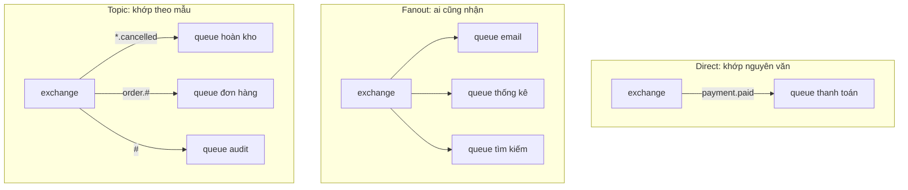
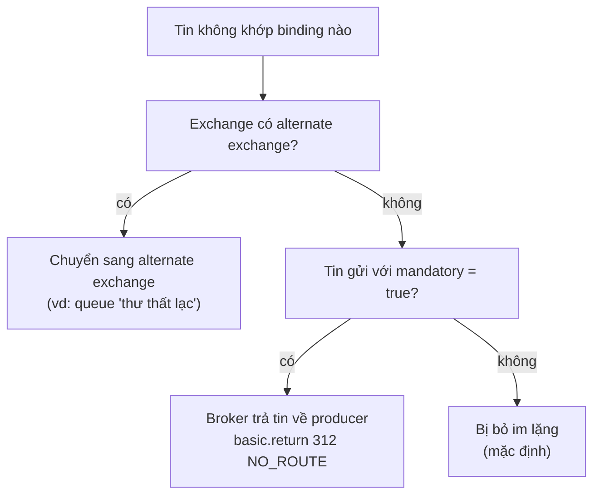

> [!tldr] Đọc nhanh
> - [[direct-exchange|Direct]]: chép tin vào queue có binding key **trùng khớp hoàn toàn** routing key. [[default-exchange|Default exchange]] là một direct exchange đặc biệt.
> - [[fanout-exchange|Fanout]]: chép tin vào **mọi** queue đã bind, bỏ qua routing key. Đây là kiểu "phát loa".
> - [[topic-exchange|Topic]]: routing key là các từ nối bằng dấu chấm; trong binding, `*` khớp đúng **một** từ, `#` khớp **không hoặc nhiều** từ.
> - [[headers-exchange|Headers]] định tuyến theo bảng headers thay vì routing key. [[exchange-to-exchange-binding|Exchange-to-exchange binding]] cho phép nối exchange vào exchange.
> - Một [[unroutable-message|tin không khớp binding nào]] mặc định **bị bỏ im lặng**. Muốn biết thì dùng cờ `mandatory` (broker trả tin lại) hoặc [[alternate-exchange|alternate exchange]] (broker chuyển tin sang exchange dự phòng).

> [!info] Bối cảnh
> Ga 3 của **tuyến RabbitMQ**. [[2026-11-21-rabbitmq-amqp-model|Ga 2]] cho thấy producer luôn gửi cho exchange, và binding quyết định tin đi đâu. Ga này hỏi tiếp: exchange *so* routing key với binding key theo luật nào? Ví dụ là các sự kiện của **flash-sale** (trang bán hàng giảm giá giờ vàng mình tự viết): `order.placed`, `order.cancelled`, `payment.paid`… Bạn không cần biết code dự án.

> [!abstract]- Từ điển nhanh cho bài này (bấm để mở)
> - **Exchange, queue, binding, routing key, binding key**: xem [[2026-11-21-rabbitmq-amqp-model|ga 2]]. Tóm tắt: exchange là bàn phân loại, queue là hộc thư, binding là quy tắc nối hai thứ đó, routing key là nhãn trên thư.
> - **Pub/sub (publish/subscribe)**: một bên phát, nhiều bên đăng ký cùng nhận.
> - **Audit log**: sổ ghi lại mọi chuyện xảy ra để tra cứu sau.
> - **Plugin**: phần mở rộng cài thêm vào RabbitMQ.
> - **Hash**: phép biến một chuỗi thành một con số; cùng chuỗi luôn ra cùng số.
> - **`basic.return`**: lệnh broker dùng để trả một tin về cho người gửi.

## Hình dung trước: bốn cách phân loại thư

Bàn phân loại ở ga 2 thật ra có bốn kiểu nhân viên, mỗi người theo một luật riêng:

| Đời thường | Khái niệm |
|---|---|
| Nhân viên chỉ đọc đúng mã bưu chính, khớp từng chữ số mới bỏ hộc | [[direct-exchange\|Direct exchange]] |
| Quầy "gửi theo tên hộc": ghi tên hộc lên phong bì là tới thẳng hộc đó | [[default-exchange\|Default exchange]] |
| Loa phường: ai đăng ký cũng nghe, không cần đọc địa chỉ | [[fanout-exchange\|Fanout exchange]] |
| Nhân viên đọc địa chỉ theo cấp "tỉnh.huyện.xã", hiểu được "mọi xã của huyện X" | [[topic-exchange\|Topic exchange]] |
| Nhân viên không nhìn địa chỉ, chỉ đọc tờ ghi chú kẹp kèm ("thư bảo đảm", "khổ lớn") | [[headers-exchange\|Headers exchange]] |
| Bàn phân loại tổng chuyển cả xấp cho bàn phân loại của từng tỉnh | [[exchange-to-exchange-binding\|Exchange-to-exchange binding]] |
| Thư sai địa chỉ: bỏ đi, trả lại người gửi, hoặc chuyển "phòng thư thất lạc" | [[unroutable-message\|Unroutable message]] |
| Phòng thư thất lạc | [[alternate-exchange\|Alternate exchange]] |



## Vấn đề: một sự kiện, nhiều kiểu người nghe

Trong flash-sale, các dịch vụ muốn nghe những thứ rất khác nhau:

- Dịch vụ **hoàn kho** chỉ quan tâm mọi thứ bị hủy: `order.cancelled`, `refund.cancelled`.
- Dịch vụ **email** nghe vài sự kiện cụ thể: `order.placed`, `payment.paid`.
- Dịch vụ **audit** muốn ghi lại *tất cả*.
- Đội vận hành muốn sự kiện của riêng khu vực Việt Nam: `order.vn.hcm.placed`, `order.vn.hn.placed`…

Mình từng nghĩ cứ mỗi kiểu người nghe thì producer gửi một bản riêng. Rồi nhận ra như vậy là quay lại vấn đề ở ga 1: producer phải biết người nhận. Bốn kiểu exchange chính là bốn cách để producer chỉ gửi **một** tin với **một** nhãn, còn việc ai nhận thì do binding quyết định.

## Cơ chế

### Direct exchange: khớp nguyên văn

[[direct-exchange|Direct exchange]] chép tin vào mọi queue có binding key **giống hệt** routing key. Binding `payment.paid` chỉ nhận tin có routing key đúng `payment.paid`, không hơn không kém.

- Nhiều queue cùng bind một khóa thì mỗi queue nhận một bản.
- Một queue bind nhiều khóa thì nhận tin của tất cả các khóa đó.
- RabbitMQ có sẵn một direct exchange tên `amq.direct`.

Hợp khi khóa là một tập cố định, rõ ràng: loại lệnh (`resize-image`, `send-email`), mức log (`error`, `warning`). Tutorial "Routing" của RabbitMQ dùng đúng ví dụ mức log.

### Default exchange: direct exchange không tên

[[default-exchange|Default exchange]] (tên rỗng `""`) là một direct exchange mà **mọi queue tự động bind vào với binding key bằng tên queue**. Không ai bind hay gỡ được binding trên nó. Đây là thứ đứng sau `sendToQueue` ở ga 2. Nó cũng không hỗ trợ alternate exchange (phần cuối bài).

### Fanout exchange: phát loa

[[fanout-exchange|Fanout exchange]] chép tin vào **mọi** queue đang bind với nó và **bỏ qua routing key**. Gửi `order.placed` hay `abc` cũng như nhau.

Đây là mẫu **pub/sub** cơ bản: mỗi bên muốn nghe tạo một queue riêng, bind vào fanout exchange, và mọi bên nhận mọi tin. Trong tutorial "Publish/Subscribe", mỗi consumer tạo một queue tạm (tên do broker đặt, `exclusive`) để nghe khi đang chạy, tắt là queue biến mất. Exchange có sẵn: `amq.fanout`.

Fanout nhanh và đơn giản, nhưng không lọc được gì. Khi người nghe bắt đầu nói "mình chỉ cần *một số* sự kiện", hãy chuyển sang topic.

### Topic exchange: khớp theo mẫu

[[topic-exchange|Topic exchange]] là kiểu linh hoạt nhất và hay dùng nhất cho sự kiện. Luật:

- Routing key là các **từ** nối bằng dấu chấm: `order.vn.hcm.placed`.
- Binding key cũng là các từ nối bằng dấu chấm, thêm hai ký tự đặc biệt:
  - `*` khớp **đúng một** từ.
  - `#` khớp **không, một hoặc nhiều** từ.

| Binding key | Khớp | Không khớp |
|---|---|---|
| `order.placed` | `order.placed` | `order.vn.placed` |
| `*.cancelled` | `order.cancelled`, `refund.cancelled` | `order.vn.cancelled` (hai từ trước `cancelled`) |
| `order.*` | `order.placed`, `order.vn` | `order`, `order.vn.hcm` |
| `order.#` | `order`, `order.placed`, `order.vn.hcm.placed` | `refund.placed` |
| `order.vn.#` | `order.vn` (`#` khớp 0 từ), `order.vn.hcm.placed` | `order.us.placed` |
| `#` | mọi thứ | |

Hai trường hợp đặc biệt: binding key chỉ có `#` biến topic exchange thành fanout; binding key không có `*` hay `#` thì nó hành xử như direct. Từ RabbitMQ 4.4, một binding key topic chứa tối đa hai ký tự `#`.

Mẹo đặt tên: đi từ chung tới riêng, `<thực thể>.<khu vực>.<hành động>` hoặc `<thực thể>.<hành động>`. Thứ tự này quyết định bạn lọc được những gì: đặt hành động ở cuối thì `*.cancelled` gom được mọi loại hủy. Flash-sale đặt tên sự kiện theo kiểu này (`order.placed`, `order.cancelled`, `inventory.changed`) và dùng topic exchange cho mỗi nhóm nghiệp vụ.

### Headers exchange: đọc tờ ghi chú

[[headers-exchange|Headers exchange]] bỏ qua routing key, so **headers** của tin với các tham số của binding. Tham số `x-match` quyết định cách so:

- `x-match: all`: mọi cặp khóa-giá trị trong binding đều phải có trong headers của tin.
- `x-match: any`: chỉ cần một cặp khớp.
- `all-with-x` và `any-with-x`: như trên nhưng tính cả các header bắt đầu bằng `x-` (bản thường bỏ qua chúng).

Ví dụ binding `{ "x-match": "all", "region": "vn", "tier": "vip" }` chỉ nhận tin có cả hai header đó. Headers exchange hợp khi tiêu chí lọc không xếp được thành chuỗi có thứ tự, nhưng ít dùng hơn topic vì khó đọc và khó gỡ lỗi. Exchange có sẵn: `amq.headers` (và `amq.match`).

### Exchange-to-exchange binding và CC/BCC

[[exchange-to-exchange-binding|Exchange-to-exchange binding]] là phần mở rộng của RabbitMQ: một exchange bind vào **exchange khác** thay vì queue. Tin đi qua chuỗi exchange theo luật của từng cái. Ví dụ một fanout exchange `events.all` bind tới hai topic exchange `orders` và `payments`; mỗi đội tự quản exchange của mình. Broker gộp đường đi lại trước khi chép, nên dù có nhiều đường dẫn tới cùng một queue, **mỗi queue chỉ nhận đúng một bản**, và vòng lặp giữa các exchange bị phát hiện.

**Sender-selected distribution** là một mẹo nhỏ khác: producer thêm header `CC` hoặc `BCC` (mảng chuỗi) để tin được định tuyến *thêm* theo các khóa đó, như gửi đồng kính gửi. Header `BCC` bị gỡ khỏi tin trước khi giao, nên người nhận không thấy.

### Các exchange cài thêm

Ngoài bốn kiểu chuẩn, RabbitMQ có các kiểu từ plugin. Hai kiểu đáng biết:

- **Consistent hash** (`x-consistent-hash`): băm routing key (hoặc một header) để chia tin đều cho nhiều queue, mà cùng một khóa luôn vào cùng một queue. Binding key ở đây là **trọng số**: queue bind với `"2"` nhận gấp đôi queue bind với `"1"`. Dùng khi muốn chia tải mà vẫn giữ mọi tin của một đơn hàng ở cùng một queue.
- **Local random** (`x-local-random`, từ 4.0): luôn chọn ngẫu nhiên một queue nằm trên **cùng node** với connection của producer, hợp cho kiểu hỏi-đáp trong cụm nhiều node.

Plugin **delayed message** (`x-delayed-message`) từng rất phổ biến nhưng đã ngừng được bảo trì; [[2026-11-21-rabbitmq-dlx-retry|ga 6]] nói cách hẹn giờ thay thế.

### Ba số phận của tin không có người nhận

Gửi một tin mà không binding nào khớp, đó là một [[unroutable-message|unroutable message]]. Có ba khả năng:



1. **Bỏ im lặng** (mặc định). Không lỗi, không log ở phía ứng dụng. Broker chỉ tăng bộ đếm `messages_unroutable_dropped`.
2. **Trả về người gửi** nếu producer gửi với cờ `mandatory: true`. Broker gửi lại tin kèm mã `312 NO_ROUTE` qua lệnh `basic.return`; trong `amqplib`, channel phát sự kiện `'return'`.
3. **Chuyển sang [[alternate-exchange|alternate exchange]]** (AE) nếu exchange được cấu hình có AE. Tin đi tiếp sang AE (thường là một fanout exchange bind tới queue "thư thất lạc") để người vận hành xem lại. AE nên đặt bằng **policy** để đổi được lúc chạy; cũng đặt được bằng tham số `alternate-exchange` khi khai báo exchange. Khi có AE, tin được coi là "đã định tuyến", nên dù gửi `mandatory` cũng không có `basic.return`.

> [!warning] Biên nhận không có nghĩa là có người nhận
> Ga 4 sẽ nói về **publisher confirm**, giấy biên nhận broker gửi cho producer. Một tin unroutable bị bỏ vẫn được broker gửi biên nhận *thành công*: broker đã "xử lý xong" tin đó bằng cách xác định không ai nhận. Confirm chỉ chứng minh broker đã nhận trách nhiệm, không chứng minh có queue nào giữ tin.

Một chi tiết thật từ flash-sale: dự án gửi một sự kiện vào exchange đơn hàng với routing key mà không consumer nào bind, và không dùng `mandatory`. Broker vẫn xác nhận, bảng outbox đánh dấu "đã gửi", còn tin thì biến mất. Code không sai cú pháp chỗ nào; chỉ là không ai nghe. Một queue audit bind `#` trong môi trường dev, hoặc một alternate exchange, là cách rẻ nhất để thấy những tin như vậy.

## Ví dụ chạy được

File `topic-routing.ts` dựng một topic exchange với bốn binding và một alternate exchange, gửi sáu routing key, rồi in xem mỗi queue nhận gì. Sau đó gỡ binding `#` để thấy tin rơi sang AE, và thử `mandatory` trên một direct exchange không có AE.

```bash
docker run -d --rm --name atlas-rabbit -p 5673:5672 -p 15673:15672 rabbitmq:4-management
npm i amqplib && node topic-routing.ts
```

Phần chính (bản đầy đủ: [topic-routing.ts](../code/rabbitmq-exchanges/topic-routing.ts)):

```ts
await ch.assertExchange(AE, 'fanout', { durable: false });
await ch.assertExchange(EX, 'topic', { durable: false, alternateExchange: AE });
const bindings: Array<[string, string]> = [
  ['q.placed-any', 'order.placed'],
  ['q.all-cancelled', '*.cancelled'],
  ['q.audit-all', '#'],
  ['q.vn-anything', 'order.vn.#'],
];
for (const [q, key] of bindings) { await ch.assertQueue(q, { durable: true }); await ch.bindQueue(q, EX, key); }

for (const key of ['order.placed', 'order.cancelled', 'refund.cancelled', 'order.vn.hcm.placed', 'order.vn', 'payment.paid'])
  ch.publish(EX, key, Buffer.from(key));

// mandatory + basic.return trên exchange KHÔNG có AE
ch.on('return', (msg) => console.log('basic.return:', msg.fields.replyCode, msg.fields.replyText, 'key =', msg.fields.routingKey));
ch.publish('demo.direct', 'khong-ai-nghe', Buffer.from('x'), { mandatory: true });
ch.publish('demo.direct', 'khong-ai-nghe-2', Buffer.from('x')); // không mandatory → mất im lặng
```

```text
$ node topic-routing.ts
q.placed-any     order.placed   -> order.placed
q.all-cancelled  *.cancelled    -> order.cancelled, refund.cancelled
q.audit-all      #              -> order.placed, order.cancelled, refund.cancelled, order.vn.hcm.placed, order.vn, payment.paid
q.vn-anything    order.vn.#     -> order.vn.hcm.placed, order.vn
q.unrouted       alternate-exch -> 
sau khi gỡ '#': q.unrouted nhận -> payment.paid (lần 2)
basic.return: 312 NO_ROUTE key = khong-ai-nghe
```

Đọc output:

- `order.vn` khớp `order.vn.#`: `#` khớp cả **không** từ nào.
- `refund.cancelled` khớp `*.cancelled` dù không liên quan tới đơn hàng: đặt tên sự kiện quyết định bạn lọc được gì.
- Lúc đầu AE trống, vì `#` của queue audit đã "hứng" mọi tin. Gỡ `#` ra thì `payment.paid` không ai nghe và rơi sang AE.
- Tin `khong-ai-nghe` (có `mandatory`) được trả về với mã 312. Tin `khong-ai-nghe-2` (không `mandatory`) biến mất, không một dòng log.

Exchange trong ví dụ để `durable: false` cho gọn vì đây là thử nghiệm. Với queue thì không được: lần chạy đầu khai báo queue `durable: false` làm connection sập với lỗi `541 … transient_nonexcl_queues is deprecated` trên RabbitMQ 4.4 (xem ga 2).

## Hiểu lầm và bẫy hay gặp

### Nghĩ `*` và `#` giống ký tự đại diện của shell

Trong topic, `*` là đúng **một từ** (giữa hai dấu chấm), không phải "chuỗi bất kỳ". `order.*` không khớp `order.vn.hcm`. Muốn "mọi thứ phía sau" thì dùng `#`.

### Đặt tên routing key tùy hứng

`placed.order` ở chỗ này, `order-placed` ở chỗ khác, `orderPlaced` ở chỗ thứ ba: không binding nào gom được hết. Thống nhất một quy ước (từ chung tới riêng, dấu chấm, chữ thường) trước khi có người nghe đầu tiên. Flash-sale từng có `flash-sale.order.placed` (gạch ngang) bên cạnh `flash_sale.item.added` (gạch dưới); một consumer bind `flash_sale.*` sẽ không bao giờ thấy sự kiện đầu.

### Tin bị bỏ mà không ai biết

Đây là lỗi khó thấy nhất của RabbitMQ. Trong production, gắn alternate exchange cho các exchange quan trọng, hoặc gửi với `mandatory` và xử lý sự kiện `return`. Theo dõi bộ đếm tin unroutable trên Prometheus ([[2026-11-21-rabbitmq-operations|ga 9]]).

### Dùng fanout rồi lọc trong consumer

Consumer nhận mọi tin rồi tự bỏ 90% là phí mạng, phí CPU và làm hàng dài vô ích. Để exchange lọc giúp bằng topic.

### Một queue cho mỗi routing key, dù cùng một consumer

Một queue có thể bind nhiều khóa. Tạo quá nhiều queue tốn tài nguyên và khó theo dõi. Tách queue khi hai nhóm việc cần **tốc độ xử lý riêng** hoặc **chính sách lỗi riêng**, không phải chỉ vì khác khóa.

## Câu hỏi tự kiểm tra

> [!question]- Routing key `order.vn` có khớp `order.vn.#` không? Có khớp `order.*` không?
> Có cả hai. `#` khớp không từ nào, nên `order.vn.#` khớp `order.vn`. `order.*` khớp vì sau `order` có đúng một từ (`vn`).

> [!question]- `order.vn.cancelled` có khớp `*.cancelled` không?
> Không. `*` chỉ khớp đúng một từ, mà trước `cancelled` có hai từ. Muốn khớp thì dùng `#.cancelled`.

> [!question]- Khi nào chọn fanout thay vì topic?
> Khi mọi bên nghe cần mọi tin và không có nhu cầu lọc. Fanout đơn giản, bỏ qua routing key.

> [!question]- Tin không khớp binding nào thì sao? Làm sao để biết?
> Mặc định bị bỏ im lặng. Gửi với `mandatory: true` thì broker trả tin về (`basic.return`, mã 312); hoặc đặt alternate exchange để tin rơi vào một queue dự phòng.

> [!question]- Đã có alternate exchange mà vẫn gửi `mandatory` thì có nhận `basic.return` không?
> Không. Tin đi sang AE được coi là đã định tuyến.

> [!question]- Publisher confirm báo thành công có nghĩa là tin đã nằm trong một queue không?
> Không. Tin unroutable bị bỏ vẫn được confirm. Confirm chỉ nghĩa là broker đã xử lý xong trách nhiệm của nó.

## Tham khảo

- [RabbitMQ: Exchanges](https://www.rabbitmq.com/docs/exchanges)
- [RabbitMQ: AMQP 0-9-1 Model Explained](https://www.rabbitmq.com/tutorials/amqp-concepts)
- [RabbitMQ tutorials 3–5: Publish/Subscribe, Routing, Topics](https://www.rabbitmq.com/tutorials)
- [RabbitMQ: Alternate Exchanges](https://www.rabbitmq.com/docs/ae)
- [RabbitMQ: Exchange to Exchange Bindings](https://www.rabbitmq.com/docs/e2e)
- [RabbitMQ: Sender-selected Distribution](https://www.rabbitmq.com/docs/sender-selected)
- [RabbitMQ: Publishers](https://www.rabbitmq.com/docs/publishers) (unroutable, mandatory)
- [Consistent hash exchange plugin](https://github.com/rabbitmq/rabbitmq-server/tree/main/deps/rabbitmq_consistent_hash_exchange) và [Local random exchange](https://www.rabbitmq.com/docs/local-random-exchange)
