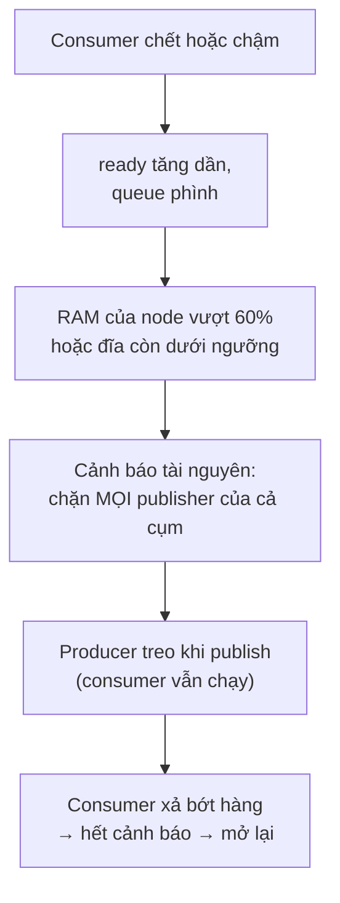

> [!tldr] Đọc nhanh
> - [[resource-alarm|Cảnh báo tài nguyên]]: một node vượt ngưỡng RAM (mặc định 60%) hoặc ổ đĩa còn dưới ngưỡng (mặc định 50 MB) là **mọi publisher của cả cụm bị chặn**. Consumer vẫn chạy.
> - [[flow-control|Flow control]] là phanh tự động nhẹ hơn: broker làm chậm connection đang gửi quá nhanh so với sức xử lý. Tách connection gửi và nhận để consumer không bị phanh oan.
> - [[queue-metrics|Chỉ số queue]]: `ready` tăng đều là consumer không theo kịp; `unacked` cao là consumer đang ôm nhiều việc. Theo dõi bằng Prometheus, không chỉ nhìn management UI.
> - [[access-control|Quyền truy cập]] theo vhost với ba quyền configure / write / read; xóa user `guest`, mỗi ứng dụng một user, bật TLS. [[policy|Policy]] cấu hình queue lúc đang chạy, không phải khai báo lại.
> - RabbitMQ 4.x nói [[giao-thuc-ngoai-amqp-0-9-1|nhiều giao thức]]: AMQP 1.0 (khuyên cho ứng dụng mới), MQTT cho IoT, STOMP, stream protocol. Cuối bài là [[production-checklist|checklist production]].

> [!info] Bối cảnh
> Ga 9, ga cuối của **tuyến RabbitMQ**. Tám ga trước dựng mọi khái niệm; ga này hỏi: chạy thật thì cần nhìn gì, chặn gì, cấu hình gì. Ví dụ là **flash-sale**, trang bán hàng giảm giá giờ vàng mình tự viết: lúc 21:00 producer gửi dồn dập, và câu hỏi là RabbitMQ có chịu nổi không, và nếu không thì nó báo bằng cách nào. Bạn không cần biết code dự án.

> [!abstract]- Từ điển nhanh cho bài này (bấm để mở)
> - **Ready / unacked**: tin đang chờ trong queue / tin đã giao cho consumer nhưng chưa ack. Xem [[2026-11-21-rabbitmq-ack-confirm|ga 4]].
> - **Prometheus, Grafana**: Prometheus định kỳ thu số liệu từ các hệ thống; Grafana vẽ biểu đồ và cảnh báo từ số liệu đó.
> - **Watermark (ngưỡng)**: mức mà vượt qua thì hệ thống phản ứng.
> - **Back-pressure**: bên nhận không theo kịp thì đẩy ngược áp lực về bên gửi, buộc bên gửi chậm lại.
> - **Regex**: biểu thức mô tả một mẫu chuỗi, ví dụ `^orders\.` là "mọi tên bắt đầu bằng `orders.`".
> - **JWT, OAuth 2**: thẻ đăng nhập có chữ ký và giao thức cấp thẻ. Xem [[2026-11-18-api-security|ga Bảo mật của tuyến API]].
> - **IoT**: thiết bị nhỏ nối mạng (cảm biến, thiết bị gia dụng thông minh).
> - **Health check / readiness probe**: phép kiểm tra định kỳ xem dịch vụ còn sống và sẵn sàng nhận việc chưa.

## Hình dung trước: vận hành một bưu điện thật

| Đời thường | Khái niệm |
|---|---|
| Kho đầy quá 60%: đóng cửa nhận thư mới ở **mọi** chi nhánh, vẫn tiếp tục phát thư | [[resource-alarm\|Resource alarm]] |
| Quầy nhận thư làm chậm lại khi bàn phân loại phía sau đang ùn | [[flow-control\|Flow control]] |
| Bảng điện tử: bao nhiêu thư đang chờ, bao nhiêu thư đang trên đường phát | [[queue-metrics\|Queue metrics]] |
| Thẻ nhân viên: ai được mở kho nào, ai chỉ được gửi, ai chỉ được nhận | [[access-control\|Access control]] |
| Thông báo nội bộ "mọi hộc thư bắt đầu bằng `orders.` chỉ chứa 10.000 lá" | [[policy\|Policy]] |
| Quầy nhận thư bằng nhiều thứ tiếng: bưu phẩm quốc tế, điện tín, thư nội bộ | [[giao-thuc-ngoai-amqp-0-9-1\|Giao thức ngoài AMQP 0-9-1]] |
| Danh sách kiểm tra trước ngày khai trương | [[production-checklist\|Production checklist]] |



## Vấn đề: hệ thống chạy tốt cho tới 21:00

Trên máy dev, RabbitMQ không bao giờ có chuyện gì. Mình từng nghĩ "broker là hạ tầng, cài xong là chạy". Ba chuyện chỉ lộ ra khi có tải thật:

- Một consumer bị lỗi cấu hình và ngừng nhận tin lúc 20:55. Năm phút sau, queue của nó có hàng trăm nghìn tin. RAM của node chạm ngưỡng, và **dịch vụ đặt hàng** (không liên quan gì tới consumer kia) treo ở dòng `publish`.
- Không ai biết consumer đã chết, vì management UI chỉ được mở khi có người nhớ ra.
- Ứng dụng nào cũng đăng nhập bằng `guest/guest`, nên không biết ai đang mở 2.000 connection.

## Cơ chế

### Cảnh báo tài nguyên: bảo vệ broker bằng cách chặn người gửi

[[resource-alarm|Resource alarm]] là cơ chế tự vệ của RabbitMQ. Có hai loại:

- **Memory alarm**: RAM dùng vượt `vm_memory_high_watermark`, mặc định **0,6** (60%) RAM máy. Chạy trong container thì nên đặt giá trị **tuyệt đối** (ví dụ `vm_memory_high_watermark.absolute = 3GiB`), vì tỉ lệ được tính trên lượng RAM mà RabbitMQ phát hiện được, và con số đó có thể không khớp giới hạn bộ nhớ đặt cho container. Checklist khuyên khoảng 0,4–0,7.
- **Disk alarm**: dung lượng trống còn dưới `disk_free_limit`, mặc định **50 MB**. Con số này chỉ hợp cho máy dev; production nên đặt xấp xỉ bằng dung lượng RAM.

Khi một cảnh báo bật trên **bất kỳ** node nào:

- Mọi connection **đang gửi tin** trên **toàn cụm** bị chặn. Broker ngừng đọc socket của chúng; lệnh `publish` treo.
- Consumer **vẫn chạy**, để hàng được xả bớt.
- Client được báo qua sự kiện `connection.blocked` / `unblocked` (trong `amqplib`: `conn.on('blocked')`).

Chặn cả cụm chỉ vì một node nghe có vẻ quá tay, nhưng đó là cách duy nhất để không node nào bị tràn: tin gửi vào node A có thể được chuyển sang queue ở node B. Hệ quả cho ứng dụng: producer phải có **timeout** cho việc gửi, dùng confirm để biết tin chưa vào, và có chỗ giữ tin (outbox ở ga 5 làm đúng việc này). Cách phòng từ gốc là giới hạn độ dài queue ([[2026-11-21-rabbitmq-dlx-retry|ga 6]]) để một consumer chết không kéo theo cả cụm.

### Flow control: phanh nhẹ trước khi phanh gấp

[[flow-control|Flow control]] là cơ chế back-pressure bên trong broker. Mỗi tin đi qua một chuỗi tiến trình: connection đọc socket, channel, queue, ghi đĩa, chép sang bản sao. Khâu nào chậm thì khâu trước nó bị chặn tạm thời, cứ thế dồn ngược về **connection đang gửi**. Connection đó hiện trạng thái `flow` trong management UI: bị chặn và mở lại nhiều lần mỗi giây, nên tốc độ gửi tự khớp với tốc độ broker ghi được.

Hai điều rút ra:

- Connection **chỉ để nhận** không bị phanh. Nếu một connection vừa gửi vừa nhận, phanh làm chậm luôn việc nhận ack, và consumer chậm lại đúng lúc cần nhanh. Vì vậy checklist khuyên **tách connection gửi và connection nhận**.
- Thấy connection ở trạng thái `flow` lâu là dấu hiệu broker đang ở giới hạn: đĩa chậm, quorum queue chép không kịp, hoặc CPU đầy.

Ở phía client còn một lớp back-pressure nữa: trong `amqplib`, `publish` trả `false` khi bộ đệm ghi đầy, và ứng dụng nên chờ sự kiện `'drain'` (ga 4).

### Chỉ số queue: đọc đồng hồ đo

[[queue-metrics|Queue metrics]] là thứ đầu tiên cần nhìn. Ba con số cơ bản của mỗi queue:

| Chỉ số | Ý nghĩa | Đáng lo khi |
|---|---|---|
| `messages_ready` | tin đang chờ giao | tăng đều theo thời gian: consumer không theo kịp hoặc đã chết |
| `messages_unacked` | tin đã giao, chưa ack | cao và không giảm: consumer treo hoặc quên ack |
| `consumers` | số consumer đang đăng ký | bằng 0 trên queue đang nhận tin |

Thêm **consumer capacity** (hay consumer utilisation): tỉ lệ thời gian queue giao được tin *ngay* cho consumer. Dưới 100% trong khi hàng đang tồn nghĩa là consumer không đủ nhanh: tăng prefetch hoặc thêm consumer.

Ngoài từng queue, theo dõi: tốc độ publish, deliver, ack và **redeliver** (redeliver cao là đang có vòng requeue), số connection mở mới mỗi giây (connection churn, ga 2), số tin unroutable bị bỏ (ga 3), số tin dead-letter theo lý do (ga 6), RAM so với ngưỡng, dung lượng đĩa trống, file descriptor.

Có ba công cụ để xem:

- **Management UI và HTTP API** (plugin `rabbitmq_management`, cổng 15672): tiện để xem tay và để công cụ gọi, nhưng chỉ giữ số liệu ngắn hạn và tự tính lại theo chu kỳ vài giây. `rabbitmqadmin` là công cụ dòng lệnh dùng HTTP API này. User cần tag (`management`, `monitoring`, `policymaker`, `administrator`) để đăng nhập; tag chỉ quyết định được xem trang nào, không thay quyền trên tài nguyên.
- **Prometheus** (plugin `rabbitmq_prometheus`, cổng 15692): cách tài liệu RabbitMQ khuyên cho production, kèm các dashboard Grafana có sẵn. Tên chỉ số thật trên 4.4: `rabbitmq_queue_messages_ready`, `rabbitmq_queue_messages_unacked`, `rabbitmq_queue_consumers`, `rabbitmq_global_messages_redelivered_total`, `rabbitmq_global_messages_unroutable_dropped_total`, `rabbitmq_global_messages_dead_lettered_expired_total`, `rabbitmq_connections_opened_total`, `rabbitmq_alarms_memory_used_watermark`… Thu mỗi 30–60 giây. Khi đã dùng Prometheus, có thể tắt bộ thu số liệu của management plugin để giảm tải.
- **CLI**: `rabbitmqctl` (quản trị: user, quyền, vhost, liệt kê queue), `rabbitmq-diagnostics` (kiểm tra sức khỏe, trạng thái, cảnh báo), `rabbitmq-plugins`, `rabbitmq-queues` (bản sao quorum), `rabbitmq-streams`, `rabbitmq-upgrade`.

Health check có nhiều mức: `rabbitmq-diagnostics ping` (node có trả lời không), `check_running`, `check_local_alarms`, `check_port_connectivity`, `check_virtual_hosts`. Tài liệu khuyên readiness probe trên Kubernetes chỉ là **kiểm tra cổng TCP** AMQP: các lệnh kiểm tra nặng hơn có thể làm cụm Khepri không khởi động lại được, vì pod chờ probe còn cụm thì chờ đủ đa số pod. Phía ứng dụng, flash-sale có một health check riêng báo `rabbitmq: down` dựa trên trạng thái kết nối của thư viện; ứng dụng vẫn khởi động được khi broker sập (không chờ kết nối lúc boot), và outbox giữ sự kiện tới khi broker trở lại.

### Quyền truy cập

[[access-control|Access control]] của RabbitMQ gồm xác thực (bạn là ai) và phân quyền (bạn được làm gì).

**Xác thực** bằng username/password (mặc định), chứng chỉ x.509 (cơ chế `EXTERNAL`, qua plugin), hoặc JWT qua **plugin OAuth 2**. Với OAuth 2, token được gửi ở chỗ password; quyền đọc từ scope trong token, dạng `rabbitmq.read:<vhost>/<mẫu tên>`; giá trị `resource_server_id` phải nằm trong trường `aud` của token. Token hết hạn thì client AMQP 0-9-1 gửi token mới bằng lệnh `update-secret` mà không phải nối lại.

**Phân quyền** theo từng vhost, gồm ba regex trên tên tài nguyên:

| Quyền | Cho phép |
|---|---|
| **configure** | tạo, xóa, sửa exchange và queue khớp mẫu |
| **write** | gửi tin vào exchange, bind queue vào exchange |
| **read** | nhận tin từ queue, bind exchange vào queue |

Ví dụ dịch vụ email: configure `^email\.`, write `^$` (không gửi gì), read `^email\.`. Có thêm **topic permission** kiểm tra cả routing key khi gửi vào topic exchange.

Mặc định đáng sửa:

- User `guest/guest` chỉ đăng nhập được từ `localhost`. Đừng nới ra; xóa nó trong production.
- Mỗi ứng dụng một user riêng, đúng quyền tối thiểu. Khi có sự cố, tên user cho biết connection nào của ai.
- Cơ chế `ANONYMOUS` được bật mặc định trong 4.x để dễ thử nghiệm; tắt nó ở production.
- Bật **TLS**: cổng 5671 cho AMQPS, tối thiểu TLS 1.2, `verify_peer` để kiểm chứng chỉ; thêm `fail_if_no_peer_cert` nếu muốn mỗi client cũng phải có chứng chỉ.

### Policy: đổi cấu hình queue khi đang chạy

[[policy|Policy]] là cấu hình áp vào mọi queue hoặc exchange có tên khớp một regex, trong một vhost:

```bash
rabbitmqctl set_policy orders-limits "^orders\." \
  '{"max-length": 100000, "overflow": "reject-publish", "dead-letter-exchange": "orders.dlx"}' \
  --apply-to queues --priority 10
```

Ưu điểm so với tham số `x-` lúc khai báo: đổi được bất cứ lúc nào mà không phải xóa và khai báo lại queue (ga 2: khai báo lại khác tham số là lỗi 406). Quy tắc:

- Mỗi queue chỉ nhận **một** policy, là policy khớp có `priority` cao nhất. Các khóa không gộp từ nhiều policy.
- Nếu queue có tham số `x-` trùng khóa với policy, **tham số thắng**.
- Không đặt được bằng policy: loại queue (`x-queue-type`) và `x-max-priority`.
- **Operator policy** là lớp do người vận hành đặt để áp *giới hạn trên* (ví dụ max-length tối đa), không ứng dụng nào vượt qua được. Khi cả hai cùng đặt một giới hạn số, giá trị nhỏ hơn thắng.

Cách làm tốt: ứng dụng chỉ khai báo tên, loại và cờ `durable`; mọi giới hạn, TTL, DLX đặt bằng policy, quản lý cùng hạ tầng.

### Các giao thức ngoài AMQP 0-9-1

[[giao-thuc-ngoai-amqp-0-9-1|RabbitMQ 4.x nói nhiều giao thức]], chung một broker, chung queue:

| Giao thức | Cổng | Dùng cho | Ghi chú |
|---|---|---|---|
| AMQP 0-9-1 | 5672 / 5671 | thư viện truyền thống (`amqplib`, Pika, Spring AMQP) | giao thức của cả tuyến này |
| **AMQP 1.0** | 5672 / 5671 | ứng dụng mới | tích hợp sẵn từ 4.0; khác hẳn 0-9-1 dù cùng tên |
| MQTT 3.1 / 3.1.1 / 5.0 | 1883 / 8883 | IoT, thiết bị yếu, mạng chập chờn | topic `a/b/c` đổi thành routing key `a.b.c` trên `amq.topic`; QoS 0 và 1, không có QoS 2 |
| STOMP 1.0–1.2 | 61613 | giao thức dạng chữ, dễ dùng từ trình duyệt qua WebSocket | đích dạng `/exchange/...`, `/queue/...`, `/topic/...` |
| Stream protocol | 5552 | đọc ghi stream tốc độ cao | ga 7 |

AMQP 1.0 được RabbitMQ khuyên cho ứng dụng mới. Thay vì `ack`/`nack`, consumer trả một trong bốn kết quả: `accepted` (xong), `released` (trả lại hàng), `rejected` (dead-letter) hoặc `modified` (chỉ quorum queue: trả lại kèm sửa header). Địa chỉ có dạng `/queues/<tên>` hoặc `/exchanges/<tên>/<routing key>`. AMQP 1.0 không có transaction. `amqplib` **không** hỗ trợ AMQP 1.0; cần thư viện client AMQP 1.0 riêng của RabbitMQ.

### NestJS và RabbitMQ: ánh xạ về các khái niệm

Phần lớn ứng dụng Node.js dùng RabbitMQ qua một framework. Với NestJS:

- **`@nestjs/microservices`, `Transport.RMQ`**: mỗi server nghe **một queue** (`queue`). Mặc định gửi qua default exchange (ga 3); bật `wildcards: true` thì dùng topic exchange. `@MessagePattern` + `client.send()` là request-reply, mặc định qua Direct Reply-to (ga 5). `@EventPattern` + `client.emit()` là gửi sự kiện không chờ trả lời. **`noAck` mặc định `true`** (auto-ack, ga 4): muốn an toàn phải đặt `noAck: false` và tự ack qua `context.getChannelRef().ack(context.getMessage())`. Tùy chọn `isGlobalPrefetchCount` là global QoS, bị chặn trên 4.3+.
- **`@golevelup/nestjs-rabbitmq`** (flash-sale dùng thư viện này): khai báo exchange, queue và binding tường minh; `@RabbitSubscribe({ exchange, routingKey, queue })` cho từng handler. Handler chạy xong là ack, trả `new Nack(false)` là dead-letter; prefetch mặc định 10; gửi qua channel có confirm. Cẩn thận: handler **ném lỗi** thì mặc định là `nack` *có requeue*, cái bẫy delivery limit ở ga 7.

### Checklist production

[[production-checklist|Production checklist]], gom từ checklist chính thức và các ga trước:

**Hạ tầng**
- Cụm 3 hoặc 5 node, cùng LAN; giữa các vùng dùng federation hoặc shovel (ga 8).
- Mỗi node tối thiểu 4 CPU, 4 GiB RAM, SSD/NVMe cục bộ, thư mục dữ liệu không dùng chung.
- File descriptor tối thiểu 50.000.
- Đặt `vm_memory_high_watermark` (giá trị tuyệt đối nếu chạy container) và `disk_free_limit` gần bằng RAM.

**Bảo mật**
- Xóa `guest`, tắt `ANONYMOUS`, mỗi ứng dụng một user với quyền tối thiểu.
- TLS cho client và cho giao tiếp giữa các node.

**Queue và tin**
- Dữ liệu quan trọng: quorum queue (ga 7); queue tạm: classic exclusive.
- Mọi queue có giới hạn độ dài và DLX qua policy; mọi DLX có DLQ (ga 6).
- Producer: confirm, tin persistent, `mandatory` hoặc alternate exchange cho sự kiện quan trọng (ga 3, 4).
- Consumer: ack thủ công, prefetch hữu hạn, idempotent (ga 4, 5).

**Kết nối**
- Connection sống lâu, có tên, heartbeat 5–20 giây; tách connection gửi và nhận; ít channel.
- Tránh `basic.get` (polling).

**Quan sát**
- Prometheus + Grafana; cảnh báo khi `ready` tăng đều, khi DLQ có tin, khi có cảnh báo tài nguyên, khi consumer của queue quan trọng bằng 0.
- Readiness probe là kiểm tra cổng TCP.

**Nâng cấp**
- Biết đường nâng cấp (qua 4.2 nếu từ 3.13/4.0/4.1); bật feature flags; kiểm tra tính năng bị bỏ (ga 8).

## Ví dụ chạy được

[observe.ts](../code/rabbitmq-operations/observe.ts) tái hiện đúng tình huống mở đầu ở quy mô nhỏ: producer gửi 200 tin/giây trong 4 giây, consumer chỉ xử lý được khoảng 50 tin/giây (20 tin song song, mỗi tin 400 ms). Mỗi giây in số tin `ready` (hỏi broker) và `unacked` (đếm ở client).

```bash
docker run -d --rm --name atlas-rabbit -p 5673:5672 -p 15673:15672 rabbitmq:4-management
npm i amqplib && node observe.ts
```

```ts
await sub.prefetch(20);
await sub.consume(Q, async (m) => {
  inflight++;
  await sleep(400);   // consumer chậm
  sub.ack(m);
  inflight--; acked++;
});
const { messageCount: ready } = await pub.checkQueue(Q); // số tin ready, theo thời gian thực
```

```text
$ node observe.ts
 giây | đã gửi | đã ack | ready | unacked
   1  |   180  |    40  |   120 |    20
   2  |   400  |    80  |   280 |    20
   3  |   580  |   140  |   420 |    20
   4  |   780  |   180  |   580 |    20
   5  |   780  |   240  |   520 |    20
   6  |   780  |   280  |   480 |    20
   ...
  14  |   780  |   680  |    80 |    20
  15  |   780  |   740  |    20 |    20
  16  |   780  |   780  |     0 |     0
```

Đọc bảng như đọc dashboard:

- **Giây 1–4**: `ready` tăng đều khoảng 150 mỗi giây. Đây là tín hiệu "consumer không theo kịp". Trong production, đường này kéo dài hàng giờ là đường dẫn tới cảnh báo bộ nhớ.
- **`unacked` đứng yên ở 20**: đúng bằng prefetch. Consumer luôn giữ đủ số việc được phép; muốn nhanh hơn thì thêm consumer, không phải chờ.
- **Giây 5–16**: producer dừng, `ready` giảm khoảng 50 mỗi giây, đúng tốc độ consumer. Từ độ dốc này tính được hàng sẽ hết sau bao lâu.

Trong lúc chạy, mở `http://localhost:15673` (guest/guest) → tab **Queues** → `demo.observe` để thấy cùng các con số trên biểu đồ. Management UI cập nhật theo chu kỳ vài giây nên trễ hơn bảng một nhịp. Cổng Prometheus 15692 có sẵn trong image này nếu bạn map thêm cổng đó.

## Hiểu lầm và bẫy hay gặp

### "Queue dài bao nhiêu cũng được, RabbitMQ lo"

RabbitMQ lo bằng cách chặn mọi publisher của cả cụm. Đặt giới hạn độ dài và cảnh báo trên `ready`.

### Để ngưỡng đĩa mặc định 50 MB

Ổ đầy trước khi cảnh báo kịp bật. Đặt gần bằng RAM.

### Đặt ngưỡng RAM theo tỉ lệ trong container

Lượng RAM RabbitMQ phát hiện có thể khác giới hạn của container, và container có thể bị giết vì hết bộ nhớ trước khi cảnh báo kịp bật. Dùng giá trị tuyệt đối, thấp hơn giới hạn container.

### Một connection vừa gửi vừa nhận

Flow control phanh connection gửi, kéo chậm luôn việc nhận và ack. Tách hai connection.

### Chỉ xem management UI khi có chuyện

Lúc nhớ ra mở UI thì hàng đã phình. Prometheus và cảnh báo tự động.

### Dùng `guest` cho mọi thứ

Không phân biệt được ai làm gì, và nới `loopback_users` để dùng `guest` từ xa là mở cửa cho bất kỳ ai. Mỗi ứng dụng một user.

### Cấu hình giới hạn bằng tham số `x-` trong code

Đổi giới hạn là phải xóa queue. Dùng policy.

### Readiness probe gọi lệnh kiểm tra nặng

Có thể làm cụm Khepri không khởi động lại được. Dùng kiểm tra cổng TCP.

### Copy cấu hình NestJS mặc định

`noAck: true` là auto-ack. Đặt `noAck: false` và ack thủ công.

## Câu hỏi tự kiểm tra

> [!question]- Một node vượt ngưỡng RAM thì chuyện gì xảy ra?
> Mọi connection đang gửi tin trên toàn cụm bị chặn, `publish` treo. Consumer vẫn chạy để xả hàng. Hết vượt ngưỡng thì publisher được mở lại.

> [!question]- Chỉ số nào cho biết consumer đang tụt lại?
> `messages_ready` tăng đều theo thời gian, consumer capacity dưới 100% khi hàng đang tồn. `messages_unacked` cao và không giảm thì consumer đang treo hoặc quên ack.

> [!question]- Vì sao nên tách connection gửi và connection nhận?
> Flow control và cảnh báo tài nguyên chặn connection gửi. Nếu cùng một connection, việc nhận tin và gửi ack cũng bị chặn theo, consumer chậm lại đúng lúc cần xả hàng.

> [!question]- User `guest` dùng được từ máy khác không?
> Không, mặc định chỉ từ `localhost`. Ở production nên xóa hẳn và tạo user riêng cho từng ứng dụng.

> [!question]- Tham số `x-max-length` trên queue và policy `max-length` khác nhau, cái nào thắng?
> Tham số trên queue thắng policy thường. Operator policy thì đặt giới hạn trên: giá trị nhỏ hơn giữa hai bên được áp dụng.

> [!question]- NestJS `Transport.RMQ` mặc định ack thế nào?
> `noAck: true`, tức auto-ack. Phải đổi thành `false` và ack thủ công trong handler.

> [!question]- Ứng dụng mới nên dùng AMQP 0-9-1 hay AMQP 1.0?
> RabbitMQ khuyên AMQP 1.0 cho ứng dụng mới trên 4.x. Nhưng `amqplib` và nhiều thư viện quen thuộc chỉ hỗ trợ 0-9-1, nên trong hệ sinh thái Node.js hiện tại 0-9-1 vẫn là lựa chọn thực tế.

## Tham khảo

- [RabbitMQ: Resource Alarms](https://www.rabbitmq.com/docs/alarms), [Memory Threshold](https://www.rabbitmq.com/docs/memory), [Disk Alarms](https://www.rabbitmq.com/docs/disk-alarms)
- [RabbitMQ: Flow Control](https://www.rabbitmq.com/docs/flow-control)
- [RabbitMQ: Monitoring](https://www.rabbitmq.com/docs/monitoring) và [Management Plugin](https://www.rabbitmq.com/docs/management)
- [RabbitMQ: Authentication, Authorisation, Access Control](https://www.rabbitmq.com/docs/access-control), [TLS](https://www.rabbitmq.com/docs/ssl), [OAuth 2.0](https://www.rabbitmq.com/docs/oauth2)
- [RabbitMQ: Policies](https://www.rabbitmq.com/docs/policies)
- [RabbitMQ: AMQP 1.0](https://www.rabbitmq.com/docs/amqp), [MQTT](https://www.rabbitmq.com/docs/mqtt), [STOMP](https://www.rabbitmq.com/docs/stomp)
- [RabbitMQ: Production Checklist](https://www.rabbitmq.com/docs/production-checklist)
- [RabbitMQ: CLI tools](https://www.rabbitmq.com/docs/cli)
- [NestJS: RabbitMQ transport](https://docs.nestjs.com/microservices/rabbitmq)
