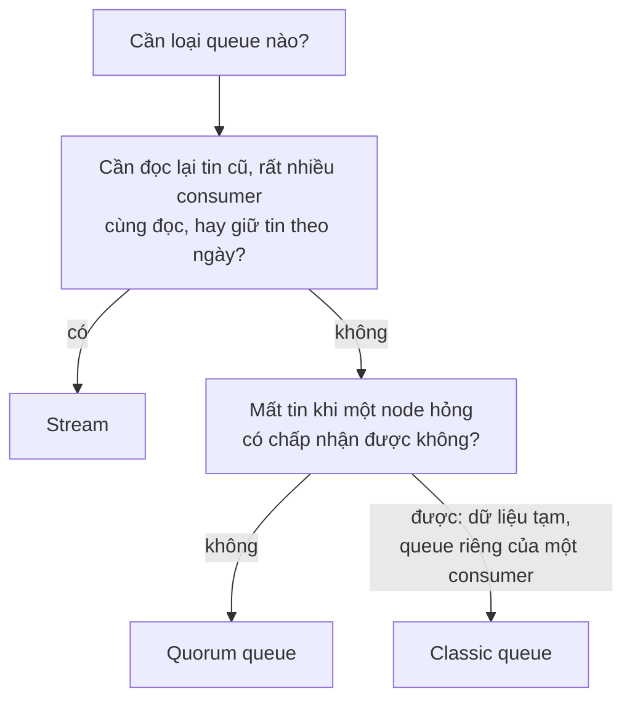

> [!tldr] Đọc nhanh
> - [[classic-queue|Classic queue]]: loại mặc định, tin nằm trên **một node**. Từ 4.0 không còn sao chép (mirrored queue đã bị gỡ). Hợp cho dữ liệu tạm, queue riêng của một consumer.
> - [[quorum-queue|Quorum queue]]: tin được chép ra nhiều node theo thuật toán [[raft|Raft]]; biên nhận chỉ gửi khi **đa số** bản sao đã có tin. Đây là lựa chọn mặc định cho dữ liệu quan trọng.
> - [[delivery-limit|Delivery limit]] của quorum queue tự dead-letter tin sau 20 lần giao thất bại. Từ 4.3, `nack` có requeue **không** được đếm; chỉ `reject` mới đếm.
> - [[stream|Stream]] là một cuốn sổ chỉ ghi nối: đọc **không xóa** tin, mỗi consumer chọn chỗ bắt đầu bằng [[stream-offset|offset]], đọc lại được bao nhiêu lần cũng được.
> - [[single-active-consumer|Single active consumer]]: nhiều consumer đăng ký, chỉ một người nhận tại một thời điểm; người đó rời đi thì người kế tiếp lên thay. Giữ được thứ tự mà vẫn có dự phòng.

> [!info] Bối cảnh
> Ga 7 của **tuyến RabbitMQ**. Ở [[2026-11-21-rabbitmq-ack-confirm|ga 4]], tin bền chỉ an toàn khi node chứa nó còn sống. Ga này hỏi: node đó cháy ổ cứng thì sao? Ví dụ là các sự kiện của **flash-sale**, trang bán hàng giảm giá giờ vàng mình tự viết. Hiện mọi queue của dự án là classic, nên đây cũng là lúc mình tự hỏi đã đến lúc đổi chưa. Bạn không cần biết code dự án.

> [!abstract]- Từ điển nhanh cho bài này (bấm để mở)
> - **Node**: một máy (hoặc container) chạy RabbitMQ. Nhiều node nối với nhau thành một **cụm** (cluster), chi tiết ở [[2026-11-21-rabbitmq-cluster|ga 8]].
> - **Bản sao (replica)**: một bản đầy đủ của dữ liệu queue nằm trên một node khác.
> - **Leader / follower**: trong một nhóm bản sao, leader nhận mọi lệnh ghi và chép cho các follower.
> - **Đa số (quorum)**: hơn một nửa. 3 node thì đa số là 2, 5 node thì là 3.
> - **Log (nhật ký chỉ ghi nối)**: cấu trúc dữ liệu chỉ thêm vào cuối, không sửa, không xóa giữa chừng. Xem [[queue-va-log|Queue và log]].
> - **Retention**: chính sách giữ dữ liệu bao lâu, hoặc bao nhiêu dung lượng.
> - **Delivery limit, dead-letter, DLX**: xem [[2026-11-21-rabbitmq-dlx-retry|ga 6]].

## Hình dung trước: một hộc thư, ba bưu cục, một cuốn sổ

| Đời thường | Khái niệm |
|---|---|
| Hộc thư ở **một** bưu cục; bưu cục cháy là mất thư | [[classic-queue\|Classic queue]] |
| Ba bưu cục cùng giữ một bản sổ thư; đa số đồng ý mới ghi | [[quorum-queue\|Quorum queue]] |
| Luật bầu trưởng bưu cục và luật "đa số đồng ý mới tính" | [[raft\|Raft]] |
| Thư phát thất bại 20 lần thì chuyển phòng thư lỗi | [[delivery-limit\|Delivery limit]] |
| Cuốn sổ lưu trữ: đọc xong vẫn còn, ai cũng đọc lại từ trang bất kỳ | [[stream\|Stream]] |
| Số trang trong sổ mà mỗi người đang đọc tới | [[stream-offset\|Stream offset]] |
| Nhiều nhân viên trực, nhưng chỉ một người được phát thư tại một thời điểm | [[single-active-consumer\|Single active consumer]] |



## Vấn đề: tin bền chưa chắc đã an toàn

Ở ga 4, mình có đủ ba điều kiện: queue durable, tin persistent, có confirm. Tin sống qua lần khởi động lại. Nhưng tất cả nằm trên ổ đĩa của **một** node:

- Node đó hỏng ổ cứng: mất toàn bộ tin trong queue.
- Node đó bảo trì 30 phút: queue không dùng được trong 30 phút, kể cả khi cụm còn hai node khác khỏe mạnh.

Mình từng nghĩ "chạy cụm 3 node là có dự phòng". Hóa ra cụm chỉ chép *cấu trúc* (tên exchange, queue, binding, user) ra mọi node; **nội dung** của một classic queue vẫn chỉ nằm ở một node. Muốn có bản sao của chính các tin, phải chọn loại queue khác. Loại queue đặt bằng tham số `x-queue-type` lúc khai báo và **không đổi được** sau đó, nên cần chọn đúng từ đầu.

## Cơ chế

<figure class="figure-map" style="--ar: 1 / 1">
<div class="frame"><iframe data-archify="../diagrams/rabbitmq-queue-types/quorum-raft.html" title="Sơ đồ tuần tự: quorum queue chép tin theo Raft và bầu leader mới" loading="lazy"></iframe></div>
<figcaption><span><b>Hình 1.</b> Biên nhận được gửi khi 2 trên 3 bưu cục đã có thư; leader mất thì hai bưu cục còn lại bầu leader mới và tiếp tục phát thư.</span><a href="../diagrams/rabbitmq-queue-types/quorum-raft.html" target="_blank" rel="noopener">Mở toàn màn hình</a></figcaption>
</figure>

### Classic queue: hộc thư ở một bưu cục

[[classic-queue|Classic queue]] là loại mặc định khi không đặt `x-queue-type`. Tin nằm trên node nơi queue được tạo.

- **Không sao chép.** Trước đây có "classic mirrored queue" (chính sách `ha-mode`) để chép classic queue ra nhiều node. Tính năng này bị đánh dấu bỏ từ 2021 và **bị gỡ hẳn ở RabbitMQ 4.0**. Rất nhiều bài viết cũ vẫn hướng dẫn `ha-mode: all`; trên 4.x nó không còn tồn tại.
- **Lưu trữ**: từ 4.0 chỉ còn định dạng CQv2. Tin nhỏ hơn 4 KB được ghi gộp vào chỉ mục; queue giữ một lượng nhỏ tin trong RAM, còn lại trên đĩa. Chế độ "lazy queue" (`x-queue-mode: lazy`) từng được khuyên bật để tiết kiệm RAM, nhưng **bị bỏ qua từ 3.12** vì classic queue giờ đã hành xử như vậy.
- **Hỗ trợ đủ thứ**: exclusive, auto-delete, TTL, giới hạn độ dài, priority, consumer priority, DLX.
- **Thiếu**: không chịu được node hỏng, không có delivery limit để chặn tin độc.

Classic queue hợp với: queue `exclusive` của một consumer, queue tạm, queue trả lời cho RPC, dữ liệu mất được (thống kê, cache), và môi trường dev. Nhắc lại từ ga 2: từ 4.3, classic queue không durable phải là exclusive.

### Quorum queue: ba bưu cục cùng giữ sổ

[[quorum-queue|Quorum queue]] (có từ 3.8) là queue được sao chép bằng thuật toán đồng thuận [[raft|Raft]]:

- Queue có một **leader** và các **follower** trên các node khác nhau (không bao giờ hai bản sao cùng một node). Mặc định 3 bản sao, chỉnh bằng `x-quorum-initial-group-size`.
- Mọi lệnh ghi (tin mới, ack) đi qua leader, leader chép cho follower. Khi **đa số** bản sao đã ghi, lệnh mới được coi là có hiệu lực. Với confirm, producer chỉ nhận biên nhận lúc đó.
- Leader chết thì các follower còn lại bầu leader mới, miễn là còn **đa số**. Các tin đang unacked được giao lại cho consumer, nên có thể trùng (ga 5).
- Mất đa số thì queue **ngừng** nhận và giao tin, thay vì đoán bừa. Producer chờ biên nhận mãi; ví dụ ở [[2026-11-21-rabbitmq-cluster|ga 8]] cho thấy đúng cảnh đó trên cụm 3 node thật.

| Số bản sao | Đa số | Chịu được bao nhiêu node chết |
|---|---|---|
| 3 | 2 | 1 |
| 5 | 3 | 2 |
| 7 | 4 | 3 |

Số chẵn không giúp gì thêm: 4 bản sao cần đa số 3, vẫn chỉ chịu được 1 node chết như 3 bản sao.

Quorum queue luôn durable, không exclusive, không có tên do broker tự đặt, không hỗ trợ prefetch kiểu `global`. Nó không giữ thân tin trong RAM nhưng giữ một chỉ mục nhỏ cho mỗi tin, và ghi qua một nhật ký chung (WAL) nên tốn đĩa hơn classic. Hỗ trợ TTL, DLX, consumer priority, single active consumer, priority (32 mức từ 4.3), delayed retry (4.3) và hẹn giờ giao (4.4) ở ga 6. Không hỗ trợ `reject-publish-dlx`.

Quorum queue còn có **at-least-once dead-lettering**: đặt `dead-letter-strategy: at-least-once` (kèm `overflow: reject-publish`) thì việc chuyển tin sang DLX cũng có xác nhận nội bộ, tin chết không thể mất trên đường sang DLQ. Mặc định, dead-letter ở mọi loại queue là at-most-once.

### Raft: luật đa số

[[raft|Raft]] là thuật toán đồng thuận: cách để nhiều máy đồng ý về một chuỗi thay đổi, kể cả khi vài máy chết hoặc mạng bị cắt. Ba ý chính đủ để hiểu RabbitMQ:

1. **Một leader tại một thời điểm.** Follower không nghe thấy leader một lúc thì đứng ra ứng cử; được đa số bỏ phiếu thì thành leader.
2. **Ghi theo đa số.** Một mục chỉ được coi là "đã ghi" khi đa số đã chép. Vì hai nhóm đa số luôn có ít nhất một máy chung, leader mới chắc chắn có mọi mục đã ghi.
3. **Nhóm thiểu số đứng im.** Khi mạng bị chia, phía có đa số tiếp tục làm việc; phía thiểu số không bầu được leader nên không nhận lệnh ghi. Không có chuyện hai phía cùng ghi rồi mâu thuẫn.

RabbitMQ dùng Raft (qua thư viện Ra) cho quorum queue, cho stream, và từ 4.3 cho cả kho siêu dữ liệu của cụm (Khepri, ga 8).

### Delivery limit: chặn tin độc

[[delivery-limit|Delivery limit]] là số lần một tin được phép giao thất bại trên quorum queue. Vượt giới hạn thì tin bị dead-letter (lý do `delivery_limit`), hoặc bị bỏ nếu không có DLX. Đây là lớp phòng thủ tự động chống [[poison-message|tin độc]] ở ga 6.

- **Mặc định 20 từ 4.0.** Bản 3.13 trở về trước mặc định không giới hạn. Đặt bằng `x-delivery-limit` hoặc policy (từ 4.4).
- **4.3 đổi cách đếm.** Header `x-delivery-count` chỉ tăng khi lần giao **thất bại**: consumer `reject`, consumer chết hoặc mất kết nối khi đang giữ tin. **`nack` với requeue không được đếm**, và hết hạn consumer timeout cũng không. Header mới `x-acquired-count` thì đếm mọi lần tin được lấy ra.

Hệ quả thực tế: thư viện nào xử lý lỗi bằng `nack(requeue = true)` sẽ **lặp vô hạn** trên quorum queue 4.3+, giới hạn không bao giờ chạm tới. `amqplib` có `nack` mặc định requeue; thư viện `@golevelup/nestjs-rabbitmq` mà flash-sale dùng cũng mặc định `nack` có requeue khi handler ném lỗi. Lớp consumer chung của flash-sale trả về `nack` *không* requeue nên không dính, nhưng một handler viết thẳng mà quên điều đó thì có. Muốn delivery limit hoạt động, dùng `reject` cho từng tin. Ví dụ bên dưới chứng minh: năm lần `nack` không làm `x-delivery-count` nhích lên.

### Stream: cuốn sổ đọc lại được

[[stream|Stream]] (có từ 3.9) là một log chỉ ghi nối, được sao chép như quorum queue. Khác biệt lớn nhất: **đọc không xóa**.

- Tin nằm trong stream theo **retention**: `x-max-age` (ví dụ `7D`) hoặc `x-max-length-bytes`. Dữ liệu được ghi theo từng đoạn (segment), và retention xóa theo cả đoạn, không theo từng tin.
- Một tin được đọc bởi bao nhiêu consumer cũng được, không cần mỗi consumer một queue như fanout ở ga 3. Hợp khi có hàng chục hay hàng trăm bên cùng đọc một dòng sự kiện.
- Throughput rất cao, và backlog hàng triệu tin không làm broker khó chịu như một queue dài.

Đọc stream qua AMQP 0-9-1 (như `amqplib`) có ba điều bắt buộc: phải đặt **prefetch**, phải dùng **ack thủ công** (ack chỉ để điều tiết tốc độ, không xóa gì), và chọn điểm bắt đầu bằng tham số consume `x-stream-offset`.

Stream không có TTL theo tin, DLX, priority, consumer priority hay delivery limit. Nó cũng không `fsync` từng lần ghi; an toàn đến từ việc có nhiều bản sao. Để có đủ tính năng và tốc độ tối đa, RabbitMQ khuyên dùng **stream protocol**, một giao thức nhị phân riêng (plugin `rabbitmq_stream`, cổng 5552) với thư viện client riêng. Qua stream protocol mới có:

- **Super stream** (3.11): một stream logic chia thành nhiều partition, giống topic nhiều partition của Kafka, để mở rộng ngang.
- **Single active consumer cho stream** (3.11).
- **Theo dõi offset phía server**: consumer lưu vị trí đã đọc ngay trong broker.
- **Lọc** (filtering): broker bỏ qua những đoạn không chứa tin consumer cần, nhờ bộ lọc Bloom. Từ 4.2, consumer AMQP 1.0 còn lọc được bằng biểu thức SQL.

### Stream offset: đọc từ trang nào

[[stream-offset|Stream offset]] là số thứ tự của tin trong stream, bắt đầu từ 0. Tham số `x-stream-offset` nhận:

| Giá trị | Bắt đầu từ |
|---|---|
| `first` | tin cũ nhất còn trong stream |
| `last` | **đoạn ghi (chunk)** cuối cùng, không phải tin cuối cùng |
| `next` | chỉ những tin tới sau lúc đăng ký |
| một số, ví dụ `3` | tin có offset đó |
| một thời điểm, hoặc khoảng thời gian như `1h` | tin ghi từ thời điểm đó |

`last` hay gây bất ngờ: một chunk có thể chứa nhiều tin, nên "đọc từ last" có thể nhận vài tin chứ không phải một. Từ 4.4 có thêm `x-stream-initial-offset` để đặt điểm đọc mặc định cho stream.

### Single active consumer: một người trực, nhiều người dự phòng

[[single-active-consumer|Single active consumer]] (SAC) bật bằng tham số `x-single-active-consumer: true` khi khai báo queue (classic hoặc quorum; với stream thì qua stream protocol). Nhiều consumer đăng ký, nhưng broker chỉ giao tin cho **một**. Consumer đó hủy đăng ký hoặc chết thì broker chọn consumer kế tiếp.

SAC giải bài ở ga 5: giữ đúng thứ tự xử lý (chỉ một người làm) mà vẫn không có điểm chết duy nhất (luôn có người dự phòng). Cái giá là không xử lý song song được trên queue đó; muốn vừa có thứ tự vừa song song thì chia thành nhiều queue theo khóa (consistent hash ở ga 3, hoặc super stream), mỗi queue một SAC.

Một cờ gần giống là **exclusive consumer** (cờ `exclusive` lúc `consume`): chỉ consumer đó được đọc queue, những người khác bị từ chối thay vì xếp hàng dự phòng. Cờ này chỉ có ở classic queue; quorum queue bỏ qua nó, nên trên quorum dùng SAC.

### Chọn loại nào

| | Classic | Quorum | Stream |
|---|---|---|---|
| Bản sao | không | có (Raft) | có |
| Đọc xong thì | xóa | xóa | giữ theo retention |
| Đọc lại | không | không | có, theo offset |
| Exclusive, transient | có | không | không |
| Tin độc | phải tự lo | delivery limit | không áp dụng |
| Dùng cho | dữ liệu tạm, queue riêng, RPC | đơn hàng, thanh toán, mọi việc quan trọng | dòng sự kiện nhiều bên đọc, đọc lại, backlog rất lớn |

Với flash-sale, các queue sự kiện đơn hàng là ứng viên rõ ràng để chuyển sang quorum: dự án đã có outbox và consumer idempotent (ga 5), nên tin giao lại sau khi đổi leader không gây hại. Việc cần làm kèm theo là kiểm tra mọi handler không trả `nack` có requeue.

## Ví dụ chạy được

Cùng broker Docker như các ga trước:

```bash
docker run -d --rm --name atlas-rabbit -p 5673:5672 -p 15673:15672 rabbitmq:4-management
npm i amqplib
node stream-offsets.ts
node ../rabbitmq-dlx-retry/dlx-retry.ts   # phần 2: delivery limit
```

Phần sao chép và bầu leader cần cụm nhiều node, nên ví dụ của nó nằm ở [[2026-11-21-rabbitmq-cluster|ga 8]].

### Stream: đọc không xóa

[stream-offsets.ts](../code/rabbitmq-queue-types/stream-offsets.ts) ghi 5 tin vào một stream rồi đọc nó 5 lần với các offset khác nhau.

```ts
await ch.assertQueue(S, { durable: true, arguments: { 'x-queue-type': 'stream', 'x-max-age': '1D' } });
for (let i = 1; i <= 5; i++) ch.sendToQueue(S, Buffer.from(`don-${i}`));

const c = await conn.createChannel();
await c.prefetch(10);                       // bắt buộc với stream
await c.consume(S, (m) => { /* ... */ c.ack(m); },
  { noAck: false, arguments: { 'x-stream-offset': offset } });
```

```text
$ node stream-offsets.ts
offset='first'             -> don-1@0, don-2@1, don-3@2, don-4@3, don-5@4
offset=3 (số thứ tự)       -> don-4@3, don-5@4
offset='last' (chunk cuối) -> don-1@0, don-2@1, don-3@2, don-4@3, don-5@4
offset='next' (chỉ tin mới) -> (chưa có gì)
đọc lại 'first' lần nữa    -> don-1@0, don-2@1, don-3@2, don-4@3, don-5@4
```

Đọc lần cuối vẫn đủ 5 tin: đọc không xóa. Dòng `last` đáng chú ý: lần chạy này cả 5 tin nằm chung một chunk nên `last` trả về cả 5; trong một lần chạy khác của mình, tin đầu được ghi thành chunk riêng và `last` trả về 4 tin. `last` là "chunk cuối", số tin phụ thuộc vào việc broker gom chunk thế nào.

### Delivery limit: nack không được đếm

Phần hai của [dlx-retry.ts](../code/rabbitmq-dlx-retry/dlx-retry.ts) khai báo quorum queue với `x-delivery-limit: 2`, rồi trả tin về 5 lần bằng `nack`, sau đó chuyển sang `reject`.

```ts
await ch.assertQueue('demo.quorum.q', { durable: true,
  arguments: { 'x-queue-type': 'quorum', 'x-delivery-limit': 2, 'x-dead-letter-exchange': 'demo.quorum.dlx' } });
const how = n <= 5 ? 'nack' : 'reject';
if (how === 'nack') ch2.nack(msg, false, true); else ch2.reject(msg, true);
```

```text
quorum: lần giao 1, x-delivery-count=-, x-acquired-count=- → nack(requeue=true)
quorum: lần giao 2, x-delivery-count=-, x-acquired-count=1 → nack(requeue=true)
quorum: lần giao 3, x-delivery-count=-, x-acquired-count=2 → nack(requeue=true)
quorum: lần giao 4, x-delivery-count=-, x-acquired-count=3 → nack(requeue=true)
quorum: lần giao 5, x-delivery-count=-, x-acquired-count=4 → nack(requeue=true)
quorum: lần giao 6, x-delivery-count=-, x-acquired-count=5 → reject(requeue=true)
quorum: lần giao 7, x-delivery-count=1, x-acquired-count=6 → reject(requeue=true)
quorum: lần giao 8, x-delivery-count=2, x-acquired-count=7 → reject(requeue=true)
DLQ của quorum nhận: tin-doc (x-death reason = delivery_limit)
```

Năm lần `nack`, `x-delivery-count` vẫn chưa xuất hiện; chỉ `x-acquired-count` tăng. Chuyển sang `reject` thì sau hai lần tin vào DLQ với lý do `delivery_limit`. Phiên bản đầu của ví dụ này chỉ dùng `nack` và chạy mãi không dừng, đúng cái bẫy mô tả ở trên.

### Single active consumer

Phần hai của [queue-features.ts](../code/rabbitmq-dlx-retry/queue-features.ts) đăng ký hai consumer trên một queue SAC, gửi 3 tin, hủy consumer thứ nhất, gửi thêm 2 tin:

```text
single active consumer: c1:m1, c1:m2, c1:m3, c2:m4, c2:m5
```

`c2` đăng ký từ đầu nhưng không nhận gì cho tới khi `c1` rời đi.

## Hiểu lầm và bẫy hay gặp

### "Chạy cụm là tin có bản sao"

Cụm chỉ chép siêu dữ liệu. Nội dung classic queue nằm trên một node. Bản sao của tin chỉ có ở quorum queue và stream.

### Bật mirrored queue theo hướng dẫn cũ

Bị gỡ ở 4.0. Chuyển sang quorum queue.

### Bật lazy queue để tiết kiệm RAM

Bị bỏ qua từ 3.12. Classic queue hiện tại đã đẩy tin xuống đĩa.

### Dùng `nack` có requeue trên quorum queue 4.3+

Delivery limit không đếm `nack`, nên tin độc lặp vô hạn. Dùng `reject` cho lỗi muốn đếm, hoặc `nack` không requeue để đi thẳng DLX.

### Quorum queue với 2 hoặc 4 bản sao

2 bản sao không chịu được node nào chết (đa số của 2 là 2). 4 bản sao chịu được như 3. Dùng số lẻ: 3 hoặc 5.

### Nghĩ stream là "queue nhanh hơn"

Stream không xóa tin, không có DLX hay delivery limit, consumer tự lo vị trí đọc. Nó là một mô hình khác, hợp cho đọc lại và nhiều bên đọc, không phải để thay work queue.

### Tưởng `x-stream-offset: last` là tin cuối

Là chunk cuối, có thể nhiều tin. Muốn "chỉ tin mới từ giờ" thì dùng `next`.

### Đổi loại queue bằng cách khai báo lại

`x-queue-type` không đổi được. Khai báo lại khác loại thì bị lỗi 406. Chuyển loại cần tạo queue mới, chuyển consumer và binding sang, rồi xả và xóa queue cũ (shovel ở ga 8 giúp chuyển tin còn tồn).

## Câu hỏi tự kiểm tra

> [!question]- Quorum queue 3 bản sao chịu được mấy node chết? 5 bản sao?
> 3 bản sao chịu được 1 node chết (đa số 2). 5 bản sao chịu được 2 (đa số 3).

> [!question]- Mất đa số thì quorum queue làm gì?
> Ngừng nhận và giao tin, publisher không nhận được biên nhận. Nó không ghi tiếp ở phía thiểu số để tránh hai phía mâu thuẫn.

> [!question]- Trên RabbitMQ 4.3+, `nack(requeue = true)` lặp lại có bị delivery limit chặn không?
> Không. Chỉ lần giao thất bại kiểu `reject`, consumer chết hoặc mất kết nối mới làm tăng `x-delivery-count`.

> [!question]- Khi nào chọn stream thay vì quorum queue?
> Khi cần đọc lại tin cũ, khi rất nhiều consumer cùng đọc một dòng sự kiện, khi backlog khổng lồ, hoặc cần throughput rất cao. Không dùng stream khi cần DLX, delivery limit hay xóa tin sau khi xử lý.

> [!question]- Classic queue còn sao chép được không?
> Không. Mirrored queue đã bị gỡ ở 4.0. Cần bản sao thì dùng quorum queue hoặc stream.

> [!question]- Single active consumer khác exclusive consumer ở đâu?
> SAC cho nhiều consumer đăng ký và tự chuyển sang người kế tiếp khi người đang nhận rời đi; chạy trên classic và quorum. Exclusive consumer chỉ cho một người đăng ký, người khác bị từ chối; chỉ có ở classic.

> [!question]- `x-stream-offset: last` có phải tin cuối cùng không?
> Không, là chunk ghi cuối cùng, có thể chứa nhiều tin.

## Tham khảo

- [RabbitMQ: Classic Queues](https://www.rabbitmq.com/docs/classic-queues) và [Lazy Queues](https://www.rabbitmq.com/docs/lazy-queues)
- [RabbitMQ: Quorum Queues](https://www.rabbitmq.com/docs/quorum-queues)
- [RabbitMQ: Streams](https://www.rabbitmq.com/docs/streams) và [RabbitMQ Streams Overview](https://www.rabbitmq.com/blog/2021/07/13/rabbitmq-streams-overview)
- [RabbitMQ: Consumers](https://www.rabbitmq.com/docs/consumers) (single active consumer, exclusive)
- [The Raft Consensus Algorithm](https://raft.github.io/)
- Release notes [RabbitMQ 4.0](https://github.com/rabbitmq/rabbitmq-server/blob/main/release-notes/4.0.1.md) và [4.3](https://github.com/rabbitmq/rabbitmq-server/blob/main/release-notes/4.3.0.md)
