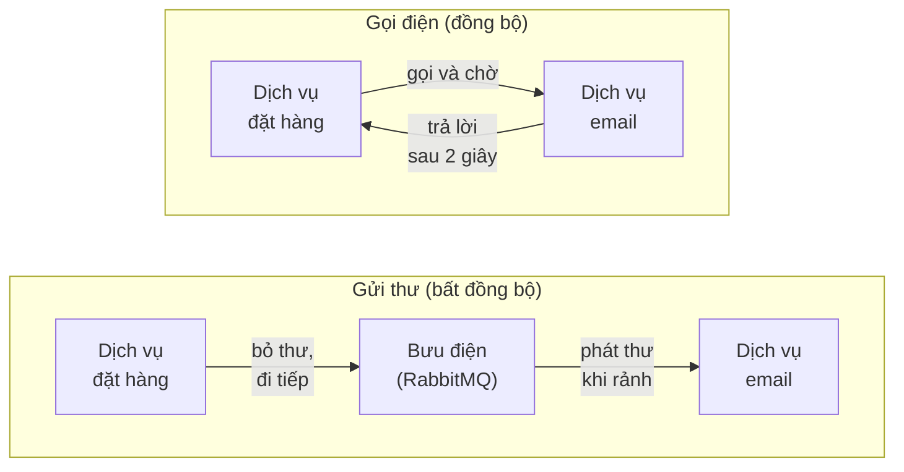
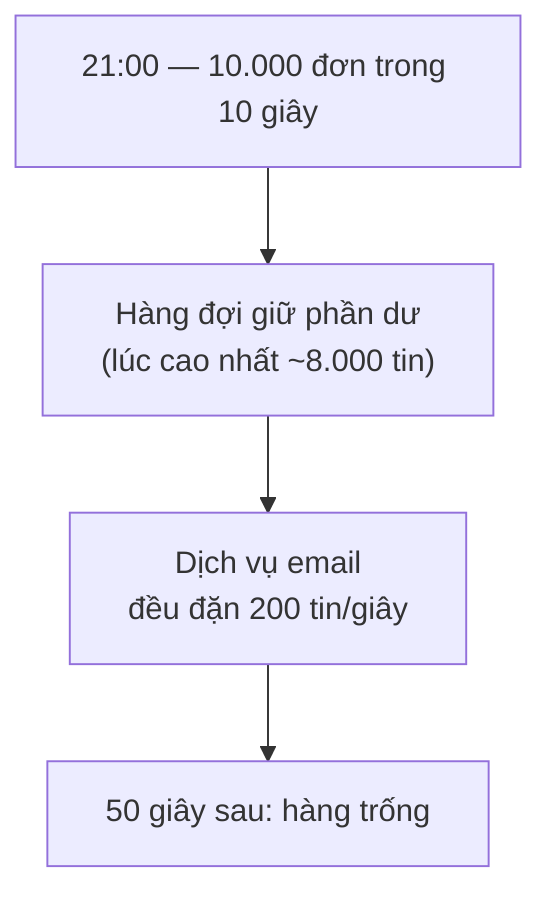

> [!tldr] Đọc nhanh
> - [[message-broker|Message broker]] là phần mềm đứng giữa, nhận tin từ bên gửi, giữ hộ và chuyển cho bên nhận. RabbitMQ là một broker như vậy.
> - [[asynchronous-messaging|Gửi bất đồng bộ]]: bên gửi giao tin cho broker rồi đi làm việc khác, không chờ bên nhận xử lý xong.
> - [[decoupling|Tách rời]]: bên gửi không cần biết ai nhận, bao nhiêu bên nhận, bên nhận đang sống hay chết.
> - [[load-leveling|San tải]]: khi việc tới nhanh hơn sức xử lý, hàng đợi giữ phần dư để bên nhận làm dần theo tốc độ của mình.
> - [[queue-va-log|Queue và log]] là hai kiểu broker khác nhau: queue xóa tin khi đã xử lý xong, log (Kafka, RabbitMQ stream) giữ tin lại để đọc lại.

> [!info] Bối cảnh
> Đây là ga đầu của **tuyến RabbitMQ**. Ví dụ xuyên suốt là **flash-sale**, một trang bán hàng giảm giá giờ vàng mình tự viết: đúng 21:00 mở bán, hàng nghìn người tranh vài trăm suất. Mỗi đơn đặt thành công kéo theo một loạt việc phụ: trừ kho, gửi email, cập nhật trang sản phẩm, đồng bộ ô tìm kiếm. Bạn không cần biết code dự án, cũng không cần biết RabbitMQ là gì. Ga này chưa có dòng cấu hình nào, chỉ trả lời câu hỏi "tại sao".

> [!abstract]- Từ điển nhanh cho bài này (bấm để mở)
> - **Service (dịch vụ)**: một chương trình chạy riêng, làm một phần việc của hệ thống, ví dụ dịch vụ đặt hàng, dịch vụ gửi email.
> - **HTTP request / gọi API**: một chương trình hỏi chương trình khác qua mạng và chờ câu trả lời. Xem lại [[2026-11-18-api-foundations|ga Nền tảng của tuyến API]].
> - **Đồng bộ (synchronous)**: hỏi xong phải đứng chờ trả lời mới làm tiếp.
> - **Tin nhắn (message)**: một gói dữ liệu nhỏ, thường là JSON, mô tả một việc cần làm hoặc một chuyện vừa xảy ra ("đơn 123 vừa được đặt").
> - **Sự kiện (event)**: tin nhắn kể lại một chuyện *đã* xảy ra. Khác với lệnh (command) là tin nhắn yêu cầu làm một việc.
> - **Throughput**: số việc xử lý được mỗi giây.
> - **Docker**: công cụ chạy phần mềm trong "hộp" cô lập, ở đây dùng để chạy RabbitMQ trên máy mà không phải cài đặt.
> - **Kafka**: một hệ thống chuyển tin nhắn khác, nổi tiếng, kiểu "log". Ga này chỉ so sánh ở mức ý tưởng.

## Hình dung trước: gọi điện hay gửi thư

Cả tuyến dùng một hình ảnh: **RabbitMQ là một bưu điện**. Ga này chỉ cần nửa đầu của hình ảnh đó, là sự khác nhau giữa *gọi điện* và *gửi thư*.

| Đời thường | Khái niệm |
|---|---|
| Bưu điện: nhận thư, giữ hộ, chuyển tới người nhận | [[message-broker\|Message broker]] |
| Gửi thư xong là về, không đứng chờ người nhận đọc | [[asynchronous-messaging\|Gửi bất đồng bộ]] |
| Gọi điện: phải chờ bên kia nhấc máy, bên kia bận là mình cũng kẹt | gọi đồng bộ (HTTP) |
| Người gửi chỉ ghi địa chỉ, không cần biết ai ở nhà, nhà có mấy người đọc | [[decoupling\|Tách rời]] |
| Tết, thư dồn về gấp mười, bưu điện chất vào kho rồi phát dần | [[load-leveling\|San tải]] |
| Người gửi thư / người nhận thư | [[producer-va-consumer\|Producer và consumer]] |
| Hộc thư: lấy thư ra là hết. Sổ lưu trữ: ai cũng đọc lại được từ trang đầu | [[queue-va-log\|Queue và log]] |



Bên trái, dịch vụ đặt hàng phải đứng chờ email gửi xong. Bên phải, nó giao thư cho bưu điện rồi làm việc tiếp; dịch vụ email nhận thư khi nào rảnh.

## Vấn đề: một đơn hàng kéo theo năm việc

Mình từng nghĩ cách đơn giản nhất là cách đúng nhất: khi khách bấm "Mua ngay", dịch vụ đặt hàng gọi lần lượt từng dịch vụ khác qua HTTP.

1. Gọi dịch vụ kho: trừ 1 sản phẩm.
2. Gọi dịch vụ email: gửi "đặt hàng thành công".
3. Gọi dịch vụ thông báo: đẩy notification lên điện thoại.
4. Gọi dịch vụ tìm kiếm: cập nhật số lượng còn lại.
5. Gọi dịch vụ thống kê: ghi lại một lượt bán.

Trên máy mình, mọi thứ chạy tốt. Rồi mình tự hỏi ba câu:

- **Dịch vụ email chậm 2 giây** (máy chủ email bên ngoài đang nghẽn). Khách phải chờ thêm 2 giây mới thấy "đặt hàng thành công", dù email chẳng liên quan gì tới việc đặt hàng.
- **Dịch vụ thông báo đang khởi động lại.** Lời gọi thất bại. Đơn hàng có bị hủy không? Nếu không hủy thì ai gửi lại thông báo sau?
- **21:00, 10.000 người bấm cùng lúc.** Dịch vụ email chỉ gửi được 200 email mỗi giây. 9.800 lời gọi còn lại treo, giữ kết nối, rồi timeout.

Ba câu này có chung một gốc: dịch vụ đặt hàng đang **làm hộ** việc của người khác, và **phụ thuộc** vào việc người khác có sống, có nhanh hay không. Hàng đợi tin nhắn cắt đúng sợi dây phụ thuộc đó.

## Cơ chế

### Message broker: người trung gian giữ hộ

[[message-broker|Message broker]] (người môi giới tin nhắn) là một phần mềm chạy riêng, chuyên nhận tin, giữ tin và chuyển tin. Bên gửi không nói chuyện trực tiếp với bên nhận nữa, mà nói chuyện với broker:

- **Bên gửi** ([[producer-va-consumer|producer]], hay publisher): đưa tin cho broker.
- **Broker** (RabbitMQ): nhận tin, cất vào **hàng đợi** (queue), giữ cho tới khi có người lấy.
- **Bên nhận** (consumer): đăng ký nhận tin từ hàng đợi, xử lý từng tin.

Với flash-sale, dịch vụ đặt hàng chỉ còn làm hai việc: lưu đơn vào database, rồi gửi *một* tin "đơn 123 vừa được đặt" cho broker. Kho, email, thông báo, tìm kiếm, thống kê mỗi bên tự lấy tin đó và tự làm phần của mình.

RabbitMQ là broker mã nguồn mở phổ biến nhất, viết bằng Erlang, ra đời năm 2007. Nó nói chuyện với ứng dụng qua một giao thức chuẩn tên **AMQP 0-9-1** (sẽ mổ xẻ ở [[2026-11-21-rabbitmq-amqp-model|ga 2]]). Từ bản 4.0, nó còn nói được AMQP 1.0, MQTT và STOMP (xem [[2026-11-21-rabbitmq-operations|ga 9]]).

### Bất đồng bộ: giao xong là đi

[[asynchronous-messaging|Gửi bất đồng bộ]] nghĩa là bên gửi không chờ bên nhận xử lý. Nó chỉ chờ một điều: broker xác nhận "tôi đã nhận giữ tin này". Xác nhận đó tới trong vài mili giây, vì broker chỉ việc ghi tin vào hàng đợi.

Điều này đổi hẳn cách tính thời gian của request "Mua ngay":

| | Gọi thẳng 5 dịch vụ | Gửi 1 tin cho broker |
|---|---|---|
| Thời gian khách chờ | tổng thời gian của 5 lời gọi | lưu đơn + vài ms gửi tin |
| Dịch vụ email chậm 2 giây | khách chờ thêm 2 giây | khách không biết gì |
| Dịch vụ thông báo đang sập | lời gọi lỗi, phải tự lo gửi lại | tin nằm chờ trong hàng, gửi khi dịch vụ sống lại |

Đổi lại, có một thứ mất đi: **kết quả không có ngay**. Khi khách thấy "đặt hàng thành công", email có thể chưa được gửi. Với email thì chẳng sao. Với "trừ tiền" thì phải nghĩ kỹ: việc nào khách *cần biết kết quả ngay* thì vẫn nên gọi đồng bộ.

> [!warning] Bất đồng bộ không làm việc nhanh hơn
> Email vẫn mất 2 giây để gửi. Hàng đợi chỉ dời 2 giây đó ra khỏi đường đi của request "Mua ngay". Tổng khối lượng việc không giảm.

### Tách rời: bên gửi không cần biết bên nhận

Khi gọi thẳng, dịch vụ đặt hàng phải biết địa chỉ của năm dịch vụ kia, biết API của từng cái, và phải sửa code mỗi khi thêm dịch vụ thứ sáu. Đó là **ràng buộc chặt** (tight coupling).

Với broker, dịch vụ đặt hàng chỉ biết một điều: "gửi tin `order.placed` cho broker". Ai muốn nghe thì tự đăng ký với broker. Tháng sau team marketing muốn tặng voucher cho đơn đầu tiên? Họ viết một consumer mới, đăng ký nhận `order.placed`, và **không ai phải sửa dịch vụ đặt hàng**. Đó là [[decoupling|tách rời]] (decoupling).

Tách rời theo ba chiều:

- **Không gian**: bên gửi không cần biết bên nhận ở đâu, có bao nhiêu.
- **Thời gian**: bên nhận không cần sống đúng lúc bên gửi gửi.
- **Tốc độ**: bên nhận xử lý theo nhịp của mình, không theo nhịp bên gửi.

Ràng buộc không biến mất hẳn, nó chuyển sang **hợp đồng tin nhắn**: tên sự kiện và cấu trúc JSON. Đổi `orderId` thành `order_id` là mọi consumer vỡ cùng lúc, và không có lỗi biên dịch nào báo trước.

### San tải: hàng đợi là cái đệm

21:00, flash sale mở. Trong 10 giây đầu có 10.000 đơn. Dịch vụ email gửi được 200 email/giây, tức cần 50 giây để gửi hết.

- **Gọi thẳng**: 9.800 lời gọi bị nghẽn hoặc timeout. Dịch vụ email có thể sập vì quá tải.
- **Có hàng đợi**: 10.000 tin nằm trong hàng. Dịch vụ email lấy ra 200 tin/giây, sau 50 giây là hết. Không ai sập, chỉ có email đến muộn hơn một chút.

Đó là [[load-leveling|san tải]] (load leveling): hàng đợi biến một đỉnh nhọn thành một đường bằng. Muốn xử lý nhanh hơn thì chạy thêm consumer; broker tự chia tin cho các consumer (ga 4 gọi đó là *work queue*).



> [!warning] Hàng đợi không phải cái túi không đáy
> Tin nằm trong hàng tốn RAM và đĩa của broker. Hàng dài mãi (consumer chết, hoặc chậm hơn producer quá lâu) thì tới lúc RabbitMQ **chặn mọi bên gửi trên toàn cụm** để tự bảo vệ. [[2026-11-21-rabbitmq-dlx-retry|Ga 6]] nói cách giới hạn độ dài hàng, [[2026-11-21-rabbitmq-operations|ga 9]] nói về cảnh báo tài nguyên.

Một chi tiết thật từ flash-sale: phần "xếp hàng người mua lúc 21:00" của dự án **không** dùng RabbitMQ mà dùng Redis (xem [[2026-11-21-shopify-flash-sale|bài về Shopify]]). RabbitMQ trong flash-sale chở các **sự kiện** sinh ra *sau* khi đơn đã được tạo: `order.placed`, `order.cancelled`, `inventory.changed`. Hàng chờ người mua cần trả lời "bạn đứng thứ mấy" ngay lập tức, còn sự kiện thì cần được giao chắc chắn. Hai nhu cầu khác nhau, hai công cụ khác nhau.

### Queue và log: hai kiểu broker

Có hai họ broker, và chọn sai họ là chọn sai từ gốc.

- **Queue (hàng đợi)** như hộc thư: consumer lấy thư ra, xác nhận đã xử lý, thư **bị xóa**. Mỗi tin thường chỉ một consumer xử lý. Muốn hai ứng dụng cùng đọc một tin thì mỗi ứng dụng cần một hàng riêng (ga 3 cho thấy broker tự nhân bản tin vào nhiều hàng). RabbitMQ classic queue và quorum queue thuộc họ này.
- **Log (nhật ký)** như sổ lưu trữ: tin được **ghi nối vào cuối** và giữ lại theo thời hạn (ví dụ 7 ngày), đọc xong không xóa. Mỗi consumer tự nhớ "mình đã đọc tới dòng số mấy" (offset), và có thể quay lại đọc từ đầu. Kafka thuộc họ này; RabbitMQ từ bản 3.9 có **stream** cũng là log.

| | Queue (RabbitMQ classic/quorum) | Log (Kafka, RabbitMQ stream) |
|---|---|---|
| Đọc xong | tin bị xóa | tin vẫn còn |
| Đọc lại tin cũ | không | được, theo offset |
| Mạnh ở | định tuyến linh hoạt, ack từng tin, thư lỗi, hẹn giờ, ưu tiên | đọc lại, rất nhiều consumer cùng đọc, throughput rất cao |
| Hợp với | giao việc cho worker, sự kiện cần xử lý một lần | event sourcing, phân tích, nhiều hệ thống cùng đọc một dòng sự kiện |

Mình từng nghĩ "RabbitMQ không đọc lại được, muốn đọc lại phải dùng Kafka". Câu đó đúng trước năm 2021. Từ 3.9, RabbitMQ có stream; [[2026-11-21-rabbitmq-queue-types|ga 7]] chạy thử việc đọc lại theo offset.

## Ví dụ chạy được

File `buffering.ts` cho thấy hai thứ của ga này bằng broker thật: bên gửi giao xong 5 đơn trong vài mili giây dù bên nhận chưa chạy (tách rời theo thời gian), và bên nhận xử lý dần theo tốc độ của nó (san tải). Cách chạy:

```bash
docker run -d --rm --name atlas-rabbit -p 5673:5672 -p 15673:15672 rabbitmq:4-management
npm i amqplib
node buffering.ts      # Node 22.6+ chạy thẳng file .ts
```

Cổng 5673 để khỏi đụng RabbitMQ khác đang chạy ở cổng mặc định 5672. Phần chính của code (bản đầy đủ: [buffering.ts](../code/rabbitmq-why-queues/buffering.ts)):

```ts
// Bên gửi: dịch vụ đặt hàng. Bên nhận (gửi email) chưa chạy.
for (let i = 1; i <= 5; i++) {
  ch.sendToQueue(Q, Buffer.from(`don-${i}`), { persistent: true });
}
await ch.waitForConfirms(); // broker xác nhận đã nhận giữ cả 5 tin

// Một lúc sau bên nhận mới chạy và xử lý theo tốc độ của nó.
await sleep(500);
const worker = await conn.createChannel();
await worker.prefetch(1);
await worker.consume(Q, async (msg) => {
  await sleep(200); // gửi email mất 200ms
  worker.ack(msg);
});
```

```text
$ node buffering.ts
+  11ms bên gửi: đã giao 5 đơn cho broker, đi làm việc khác
+  11ms trong hàng đang chờ: 5 tin
+ 513ms bên nhận (gửi email) bắt đầu chạy
+ 721ms bên nhận: đã gửi email cho don-1
+ 924ms bên nhận: đã gửi email cho don-2
+1126ms bên nhận: đã gửi email cho don-3
+1328ms bên nhận: đã gửi email cho don-4
+1530ms bên nhận: đã gửi email cho don-5
```

Bên gửi xong việc ở mili giây thứ 11. Nếu gọi đồng bộ, nó sẽ chờ 5 × 200 = 1.000 ms, và thất bại ngay nếu dịch vụ email chưa chạy. Các từ `sendToQueue`, `prefetch`, `ack`, `persistent`, `waitForConfirms` sẽ được giải thích dần ở ga 2 và ga 4. Lúc này chỉ cần nhìn thứ tự thời gian.

Trong lúc container chạy, mở `http://localhost:15673` (tài khoản `guest` / `guest`) để xem giao diện quản trị: tab **Queues** hiện hàng `demo.orders.to-email` với số tin đang chờ.

## Hiểu lầm và bẫy hay gặp

### "Có hàng đợi thì hệ thống nhanh hơn"

Hàng đợi làm *request* nhanh hơn vì dời việc phụ ra sau. Tổng khối lượng việc vẫn vậy, cộng thêm chi phí đi qua broker. Nếu consumer chậm hơn producer *mãi mãi* thì hàng đợi chỉ trì hoãn ngày sập.

### Đưa mọi thứ vào hàng đợi

Việc mà người dùng cần kết quả ngay ("còn hàng không?", "thanh toán được chưa?") mà đẩy vào hàng đợi thì phải tự xây thêm cơ chế chờ kết quả (ga 5 có mẫu request-reply). Hàng đợi hợp nhất với việc mà bên gửi *không cần đợi*: gửi email, cập nhật chỉ mục tìm kiếm, ghi thống kê.

### "Gửi được cho broker là tin chắc chắn tới nơi"

Chưa chắc. Tin có thể không vào hàng nào (gửi sai địa chỉ, ga 3), có thể mất khi broker khởi động lại (ga 4), có thể bị xử lý hai lần (ga 5). Cả tuyến này phần lớn là để trả lời câu "làm sao cho chắc".

### Coi tách rời là không còn ràng buộc

Đổi tên trường JSON hay đổi tên sự kiện vẫn làm vỡ consumer, chỉ là vỡ *âm thầm* và *muộn hơn*. Hợp đồng tin nhắn cần được ghi lại và đổi có kế hoạch, như hợp đồng API.

### Chọn Kafka hay RabbitMQ vì "nghe nói nhanh hơn"

Hai thứ giải hai bài khác nhau. Cần giao việc cho worker, định tuyến theo nhãn, thử lại có độ trễ, thư lỗi: RabbitMQ queue. Cần lưu một dòng sự kiện để nhiều hệ thống đọc lại nhiều lần: log (Kafka hoặc RabbitMQ stream).

## Câu hỏi tự kiểm tra

> [!question]- Dịch vụ email đang sập. Gọi HTTP và gửi qua broker khác nhau thế nào?
> Gọi HTTP thất bại ngay (hoặc treo tới timeout), bên gọi phải tự lo gửi lại. Gửi qua broker thì tin nằm chờ trong hàng; dịch vụ email sống lại là xử lý tiếp, bên gửi không biết gì.

> [!question]- 10.000 đơn tới trong 10 giây, consumer xử lý 200 tin/giây. Hàng đợi giúp gì, và không giúp gì?
> Giúp: giữ phần dư để không ai sập, consumer làm đều 200 tin/giây, khoảng 50 giây là xong. Không giúp: việc vẫn mất 50 giây; và nếu tình trạng này kéo dài mãi thì hàng sẽ phình tới mức broker phải chặn bên gửi.

> [!question]- Khác biệt cốt lõi giữa queue và log là gì?
> Queue xóa tin khi consumer xác nhận đã xử lý. Log giữ tin theo thời hạn, mỗi consumer tự giữ vị trí đọc (offset) và có thể đọc lại.

> [!question]- Team marketing muốn tặng voucher cho mỗi đơn đầu tiên. Với broker, phải sửa dịch vụ đặt hàng không?
> Không. Họ viết consumer mới, đăng ký nhận sự kiện `order.placed`. Dịch vụ đặt hàng vẫn gửi đúng một tin như cũ.

> [!question]- Việc nào trong flash-sale *không* nên đẩy sang hàng đợi?
> Việc mà người dùng cần kết quả ngay trong request, như kiểm tra còn suất không hay xác nhận thanh toán. Đẩy vào hàng thì phải tự xây cơ chế chờ kết quả, phức tạp hơn gọi thẳng.

## Tham khảo

- [RabbitMQ: AMQP 0-9-1 Model Explained](https://www.rabbitmq.com/tutorials/amqp-concepts)
- [RabbitMQ tutorial 2: Work Queues (JavaScript)](https://www.rabbitmq.com/tutorials/tutorial-two-javascript)
- [RabbitMQ: Streams](https://www.rabbitmq.com/docs/streams) và [RabbitMQ Streams Overview](https://www.rabbitmq.com/blog/2021/07/13/rabbitmq-streams-overview)
- [Apache Kafka: Introduction](https://kafka.apache.org/intro)
