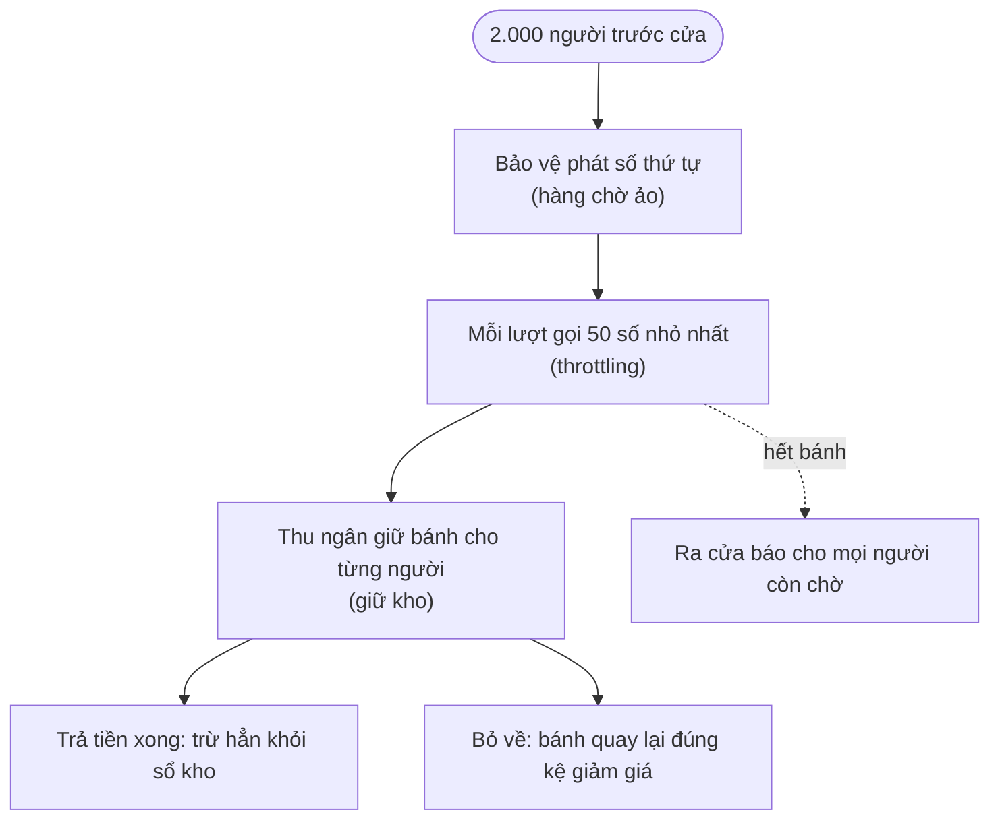
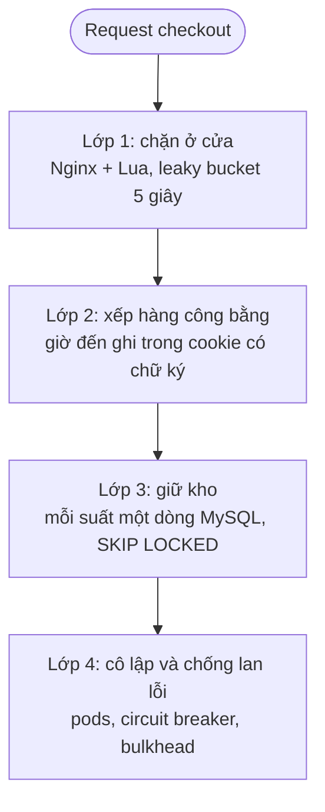
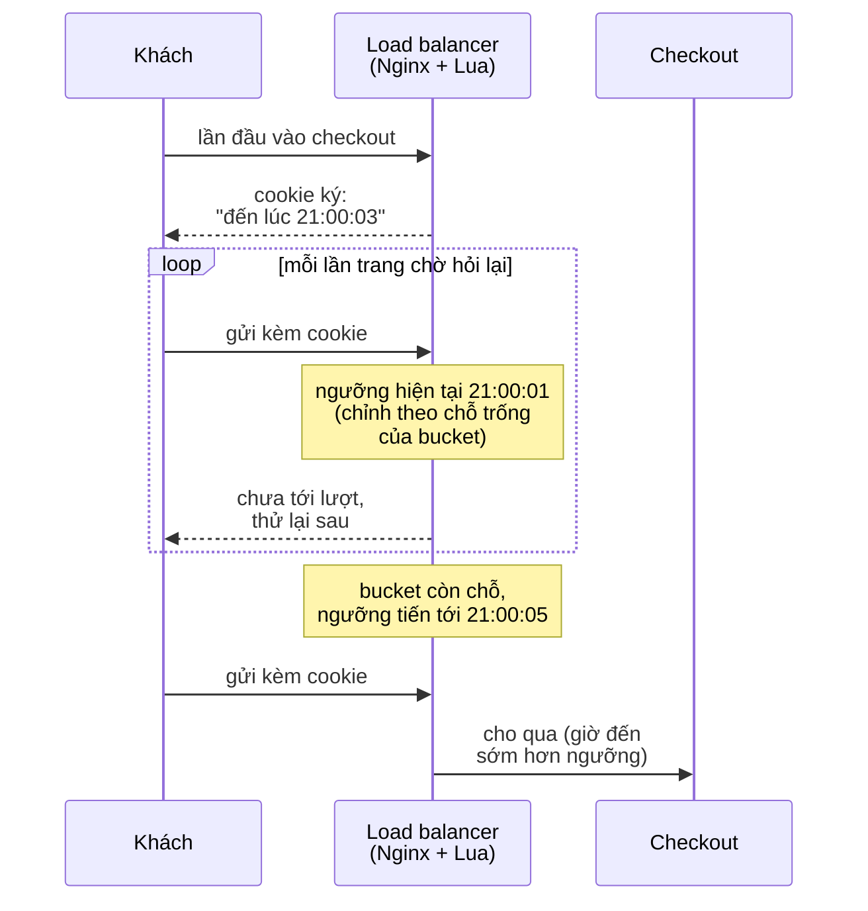

> [!tldr] Đọc nhanh
> - Con số "32 triệu request mỗi phút" là đỉnh của cả Shopify trong Black Friday 2021, không phải của một đợt flash sale. Con số đáng nhớ hơn: **một** đợt flash sale từng ăn hơn 20% toàn bộ năng lực tính toán của Shopify.
> - Shopify xử lý flash sale bằng bốn lớp: chặn bớt ở cửa ([[concepts/throttling]]), xếp hàng công bằng theo giờ đến ([[concepts/virtual-queue|hàng chờ ảo]]), giữ kho không bán quá ([[concepts/inventory-reservation|giữ kho]]), và cô lập để một shop nóng không kéo sập shop khác.
> - Mỗi lớp đều có một lần sửa sai được kể công khai: hàng chờ kiểu xổ số bắt khách chờ 40 phút, hàng chờ ở cửa không biết kho đã hết, giữ kho bằng Redis không ghi nguyên tử được với sổ kho chính.
> - Dự án của mình làm đúng phần khó nhất (trừ kho nguyên tử bằng Lua, hàng chờ theo giờ đến), nhưng còn bốn chỗ hở. Nặng nhất: đơn flash sale bị hủy thì hàng trả về **nhầm kệ**, và lúc đối soát cuối đợt thì tin Redis hơn tin đơn hàng thật.

> [!info] Bối cảnh
> **flash-sale** là trang bán hàng giảm giá giờ vàng mình tự viết (backend NestJS, kho nhanh trong Redis, sổ kho chính trong Postgres). Đúng giờ mở bán, hàng nghìn người tranh vài trăm suất. Người mua xếp vào một hàng chờ ảo, cứ 5 giây hệ thống gọi 50 người vào mua. Bạn không cần đọc code dự án: mỗi đoạn code trích ra đều có giải thích bằng lời trước.
>
> Bài này khác các bài trước ở chỗ nó là một **bài soát lỗi**. Mình đọc các bài kỹ thuật Shopify tự viết về flash sale, rồi dùng chúng làm thước đo cho dự án của mình.

> [!abstract]- Từ điển nhanh cho bài này (bấm để mở)
> - **Flash sale**: đợt bán giới hạn số lượng và thời gian, ví dụ 300 đôi giày mở bán lúc 21:00.
> - **RPM (requests per minute)**: số request mỗi phút mà hệ thống nhận.
> - **Edge / load balancer**: lớp máy đứng ngoài cùng, nhận request từ Internet trước khi chuyển vào ứng dụng. Shopify dùng Nginx kèm Lua (OpenResty).
> - **Leaky bucket**: mỗi khoảng thời gian chỉ cho một số request nhất định đi qua, phần thừa phải chờ (xem [[concepts/rate-limiting]]).
> - **Cookie có chữ ký**: cookie server ký bằng khóa bí mật. Khách đọc được nhưng sửa thì chữ ký sai.
> - **Redis / Lua script**: Redis là cơ sở dữ liệu trong RAM. Lua script chạy bên trong Redis, trọn vẹn một lần, không bị lệnh khác chen vào.
> - **ZSET**: danh sách trong Redis tự sắp xếp theo điểm, ở đây điểm là giờ đến.
> - **Ghi hai nơi (dual write)**: một thao tác phải cập nhật hai hệ thống, như Redis và Postgres, mà không có transaction chung. Xem [[concepts/dual-write]].
> - **Đối soát (reconcile)**: so số liệu giữa hai nơi lưu rồi sửa cho khớp.
> - **`SELECT … FOR UPDATE SKIP LOCKED`**: lệnh SQL khóa dòng để sửa, dòng nào đang bị người khác khóa thì bỏ qua lấy dòng khác.
> - **Circuit breaker, timeout**: xem [[posts/2026-11-18-api-reliability|ga Độ tin cậy]].

## Hình dung trước: tiệm bánh mở bán 300 cái bánh lúc 9 giờ

Một tiệm bánh nổi tiếng thông báo: đúng 9 giờ sáng bán 300 cái bánh giá một nửa. 8 giờ 55 đã có 2.000 người đứng trước cửa. Mọi kỹ thuật của bài này đều có bản sao ở tiệm bánh:

| Đời thường | Khái niệm | Shopify | flash-sale của mình |
|---|---|---|---|
| Bảo vệ chỉ cho 50 người vào mỗi 5 phút, người còn lại đứng chờ ngoài cửa | [[concepts/throttling\|Throttling]] | Leaky bucket ở lớp Nginx | Mỗi 5 giây gọi 50 người |
| Phát **số thứ tự** theo giờ đến, gọi số từ nhỏ đến lớn | [[concepts/virtual-queue\|Hàng chờ ảo]] | Ghi giờ đến vào cookie có chữ ký | Ghi giờ đến vào ZSET trong Redis |
| Thu ngân **giữ** cái bánh cho bạn trong lúc bạn móc ví, trả tiền xong mới trừ hẳn khỏi sổ | [[concepts/inventory-reservation\|Giữ kho]] | Mỗi suất là một dòng trong MySQL | Lua trừ kho trong Redis, rồi tạo đơn trong Postgres |
| Bảng đếm ở cửa và sổ kho trong bếp phải khớp nhau | [[concepts/dual-write\|Ghi hai nơi]] | Bỏ Redis, chỉ còn MySQL | Vẫn ghi hai nơi, cuối đợt đối soát |
| Hết bánh thì ra cửa báo ngay cho người đang xếp hàng | Đóng hàng chờ khi hết | Chuyển hàng chờ vào trong ứng dụng để biết kho | **Chưa có** |
| Khách bỏ về không trả tiền thì bánh quay về đúng kệ bánh giảm giá | Trả hàng đúng kho | Giải phóng suất đã giữ | **Trả nhầm sang kệ thường** |



## Vấn đề: con số 32 triệu nói gì, và không nói gì

Mình bắt đầu từ tiêu đề *How Shopify Handles Flash Sales at 32 Million Requests per Minute* của một newsletter về system design. Đọc lại nguồn gốc thì thấy con số đó nằm trong bài tổng kết đầu năm 2022 của CTO Shopify. Đỉnh Black Friday 2021 là **hơn 32 triệu request mỗi phút vào app server**, hơn 34 triệu ở load balancer. Đó là tải của toàn nền tảng, không phải của một đợt flash sale.

Câu đáng chú ý hơn nằm ngay bên dưới: Shopify định nghĩa flash sale là đợt bán ngắn vượt một ngưỡng số checkout mỗi phút, và **một** đợt như vậy từng dùng hơn 20% toàn bộ năng lực tính toán của họ lúc cao điểm. Một shop trong hàng triệu shop chiếm một phần năm hạ tầng trong vài phút. Đó mới là bài toán: tải không tăng đều mà dồn hết vào **đường ghi** (tạo checkout, giữ kho, trừ kho), đúng chỗ khó mở rộng nhất.

Vì vậy mình bỏ qua newsletter và đọc thẳng các bài Shopify tự viết (danh sách ở cuối bài), rồi đặt câu hỏi: dự án của mình xử lý từng vấn đề đó ra sao?

## Shopify làm thế nào: bốn lớp, mỗi lớp một lần sửa sai



### Lớp 1: chặn bớt ở cửa, nhưng không trả lỗi

Năm 2017, Emil Stolarsky kể lại lý do Shopify phải chặn ở checkout. Mỗi phiên checkout tạo một bản ghi MySQL, và mỗi bước trong checkout lại sửa đúng bản ghi đó. Flash sale biến checkout thành điểm nóng ghi. Cách sửa tận gốc là viết lại checkout để gộp các lần ghi, nhưng không kịp trước đợt bán tiếp theo. Nên họ chọn một giải pháp tạm ở lớp ngoài cùng.

Throttle chạy trong Nginx bằng Lua (OpenResty), theo kiểu [[concepts/rate-limiting|leaky bucket]]: mỗi chu kỳ **5 giây** chỉ cho một số request checkout đi qua, con số này đặt theo sức chịu của ứng dụng. Ai qua được thì nhận một cookie có chữ ký, cho phép đi thẳng suốt phiên đó. Ai không qua thì thấy trang chờ (do merchant thiết kế, cache sẵn ở Nginx), JavaScript trên trang tự hỏi lại.

Họ cố ý **không trả `429`**: với người mua, một trang lỗi trông như shop bị sập. Trang chờ giữ được cảm giác "đang xếp hàng".

### Lớp 2: hàng chờ xổ số và cách sửa thành hàng chờ theo giờ đến

Bản đầu có một lỗi thiết kế mà chính tác giả thừa nhận. Trang chờ thật ra **không phải hàng chờ**: mỗi lần hỏi lại là một lần bốc thăm ngang hàng với mọi người khác, người đến sớm không được ưu tiên. Có khách chờ tới **40 phút**, trong một đợt bán chỉ kéo dài khoảng 40 phút.

Phần II kể lại bản sửa:

1. Lần đầu bấm checkout, giờ đến được ghi vào **cookie có chữ ký**. Không có cơ sở dữ liệu chung nào lưu hàng chờ.
2. Mỗi máy load balancer tự tính một ngưỡng "đang phục vụ tới số…" (virtual now serving). Ai có giờ đến sớm hơn ngưỡng thì được đưa tới leaky bucket.
3. Ngưỡng được chỉnh liên tục theo **chỗ trống của bucket**: bucket còn trống thì ngưỡng tiến lên hiện tại, bucket đầy thì ngưỡng lùi lại. Bộ điều chỉnh chỉ dùng thành phần tỉ lệ (proportional), sau khi họ thử mô phỏng PID đầy đủ.



Cái hay là **không cần trạng thái chung**: hàng chờ nằm trong cookie của từng khách, mỗi load balancer tự quyết định. Cái giá là công bằng chỉ gần đúng, vì các máy có thể tính ra ngưỡng hơi khác nhau.

Năm 2022, Logan Martel (Shopify) kể phần tiếp theo ở Strange Loop. Throttle ở cửa chịu được đợt ghi gấp **5 lần** bình thường, nhưng có hai giới hạn. Nó tách khỏi logic nghiệp vụ nên khó test và khó cải tiến. Quan trọng hơn, **nó không biết kho**: khách có thể chờ 30 phút rồi mới thấy món hàng đã hết từ 20 phút trước. Họ chuyển hàng chờ vào trong ứng dụng (Rails), thành "hàng chờ hiểu nghiệp vụ".

### Lớp 3: giữ kho, và vì sao Shopify bỏ Redis

Giữ kho là thao tác chống bán quá: lúc khách bắt đầu trả tiền, hệ thống giữ một suất trong vài phút. Trả tiền thành công thì trừ hẳn khỏi sổ kho (claim), bỏ ngang thì suất được nhả ra.

Bài tháng 5/2026 của Emilie Noel kể lại cuộc chuyển nhà của phần này. Trước đây mỗi mặt hàng có một con số trong Redis, giữ thì `DECR`, nhả thì `INCR`. Chạy đồng thời không có vấn đề gì. Vấn đề nằm ở chỗ suất đang giữ ở Redis, còn sổ kho ở MySQL: lúc claim phải sửa MySQL **và** dọn Redis, hai việc không thể gói chung một transaction. Làm theo thứ tự nào cũng có lúc bán quá hoặc báo hết hàng sai. Họ chuyển hẳn sang MySQL:

- **Mỗi suất là một dòng.** Mặt hàng có 10 suất thì có 10 dòng. Số dòng có sẵn được giới hạn 1.000 cho mỗi cặp mặt hàng và kho, một tiến trình bổ sung dần từ sổ kho. Con số 1.000 lấy từ tốc độ giữ kho cao nhất đo được trong các đợt flash sale.
- **`SELECT … FOR UPDATE SKIP LOCKED`**: hai người cùng giữ thì mỗi người lấy một dòng khác nhau, không ai phải chờ ai.
- **Thứ tự khóa cố định** để hết deadlock: giữ kho luôn xóa ở bảng suất trống trước, rồi mới ghi vào bảng suất đã giữ.
- **Nút cổ chai thật là connection, không phải CPU.** Họ gắn nhãn quy trình nghiệp vụ vào từng câu SQL để đo ai giữ connection lâu. Dọn dẹp xong thì đường checkout bớt được một nửa số lần đọc và một phần ba số transaction trên máy chủ chính.
- **Chuyển dần có đường lùi**: ghi song song cả Redis lẫn MySQL (Redis vẫn là nguồn sự thật), rồi đổi nguồn sự thật sang MySQL kèm công tắc quay lại Redis, rollout từ shop ít traffic tới shop lớn nhất.

Kết quả: trong các đợt flash sale lớn, CPU của máy ghi dưới 50%, máy đọc dưới 16%. Black Friday 2025 đạt đỉnh 5,1 triệu USD doanh thu mỗi phút.

### Lớp 4: cô lập và chống lan lỗi

- **Pods** (2016): các shop được chia thành nhóm, mỗi nhóm có bộ datastore riêng hoàn toàn. Một phần mềm tên Sorting Hat trong load balancer gắn mỗi request vào đúng pod. Một shop đang flash sale chỉ đè lên pod của nó, không lan ra cả nền tảng.
- **Semian** (từ 2014): [[concepts/circuit-breaker]] cộng *bulkhead* (chỉ cho một số worker cùng chạm vào một tài nguyên, như các khoang kín trên tàu). Lý do được nói rất rõ: timeout thôi là không đủ, một dependency chậm còn tệ hơn một dependency chết.
- **Toxiproxy và ma trận chịu lỗi**: một bảng hàng là các dịch vụ phụ thuộc, cột là các phần của ứng dụng, mỗi ô ghi phần đó cư xử ra sao khi dịch vụ chậm hoặc chết. Toxiproxy chèn độ trễ và sự cố thật vào test để kiểm từng ô.
- **Load test ở quy mô thật**: chuẩn bị cho Black Friday 2021 từ tháng 7, lần test lớn nhất đạt 50,7 triệu request mỗi phút ở load balancer, gấp rưỡi đỉnh thật.

## Soi vào flash-sale: luồng đi của một suất

Sơ đồ dưới theo một suất flash sale từ lúc xếp hàng tới lúc đối soát cuối đợt, đánh dấu những chỗ hở mình tìm ra:

<figure class="figure-map" style="--ar: 1 / 1">
<div class="frame"><iframe data-archify="../diagrams/shopify-flash-sale/flash-sale-gaps.html" title="Sơ đồ tuần tự: một suất flash sale đi qua dự án flash-sale và bốn chỗ hở" loading="lazy"></iframe></div>
<figcaption><span><b>Hình 1.</b> Phần xếp hàng và trừ kho làm đúng; các chỗ hở nằm ở lúc gọi số khi đã hết hàng, giữa hai lần ghi Redis và Postgres, và ở luồng hủy đơn.</span><a href="../diagrams/shopify-flash-sale/flash-sale-gaps.html" target="_blank" rel="noopener">Mở toàn màn hình</a></figcaption>
</figure>

### Những gì đã làm đúng

| Việc | Shopify | flash-sale | Nhận xét |
|---|---|---|---|
| Xếp hàng theo giờ đến | Cookie có chữ ký + ngưỡng tại từng load balancer | `ZADD NX` vào ZSET, điểm là giờ đến | Công bằng chính xác hơn, đổi lại phụ thuộc một Redis |
| Mỗi người một chỗ | Cookie gắn với phiên | `NX`: đã có thì không thêm | Ngang nhau |
| Tách "ai được vào" khỏi "còn hàng không" | Bucket riêng, giữ kho riêng | Vé checkout riêng, Lua trừ kho riêng | Đúng hướng |
| Trừ kho không bán quá | Một dòng mỗi suất, `SKIP LOCKED` | Lua: kiểm trạng thái, kiểm hạn mức mỗi người, `DECRBY`, âm thì hoàn | Đúng, nguyên tử |
| Báo cho khách đang chờ | Trang chờ tự hỏi lại | WebSocket, có endpoint hỏi lại làm đường lùi | Tốt hơn polling thuần |
| Tắt khẩn cấp | (không thấy trong bài) | Feature flag `flash_sale_kill_switch` | Tốt |

Phần lõi trừ kho được viết cẩn thận. Bằng lời: kiểm đợt bán còn mở không, kiểm người này đã mua quá hạn mức chưa, trừ kho, nếu kho âm thì cộng lại và báo hết hàng. Tất cả trong một Lua script nên không request nào chen được vào giữa:

```lua
-- rút gọn từ flash_purchase.lua
if meta.status ~= 'ACTIVE' then return -3 end            -- đợt bán đã đóng
if bought + qty > maxPerUser then return -2 end          -- quá hạn mức mỗi người
local left = redis.call('DECRBY', stockKey, qty)
if left < 0 then redis.call('INCRBY', stockKey, qty); return -1 end  -- hết hàng
redis.call('INCRBY', userLimitKey, qty)
return 1
```

### Chỗ hở 1 (nặng): đơn flash sale đi qua luồng kho thường

Trong Postgres, mỗi SKU có hai "kệ": kệ thường (`total_stock`, `reserved_stock`) và kệ flash sale (`flash_sale_stock`, `flash_sale_reserved`, `flash_sale_sold`). Đơn flash sale được tạo đúng trên kệ flash sale. Nhưng sau đó đơn đi vào **luồng chuyển trạng thái chung** của mọi đơn hàng, và luồng này không phân biệt nguồn:

- Đơn quá 15 phút chưa trả tiền bị tự hủy. Sự kiện `order.cancelled` đến consumer trả hàng, consumer gọi `releaseStock`. Hàm này **giảm `reserved_stock` của kệ thường**:

  ```sql
  -- rút gọn từ stock.service.ts: releaseStock
  UPDATE inventories SET reserved_stock = GREATEST(reserved_stock - $qty, 0) WHERE sku_id = $sku
  ```

  Nếu lúc đó có khách thường đang giữ hàng, chỗ giữ của *họ* bị nhả bớt, kệ thường báo còn nhiều hơn thực tế, và có thể **bán quá**. Còn suất flash sale bị hủy thì không quay lại Redis cũng không quay lại kệ flash sale: nó **mất luôn** cho tới khi đợt bán kết thúc.
- Đơn giao xong 7 ngày thì chuyển `COMPLETED` và gọi `confirmSold`, cũng trên kệ thường: trừ `total_stock` và `reserved_stock` với điều kiện `reserved_stock >= qty`. Không có khách thường nào đang giữ hàng thì câu lệnh ném `INSUFFICIENT_RESERVED` và đơn flash sale **không hoàn tất được**. Có thì nó lấy mất chỗ giữ của người khác và trừ `total_stock` cho một món đã được tính ở kệ flash sale.

Thí nghiệm 4 ở cuối bài dựng lại đúng tình huống hủy đơn: kệ thường đang còn 1, hủy một đơn flash sale xong thì thành 2, dù không ai trả hàng.

Mình kết luận điều này bằng cách đọc code (luồng `transition` của đơn, consumer trả hàng và `StockService`), chưa chạy test tích hợp tái hiện. So với Shopify: họ giữ **một** nguồn sự thật cho kho, giữ và claim trên cùng các bảng. Hướng sửa cho flash-sale là để luồng hủy và hoàn tất nhận ra đơn flash sale (đơn đã lưu `skuInfo.source = 'flash-sale'` và `campaignId`), rồi trả suất về kệ flash sale, cộng lại vào Redis nếu đợt bán còn chạy.

### Chỗ hở 2 (nặng): ghi hai nơi, và đối soát lại tin nhầm bên

Đây chính là bài toán khiến Shopify rời Redis. Ở flash-sale, Lua trừ kho trong Redis, **sau đó** một transaction Postgres tạo đơn. Nếu transaction lỗi, khối `catch` chạy script bù trừ cộng kho lại. Cách này đúng khi lỗi là một exception. Nó không đúng khi **pod chết** giữa hai bước (deploy, hết bộ nhớ, node bị thu hồi): Redis đã trừ, không có đơn, và khối `catch` không bao giờ chạy.

Lưới an toàn lẽ ra là bước đối soát cuối đợt. Nhưng bước này lấy **Redis làm chuẩn**: tính số đã bán bằng "số phân bổ trừ số còn trong Redis", rồi sửa sổ kho Postgres cho khớp. Suất "bán ma" (Redis đã trừ, không có đơn) vì thế được ghi thành đã bán, và không được trả về kho. Thí nghiệm 3: 100 suất, 3% request trúng lúc pod chết, Redis nói bán 100, Postgres có 97 đơn, đối soát ghi 100.

Hướng sửa, từ nhẹ tới nặng:

1. **Đối soát theo đơn thật**: số đã bán là số đơn flash sale chưa hủy trong Postgres, không phải số Redis đã trừ. Phần chênh lệch được trả về kho và ghi log cảnh báo.
2. **Ghi dấu trong cùng Lua**: script trừ kho ghi luôn một mục "đang giữ" theo `Idempotency-Key`. Một job định kỳ tìm mục quá hạn mà không có đơn tương ứng thì hoàn lại. Đây là phiên bản Redis của bảng `reserved_quantities` bên Shopify.
3. **Làm như Shopify**: giữ kho bằng dòng Postgres với `SKIP LOCKED`, Redis chỉ còn là hàng chờ. Mất tốc độ của Lua, đổi lại không còn hai nguồn sự thật.

### Chỗ hở 3: hết hàng mà hàng chờ vẫn gọi số

`joinQueue` và `processBatch` không nhìn vào kho. Hết hàng ở giây 60 thì người thứ 1.500 vẫn được xếp hàng, vẫn chờ tới lượt, nhận vé, rồi mới nghe "hết hàng". Đây đúng là chuyện "chờ 30 phút, hàng hết từ 20 phút trước" mà Shopify phải chuyển hàng chờ vào ứng dụng để sửa. Thí nghiệm 2 đo được hơn 3.000 phút-người chờ vô ích trong một đợt 300 suất.

Sửa khá rẻ: khi Lua trả "hết hàng" cho mọi SKU của đợt, đặt một cờ `sold_out`; `joinQueue` từ chối ngay, `processBatch` dừng, và server phát một sự kiện WebSocket để mọi người đang chờ thấy "đã hết" ngay lập tức.

### Chỗ hở 4: các lỗ nhỏ quanh hàng chờ

- **Tốc độ gọi số cố định** (50 người mỗi 5 giây). Shopify chỉnh ngưỡng theo chỗ trống thật của bucket. Ở flash-sale, vé không dùng thì hết hạn sau 5 phút mà không ai được gọi bù, còn khi hệ thống đang khỏe thì vẫn chỉ gọi 50. Có thể chỉnh số người mỗi lượt theo số vé đang còn hiệu lực và số kho còn lại.
- **Gọi số không nguyên tử**: `ZPOPMIN` lấy người ra khỏi hàng, rồi một lệnh khác mới phát vé. Worker chết giữa hai lệnh thì 50 người mất chỗ mà không có vé. Gộp hai bước vào một Lua script là hết.
- **Vé "dùng một lần" chưa thật sự dùng một lần**: vé được kiểm bằng `GET` trước Lua và chỉ bị xóa sau khi tạo đơn xong. Hai request song song với hai `Idempotency-Key` khác nhau đều qua được bước kiểm vé. Hạn mức mỗi người trên mỗi SKU vẫn chặn mua quá, nhưng một vé vẫn mua được nhiều SKU. Có thể đưa việc kiểm và xóa vé vào chính `flash_purchase.lua`.
- **Load test không thể báo đỏ**: script k6 gọi thẳng endpoint mua mà không xếp hàng lấy vé, dùng chung một tài khoản cho 500 người ảo, và coi `400`, `429` là kết quả hợp lệ. Mọi request bị chặn ở bước kiểm vé hoặc giới hạn tốc độ, nên Lua không bao giờ bị thử tải, mà test vẫn xanh. Bảng kết quả trong README cũng chưa từng được điền. Shopify thì load test gấp rưỡi đỉnh thật từ bốn tháng trước Black Friday.

Còn một giới hạn khi mở rộng, chưa phải lỗi: Lua đụng ba key `flash:stock:…`, `flash:user_limit:…`, `flash:campaign:…` không có hash tag chung. Chạy trên một Redis thì không sao. Chuyển sang Redis Cluster thì script sẽ báo `CROSSSLOT`, phải đổi tên key thành dạng `flash:{campaignId}:…`.

## Ví dụ chạy được

File `sim.ts` gồm bốn thí nghiệm, mỗi cái dựng lại một ý trong bài. Số ngẫu nhiên có seed nên lần chạy nào cũng ra cùng kết quả.

```ts
// Thí nghiệm 3: Lua trừ kho thành công, rồi pod có thể chết trước khi transaction DB chạy
for (let i = 0; i < 100; i++) {
  redisStock-- // Lua: DECRBY thành công
  const podKilled = rand3() < 0.03 // 3% request trúng lúc pod bị tắt
  if (!podKilled) dbOrders.push(`ord_${i}`)
}
```

```text
$ node sim.ts
===== 1. Hàng chờ kiểu xổ số (Shopify 2016) và hàng chờ theo giờ đến (Shopify 2017) =====
xổ số        : trung vị 69s | p95 160s | lâu nhất 200s
theo giờ đến : trung vị 73s | p95 137s | lâu nhất 142s

===== 2. Hết hàng mà hàng chờ vẫn phát vé =====
hết hàng ở giây 60
không đóng hàng chờ: người cuối hàng tới lượt rồi mới biết hết hàng; tổng thời gian chờ vô ích 3132 phút-người
đóng hàng chờ khi hết: 1400 người còn lại được báo "hết hàng" ngay ở giây 60

===== 3. Ghi hai nơi: Redis trừ kho rồi DB tạo đơn, pod chết ở giữa =====
Redis nói đã bán 100, DB có 97 đơn thật
đối soát tin Redis (như hiện tại): ghi soldCount=100, trả về kho 0 suất → 3 suất "bán ma"
đối soát tin đơn trong DB:        ghi soldCount=97, trả về kho 3 suất

===== 4. Trả hàng vào nhầm kệ khi đơn flash sale bị hủy =====
trước khi hủy: kệ thường còn bán được 1, kệ flash sale đã bán 1
sau khi hủy:   kệ thường còn bán được 2 (tăng 1 dù không ai trả hàng), kệ flash sale vẫn ghi đã bán 1
→ kệ thường có thể bán quá số hàng thật; suất flash sale bị hủy thì mất luôn
```

Thí nghiệm 1 cho thấy điều Shopify gặp: trung vị của hai kiểu hàng chờ gần như nhau, nhưng ở kiểu xổ số, người kém may nhất chờ lâu gần gấp rưỡi. Bất công nằm ở cái đuôi, không nằm ở con số trung bình. Toàn bộ file: <a href="../code/shopify-flash-sale/sim.ts">code/shopify-flash-sale/sim.ts</a>.

## Hiểu lầm và bẫy hay gặp

### "Flash sale khó vì nhiều request"

Đọc request thì cache được (Shopify cache cả trang chờ ở Nginx). Cái khó là **ghi dồn vào cùng vài dòng dữ liệu**: cùng một mặt hàng, cùng một bản ghi checkout. Mọi kỹ thuật ở đây đều nhằm giãn hoặc chia nhỏ các lần ghi đó.

### "Đã dùng Lua nguyên tử thì không thể sai số kho"

Lua chỉ nguyên tử *bên trong Redis*. Ngay khi một thao tác phải ghi cả Redis lẫn database, tính nguyên tử dừng ở ranh giới đó. Shopify trả giá đúng chỗ này và quyết định bỏ Redis cho phần giữ kho.

### "Hàng chờ là để công bằng"

Hàng chờ trước hết là để **bảo vệ đường ghi**, công bằng là yêu cầu thứ hai. Nhưng nếu thiếu công bằng, khách sẽ thấy ngay (Shopify nhận phàn nàn chờ 40 phút). Còn nếu hàng chờ không biết kho, nó trở thành chỗ bắt khách chờ một món đã hết.

### "Có đối soát cuối đợt là an toàn"

Đối soát chỉ an toàn khi nó tin vào đúng nguồn. Sửa sổ kho theo bộ đếm tạm thời là biến lỗi thành dữ liệu chính thức.

### "Load test xanh là hệ thống chịu được"

Một test chỉ có giá trị khi nó *có thể* đỏ. Hãy tự hỏi: nếu Lua trừ kho sai, test này có báo không?

## Câu hỏi tự kiểm tra

> [!question]- Vì sao Shopify trả trang chờ thay vì `429` cho người bị chặn ở checkout?
> Người mua đọc `429` (hay bất kỳ trang lỗi nào) thành "shop sập". Trang chờ, do merchant thiết kế và được cache ở Nginx, giữ cảm giác đang xếp hàng, còn JavaScript trên trang tự hỏi lại.

> [!question]- Hàng chờ theo giờ đến của Shopify không có cơ sở dữ liệu chung. Giờ đến được lưu ở đâu, và cái giá là gì?
> Trong cookie có chữ ký của từng khách. Mỗi load balancer tự tính ngưỡng "đang phục vụ tới" theo chỗ trống của bucket. Cái giá là công bằng gần đúng, vì các máy có thể tính ra ngưỡng hơi khác nhau.

> [!question]- Shopify giữ kho bằng Redis vẫn chạy đồng thời tốt. Vậy vì sao họ bỏ?
> Vì suất đang giữ ở Redis còn sổ kho ở MySQL. Lúc claim phải sửa cả hai, không gói được trong một transaction, nên có lúc bán quá hoặc báo hết hàng sai.

> [!question]- Ở flash-sale, pod chết ngay sau khi Lua trừ kho. Chuyện gì xảy ra với suất đó lúc đối soát?
> Redis đã trừ nhưng không có đơn. Đối soát hiện tại lấy Redis làm chuẩn nên ghi suất đó thành đã bán và không trả về kho. Đối soát theo đơn thật trong Postgres sẽ trả nó lại.

> [!question]- Vì sao hủy một đơn flash sale có thể làm *kệ thường* bán quá?
> Luồng hủy chung gọi `releaseStock` trên `reserved_stock` của kệ thường, trong khi đơn flash sale chưa từng giữ gì ở đó. Nếu khách thường đang giữ hàng, chỗ giữ của họ bị nhả bớt và kệ thường báo còn nhiều hơn thực tế.

## Tham khảo

Tiêu đề và con số 32 triệu được mình biết đến qua newsletter [System Design One](https://newsletter.systemdesign.one/p/shopify-flash-sale). Mọi nội dung kỹ thuật trong bài lấy từ nguồn gốc của Shopify bên dưới; phần soát dự án là mình tự đọc code.

- Emil Stolarsky, [Surviving Flashes of High-Write Traffic Using Scriptable Load Balancers, Part I](https://shopify.engineering/surviving-flashes-of-high-write-traffic-using-scriptable-load-balancers-part-i) và [Part II](https://shopify.engineering/surviving-flashes-of-high-write-traffic-using-scriptable-load-balancers-part-ii) (Shopify Engineering, 2/2017)
- Allan Leinwand, [Shopify's Cloud, Load, and Modular Code Plans for 2022](https://shopify.engineering/cloud-load-modular-code-shopify-2022) (1/2022): con số 32 triệu RPM, flash sale chiếm hơn 20% năng lực, load test 50,7 triệu RPM
- Emilie Noel, [Scaling Inventory Reservations](https://shopify.engineering/scaling-inventory-reservations) (5/2026)
- Xavier Denis, [A Pods Architecture To Allow Shopify To Scale](https://shopify.engineering/a-pods-architecture-to-allow-shopify-to-scale) (3/2018)
- Logan Martel, [A Commerce-Centric Approach to Queuing Fairly at High Throughput](https://thestrangeloop.com/2022/a-commerce-centric-approach-to-queuing-fairly-at-high-throughput.html) (Strange Loop 2022)
- Simon Eskildsen, [Building and Testing Resilient Ruby on Rails Applications](https://shopify.engineering/building-and-testing-resilient-ruby-on-rails-applications) (1/2015)
- [Shopify/semian](https://github.com/Shopify/semian) và [Shopify/toxiproxy](https://github.com/Shopify/toxiproxy)
