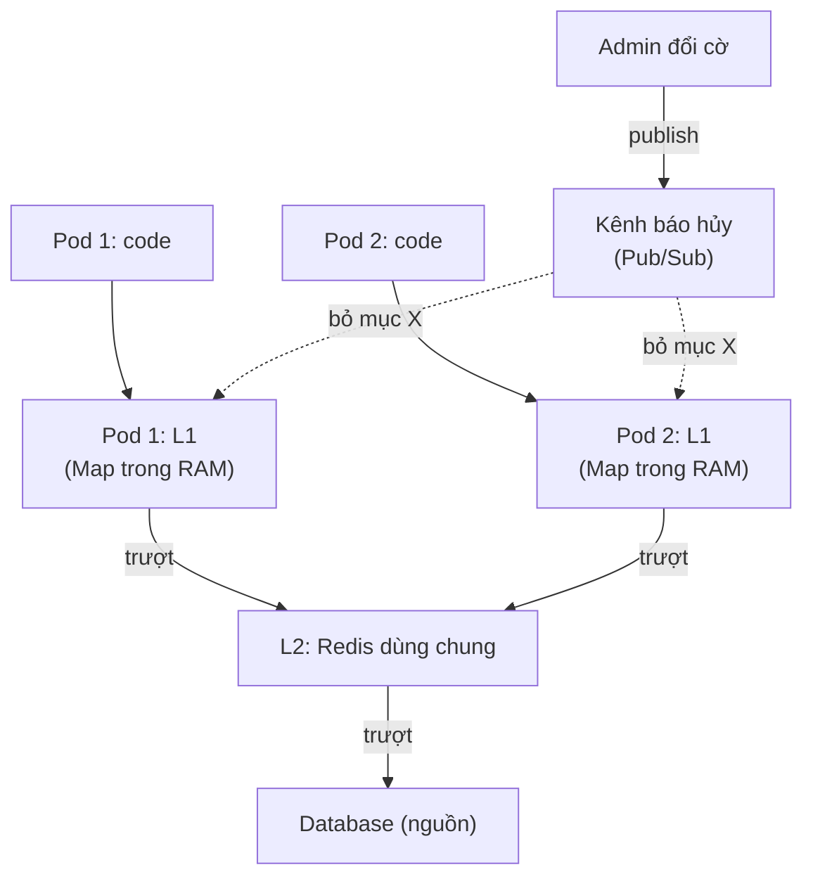

> [!tldr] Đọc nhanh
> - [[concepts/in-process-cache|Cache trong RAM của tiến trình]] (một `Map`) nhanh hơn Redis hàng trăm lần vì không qua mạng, nhưng mỗi pod giữ một bản riêng, và không có giới hạn thì thành rò rỉ bộ nhớ.
> - [[concepts/two-tier-cache|Cache hai tầng]]: L1 trong RAM từng pod, L2 Redis dùng chung, cuối cùng là database. Khó nhất là báo cho *mọi* pod bỏ L1 khi dữ liệu đổi.
> - [[concepts/pubsub-invalidation|Báo hủy qua Pub/Sub]] là "bắn rồi quên": pod nào đang mất kết nối đúng lúc đó sẽ không bao giờ nhận tin. L1 không có TTL thì sai tới khi pod khởi động lại; có TTL 2 giây thì tự đúng lại sau 2 giây.
> - [[concepts/client-side-caching|Client-side caching]] của Redis 6+: Redis tự nhớ client đã đọc key nào và gửi tin báo hủy khi key đó đổi.
> - Chia key cho nhiều node: `hash % N` bắt 80% key đổi chỗ khi thêm node thứ 5, [[concepts/consistent-hashing|consistent hashing]] chỉ 20%. Redis Cluster dùng 16384 [[concepts/hash-slot|hash slot]]. [[concepts/cache-warming|Làm nóng cache]] trước giờ cao điểm để pod mới không bắt đầu từ con số 0.

> [!info] Bối cảnh
> Ga 7 của **tuyến Caching**. Ví dụ là **flash-sale**, trang bán hàng giảm giá giờ vàng: backend chạy nhiều pod sau load balancer, mỗi lần kiểm tra một feature flag (bật trang thanh toán mới chưa?) phải nhanh tới mức gần như miễn phí. flash-sale giữ cờ trong RAM của từng pod, sau đó tới Redis, sau đó tới PostgreSQL. Bạn không cần biết code dự án.

> [!abstract]- Từ điển nhanh cho bài này (bấm để mở)
> - **Cache-aside, invalidation, TTL, hot key, LRU**: xem các ga [[posts/2026-11-22-caching-patterns|3]], [[posts/2026-11-22-caching-invalidation|4]], [[posts/2026-11-22-caching-under-load|5]], [[posts/2026-11-22-caching-redis|6]].
> - **Pod**: một bản đang chạy của ứng dụng (trong Kubernetes). Mười pod là mười tiến trình riêng, mỗi cái có RAM riêng.
> - **Pub/Sub**: kiểu nhắn tin "phát thanh": người gửi publish lên một kênh, ai đang subscribe kênh đó thì nhận. Không ai nghe thì tin mất.
> - **Feature flag**: công tắc bật tắt tính năng mà không cần deploy lại.
> - **RESP2 / RESP3**: hai phiên bản giao thức client dùng để nói chuyện với Redis. RESP3 cho phép server gửi tin chủ động trên cùng kết nối.
> - **Node / shard**: một tiến trình Redis giữ một phần dữ liệu của cụm.
> - **CRC16**: một hàm băm đơn giản cho ra số 16 bit.

## Hình dung trước: chồng sách trên mỗi bàn

Thư viện giờ có nhiều phòng đọc. Mỗi bàn giữ một **chồng sách riêng** cho nhanh, cả tòa nhà dùng chung **giá sách ở sảnh**, và **kho** ở tầng hầm. Khi có bản in mới, thủ thư phát loa: "ai đang giữ cuốn X thì cất đi". Ai đang đeo tai nghe thì không nghe thấy.

| Đời thường | Khái niệm |
|---|---|
| Chồng sách trên bàn: lấy ngay, chỉ bàn đó dùng | [[concepts/in-process-cache\|In-process cache]] (L1) |
| Chồng trên bàn, giá ở sảnh, kho tầng hầm | [[concepts/two-tier-cache\|Two-tier cache]] |
| Phát loa "cất cuốn X đi", ai đeo tai nghe thì lỡ | [[concepts/pubsub-invalidation\|Pub/Sub invalidation]] |
| Thủ thư ghi sổ ai đã mượn cuốn nào, có bản mới thì báo đúng người đó | [[concepts/client-side-caching\|Client-side caching]] |
| Chia sách theo vòng tròn để thêm một phòng chỉ phải dời ít sách | [[concepts/consistent-hashing\|Consistent hashing]] |
| Sách được xếp vào 16.384 ngăn đánh số, mỗi phòng giữ một dải ngăn | [[concepts/hash-slot\|Hash slot]] |
| Bày sẵn giáo trình lên giá trước ngày thi | [[concepts/cache-warming\|Cache warming]] |



## Vấn đề: nhanh hơn Redis, nhưng có hai mươi bản sao

Mình từng nghĩ Redis là tầng cache nhanh nhất cần có. Nhưng mỗi request trong flash-sale kiểm tra vài feature flag, đọc quyền, đọc template. Mỗi lần hỏi Redis tốn khoảng nửa mili giây đi về qua mạng; nhân lên vài nghìn request mỗi giây, mỗi pod dành cả trăm mili giây CPU và mạng mỗi giây chỉ để hỏi những thứ gần như không bao giờ đổi. Một `Map` trong RAM trả lời trong vài chục nano giây.

Cái giá: giờ có **hai mươi bản sao** (mỗi pod một bản) cộng bản trong Redis cộng bản gốc. Khi admin tắt một feature flag, cả hai mươi bản phải biết. Và khi một Redis không đủ chỗ, phải chia key cho nhiều node mà không làm cache trượt hàng loạt mỗi lần thêm node.

## Cơ chế

<figure class="figure-map" style="--ar: 4 / 3">
<div class="frame"><iframe data-archify="../diagrams/caching-distributed/two-tier.html" title="Sơ đồ kiến trúc: hai pod có L1 trong RAM, Redis dùng chung làm L2, PostgreSQL làm nguồn, kênh Pub/Sub báo hủy" loading="lazy"></iframe></div>
<figcaption><span><b>Hình 1.</b> Cache feature flag hai tầng: đọc đi L1 → L2 → database; ghi thì xóa L2 và phát tin báo hủy cho mọi pod.</span><a href="../diagrams/caching-distributed/two-tier.html" target="_blank" rel="noopener">Mở toàn màn hình</a></figcaption>
</figure>

### In-process cache: nhanh nhất, riêng từng pod

**[[concepts/in-process-cache|In-process cache]]** là cache nằm ngay trong bộ nhớ của tiến trình ứng dụng: một `Map`, hoặc thư viện như `lru-cache` (Node), Caffeine (Java). Không qua mạng, không tuần tự hóa JSON, nên nhanh hơn Redis hàng trăm tới hàng nghìn lần.

Ba điểm phải để ý:

- **Phải có giới hạn.** Một `Map` không bao giờ xóa là rò rỉ bộ nhớ: mỗi key mới (một template, một kết quả) nằm đó mãi tới khi pod bị giết vì hết RAM. Dùng LRU có `max` số mục, kèm TTL.
- **Mỗi pod một bản.** Hai mươi pod là hai mươi bản sao, hit ratio của từng pod thấp hơn cache dùng chung (mỗi pod chỉ thấy 1/20 lưu lượng), và pod mới khởi động thì cache trống.
- **Không đồng bộ giữa các pod.** Pod A xóa mục của nó, pod B không biết. Đây là chủ đề của các mục sau.

Hợp nhất với dữ liệu **nhỏ, đọc cực nhiều, ít đổi, và chịu được cũ vài giây**: feature flag, cấu hình, quyền theo role, template, và các [[concepts/hot-key|hot key]] ở ga 5.

### Two-tier cache: L1, L2, rồi nguồn

**[[concepts/two-tier-cache|Cache hai tầng]]** xếp hai cache chồng lên nhau: L1 trong RAM từng pod, L2 Redis dùng chung, rồi mới tới database. Đọc đi từ trên xuống; trượt ở tầng nào thì nạp lại tầng đó trên đường về.

Cache feature flag của flash-sale đúng là như vậy, thêm cả negative cache ([[posts/2026-11-22-caching-invalidation|ga 4]]) ở L1:

```ts
// trích rút gọn từ cache feature flag của flash-sale
async get(name: string) {
  const l1Hit = this.l1.get(name);                       // L1: Map, không TTL
  if (l1Hit) return l1Hit;
  if (this.l1Negative.has(name)) return null;
  const raw = await redis.hget('flags', name);            // L2: một hash trong Redis
  if (raw) { const f = JSON.parse(raw); this.l1.set(name, f); return f; }
  const flag = await this.repository.findByName(name);    // nguồn: PostgreSQL
  if (flag) { this.l1.set(name, flag); await this.writeL2(name, flag); return flag; }
  this.l1Negative.add(name); return null;
}
async invalidate(name: string) {
  this.l1.delete(name); this.l1Negative.delete(name);     // pod này
  await redis.hdel('flags', name);                         // tầng dùng chung
  await this.pubsub.publish({ flagName: name });           // các pod khác
}
```

Điểm hay: đọc gần như luôn trúng L1, Redis sập thì vẫn đọc được từ L1 và từ database (mỗi tầng bọc try/catch). Điểm yếu nằm ở dòng cuối: tin báo hủy.

### Pub/Sub invalidation: bắn rồi quên

Redis Pub/Sub giao tin theo kiểu **at-most-once** (nhiều nhất một lần): tài liệu Redis nói rõ tin được gửi tới những ai *đang* subscribe, không được lưu lại, không có xác nhận. Pod đang mất kết nối tới Redis đúng lúc admin đổi cờ (mạng chập chờn, Redis đang failover, pod đang bị GC dừng lâu) sẽ không bao giờ nhận tin đó. Khi nối lại, nó không biết mình đã lỡ gì.

Với **[[concepts/pubsub-invalidation|Pub/Sub invalidation]]** và L1 **không có TTL** (như flash-sale hiện nay), pod đó giữ giá trị cũ **tới khi khởi động lại**. Admin tắt trang thanh toán mới vì có lỗi, 19 pod tắt, pod thứ 20 vẫn bật.

Cách gia cố, từ rẻ tới đắt:

1. **TTL cho L1** làm lưới an toàn: vài giây tới một phút. Tin bị lỡ chỉ gây sai tối đa bằng TTL. Đây là thay đổi nên làm đầu tiên.
2. **Xóa sạch L1 khi nối lại** kết nối subscribe: đã có thể lỡ tin thì coi như mọi thứ đều có thể cũ.
3. **Kèm version**: tin báo hủy mang version (flash-sale đã gửi `version`); pod định kỳ so version lớn nhất nó biết với một key trong Redis, lệch thì xóa L1.
4. **Kênh bền** thay Pub/Sub: Redis Streams hoặc một queue (RabbitMQ, Kafka), mỗi pod đọc tiếp từ chỗ đã dừng sau khi nối lại.

### Client-side caching: để Redis nhớ ai đang giữ gì

Redis 6 thêm **[[concepts/client-side-caching|client-side caching]]** (tracking): client bật `CLIENT TRACKING on`, và Redis tự ghi nhớ client đó đã đọc key nào. Khi key bị sửa, xóa, hết hạn hay bị đẩy, Redis gửi tin báo hủy (`invalidate`) cho đúng những client đã đọc nó. Không cần tự viết code publish ở mọi chỗ ghi.

- **Chế độ mặc định**: Redis nhớ từng key cho từng client. Chính xác, nhưng tốn bộ nhớ phía server (bảng theo dõi có giới hạn, đầy thì Redis chủ động báo hủy bớt).
- **Chế độ broadcast (`BCAST PREFIX flag:`)**: Redis không nhớ gì, báo hủy mọi thay đổi của key có tiền tố đã đăng ký. Không tốn bộ nhớ server, nhưng client nhận nhiều tin hơn.
- **RESP3** nhận tin báo hủy trên chính kết nối đang dùng. **RESP2** phải mở thêm một kết nối subscribe kênh `__redis__:invalidate` và bật tracking với `REDIRECT <id của kết nối đó>`. Các tùy chọn `OPTIN`/`OPTOUT` chọn key nào được theo dõi, `NOLOOP` bỏ qua tin do chính mình gây ra.

Nó không xóa được vấn đề mất tin: tài liệu Redis khuyên khi kết nối nhận tin báo hủy bị đứt, client nên **xóa sạch cache cục bộ**, vì có thể đã lỡ tin.

### Consistent hashing: thêm node mà không làm trượt cả cache

Khi một Redis không đủ RAM hay CPU, chia key cho nhiều node. Cách ngây thơ là `node = hash(key) % N`. Thêm node thứ năm (N từ 4 thành 5) thì gần như mọi key đổi chỗ: khoảng 1 − 1/5 = **80%** key giờ thuộc node khác, nên đồng loạt trượt, tải dồn về database, đúng lúc vừa thêm node vì đang quá tải.

**[[concepts/consistent-hashing|Consistent hashing]]** (Karger và cộng sự, 1997) đặt cả node lẫn key lên một **vòng tròn** giá trị băm. Mỗi key thuộc về node đầu tiên gặp được khi đi theo chiều kim đồng hồ. Thêm một node thì chỉ những key nằm giữa node mới và node đứng trước nó đổi chỗ, cỡ 1/N key. Mỗi node thật được đặt nhiều "điểm ảo" (virtual node) trên vòng để chia đều hơn. Trong ví dụ: 79,8% key đổi node với `hash % N`, 19,8% với consistent hashing. Nhiều client memcached, CDN và load balancer theo người dùng ([[concepts/load-balancing|load balancing]]) dùng ý tưởng này.

### Hash slot: cách Redis Cluster chia key

Redis Cluster không dùng vòng tròn mà dùng **16.384 [[concepts/hash-slot|hash slot]]** cố định:

```text
slot = CRC16(key) mod 16384
```

Mỗi node giữ một dải slot. Thêm node là **chuyển một số slot** (cùng các key trong đó) sang node mới; client hỏi nhầm node thì nhận lỗi chuyển hướng `MOVED` hoặc `ASK` và tự cập nhật bản đồ. Kết quả giống consistent hashing (chỉ phần dữ liệu được chuyển mới đổi chỗ), nhưng việc chuyển được điều khiển rõ ràng từng slot.

Hệ quả quan trọng: lệnh nhiều key (`MGET`, `DEL k1 k2`, transaction, Lua script) chỉ chạy được khi **mọi key cùng slot**, không thì lỗi `CROSSSLOT`. Muốn ép nhiều key về cùng slot, dùng **hash tag**: chỉ phần trong `{...}` được băm. `product:{42}:price` và `product:{42}:stock` cùng slot 8000, nên lease ở ga 4 (cache key + lease key trong một Lua script) phải đặt tên kiểu `{price:42}` và `lease:{price:42}`. Đừng lạm dụng: mọi key cùng một tag dồn vào một node, thành hot key theo cách khác.

### Cache warming: không bắt đầu từ con số không

Pod mới, Redis vừa khởi động lại, hay deploy lúc 20:55: mọi cache đều trống, và lượt người dùng đầu tiên rơi thẳng xuống database. **[[concepts/cache-warming|Cache warming]]** nạp sẵn những thứ chắc chắn sẽ được đọc *trước* khi nhận lưu lượng:

- Lúc khởi động: flash-sale nạp toàn bộ feature flag vào L1 bằng một query (`warmL1`) và nạp quyền của mọi role vào Redis (`warmCache`) trước khi pod nhận request.
- Trước sự kiện: nạp trang và giá của các sản phẩm sẽ giảm giá lúc 21:00 vào cache từ 20:50.

Hai bẫy: làm nóng quá mạnh thì chính nó thành đợt tải vào database (giới hạn tốc độ nạp), và làm nóng hàng nghìn key cùng lúc với cùng TTL thì chúng hết hạn cùng lúc ([[concepts/ttl-jitter|TTL jitter]] ở ga 5).

## Ví dụ chạy được

[two-tier.ts](../code/caching-distributed/two-tier.ts) dựng hai "pod" trong cùng một tiến trình, mỗi pod có L1 riêng và kết nối Redis riêng, cùng nghe một kênh báo hủy. Sau đó thử client-side caching của Redis, so `hash % N` với consistent hashing, và tự tính hash slot.

```bash
docker run -d --rm --name atlas-redis -p 6380:6379 redis:8
npm i ioredis
node two-tier.ts
```

```ts
// Giả lập kết nối Pub/Sub của pod B rớt đúng lúc pod A ghi
await b.sub.unsubscribe(CHANNEL);     // B không nhận tin nào
await a.write(K, 'off');              // A: ghi DB, xóa L2, publish
await b.sub.subscribe(CHANNEL);       // B nối lại, nhưng tin đã trôi qua

// Redis client-side caching qua RESP2: tin báo hủy đi tới một kết nối riêng
const inboxId = await inbox.client('ID');
await inbox.subscribe('__redis__:invalidate');
await tracked.call('CLIENT', 'TRACKING', 'on', 'REDIRECT', String(inboxId));
```

```text
$ node two-tier.ts
1) Hai pod, L1 không có TTL, báo hủy qua Pub/Sub
   B đọc: off (DB), B đọc lại: off (L1)
   A bật cờ "on" và publish → B đọc: on (DB)
2) Kết nối Pub/Sub của B rớt đúng lúc A ghi (tin Pub/Sub không được lưu lại)
   3 giây sau, DB = off, B đọc: on (L1) ← sai mãi tới khi B khởi động lại
3) Cùng sự cố, nhưng L1 có TTL 2 giây làm lưới an toàn
   ngay sau khi A ghi: B đọc on (L1)
   2 giây sau: B đọc off (DB) ← tự đúng lại khi L1 hết hạn
4) Redis client-side caching: Redis tự nhớ client đã đọc key nào và báo khi key đổi
   client đọc price:42 = 199000 (Redis ghi nhớ)
   tin báo hủy gửi tới client: price:42
   (đổi price:43 không sinh tin vì client chưa từng đọc key đó)
5) Chia 100.000 key cho 4 node, rồi thêm node thứ 5
   hash % số node      → 79.8% key phải đổi node (cache trượt)
   consistent hashing  → 19.8% key phải đổi node (cache trượt)
6) Redis Cluster: slot = CRC16(key) mod 16384, hash tag {…} ép các key về cùng slot
   product:{42}:price  → slot 8000
   product:{42}:stock  → slot 8000
   product:42:price    → slot 15184
   somekey             → slot 11058
```

Đọc kết quả:

- **Phần 1**: đường bình thường chạy đúng, B nhận tin và đọc lại từ nguồn.
- **Phần 2**: lỡ một tin là B sai vô thời hạn. Đây chính là hành vi của L1 không TTL.
- **Phần 3**: thêm TTL 2 giây cho L1, cùng sự cố đó chỉ sai 2 giây.
- **Phần 4**: Redis tự gửi tin báo hủy cho `price:42` vì client đã đọc nó, không gửi gì cho `price:43`.
- **Phần 5**: khớp lý thuyết, 1 − 1/5 = 80% so với 1/5 = 20%.
- **Phần 6**: số slot tự tính bằng CRC16 khớp với lệnh `CLUSTER KEYSLOT` của một Redis bật chế độ cluster (mình đã đối chiếu: 8000, 8000, 15184, 11058).

## Hiểu lầm và bẫy hay gặp

- **"Pub/Sub đảm bảo mọi pod nhận tin."** Không. Tin chỉ tới ai đang nghe, không lưu, không xác nhận. L1 phải có TTL hoặc phải xóa sạch khi nối lại.
- **"`new Map()` là cache."** Không giới hạn kích thước và không TTL thì nó là rò rỉ bộ nhớ có tên đẹp. Dùng LRU có `max` và TTL.
- **"Thêm L1 thì hit ratio tăng."** Hit ratio *tổng* có thể tăng, nhưng mỗi pod chỉ thấy một phần lưu lượng nên L1 của từng pod trúng ít hơn một cache dùng chung cùng kích thước. L1 đáng giá vì nó rẻ, không phải vì nó trúng nhiều.
- **"Client-side caching tự giải quyết đồng bộ."** Vẫn có thể lỡ tin khi kết nối đứt; phải xóa sạch cache cục bộ khi nối lại. Chế độ mặc định còn tốn bộ nhớ phía server.
- **"`hash % N` là đủ để chia key."** Mỗi lần đổi số node là gần như cả cache trượt. Dùng consistent hashing hoặc Redis Cluster.
- **Lua script hay `MGET` với key ở các slot khác nhau** trong Redis Cluster bị lỗi `CROSSSLOT`. Dùng hash tag cho những key luôn đi cùng nhau.
- **Làm nóng cache cùng TTL** thì hết hạn cùng lúc. Thêm jitter.

## Câu hỏi tự kiểm tra

> [!question]- Vì sao in-process cache nhanh hơn Redis nhiều lần, và cái giá là gì?
> Không đi qua mạng, không tuần tự hóa dữ liệu, chỉ là đọc bộ nhớ của chính tiến trình. Cái giá: mỗi pod một bản riêng, không tự đồng bộ giữa các pod, tốn RAM nhân theo số pod, và cache trống mỗi khi pod khởi động.

> [!question]- Pod B mất kết nối Redis 2 giây, đúng lúc đó admin tắt một feature flag. L1 không có TTL. Chuyện gì xảy ra và sửa thế nào?
> Pub/Sub không lưu tin, nên B không bao giờ biết cờ đã đổi và giữ giá trị cũ tới khi khởi động lại. Sửa: thêm TTL cho L1 làm lưới an toàn, xóa sạch L1 mỗi khi kết nối subscribe được nối lại, hoặc dùng kênh bền.

> [!question]- Chế độ mặc định và chế độ broadcast của Redis client-side caching khác nhau ở đâu?
> Mặc định: Redis nhớ từng key mỗi client đã đọc, chỉ báo hủy đúng những key đó; chính xác nhưng tốn bộ nhớ server. Broadcast: Redis không nhớ gì, báo mọi thay đổi của key khớp tiền tố đã đăng ký; không tốn bộ nhớ nhưng nhiều tin hơn.

> [!question]- Cụm cache 4 node chia key bằng `hash % N`. Thêm node thứ 5, bao nhiêu phần trăm key trượt? Với consistent hashing thì sao?
> Khoảng 80% với `hash % N`, vì gần như mọi key đổi node. Khoảng 20% (1/N) với consistent hashing, vì chỉ những key thuộc đoạn vòng tròn mà node mới nhận mới đổi chỗ.

> [!question]- Vì sao `product:{42}:price` và `product:{42}:stock` luôn cùng slot, và khi nào điều đó cần thiết?
> Khi key có hash tag, Redis Cluster chỉ băm phần trong ngoặc nhọn (`42`), nên hai key cùng slot. Cần khi phải dùng chúng trong cùng một lệnh nhiều key, transaction hay Lua script, nếu không sẽ lỗi `CROSSSLOT`.

## Tham khảo

- [Redis: Client-side caching](https://redis.io/docs/latest/develop/reference/client-side-caching/) (tracking, broadcast, REDIRECT, xóa cache khi mất kết nối)
- [Redis: Pub/Sub](https://redis.io/docs/latest/develop/interact/pubsub/) (at-most-once)
- [Redis Cluster specification](https://redis.io/docs/latest/operate/oss_and_stack/reference/cluster-spec/) (16384 slot, CRC16, hash tag, MOVED/ASK)
- Karger và cộng sự, [Consistent Hashing and Random Trees](https://dl.acm.org/doi/10.1145/258533.258660), STOC 1997
- Nishtala và cộng sự, [Scaling Memcache at Facebook](https://www.usenix.org/conference/nsdi13/technical-sessions/presentation/nishtala), NSDI 2013 (nhiều cụm, cold cluster warmup)
