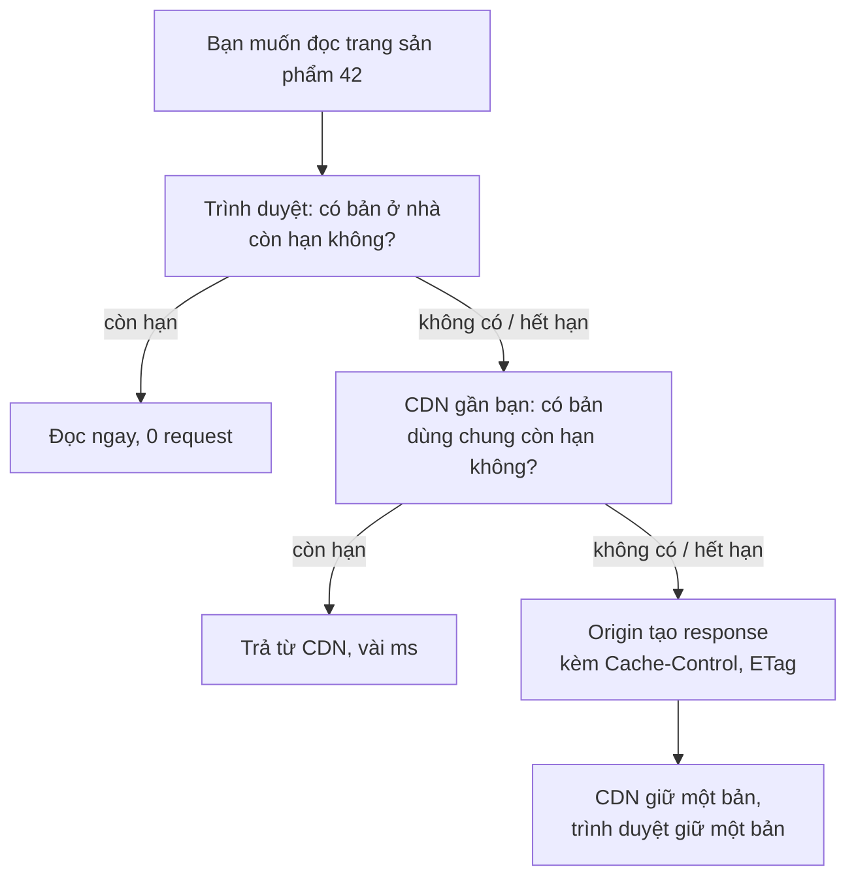

> [!tldr] Đọc nhanh
> - Giữa người dùng và server có ít nhất hai tầng cache: [[concepts/browser-cache|cache của trình duyệt]] (riêng từng người) và [[concepts/cdn|CDN]] (dùng chung cho mọi người). Server điều khiển cả hai bằng header [[concepts/cache-control|Cache-Control]].
> - `max-age=N`: dùng lại trong N giây không cần hỏi. `no-cache` **không** có nghĩa "đừng cache" mà là "lưu được, nhưng hỏi lại trước khi dùng"; cấm lưu là `no-store`. `private`: chỉ trình duyệt được giữ, CDN thì không.
> - [[concepts/etag|ETag]] là "mã phiên bản" của response. Hết hạn, client hỏi lại kèm `If-None-Match`; chưa đổi thì server trả `304` không có body.
> - [[concepts/vary|Vary]] đưa thêm header của request vào khóa cache: cùng URL nhưng tiếng Việt và tiếng Anh là hai bản khác nhau.
> - [[concepts/stale-while-revalidate|stale-while-revalidate]]: hết hạn rồi vẫn trả bản cũ ngay, rồi đi lấy bản mới ở nền. Người dùng không phải chờ.

> [!info] Bối cảnh
> Ga 2 của **tuyến Caching**. Ví dụ là **flash-sale**, trang bán hàng giảm giá giờ vàng: lúc 21:00, ảnh, CSS và trang sản phẩm bị tải hàng trăm nghìn lần. Ga này ở tầng xa server nhất: chính trình duyệt và CDN. Ví dụ là một CDN thu nhỏ chạy bằng Docker trên máy bạn. Bạn không cần biết code dự án.

> [!abstract]- Từ điển nhanh cho bài này (bấm để mở)
> - **Hit, miss, hit ratio, cache key, staleness**: xem [[posts/2026-11-22-caching-why|ga 1]].
> - **Header HTTP**: các dòng `Tên: giá trị` đi kèm request và response, mang thông tin phụ (ngôn ngữ, kiểu dữ liệu, luật cache…).
> - **Origin**: server gốc tạo ra response (ở đây là server Node của shop), đối lập với các cache đứng trước nó.
> - **CDN (Content Delivery Network)**: mạng máy chủ đặt ở nhiều nơi trên thế giới, giữ bản sao nội dung gần người dùng. Ví dụ: Cloudflare, Fastly, CloudFront.
> - **Proxy / reverse proxy**: chương trình đứng giữa, nhận request thay cho server rồi chuyển tiếp. **nginx** là một reverse proxy phổ biến, có sẵn tính năng cache.
> - **Status 200 / 304**: 200 là "đây là dữ liệu"; 304 Not Modified là "bản bạn đang có vẫn đúng, dùng tiếp".
> - **Docker compose**: cách chạy nhiều container cùng lúc từ một file cấu hình.

## Hình dung trước: sách ở nhà, thư viện quận và thư viện trung tâm

Ở ga 1, thư viện có một giá sách cạnh quầy. Giờ nhìn rộng ra cả thành phố: bạn có vài cuốn **ở nhà** (chỉ bạn đọc), **thư viện quận** gần nhà giữ bản sao những cuốn cả quận hay mượn, và **thư viện trung tâm** có đủ mọi thứ nhưng ở xa.

| Đời thường | Khái niệm |
|---|---|
| Sách để trên bàn ở nhà, chỉ bạn đọc | [[concepts/browser-cache\|Browser cache]] (cache riêng) |
| Thư viện quận: bản sao dùng chung cho cả khu | [[concepts/cdn\|CDN]] (cache dùng chung) |
| Thư viện trung tâm, nơi in và giữ bản gốc | Origin server |
| Nhãn dán trên bìa: "dùng được tới ngày…", "không cho mượn ra ngoài" | [[concepts/cache-control\|Cache-Control]] |
| Số lần in trên gáy sách: gọi hỏi "lần in 3 còn mới không?" | [[concepts/etag\|ETag]] và `If-None-Match` |
| Cùng tựa sách nhưng có bản tiếng Việt và bản tiếng Anh | [[concepts/vary\|Vary]] |
| Sách quá hạn vẫn cho mượn tạm, trong lúc gửi yêu cầu lấy bản mới | [[concepts/stale-while-revalidate\|stale-while-revalidate]] |



## Vấn đề: mọi người cùng hỏi một thứ, từ khắp nơi

Mình từng nghĩ cache là chuyện của backend: đặt Redis trước database là xong. Nhưng lúc 21:00, phần lớn byte gửi đi là ảnh, CSS, JavaScript và trang sản phẩm *giống hệt nhau cho mọi người*. Mỗi lượt tải vẫn phải đi hết đường tới server, qua TLS, qua load balancer, chạy code, rồi đi về. Server làm cùng một việc hàng trăm nghìn lần, và người dùng ở xa chịu độ trễ mạng mỗi lần.

HTTP đã có sẵn cả bộ luật cho chuyện này từ lâu: server ghi luật lên từng response, và mọi cache trên đường đi (trình duyệt, proxy công ty, CDN) tự làm theo. Phần khó là hiểu đúng từng chữ trong luật.

## Cơ chế

<figure class="figure-map" style="--ar: 1 / 1">
<div class="frame"><iframe data-archify="../diagrams/caching-http/cdn-life.html" title="Sơ đồ tuần tự: request đi qua trình duyệt, CDN và origin; hit, hết hạn, trả bản cũ, hỏi lại bằng ETag" loading="lazy"></iframe></div>
<figcaption><span><b>Hình 1.</b> Một response đi qua CDN: lần đầu trượt, trong <code>max-age</code> thì CDN tự trả, hết hạn thì trả bản cũ ngay và hỏi lại origin ở nền bằng ETag.</span><a href="../diagrams/caching-http/cdn-life.html" target="_blank" rel="noopener">Mở toàn màn hình</a></figcaption>
</figure>

### Hai loại cache trên đường đi

RFC 9111 chia cache HTTP làm hai loại, và mọi luật đều xoay quanh sự khác nhau này:

- **Private cache** (cache riêng): chỉ phục vụ một người. Đó là **[[concepts/browser-cache|cache của trình duyệt]]**. Nó được giữ cả dữ liệu riêng tư (trang tài khoản của bạn), vì không ai khác đọc được.
- **Shared cache** (cache dùng chung): một bản phục vụ nhiều người. Đó là **[[concepts/cdn|CDN]]**, reverse proxy như nginx, proxy của công ty. Lỡ giữ dữ liệu riêng của người A là có thể trả cho người B.

CDN đặt máy chủ ở hàng trăm thành phố (gọi là PoP hay edge). Người ở Hà Nội lấy ảnh từ máy chủ ở Hà Nội thay vì vượt biển sang server gốc ở Singapore. Ngoài tốc độ, CDN còn **chắn tải**: origin chỉ thấy những lần CDN trượt.

### Cache-Control: luật ghi trên từng response

[[concepts/cache-control|Cache-Control]] là header server gửi kèm response. Các chỉ thị hay dùng:

| Chỉ thị | Nghĩa | Ví dụ dùng |
|---|---|---|
| `max-age=N` | Còn "tươi" trong N giây: cache được dùng lại mà không hỏi | `max-age=60` cho trang sản phẩm |
| `s-maxage=N` | Như `max-age` nhưng **chỉ cho shared cache**, và đè lên `max-age` ở đó | CDN giữ 5 phút, trình duyệt 30 giây |
| `public` | Shared cache được lưu, kể cả response thường không được lưu | Response có header `Authorization` |
| `private` | Chỉ cache riêng (trình duyệt) được lưu | `/me`, giỏ hàng |
| `no-cache` | Được lưu, nhưng **phải hỏi lại origin trước mỗi lần dùng** | HTML cần luôn mới nhưng tiết kiệm băng thông nhờ 304 |
| `no-store` | **Không được lưu** ở đâu cả | Trang thanh toán, dữ liệu nhạy cảm |
| `must-revalidate` | Hết hạn thì bắt buộc hỏi lại, cấm dùng bản cũ | Dữ liệu cũ gây hại |
| `immutable` | Trong thời hạn, nội dung không bao giờ đổi; khỏi hỏi lại kể cả khi người dùng bấm tải lại | `app.3f9a1c.js` có mã băm trong tên |
| `stale-while-revalidate=N` | Hết hạn rồi vẫn dùng tạm bản cũ thêm N giây, trong lúc lấy bản mới ở nền | Trang sản phẩm |
| `stale-if-error=N` | Origin lỗi (500, 502, 503, 504) thì được dùng bản cũ thêm N giây | Trang ít đổi, cần sống sót khi origin sập |

Ba điểm mình từng hiểu sai:

1. **`no-cache` không cấm cache.** Muốn cấm, dùng `no-store`. `no-cache` vẫn có ích: kèm ETag, mỗi lần chỉ tốn một request 304 rất nhẹ thay vì tải lại cả body.
2. **Không có `Cache-Control` không có nghĩa là không cache.** RFC 9111 cho phép cache tự đoán thời hạn (heuristic freshness) với một số status code như 200, thường bằng khoảng 10% thời gian từ `Last-Modified` tới lúc trả lời. File sửa lần cuối 10 ngày trước có thể bị giữ tới một ngày. Luôn ghi luật rõ ràng.
3. **Muốn CDN và trình duyệt giữ khác nhau**, dùng `s-maxage` cho CDN và `max-age` cho trình duyệt. Nhiều CDN còn đọc header riêng `CDN-Cache-Control` (RFC 9213) chỉ dành cho chúng.

Với file tĩnh, mẹo phổ biến nhất là **đặt mã băm nội dung vào tên file** (`app.3f9a1c.js`) rồi cho cache một năm với `immutable`. Đổi code thì tên file đổi, HTML trỏ sang tên mới, nên không bao giờ cần xóa cache file cũ. Chỉ riêng HTML là cần thời hạn ngắn hoặc `no-cache`.

### ETag: hỏi lại mà không phải tải lại

Hết hạn không có nghĩa là đã đổi. Thay vì tải lại cả trang, cache hỏi origin: "bản tôi đang có còn đúng không?". Đó là **conditional request** (request có điều kiện), dựa trên một trong hai dấu phiên bản:

- **[[concepts/etag|ETag]]**: chuỗi do server tự đặt, đại diện cho một phiên bản nội dung, ví dụ `"a1b2c3"`. Client hỏi lại bằng `If-None-Match: "a1b2c3"`.
- **`Last-Modified`**: thời điểm sửa cuối. Client hỏi lại bằng `If-Modified-Since`. Chỉ chính xác tới giây.

Nếu chưa đổi, server trả **`304 Not Modified`** không có body, kèm thời hạn mới. Nếu đã đổi, trả `200` với nội dung và ETag mới.

ETag có hai loại (RFC 9110):

- **Strong** (`"v42"`, mặc định): giống từng byte. Dùng được cho tải từng đoạn (range request).
- **Weak** (`W/"v42"`): "tương đương về nghĩa", không nhất thiết giống từng byte. Ví dụ trong bài dùng `W/"v<giá>"`: body có giờ render khác nhau mỗi lần nhưng cùng giá thì coi là cùng phiên bản.

> [!tip] ETag tính từ đâu
> Băm cả body thì đúng nhưng server vẫn phải dựng xong response mới biết, chỉ tiết kiệm băng thông chứ không tiết kiệm CPU. Rẻ hơn là lấy từ cột `version` hoặc `updated_at` trong database: so sánh được trước khi dựng trang.

### Vary: khi URL không đủ làm khóa

Khóa cache mặc định là method + URL. Nhưng nếu server trả nội dung khác nhau theo header của request, ví dụ `Accept-Language`, thì một URL có nhiều phiên bản. Header **[[concepts/vary|Vary]]** trong response nói với cache: "hãy đưa header này của request vào khóa".

```http
Vary: Accept-Language
```

Cạm bẫy là chọn header có quá nhiều giá trị. `Vary: User-Agent` chia cache thành hàng nghìn bản (mỗi phiên bản trình duyệt một bản), hit ratio rơi về gần 0. `Vary: Cookie` với cookie phân tích hành vi khiến mỗi người một bản. `Vary: *` nghĩa là không bao giờ dùng lại được. Thay vào đó, chuẩn hóa giá trị trước (chỉ lấy `vi` hoặc `en`), hoặc tách URL (`/vi/...`, `/en/...`).

Chiều ngược lại còn nguy hiểm hơn: nội dung phụ thuộc một header nhưng **không khai báo trong Vary**. Cache sẽ trả bản của người này cho người kia. Ga 8 biến đúng lỗi đó thành một cuộc tấn công.

### stale-while-revalidate: không ai phải chờ lúc hết hạn

Không có nó, người đầu tiên tới sau khi hết hạn phải chờ cache đi hỏi origin. Với `stale-while-revalidate=10` (RFC 5861), trong 10 giây sau khi hết hạn, cache **trả ngay bản cũ** và đồng thời gửi một request ở nền để lấy bản mới. Người dùng luôn nhận câu trả lời trong vài mili giây; cái giá là có thể thấy dữ liệu cũ thêm tối đa 10 giây.

Đây là dạng đơn giản của ý tưởng "làm mới trước khi người dùng phải chờ", sẽ quay lại ở ga 3 (refresh-ahead) và ga 5 (làm mới sớm theo xác suất).

## Ví dụ chạy được

Một CDN thu nhỏ: nginx đứng trước một origin Node, mỗi request tới origin mất 300 ms và được đếm. Bốn file: [origin.ts](../code/caching-http/origin.ts), [nginx.conf](../code/caching-http/nginx.conf), [compose.yaml](../code/caching-http/compose.yaml) và [client.ts](../code/caching-http/client.ts).

```bash
docker compose -p atlas-http up -d     # nginx ở cổng 8088, origin ở trong
node client.ts
docker compose -p atlas-http down
```

Origin ghi luật cho từng đường dẫn:

```ts
if (url.pathname === '/products/42') {
  const tag = `W/"v${price}"`;            // weak ETag: cùng giá là cùng phiên bản
  res.setHeader('Cache-Control', 'public, max-age=5, stale-while-revalidate=10');
  res.setHeader('ETag', tag);
  if (req.headers['if-none-match'] === tag) { res.statusCode = 304; res.end(); return; }
  // ...trả JSON sản phẩm
}
if (url.pathname === '/me')       res.setHeader('Cache-Control', 'private, max-age=60');
if (url.pathname === '/greeting') res.setHeader('Vary', 'Accept-Language');
```

nginx đóng vai CDN, gắn header `X-Cache-Status` để mình thấy nó làm gì:

```nginx
proxy_cache edge;
proxy_cache_key $scheme$host$request_uri;
proxy_cache_revalidate on;          # hết hạn thì hỏi lại origin bằng If-None-Match
proxy_cache_background_update on;   # cập nhật ở nền khi đang trả bản cũ
proxy_cache_lock on;                # nhiều request cùng trượt: chỉ 1 request lên origin
add_header X-Cache-Status $upstream_cache_status always;
```

```text
$ node client.ts
1) max-age=5, stale-while-revalidate=10 qua CDN
 0.4s  /products/42  MISS       352ms  {"id":42,...,"price":199000,...}  ← lần đầu: CDN đi hỏi origin
 0.4s  /products/42  HIT          4ms  {"id":42,...,"price":199000,...}  ← trong 5 giây: CDN tự trả
 6.9s  /products/42  STALE        5ms  {"id":42,...,"price":199000,...}  ← quá 5 giây: trả bản cũ ngay, cập nhật ở nền
 7.7s  /products/42  HIT          3ms  {"id":42,...,"price":199000,...}  ← nền đã hỏi lại origin: 304, bản cũ được gia hạn

2) 200 request cùng lúc vào một URL chưa có trong cache
   origin nhận thêm 1 request (proxy_cache_lock gom lại)

3) Vary: Accept-Language
 8.5s  /greeting     MISS       303ms  Xin chào
 8.8s  /greeting     MISS       305ms  Hello
 8.8s  /greeting     HIT          2ms  Xin chào

4) private: CDN không giữ dữ liệu riêng của từng người
 9.2s  /me           MISS       304ms  {"user":"an"}
 9.5s  /me           MISS       305ms  {"user":"binh"}

5) ETag: trình duyệt hỏi lại "bản tôi đang có còn đúng không?"
   If-None-Match: W/"v199000" → 304 (dùng tiếp bản đang có, không tải lại body)
   giá đã đổi, hỏi lại với ETag cũ → 200, ETag mới W/"v200000": {"id":42,...,"price":200000,...}

origin nhận tổng cộng 8 request
```

Đọc kết quả:

- **Phần 1**: 352 ms lần đầu, 4 ms các lần sau. Ở giây 6,9 bản đã hết hạn nhưng vẫn trả trong 5 ms (`STALE`), không ai phải chờ 300 ms. Ở nền, nginx hỏi lại origin với `If-None-Match`; giá chưa đổi nên origin trả 304, bản cũ được gia hạn thêm 5 giây.
- **Phần 2**: 200 request cùng trượt một URL, origin chỉ nhận 1. Đây là phiên bản ở tầng CDN của kỹ thuật gom request, ga 5 sẽ tự viết nó.
- **Phần 3**: `Vary` tách "Xin chào" và "Hello" thành hai mục; lần thứ ba trúng đúng bản tiếng Việt.
- **Phần 4**: `private` khiến CDN không lưu, mỗi người đều đi tới origin. Đúng như mong muốn: thiếu `private` ở đây là An có thể nhận trang của Bình.
- **Phần 5**: CDN tự trả 304 cho trình duyệt khi ETag khớp. Đổi giá thì ETag đổi, cùng câu hỏi đó nhận 200 và nội dung mới.
- Tổng cộng client gửi hơn 210 request, origin chỉ làm việc 8 lần.

## Hiểu lầm và bẫy hay gặp

- **"`no-cache` là không cache."** Sai. Đó là "hỏi lại trước khi dùng". Không lưu là `no-store`.
- **"Không đặt Cache-Control thì không ai cache."** Cache được phép tự đoán thời hạn từ `Last-Modified`. Response API trả 200 không có luật có thể bị một proxy giữ lại. Luôn ghi luật, kể cả `no-store`.
- **"Đổi file rồi, xóa cache CDN là xong."** Bản trong trình duyệt của người dùng thì không xóa được từ xa. Với file tĩnh, đặt mã băm vào tên file thay vì trông vào việc xóa.
- **"Dữ liệu cá nhân có Set-Cookie thì CDN tự biết không lưu."** Tùy CDN và cấu hình. Nhiều cấu hình "cache mọi file tĩnh" bỏ qua header của origin (ga 8). Ghi rõ `private` hoặc `no-store`.
- **`Vary: User-Agent` hay `Vary: Cookie`** làm vỡ cache thành hàng nghìn mảnh. Chuẩn hóa giá trị hoặc tách URL.
- **`stale-while-revalidate` không phải miễn phí**: người dùng có thể thấy bản cũ thêm N giây. Với giá đang flash sale, chọn N nhỏ hoặc bỏ hẳn.

## Câu hỏi tự kiểm tra

> [!question]- Response có `Cache-Control: no-cache` và `ETag`. Trình duyệt làm gì ở lần mở tiếp theo?
> Vẫn dùng bản đã lưu, nhưng trước đó gửi request với `If-None-Match`. Nếu server trả 304 thì dùng bản đang có, không tải lại body. `no-cache` không cấm lưu.

> [!question]- Muốn CDN giữ trang sản phẩm 5 phút nhưng trình duyệt chỉ giữ 30 giây. Viết header thế nào?
> `Cache-Control: public, max-age=30, s-maxage=300`. `s-maxage` chỉ áp dụng cho shared cache và đè lên `max-age` ở đó.

> [!question]- Vì sao file `app.3f9a1c.js` có thể cache một năm còn `index.html` thì không?
> Tên file JS chứa mã băm nội dung: nội dung đổi thì tên đổi, nên một URL không bao giờ đổi nội dung (`immutable`). `index.html` giữ nguyên URL nhưng nội dung đổi mỗi lần deploy, nên cần thời hạn ngắn hoặc `no-cache` kèm ETag.

> [!question]- Server trả nội dung khác nhau theo `Accept-Language` nhưng quên `Vary`. Chuyện gì xảy ra sau CDN?
> CDN chỉ dùng URL làm khóa, nên ai tới đầu tiên quyết định ngôn ngữ cho mọi người sau đó cho tới khi hết hạn. Người Việt có thể nhận trang tiếng Anh và ngược lại.

> [!question]- `stale-while-revalidate=10` khác gì `max-age` dài thêm 10 giây?
> Với `max-age` dài hơn, cache không hỏi lại gì trong 10 giây đó. Với `stale-while-revalidate`, request đầu tiên sau khi hết hạn vẫn được trả ngay bằng bản cũ nhưng đồng thời kích hoạt lấy bản mới ở nền, nên bản cũ bị thay sớm nhất có thể.

## Tham khảo

- [RFC 9111: HTTP Caching](https://www.rfc-editor.org/rfc/rfc9111) (private và shared cache, `s-maxage`, heuristic freshness, `Vary`)
- [RFC 9110, mục Conditional Requests](https://www.rfc-editor.org/rfc/rfc9110#name-conditional-requests) (ETag strong và weak, `If-None-Match`, 304)
- [RFC 5861: HTTP Cache-Control Extensions for Stale Content](https://www.rfc-editor.org/rfc/rfc5861) (`stale-while-revalidate`, `stale-if-error`)
- [RFC 9213: Targeted HTTP Cache Control](https://www.rfc-editor.org/rfc/rfc9213) (`CDN-Cache-Control`)
- [MDN: Cache-Control](https://developer.mozilla.org/en-US/docs/Web/HTTP/Reference/Headers/Cache-Control)
- [nginx: ngx_http_proxy_module](https://nginx.org/en/docs/http/ngx_http_proxy_module.html) (`proxy_cache_lock`, `proxy_cache_background_update`, `$upstream_cache_status`)
