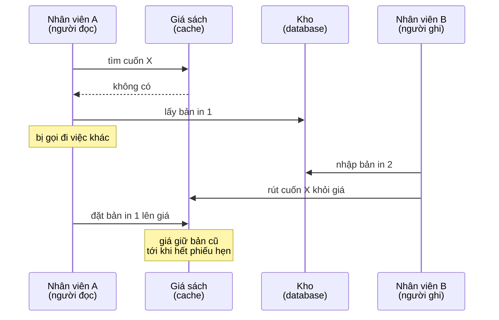

> [!tldr] Đọc nhanh
> - [[concepts/ttl|TTL]] là lưới an toàn: nó giới hạn *thời gian tối đa* cache được sai, chứ không làm cache đúng. Không có TTL, một lần quên xóa là sai vĩnh viễn.
> - [[concepts/cache-invalidation|Invalidation]] là xóa (hoặc đánh dấu cũ) mục trong cache khi nguồn đổi. Ai xóa, lúc nào, bằng cách nào là ba câu hỏi riêng.
> - [[concepts/stale-set-race|Race stale set]]: người đọc trượt, đọc DB cũ, bị chậm; người ghi ghi DB rồi xóa cache; người đọc tỉnh lại ghi giá trị cũ vào cache. Kết quả: DB 200, cache 100 trong 60 giây.
> - [[concepts/cache-lease|Lease]] (của memcache Facebook) và [[concepts/versioned-key|version]] đóng hẳn khe hở đó: cache từ chối giá trị cũ thay vì tin người ghi tới sau cùng.
> - [[concepts/negative-caching|Negative caching]]: cache cả câu trả lời "không tồn tại", với TTL ngắn, để những câu hỏi về thứ không có không đổ hết xuống database.

> [!info] Bối cảnh
> Ga 4 của **tuyến Caching**. Ví dụ là **flash-sale**, trang bán hàng giảm giá giờ vàng: người bán đổi giá, đơn đổi trạng thái, admin thu quyền của một role; mỗi thay đổi đều phải tới được những bản sao trong cache. Ga này đi vào câu nổi tiếng "cache invalidation là một trong hai việc khó nhất". Bạn không cần biết code dự án.

> [!abstract]- Từ điển nhanh cho bài này (bấm để mở)
> - **Cache-aside, write-through**: xem [[posts/2026-11-22-caching-patterns|ga 3]].
> - **Race condition**: lỗi chỉ xảy ra khi hai việc chạy xen kẽ nhau theo một thứ tự xui xẻo.
> - **Lua script trong Redis**: một đoạn code nhỏ gửi lên Redis và chạy trọn vẹn, không lệnh nào khác chen vào giữa (nguyên tử).
> - **Token**: một chuỗi ngẫu nhiên dùng làm "vé", ai giữ đúng vé mới được làm.
> - **Tombstone (bia mộ)**: một giá trị đặc biệt đánh dấu "đã xóa", để lại thay vì xóa trắng.
> - **GC pause**: lúc chương trình tạm dừng để dọn bộ nhớ, có thể kéo dài hàng chục tới hàng trăm mili giây.
> - **Commit log / binlog**: nhật ký database ghi lại mọi thay đổi đã commit, theo đúng thứ tự.

## Hình dung trước: phiếu hẹn và bản in mới

Ở thư viện, mỗi cuốn trên giá cạnh quầy có **phiếu hẹn**: hết hạn thì đem trả kho, dù có ai hỏi hay không. Khi kho nhận bản in mới, thủ thư phải nhớ **rút bản cũ khỏi giá**. Rắc rối xảy ra khi một nhân viên đang mang bản cũ từ kho lên đúng lúc người khác vừa rút bản cũ khỏi giá: bản cũ lại nằm lên giá.

| Đời thường | Khái niệm |
|---|---|
| Phiếu hẹn: hết ngày thì trả kho, ai hỏi cũng vậy | [[concepts/ttl\|TTL]] |
| Kho có bản in mới: rút bản cũ khỏi giá | [[concepts/cache-invalidation\|Cache invalidation]] |
| Nhân viên chậm chân đặt bản cũ lên giá sau khi đã rút | [[concepts/stale-set-race\|Stale set race]] |
| Phiếu "được phép đặt sách lên giá", bị hủy khi có bản in mới | [[concepts/cache-lease\|Cache lease]] |
| Ghi "lần in 3" lên gáy, giá chỉ nhận bản lần in mới hơn | [[concepts/versioned-key\|Versioned key]] |
| Tấm thẻ "thư viện không có cuốn này" để khỏi xuống kho tìm lại | [[concepts/negative-caching\|Negative caching]] |



## Vấn đề: xóa đúng chỗ mà vẫn sai

Mình từng nghĩ quy tắc "ghi DB trước, xóa cache sau" của [[posts/2026-11-22-caching-patterns|ga 3]] là đủ. Thống kê người bán trong flash-sale làm đúng như vậy: đổi trạng thái đơn, commit, rồi `DEL stats:seller:<id>`. Vậy mà vẫn có lúc số trên dashboard lệch cả phút.

Lý do là người **đọc** cũng ghi vào cache: khi trượt, nó nạp giá trị nó vừa đọc từ DB. Nếu giá trị đó đã cũ vào lúc nó ghi, thì lần xóa của người ghi đã "trôi qua" trước đó và không còn tác dụng. Cache sẽ sai tới khi hết TTL. Ga này đi từ công cụ thô nhất (TTL) tới các cách đóng hẳn khe hở.

## Cơ chế

<figure class="figure-map" style="--ar: 1 / 1">
<div class="frame"><iframe data-archify="../diagrams/caching-invalidation/stale-set-lease.html" title="Sơ đồ tuần tự: race stale set, và lease từ chối giá trị cũ" loading="lazy"></iframe></div>
<figcaption><span><b>Hình 1.</b> Người đọc xin vé khi trượt, đọc giá cũ rồi bị chậm; người ghi ghi DB và xóa cả cache lẫn vé. Lần ghi cache muộn của người đọc bị từ chối vì vé đã bị hủy.</span><a href="../diagrams/caching-invalidation/stale-set-lease.html" target="_blank" rel="noopener">Mở toàn màn hình</a></figcaption>
</figure>

### TTL: giới hạn thời gian sai, không làm cho đúng

**[[concepts/ttl|TTL]]** (time to live) là thời gian sống của một mục cache. Trong Redis: `SET key value EX 60` hoặc `EXPIRE key 60`; `TTL key` trả số giây còn lại, `-1` nếu key không có hạn, `-2` nếu key không tồn tại.

TTL là lưới an toàn cho mọi kiểu invalidation khác: quên xóa, xóa thất bại, race… cuối cùng mục sai cũng tự biến mất. Vì vậy **mọi mục cache nên có TTL**, kể cả khi đã có xóa chủ động.

Chọn TTL là trả lời câu hỏi của ga 1: "cũ tối đa bao lâu thì chấp nhận được". TTL ngắn thì ít sai nhưng trượt nhiều (tải DB cao); TTL dài thì ngược lại. Không có con số chung, chỉ có con số cho từng loại dữ liệu.

Hai chi tiết Redis hay làm người mới vấp:

- **`SET` không kèm `EX` xóa TTL cũ.** Ghi đè một key đang có hạn bằng `SET key value` là biến nó thành key vĩnh viễn. Muốn giữ hạn cũ thì dùng `SET key value KEEPTTL`.
- **Đọc không gia hạn.** `GET` không đổi TTL. Muốn kiểu "ai đọc thì gia hạn" (sliding expiration) thì dùng `GETEX key EX 60` (Redis 6.2+).

### Invalidation: ai xóa, lúc nào, bằng cách nào

**[[concepts/cache-invalidation|Cache invalidation]]** là làm cho mục cache cũ không còn được dùng khi nguồn đổi. Có ba cách hay gặp, thường kết hợp:

| Cách | Ai làm | Ưu | Nhược |
|---|---|---|---|
| Chỉ dựa vào TTL | Không ai cả, cache tự hết hạn | Đơn giản nhất | Luôn cũ tới TTL |
| Xóa ngay trong code ghi | Code ghi, sau khi commit | Nhanh, rõ ràng | Mỗi chỗ ghi phải nhớ xóa đủ mọi key liên quan |
| Theo sự kiện (event-driven) | Một tiến trình đọc thay đổi của DB và xóa | Không chỗ ghi nào bị quên, kể cả sửa tay bằng SQL | Thêm một hệ thống, có độ trễ |

Cách thứ hai khó ở chỗ **một thay đổi ảnh hưởng nhiều key**. Đổi giá sản phẩm 42 thì phải xóa `product:42`, các trang danh mục chứa nó, các kết quả tìm kiếm có nó. Sửa quyền của một role thì phải xóa cả cache của **mọi** role kế thừa nó. flash-sale có chuỗi kế thừa ADMIN → SELLER → USER, và hàm xóa cache quyền làm thế này:

```ts
// trích rút gọn từ phần phân quyền của flash-sale
async invalidateCache(role: string) {
  await redis.del(`perms:${role}`);
  for (const [parent, child] of ROLE_HIERARCHY)        // [['ADMIN','SELLER'], ['SELLER','USER']]
    if (child === role) await redis.del(`perms:${parent}`);
}
```

Sửa quyền USER thì xóa `perms:USER` và `perms:SELLER`, nhưng **không** xóa `perms:ADMIN`, dù ADMIN cũng kế thừa quyền của USER qua SELLER. Cache của ADMIN sai tới khi hết TTL một giờ. Mình chỉ thấy lỗi này khi đọc lại code để viết bài: invalidation theo quan hệ phải đi hết cả cây, không chỉ một tầng.

Cách thứ ba được Facebook dùng ở quy mô lớn: một daemon tên **mcsqueal** đọc commit log của MySQL và gửi lệnh xóa tới memcache. Ngày nay hay làm bằng CDC (change data capture) như Debezium đọc WAL của PostgreSQL hoặc binlog của MySQL, đẩy sự kiện qua Kafka hay RabbitMQ tới một consumer chuyên xóa cache. Lợi ích lớn: mọi thay đổi, kể cả từ job nền hay một câu `UPDATE` gõ tay, đều được xóa cache.

Khi không thể liệt kê hết key cần xóa (ví dụ hàng nghìn trang tìm kiếm có thể chứa sản phẩm 42), dùng **version cho cả nhóm**, phần ngay dưới.

### Stale set race: khe hở của cache-aside

Đây là tình huống ở sơ đồ "Hình dung trước", viết lại bằng thứ tự lệnh:

| Bước | Người đọc (R) | Người ghi (W) | DB | Cache |
|---|---|---|---|---|
| 1 | `GET price:42` → trống | | 100 | trống |
| 2 | đọc DB → 100 | | 100 | trống |
| 3 | *bị chậm (GC, mạng, CPU)* | `UPDATE` → 200, commit | 200 | trống |
| 4 | | `DEL price:42` (không có gì để xóa) | 200 | trống |
| 5 | `SET price:42 100 EX 60` | | 200 | **100** |

Lần xóa ở bước 4 xảy ra *trước* lần ghi cache ở bước 5, nên vô dụng. Cache sai trong 60 giây. Bài báo của Facebook gọi đây là **stale set**: "a web server sets a value in memcache that does not reflect the latest value that should be cached".

Vì cần đúng thứ tự xen kẽ đó, race này hiếm, nhưng ở hàng triệu request mỗi giây thì "hiếm" là vài lần mỗi phút. Nó cũng dễ xảy ra hơn khi DB có replica: người đọc đọc từ replica chậm vài trăm mili giây, nên bước 2 trả giá trị cũ kể cả khi đọc *sau* bước 3.

Còn một biến thể tệ hơn nếu người ghi **cập nhật** cache thay vì xóa: W1 ghi DB = 1, W2 ghi DB = 2, W2 ghi cache = 2, W1 (chậm) ghi cache = 1. DB 2, cache 1. Đây là lý do ga 3 nói "xóa, đừng cập nhật".

### Lease: cache từ chối giá trị cũ

Facebook chữa stale set bằng **[[concepts/cache-lease|lease]]**: khi một client trượt, memcache phát cho nó một **token 64-bit** gắn với key đó. Client chỉ được ghi giá trị vào cache nếu đưa ra đúng token. Khi có lệnh xóa key, token cũng bị hủy. Người đọc chậm chân ở bước 5 mang theo token đã bị hủy, nên bị từ chối.

Redis không có lease sẵn, nhưng dựng được bằng một key phụ và một Lua script (chạy nguyên tử):

```lua
-- KEYS[1] = cache key, KEYS[2] = lease key, ARGV = token, giá trị, TTL
if redis.call('GET', KEYS[2]) == ARGV[1] then
  redis.call('SET', KEYS[1], ARGV[2], 'EX', ARGV[3]); redis.call('DEL', KEYS[2]); return 1
end
return 0
```

Người đọc: trượt → `SET lease:<key> <token> PX 10000` → đọc DB → chạy script. Người ghi: ghi DB → `DEL <key> lease:<key>`. Lease còn một tác dụng thứ hai mà Facebook dùng để chống "bầy đàn" khi key hot hết hạn (họ chỉ phát token cho một key mỗi 10 giây, người khác phải chờ); ga 5 nói về chuyện đó.

### Versioned key: so phiên bản thay vì tin thứ tự

**[[concepts/versioned-key|Version]]** là cách thứ hai, có hai dạng:

**Version trong giá trị.** Database có cột `version` tăng mỗi lần ghi. Cache lưu `version:giá trị`. Người ghi, thay vì xóa trắng, để lại một **tombstone** mang version mới (`2:deleted`). Lệnh ghi vào cache chỉ được nhận nếu version mới hơn cái đang nằm đó. Người đọc chậm chân mang version 1, cache đang giữ version 2, bị từ chối. Đọc thấy tombstone thì coi như trượt.

**Version trong khóa** (namespace version). Thay vì xóa từng key, đưa một số thế hệ vào tên key: `search:g17:<hash>`. Số thế hệ hiện tại nằm ở một key riêng (`search:gen = 17`). Muốn xóa *toàn bộ* cache tìm kiếm, chỉ cần `INCR search:gen`; mọi key cũ không còn được ai đọc tới và tự hết hạn theo TTL. Đây là cách xóa một nhóm lớn mà không phải tìm từng key (ga 6 giải thích vì sao tìm key bằng `KEYS` là ý tồi). Với file tĩnh, mã băm trong tên file ở [[posts/2026-11-22-caching-http|ga 2]] cũng là một dạng version trong khóa.

### Delayed double delete: thu hẹp, không đóng hẳn

Một mẹo hay gặp trên mạng: người ghi xóa cache, chờ vài trăm mili giây, rồi xóa thêm lần nữa để dọn giá trị cũ mà người đọc chậm chân có thể đã nạp. Ví dụ dưới cho thấy nó có tác dụng, nhưng chỉ khi người đọc chậm *ít hơn* độ trễ đã chọn. Đó là đoán, không phải đảm bảo. Dùng được như lớp phụ khi không thể thêm lease hay version.

### Negative caching: cache cả chữ "không có"

Cache-aside bình thường không lưu gì khi DB trả về rỗng. Hậu quả: mọi câu hỏi về thứ không tồn tại đều trượt và đi xuống DB, *mỗi lần*. Với feature flag, đó là mỗi lần code kiểm tra một cờ đã bị xóa; với sản phẩm, đó là mỗi lần ai đó (hoặc bot) mở `/products/999999`.

**[[concepts/negative-caching|Negative caching]]** lưu luôn câu trả lời "không có", thường với TTL ngắn hơn câu trả lời bình thường. DNS làm việc này từ lâu (RFC 2308). Cache feature flag của flash-sale giữ một tập riêng cho những tên cờ đã xác nhận là không tồn tại:

```ts
// trích rút gọn từ cache feature flag của flash-sale
if (this.l1.has(name)) return this.l1.get(name);
if (this.l1Negative.has(name)) return null;           // đã biết là không có: khỏi hỏi ai
const flag = await this.repository.findByName(name);
if (flag) this.l1.set(name, flag); else this.l1Negative.add(name);
```

Bẫy duy nhất: khi thứ đó **được tạo ra**, phải xóa cả mục "không có". flash-sale xóa tên cờ khỏi tập negative mỗi khi nhận tin báo đổi; quên bước này là cờ mới tạo bị coi là không tồn tại cho tới khi tiến trình khởi động lại. Ga 5 dùng negative cache để chống một kiểu tấn công làm thủng cache.

## Ví dụ chạy được

[stale-set-race.ts](../code/caching-invalidation/stale-set-race.ts) tái hiện các tình huống trên Redis thật. Thứ tự xen kẽ giữa người đọc và người ghi được điều khiển bằng các "cổng" (promise chỉ mở khi bên kia làm xong một bước), nên lần nào chạy cũng ra cùng kết quả thay vì phải chờ may.

```bash
docker run -d --rm --name atlas-redis -p 6380:6379 redis:8
npm i ioredis
node stale-set-race.ts
```

```ts
// Cache-aside chuẩn: người đọc trượt, đọc DB cũ, bị chậm đúng lúc người ghi ghi DB và DEL
const reader = (async () => {
  if ((await redis.get(K)) === null) {
    const { price } = await dbGet();              // đọc được 100
    readerHasOldValue.open(); await writerDone.p; // ...bị chậm (GC, mạng) đúng lúc này
    await redis.set(K, price, 'EX', 60);          // ghi 100 vào cache
  }
})();
const writer = (async () => { await readerHasOldValue.p; await dbPut(200); await redis.del(K); writerDone.open(); })();
```

```text
$ node stale-set-race.ts
0) Hai người ghi cùng cập nhật cache (update thay vì delete)
   W1 ghi DB trước, nhưng ghi cache sau W2: DB = 2, cache = 1
1) Cache-aside: người đọc trượt cache, đọc DB cũ, ghi vào cache SAU khi người ghi đã xóa
   sai trong 60 giây (tới khi TTL hết): DB = 200, cache = 100
2) Lease: người đọc xin "vé" khi trượt, người ghi xóa cả cache lẫn vé
   ghi 100 vào cache bị TỪ CHỐI vì vé đã bị hủy
   lần đọc sau sẽ trượt và lấy giá đúng: DB = 200, cache = null
3) Version + tombstone: chỉ nhận giá trị có version mới hơn cái đang nằm trong cache
   ghi "1:100" bị TỪ CHỐI vì cache đang giữ version 2
   cache giữ bia mộ, lần đọc sau coi như trượt: DB = 200, cache = 2:deleted
4) Delayed double delete: người ghi xóa lại sau 200ms
   ngay sau khi người đọc ghi bản cũ: DB = 200, cache = 100
   sau lần xóa thứ hai: DB = 200, cache = null
   (nếu người đọc chậm hơn 200ms thì bản cũ vẫn lọt qua)
```

Đọc kết quả:

- **Phần 0 và 1** là hai lỗi: cập nhật cache sai thứ tự, và stale set. Cả hai để lại giá trị cũ tới hết TTL.
- **Phần 2 (lease)** và **phần 3 (version)** đóng hẳn khe hở: lần ghi cache muộn bị Redis từ chối trong Lua script, vì kiểm tra và ghi xảy ra nguyên tử.
- **Phần 4** cho thấy double delete có ích nhưng chỉ là thu hẹp cửa sổ.

## Hiểu lầm và bẫy hay gặp

- **"Có TTL rồi thì không cần xóa."** TTL chỉ chặn trên thời gian sai. Với dữ liệu như quyền truy cập, sai một giờ là quá lâu; phải xóa chủ động *và* có TTL.
- **"Đã xóa đúng chỗ thì cache đúng."** Stale set vẫn có thể xảy ra, nhất là khi đọc từ replica. Nếu sai vài chục giây là không chấp nhận được, thêm lease hoặc version.
- **"Ghi đè key bằng SET là giữ nguyên TTL."** `SET` không kèm `EX`/`KEEPTTL` xóa TTL, key thành vĩnh viễn. Đây là nguồn phổ biến của "cache không bao giờ hết hạn".
- **"Xóa cache trong transaction cho chắc."** Xóa trước khi commit thì người đọc có thể nạp lại giá trị cũ ngay trước khi commit. Xóa *sau* khi commit, hoặc để CDC làm.
- **"Negative cache cùng TTL với cache thường."** Thứ vừa được tạo sẽ bị coi là không tồn tại suốt TTL đó. Dùng TTL ngắn và xóa mục "không có" khi tạo mới.
- **Xóa theo quan hệ chỉ đi một tầng.** Dữ liệu suy ra từ dữ liệu khác (quyền kế thừa, tổng theo danh mục) cần xóa theo cả chuỗi phụ thuộc, như lỗi ADMIN ở trên.
- **"Xóa theo mẫu bằng KEYS `search:*`."** Lệnh đó chặn cả Redis khi có nhiều key (ga 6). Dùng version trong khóa, hoặc giữ danh sách key trong một Set.

## Câu hỏi tự kiểm tra

> [!question]- Viết lại thứ tự 5 bước của race stale set. Vì sao lần DEL không có tác dụng?
> Người đọc trượt, đọc DB (100), bị chậm; người ghi ghi DB (200), DEL cache (trống, không có gì để xóa); người đọc ghi 100 vào cache. DEL xảy ra trước lần ghi cache cũ, nên không xóa được gì.

> [!question]- Lease chặn stale set bằng cách nào?
> Người đọc trượt thì nhận một token. Ghi vào cache phải kèm đúng token. Người ghi xóa key thì cũng hủy token. Người đọc chậm chân mang token đã bị hủy nên bị từ chối, và kiểm tra + ghi chạy nguyên tử.

> [!question]- Muốn xóa hàng nghìn kết quả tìm kiếm khi danh mục đổi, mà không biết hết các key. Làm sao?
> Dùng version trong khóa: key có dạng `search:g<thế hệ>:<hash>`, số thế hệ nằm ở một key riêng. Tăng số thế hệ là mọi key cũ không còn được đọc tới và tự hết hạn theo TTL.

> [!question]- Vì sao event-driven invalidation (CDC) bắt được những thay đổi mà xóa trong code bỏ sót?
> Nó đọc commit log của database, nơi ghi mọi thay đổi đã commit bất kể từ đâu: code chính, job nền, migration, câu SQL gõ tay. Xóa trong code chỉ bắt được những chỗ ghi có nhớ gọi hàm xóa.

> [!question]- Negative cache có rủi ro gì, và chữa thế nào?
> Thứ vừa được tạo vẫn bị coi là không tồn tại cho tới khi mục "không có" hết hạn. Chữa: TTL ngắn cho mục âm, và xóa mục âm khi tạo mới.

## Tham khảo

- Nishtala và cộng sự, [Scaling Memcache at Facebook](https://www.usenix.org/conference/nsdi13/technical-sessions/presentation/nishtala), NSDI 2013 (stale set, lease, mcsqueal)
- [Redis: EXPIRE](https://redis.io/docs/latest/commands/expire/) và [SET](https://redis.io/docs/latest/commands/set/) (`KEEPTTL`, TTL bị xóa khi ghi đè)
- [Redis: Scripting with Lua](https://redis.io/docs/latest/develop/interact/programmability/eval-intro/) (script chạy nguyên tử)
- [RFC 2308: Negative Caching of DNS Queries](https://www.rfc-editor.org/rfc/rfc2308)
- [Debezium](https://debezium.io/documentation/reference/stable/index.html) (change data capture từ WAL/binlog)
