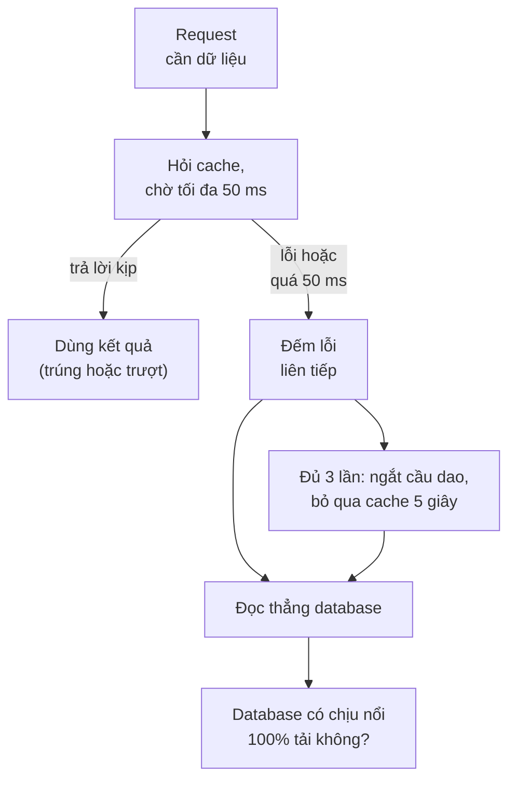

> [!tldr] Đọc nhanh
> - [[concepts/cache-metrics|Đo cache]] theo từng loại dữ liệu. `INFO` của Redis gộp mọi tính năng: ví dụ báo 38,9% trong khi cache sản phẩm thật ra trúng 77,8%. Theo dõi thêm số key bị đẩy, bộ nhớ, độ trễ và tải database.
> - Cache sập: client Redis mặc định (ioredis) **xếp lệnh vào hàng chờ và chờ mãi**, request treo theo. [[concepts/fail-open|Fail-open]] nghĩa là hết thời gian chờ ngắn thì coi như trượt và đọc nguồn, nhưng khi đó *toàn bộ* tải dồn về database.
> - [[concepts/cache-poisoning|Cache poisoning]]: kẻ tấn công gửi một header không nằm trong khóa cache (`X-Forwarded-Host`) để origin sinh ra nội dung độc, cache lưu lại và phát cho mọi người.
> - [[concepts/web-cache-deception|Web cache deception]]: lừa nạn nhân mở `/account/avatar.css`; cache thấy đuôi `.css` nên lưu trang tài khoản của nạn nhân, kẻ tấn công mở cùng URL và đọc được.
> - Cả hai đều do cache và origin hiểu khác nhau về "hai request có giống nhau không". [[concepts/cache-checklist|Checklist]] cuối bài gom cả tuyến lại.

> [!info] Bối cảnh
> Ga cuối của **tuyến Caching**. Ví dụ là **flash-sale**, trang bán hàng giảm giá giờ vàng: cache đã đỡ phần lớn tải lúc 21:00, giờ phải biết nó có đang làm tốt không, chuyện gì xảy ra khi chính nó sập, và nó có vô tình phát dữ liệu của người này cho người khác không. Ví dụ bảo mật chạy hoàn toàn trên máy bạn. Bạn không cần biết code dự án.

> [!abstract]- Từ điển nhanh cho bài này (bấm để mở)
> - **Hit ratio, cache key, Cache-Control, Vary, CDN, eviction, stampede**: xem các ga trước, nhất là [[posts/2026-11-22-caching-why|ga 1]], [[posts/2026-11-22-caching-http|ga 2]] và [[posts/2026-11-22-caching-redis|ga 6]].
> - **Timeout**: thời gian chờ tối đa; quá thì bỏ cuộc. Xem [[concepts/timeouts|Timeouts]] ở tuyến API.
> - **Circuit breaker (cầu dao)**: lỗi liên tiếp thì tạm ngừng gọi một dịch vụ một lúc, thay vì tiếp tục chờ nó. Xem [[concepts/circuit-breaker|Circuit Breaker]].
> - **Unkeyed input**: phần của request mà origin có dùng nhưng cache không đưa vào khóa.
> - **`X-Forwarded-Host`**: header proxy dùng để báo cho origin biết tên miền mà người dùng gõ ban đầu.
> - **XSS**: chèn JavaScript độc vào trang người khác xem.
> - **SLO**: mục tiêu chất lượng dịch vụ, ví dụ "99% request dưới 200 ms".

## Hình dung trước: sổ thống kê, mất điện, và tờ rơi giả

Thư viện chạy ổn rồi. Giờ thủ thư trưởng cần **sổ thống kê** (bao nhiêu lượt mượn được phục vụ từ giá), một **phương án mất điện** (thang máy kho vẫn chạy nếu giá sảnh đóng cửa không?), và cảnh giác hai trò lừa: có kẻ **kẹp tờ rơi giả vào sách trên giá** để mọi người mượn sau đều đọc thấy, và có kẻ **nhờ bạn mượn sổ khám bệnh của chính bạn rồi để lên giá chung**.

| Đời thường | Khái niệm |
|---|---|
| Sổ ghi lượt mượn từ giá và từ kho, theo từng loại sách | [[concepts/cache-metrics\|Cache metrics]] |
| Giá sảnh đóng: thủ thư xuống thẳng kho, nhưng thang máy kho chịu được bao nhiêu người? | [[concepts/fail-open\|Fail-open]] |
| Kẹp tờ rơi giả vào sách trên giá chung | [[concepts/cache-poisoning\|Cache poisoning]] |
| Lừa bạn để sổ khám bệnh của bạn lên giá chung | [[concepts/web-cache-deception\|Web cache deception]] |
| Danh sách kiểm tra trước giờ mở cửa | [[concepts/cache-checklist\|Cache checklist]] |



## Vấn đề: cache chạy được, nhưng có đúng không, và có an toàn không

Mình từng nghĩ cache là thứ "thêm vào cho nhanh, hỏng thì bỏ ra". Ba chuyện làm mình đổi ý:

1. Dashboard Redis báo hit ratio 40%, mình tưởng cache vô dụng. Hóa ra con số đó trộn cả rate limit, session và các key toàn trượt. Cache sản phẩm thật ra trúng gần 80%.
2. Tắt thử Redis trên máy: request không lỗi, cũng không chậm một chút, mà **treo**. Client Redis mặc định cứ chờ để nối lại.
3. Đọc nghiên cứu về web cache deception và cache poisoning: cả hai không cần lỗi trong code ứng dụng, chỉ cần cache và origin hiểu khác nhau về một URL hay một header.

## Cơ chế

### Cache metrics: đo đúng thứ cần đo

**[[concepts/cache-metrics|Cache metrics]]** cần trả lời ba câu: cache có đang trúng không, có đang thiếu chỗ không, và nó có đang làm database dễ thở hơn không.

Redis cho số liệu toàn instance qua `INFO stats` và `INFO memory`:

| Số liệu | Ý nghĩa | Đáng lo khi |
|---|---|---|
| `keyspace_hits`, `keyspace_misses` | Số lần đọc trúng và trượt, **gộp mọi key** | Dùng để thấy xu hướng, không dùng để đánh giá từng cache |
| `evicted_keys` | Số key bị đẩy vì đầy | Tăng đều: cache thiếu chỗ, hit ratio đang bị ăn mòn |
| `expired_keys` | Số key hết hạn | So với số key ghi vào để biết TTL có quá ngắn không |
| `used_memory`, `maxmemory` | Bộ nhớ đang dùng và trần | Sát trần với `noeviction`: sắp OOM |
| `instantaneous_ops_per_sec`, độ trễ lệnh | Tải và tốc độ | Độ trễ tăng vọt: lệnh chậm, big key, `KEYS` (ga 6) |

Vì Redis gộp mọi thứ, hãy **đếm ở phía ứng dụng theo từng loại cache**: một bộ đếm trúng/trượt có nhãn `cache="product"`, `cache="search"`, `layer="l1"`... Cache feature flag của flash-sale làm đúng như vậy với một metric `cacheHits` có nhãn `layer` (`l1`, `l2`, `pg`). Ngoài hit ratio, đo **độ trễ của lần trượt** (thời gian nạp từ nguồn) và **tải mà nguồn nhận**: mục tiêu thật của cache là giữ database dưới ngưỡng, không phải đẹp một con số.

### Fail-open: cache sập thì làm gì

Cache là một phụ thuộc, và nó sẽ có lúc sập: Redis khởi động lại, failover, mạng chập chờn. Có hai lựa chọn:

- **Fail-closed**: cache lỗi thì request lỗi. Hợp lý khi cache *không phải* cache mà là nơi lưu chính (session, khóa phân tán, bộ đếm rate limit).
- **[[concepts/fail-open|Fail-open]]**: cache lỗi thì coi như trượt, đọc thẳng nguồn. Đúng với cache thật sự (mọi thứ đều nạp lại được).

Fail-open nghe đơn giản nhưng có hai bẫy:

1. **Client mặc định không "lỗi" nhanh.** ioredis mặc định bật *offline queue*: khi mất kết nối, lệnh được xếp hàng chờ nối lại, mỗi lệnh thử lại tới 20 lần. Request treo tới khi một timeout ở tầng cao hơn cắt nó. Phải cấu hình để thất bại nhanh: tắt offline queue (`enableOfflineQueue: false`), giới hạn số lần thử lại (`maxRetriesPerRequest`), và bọc mỗi lệnh cache trong một [[concepts/timeouts|timeout]] ngắn (vài chục mili giây, cache chậm hơn thế thì không còn là cache).
2. **Fail-open dồn 100% tải về database.** Với hit ratio 95%, database đang chỉ thấy 5% lượt đọc; cache sập là tải nhân 20 lần, đúng lúc mọi người đang dùng. Nếu database không chịu được, fail-open chỉ dời sự cố từ cache sang database. Cần một trong các thứ sau: database đủ dư, giới hạn số query đồng thời xuống database (bulkhead), trả dữ liệu dự phòng (bản cũ trong L1, trang tĩnh), hoặc [[concepts/rate-limiting|giới hạn tải]] ở cửa vào.

Thêm một [[concepts/circuit-breaker|cầu dao]]: lỗi liên tiếp vài lần thì bỏ qua cache trong vài giây, để không phải trả giá timeout cho mỗi request trong lúc cache đang chết.

### Cache poisoning: đầu độc bản dùng chung

**[[concepts/cache-poisoning|Web cache poisoning]]** (James Kettle, PortSwigger, 2018) khai thác **unkeyed input**: thứ mà origin dùng để tạo response nhưng cache *không* đưa vào khóa.

Trong ví dụ, origin dựng link script tuyệt đối từ header `X-Forwarded-Host` (một thói quen phổ biến để biết tên miền gốc sau proxy). Cache chỉ dùng URL làm khóa. Kẻ tấn công:

1. Gửi `GET /` kèm `X-Forwarded-Host: evil.example` lúc cache vừa hết hạn.
2. Origin trả trang chủ có `<script src="https://evil.example/app.js">`. Cache lưu nó dưới khóa `/`.
3. Mọi người mở trang chủ trong thời hạn cache đều chạy script của kẻ tấn công.

Một request, mọi người dùng bị ảnh hưởng. Cách chặn:

- **Mọi thứ ảnh hưởng tới response phải nằm trong khóa** (hoặc trong `Vary`), hoặc không được tới origin. Trong ví dụ, cấu hình đã sửa xóa `X-Forwarded-Host` từ client trước khi chuyển tiếp.
- Origin không tin header do client gửi để dựng URL; dùng cấu hình tên miền cố định.
- Chỉ cache những gì cần cache, thời hạn ngắn cho HTML.

### Web cache deception: lừa cache giữ trang riêng tư

**[[concepts/web-cache-deception|Web cache deception]]** (Omer Gil, 2017) khai thác chỗ **cache và origin hiểu khác nhau về một URL**:

- Cache có luật "đuôi `.css`, `.js`, `.png` là file tĩnh, cache 10 phút, bỏ qua header của origin".
- Origin (nhiều framework như vậy) phục vụ `/account/avatar.css` như `/account`, bỏ qua phần đuôi không khớp route nào, và trả trang tài khoản của người đang đăng nhập.

Kẻ tấn công gửi cho nạn nhân link `/account/avatar.css`. Nạn nhân bấm vào khi đang đăng nhập; origin trả trang tài khoản của họ (có `Cache-Control: private, no-store`), nhưng cache bỏ qua header đó vì đuôi là `.css` và lưu lại. Kẻ tấn công mở cùng URL, không cần cookie, và nhận trang tài khoản của nạn nhân từ cache.

Cách chặn:

- **Tôn trọng `Cache-Control` của origin**, kể cả với "file tĩnh". Đừng cấu hình kiểu `proxy_ignore_headers Cache-Control` cho cả một nhóm đuôi file.
- Origin trả **404 cho đường dẫn không tồn tại** thay vì trả trang gần giống nhất.
- Cache file tĩnh theo **đường dẫn thư mục** (`/static/`, `/assets/`) chứ không theo đuôi file; kiểm tra thêm `Content-Type` của response có khớp đuôi không.

### Checklist: gom cả tuyến lại

**[[concepts/cache-checklist|Cache checklist]]** trước khi đưa một cache lên production:

| Hạng mục | Câu hỏi | Ga |
|---|---|---|
| Có nên cache không | Đọc nhiều hơn ghi? Nhiều người cùng đọc? Cũ bao lâu thì chấp nhận được? | 1 |
| Khóa | Khóa chứa đủ mọi thứ làm kết quả khác đi, và chỉ những thứ đó? Đã chuẩn hóa? | 1, 8 |
| HTTP | Mỗi response có `Cache-Control` rõ ràng? Dữ liệu riêng là `private` hoặc `no-store`? `Vary` đủ? | 2 |
| Mẫu | Cache-aside, ghi DB rồi xóa cache sau commit? Không dùng write-behind cho dữ liệu không được mất? | 3 |
| Invalidation | Mọi mục có TTL? Xóa đủ mọi key liên quan, kể cả theo chuỗi phụ thuộc? Cần lease hay version không? | 4 |
| Tải cao | Có gom request hoặc làm mới sớm cho key hot? TTL có jitter? Có negative cache hoặc Bloom filter? | 5 |
| Redis | `maxmemory` và chính sách phù hợp? Cache tách khỏi dữ liệu cần giữ? Không `KEYS`, xóa big key bằng `UNLINK`? | 6 |
| Nhiều pod | L1 có giới hạn và TTL? Mất tin báo hủy thì sai tối đa bao lâu? Thêm node có làm trượt hàng loạt? | 7 |
| Vận hành | Đo hit ratio theo từng cache, `evicted_keys`, tải database? Cache sập thì timeout ngắn và database chịu được? | 8 |
| Bảo mật | Cache dùng chung không giữ dữ liệu riêng? Không có unkeyed input? Không cache theo đuôi file bất chấp header? | 8 |

## Ví dụ chạy được

Hai ví dụ. [hit-ratio-and-failover.ts](../code/caching-operations/hit-ratio-and-failover.ts) đo hit ratio và thử Redis sập (cổng 6399 không có gì). Thư mục [security/](../code/caching-operations/security/origin.ts) chứa một origin, một nginx với hai cấu hình (cổng 8090 lỏng, cổng 8091 đã sửa) và [attack.ts](../code/caching-operations/security/attack.ts). Tất cả chạy trên máy bạn, chỉ để học.

```bash
docker run -d --rm --name atlas-redis -p 6380:6379 redis:8
npm i ioredis
node hit-ratio-and-failover.ts

cd security && docker compose -p atlas-sec up -d
node attack.ts
docker compose -p atlas-sec down
```

```ts
// Fail-open: hết 50ms thì coi như trượt; 3 lỗi liên tiếp thì bỏ qua cache 5 giây
const fast = new Redis(6399, { lazyConnect: true, enableOfflineQueue: false, maxRetriesPerRequest: 0 });
async function cachedGet(id: string) {
  if (Date.now() < skipUntil) return db(id);                 // cầu dao đang ngắt
  try {
    const v = await Promise.race([fast.get(`p:${id}`), sleep(50).then(() => { throw new Error('timeout'); })]);
    failures = 0; if (v !== null) return v;
  } catch { if (++failures >= 3) skipUntil = Date.now() + 5000; }
  return db(id);
}
```

```text
$ node hit-ratio-and-failover.ts
1) Hit ratio
   Redis INFO: keyspace_hits=1555 keyspace_misses=2445 → 38.9% (trộn mọi tính năng)
   ứng dụng tự đếm cache sản phẩm: 1555 trúng / 445 trượt → 77.8%
2) Redis không trả lời
   client mặc định: vẫn chờ sau 3 giây (3000ms)
   bọc timeout 50ms + bỏ qua cache khi lỗi: 200 request xong sau 26ms, nhưng DB nhận 200 query
   (cache sập = toàn bộ tải dồn về DB; DB phải chịu được, hoặc phải giới hạn tải)
```

Cấu hình nginx lỏng (cổng 8090) và đã sửa (cổng 8091):

```nginx
# 8090: "file tĩnh thì cứ cache", bỏ qua Cache-Control của origin
location ~* \.(css|js|png)$ {
  proxy_cache loose;
  proxy_ignore_headers Cache-Control Set-Cookie Expires;
  proxy_cache_valid 200 10m;
}
location / {
  proxy_set_header X-Forwarded-Host $http_x_forwarded_host;   # chuyển header của client lên origin
  proxy_cache loose;
  proxy_cache_key $scheme$host$request_uri;                    # ...nhưng không đưa vào khóa
}

# 8091: tôn trọng Cache-Control, không cho header ngoài khóa tới origin
location / {
  proxy_set_header X-Forwarded-Host "";
  proxy_cache strict;
}
```

```text
$ node attack.ts

=== cổng 8090 (cấu hình lỏng) ===
1) Web cache deception
   nạn nhân (có cookie) mở /account/avatar.css → MISS   <h1>Tài khoản của lan</h1><p>Địa chỉ: 12 Lý Thường Kiệt, SĐT 09xx</p>
   kẻ xấu (không cookie) mở cùng URL       → HIT    <h1>Tài khoản của lan</h1><p>Địa chỉ: 12 Lý Thường Kiệt, SĐT 09xx</p>
2) Cache poisoning qua header không nằm trong khóa cache
   kẻ xấu gửi X-Forwarded-Host: evil.example → MISS   <script src="https://evil.example/app.js"></script><h1>Flash sale 21:0
   người dùng bình thường mở trang chủ      → HIT    <script src="https://evil.example/app.js"></script><h1>Flash sale 21:0

=== cổng 8091 (cấu hình đã sửa) ===
1) Web cache deception
   nạn nhân (có cookie) mở /account/avatar.css → MISS   <h1>Tài khoản của lan</h1><p>Địa chỉ: 12 Lý Thường Kiệt, SĐT 09xx</p>
   kẻ xấu (không cookie) mở cùng URL       → MISS   <h1>Mời đăng nhập</h1>
2) Cache poisoning qua header không nằm trong khóa cache
   kẻ xấu gửi X-Forwarded-Host: evil.example → MISS   <script src="https://shop.example/app.js"></script><h1>Flash sale 21:0
   người dùng bình thường mở trang chủ      → HIT    <script src="https://shop.example/app.js"></script><h1>Flash sale 21:0
```

Đọc kết quả (dữ liệu trong ví dụ là giả):

- **Hit ratio**: cùng một lần chạy, Redis báo 38,9% vì gộp cả 2.000 lần đọc session toàn trượt; cache sản phẩm thật ra trúng 77,8%.
- **Redis sập**: client mặc định treo cả 3 giây (và còn chờ tiếp). Bọc timeout và cầu dao thì 200 request xong trong 26 ms, nhưng cả 200 đều xuống database.
- **Cổng 8090**: kẻ xấu đọc được trang tài khoản của Lan (`HIT`), và trang chủ của mọi người tải script từ `evil.example`.
- **Cổng 8091**: trang tài khoản không bị cache (kẻ xấu chỉ thấy "Mời đăng nhập"), header độc bị xóa trước khi tới origin nên bản trong cache sạch.

## Hiểu lầm và bẫy hay gặp

- **"Hit ratio trong INFO là hit ratio của cache."** Nó gộp mọi key của instance. Đo theo từng cache ở phía ứng dụng.
- **"Cache lỗi thì code đã có try/catch."** Try/catch không giúp gì khi lệnh không lỗi mà *treo*. Cần timeout ngắn và tắt hàng chờ offline.
- **"Fail-open là an toàn."** An toàn cho tính đúng, không an toàn cho database. Phải tính trước database chịu được bao nhiêu khi hit ratio về 0.
- **"Có `Cache-Control: private` thì CDN không bao giờ lưu."** Trừ khi cấu hình cache bỏ qua header của origin, như cấu hình "cache mọi file tĩnh theo đuôi".
- **"Cache poisoning cần lỗi XSS trong code."** Không cần. Chỉ cần origin phản chiếu một header mà cache không đưa vào khóa.
- **"Đường dẫn lạ thì origin trả gì cũng được."** Trả trang gần đúng nhất (thay vì 404) là điều kiện cho web cache deception.

## Câu hỏi tự kiểm tra

> [!question]- Redis báo hit ratio 40%. Vì sao chưa thể kết luận cache sản phẩm kém?
> `keyspace_hits` và `keyspace_misses` gộp mọi key của instance, gồm cả session, rate limit, khóa... vốn có thể toàn trượt. Phải đếm trúng/trượt theo từng loại cache ở phía ứng dụng.

> [!question]- Vì sao một request treo khi Redis sập, dù code có try/catch quanh lệnh cache?
> Client mặc định (như ioredis) không ném lỗi ngay mà xếp lệnh vào hàng chờ offline và thử nối lại. Lệnh không lỗi nên catch không chạy; request chờ tới khi timeout ở tầng cao hơn. Cần tắt offline queue, giới hạn thử lại và bọc timeout ngắn.

> [!question]- Fail-open khi cache sập có rủi ro gì cho database, và có những cách giảm nhẹ nào?
> Toàn bộ lượt đọc mà cache đang đỡ dồn về database; hit ratio 95% nghĩa là tải tăng 20 lần. Giảm nhẹ: database có dư, giới hạn số query đồng thời, trả dữ liệu dự phòng từ L1 hoặc bản cũ, giới hạn tải ở cửa vào, cầu dao để không trả giá timeout mỗi request.

> [!question]- Cache poisoning và web cache deception khác nhau ở đâu?
> Poisoning: kẻ tấn công làm cache lưu một response *độc* do chính họ kích hoạt, rồi cache phát nó cho mọi người. Deception: kẻ tấn công lừa *nạn nhân* làm cache lưu response *riêng tư* của nạn nhân, rồi tự đọc nó. Cả hai đều do cache và origin hiểu khác nhau về một request.

> [!question]- Kể ba thay đổi cấu hình chặn được cả hai lỗ hổng trong ví dụ.
> Tôn trọng `Cache-Control` của origin thay vì bỏ qua theo đuôi file; không chuyển header nằm ngoài khóa cache (như `X-Forwarded-Host` của client) tới origin; origin trả 404 cho đường dẫn không tồn tại và dựng URL từ cấu hình chứ không từ header.

## Tham khảo

- [Redis: INFO](https://redis.io/docs/latest/commands/info/) (`keyspace_hits`, `evicted_keys`, `used_memory`)
- [ioredis: Offline queue](https://github.com/redis/ioredis#offline-queue) (`enableOfflineQueue`, `maxRetriesPerRequest`)
- James Kettle, [Practical Web Cache Poisoning](https://portswigger.net/research/practical-web-cache-poisoning), PortSwigger Research, 2018
- Omer Gil, [Web Cache Deception Attack](https://omergil.blogspot.com/2017/02/web-cache-deception-attack.html), 2017
- [PortSwigger Web Security Academy: Web cache deception](https://portswigger.net/web-security/web-cache-deception)
- [RFC 9111: HTTP Caching](https://www.rfc-editor.org/rfc/rfc9111) (mục Security Considerations)
