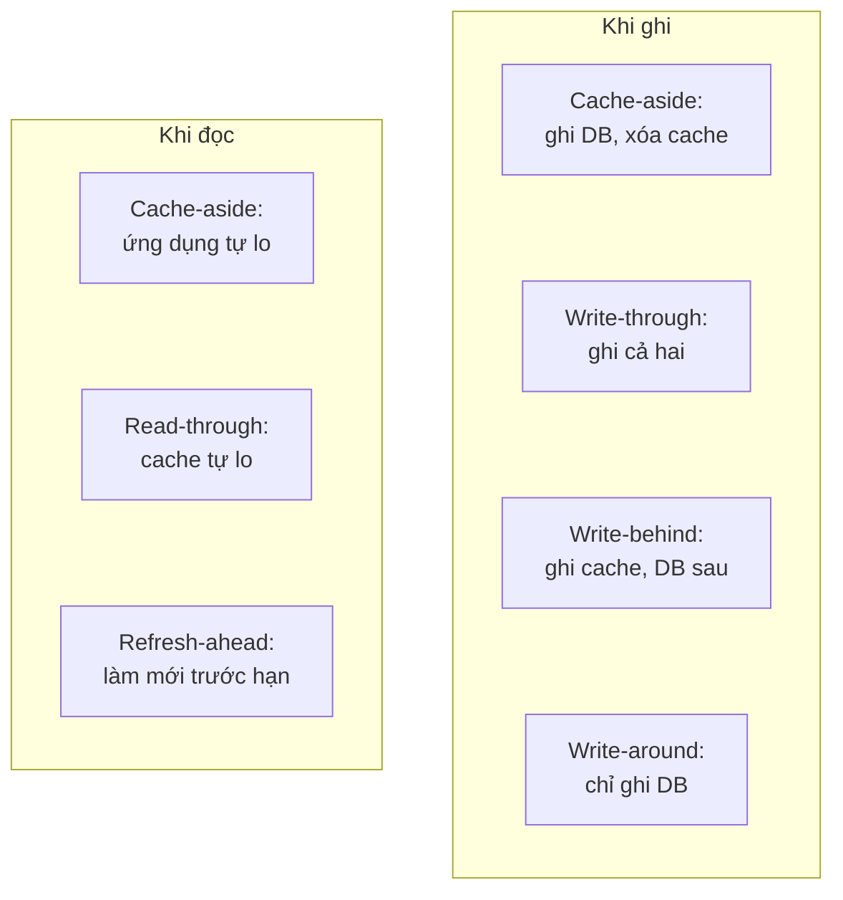
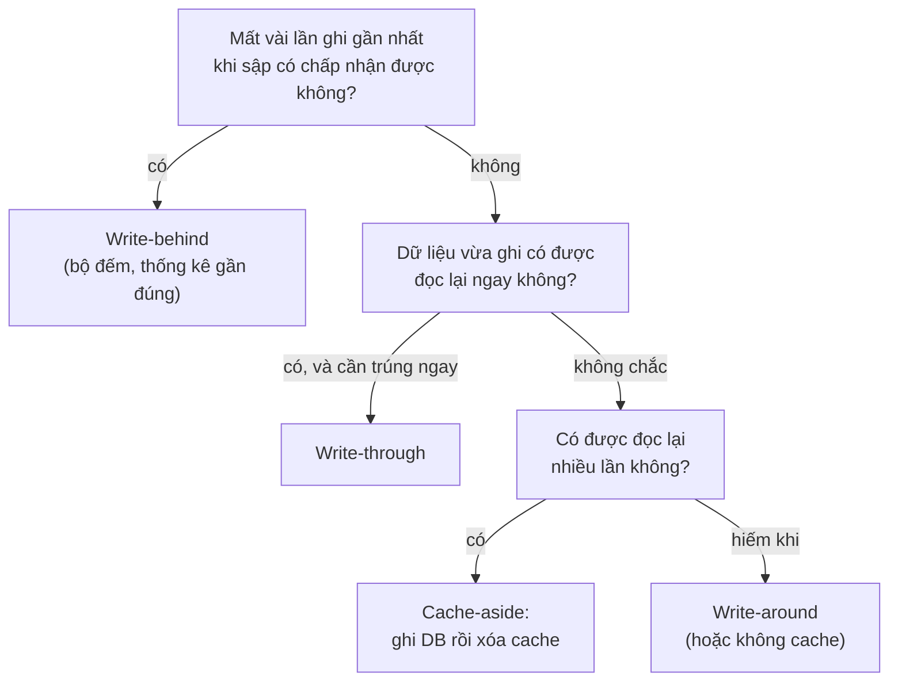

> [!tldr] Đọc nhanh
> - [[concepts/cache-aside|Cache-aside]] là mẫu phổ biến nhất: ứng dụng tự hỏi cache, trượt thì đọc DB rồi ghi vào cache. Khi ghi: ghi DB trước, rồi **xóa** mục trong cache.
> - [[concepts/read-through|Read-through]]: ứng dụng chỉ nói chuyện với cache; cache tự đi lấy từ DB khi trượt. Cùng ý tưởng, khác ai giữ code nạp dữ liệu.
> - [[concepts/write-through|Write-through]] ghi DB và cache cùng lúc: đọc ngay sau khi ghi luôn trúng, đổi lại mỗi lần ghi chậm hơn.
> - [[concepts/write-behind|Write-behind]] chỉ ghi cache rồi trả lời ngay, DB được ghi sau. Nhanh nhất và gộp được nhiều lần ghi, nhưng **sập trước khi kịp ghi là mất dữ liệu**.
> - [[concepts/write-around|Write-around]] ghi thẳng DB, không đụng cache. [[concepts/refresh-ahead|Refresh-ahead]] làm mới mục sắp hết hạn ở nền, nên người đọc gần như không bao giờ phải chờ DB.

> [!info] Bối cảnh
> Ga 3 của **tuyến Caching**. Ví dụ là **flash-sale**, trang bán hàng giảm giá giờ vàng: trang thống kê của người bán đọc số đơn hàng hàng chục lần một phút, trong khi đơn mới vào liên tục. Ga này trả lời: khi dữ liệu có hai bản (cache và database), ai đọc bản nào, ai ghi bản nào, theo thứ tự nào. Bạn không cần biết code dự án.

> [!abstract]- Từ điển nhanh cho bài này (bấm để mở)
> - **Hit, miss, staleness, cache key**: xem [[posts/2026-11-22-caching-why|ga 1]].
> - **TTL (time to live)**: thời gian sống của một mục cache, hết thì tự biến mất. Ga 4 nói kỹ.
> - **Redis `SET key value EX 60`**: ghi một key, tự hết hạn sau 60 giây. `GET` đọc, `DEL` xóa.
> - **Đồng bộ / bất đồng bộ**: đồng bộ là chờ việc xong mới trả lời; bất đồng bộ là trả lời trước, việc làm sau.
> - **Flush**: đẩy dữ liệu đang chờ trong bộ đệm xuống nơi lưu bền.
> - **Nguồn sự thật (source of truth)**: bản dữ liệu được coi là đúng khi hai bản lệch nhau. Thường là database.

## Hình dung trước: giá sách và sổ đăng ký

Ở ga 1, thủ thư có một giá sách cạnh quầy (cache) và một kho ở tầng hầm (database). Giờ thêm chuyện **ghi**: thư viện nhận sách mới, sửa thông tin sách, đổi giá thuê. Thủ thư phải quyết định: sửa sổ kho trước hay sửa nhãn trên giá trước? Sửa cả hai cùng lúc, hay sửa giá trước rồi cuối ngày mới cập nhật kho?

| Đời thường | Khái niệm |
|---|---|
| Thủ thư tự nhìn giá, thiếu thì tự xuống kho lấy rồi đặt một bản lên giá | [[concepts/cache-aside\|Cache-aside]] |
| Bạn đọc chỉ hỏi quầy; quầy có nhân viên riêng lo xuống kho khi thiếu | [[concepts/read-through\|Read-through]] |
| Sửa thông tin sách: sửa sổ kho và nhãn trên giá cùng lúc | [[concepts/write-through\|Write-through]] |
| Chỉ ghi lên bảng ở quầy, cuối ngày mới chép vào sổ kho | [[concepts/write-behind\|Write-behind]] |
| Sách mới nhập thẳng vào kho, không đặt lên giá | [[concepts/write-around\|Write-around]] |
| Sách sắp tới hạn trả mà vẫn được hỏi nhiều: gia hạn trước khi hết hạn | [[concepts/refresh-ahead\|Refresh-ahead]] |



## Vấn đề: hai bản của một dữ liệu

Mình từng nghĩ cache chỉ là chuyện đọc: thêm một dòng `redis.get` trước câu query là xong. Rồi người bán phàn nàn: vừa giao xong một đơn, trang thống kê vẫn báo "đang xử lý: 12" thêm cả phút. Chỗ hở không nằm ở đọc mà ở **ghi**: đơn đổi trạng thái trong database, còn cache vẫn giữ con số cũ.

Mỗi khi có cache là có hai bản của cùng một dữ liệu. Các mẫu trong ga này là sáu cách khác nhau để trả lời ba câu hỏi:

1. Khi **đọc** trượt, ai đi lấy dữ liệu từ database?
2. Khi **ghi**, ghi vào bản nào trước, và có chờ bản kia không?
3. Khi hai bản lệch nhau, bản nào là sự thật?

## Cơ chế

### Cache-aside: ứng dụng tự lo mọi thứ

**[[concepts/cache-aside|Cache-aside]]** (còn gọi là lazy loading) là mẫu mặc định ở hầu hết hệ thống, kể cả Facebook gọi memcache của họ là "demand-filled look-aside cache". Cache đứng *bên cạnh*, không đứng giữa: nó không biết database tồn tại.

Đọc:

1. Hỏi cache. Có thì trả.
2. Không có thì đọc database.
3. Ghi kết quả vào cache kèm TTL, rồi trả.

Ghi:

1. Ghi database.
2. **Xóa** mục tương ứng trong cache. Lần đọc sau sẽ trượt và nạp bản mới.

```ts
// trích rút gọn từ thống kê người bán của flash-sale
async getStats(ownerId: string) {
  const cached = await redis.get(`stats:seller:${ownerId}`);
  if (cached) return JSON.parse(cached);
  const stats = await this.countOrders(ownerId);                      // query đắt
  await redis.setex(`stats:seller:${ownerId}`, 60, JSON.stringify(stats));
  return stats;
}
// gọi sau khi transaction đổi trạng thái đơn đã commit
async invalidate(ownerId: string) { await redis.del(`stats:seller:${ownerId}`); }
```

Vì sao **xóa** chứ không **ghi giá trị mới vào cache**? Bài báo về memcache của Facebook trả lời gọn: "We choose to delete cached data instead of updating it because deletes are idempotent". Xóa hai lần cũng như xóa một lần; còn hai lần ghi về sai thứ tự thì cache giữ giá trị sai. Ga 4 tái hiện đúng tình huống đó.

Ưu điểm: đơn giản, chỉ cache thứ thực sự được đọc, cache sập thì ứng dụng vẫn chạy (chậm hơn). Nhược điểm: lần đọc đầu và lần đọc ngay sau mỗi lần ghi luôn trượt, và vẫn còn một khe hở hiếm gặp mà ga 4 sẽ mổ xẻ.

### Read-through: cache tự đi lấy

**[[concepts/read-through|Read-through]]** giống cache-aside khi nhìn từ database, nhưng khác ở chỗ ai giữ code nạp dữ liệu. Ứng dụng chỉ gọi `cache.get(key)`; cache được cấu hình sẵn một hàm nạp (loader) và tự gọi nó khi trượt.

```ts
// minh họa, không chạy trực tiếp
const products = new LoadingCache({ ttl: 60, load: (id) => db.findProduct(id) });
const p = await products.get('42');   // trượt thì cache tự gọi load('42')
```

Thư viện như Caffeine (Java) hay các sản phẩm như Hazelcast, NCache có sẵn kiểu này. Lợi ích lớn nhất: code đọc ở mọi chỗ đều gọn và giống nhau, và cache có thể tự gom các lần trượt cùng key thành một lần nạp (ga 5). Hàm `getOrFetch(key, ttl, fetcher)` của flash-sale nằm ở giữa hai mẫu: ứng dụng vẫn truyền hàm nạp vào mỗi lần gọi, nhưng mọi logic trúng, trượt, khóa đều gói trong một chỗ.

### Write-through: ghi cả hai, đồng bộ

**[[concepts/write-through|Write-through]]**: mỗi lần ghi, ghi database **và** ghi giá trị mới vào cache, trong cùng một lời gọi, rồi mới trả lời.

- Ưu: đọc ngay sau khi ghi luôn trúng và đúng. Cache luôn "ấm" với dữ liệu vừa đổi.
- Nhược: mỗi lần ghi chậm thêm một lần ghi cache. Cache đầy những thứ được ghi nhưng không ai đọc (cần TTL). Và vì là "ghi giá trị mới" chứ không phải "xóa", hai lần ghi đồng thời vẫn có thể để lại giá trị sai (ga 4).

Write-through thường đi với read-through: cả đọc và ghi đều qua cache, cache tự lo phần database.

### Write-behind: ghi cache, database sau

**[[concepts/write-behind|Write-behind]]** (còn gọi là write-back): chỉ ghi cache rồi trả lời ngay. Một tiến trình nền gom các thay đổi lại và ghi xuống database sau, theo lô.

- Ưu: ghi cực nhanh. **Gộp được** nhiều lần ghi cùng key: 100 lần cập nhật bộ đếm lượt xem chỉ thành 1 lần ghi DB.
- Nhược nặng: trong khoảng thời gian chưa flush, **cache là nguồn sự thật duy nhất**. Tiến trình hoặc cache sập là mất dữ liệu. Lỗi ràng buộc của database (trùng khóa, vi phạm khóa ngoại) xảy ra *sau khi* đã trả lời "thành công" cho người dùng. Thứ tự ghi cũng phải được giữ cẩn thận.

Hợp với dữ liệu chịu được mất một ít: bộ đếm lượt xem, "lần cuối hoạt động", số liệu thống kê gần đúng. Không bao giờ dùng cho đơn hàng hay tiền.

### Write-around: ghi thẳng database, không đụng cache

**[[concepts/write-around|Write-around]]**: ghi database, cache để nguyên; cache chỉ được nạp khi có người đọc. Hợp với dữ liệu ghi một lần và hiếm khi đọc lại (log, lịch sử), vì không làm bẩn cache bằng những thứ không ai cần.

Bẫy: nếu mục đó *đã* có trong cache từ trước, cache sẽ trả giá trị cũ cho tới khi hết TTL. Trong thực tế, "ghi DB rồi xóa cache" của cache-aside chính là write-around cộng thêm bước xóa để vá đúng chỗ này.

### Refresh-ahead: làm mới trước khi hết hạn

**[[concepts/refresh-ahead|Refresh-ahead]]**: khi một mục được đọc lúc đã gần hết hạn (ví dụ còn dưới 20% TTL), trả giá trị hiện có ngay, đồng thời nạp bản mới ở nền. Mục đang được đọc nhiều sẽ không bao giờ hết hạn thật, nên người đọc không phải chờ database; mục ít ai đọc thì cứ để hết hạn.

Đây là cùng ý tưởng với `stale-while-revalidate` ở [[posts/2026-11-22-caching-http|ga 2]], chỉ khác là làm *trước* khi hết hạn thay vì sau. Cái giá: một ít query DB "thừa" cho các mục được làm mới mà sau đó không ai đọc. Ga 5 có một phiên bản theo xác suất được chứng minh là tối ưu.

### So sánh và chọn

| Mẫu | Đọc ngay sau khi ghi | Tốc độ ghi | Rủi ro chính | Hợp với |
|---|---|---|---|---|
| Cache-aside (ghi DB, xóa cache) | Trượt một lần rồi đúng | Nhanh | Race hiếm gặp (ga 4) | Mặc định cho hầu hết dữ liệu đọc nhiều |
| Read-through | Như trên | Như trên | Phụ thuộc thư viện cache | Muốn code đọc gọn, gom trượt |
| Write-through | Trúng ngay | Chậm hơn (ghi hai nơi) | Cache đầy thứ không ai đọc | Dữ liệu vừa ghi sẽ được đọc ngay |
| Write-behind | Trúng ngay | Nhanh nhất | **Mất dữ liệu khi sập** | Bộ đếm, số liệu gần đúng |
| Write-around | Cũ tới khi hết TTL | Nhanh | Trả dữ liệu cũ | Dữ liệu ghi một lần, ít đọc lại |
| Refresh-ahead | (mẫu đọc) | | Query thừa | Mục hot, TTL ngắn |



## Ví dụ chạy được

[read-write-patterns.ts](../code/caching-patterns/read-write-patterns.ts) chạy năm mẫu trên Redis thật, với một "database" giả mất 20 ms mỗi lần đọc hoặc ghi và có đếm số lần gọi.

```bash
docker run -d --rm --name atlas-redis -p 6380:6379 redis:8
npm i ioredis
node read-write-patterns.ts
```

```ts
// Write-behind: chỉ ghi cache rồi trả lời; bộ đệm `dirty` chờ flush xuống DB
const dirty = new Map<string, number>();
async function behindWrite(id: string, v: number) { await redis.set(k(id), v, 'EX', TTL); dirty.set(id, v); }
async function flush() { const batch = [...dirty]; dirty.clear(); for (const [id, v] of batch) await db.put(id, v); }

// Refresh-ahead: còn dưới 20% TTL thì làm mới ở nền, người đọc không chờ
async function aheadRead(id: string, ttl: number) {
  const [hit, left] = await Promise.all([redis.get(k(id)), redis.ttl(k(id))]);
  if (hit !== null) {
    if (left <= ttl * 0.2) void db.get(id).then((v) => redis.set(k(id), v!, 'EX', ttl));
    return Number(hit);
  }
  // ...trượt: đọc DB, ghi cache
}
```

```text
$ node read-write-patterns.ts
1) Cache-aside
   đọc lần 1: 100 (21.3ms, trượt → DB)
   đọc lần 2: 100 (0.5ms, trúng cache)
   ghi 99 (DB rồi xóa cache), đọc lại: 99 (23.0ms, trượt 1 lần sau mỗi lần ghi)
2) Write-through
   ghi 98 mất 21.5ms (DB + cache), đọc ngay: 98 (0.7ms, trúng)
3) Write-behind
   100 lần ghi liên tiếp mất 11ms tổng, DB chưa bị ghi lần nào (db.writes = 0)
   flush: DB nhận 1 lần ghi (chỉ giá trị cuối 300), 99 lần ghi trung gian được gộp
   sập trước khi flush: đặt 1 nhưng DB vẫn là 300 → mất một lần ghi
4) Write-around
   ghi 50 thẳng vào DB, đọc qua cache: 300 (cũ, đúng tới khi key hết hạn sau tối đa 60s)
5) Refresh-ahead (TTL 5s)
   +   0ms đọc: 50 từ DB                      22.6ms
   +2500ms đọc: 50 từ cache                   1.5ms
   +1600ms đọc: 50 từ cache (+ làm mới ở nền) 1.5ms
   + 300ms đọc: 60 từ cache                   1.4ms
   DB bị đọc 2 lần (lần đầu + 1 lần làm mới ở nền), chỉ lần đầu người dùng phải chờ
```

Đọc kết quả:

- **Cache-aside**: trúng 0,5 ms so với 21 ms khi trượt; sau mỗi lần ghi phải trượt một lần (23 ms) để nạp bản mới.
- **Write-through**: ghi mất 21,5 ms (thêm một lần ghi cache), đổi lại đọc ngay sau đó trúng.
- **Write-behind**: 100 lần ghi chỉ tốn 11 ms và gộp thành 1 lần ghi DB. Nhưng khi tiến trình "chết" trước lúc flush, giá trị 1 không bao giờ xuống DB.
- **Write-around**: DB đã là 50 nhưng cache vẫn trả 300, vì không ai xóa mục cũ.
- **Refresh-ahead**: ở lần đọc thứ ba (còn dưới 1 giây TTL), giá trị vẫn trả ngay nhưng việc làm mới chạy ở nền. Lần đọc thứ tư đã thấy giá trị mới 60 mà không ai phải chờ DB.

## Hiểu lầm và bẫy hay gặp

- **"Ghi DB xong thì cập nhật cache luôn cho đỡ một lần trượt."** Hai request ghi đồng thời có thể cập nhật cache sai thứ tự, để lại giá trị cũ vô thời hạn (tới TTL). Xóa thì không có vấn đề thứ tự. Ga 4 chạy lại tình huống này.
- **"Xóa cache trước rồi mới ghi DB."** Giữa hai bước, một request đọc sẽ trượt, đọc DB *cũ* và nạp lại vào cache. Thứ tự đúng là ghi DB trước, xóa sau, và chỉ xóa sau khi transaction đã commit.
- **"Write-behind cho đơn hàng để chịu tải giờ cao điểm."** Đơn hàng là thứ không được mất. Muốn hấp thụ đợt ghi, dùng hàng đợi bền (như RabbitMQ với confirm, xem [[posts/2026-11-21-rabbitmq-ack-confirm|tuyến RabbitMQ]]) chứ không phải cache.
- **"Read-through tự giải quyết dữ liệu cũ."** Không. Read-through chỉ đổi ai đi nạp dữ liệu; invalidation vẫn là việc của bạn.
- **"Xóa cache thất bại thì ném lỗi cho người dùng."** DB đã ghi xong rồi. Thường chỉ cần log và dựa vào TTL làm lưới an toàn; flash-sale ghi rõ điều này trong comment: xóa thất bại thì cache tự hết hạn sau TTL.

## Câu hỏi tự kiểm tra

> [!question]- Cache-aside và read-through khác nhau ở đâu, nếu nhìn từ database thì giống nhau?
> Từ database, cả hai đều chỉ nhận query khi cache trượt. Khác ở chỗ ai giữ code nạp: cache-aside thì ứng dụng tự đọc DB và ghi cache; read-through thì cache được cấu hình sẵn hàm nạp và tự gọi.

> [!question]- Vì sao khi ghi, cache-aside xóa mục trong cache thay vì ghi giá trị mới vào?
> Xóa là idempotent và không phụ thuộc thứ tự: hai lần xóa đồng thời cho cùng kết quả. Hai lần ghi giá trị mới có thể tới cache sai thứ tự, để lại giá trị cũ cho tới khi hết TTL.

> [!question]- Write-behind gộp 100 lần ghi thành 1. Kể hai rủi ro phải trả.
> Sập trước khi flush thì mất các thay đổi chưa xuống DB. Lỗi của DB (vi phạm ràng buộc) xảy ra sau khi đã báo thành công cho người dùng. Ngoài ra còn phải giữ đúng thứ tự ghi.

> [!question]- Sao write-around lại có thể trả dữ liệu cũ?
> Nó chỉ ghi DB mà không đụng cache. Nếu mục đó đã nằm trong cache từ trước, cache vẫn trả bản cũ cho tới khi hết TTL. Muốn tránh thì thêm bước xóa, và đó chính là đường ghi của cache-aside.

> [!question]- Refresh-ahead khác stale-while-revalidate thế nào?
> Refresh-ahead làm mới *trước* khi hết hạn, khi mục được đọc trong khoảng cuối của TTL. Stale-while-revalidate làm mới *sau* khi đã hết hạn, trong lúc vẫn trả bản cũ. Cả hai đều làm việc ở nền để người đọc không phải chờ.

## Tham khảo

- [AWS: Caching patterns](https://docs.aws.amazon.com/whitepapers/latest/database-caching-strategies-using-redis/caching-patterns.html) (lazy loading, write-through, TTL)
- [Microsoft Azure Architecture Center: Cache-Aside pattern](https://learn.microsoft.com/en-us/azure/architecture/patterns/cache-aside)
- [Oracle Coherence: Read-Through, Write-Through, Write-Behind, and Refresh-Ahead Caching](https://docs.oracle.com/cd/E15357_01/coh.360/e15723/cache_rtwtwbra.htm)
- [Caffeine wiki: Population](https://github.com/ben-manes/caffeine/wiki/Population) (loading cache, refresh)
- Nishtala và cộng sự, [Scaling Memcache at Facebook](https://www.usenix.org/conference/nsdi13/technical-sessions/presentation/nishtala), NSDI 2013 (look-aside, xóa thay vì cập nhật)
