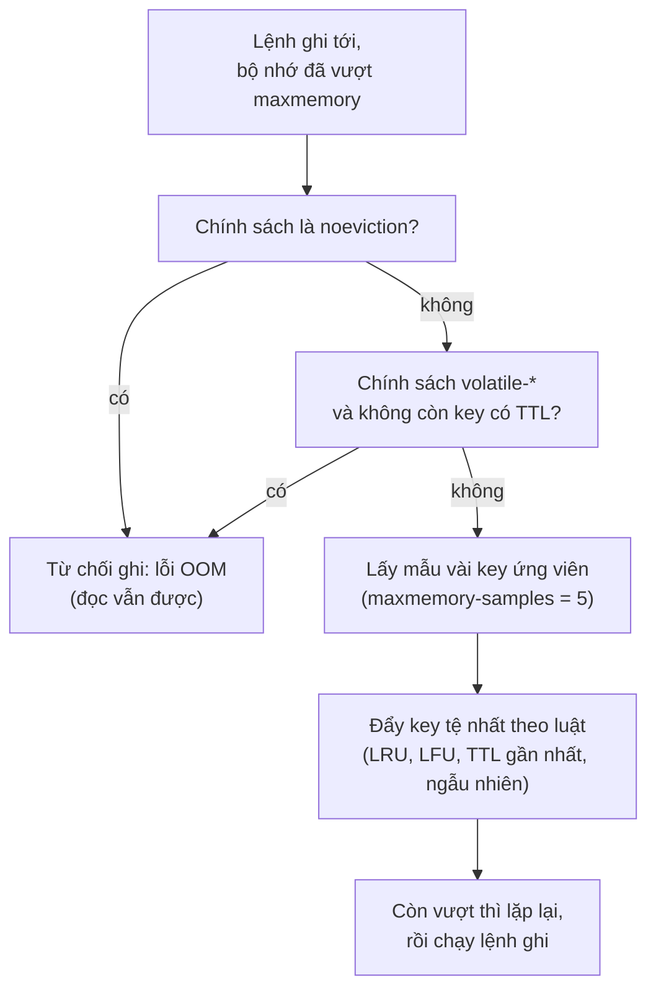

> [!tldr] Đọc nhanh
> - Mặc định Redis có `maxmemory 0` (không giới hạn) và chính sách `noeviction`: đặt giới hạn mà không đổi chính sách thì đầy là **mọi lệnh ghi bị từ chối** (OOM). Muốn Redis làm cache, phải đặt cả [[concepts/maxmemory|maxmemory]] lẫn [[concepts/eviction-policy|eviction policy]].
> - `allkeys-*` đẩy bất kỳ key nào; `volatile-*` chỉ đẩy key có TTL. Redis dùng chung cho session (không TTL) và cache: `volatile-lru` vẫn OOM khi session chiếm hết chỗ.
> - [[concepts/lru-va-lfu|LRU]] đẩy key lâu nhất chưa ai đọc, LFU đẩy key ít được đọc nhất. Một lượt quét 15.000 key "lạnh": LRU còn giữ 55/200 key hot, LFU giữ đủ 200/200.
> - [[concepts/key-expiration|Key hết hạn]] bị xóa theo hai cách: khi có người đọc tới, và một vòng quét nền lấy mẫu ngẫu nhiên. 50.000 key hết hạn tự biến mất trong 3 giây dù không ai đọc.
> - [[concepts/big-key|Big key]] và [[concepts/scan-va-keys|KEYS]] làm Redis đứng hình vì Redis xử lý lệnh trên một luồng: `KEYS` trên 1 triệu key chặn mọi client 91 ms, `SCAN` chỉ 1 ms; `DEL` một hash 1 triệu field chặn 51 ms, `UNLINK` gần 0.

> [!info] Bối cảnh
> Ga 6 của **tuyến Caching**. Ví dụ là **flash-sale**, trang bán hàng giảm giá giờ vàng: một instance Redis duy nhất giữ cả phiên đăng nhập, hàng đợi job, bộ đếm rate limit lẫn cache, và chưa đặt giới hạn bộ nhớ. Ga này hỏi: khi Redis đầy thì chuyện gì xảy ra, và nên cấu hình thế nào. Bạn không cần biết code dự án.

> [!abstract]- Từ điển nhanh cho bài này (bấm để mở)
> - **TTL, version trong khóa**: xem [[posts/2026-11-22-caching-invalidation|ga 4]]. **Hot key**: xem [[posts/2026-11-22-caching-under-load|ga 5]].
> - **OOM (out of memory)**: hết bộ nhớ. Trong Redis là lỗi `OOM command not allowed when used memory > 'maxmemory'`.
> - **Một luồng (single-threaded)**: Redis chạy các lệnh lần lượt từng cái một. Một lệnh chậm làm mọi client khác phải chờ.
> - **O(N)**: thời gian chạy tăng theo số phần tử N. `KEYS` là O(N) với N là tổng số key.
> - **Hash, Set, List**: kiểu dữ liệu của Redis chứa nhiều phần tử trong một key (bảng field → value, tập hợp, danh sách).
> - **`CONFIG SET`**: đổi cấu hình Redis khi đang chạy. **`INFO stats`**: xem số liệu như số key bị đẩy, số key hết hạn.
> - **Pipeline**: gửi nhiều lệnh một lượt rồi mới đọc kết quả, đỡ tốn thời gian đi về.

## Hình dung trước: giá sách có hạn

Giá sách cạnh quầy chỉ có 300 ô. Khi đầy mà có cuốn mới cần đặt lên, thủ thư phải chọn cuốn nào đem trả kho. Luật chọn khác nhau thì giá giữ được những cuốn khác nhau.

| Đời thường | Khái niệm |
|---|---|
| Giá sách chỉ có 300 ô | [[concepts/maxmemory\|Maxmemory]] |
| Luật "giá đầy thì cất cuốn nào" | [[concepts/eviction-policy\|Eviction policy]] |
| Cất cuốn lâu nhất chưa ai mở / cuốn ít người mượn nhất | [[concepts/lru-va-lfu\|LRU và LFU]] |
| Sách hết phiếu hẹn: cất khi có người hỏi, hoặc khi thủ thư đi tuần | [[concepts/key-expiration\|Key expiration]] |
| Bộ bách khoa 40 tập chiếm cả một tầng giá, dọn mất cả buổi | [[concepts/big-key\|Big key]] |
| Kiểm kê cả giá một lượt (quầy đóng cửa) / mỗi lần một ngăn | [[concepts/scan-va-keys\|SCAN và KEYS]] |



## Vấn đề: Redis không biết nó đang làm cache

Mình từng nghĩ Redis "là cache" nên tự biết bỏ bớt dữ liệu khi đầy. Thực ra Redis là một kho key-value trong RAM, dùng được cho nhiều việc: cache, session, hàng đợi, bộ đếm, khóa. Với session hay hàng đợi, tự ý xóa dữ liệu là lỗi nghiêm trọng. Nên mặc định Redis **không giới hạn bộ nhớ và không xóa gì cả**.

Trong docker-compose của flash-sale, Redis chạy không đặt `maxmemory`. Nó sẽ lớn dần theo dữ liệu tới khi container hoặc máy hết RAM và hệ điều hành giết tiến trình. Khi đó mất cùng lúc session, hàng đợi lẫn cache. Đặt giới hạn thôi chưa đủ: còn phải chọn đúng luật đẩy, và hiểu Redis dọn key hết hạn thế nào.

## Cơ chế

### Maxmemory: đặt trần cho bộ nhớ

**[[maxmemory|`maxmemory`]]** là lượng bộ nhớ tối đa Redis được dùng cho dữ liệu. Mặc định là `0`, nghĩa là không giới hạn (trên máy 64-bit). Khi đặt giới hạn, mỗi lệnh ghi mà làm bộ nhớ vượt trần sẽ kích hoạt việc đẩy key theo chính sách đã chọn.

Vài lưu ý khi chọn con số:

- Chừa chỗ cho phần không phải dữ liệu: bộ đệm của client, bộ đệm sao chép sang replica, và nhất là lúc Redis fork tiến trình con để ghi snapshot (RDB) hay viết lại AOF. Nếu bật lưu xuống đĩa, đặt `maxmemory` khoảng 60–75% RAM dành cho Redis là con số an toàn hay được khuyên.
- Trong container, `maxmemory` phải nhỏ hơn giới hạn bộ nhớ của container, không thì container bị giết trước khi Redis kịp đẩy key.

### Eviction policy: đầy thì đẩy key nào

**[[eviction-policy|`maxmemory-policy`]]** có hai nửa: *nhóm* key được phép đẩy, và *luật* chọn key trong nhóm. Redis 8 có mười giá trị:

| Chính sách | Đẩy trong nhóm | Theo luật |
|---|---|---|
| `noeviction` (mặc định) | không đẩy gì | Lệnh ghi bị lỗi OOM |
| `allkeys-lru` | mọi key | lâu nhất chưa được đọc/ghi |
| `allkeys-lfu` | mọi key | ít được dùng nhất |
| `allkeys-lrm` | mọi key | lâu nhất chưa bị *ghi* (Redis 8.6+) |
| `allkeys-random` | mọi key | ngẫu nhiên |
| `volatile-lru` | chỉ key có TTL | lâu nhất chưa được dùng |
| `volatile-lfu` | chỉ key có TTL | ít được dùng nhất |
| `volatile-lrm` | chỉ key có TTL | lâu nhất chưa bị ghi (Redis 8.6+) |
| `volatile-random` | chỉ key có TTL | ngẫu nhiên |
| `volatile-ttl` | chỉ key có TTL | sắp hết hạn nhất |

Hai quy tắc chọn nhanh:

- **Redis chỉ làm cache** (mọi thứ đều nạp lại được từ nguồn): `allkeys-lfu` hoặc `allkeys-lru`. Không cần đặt TTL cho mọi key để được đẩy.
- **Redis dùng chung** cho dữ liệu không được mất (session, hàng đợi) và cache: `volatile-*` nghe có vẻ đúng, vì chỉ key có TTL (cache) bị đẩy. Nhưng nếu phần không có TTL tự nó lớn tới trần, Redis **vẫn OOM**: tài liệu ghi rõ các chính sách `volatile-*` hành xử như `noeviction` khi không còn key nào đủ điều kiện. Ví dụ dưới chạy đúng tình huống này. Cách sạch nhất là **tách instance**: một Redis cho cache với `allkeys-lfu`, một Redis cho dữ liệu cần giữ với `noeviction` và cảnh báo khi gần đầy.

### LRU và LFU: Redis đoán key nào ít giá trị

**[[concepts/lru-va-lfu|LRU]]** (least recently used) đẩy key *lâu nhất chưa được đụng tới*. **LFU** (least frequently used) đẩy key *ít được dùng nhất*. Khác nhau rõ nhất khi có một **lượt quét**: một job báo cáo đọc lướt toàn bộ catalog một lần. Với LRU, mỗi key bị quét đều thành "vừa được dùng", đẩy những key hot thật ra ngoài. Với LFU, key bị quét chỉ có tần suất 1 lần, không thắng nổi key hot đã được đọc hàng nghìn lần.

Redis không giữ một danh sách LRU chính xác cho mọi key (quá tốn bộ nhớ). Thay vào đó nó **xấp xỉ**:

- Mỗi key có một trường 24 bit. Với LRU, trường này ghi thời điểm truy cập cuối. Khi cần đẩy, Redis lấy mẫu `maxmemory-samples` key (mặc định 5) và đẩy key tệ nhất trong mẫu, có một "bể ứng viên" nhỏ để các lần lấy mẫu sau tận dụng. Tăng lên 10 thì gần LRU chính xác hơn, tốn CPU hơn.
- Với LFU, 24 bit đó chia làm hai: 8 bit là một **bộ đếm logarit** (Morris counter: càng lớn càng khó tăng, nên 8 bit đếm được tới cả triệu lượt truy cập), 16 bit là thời điểm để **giảm dần** bộ đếm theo thời gian. `lfu-log-factor` (mặc định 10) chỉnh độ khó tăng, `lfu-decay-time` (mặc định 1 phút) chỉnh tốc độ giảm. Nhờ giảm dần, một key từng hot hôm qua nhưng hôm nay không ai đọc vẫn bị đẩy được.

`allkeys-lrm` mới có từ Redis 8.6 chỉ nhìn lần *ghi* cuối, bỏ qua lần đọc: hợp với dữ liệu mà "cũ" nghĩa là lâu không được cập nhật.

### Key expiration: key hết hạn bị xóa lúc nào

Key có TTL không biến mất đúng giây hết hạn. **[[concepts/key-expiration|Redis xóa key hết hạn]]** theo hai cách:

1. **Thụ động**: khi một client đọc tới key đã hết hạn, Redis xóa nó và trả như không tồn tại. Người đọc không bao giờ thấy giá trị đã hết hạn.
2. **Chủ động**: một vòng quét nền chạy nhiều lần mỗi giây (theo `hz`, mặc định 10), lấy mẫu ngẫu nhiên các key có TTL và xóa những key đã hết hạn; nếu trong mẫu có nhiều key hết hạn thì quét tiếp ngay. `active-expire-effort` (1–10, mặc định 1) cho phép dành nhiều CPU hơn để dọn nhanh hơn.

Nhờ cách thứ hai, những key hết hạn mà không ai đọc tới vẫn được dọn, chứ không nằm chiếm RAM mãi. Trong ví dụ, 50.000 key TTL 1 giây biến mất hết trong 3 giây mà không cần đọc key nào.

Một điểm mới đáng biết: từ **Redis 7.4**, từng field trong một hash có TTL riêng (`HEXPIRE`, `HTTL`, `HPERSIST`; Redis 8.0 thêm `HGETEX`, `HSETEX`). Cache feature flag của flash-sale lưu mọi cờ trong một hash và đặt `EXPIRE` cho cả hash, kèm comment "per-field TTL not native in Redis". Comment đó đúng với Redis 7.2 trở về trước, nhưng đã cũ: giờ có thể cho từng cờ một TTL.

### Big key: một key chiếm cả tầng giá

**[[concepts/big-key|Big key]]** là key có giá trị rất lớn (chuỗi vài MB) hoặc collection rất nhiều phần tử (hash, set, list hàng triệu phần tử). Vì Redis chạy lệnh trên một luồng, big key gây hại theo nhiều kiểu:

- **Xóa chậm**: `DEL` trên collection là O(N) theo số phần tử, chặn mọi client trong lúc giải phóng bộ nhớ. Một big key hết hạn hoặc bị đẩy cũng vậy, trừ khi bật `lazyfree-lazy-expire` / `lazyfree-lazy-eviction` (mặc định tắt).
- **Đọc chậm, nghẽn mạng**: `HGETALL` hay `GET` một giá trị 5 MB chiếm băng thông và thời gian của cả server.
- **Lệch tải trong cụm**: một node giữ big key nặng hơn hẳn các node khác.

Cách xử lý: dùng **`UNLINK`** thay `DEL` (Redis 4.0+: gỡ key khỏi keyspace ngay, giải phóng bộ nhớ ở luồng nền), chia nhỏ collection thành nhiều key, và tìm big key bằng `redis-cli --bigkeys`, `--memkeys` hay `MEMORY USAGE <key>`.

### SCAN và KEYS: tìm key mà không làm Redis đứng hình

**[[scan-va-keys|`KEYS pattern`]]** duyệt **toàn bộ** keyspace trong một lệnh. Tài liệu Redis ghi thẳng: "Use extreme care when using this command in production… Don't use KEYS in your regular application code". Trong lúc nó chạy, không client nào khác được phục vụ.

**`SCAN cursor MATCH pattern COUNT n`** duyệt từng đợt nhỏ: mỗi lần trả một ít key và một con trỏ để gọi tiếp, tới khi con trỏ về `0`. Giữa các đợt, client khác vẫn chạy bình thường. Cái giá: tổng thời gian lâu hơn, có thể trả trùng một key (phải tự lọc), và key thêm hoặc xóa trong lúc quét có thể có hoặc không có trong kết quả. Key tồn tại suốt quá trình thì chắc chắn được trả.

Hàm `invalidate(pattern)` trong cache tìm kiếm của flash-sale dùng `KEYS` rồi `DEL`. Hiện chưa chỗ nào gọi nó, nhưng nếu một ngày ai đó gọi nó lúc 21:00 với hàng triệu key thì cả Redis (kèm session và rate limit) đứng lại theo. Thay thế tốt hơn là version trong khóa ([[posts/2026-11-22-caching-invalidation|ga 4]]): không cần tìm key nào cả.

## Ví dụ chạy được

[redis-as-cache.ts](../code/caching-redis/redis-as-cache.ts) đặt `maxmemory 8mb` bằng `CONFIG SET` rồi chạy từng tình huống, cuối cùng trả cấu hình về như cũ. Một kết nối thứ hai gửi `PING` mỗi mili giây để đo xem Redis có trả lời kịp trong lúc bận không.

```bash
docker run -d --rm --name atlas-redis -p 6380:6379 redis:8
npm i ioredis
node redis-as-cache.ts
```

```ts
// 200 key hot được đọc 20 vòng, rồi một lượt quét 15.000 key lạnh
for (const policy of ['allkeys-lru', 'allkeys-lfu']) {
  await r.flushall(); await r.config('SET', 'maxmemory-policy', policy);
  await fill('hot:', 200);
  for (let round = 0; round < 20; round++) { /* GET hot:0..199 */ }
  await fill('scan:', 15_000);   // job báo cáo đọc lướt cả catalog một lần
  // đếm còn bao nhiêu hot:* sống sót
}
```

```text
$ node redis-as-cache.ts
1) maxmemory 8mb, policy noeviction (mặc định)
   ghi 20.000 key 1 KB → OOM command not allowed when used memory > 'maxmemory'.
2) 200 key "hot" được đọc liên tục, rồi một lượt quét 15.000 key "lạnh" chỉ đọc một lần
   allkeys-lru: Redis đẩy ra 9422 key, key hot còn lại 55/200
   allkeys-lfu: Redis đẩy ra 9407 key, key hot còn lại 200/200
3) Redis dùng chung: 3.000 session KHÔNG có TTL + cache CÓ TTL, policy volatile-lru
   ghi 20.000 key cache (EX 300) → ok
   session còn 3000/3000, cache còn 2841, bị đẩy 17333
   ghi thêm 6.000 session không TTL → OOM command not allowed when used memory > 'maxmemory'.
4) Key hết hạn được dọn kể cả khi không ai đọc tới
   50.000 key TTL 1s vừa ghi: dbsize = 50000
   3 giây sau, không đọc key nào: dbsize = 0, expired_keys tăng 50000
5) Tìm key: KEYS chặn mọi người, SCAN đi từng bước
   KEYS product:1*  → 111111 key, mất 107ms, PING chậm nhất 91ms
   SCAN COUNT 1000  → 111111 key, mất 252ms, PING chậm nhất 1ms
6) Xóa một key lớn (hash 1 triệu field): DEL chặn, UNLINK giải phóng ở luồng nền
   DEL    → lệnh mất 51ms, PING chậm nhất 51ms
   UNLINK → lệnh mất 0ms, PING chậm nhất 1ms
7) TTL cho từng field của hash (Redis 7.4+)
   HTTL: [-1,2] (−1 = không hết hạn)
   2,5 giây sau: {"dark-mode":"on"}
```

Đọc kết quả (thời gian ở phần 5 và 6 tùy máy):

- **Phần 1**: đặt trần mà giữ chính sách mặc định là ghi bị từ chối. Ứng dụng nào coi lỗi ghi cache là lỗi request sẽ trả 500 cho người dùng.
- **Phần 2**: cùng lượt quét, LRU để mất gần ba phần tư key hot, LFU giữ đủ.
- **Phần 3**: `volatile-lru` bảo vệ được session (đẩy 17.333 key cache), nhưng khi session tự nó vượt trần thì vẫn OOM. Cache chỉ còn 2.841 key, hit ratio của nó cũng tụt theo.
- **Phần 4**: vòng quét nền dọn sạch 50.000 key hết hạn.
- **Phần 5 và 6**: `KEYS` và `DEL` big key đều làm một client không liên quan (`PING`) phải chờ cả chục mili giây; `SCAN` và `UNLINK` thì không. Với hàng chục triệu key, con số này lên tới cả giây.
- **Phần 7**: field `new-checkout` tự biến mất sau 2 giây, field còn lại giữ nguyên.

## Hiểu lầm và bẫy hay gặp

- **"Redis là cache nên tự đẩy key khi đầy."** Mặc định là `noeviction` và không giới hạn. Phải đặt cả `maxmemory` lẫn `maxmemory-policy`.
- **"Dùng volatile-lru thì session an toàn và Redis không bao giờ đầy."** Session an toàn, nhưng Redis vẫn OOM khi phần không TTL đầy trần. Tách instance cho dữ liệu cần giữ.
- **"LRU là lựa chọn mặc định đúng."** Với dữ liệu có lượt quét (job báo cáo, bot cào trang), LFU giữ key hot tốt hơn nhiều. Đo hit ratio với cả hai.
- **"Key hết hạn thì lập tức được trả lại RAM."** Có độ trễ nhỏ do vòng quét lấy mẫu. Với rất nhiều key hết hạn cùng lúc, bộ nhớ giảm dần trong vài giây.
- **"KEYS chạy nhanh trên máy mình."** Trên máy bạn có vài trăm key. Production có hàng chục triệu, và trong lúc `KEYS` chạy, mọi tính năng dùng Redis đều đứng.
- **"DEL là xóa, xóa thì nhanh."** Với collection lớn, `DEL` là O(N) và chặn. Dùng `UNLINK`.
- **"Hash không có TTL từng field."** Đã có từ Redis 7.4 (`HEXPIRE`). Nhiều bài viết và comment trong code vẫn nói ngược lại.

## Câu hỏi tự kiểm tra

> [!question]- Đặt `maxmemory 1gb` mà không đổi gì khác. Khi đầy, chuyện gì xảy ra?
> Chính sách mặc định là `noeviction`: mọi lệnh làm tăng bộ nhớ bị lỗi OOM, lệnh đọc vẫn chạy. Không key nào bị đẩy.

> [!question]- Redis dùng chung cho session (không TTL) và cache (có TTL), chính sách `volatile-lru`. Kể một tình huống vẫn OOM.
> Session tăng tới mức tự nó chạm trần. Lúc đó không còn key có TTL nào để đẩy (hoặc đã đẩy hết), Redis hành xử như `noeviction` và từ chối ghi, kể cả ghi session mới.

> [!question]- Vì sao một lượt quét toàn bộ catalog đẩy key hot ra với LRU nhưng không với LFU?
> LRU chỉ nhìn lần dùng gần nhất: key bị quét vừa được dùng nên trông "mới" hơn key hot. LFU nhìn tần suất: key bị quét chỉ được dùng một lần, key hot hàng nghìn lần, nên key bị quét bị đẩy trước.

> [!question]- Key hết hạn mà không ai đọc tới thì có nằm trong RAM mãi không?
> Không. Ngoài việc xóa khi có người đọc, Redis chạy một vòng quét nền nhiều lần mỗi giây, lấy mẫu ngẫu nhiên các key có TTL và xóa key đã hết hạn.

> [!question]- Muốn xóa mọi key `search:*`. Vì sao không nên `KEYS search:*` rồi `DEL`, và nên làm gì?
> `KEYS` duyệt cả keyspace trong một lệnh, chặn mọi client. Nên dùng `SCAN ... MATCH search:*` theo từng đợt kèm `UNLINK`, hoặc tốt hơn là thiết kế version trong khóa để không phải tìm key.

## Tham khảo

- [Redis: Key eviction](https://redis.io/docs/latest/develop/reference/eviction/) (các chính sách, LRU xấp xỉ, LFU và Morris counter)
- [Redis: EXPIRE](https://redis.io/docs/latest/commands/expire/) (hết hạn thụ động và chủ động)
- [Redis: KEYS](https://redis.io/docs/latest/commands/keys/), [SCAN](https://redis.io/docs/latest/commands/scan/), [UNLINK](https://redis.io/docs/latest/commands/unlink/), [HEXPIRE](https://redis.io/docs/latest/commands/hexpire/)
- [redis.conf của Redis 8](https://raw.githubusercontent.com/redis/redis/8.0/redis.conf) (mặc định `maxmemory`, `maxmemory-samples`, `lfu-log-factor`, `lazyfree-*`, `active-expire-effort`)
- Kiểm chứng giá trị mặc định bằng `CONFIG GET` trên image `redis:8` (Redis 8.10.3)
