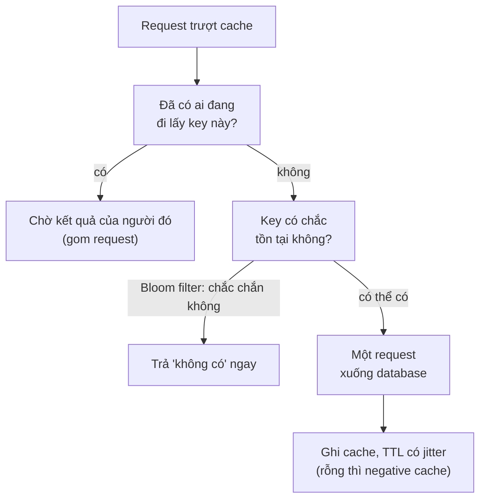

> [!tldr] Đọc nhanh
> - [[concepts/cache-stampede|Cache stampede]]: key hot vừa hết hạn, hàng trăm request cùng trượt và cùng đi hỏi database. Trong ví dụ: 500 request thành 500 query.
> - [[concepts/request-coalescing|Gom request]] (singleflight, khóa): chỉ một request đi lấy, những request khác chờ kết quả của nó. 500 query còn 1.
> - [[concepts/probabilistic-early-expiration|Làm mới sớm theo xác suất]] (XFetch): càng gần hạn, càng có khả năng một request tự làm mới trước. Với lưu lượng đều, số query giảm từ 127 xuống 50, thêm gom request thì còn 6.
> - [[concepts/ttl-jitter|TTL jitter]]: cộng trừ ngẫu nhiên vào TTL để hàng nghìn key nạp cùng lúc không hết hạn cùng lúc. Đỉnh tải giảm từ 2.000 xuống 526 query mỗi 100 ms.
> - [[concepts/cache-penetration|Cache penetration]]: hỏi thứ không tồn tại thì cache không bao giờ trúng. Chữa bằng negative cache, hoặc [[concepts/bloom-filter|Bloom filter]] (12 KB cho 10.000 id, sai 1%). [[concepts/hot-key|Hot key]] là một key nóng tới mức một node không chịu nổi.

> [!info] Bối cảnh
> Ga 5 của **tuyến Caching**. Ví dụ là **flash-sale**, trang bán hàng giảm giá giờ vàng: 21:00, hàng nghìn người cùng mở *một* trang sản phẩm và cùng gõ *một* từ khóa. Đây là lúc cache quan trọng nhất, và cũng là lúc những khe hở nhỏ của nó biến thành sự cố. Bạn không cần biết code dự án.

> [!abstract]- Từ điển nhanh cho bài này (bấm để mở)
> - **TTL, negative caching, lease**: xem [[posts/2026-11-22-caching-invalidation|ga 4]].
> - **Đồng thời (concurrent)**: nhiều request đang được xử lý cùng một lúc.
> - **Promise**: trong JavaScript, một "giấy hẹn" cho kết quả sẽ có sau. Nhiều chỗ có thể cùng chờ một promise.
> - **Hàm băm (hash)**: biến một chuỗi bất kỳ thành một con số trông như ngẫu nhiên, cùng đầu vào thì cùng đầu ra.
> - **Bit**: ô nhớ nhỏ nhất, chỉ chứa 0 hoặc 1. 8 bit là 1 byte.
> - **Dương tính giả (false positive)**: trả lời "có" trong khi thực ra là "không".
> - **Shard / node**: một máy (hoặc một tiến trình) giữ một phần dữ liệu của cụm. Ga 7 nói kỹ.

## Hình dung trước: giờ cao điểm ở thư viện

Mùa thi, cả trăm sinh viên cùng chạy tới quầy hỏi đúng một cuốn giáo trình, đúng lúc bản trên giá vừa bị trả về kho. Nếu thủ thư nào cũng tự chạy xuống kho, thang máy kẹt cứng.

| Đời thường | Khái niệm |
|---|---|
| Trăm người cùng hỏi một cuốn vừa bị trả kho, trăm thủ thư cùng chạy xuống | [[concepts/cache-stampede\|Cache stampede]] |
| Một thủ thư xuống kho, những người khác đứng chờ cuốn đó | [[concepts/request-coalescing\|Request coalescing]] |
| Sách sắp hết hạn: thỉnh thoảng một thủ thư tranh thủ đổi bản mới trước | [[concepts/probabilistic-early-expiration\|Làm mới sớm theo xác suất]] |
| Hẹn trả lệch nhau vài ngày, để cả lớp không trả cùng một buổi sáng | [[concepts/ttl-jitter\|TTL jitter]] |
| Người cứ hỏi những cuốn thư viện không hề có | [[concepts/cache-penetration\|Cache penetration]] |
| Danh mục bỏ túi: "chắc chắn không có" hoặc "có thể có" | [[concepts/bloom-filter\|Bloom filter]] |
| Một cuốn được hỏi nhiều tới mức một quầy không phục vụ xuể | [[concepts/hot-key\|Hot key]] |



## Vấn đề: cache thủng đúng lúc cần nó nhất

Mình từng nghĩ hit ratio 99% là cache đã làm xong việc. Nhưng 1% còn lại không rải đều theo thời gian. Nó dồn vào những khoảnh khắc cụ thể: đúng giây key hot hết hạn, đúng phút cả loạt key nạp lúc 21:00 cùng hết hạn lúc 21:01, đúng lúc một con bot quét `/products/1..1000000`. Những khoảnh khắc đó, database thấy cả nghìn query một lúc thay vì vài chục, và nếu nó chậm đi thì càng nhiều request trượt chồng lên nhau.

Ga này đi qua bốn kiểu thủng, mỗi kiểu một cách vá, đều được đo bằng cùng một ví dụ.

## Cơ chế

<figure class="figure-map" style="--ar: 1 / 1">
<div class="frame"><iframe data-archify="../diagrams/caching-under-load/stampede.html" title="Sơ đồ tuần tự: key hot hết hạn, ba request cùng trượt, chỉ một request được đi hỏi database" loading="lazy"></iframe></div>
<figcaption><span><b>Hình 1.</b> Gom request bằng khóa: request đầu tiên giành khóa và đi hỏi nguồn, các request khác chờ rồi đọc lại cache.</span><a href="../diagrams/caching-under-load/stampede.html" target="_blank" rel="noopener">Mở toàn màn hình</a></figcaption>
</figure>

### Cache stampede: một key, hàng trăm lần trượt

**[[concepts/cache-stampede|Cache stampede]]** (còn gọi là dogpile hay thundering herd): key hot hết hạn, và trong khoảng thời gian một request đi lấy dữ liệu mới (ví dụ 100 ms), *mọi* request tới key đó đều thấy cache trống và cũng đi lấy. Ở 5.000 request/giây, 100 ms là 500 query giống hệt nhau. Nếu database chậm đi vì tải, khoảng 100 ms đó dài ra, càng nhiều request trượt: một vòng xoáy.

### Gom request: chỉ một người đi lấy

**[[concepts/request-coalescing|Request coalescing]]** (gom request): khi đã có một request đang đi lấy key X, những request sau không đi nữa mà chờ chung kết quả. Có hai phạm vi:

**Trong một tiến trình (singleflight).** Giữ một bảng "key → promise đang chạy". Request tới sau lấy promise sẵn có thay vì tạo mới. Thư viện Go có sẵn `singleflight`; trong Node chỉ vài dòng:

```ts
const inflight = new Map<string, Promise<string | null>>();
async function singleflight(key: string) {
  const e = cache.get(key); if (fresh(e)) return e!.v;
  if (!inflight.has(key)) inflight.set(key, recompute(key, 1000).finally(() => inflight.delete(key)));
  return inflight.get(key)!;   // mọi người cùng chờ MỘT lần gọi DB
}
```

Chỉ gom được trong một tiến trình: 20 pod thì vẫn có tới 20 query.

**Giữa nhiều máy (khóa phân tán).** Request trượt thử giành một khóa trong Redis (`SET lock:<key> <token> NX EX 5`). Ai giành được thì đi lấy; ai không giành được thì chờ một chút rồi đọc lại cache. Cache tìm kiếm của flash-sale làm đúng như vậy, với vài chi tiết quan trọng:

```ts
// trích rút gọn từ cache tìm kiếm của flash-sale
const token = randomUUID();
const acquired = (await redis.set(`lock:${key}`, token, 'EX', 5, 'NX')) === 'OK';
if (!acquired) {
  for (let i = 0; i < 3; i++) {                    // chờ 250ms × 3, đủ cho phần lớn truy vấn
    await sleep(250);
    const polled = await redis.get(key); if (polled) return JSON.parse(polled);
  }
  // người giữ khóa chậm quá hoặc đã chết: tự đi lấy, không chờ mãi
}
try { /* fetch, SET key EX ttl */ }
finally {
  if (acquired) await redis.eval(RELEASE_IF_MINE, 1, `lock:${key}`, token);   // Lua: GET so token rồi DEL
}
```

- **Khóa có hạn** (`EX 5`): người giữ khóa chết thì khóa tự mất, không ai bị kẹt.
- **Token ngẫu nhiên và nhả khóa bằng Lua so token**: nếu người giữ khóa chậm quá 5 giây, khóa hết hạn và người khác giành được; lúc người cũ xong việc, nó không được xóa nhầm khóa của người mới.
- **Chờ có giới hạn**: sau 750 ms vẫn chưa có thì tự đi lấy. Thà tốn thêm vài query còn hơn treo request.

Ở tầng CDN, nginx làm cùng việc bằng `proxy_cache_lock` ([[posts/2026-11-22-caching-http|ga 2]]: 200 request thành 1). Lease của Facebook ([[posts/2026-11-22-caching-invalidation|ga 4]]) cũng vậy: memcache chỉ phát token cho một key mỗi 10 giây, người không có token chờ một chút rồi thử lại. Bài báo của họ ghi tải đỉnh của database giảm từ 17.000 xuống 1.300 query/giây nhờ cơ chế này.

### Làm mới sớm theo xác suất: không để key hết hạn

Gom request vẫn để *một* request phải chờ database mỗi lần hết hạn, và tất cả những request đến cùng lúc phải chờ theo. Cách tốt hơn là làm mới **trước** khi hết hạn. Nhưng nếu ai cũng làm mới khi còn 1 giây thì lại thành stampede sớm hơn 1 giây.

**[[concepts/probabilistic-early-expiration|XFetch]]** (Vattani, Chierichetti và Lowenstein, VLDB 2015) để mỗi request *tự tung đồng xu*. Mỗi mục lưu kèm `delta` (lần tính trước mất bao lâu) và `expiry`. Request tính lại nếu:

```text
now − delta × beta × ln(rand()) ≥ expiry
```

`rand()` nằm trong (0, 1) nên `ln(rand())` âm, vế trái lớn hơn `now` một khoảng ngẫu nhiên. Còn xa hạn thì gần như không ai trúng; càng gần hạn càng dễ trúng; việc tính lại càng lâu (`delta` lớn) thì bắt đầu sớm càng nhiều. `beta = 1` là mặc định được bài báo chứng minh là tối ưu; `beta > 1` làm mới sớm hơn. Không cần khóa, không cần phối hợp giữa các máy.

Trong ví dụ (500 request/giây, TTL 1 giây, database 100 ms): TTL thường cần 127 query và 127 request phải chờ; XFetch còn 50. Kết hợp XFetch với singleflight chạy ở nền (ai trúng xác suất thì khởi động *một* lần làm mới và vẫn trả giá trị đang có) chỉ còn 6 query.

### TTL jitter: tránh hết hạn hàng loạt

Đầu giờ flash sale, hệ thống nạp 2.000 sản phẩm vào cache cùng lúc với cùng TTL 60 giây. Đúng 60 giây sau, cả 2.000 key hết hạn trong cùng một khoảnh khắc. Hiện tượng này đôi khi được gọi là cache avalanche (tuyết lở). Nó cũng xảy ra sau khi khởi động lại hoặc làm nóng cache (ga 7).

**[[concepts/ttl-jitter|TTL jitter]]** cộng một phần ngẫu nhiên vào TTL, ví dụ 60 giây ± 20%. Các lần hết hạn trải ra trong 24 giây thay vì dồn vào một khoảnh khắc. Một dòng code:

```ts
const ttl = Math.round(60 * (0.8 + 0.4 * Math.random()));   // 48–72 giây
```

Trong ví dụ, đỉnh tải giảm từ 2.000 xuống 526 query mỗi 100 ms. Tổng số query không đổi, chỉ có hình dạng của nó thay đổi, và database thường chết vì đỉnh chứ không vì tổng.

### Cache penetration: hỏi thứ không tồn tại

**[[concepts/cache-penetration|Cache penetration]]** (thủng cache): request hỏi những key không có trong database. Cache-aside không lưu gì khi DB trả rỗng, nên request nào cũng trượt và đi thẳng xuống DB. Có thể do lỗi (link hỏng, id cũ) hoặc cố ý: bot quét `/products/1` tới `/products/1000000` để vượt qua cache và đánh thẳng vào DB.

Hai cách vá, thường dùng cùng nhau:

1. **Negative caching** ([[posts/2026-11-22-caching-invalidation|ga 4]]): lưu luôn "không có" với TTL ngắn. 1.000 request vào 200 id giả còn 200 query. Nhưng nếu kẻ tấn công dùng id *mới* mỗi lần thì negative cache không giúp được gì, mà còn bị lấp đầy bởi rác.
2. **[[concepts/bloom-filter|Bloom filter]]** đứng trước cache: một cấu trúc nhỏ biết "id này chắc chắn không tồn tại" hay "có thể tồn tại". Id chắc chắn không có thì trả 404 ngay, không ai phải hỏi.

### Bloom filter: biết chắc "không có" bằng vài KB

Bloom filter (Burton Bloom, 1970) là một mảng `m` bit, ban đầu toàn 0, và `k` hàm băm.

- **Thêm** id: băm id bằng `k` hàm, được `k` vị trí, bật cả `k` bit đó lên 1.
- **Hỏi** id: băm lại, nếu có *bất kỳ* bit nào là 0 thì id **chắc chắn chưa từng được thêm**. Nếu cả `k` bit đều là 1 thì id **có thể** đã được thêm (cũng có thể các bit đó do id khác bật lên).

Không bao giờ nói "không có" với thứ đang có (không có âm tính giả). Thỉnh thoảng nói "có thể có" với thứ không có (dương tính giả), và khi đó request chỉ đơn giản đi tiếp xuống cache và DB như bình thường. Tỉ lệ dương tính giả xấp xỉ `(1 − e^(−k·n/m))^k`; muốn 1% thì cần khoảng 9,6 bit mỗi phần tử và `k = 7`. 10.000 id chỉ tốn khoảng 12 KB, bất kể id dài bao nhiêu.

Hạn chế: không xóa được phần tử (tắt bit có thể làm hỏng phần tử khác; muốn xóa thì dùng biến thể như counting Bloom filter hoặc cuckoo filter), và phải thêm id mới vào filter ngay khi tạo. Redis 8 có sẵn Bloom filter (`BF.RESERVE`, `BF.ADD`, `BF.EXISTS`), dùng chung cho mọi pod.

### Hot key: một key, một node, quá tải

**[[concepts/hot-key|Hot key]]** khác stampede: key không hết hạn, cache vẫn trúng, nhưng **một key nhận quá nhiều request** đến mức node giữ nó quá tải. Khi Redis chạy thành cụm nhiều node (ga 7), mỗi key chỉ nằm ở một node; sản phẩm đang flash sale có thể nhận 100.000 lượt đọc mỗi giây trong khi các node khác ngồi chơi. Giá trị càng lớn thì càng nhanh nghẽn băng thông mạng của node đó.

Cách vá:

- **Cache tầng hai trong RAM của từng pod** cho đúng những key hot, TTL vài giây (ga 7). Đây là cách hiệu quả nhất: phần lớn lượt đọc không còn rời khỏi pod.
- **Nhân bản key**: ghi cùng giá trị vào `product:42#0` … `product:42#7`, đọc ngẫu nhiên một bản. Tám bản rơi vào các node khác nhau. Cái giá là xóa phải xóa cả tám.
- **Đọc từ replica**: trải lượt đọc ra các bản sao của node.

Tìm hot key: `redis-cli --hotkeys` (cần chính sách đẩy kiểu LFU, ga 6), thống kê của nhà cung cấp Redis, hoặc tự đếm ở phía ứng dụng.

## Ví dụ chạy được

[stampede-and-friends.ts](../code/caching-under-load/stampede-and-friends.ts) dùng một cache trong RAM (đủ để thấy cơ chế, không cần Redis) và một database giả mất 100 ms mỗi query, có đếm số query.

```bash
node stampede-and-friends.ts
```

```ts
// XFetch: tính lại sớm theo xác suất (Vattani và cộng sự, VLDB 2015)
async function xfetch(key: string, ttlMs: number, beta = 1) {
  const e = cache.get(key);
  if (!e || performance.now() - e.delta * beta * Math.log(rand()) >= e.expiry) return recompute(key, ttlMs);
  return e.v;
}

// Bloom filter: m bit, k vị trí lấy từ SHA-256
add(s: string) { for (const i of this.idx(s)) this.bits[i >> 3] |= 1 << (i & 7); }
has(s: string) { return this.idx(s).every((i) => this.bits[i >> 3] & (1 << (i & 7))); }
```

```text
$ node stampede-and-friends.ts
1) Stampede: 500 request cùng lúc vào key hot vừa hết hạn
   không làm gì  → 500 query xuống DB
   singleflight  →   1 query xuống DB
2) Lưu lượng đều ~500 request/giây trong 3,5 giây, TTL 1 giây, DB mất 100ms
   TTL thường                  → 127 query DB,  127/1468 request phải chờ DB
   XFetch beta=1               →  50 query DB,   50/1458 request phải chờ DB
   XFetch + singleflight ở nền →   6 query DB,   20/1455 request phải chờ DB
3) Avalanche: 2000 key nạp cùng lúc, TTL 1 giây; số query DB trong từng khoảng 100ms
   TTL cố định   → đỉnh 2000 query/100ms  [0 0 0 0 0 0 0 0 0 0 2000 0 0 0 0]
   TTL ± 20%     → đỉnh  526 query/100ms  [0 0 0 0 0 0 0 0 1 509 526 519 445 0 0]
4) Penetration: 1000 request vào 200 id không tồn tại (ghost-*)
   không làm gì         → 1000 query DB
   cache cả "không có"  →  200 query DB
   Bloom filter         →    0 query DB
   Bloom filter 12 KB cho 10.000 id thật: dương tính giả đo được 1.00% trên 100.000 id lạ
```

Đọc kết quả (phần 2 có yếu tố thời gian thật nên số có thể lệch vài đơn vị giữa các lần chạy):

- **Phần 1**: singleflight biến 500 query thành 1.
- **Phần 2**: với TTL thường, mỗi lần hết hạn có cả loạt request trượt cùng lúc. XFetch làm mới sớm nên ít lần trượt hơn hẳn. Cộng thêm singleflight ở nền, chỉ còn 6 lần làm mới trong 3,5 giây; 20 request phải chờ là những request đầu tiên lúc cache còn trống.
- **Phần 3**: cùng tổng 2.000 query, TTL cố định dồn cả vào một khoảng 100 ms; jitter trải ra năm khoảng.
- **Phần 4**: negative cache chặn được các lần hỏi lặp lại; Bloom filter chặn ngay từ lần đầu. Tỉ lệ dương tính giả đo được (1,00%) khớp đúng con số thiết kế.

## Hiểu lầm và bẫy hay gặp

- **"Khóa chống stampede thì không cần hạn."** Người giữ khóa chết là mọi người chờ mãi. Khóa phải có TTL, nhả khóa phải so token, và người chờ phải có giới hạn thời gian chờ.
- **"Singleflight trong code là đủ."** Nó chỉ gom trong một tiến trình. Với 50 pod, một lần hết hạn vẫn có thể thành 50 query. Cần khóa phân tán hoặc làm mới sớm.
- **"Làm mới khi còn 10% TTL là xong."** Mọi request tới trong khoảng 10% đó đều làm mới: stampede chỉ dời sớm hơn. Phải có ngẫu nhiên (XFetch) hoặc gom request.
- **"Jitter làm giảm tải DB."** Không, tổng số query như cũ. Jitter chỉ san phẳng đỉnh.
- **"Bloom filter có thể trả lời 'có tồn tại'."** Nó chỉ chắc chắn ở câu trả lời "không". "Có thể có" vẫn phải đi tiếp để kiểm tra.
- **"Negative cache đủ chống quét id."** Kẻ tấn công dùng id mới mỗi lần thì negative cache không bao giờ trúng và còn bị lấp đầy rác. Cần Bloom filter hoặc rate limit.
- **"Hot key thì thêm node Redis."** Một key chỉ nằm ở một node; thêm node không chia nó ra. Phải cache ở tầng ứng dụng hoặc nhân bản key.

## Câu hỏi tự kiểm tra

> [!question]- 5.000 request/giây vào một key, việc tính lại mất 100 ms. Khi key hết hạn, không có biện pháp nào, có khoảng bao nhiêu query trùng?
> Khoảng 5.000 × 0,1 = 500, vì mọi request đến trong 100 ms đó đều thấy cache trống. Nếu DB chậm đi do tải thì cửa sổ dài ra và con số còn tăng.

> [!question]- Vì sao khóa chống stampede của flash-sale dùng token ngẫu nhiên và Lua để nhả khóa?
> Nếu người giữ khóa chậm hơn TTL của khóa, khóa hết hạn và người khác giành được. Khi người cũ xong việc, một lệnh DEL thường sẽ xóa nhầm khóa của người mới. So token trong Lua đảm bảo chỉ người đang giữ đúng khóa mới xóa được, và kiểm tra + xóa là nguyên tử.

> [!question]- Trong XFetch, vì sao việc tính lại mất càng lâu thì càng làm mới sớm?
> Điều kiện là `now − delta × beta × ln(rand()) ≥ expiry`. `delta` là thời gian tính lại; `delta` lớn thì khoảng ngẫu nhiên cộng vào `now` lớn, nên vượt `expiry` sớm hơn. Hợp lý vì việc chậm cần được bắt đầu sớm hơn để xong trước khi hết hạn.

> [!question]- Bloom filter trả "có thể có" cho một id không tồn tại. Chuyện gì xảy ra, và có hại không?
> Request đi tiếp xuống cache rồi DB như không có filter, DB trả rỗng. Chỉ tốn một query; với tỉ lệ 1% thì filter vẫn chặn 99% request rác. Không bao giờ có chuyện chặn nhầm id có thật.

> [!question]- Hot key khác cache stampede ở đâu?
> Stampede là nhiều lần trượt cùng lúc khi key hết hạn, tải dồn về database. Hot key là key vẫn trúng nhưng nhận quá nhiều lượt đọc, tải dồn vào một node cache. Cách vá khác nhau: gom request và làm mới sớm cho stampede; cache cục bộ hoặc nhân bản key cho hot key.

## Tham khảo

- Vattani, Chierichetti, Lowenstein, [Optimal Probabilistic Cache Stampede Prevention](https://www.vldb.org/pvldb/vol8/p886-vattani.pdf), PVLDB 8(8), 2015
- Nishtala và cộng sự, [Scaling Memcache at Facebook](https://www.usenix.org/conference/nsdi13/technical-sessions/presentation/nishtala), NSDI 2013 (lease chống thundering herd)
- [Go: golang.org/x/sync/singleflight](https://pkg.go.dev/golang.org/x/sync/singleflight)
- [nginx: proxy_cache_lock](https://nginx.org/en/docs/http/ngx_http_proxy_module.html#proxy_cache_lock)
- [Redis: Bloom filter](https://redis.io/docs/latest/develop/data-types/probabilistic/bloom-filter/)
- Burton H. Bloom, [Space/Time Trade-offs in Hash Coding with Allowable Errors](https://dl.acm.org/doi/10.1145/362686.362692), Communications of the ACM, 1970
