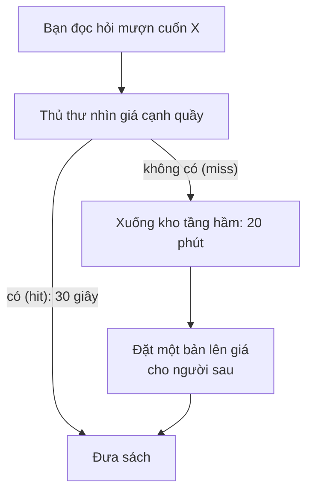

> [!tldr] Đọc nhanh
> - [[concepts/caching|Cache]] là một bản sao nhỏ, nhanh của dữ liệu nằm ở chỗ chậm hơn. Đọc trúng bản sao gọi là [[concepts/cache-hit-va-miss|hit]], không có gọi là miss.
> - [[concepts/hit-ratio|Hit ratio]] (tỉ lệ trúng) quyết định cache có đáng không. Trong ví dụ, cache giữ 1% sản phẩm mà trúng 39% lượt xem; giữ 10% thì trúng 68%.
> - Cache nhỏ trúng nhiều được là nhờ [[concepts/locality|locality]]: người dùng đọc lặp lại một nhóm nhỏ dữ liệu ([[concepts/working-set|working set]]). Truy cập đều thì cache 10% chỉ trúng đúng 10%.
> - [[concepts/cache-key|Cache key]] quyết định hai request có dùng chung một bản sao không. Thiếu thông tin trong key là trả nhầm dữ liệu; thừa thì không bao giờ trúng.
> - Cái giá: bản sao có thể [[concepts/staleness|cũ]] so với bản gốc. Mọi quyết định về cache bắt đầu từ câu hỏi "cũ bao lâu thì chấp nhận được".

> [!info] Bối cảnh
> Ga 1 của **tuyến Caching**. Ví dụ là **flash-sale**, trang bán hàng giảm giá giờ vàng mình tự viết: đúng 21:00, hàng nghìn người cùng mở trang sản phẩm, tìm kiếm và bấm mua vài trăm suất hàng. Cùng một trang sản phẩm bị mở hàng chục nghìn lần trong vài phút, nên không thể lần nào cũng hỏi database. Bạn không cần biết code dự án hay framework nào.

> [!abstract]- Từ điển nhanh cho bài này (bấm để mở)
> - **Database (DB)**: nơi lưu dữ liệu gốc, bền vững (PostgreSQL, MySQL). Đọc từ DB thường mất vài mili giây tới vài chục mili giây.
> - **RAM**: bộ nhớ trong của máy. Đọc từ RAM nhanh hơn đọc đĩa hay gọi qua mạng hàng nghìn lần, nhưng ít và mất khi tắt máy.
> - **Redis**: một chương trình lưu dữ liệu dạng key → value trong RAM, chạy riêng, nhiều server dùng chung qua mạng. Đọc một key thường dưới 1 ms.
> - **Request**: một lần client hỏi server (ví dụ mở trang sản phẩm 42).
> - **ms (mili giây)**: một phần nghìn giây.
> - **Phân phối Zipf**: kiểu phân phối "vài thứ cực phổ biến, đa số hiếm khi đụng tới". Món phổ biến thứ k được xem nhiều cỡ 1/k lần món số 1.
> - **LRU**: luật "giá đầy thì bỏ món lâu nhất chưa ai đụng". Ga 6 nói kỹ.

## Hình dung trước: giá sách ở phòng đọc

Một thư viện có kho sách ở tầng hầm với một triệu cuốn. Mỗi lần có người mượn, thủ thư phải đi thang máy xuống kho, tìm, mang lên: mất 20 phút. Thủ thư thông minh để một giá sách nhỏ cạnh quầy, chỉ vài trăm cuốn đang được mượn nhiều nhất. Phần lớn người tới mượn đúng mấy cuốn đó, nên phần lớn lượt mượn xong trong 30 giây.

| Đời thường | Khái niệm |
|---|---|
| Kho sách ở tầng hầm: đủ mọi cuốn, đi lấy mất lâu | Database, nguồn dữ liệu gốc |
| Giá sách cạnh quầy: vài trăm cuốn, lấy ngay | [[concepts/caching\|Cache]] |
| Cuốn sách cần mượn có sẵn trên giá / phải xuống kho | [[concepts/cache-hit-va-miss\|Cache hit / miss]] |
| Bao nhiêu phần trăm lượt mượn được phục vụ từ giá | [[concepts/hit-ratio\|Hit ratio]] |
| Mùa thi, ai cũng mượn mấy cuốn giáo trình giống nhau | [[concepts/locality\|Locality]] |
| Nhóm sách đang "nóng" trong tuần này | [[concepts/working-set\|Working set]] |
| Mã số trên gáy sách để tìm đúng cuốn trên giá | [[concepts/cache-key\|Cache key]] |
| Giá giữ bản in năm ngoái, kho đã có bản sửa | [[concepts/staleness\|Staleness (dữ liệu cũ)]] |



Toàn bộ caching xoay quanh ba câu hỏi của người thủ thư: giá nên to bao nhiêu, cuốn nào được nằm trên giá, và làm gì khi kho có bản in mới mà giá vẫn giữ bản cũ.

## Vấn đề: database không chịu nổi những lượt đọc lặp lại

Mình từng nghĩ "chậm thì nâng cấp database". Rồi mình đếm request của flash-sale lúc 21:00: phần lớn là đọc, và phần lớn lượt đọc rơi vào vài chục sản phẩm đang giảm giá. Database phải trả lời hàng nghìn lần cùng một câu hỏi "sản phẩm 42 giá bao nhiêu", với cùng một đáp án.

Câu hỏi đó lặp lại vì ba lý do mà cache khai thác được:

1. **Đọc nhiều hơn ghi rất nhiều.** Giá sản phẩm đổi vài lần một ngày, nhưng được đọc hàng trăm nghìn lần.
2. **Kết quả giống nhau cho nhiều người.** Trang sản phẩm 42 với người này cũng như người kia.
3. **Lượt đọc dồn vào một nhóm nhỏ.** Sản phẩm đang flash sale, từ khóa đang hot.

Nếu thiếu cả ba (dữ liệu đổi liên tục, mỗi người một kết quả, đọc đều mọi thứ), cache gần như vô dụng. Phần còn lại của bài đo điều đó bằng số.

## Cơ chế

### Hit, miss và cái giá của một lần trượt

Một lần đọc qua cache có hai kết cục:

- **[[concepts/cache-hit-va-miss|Hit]]**: dữ liệu đã có trong cache, trả về ngay. Ví dụ dưới coi một lần đọc cache tốn 0,5 ms.
- **Miss**: không có. Phải đọc nguồn (DB, 20 ms), *cộng thêm* thời gian đã hỏi cache, rồi thường ghi kết quả vào cache cho lần sau.

Miss đắt hơn không có cache một chút, vì phải hỏi cache trước. Nên thời gian trung bình mỗi request là:

```text
thời gian TB = hit_ratio × t_cache + (1 − hit_ratio) × (t_cache + t_DB)
```

Với cache 0,5 ms và DB 20 ms: hit ratio 0% cho 20,5 ms (tệ hơn không có cache), 50% cho 10,5 ms, 90% cho 2,5 ms. Mỗi điểm phần trăm hit ratio ở vùng cao đáng giá hơn ở vùng thấp, vì nó cắt bớt đúng phần đắt nhất: những lần phải xuống DB.

### Hit ratio: con số quyết định cache có đáng không

[[concepts/hit-ratio|Hit ratio]] là số lần trúng chia tổng số lần đọc. Nó không chỉ đo tốc độ, mà còn đo **tải mà nguồn phải chịu**: hit ratio 95% nghĩa là DB chỉ thấy 5% lượt đọc. Lên 99% thì DB chỉ thấy 1%, tức tải DB giảm thêm *năm lần* dù con số chỉ nhích 4 điểm.

Hai thứ quyết định hit ratio:

1. **Cache to bao nhiêu so với lượng dữ liệu đang được đọc.**
2. **Người dùng đọc dồn hay đọc đều.** Đây là chỗ mình từng hiểu sai, và là lý do của cả mục tiếp theo.

### Locality và working set: vì sao cache nhỏ mà vẫn trúng nhiều

**[[concepts/locality|Locality]]** (tính cục bộ) là quan sát rằng truy cập không rải đều:

- **Temporal locality** (cục bộ thời gian): thứ vừa được đọc sẽ sớm được đọc lại. Ai vừa mở sản phẩm 42 thì vài giây sau người khác cũng mở.
- **Spatial locality** (cục bộ không gian): thứ nằm cạnh thứ vừa đọc cũng sắp được đọc. CPU đọc cả một dải bộ nhớ một lúc vì lý do này; ở tầng ứng dụng, mở trang 1 của danh sách thì hay mở tiếp trang 2.

**[[concepts/working-set|Working set]]** là nhóm dữ liệu đang được đọc trong một khoảng thời gian. Cache chỉ cần chứa vừa working set, không cần chứa cả database. Trong giờ flash sale, working set là vài chục sản phẩm đang giảm giá chứ không phải mười nghìn sản phẩm của cả shop.

Đo bằng ví dụ ở cuối bài (10.000 sản phẩm, 200.000 lượt xem, cache [[concepts/lru-va-lfu|LRU]]):

| Cache giữ | % catalog | Lượt xem kiểu Zipf: trúng | TB/request | Lượt xem đều: trúng | TB/request |
|---|---|---|---|---|---|
| 10 món | 0,1% | 13,2% | 17,9 ms | 0,1% | 20,5 ms |
| 100 món | 1% | **39,0%** | 12,7 ms | 0,9% | 20,3 ms |
| 1.000 món | 10% | **67,6%** | 7,0 ms | 10,0% | 18,5 ms |
| 5.000 món | 50% | 88,8% | 2,7 ms | 49,3% | 10,6 ms |

Cùng một cache 1.000 món: với người dùng thật (đọc dồn vào món hot) trúng 68%, với truy cập đều chỉ trúng đúng 10%, bằng tỉ lệ dung lượng. Không có locality thì cache chỉ là một bản sao đắt tiền.

> [!tip] Đường cong đi xuống
> Từ 100 lên 1.000 món (gấp 10 lần RAM), hit ratio chỉ tăng từ 39% lên 68%. Từ 1.000 lên 5.000 món (gấp 5 lần), thêm 21 điểm. Thêm RAM cho cache luôn có lợi ích giảm dần; điểm dừng hợp lý là khi thời gian trung bình hoặc tải DB đã đủ thấp, không phải khi hit ratio chạm 100%.

### Cache key: hai request có dùng chung một bản sao không

Mỗi mục trong cache được tìm bằng một **[[concepts/cache-key|cache key]]**, giống mã số trên gáy sách. Key phải chứa **mọi thứ làm kết quả khác đi**, và **chỉ những thứ đó**:

- **Thiếu** → trả nhầm. Cache kết quả tìm kiếm theo key `search:tai nghe` nhưng quên trang và cách sắp xếp, thì người xem trang 2 nhận trang 1. Tệ hơn: quên user id trên dữ liệu riêng, người này thấy giỏ hàng của người kia. Ga 8 có một lỗ hổng bảo mật thật sinh ra từ đúng lỗi này.
- **Thừa** → không bao giờ trúng. Đưa cả timestamp hoặc request id vào key thì mỗi request một key riêng, hit ratio về 0.
- **Cùng nghĩa, khác chữ** → trượt oan. `?q=tai+nghe&sort=price` và `?sort=price&q=tai+nghe` là một câu hỏi. flash-sale sắp xếp tham số theo tên rồi băm SHA-256 trước khi làm key, nên hai URL trên dùng chung một mục:

```ts
// trích rút gọn từ cache tìm kiếm của flash-sale
hashKey(parts: Record<string, unknown>): string {
  const sorted = Object.keys(parts).sort()                    // thứ tự tham số không còn quan trọng
    .map((k) => `${k}=${JSON.stringify(parts[k] ?? '')}`).join('&');
  return createHash('sha256').update(sorted).digest('hex').slice(0, 32);
}
```

Quy ước đặt tên giúp vận hành: `<loại>:<id>[:<phần>]`, ví dụ `stats:seller:17`, `product:42:price`. Nhìn key là biết của tính năng nào, và về sau có thể đếm hoặc dọn theo tiền tố (ga 6 nói cách dọn an toàn).

### Staleness: cái giá của mọi cache

Bản sao trong cache được chụp ở một thời điểm. Sau đó nguồn đổi, bản sao không tự biết. Khoảng cách giữa hai bản là **[[concepts/staleness|staleness]]** (độ cũ). Cache luôn đổi **độ tươi lấy tốc độ**; câu hỏi không phải "có cũ không" mà là "cũ tối đa bao lâu, với dữ liệu nào, thì chấp nhận được".

| Dữ liệu trong flash-sale | Cũ bao lâu thì chấp nhận được | Hệ quả khi cũ |
|---|---|---|
| Mô tả, ảnh sản phẩm | Vài phút tới vài giờ | Không ai để ý |
| Kết quả tìm kiếm | Cỡ một phút | Sản phẩm mới chưa hiện ngay |
| Thống kê đơn của người bán | Cỡ một phút | Số trên dashboard lệch một chút |
| Quyền của một role | Vài giây tới một giờ, *có xóa chủ động* | Người vừa bị thu quyền vẫn làm được việc |
| Số hàng còn lại khi bấm mua | **Không được cũ** | Bán quá số hàng đang có |

Hàng cuối là lý do flash-sale không bao giờ quyết định "còn hàng hay không" bằng số đọc từ cache. Con số hiển thị trên trang có thể cũ vài giây; còn lúc trừ kho thì đi thẳng vào nguồn sự thật bằng một thao tác nguyên tử. Ga 4 nói về cách làm cho cache bớt cũ, và vì sao điều đó khó hơn tưởng.

> [!warning] Không phải thứ gì cũng nên cache
> Dữ liệu ghi nhiều hơn đọc, mỗi người một khác và hiếm khi đọc lại, hoặc đòi hỏi đúng tuyệt đối (số dư, tồn kho lúc thanh toán) thì cache tốn công mà rủi ro. Phil Karlton có câu nổi tiếng: "There are only two hard things in Computer Science: cache invalidation and naming things." Thêm cache là thêm một nơi dữ liệu có thể sai.

## Ví dụ chạy được

[hit-ratio.ts](../code/caching-why/hit-ratio.ts) mô phỏng 10.000 sản phẩm và 200.000 lượt xem, so hai kiểu truy cập (Zipf và đều) với cache LRU ở năm kích cỡ. Không cần Redis; bộ sinh số có hạt giống nên chạy lại ra đúng số cũ.

```bash
node hit-ratio.ts
```

```ts
// Zipf(s=1): sản phẩm thứ k được xem với xác suất tỉ lệ 1/k
const weights = Array.from({ length: ITEMS }, (_, k) => 1 / (k + 1));

// LRU tối giản: Map giữ thứ tự chèn, đọc thì đưa lên cuối, đầy thì bỏ phần tử đầu
function simulate(size: number, next: () => number) {
  const lru = new Map<number, true>();
  let hits = 0;
  for (let i = 0; i < REQUESTS; i++) {
    const id = next();
    if (lru.has(id)) { hits++; lru.delete(id); lru.set(id, true); continue; }
    lru.set(id, true);
    if (lru.size > size) lru.delete(lru.keys().next().value!);
  }
  const ratio = hits / REQUESTS;
  return { ratio, avgMs: ratio * CACHE_MS + (1 - ratio) * (CACHE_MS + DB_MS) };
}
```

```text
$ node hit-ratio.ts
cache giữ    | % catalog | Zipf: trúng  TB/request | Đều: trúng  TB/request
   10 món   |    0.1%   |    13.2%    17.9ms   |    0.1%    20.5ms
  100 món   |      1%   |    39.0%    12.7ms   |    0.9%    20.3ms
  500 món   |      5%   |    58.7%     8.8ms   |    5.0%    19.5ms
 1000 món   |     10%   |    67.6%     7.0ms   |   10.0%    18.5ms
 5000 món   |     50%   |    88.8%     2.7ms   |   49.3%    10.6ms
```

Đọc kết quả:

- Cột "Đều": hit ratio luôn xấp xỉ % catalog. Cache chỉ trúng nhờ may.
- Cột "Zipf": 1% catalog đã đỡ 39% lượt xem. Đây là lý do một instance Redis vài GB đứng trước database hàng trăm GB vẫn hiệu quả.
- Hàng 10 món với truy cập đều: 20,5 ms, *chậm hơn* không có cache (20 ms). Cache trượt gần hết là cache lỗ.

Thử đổi `s` của Zipf (ví dụ `1 / (k + 1) ** 0.6` cho truy cập ít dồn hơn) để thấy hit ratio tụt nhanh thế nào.

## Hiểu lầm và bẫy hay gặp

- **"Hit ratio 80% là tốt."** Còn tùy. 80% nghĩa là DB vẫn thấy 20% lượt đọc; nếu đỉnh tải là 50.000 request/giây thì đó là 10.000 query/giây xuống DB. Hãy đo hit ratio theo từng loại dữ liệu và quy ra tải DB (ga 8).
- **"Cache càng to càng tốt."** Lợi ích giảm dần, còn chi phí RAM và thời gian khởi động lại thì không. Cache to cũng giữ dữ liệu cũ lâu hơn nếu dựa vào việc bị đẩy ra để làm mới.
- **"Có cache thì database nhỏ cũng được."** Khi cache sập hoặc vừa khởi động, toàn bộ tải dồn về DB (ga 5 và ga 8). DB phải chịu được, hoặc phải có cách giới hạn tải.
- **"Key là URL là đủ."** Nếu kết quả phụ thuộc người dùng, ngôn ngữ hoặc header nào đó mà key không chứa, cache trả nhầm cho người khác (ga 2 với `Vary`, ga 8 với cache poisoning).
- **"Cache sẽ đúng vì có TTL."** TTL chỉ giới hạn *thời gian tối đa* dữ liệu sai. Trong khoảng đó, cache vẫn sai (ga 4).

## Câu hỏi tự kiểm tra

> [!question]- Cache 0,5 ms, DB 20 ms. Hit ratio bao nhiêu thì cache bắt đầu có lợi về thời gian trung bình?
> Không có cache: 20 ms. Có cache: `h × 0,5 + (1 − h) × 20,5 = 20,5 − 20h`. Có lợi khi `20,5 − 20h < 20`, tức h > 2,5%. Dưới mức đó cache chỉ thêm một bước hỏi vô ích.

> [!question]- Vì sao cùng cache 1.000 món mà truy cập kiểu Zipf trúng 68%, truy cập đều chỉ 10%?
> Vì locality. Với Zipf, vài trăm món hot chiếm phần lớn lượt xem; cache LRU giữ được đúng nhóm đó (working set). Truy cập đều thì món nào cũng ngang nhau, cache trúng đúng bằng tỉ lệ dung lượng.

> [!question]- Cache kết quả tìm kiếm theo key `search:<từ khóa>`. Sai ở đâu?
> Thiếu những tham số khác làm kết quả đổi: trang, số mục mỗi trang, cách sắp xếp, bộ lọc. Người xem trang 2 sẽ nhận trang 1. Key phải chứa mọi tham số có ảnh hưởng, và nên chuẩn hóa thứ tự để cùng nghĩa thì cùng key.

> [!question]- Hit ratio tăng từ 95% lên 99%. Tải database giảm bao nhiêu lần?
> Từ 5% xuống 1% lượt đọc, tức giảm 5 lần. Ở vùng cao, vài điểm phần trăm hit ratio là chênh lệch rất lớn về tải nguồn.

> [!question]- Kể ba loại dữ liệu không nên cache và lý do.
> Ví dụ: tồn kho lúc thanh toán (cần đúng tuyệt đối), dữ liệu ghi nhiều hơn đọc (cache bị xóa trước khi kịp trúng), dữ liệu riêng từng người hiếm khi đọc lại (không có locality, hit ratio thấp, lại có rủi ro lộ cho người khác nếu key sai).

## Tham khảo

- [RFC 9111: HTTP Caching](https://www.rfc-editor.org/rfc/rfc9111) (định nghĩa cache, fresh và stale)
- [Redis: Key eviction](https://redis.io/docs/latest/develop/reference/eviction/) (LRU xấp xỉ, kích thước cache)
- [AWS whitepaper: Database Caching Strategies Using Redis](https://docs.aws.amazon.com/whitepapers/latest/database-caching-strategies-using-redis/caching-patterns.html)
- Nishtala và cộng sự, [Scaling Memcache at Facebook](https://www.usenix.org/conference/nsdi13/technical-sessions/presentation/nishtala), NSDI 2013 (cache đứng trước MySQL ở quy mô lớn)
- Peter J. Denning, *The Working Set Model for Program Behavior*, Communications of the ACM, 1968
- Ga trước liên quan: [[posts/2026-11-18-api-performance|Hiệu năng API]] (tuyến API)
