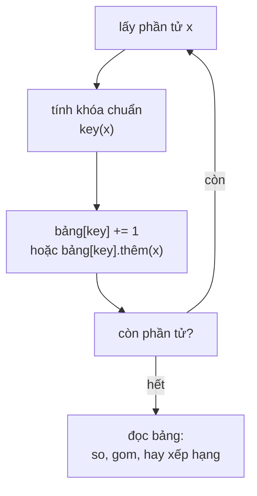

> [!tldr] Đọc nhanh
> - Pattern: chọn một **khóa chuẩn** sao cho hai thứ "giống nhau theo nghĩa của đề" luôn ra cùng một khóa, rồi **đếm** hoặc **gom** theo khóa đó trong một bảng băm. Mỗi phần tử chỉ được nhìn một lần, không so từng cặp.
> - Valid Anagram: khóa là chữ cái, đếm bằng mảng 26 ô. Group Anagrams: chính bảng đếm 26 ô của mỗi từ là khóa để gom. Top K Frequent Elements: đếm xong, dùng **số lần** làm chỉ số mảng (bucket sort). Valid Sudoku: khóa là (hàng, số), (cột, số), (ô 3×3, số).
> - Khóa phải **so sánh được theo giá trị**. Mảng trong JavaScript và `int[]` trong Java so theo tham chiếu, nên phải đổi thành chuỗi có dấu phân cách, tuple (Python), mảng cố định (Go) hay record (Java).
> - Bẫy: ghép bảng đếm thành chuỗi **không** có dấu phân cách. `[1, 11]` và `[11, 1]` đều thành `"111"`: hai từ khác nhau rơi vào cùng một nhóm.

> [!info] Bối cảnh
> Ga 2 của **tuyến NeetCode: Mảng và chuỗi**. Ga 1, [[posts/2026-11-22-neetcode-hash-lookup|tra cứu bằng hash]], hỏi bảng "đã gặp x chưa?"; ga này hỏi "gặp **bao nhiêu lần**?" và "x **thuộc nhóm nào**?". Mỗi bài có một trang riêng giải kỹ bằng năm ngôn ngữ. Bạn chỉ cần biết vòng lặp, mảng và hàm.

> [!abstract]- Từ điển nhanh cho bài này (bấm để mở)
> - **Khóa chuẩn (canonical key)**: một dạng đại diện chung cho cả một nhóm thứ được coi là giống nhau. Xem [[concepts/canonical-key|Canonical Key]].
> - **Đếm tần suất**: bảng từ khóa → số lần xuất hiện. Xem [[concepts/frequency-counting|Frequency Counting]] và [[concepts/counting-array|Counting Array]].
> - **Gom nhóm (group by)**: bảng từ khóa → danh sách phần tử có khóa đó. Xem [[concepts/group-by|Group By]].
> - **Bucket sort**: xếp bằng cách bỏ mỗi phần tử vào "xô" đánh số theo giá trị của nó, không cần so sánh. Xem [[concepts/bucket-sort|Bucket Sort]].
> - **Anagram**: hai từ dùng cùng các chữ cái với cùng số lần, chỉ khác thứ tự (`listen`, `silent`).

## Hình dung trước: phòng phân loại thư

Một bưu cục nhận hàng nghìn lá thư mỗi sáng. Không ai so từng lá với từng lá để xem có cùng nơi đến không. Nhân viên đọc **mã bưu chính** trên mỗi lá rồi bỏ vào ngăn có mã đó. Hai địa chỉ viết khác nhau ("Q.1", "Quận 1") vẫn cùng một mã, nên vẫn vào cùng một ngăn.

| Đời thường | Khái niệm |
|---|---|
| Mã bưu chính: viết kiểu gì thì cùng nơi vẫn ra cùng mã | Khóa chuẩn |
| Dãy ngăn thư đánh số theo mã | Bảng băm từ khóa → nhóm |
| Đếm số thư trong mỗi ngăn | Đếm tần suất |
| Hai lá thư có đúng các chữ trên phong bì, chỉ khác thứ tự | Anagram: cùng bảng đếm chữ |
| Xếp ngăn theo số thư, ngăn nhiều thư nhất lên trước | Top K: bucket theo số lần |
| Mỗi lá thư được đóng ba con dấu: tuyến phố, quận, khu | Valid Sudoku: một ô có ba khóa (hàng, cột, ô 3×3) |



## Vấn đề: so từng cặp tốn O(n²)

Group Anagrams cho n từ và hỏi gom các từ là anagram của nhau. Cách ngây thơ: so mỗi cặp từ bằng hàm kiểm tra anagram. Có khoảng n²/2 cặp, mỗi cặp tốn O(k) với k là độ dài từ, nên tổng O(n²·k). Với n = 10⁴ và k = 100, đó là khoảng 5·10⁹ bước.

Thay vào đó: tính cho mỗi từ một khóa sao cho **anagram ⇔ cùng khóa**. Khi đó gom nhóm chỉ còn là "bỏ vào ngăn theo khóa", mỗi từ một lần, tổng O(n·k).

## Cơ chế

### Hai cách chọn khóa cho anagram

<figure class="figure-map" style="--ar: 3 / 4">
<div class="frame"><iframe data-archify="../diagrams/neetcode-group-anagrams/canonical-key.html" title="Gom eat, tea, tan, ate, nat, bat theo khóa sắp xếp" loading="lazy"></iframe></div>
<figcaption><span><b>Hình 1.</b> Group Anagrams: mỗi từ ra một khóa chuẩn, từ cùng khóa vào cùng nhóm.</span><a href="../diagrams/neetcode-group-anagrams/canonical-key.html" target="_blank" rel="noopener">Mở toàn màn hình</a></figcaption>
</figure>

- **Khóa sắp xếp**: `"eat"`, `"tea"`, `"ate"` đều thành `"aet"`. Dễ viết, tốn O(k log k) mỗi từ.
- **Khóa đếm** ([[concepts/count-key|Count Key]]): bảng 26 số đếm từng chữ. Tốn O(k) mỗi từ, nhưng bảng là một mảng, và mảng không phải lúc nào cũng làm khóa được (dưới đây).

Trang [[problems/group-anagrams|Group Anagrams]] đo hai cách: khóa đếm thắng khi từ dài, nhưng thua khi từ chỉ vài chữ.

### Khóa phải so sánh được theo giá trị

Bảng băm tìm khóa bằng hash rồi so bằng phép "bằng nhau" của ngôn ngữ. Nếu phép đó so **địa chỉ** chứ không so **nội dung**, hai bảng đếm giống hệt nhau vẫn là hai khóa khác nhau ([[concepts/key-serialization|Key Serialization]]):

| Ngôn ngữ | Bảng đếm dạng | Làm khóa được trực tiếp? | Cách làm |
|---|---|---|---|
| TypeScript, JavaScript | mảng `number[]` | không, `Map` so mảng theo tham chiếu | `count.join(",")` |
| Python | `list` | không, list không hash được | `tuple(count)` |
| Go | mảng cố định `[26]int` | **có**, mảng cố định so được bằng `==` | dùng thẳng; slice `[]int` thì không được |
| Java | `int[]` | không, `equals`/`hashCode` theo địa chỉ | `Arrays.toString(count)`, hoặc một `record` |

### Đếm xong rồi làm gì

| Bài | Khóa | Sau khi đếm hoặc gom |
|---|---|---|
| [[problems/valid-anagram\|Valid Anagram]] | chữ cái (mảng 26 ô) | cộng cho `s`, trừ cho `t`; anagram khi mọi ô về 0 |
| [[problems/group-anagrams\|Group Anagrams]] | bảng đếm 26 ô của cả từ | trả các nhóm |
| [[problems/top-k-frequent-elements\|Top K Frequent Elements]] | giá trị | đổi chiều: **số lần** thành chỉ số của mảng xô, đọc từ xô cao nhất xuống |
| Valid Sudoku | (hàng, số), (cột, số), (ô 3×3, số) | dùng khuôn của ga 1: gặp khóa lần thứ hai là sai |

Ở Top K Frequent Elements, số lần xuất hiện nằm trong `1..n`, nên một mảng n + 1 xô xếp được mọi giá trị theo số lần trong O(n), không cần sắp xếp O(n log n). Đây là chỗ đếm biến thành [[concepts/bucket-sort|bucket sort]].

Ở Valid Sudoku, khóa của ô 3×3 là chỉ số chuẩn `⌊r/3⌋·3 + ⌊c/3⌋`: chín ô trong cùng một khối 3×3 đều ra cùng một số từ 0 tới 8.

## Ví dụ chạy được

[TypeScript](../code/neetcode-counting-keys/counting-keys.ts) · [Python](../code/neetcode-counting-keys/counting_keys.py) · [Go](../code/neetcode-counting-keys/counting_keys.go) · [Java](../code/neetcode-counting-keys/counting-keys.java) · [JavaScript](../code/neetcode-counting-keys/counting-keys.js)

Mỗi file giải cả bốn bài và tự chạy 9 ca kiểm tra. Dưới đây là phần Group Anagrams và Valid Sudoku, hai bài cho thấy rõ nhất chuyện chọn khóa trong từng ngôn ngữ.

```ts
// 49: bảng đếm 26 ô CỦA MỖI TỪ trở thành khóa của một Map lớn.
function groupAnagrams(words: string[]): string[][] {
  const groups = new Map<string, string[]>();
  for (const w of words) {
    const count = new Array(26).fill(0);
    for (let i = 0; i < w.length; i++) count[w.charCodeAt(i) - 97]++;
    const key = count.join(","); // có dấu phẩy: [1,11] và [11,1] không được thành cùng chuỗi "111"
    const g = groups.get(key);
    if (g) g.push(w);
    else groups.set(key, [w]);
  }
  return [...groups.values()];
}

// 36: khóa là (hàng, số), (cột, số), (ô 3×3, số).
function isValidSudoku(board: string[][]): boolean {
  const seen = new Set<string>();
  for (let r = 0; r < 9; r++) {
    for (let c = 0; c < 9; c++) {
      const d = board[r][c];
      if (d === ".") continue;
      const box = Math.floor(r / 3) * 3 + Math.floor(c / 3);
      for (const key of [`r${r}:${d}`, `c${c}:${d}`, `b${box}:${d}`]) {
        if (seen.has(key)) return false; // vẫn là khuôn của ga 1: hỏi trước, ghi sau
        seen.add(key);
      }
    }
  }
  return true;
}
```

```python
def group_anagrams(words: list[str]) -> list[list[str]]:  # 49
    groups: defaultdict[tuple[int, ...], list[str]] = defaultdict(list)
    for w in words:
        count = [0] * 26
        for ch in w:
            count[ord(ch) - 97] += 1
        groups[tuple(count)].append(w)  # list không hash được, tuple thì được
    return list(groups.values())


def is_valid_sudoku(board: list[list[str]]) -> bool:  # 36
    seen: set[tuple] = set()
    for r in range(9):
        for c in range(9):
            d = board[r][c]
            if d == ".":
                continue
            for key in (("r", r, d), ("c", c, d), ("b", r // 3 * 3 + c // 3, d)):  # tuple làm khóa, không cần ghép chuỗi
                if key in seen:
                    return False
                seen.add(key)
    return True
```

```go
// 49: trong Go, MẢNG [26]int so sánh được nên làm khóa map trực tiếp; slice []int thì không.
func groupAnagrams(words []string) [][]string {
	groups := map[[26]int][]string{}
	var order [][26]int // map của Go duyệt theo thứ tự ngẫu nhiên; giữ thứ tự gặp lần đầu
	for _, w := range words {
		var key [26]int
		for i := 0; i < len(w); i++ {
			key[w[i]-'a']++
		}
		if _, ok := groups[key]; !ok {
			order = append(order, key)
		}
		groups[key] = append(groups[key], w)
	}
	out := make([][]string, 0, len(order))
	for _, k := range order {
		out = append(out, groups[k])
	}
	return out
}

// 36: struct gồm các trường so sánh được cũng làm khóa map được.
func isValidSudoku(board [][]byte) bool {
	type key struct {
		kind  byte
		index int
		digit byte
	}
	seen := map[key]bool{}
	for r := 0; r < 9; r++ {
		for c := 0; c < 9; c++ {
			d := board[r][c]
			if d == '.' {
				continue
			}
			for _, k := range []key{{'r', r, d}, {'c', c, d}, {'b', r/3*3 + c/3, d}} {
				if seen[k] {
					return false
				}
				seen[k] = true
			}
		}
	}
	return true
}
```

```java
// 49: int[] KHÔNG làm khóa HashMap được (equals/hashCode theo địa chỉ); dùng Arrays.toString làm khóa chuỗi.
static List<List<String>> groupAnagrams(String[] words) {
    Map<String, List<String>> groups = new LinkedHashMap<>();
    for (String w : words) {
        int[] count = new int[26];
        for (char ch : w.toCharArray()) count[ch - 'a']++;
        groups.computeIfAbsent(Arrays.toString(count), k -> new ArrayList<>()).add(w);
    }
    return new ArrayList<>(groups.values());
}

// 36: record tự có equals/hashCode theo giá trị các trường, nên làm khóa được.
record Key(char kind, int index, char digit) {}

static boolean isValidSudoku(char[][] board) {
    Set<Key> seen = new HashSet<>();
    for (int r = 0; r < 9; r++)
        for (int c = 0; c < 9; c++) {
            char d = board[r][c];
            if (d == '.') continue;
            if (!seen.add(new Key('r', r, d)) || !seen.add(new Key('c', c, d)) || !seen.add(new Key('b', r / 3 * 3 + c / 3, d)))
                return false;
        }
    return true;
}
```

```js
// 49: Map so khóa mảng theo THAM CHIẾU, nên phải đổi bảng đếm thành chuỗi (có dấu phân cách).
function groupAnagrams(words) {
  const groups = new Map();
  for (const w of words) {
    const count = new Array(26).fill(0);
    for (let i = 0; i < w.length; i++) count[w.charCodeAt(i) - 97]++;
    const key = count.join(",");
    if (!groups.has(key)) groups.set(key, []);
    groups.get(key).push(w);
  }
  return [...groups.values()];
}

// 36
function isValidSudoku(board) {
  const seen = new Set();
  for (let r = 0; r < 9; r++) {
    for (let c = 0; c < 9; c++) {
      const d = board[r][c];
      if (d === ".") continue;
      const box = Math.floor(r / 3) * 3 + Math.floor(c / 3);
      for (const key of [`r${r}:${d}`, `c${c}:${d}`, `b${box}:${d}`]) {
        if (seen.has(key)) return false;
        seen.add(key);
      }
    }
  }
  return true;
}
```

```text
$ node counting-keys.ts
9/9 ca đúng
join(""):  TRÙNG khóa; join(","): khác khóa
```

Dòng thứ hai là phép thử dấu phân cách: bảng đếm "1 chữ a, 11 chữ b" và "11 chữ a, 1 chữ b" ghép không dấu đều thành `"111…"`, nên trùng khóa. Có dấu phẩy thì `"1,11,…"` khác `"11,1,…"`. Python, Go, Java và JavaScript chạy cùng 9 ca và đều in `9/9 ca đúng`.

## Hiểu lầm và bẫy hay gặp

- **Ghép khóa thành chuỗi không có dấu phân cách.** Hai bảng đếm khác nhau ra cùng một chuỗi (đo ở trên), và hai nhóm anagram khác nhau bị gộp làm một.
- **Dùng mảng làm khóa trong JS hoặc `int[]` trong Java.** Không báo lỗi, chỉ là không bao giờ tìm lại được: mỗi mảng là một khóa riêng, và mọi từ thành nhóm một mình.
- **Dùng slice làm khóa trong Go.** Trình biên dịch từ chối (`invalid map key type`). Dùng mảng cố định `[26]int`.
- **Quên rằng `map` của Go duyệt theo thứ tự ngẫu nhiên.** Kết quả gom nhóm vẫn đúng nhưng thứ tự nhóm đổi mỗi lần chạy. LeetCode chấp nhận mọi thứ tự; test của mình thì phải chuẩn hóa trước khi so.
- **"Đếm bằng mảng 26 ô luôn đúng."** Chỉ khi đầu vào chắc chắn là chữ thường a–z. Với Unicode, dùng Map và chuẩn hóa chuỗi trước; xem [[problems/valid-anagram|Valid Anagram]] và [[concepts/unicode-normalization|Unicode Normalization]].
- **Sắp xếp toàn bộ để lấy top k.** O(n log n) vẫn qua LeetCode, nhưng bucket sort làm được trong O(n) vì số lần bị chặn bởi n. Trang [[problems/top-k-frequent-elements|Top K Frequent Elements]] đo cả heap, bucket sort và quickselect.

## Câu hỏi tự kiểm tra

> [!question]- Khóa chuẩn cho anagram phải thỏa điều kiện gì?
> Hai từ là anagram **khi và chỉ khi** chúng có cùng khóa. Chỉ một chiều là chưa đủ: nếu hai từ không phải anagram mà vẫn cùng khóa, chúng bị gom nhầm.

> [!question]- Vì sao `[26]int` làm khóa map được trong Go, còn `int[]` thì không làm khóa HashMap được trong Java?
> Mảng cố định trong Go so sánh được bằng `==` theo nội dung. `int[]` trong Java kế thừa `equals`/`hashCode` của `Object`, tức so theo địa chỉ.

> [!question]- Ở Top K Frequent Elements, vì sao mảng xô chỉ cần n + 1 phần tử?
> Một giá trị xuất hiện ít nhất 1 lần và nhiều nhất n lần, nên số lần luôn nằm trong `1..n` và dùng thẳng làm chỉ số được.

> [!question]- Valid Sudoku dùng khuôn của ga nào, và khóa của nó là gì?
> Khuôn "hỏi trước, ghi sau" của [[posts/2026-11-22-neetcode-hash-lookup|ga 1]]. Mỗi chữ số ở ô (r, c) sinh ba khóa: (hàng r, số), (cột c, số), (ô 3×3 `⌊r/3⌋·3 + ⌊c/3⌋`, số); gặp lại khóa nào là bảng không hợp lệ.

## Tham khảo

- [NeetCode 150](https://neetcode.io/practice) (danh sách và nhóm bài)
- LeetCode: [242. Valid Anagram](https://leetcode.com/problems/valid-anagram/), [49. Group Anagrams](https://leetcode.com/problems/group-anagrams/), [347. Top K Frequent Elements](https://leetcode.com/problems/top-k-frequent-elements/), [36. Valid Sudoku](https://leetcode.com/problems/valid-sudoku/)
- [Go spec: Comparison operators](https://go.dev/ref/spec#Comparison_operators) (mảng so sánh được, slice thì không)
- [Java 21 `Arrays.toString`](https://docs.oracle.com/en/java/javase/21/docs/api/java.base/java/util/Arrays.html#toString(int%5B%5D)) và [Record classes](https://docs.oracle.com/en/java/javase/21/language/records.html) (equals/hashCode theo giá trị)
- [Python glossary: hashable](https://docs.python.org/3/glossary.html#term-hashable) (list không hash được, tuple thì được)
