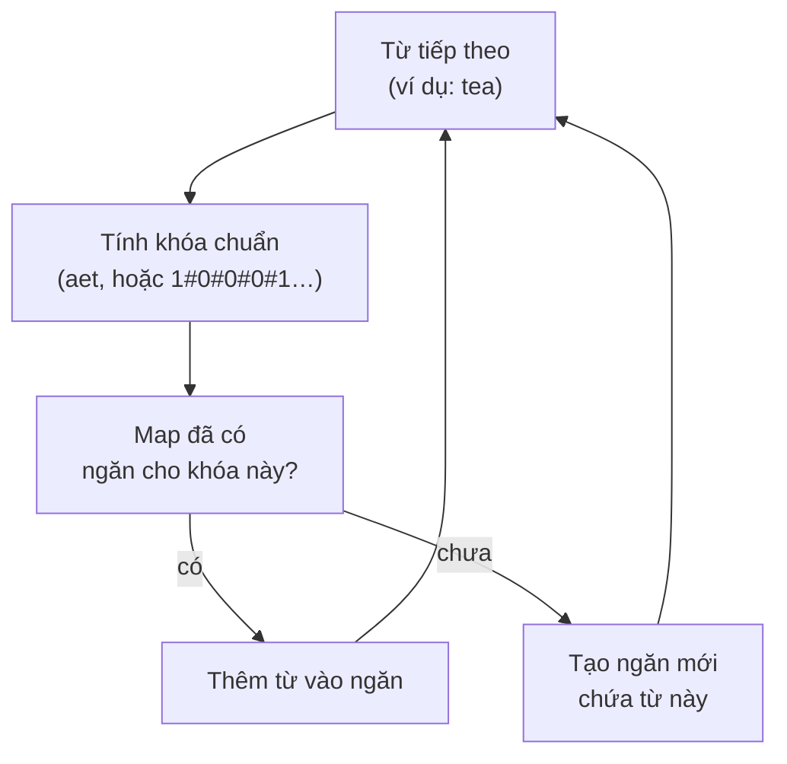

> [!tldr] Đọc nhanh
> - Đề: cho danh sách từ, gom các từ là anagram của nhau vào cùng một nhóm.
> - [[canonical-key|Khóa chuẩn]]: biến mỗi từ thành một giá trị mà mọi anagram đều cho ra **cùng** một giá trị, rồi [[group-by|gom nhóm]] bằng hash map `khóa → danh sách từ`.
> - Khóa sắp xếp (`"eat"` → `"aet"`): O(k log k) mỗi từ. [[count-key|Khóa đếm]] (bảng 26 số của ga 2): O(k) mỗi từ. Khóa đếm thắng 47 lần khi từ dài 1000 chữ, nhưng **thua** khi từ chỉ dài 5 chữ.
> - [[key-serialization|Nối khóa thành chuỗi]] phải có dấu phân cách. Bảng đếm `[1, 11, …]` và `[11, 1, …]` nối không phân cách đều thành `"1110…"`, nên hai từ không phải anagram bị gom chung. Lỗi này vẫn qua cả 4 ca test.
> - Mỗi ngôn ngữ có một luật riêng về thứ gì làm khóa được: Go cho mảng cố định làm khóa, Python cần tuple, JS và Java so mảng theo **danh tính** nên phải đổi sang chuỗi.

> [!info] Bối cảnh
> Ga 4 của **tuyến NeetCode 150: Arrays & Hashing**, bài Medium đầu tiên. Nó ghép ga 2 (anagram, bảng đếm) với hash map của ga 3, nhưng lần này bảng đếm không phải đáp án mà là **khóa**. Lời giải có đủ TypeScript, JavaScript, Python, Go và Java.

> [!abstract]- Từ điển nhanh cho bài này (bấm để mở)
> - **Anagram, bảng đếm 26 ô**: xem [[2026-11-22-neetcode-valid-anagram|ga 2]]. **Hash map, va chạm**: xem [[2026-11-22-neetcode-two-sum|ga 3]].
> - **k**: độ dài của một từ. **n**: số từ. Độ phức tạp bài này phụ thuộc cả hai.
> - **Khóa (key)**: giá trị dùng để tra trong map. Hai khóa "bằng nhau" thì trỏ tới cùng một ô.
> - **Danh tính (identity)**: hai object là "một" chỉ khi chúng là cùng một vùng nhớ. Hai mảng `[1, 2]` tạo riêng có cùng nội dung nhưng khác danh tính.
> - **Bất biến (immutable)**: giá trị không đổi được sau khi tạo. Python chỉ cho giá trị bất biến làm khóa dict, vì khóa đổi thì hash đổi, và map không tìm lại được.

## Hình dung trước: chia thư vào ngăn

Bưu điện nhận một bao thư. Mỗi thư phải vào đúng ngăn của khu vực mình.

| Đời thường | Khái niệm |
|---|---|
| Từ địa chỉ viết tay (mỗi người viết một kiểu), suy ra **mã bưu chính** | [[canonical-key\|Khóa chuẩn]] |
| Mã bưu chính = các chữ cái của từ, xếp A→Z | Khóa sắp xếp |
| Mã bưu chính = "có mấy chữ a, mấy chữ b, …" | [[count-key\|Khóa đếm]] |
| In mã lên nhãn: "1-11-0" chứ không in "1110" | [[key-serialization\|Nối khóa có dấu phân cách]] |
| Một dãy ngăn có nhãn, thư cùng mã vào cùng ngăn | [[group-by\|Gom nhóm]] bằng hash map |



## Vấn đề

**Đề (tóm tắt):** cho mảng chuỗi `strs`, gom các chuỗi là anagram của nhau thành nhóm. Trả về các nhóm theo thứ tự bất kỳ. Đề gốc: [LeetCode 49](https://leetcode.com/problems/group-anagrams/).

| Input | Một output hợp lệ |
|---|---|
| `["eat","tea","tan","ate","nat","bat"]` | `[["bat"],["nat","tan"],["ate","eat","tea"]]` |
| `[""]` | `[[""]]` |
| `["a"]` | `[["a"]]` |

Giới hạn: tới **10 000** chuỗi, mỗi chuỗi dài tới **100** ký tự, chỉ gồm chữ thường.

Cách ngây thơ: so từng cặp từ bằng hàm anagram của ga 2. Với n từ là O(n²·k), khoảng 5·10⁹ bước ở giới hạn trên. Cần một cách để mỗi từ chỉ phải "nhìn" một lần.

## Cơ chế

<figure class="figure-map" style="--ar: 3 / 4">
<div class="frame"><iframe data-archify="../diagrams/neetcode-group-anagrams/canonical-key.html" title="Gom eat, tea, tan, ate, nat, bat theo khóa sắp xếp" loading="lazy"></iframe></div>
<figcaption><span><b>Hình 1.</b> Mỗi từ đi qua bước "tính khóa" đúng một lần, rồi vào ngăn của khóa đó. "eat", "tea", "ate" cùng ra khóa "aet" nên vào chung một ngăn.</span><a href="../diagrams/neetcode-group-anagrams/canonical-key.html" target="_blank" rel="noopener">Mở toàn màn hình</a></figcaption>
</figure>

### Khóa chuẩn: thay so cặp bằng so khóa

Ý tưởng trung tâm là một [[canonical-key|khóa chuẩn]]: một hàm `key(w)` sao cho `key(a) == key(b)` **khi và chỉ khi** a và b là anagram. Có hàm đó rồi, bài toán thành [[group-by|gom nhóm]] theo khóa: duyệt từng từ, tính khóa, bỏ vào ngăn của khóa trong một hash map. Mỗi từ chỉ được xử lý một lần.

"Khi và chỉ khi" có hai chiều, và cả hai đều quan trọng:

- Anagram **phải** cho cùng khóa (nếu không, một nhóm bị tách đôi).
- Không phải anagram thì **phải** khác khóa (nếu không, hai nhóm bị gom chung). Lỗi nối không phân cách vi phạm đúng chiều này.

### Khóa sắp xếp: O(n · k log k)

Sắp xếp các chữ của từ: `"eat"`, `"tea"`, `"ate"` đều thành `"aet"`. Đây chính là cách 1 của ga 2, dùng làm khóa. Đơn giản, đúng với mọi bảng chữ cái, kể cả Unicode nếu tách đúng theo code point.

### Khóa đếm: O(n · k)

Bảng đếm 26 ô của ga 2 cũng là một khóa chuẩn: anagram thì cùng bảng đếm. Tạo bảng tốn O(k), không cần sắp xếp. Nhưng bảng đếm là một **mảng**, và hầu hết ngôn ngữ không cho mảng làm khóa hash map một cách trực tiếp. Phải [[key-serialization|biến nó thành một giá trị làm khóa được]]:

| | Mảng làm khóa map? | Cách làm |
|---|---|---|
| TypeScript / JavaScript | được, nhưng so theo **danh tính**: `m.get([1, 2])` luôn trả `undefined` | nối thành chuỗi: `count.join('#')` |
| Python | `list` không hash được (`TypeError: unhashable type`) | đổi thành `tuple(count)`: bất biến, hash theo nội dung |
| Go | **được**: mảng cố định `[26]uint8` so sánh được bằng `==`, nên làm khóa trực tiếp | `map[[26]uint8][]string`; slice `[]int` thì không được |
| Java | `int[]` dùng `equals`/`hashCode` theo danh tính | `new String(char[] count)`, hoặc `Arrays.toString(count)` |

Mẹo Java ở trên đáng giải thích: mỗi ô đếm được lưu vào một `char` (số 16 bit, đếm được tới 65 535), rồi 26 `char` ghép thành một `String` dài đúng 26. Mỗi vị trí trong chuỗi là đúng một con số, nên không cần dấu phân cách.

### Nối khóa: vì sao phải có dấu phân cách

Nối các số thành chuỗi mà không phân cách thì mất ranh giới giữa các số. Từ `"a" + "b"×11` có bảng đếm bắt đầu `[1, 11, 0, …]`; từ `"a"×11 + "b"` có `[11, 1, 0, …]`. Nối không phân cách, cả hai đều thành `"1110…"`. Hai từ không phải anagram bị gom chung.

Với giới hạn của đề (mỗi từ ≤ 100 chữ), một ô đếm có thể là 10 hay 11, nên lỗi này **có thể xảy ra trên input hợp lệ**. Nó không lộ ra trong các ví dụ của đề, vì ở đó mọi ô đếm đều nhỏ hơn 10. Có hai cách sửa:

- Thêm dấu phân cách (`#`), để mỗi số có ranh giới rõ ràng.
- Dùng định dạng độ dài cố định, mỗi ô đúng một "ký tự", như mẹo `char` của Java.

### Bộ nhớ

Map chứa mọi từ một lần, cộng một khóa cho mỗi nhóm: O(n·k) cho từ, cộng O(số nhóm × độ dài khóa). Khóa đếm dài cố định (26 số và 25 dấu `#`), dù từ chỉ dài 3 chữ. Đó là một lý do nó thua ở từ ngắn.

## Ví dụ chạy được

[TypeScript](../code/neetcode-group-anagrams/group-anagrams.ts) · [JavaScript](../code/neetcode-group-anagrams/group-anagrams.js) · [Python](../code/neetcode-group-anagrams/group_anagrams.py) · [Go](../code/neetcode-group-anagrams/group_anagrams.go) · [Java](../code/neetcode-group-anagrams/GroupAnagrams.java)

```ts
// TypeScript: khóa đếm, nối có dấu phân cách
function byCountKey(strs: string[]): string[][] {
  const groups = new Map<string, string[]>();
  for (const s of strs) {
    const count = new Array<number>(26).fill(0);
    for (let i = 0; i < s.length; i++) count[s.charCodeAt(i) - 97]++;
    const key = count.join('#');
    const g = groups.get(key);
    if (g) g.push(s); else groups.set(key, [s]);
  }
  return [...groups.values()];
}

// Khóa sắp xếp
function bySortedKey(strs: string[]): string[][] {
  const groups = new Map<string, string[]>();
  for (const s of strs) {
    const key = s.split('').sort().join('');
    const g = groups.get(key);
    if (g) g.push(s); else groups.set(key, [s]);
  }
  return [...groups.values()];
}
```

> [!example]- JavaScript
> ```js
> function groupAnagrams(strs) {
>   const groups = new Map();
>   for (const s of strs) {
>     const count = new Array(26).fill(0);
>     for (let i = 0; i < s.length; i++) count[s.charCodeAt(i) - 97]++;
>     const key = count.join('#'); // mảng làm khóa Map thì so theo danh tính, không theo nội dung
>     if (!groups.has(key)) groups.set(key, []);
>     groups.get(key).push(s);
>   }
>   return [...groups.values()];
> }
> ```

> [!example]- Python
> ```python
> from collections import defaultdict
>
> def group_anagrams(strs: list[str]) -> list[list[str]]:
>     groups: defaultdict[tuple[int, ...], list[str]] = defaultdict(list)
>     for s in strs:
>         count = [0] * 26
>         for ch in s:
>             count[ord(ch) - ord("a")] += 1
>         groups[tuple(count)].append(s)  # tuple băm được; list thì không
>     return list(groups.values())
> ```

> [!example]- Go
> ```go
> func groupAnagrams(strs []string) [][]string {
> 	// [26]uint8 so sánh được bằng ==, nên làm khóa map trực tiếp.
> 	// uint8 đủ vì mỗi từ tối đa 100 chữ (< 256).
> 	groups := map[[26]uint8][]string{}
> 	for _, s := range strs {
> 		var key [26]uint8
> 		for i := 0; i < len(s); i++ {
> 			key[s[i]-'a']++
> 		}
> 		groups[key] = append(groups[key], s)
> 	}
> 	out := make([][]string, 0, len(groups))
> 	for _, g := range groups { // thứ tự duyệt map ngẫu nhiên mỗi lần chạy
> 		out = append(out, g)
> 	}
> 	return out
> }
> ```

> [!example]- Java
> ```java
> static List<List<String>> groupAnagrams(String[] strs) {
>     Map<String, List<String>> groups = new HashMap<>();
>     for (String s : strs) {
>         char[] count = new char[26]; // char là số 16 bit
>         for (int i = 0; i < s.length(); i++) count[s.charAt(i) - 'a']++;
>         String key = new String(count); // 26 "ký tự" = 26 con số, không cần dấu phân cách
>         groups.computeIfAbsent(key, k -> new ArrayList<>()).add(s);
>     }
>     return new ArrayList<>(groups.values());
> }
> ```

```text
$ node group-anagrams.ts
bySortedKey            4/4 ca đúng
byCountKey             4/4 ca đúng
byCountKeyNoSeparator  4/4 ca đúng

"abbbbbbbbbbb" và "aaaaaaaaaaab" không phải anagram
  khóa không phân cách: 1110… và 1110…
  khóa có '#':          1#11#0#… và 11#1#0#…
  byCountKeyNoSeparator gom chung: [["abbbbbbbbbbb","aaaaaaaaaaab"]]
  byCountKey tách riêng:           [["abbbbbbbbbbb"],["aaaaaaaaaaab"]]

n = 10 000 từ   khóa sắp xếp   khóa đếm
k = 5                 3.9 ms       5.7 ms
k = 20               14.9 ms       6.3 ms
k = 100              91.5 ms       8.3 ms
k = 1000           1041.1 ms      22.1 ms
```

- Bản không phân cách **qua cả 4 ca test**, rồi gom sai hai từ không phải anagram. Một bộ test chỉ có từ ngắn không bao giờ bắt được lỗi này.
- **k = 5**: khóa sắp xếp nhanh hơn. Sắp xếp 5 chữ gần như không tốn gì, còn khóa đếm luôn phải dựng và nối 26 con số.
- **k = 100** (giới hạn của đề): khóa đếm nhanh hơn 11 lần. **k = 1000**: nhanh hơn 47 lần, đúng như k log k so với k.

Go cho thấy luôn hệ quả của "thứ tự bất kỳ":

```text
$ go run group_anagrams.go
lần 1: [[eat tea ate] [tan nat] [bat]]
lần 2: [[bat] [eat tea ate] [tan nat]]
lần 3: [[tan nat] [bat] [eat tea ate]]
đã chuẩn hóa: [[ate eat tea] [bat] [nat tan]]

$ python3 group_anagrams.py
[['eat', 'tea', 'ate'], ['tan', 'nat'], ['bat']]
[['eat', 'tea', 'ate'], ['tan', 'nat'], ['bat']]
list làm khóa dict: unhashable type: 'list'

$ java GroupAnagrams.java
[[tan, nat], [eat, tea, ate], [bat]]
[[eat, tea, ate], [bat], [tan, nat]]
int[] làm khóa: get(new int[]{1, 2}) = null
```

Cùng input, Go trả các nhóm theo thứ tự khác nhau mỗi lần chạy: đặc tả Go nói thứ tự duyệt map không được xác định, và runtime cố ý xáo trộn. Java cũng không giữ thứ tự (`HashMap`). Python và JS giữ thứ tự chèn. Test cho bài này phải chuẩn hóa (sắp xếp trong nhóm, rồi sắp xếp các nhóm) trước khi so.

## Hiểu lầm và bẫy hay gặp

- **Nối bảng đếm không có dấu phân cách.** Đúng với mọi ví dụ của đề, sai khi một chữ xuất hiện từ 10 lần trở lên.
- **Dùng mảng làm khóa trong JS hoặc Java.** Không lỗi biên dịch, không lỗi chạy, chỉ là mỗi từ thành một nhóm riêng vì mỗi mảng là một khóa khác danh tính.
- **Dùng list làm khóa dict trong Python.** Lỗi ngay (`unhashable type`). Đổi sang `tuple`.
- **Go: dùng `[]int` (slice) làm khóa.** Không biên dịch được; slice không so sánh được. Dùng mảng `[26]int`/`[26]uint8`. Với `uint8`, nhớ giới hạn 255: từ dài hơn thì phải dùng kiểu lớn hơn.
- **So output với một thứ tự cố định.** Đề cho phép thứ tự bất kỳ, và Go đổi thứ tự mỗi lần chạy. Chuẩn hóa trước khi so.
- **"Khóa đếm luôn nhanh hơn vì O(k) < O(k log k)."** Với từ ngắn, hằng số (dựng 26 ô, nối 51 ký tự) lớn hơn chi phí sắp xếp vài chữ.
- **Khóa đếm với Unicode.** 26 ô chỉ dành cho a–z. Với chữ bất kỳ, khóa sắp xếp theo code point (hoặc một bảng đếm dạng map, đã sắp xếp và nối lại) mới đúng.

## Câu hỏi tự kiểm tra

> [!question]- Một hàm khóa chuẩn cho bài này phải thỏa mãn điều gì, theo cả hai chiều?
> Mọi cặp anagram cho ra cùng khóa, và mọi cặp không phải anagram cho ra khóa khác nhau. Vi phạm chiều đầu thì nhóm bị tách; vi phạm chiều sau thì hai nhóm bị gom chung.

> [!question]- Vì sao `count.join('')` có thể gom sai, còn `count.join('#')` thì không?
> Không có dấu phân cách thì không biết một con số kết thúc ở đâu: `[1, 11]` và `[11, 1]` đều thành `"111"`. Với `#`, mỗi số có ranh giới, nên chuỗi xác định duy nhất mảng.

> [!question]- Trong Go, vì sao `map[[26]uint8][]string` biên dịch được nhưng `map[[]uint8][]string` thì không?
> Khóa map trong Go phải so sánh được bằng `==`. Mảng cố định so sánh được (so từng phần tử). Slice thì không, vì nó chỉ là một tham chiếu tới vùng nhớ có thể thay đổi.

> [!question]- Với từ dài 5 chữ, khóa sắp xếp nhanh hơn khóa đếm. Giải thích bằng hằng số.
> Sắp xếp 5 chữ chỉ tốn vài phép so sánh. Khóa đếm luôn phải tạo 26 ô và nối 26 con số thành chuỗi, bất kể từ ngắn hay dài. Big-O bỏ hằng số này; ở k nhỏ, nó lại là phần lớn công việc.

> [!question]- Test của bạn so `groupAnagrams(input)` với `[["bat"],["nat","tan"],["ate","eat","tea"]]` và thỉnh thoảng thất bại trong Go. Vì sao, và sửa thế nào?
> Go duyệt map theo thứ tự ngẫu nhiên, nên thứ tự các nhóm (và đề cho phép cả thứ tự trong nhóm) thay đổi. Sắp xếp từng nhóm rồi sắp xếp danh sách nhóm trước khi so.

## Tham khảo

- [LeetCode 49: Group Anagrams](https://leetcode.com/problems/group-anagrams/) (đề gốc)
- [The Go Programming Language Specification](https://go.dev/ref/spec) (kiểu khóa map phải so sánh được; thứ tự duyệt map không xác định)
- [Python glossary: hashable](https://docs.python.org/3/glossary.html#term-hashable) (container biến đổi được như list không hash được)
- [Java 21: Map](https://docs.oracle.com/en/java/javase/21/docs/api/java.base/java/util/Map.html) (`computeIfAbsent`; cảnh báo dùng object biến đổi được làm khóa)
