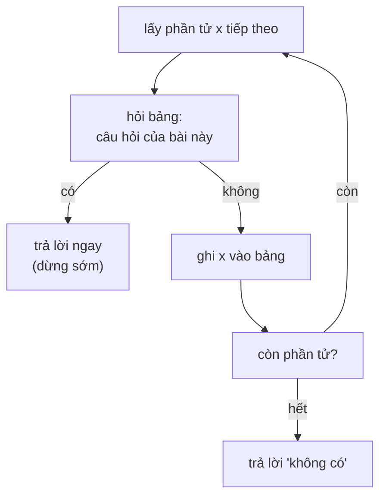

> [!tldr] Đọc nhanh
> - Pattern: duyệt dữ liệu **một lượt**, mỗi bước **hỏi** một bảng băm (Set hoặc Map) một câu, rồi **ghi** phần tử hiện tại vào bảng. Hỏi và ghi đều O(1) trung bình, nên cả bài O(n) thay vì O(n²).
> - Mỗi bài chỉ khác ở ba quyết định: **bảng lưu gì** (chỉ giá trị, hay giá trị → chỉ số), **hỏi câu gì** (chính x, phần bù `target − x`, hay hàng xóm `x − 1`), và **thứ tự** (hỏi trước rồi ghi, hay ghi hết rồi mới hỏi).
> - Contains Duplicate hỏi chính x. Two Sum hỏi `target − x` và cần lưu chỉ số. Longest Consecutive Sequence ghi hết trước, rồi hỏi `x − 1` để chỉ đếm từ đầu mỗi dãy.
> - Bẫy đắt nhất ga này: ở Longest Consecutive Sequence, duyệt mảng gốc thay vì duyệt Set. Kết quả vẫn đúng, nhưng với 20 000 bản sao của một đầu dãy, thời gian tăng từ 2,7 ms lên gần 4 giây.

> [!info] Bối cảnh
> Ga 1 của **tuyến NeetCode: Mảng và chuỗi**. [NeetCode 150](https://neetcode.io/practice) là danh sách 150 bài LeetCode xếp theo mẫu giải. Ở Atlas, mỗi ga là một mẫu giải (pattern): post này dạy pattern, còn mỗi bài có một trang riêng giải kỹ bằng năm ngôn ngữ. Bạn chỉ cần biết viết vòng lặp và hàm trong một ngôn ngữ bất kỳ.

> [!abstract]- Từ điển nhanh cho bài này (bấm để mở)
> - **Bảng băm (hash table)**: cấu trúc tính một con số (hash) từ khóa để biết ngay khóa nằm ở ô nào, nên tra và ghi không phải duyệt hết. Xem [[concepts/hash-set|Hash Set]] và [[concepts/hash-map|Hash Map]].
> - **Set**: bảng chỉ nhớ "có hay không". **Map**: bảng nhớ thêm một giá trị đi kèm mỗi khóa.
> - **O(1) trung bình**: phần lớn lần tra mất thời gian cố định, dù thỉnh thoảng có lần chậm hơn. Xem [[concepts/amortized-o1|Amortized O(1)]].
> - **Big-O**: cách đo số bước tăng theo kích thước đầu vào. Xem [[concepts/big-o-notation|Big-O Notation]].
> - **Phần bù (complement)**: với tổng `target`, số ghép được với `x` là `target − x`. Xem [[concepts/complement-lookup|Complement Lookup]].

## Hình dung trước: người gác cổng có cuốn sổ

Một buổi tiệc chỉ có một cửa vào. Người gác cổng cầm một cuốn sổ, sổ được đánh mục lục theo tên nên lật tới một tên mất vài giây, không phải đọc từ trang đầu. Mỗi khách tới, người gác **tra sổ trước**, rồi mới **ghi tên** khách vào.

| Đời thường | Khái niệm |
|---|---|
| Khách đi qua cửa lần lượt, mỗi người một lần | Duyệt mảng một lượt |
| Cuốn sổ có mục lục theo tên | Bảng băm: tra và ghi O(1) trung bình |
| "Người này vào rồi chưa?" | Contains Duplicate: hỏi chính x |
| "Có ai đang đợi bạn nhảy cao đúng bằng mình không?" | Two Sum: hỏi phần bù `target − x` |
| Sổ ghi thêm số thẻ của từng khách | Map giá trị → chỉ số thay cho Set |
| Tra sổ trước khi ghi tên | Hỏi trước, ghi sau: không bao giờ ghép một khách với chính họ |
| Sau tiệc, tìm nhóm khách có số thẻ liền nhau dài nhất | Longest Consecutive Sequence: ghi hết, rồi hỏi `x − 1` |



## Vấn đề: câu hỏi "đã gặp chưa?" tốn O(n) nếu không có bảng

Cả ba bài đều quy về cùng một câu hỏi: *trong những thứ đã thấy, có thứ mình cần không?* Cách ngây thơ là mỗi lần hỏi lại duyệt hết những gì đã thấy. Với n phần tử, mỗi lần hỏi tốn tới n bước, và có n lần hỏi, nên tổng là O(n²). Với giới hạn n = 10⁵ của LeetCode, đó là khoảng 5·10⁹ phép so sánh, quá chậm.

Pattern của ga này đổi "duyệt lại những gì đã thấy" thành "tra một bảng băm". Phần còn lại của mỗi bài chỉ là chọn đúng câu hỏi.

## Cơ chế

### Khuôn chung

```text
bảng = rỗng
với mỗi phần tử x (theo thứ tự):
    nếu bảng trả lời được câu hỏi về x  → trả kết quả, dừng
    ghi x (và thông tin đi kèm) vào bảng
trả "không có"
```

Hình dưới là khuôn này chạy trên Two Sum với `[3, 2, 4]` và target 6: ở mỗi bước, phần bù được tra *trước khi* số hiện tại được ghi vào bảng.

<figure class="figure-map" style="--ar: 3 / 4">
<div class="frame"><iframe data-archify="../diagrams/neetcode-two-sum/one-pass.html" title="Hash map một lượt trên [3, 2, 4] với target 6" loading="lazy"></iframe></div>
<figcaption><span><b>Hình 1.</b> Two Sum trên <code>[3, 2, 4]</code>, target 6: hỏi phần bù trước, ghi số hiện tại sau.</span><a href="../diagrams/neetcode-two-sum/one-pass.html" target="_blank" rel="noopener">Mở toàn màn hình</a></figcaption>
</figure>

### Quyết định 1: bảng lưu gì

- Chỉ cần biết "có hay không" thì dùng **Set** ([[concepts/hash-set|Hash Set]]). Contains Duplicate và Longest Consecutive Sequence chỉ cần vậy.
- Cần trả về *vị trí* thì dùng **Map** giá trị → chỉ số ([[concepts/one-pass-hash-map|One-pass Hash Map]]). Two Sum phải trả hai chỉ số, nên Set không đủ.

### Quyết định 2: hỏi câu gì

| Bài | Câu hỏi khi đứng ở x | Vì sao |
|---|---|---|
| [[problems/contains-duplicate\|Contains Duplicate]] | `x` có trong bảng chưa? | Trùng nghĩa là gặp lại đúng giá trị đó |
| [[problems/two-sum\|Two Sum]] | `target − x` có trong bảng chưa? | Chỉ đúng một giá trị ghép được với x ([[concepts/complement-lookup\|phần bù]]) |
| [[problems/longest-consecutive-sequence\|Longest Consecutive Sequence]] | `x − 1` có trong bảng không? | Không có thì x là **đầu** một dãy liên tiếp; chỉ đếm từ đầu dãy |

### Quyết định 3: hỏi trước hay ghi trước

- **Hỏi trước, ghi sau** khi câu trả lời chỉ được dựa vào phần tử *đứng trước*. Ở Two Sum với `[3, 3]` và target 6, nếu ghi số 3 thứ nhất rồi mới hỏi, phần bù 3 sẽ tìm thấy chính nó và trả `[0, 0]`, sai. Hỏi trước thì lúc đứng ở số 3 đầu tiên bảng còn rỗng; tới số 3 thứ hai mới gặp, trả `[0, 1]`.
- **Ghi hết rồi mới hỏi** khi câu hỏi cần biết cả những phần tử *đứng sau*. Longest Consecutive Sequence là bài như vậy: phần tử `x − 1` có thể nằm ở cuối mảng. Bài này không có "dừng sớm"; nó duyệt bảng một lượt sau khi đã ghi hết.

### Longest Consecutive Sequence: vì sao vẫn O(n) dù có vòng `while` lồng

Với mỗi đầu dãy, vòng `while` đi tiếp `x + 1, x + 2, …` tới khi hết dãy. Mỗi giá trị chỉ thuộc đúng một dãy và mỗi dãy chỉ có một đầu, nên tổng số bước của mọi vòng `while` cộng lại không quá số giá trị khác nhau. Điều này chỉ đúng khi duyệt **Set**: duyệt mảng gốc thì mỗi *bản sao* của một đầu dãy lại đi hết dãy một lần nữa (đo ở dưới).

## Ví dụ chạy được

[TypeScript](../code/neetcode-hash-lookup/hash-lookup.ts) · [Python](../code/neetcode-hash-lookup/hash_lookup.py) · [Go](../code/neetcode-hash-lookup/hash_lookup.go) · [Java](../code/neetcode-hash-lookup/hash-lookup.java) · [JavaScript](../code/neetcode-hash-lookup/hash-lookup.js)

Mỗi file giải cả ba bài và tự chạy 9 ca kiểm tra.

```ts
// 217 Contains Duplicate: hỏi chính x; bảng là Set các giá trị đã gặp.
function containsDuplicate(nums: number[]): boolean {
  const seen = new Set<number>();
  for (const x of nums) {
    if (seen.has(x)) return true; // hỏi trước
    seen.add(x); // ghi sau
  }
  return false;
}

// 1 Two Sum: hỏi phần bù target - x; bảng là Map giá trị → chỉ số.
function twoSum(nums: number[], target: number): [number, number] | null {
  const seen = new Map<number, number>();
  for (let i = 0; i < nums.length; i++) {
    const j = seen.get(target - nums[i]);
    if (j !== undefined) return [j, i];
    seen.set(nums[i], i);
  }
  return null;
}

// 128 Longest Consecutive Sequence: ghi HẾT vào bảng trước, rồi hỏi x - 1 để biết x có phải đầu dãy.
function longestConsecutive(nums: number[]): number {
  const all = new Set(nums);
  let best = 0;
  for (const x of all) { // duyệt Set, không duyệt nums: số trùng không được đếm lại
    if (all.has(x - 1)) continue;
    let len = 1;
    while (all.has(x + len)) len++;
    best = Math.max(best, len);
  }
  return best;
}
```

```python
def contains_duplicate(nums: list[int]) -> bool:  # 217
    seen: set[int] = set()
    for x in nums:
        if x in seen:  # hỏi trước
            return True
        seen.add(x)  # ghi sau
    return False


def two_sum(nums: list[int], target: int) -> list[int] | None:  # 1
    seen: dict[int, int] = {}  # giá trị → chỉ số
    for i, x in enumerate(nums):
        if (j := seen.get(target - x)) is not None:  # đừng viết "if j:": chỉ số 0 là falsy
            return [j, i]
        seen[x] = i
    return None


def longest_consecutive(nums: list[int]) -> int:  # 128
    all_ = set(nums)
    best = 0
    for x in all_:  # duyệt set, không duyệt nums
        if x - 1 in all_:
            continue  # x không phải đầu dãy
        length = 1
        while x + length in all_:
            length += 1
        best = max(best, length)
    return best
```

```go
// 217: Go không có kiểu set; map[int]struct{} là set (struct{} chiếm 0 byte).
func containsDuplicate(nums []int) bool {
	seen := make(map[int]struct{}, len(nums))
	for _, x := range nums {
		if _, ok := seen[x]; ok { // hỏi trước
			return true
		}
		seen[x] = struct{}{} // ghi sau
	}
	return false
}

// 1: map giá trị → chỉ số; "comma ok" phân biệt "không có" với "có, chỉ số 0".
func twoSum(nums []int, target int) []int {
	seen := make(map[int]int, len(nums))
	for i, x := range nums {
		if j, ok := seen[target-x]; ok {
			return []int{j, i}
		}
		seen[x] = i
	}
	return nil
}

// 128: ghi hết vào set trước, rồi chỉ đếm từ đầu dãy.
func longestConsecutive(nums []int) int {
	all := make(map[int]struct{}, len(nums))
	for _, x := range nums {
		all[x] = struct{}{}
	}
	best := 0
	for x := range all { // duyệt set, không duyệt nums
		if _, ok := all[x-1]; ok {
			continue
		}
		length := 1
		for {
			if _, ok := all[x+length]; !ok {
				break
			}
			length++
		}
		best = max(best, length)
	}
	return best
}
```

```java
// 217: add trả về false khi phần tử đã có, nên "hỏi" và "ghi" gộp thành một lệnh.
static boolean containsDuplicate(int[] nums) {
    Set<Integer> seen = new HashSet<>();
    for (int x : nums) if (!seen.add(x)) return true;
    return false;
}

// 1: Map giá trị → chỉ số; get trả null khi chưa có.
static int[] twoSum(int[] nums, int target) {
    Map<Integer, Integer> seen = new HashMap<>();
    for (int i = 0; i < nums.length; i++) {
        Integer j = seen.get(target - nums[i]);
        if (j != null) return new int[] {j, i};
        seen.put(nums[i], i);
    }
    return null;
}

// 128: ghi hết vào set trước, rồi chỉ đếm từ đầu dãy.
static int longestConsecutive(int[] nums) {
    Set<Integer> all = new HashSet<>();
    for (int x : nums) all.add(x);
    int best = 0;
    for (int x : all) { // duyệt set, không duyệt nums
        if (all.contains(x - 1)) continue;
        int len = 1;
        while (all.contains(x + len)) len++;
        best = Math.max(best, len);
    }
    return best;
}
```

```js
// 217
function containsDuplicate(nums) {
  const seen = new Set();
  for (const x of nums) {
    if (seen.has(x)) return true;
    seen.add(x);
  }
  return false;
}

// 1: dùng Map, đừng dùng object {}: khóa của object luôn bị đổi thành chuỗi.
function twoSum(nums, target) {
  const seen = new Map();
  for (let i = 0; i < nums.length; i++) {
    const j = seen.get(target - nums[i]);
    if (j !== undefined) return [j, i]; // đừng viết "if (j)": chỉ số 0 là falsy
    seen.set(nums[i], i);
  }
  return null;
}

// 128
function longestConsecutive(nums) {
  const all = new Set(nums);
  let best = 0;
  for (const x of all) {
    if (all.has(x - 1)) continue;
    let len = 1;
    while (all.has(x + len)) len++;
    best = Math.max(best, len);
  }
  return best;
}
```

Bản TypeScript còn đo bẫy duyệt mảng của Longest Consecutive Sequence: một dãy `1..20 000`, cộng thêm số 1 (đầu dãy) lặp lại 20 000 lần.

```text
$ node hash-lookup.ts
9/9 ca đúng
duyệt Set   kết quả 20000, 2.7 ms
duyệt mảng  kết quả 20000, 3977.7 ms
```

Cả hai bản đều ra 20 000. Bản duyệt mảng gặp số 1 tới 20 001 lần, và lần nào cũng đi hết dãy 20 000 số: khoảng 4·10⁸ lần tra, tức O(n²) trá hình. Python, Go, Java và JavaScript chạy cùng 9 ca và đều in `9/9 ca đúng`.

## Hiểu lầm và bẫy hay gặp

- **"Có vòng lặp lồng thì chắc chắn O(n²)."** Không phải lúc nào cũng vậy. Ở Longest Consecutive Sequence, vòng `while` chỉ chạy từ đầu dãy, nên tổng số bước của nó qua mọi lần lặp là O(n). Phải đếm tổng công ([[concepts/aggregate-analysis|phân tích gộp]]), không đếm số tầng vòng lặp. Trang [[problems/longest-consecutive-sequence|Longest Consecutive Sequence]] chứng minh chi tiết và so với cách sắp xếp.
- **Duyệt mảng gốc thay vì duyệt Set.** Đúng kết quả nhưng mất đảm bảo O(n) khi đầu dãy bị lặp lại (đo ở trên: 2,7 ms thành gần 4 giây).
- **Ghi trước rồi mới hỏi ở Two Sum.** Phần tử ghép với chính nó: `[3, 3]`, target 6 thành `[0, 0]`.
- **Kiểm tra kết quả tra bằng "truthy".** `if (j)` trong JS hay `if j:` trong Python bỏ qua chỉ số 0. Hãy so với `undefined`/`None`, hoặc dùng `has`/`in`, hoặc "comma ok" trong Go.
- **Dùng object `{}` làm bảng trong JavaScript.** Khóa của object luôn bị đổi thành chuỗi, và có sẵn các khóa kế thừa như `constructor`. Dùng `Map` và `Set`.
- **"Hash luôn O(1)."** Chỉ là trung bình. Trang [[problems/two-sum|Two Sum]] đo trường hợp mọi khóa trùng hash làm `HashMap` của Java chậm hẳn; xem thêm [[concepts/hash-collision|Hash Collision]].

## Câu hỏi tự kiểm tra

> [!question]- Ba bài trong ga này khác nhau ở ba quyết định nào?
> Bảng lưu gì (Set hay Map giá trị → chỉ số), hỏi câu gì (x, `target − x` hay `x − 1`), và thứ tự hỏi/ghi (hỏi trước rồi ghi, hay ghi hết rồi hỏi).

> [!question]- Vì sao Longest Consecutive Sequence không thể "hỏi trước, ghi sau" như hai bài kia?
> Vì câu hỏi "`x − 1` có trong dữ liệu không?" cần biết cả những phần tử đứng **sau** x trong mảng. Phải ghi hết vào Set trước rồi mới hỏi.

> [!question]- Vòng `while` nằm trong vòng `for`, vậy tại sao Longest Consecutive Sequence vẫn là O(n)?
> `while` chỉ chạy khi x là đầu dãy, và mỗi giá trị chỉ thuộc một dãy, nên tổng số bước `while` qua mọi đầu dãy không vượt số giá trị khác nhau. Tổng công là O(n).

> [!question]- Đổi Two Sum thành "có cặp nào có **hiệu** bằng k không?". Câu hỏi khi đứng ở x là gì?
> Hai câu: `x − k` hoặc `x + k` có trong bảng chưa? Khuôn giữ nguyên, chỉ đổi câu hỏi.

## Tham khảo

- [NeetCode 150](https://neetcode.io/practice) (danh sách và nhóm bài)
- LeetCode: [217. Contains Duplicate](https://leetcode.com/problems/contains-duplicate/), [1. Two Sum](https://leetcode.com/problems/two-sum/), [128. Longest Consecutive Sequence](https://leetcode.com/problems/longest-consecutive-sequence/)
- [ECMAScript 2025](https://tc39.es/ecma262/2025/) (Set và Map: truy cập trung bình dưới tuyến tính)
- [Go spec: Map types](https://go.dev/ref/spec#Map_types) (khóa phải so sánh được bằng `==`)
- [Java 21 `HashSet.add`](https://docs.oracle.com/en/java/javase/21/docs/api/java.base/java/util/HashSet.html#add(E)) (trả về false khi phần tử đã có)
