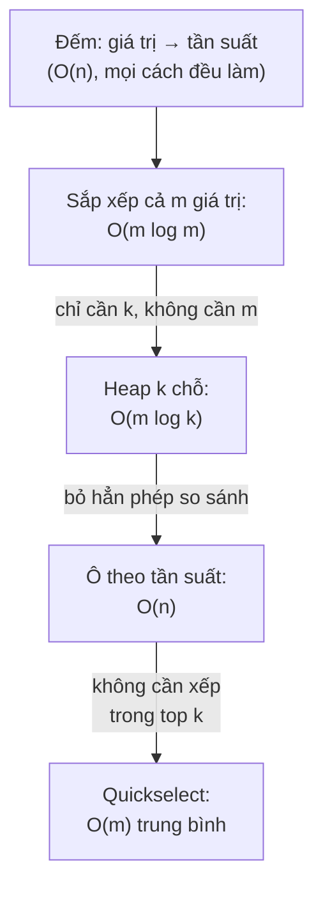

> [!tldr] Đọc nhanh
> - Đề: trả về k giá trị xuất hiện nhiều nhất. Bước 1 luôn là đếm (ga 2), O(n). Cái khó nằm ở bước 2: chọn k giá trị lớn nhất trong m tần suất.
> - Sắp xếp m cặp (giá trị, tần suất): O(m log m). [[concepts/heap|Min-heap]] giữ đúng k phần tử: O(m log k). Python có sẵn `Counter.most_common(k)`, bên dưới dùng chính heap.
> - [[concepts/bucket-sort|Bucket sort]] theo tần suất: tần suất chỉ từ 1 tới n, nên có n ô và cả bài là O(n). Nó vượt được [[concepts/sorting-lower-bound|giới hạn O(n log n)]] của mọi thuật toán sắp xếp dựa trên so sánh.
> - [[concepts/quickselect|Quickselect]]: phân hoạch như quicksort nhưng chỉ đi vào một nửa, O(n) **trung bình**, O(n²) tệ nhất.
> - Đo trên một triệu số: bước **đếm** chiếm phần lớn thời gian. Bucket sort "O(n)" chậm nhất khi ít giá trị khác nhau (phải cấp phát một triệu ô). Quickselect mất 798 ms khi hầu hết tần suất bằng nhau, chậm gấp 3,5 lần sắp xếp.

> [!info] Bối cảnh
> Ga 5 của **tuyến NeetCode 150: Arrays & Hashing**. Đếm là việc của ga 2; ga này hỏi tiếp: đếm xong, lấy **top k** thế nào cho nhanh. Đây cũng là lần đầu tuyến gặp heap, cấu trúc sẽ có cả một nhóm riêng về sau trong NeetCode 150. Lời giải có đủ TypeScript, JavaScript, Python, Go và Java.

> [!abstract]- Từ điển nhanh cho bài này (bấm để mở)
> - **Đếm tần suất, Map**: xem [[posts/2026-11-22-neetcode-valid-anagram|ga 2]]. **Big-O**: xem [[posts/2026-11-22-neetcode-contains-duplicate|ga 1]].
> - **m**: số giá trị *khác nhau* trong mảng. Luôn có m ≤ n.
> - **Heap (đống)**: cây nhị phân lưu trong một mảng, trong đó cha luôn nhỏ hơn (min-heap) hoặc lớn hơn (max-heap) các con. Phần tử nhỏ nhất luôn ở đỉnh.
> - **Priority queue (hàng đợi ưu tiên)**: kiểu dữ liệu "lấy ra phần tử ưu tiên nhất". Heap là cách cài phổ biến nhất.
> - **Phân hoạch (partition)**: chọn một phần tử làm chốt (pivot), dồn các phần tử nhỏ hơn chốt sang trái và lớn hơn sang phải.
> - **Cấp phát (allocation)**: xin bộ nhớ cho một object mới. Tạo một triệu mảng rỗng là một triệu lần cấp phát.

## Hình dung trước: chung kết bình chọn bài hát

Một cuộc bình chọn nhận một triệu phiếu cho vài chục nghìn bài hát. Ban tổ chức cần công bố top 10.

| Đời thường | Khái niệm |
|---|---|
| Kiểm phiếu: mỗi bài một dòng, mỗi phiếu thêm một gạch | Đếm tần suất (ga 2) |
| Xếp hạng **mọi** bài theo số phiếu rồi lấy 10 bài đầu | Sắp xếp, O(m log m) |
| Một bục 10 chỗ; bài yếu nhất trên bục đứng ngay mép. Bài mới mạnh hơn thì đẩy nó xuống | [[concepts/heap\|Min-heap]] k phần tử |
| Các hộp đánh số "1 phiếu", "2 phiếu", … "1 triệu phiếu"; bỏ mỗi bài vào hộp đúng số phiếu, rồi đi từ hộp lớn nhất xuống | [[concepts/bucket-sort\|Bucket sort]] |
| Chọn đại một bài làm mốc, chia hai phe "nhiều phiếu hơn mốc" và "ít hơn", chỉ tiếp tục chia phe chứa ranh giới top 10 | [[concepts/quickselect\|Quickselect]] |
| Chỉ được so hai bài với nhau thì không thể xếp hạng nhanh hơn n log n; nhìn thẳng con số phiếu thì được | [[concepts/sorting-lower-bound\|Giới hạn của sắp xếp so sánh]] |



## Vấn đề

**Đề (tóm tắt):** cho mảng số nguyên `nums` và số `k`, trả về k giá trị xuất hiện nhiều nhất, theo thứ tự bất kỳ. Đề bảo đảm đáp án là duy nhất. Đề gốc: [LeetCode 347](https://leetcode.com/problems/top-k-frequent-elements/).

| `nums` | `k` | Output |
|---|---|---|
| `[1, 1, 1, 2, 2, 3]` | 2 | `[1, 2]` |
| `[1]` | 1 | `[1]` |

Giới hạn: tới **100 000** phần tử, k nằm giữa 1 và số giá trị khác nhau. Câu hỏi mở rộng: độ phức tạp phải **tốt hơn O(n log n)**.

Câu hỏi mở rộng là phần thú vị. Sắp xếp các tần suất là O(m log m), và m có thể bằng n (mọi số khác nhau). Vậy làm sao chọn top k mà không sắp xếp?

## Cơ chế

<figure class="figure-map" style="--ar: 3 / 4">
<div class="frame"><iframe data-archify="../diagrams/neetcode-top-k-frequent/min-heap.html" title="Min-heap giữ 2 phần tử phổ biến nhất của [1, 1, 1, 2, 2, 3]" loading="lazy"></iframe></div>
<figcaption><span><b>Hình 1.</b> Đếm [1, 1, 1, 2, 2, 3] ra {1: 3, 2: 2, 3: 1}, rồi đưa từng cặp vào một min-heap giới hạn 2 chỗ. Khi heap có 3 phần tử, phần tử ở đỉnh (ít phổ biến nhất) bị đẩy ra.</span><a href="../diagrams/neetcode-top-k-frequent/min-heap.html" target="_blank" rel="noopener">Mở toàn màn hình</a></figcaption>
</figure>

### Cách 1, đếm rồi sắp xếp: O(n + m log m)

Đếm vào một map (O(n)), lấy m cặp (giá trị, tần suất), sắp xếp giảm dần theo tần suất, cắt k phần tử đầu. Đúng, dễ viết, và (như phép đo cho thấy) không hề chậm khi m nhỏ. Nhưng nó làm thừa việc: xếp hạng cả m giá trị trong khi chỉ cần k.

### Cách 2, min-heap k phần tử: O(n + m log k)

Một [[concepts/heap|heap]] lưu cây nhị phân trong mảng: cha ở vị trí i, hai con ở 2i+1 và 2i+2. Thêm phần tử thì đặt ở cuối rồi "nổi lên"; lấy đỉnh thì đưa phần tử cuối lên đỉnh rồi "chìm xuống". Mỗi thao tác đi qua chiều cao của cây, tức O(log kích thước).

Mẹo là dùng **min**-heap để tìm phần tử **lớn** nhất: heap giữ k ứng viên tốt nhất tới giờ, và đỉnh là ứng viên **yếu nhất** trong số đó. Mỗi cặp mới được đẩy vào; heap quá k phần tử thì bỏ đỉnh. Heap không bao giờ lớn hơn k+1, nên mỗi bước là O(log k), cả bài O(m log k). Với k nhỏ (top 10 trong một triệu), log k gần như là hằng số.

Heap có sẵn ở mọi ngôn ngữ trừ JS:

| | Heap có sẵn | Ghi chú |
|---|---|---|
| TypeScript / JavaScript | **không có** | tự viết khoảng 30 dòng, hoặc dùng bucket sort |
| Python | `heapq`: các hàm trên `list` thường, luôn là min-heap | `Counter(nums).most_common(k)` gọi `heapq.nlargest` bên dưới |
| Go | `container/heap`: bạn cài 5 phương thức (`Len`, `Less`, `Swap`, `Push`, `Pop`), gói lo phần nổi/chìm | phải gọi `heap.Push(h, x)`, không gọi `h.Push(x)` |
| Java | `PriorityQueue`: min-heap theo `Comparator` | `offer`/`poll` O(log n); so sánh bằng `Integer.compare`, đừng trừ hai số |

### Cách 3, bucket sort: O(n)

Mọi thuật toán sắp xếp chỉ dựa vào phép so sánh hai phần tử đều cần Ω(n log n) phép so sánh trong trường hợp tệ nhất. Đó là [[concepts/sorting-lower-bound|giới hạn dưới của sắp xếp so sánh]]: có n! thứ tự có thể, mỗi phép so sánh chỉ loại được một nửa, nên cần ít nhất log₂(n!) ≈ n log n phép.

[[concepts/bucket-sort|Bucket sort]] thoát giới hạn đó vì nó **không so sánh**: nó dùng thẳng giá trị tần suất làm chỉ số mảng. Mà tần suất của một giá trị luôn nằm từ 1 tới n. Tạo n+1 ô, bỏ mỗi giá trị vào ô `buckets[tần suất]`, rồi đi từ ô n xuống ô 1, gom tới khi đủ k. Tổng cộng O(n) thời gian, O(n) bộ nhớ. Đây là lời giải mà câu hỏi mở rộng nhắm tới.

### Cách 4, quickselect: O(n) trung bình

[[concepts/quickselect|Quickselect]] là quicksort chỉ đi một nhánh. Chọn một chốt ngẫu nhiên và phân hoạch m cặp theo tần suất. Nếu chốt rơi đúng vào ranh giới "k phần tử lớn nhất", xong. Nếu không, chỉ cần tiếp tục ở **một** phía. Chi phí trung bình là m + m/2 + m/4 + … ≈ 2m, tức O(m).

"Trung bình" là chữ quan trọng. Nếu chốt liên tục rơi vào phía tệ, mỗi lần chỉ loại một phần tử và tổng thành O(m²). Chọn chốt ngẫu nhiên chống được input cố tình xấu. Nhưng có một kiểu input mà ngẫu nhiên không cứu được: **rất nhiều giá trị bằng nhau**. Phân hoạch hai phần với điều kiện `<` dồn mọi phần tử bằng chốt về một phía, nên với hàng trăm nghìn tần suất bằng 1, mỗi lần phân hoạch hầu như chẳng loại được gì. Cách sửa là phân hoạch ba phần (nhỏ hơn, bằng, lớn hơn chốt), còn gọi là "Dutch national flag".

## Ví dụ chạy được

[TypeScript](../code/neetcode-top-k-frequent/top-k-frequent.ts) · [JavaScript](../code/neetcode-top-k-frequent/top-k-frequent.js) · [Python](../code/neetcode-top-k-frequent/top_k_frequent.py) · [Go](../code/neetcode-top-k-frequent/top_k_frequent.go) · [Java](../code/neetcode-top-k-frequent/top-k-frequent.java)

```ts
// TypeScript: bucket sort theo tần suất, O(n)
function byBuckets(nums: number[], k: number): number[] {
  const count = new Map<number, number>();
  for (const x of nums) count.set(x, (count.get(x) ?? 0) + 1);
  const buckets: number[][] = Array.from({ length: nums.length + 1 }, () => []);
  for (const [v, c] of count) buckets[c].push(v); // tần suất làm chỉ số: không so sánh
  const out: number[] = [];
  for (let f = nums.length; f > 0 && out.length < k; f--)
    for (const v of buckets[f]) { out.push(v); if (out.length === k) break; }
  return out;
}

// Min-heap k phần tử: đỉnh là "kẻ yếu nhất trong top k" (MinHeap tự viết, xem file đầy đủ)
function byHeap(nums: number[], k: number): number[] {
  const heap = new MinHeap<[number, number]>((x, y) => x[1] < y[1]);
  for (const e of countAll(nums)) {
    heap.push(e);
    if (heap.size > k) heap.pop(); // đẩy kẻ yếu nhất ra
  }
  const out: number[] = [];
  while (heap.size) out.push(heap.pop()![0]);
  return out.reverse();
}
```

```python
import heapq
from collections import Counter

def top_k_counter(nums: list[int], k: int) -> list[int]:
    # most_common(k) gọi heapq.nlargest bên dưới: O(n + m log k)
    return [v for v, _ in Counter(nums).most_common(k)]

def top_k_heap(nums: list[int], k: int) -> list[int]:
    heap: list[tuple[int, int]] = []  # heapq là min-heap trên list thường
    for v, c in Counter(nums).items():
        heapq.heappush(heap, (c, v))
        if len(heap) > k:
            heapq.heappop(heap)  # bỏ phần tử ít phổ biến nhất
    return [v for _, v in sorted(heap, reverse=True)]
```

```go
type entry struct{ val, freq int }

// container/heap: bạn cài 5 phương thức, gói heap lo phần nổi/chìm.
type minHeap []entry

func (h minHeap) Len() int           { return len(h) }
func (h minHeap) Less(i, j int) bool { return h[i].freq < h[j].freq }
func (h minHeap) Swap(i, j int)      { h[i], h[j] = h[j], h[i] }
func (h *minHeap) Push(x any)        { *h = append(*h, x.(entry)) }
func (h *minHeap) Pop() any {
	old := *h
	x := old[len(old)-1]
	*h = old[:len(old)-1]
	return x
}

func topKHeap(nums []int, k int) []int {
	count := map[int]int{}
	for _, x := range nums {
		count[x]++
	}
	h := &minHeap{}
	for v, f := range count {
		heap.Push(h, entry{v, f}) // gọi heap.Push, không gọi h.Push trực tiếp
		if h.Len() > k {
			heap.Pop(h)
		}
	}
	out := make([]int, h.Len())
	for i := len(out) - 1; i >= 0; i-- {
		out[i] = heap.Pop(h).(entry).val
	}
	return out
}
```

```java
static int[] topKHeap(int[] nums, int k) {
    Map<Integer, Integer> count = new HashMap<>();
    for (int x : nums) count.merge(x, 1, Integer::sum);
    // PriorityQueue mặc định là min-heap. So sánh bằng Integer.compare, đừng trừ hai số.
    PriorityQueue<Map.Entry<Integer, Integer>> heap =
            new PriorityQueue<>((a, b) -> Integer.compare(a.getValue(), b.getValue()));
    for (Map.Entry<Integer, Integer> e : count.entrySet()) {
        heap.offer(e);
        if (heap.size() > k) heap.poll(); // O(log k)
    }
    int[] out = new int[heap.size()];
    for (int i = out.length - 1; i >= 0; i--) out[i] = heap.poll().getKey();
    return out;
}
```

```js
function topKFrequent(nums, k) {
  const count = new Map();
  for (const x of nums) count.set(x, (count.get(x) || 0) + 1);
  // buckets[f] = các giá trị xuất hiện đúng f lần. Một giá trị xuất hiện tối đa n lần.
  const buckets = Array.from({ length: nums.length + 1 }, () => []);
  for (const [value, freq] of count) buckets[freq].push(value);
  const out = [];
  for (let f = buckets.length - 1; f > 0; f--) {
    for (const v of buckets[f]) {
      out.push(v);
      if (out.length === k) return out;
    }
  }
  return out;
}
```

File TypeScript chạy test cho bốn cách, rồi đo trên một triệu số với số giá trị khác nhau (m) và k khác nhau. Cột "chỉ đếm" là riêng bước đếm, phần mà mọi cách đều phải làm:

```text
$ node top-k-frequent.ts
bySorting      4/4 ca đúng
byHeap         4/4 ca đúng
byBuckets      4/4 ca đúng
byQuickselect  4/4 ca đúng

n = 1 000 000                   chỉ đếm  sắp xếp     heap   bucket  quickselect  (ms, trung vị 5 lần)
m = 1000    k = 10     lệch         26       27       27       77       26
m = 99017   k = 10     lệch         44       57       46       75       44
m = 632052  k = 10     đều          96      200      137      146      155
m = 632052  k = 10000  đều         108      228      160      167      798
```

Đọc kết quả:

- **m nhỏ** (1 000 giá trị): đếm mất 26 ms, và mọi cách đều kết thúc ngay sau đó. Sắp xếp 1 000 cặp gần như miễn phí. Riêng bucket sort mất thêm khoảng 50 ms để tạo **một triệu lẻ một** mảng rỗng, dù chỉ dùng tới vài trăm ô. Đây là cách "O(n)" chậm nhất.
- **m lớn** (632 052 giá trị, gần như mọi số chỉ xuất hiện 1–2 lần): heap tốt nhất, sắp xếp chậm nhất. Chênh lệch giữa O(m log m) và O(m log k) lộ rõ khi m lớn.
- **Quickselect, hàng cuối**: 798 ms, gấp 3,5 lần sắp xếp. Phần lớn trong 632 052 giá trị có cùng tần suất (1 hoặc 2), nên phân hoạch hai phần suy biến như đã giải thích ở trên.
- Bài học chung: Big-O nói đường cong; phép đo nói chi phí thật. Với giới hạn của đề (n ≤ 100 000), cả bốn cách đều dưới vài chục mili giây. Chọn theo độ rõ ràng của code, trừ khi phép đo nói khác.

Các ngôn ngữ còn lại đều cho cùng đáp án, và Java minh họa bẫy so sánh bằng phép trừ:

```text
$ python3 top_k_frequent.py
[1, 1, 1, 2, 2, 3] 2 → [1, 2] [1, 2] [1, 2]
[1] 1 → [1] [1] [1]
[4, 4, 4, 4, -1, -1, -1, 2, 2, 7] 3 → [4, -1, 2] [4, -1, 2] [4, -1, 2]

$ go run top_k_frequent.go
[1 1 1 2 2 3] 2 → heap [1 2] | bucket [1 2]
[1] 1 → heap [1] | bucket [1]
[4 4 4 4 -1 -1 -1 2 2 7] 3 → heap [4 -1 2] | bucket [4 -1 2]

$ java top-k-frequent.java
...
so sánh MIN_VALUE với 1 bằng phép trừ: 2147483647 (dương, tức 'lớn hơn': sai) | Integer.compare: -1
```

## Hiểu lầm và bẫy hay gặp

- **"O(n) luôn nhanh hơn O(n log n)."** Bucket sort cấp phát n+1 ô bất kể m. Khi m nhỏ, chi phí cấp phát lớn hơn chi phí sắp xếp m phần tử. Có thể chỉ tạo `maxFreq + 1` ô để giảm bớt.
- **Dùng max-heap chứa cả m phần tử rồi pop k lần.** Đúng, thời gian O(m + k log m), nhưng tốn O(m) bộ nhớ. Min-heap giới hạn k chỗ chỉ dùng O(k) bộ nhớ, hợp khi dữ liệu đến dạng luồng.
- **Nhầm hướng heap.** Muốn top k **lớn** nhất thì giữ một **min**-heap k phần tử: đỉnh là phần tử cần bị loại đầu tiên.
- **Java: comparator `(a, b) -> a - b`.** Tràn số khi hai số trái dấu và lớn: `Integer.MIN_VALUE - 1` ra số dương. Dùng `Integer.compare`. Với tần suất (luôn dương, ≤ 10⁵) thì không tràn, nhưng thói quen này hại ở chỗ khác.
- **Go: gọi `h.Push(x)` thay vì `heap.Push(h, x)`.** `h.Push` chỉ là append, không nổi phần tử lên; heap mất tính chất mà không báo lỗi.
- **Quickselect "O(n)".** Đó là trung bình với chốt ngẫu nhiên. Nhiều giá trị bằng nhau thì cần phân hoạch ba phần, nếu không có thể chậm hơn cả sắp xếp.
- **Quên rằng đếm cũng tốn.** Ở cỡ một triệu, bước đếm (O(n) thao tác trên map) thường đắt hơn bước chọn top k.

## Câu hỏi tự kiểm tra

> [!question]- Vì sao dùng **min**-heap, không phải max-heap, để tìm k phần tử phổ biến **nhất**?
> Heap giữ k ứng viên tốt nhất tới giờ. Khi có ứng viên mới, cần biết ngay ai là người yếu nhất trong k người đó để loại. Min-heap đặt đúng người đó ở đỉnh, lấy ra trong O(log k).

> [!question]- Bucket sort ở đây cần bao nhiêu ô, và vì sao biết trước được?
> n+1 ô (chỉ số 0 tới n). Tần suất của một giá trị không thể vượt quá số phần tử n, nên mọi tần suất đều có sẵn ô.

> [!question]- Vì sao bucket sort không bị giới hạn Ω(n log n) của sắp xếp?
> Giới hạn đó chỉ áp dụng cho thuật toán chỉ dùng phép so sánh hai phần tử. Bucket sort dùng thẳng tần suất làm chỉ số mảng, không so sánh, và chỉ làm được vì tần suất là số nguyên trong khoảng nhỏ đã biết.

> [!question]- Trong phép đo, khi nào bucket sort chậm hơn sắp xếp, và vì sao?
> Khi m nhỏ (1 000 giá trị trong một triệu số). Sắp xếp chỉ làm việc trên 1 000 cặp, còn bucket sort vẫn tạo một triệu lẻ một mảng rỗng. Chi phí cấp phát đó lớn hơn hẳn việc sắp xếp 1 000 phần tử.

> [!question]- Quickselect mất 798 ms ở hàng cuối, còn sắp xếp chỉ 228 ms. Nguyên nhân, và sửa thế nào?
> Hầu hết tần suất bằng nhau (1 hoặc 2). Phân hoạch hai phần với `<` dồn mọi phần tử bằng chốt về một phía, nên mỗi vòng loại được rất ít phần tử. Phân hoạch ba phần (nhỏ hơn, bằng, lớn hơn chốt) gom cả khối bằng nhau lại và loại chúng một lần.

## Tham khảo

- [LeetCode 347: Top K Frequent Elements](https://leetcode.com/problems/top-k-frequent-elements/) (đề gốc và yêu cầu tốt hơn O(n log n))
- [Python: heapq](https://docs.python.org/3/library/heapq.html) (min-heap trên list, `nlargest`)
- [CPython: collections/\_\_init\_\_.py](https://github.com/python/cpython/blob/main/Lib/collections/__init__.py) (`Counter.most_common(n)` gọi `heapq.nlargest`)
- [Go: container/heap](https://pkg.go.dev/container/heap) (giao diện 5 phương thức)
- [Java 21: PriorityQueue](https://docs.oracle.com/en/java/javase/21/docs/api/java.base/java/util/PriorityQueue.html) (min-heap, `offer`/`poll` O(log n))
