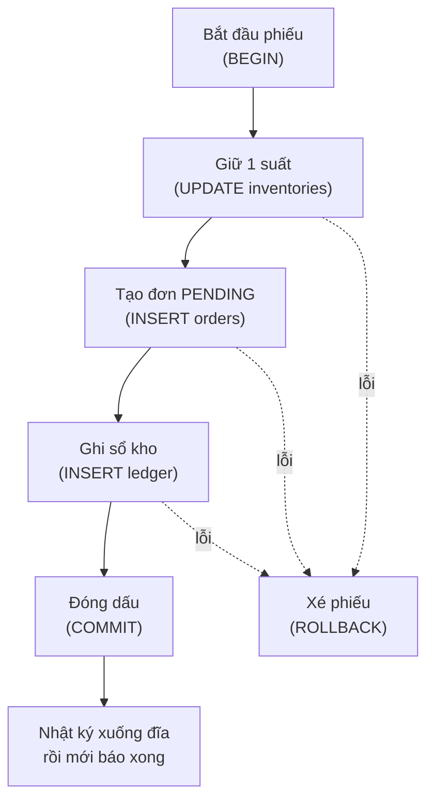

> [!tldr] Đọc nhanh
> - Một [[transaction|transaction]] gom nhiều câu lệnh thành **một khối**: hoặc mọi câu đều có hiệu lực, hoặc không câu nào. Trong ví dụ, đặt hàng ba bước lỗi ở bước 3: không có transaction thì còn lại 1 suất bị giữ và 1 đơn mồ côi; có transaction thì sạch trơn.
> - [[acid|ACID]] là bốn lời hứa của transaction: Atomicity (cả khối hoặc không), Consistency (luật của dữ liệu vẫn đúng), Isolation (các transaction chạy cùng lúc không giẫm chân nhau), Durability (đã commit là không mất).
> - [[commit-va-rollback|COMMIT]] chốt cả khối; [[commit-va-rollback|ROLLBACK]] bỏ cả khối. Lỗi, mất kết nối hay pod bị kill giữa chừng đều dẫn tới rollback.
> - Durability nhờ [[write-ahead-log|Write-Ahead Log]]: Postgres ghi nhật ký thay đổi xuống đĩa **trước** khi trả lời "COMMIT xong", bảng thì ghi sau.
> - [[mvcc|MVCC]]: `UPDATE` không sửa tại chỗ mà tạo một **phiên bản dòng mới**. Người đang đọc vẫn thấy bản cũ đã commit và không phải chờ người ghi.

> [!info] Bối cảnh
> Ga 1 của **tuyến Transaction và khóa**. Ví dụ là **flash-sale**, trang bán hàng giảm giá giờ vàng: đúng 21:00, hàng nghìn người cùng giành vài trăm sản phẩm. Mỗi lần đặt hàng, server phải giữ hàng trong kho, tạo đơn và ghi một dòng vào sổ kho. Database là PostgreSQL. Bạn không cần biết NestJS, Prisma hay code của dự án.

> [!abstract]- Từ điển nhanh cho bài này (bấm để mở)
> - **Câu lệnh SQL**: một lệnh gửi cho database. `SELECT` đọc, `INSERT` thêm dòng, `UPDATE` sửa dòng, `DELETE` xóa dòng.
> - **Bảng, dòng**: database lưu dữ liệu thành bảng (`inventories`, `orders`), mỗi bản ghi là một dòng.
> - **Session (kết nối)**: một kết nối từ server ứng dụng tới Postgres. Một transaction luôn nằm trọn trong một session.
> - **Autocommit**: chế độ mặc định khi không gõ `BEGIN`: mỗi câu lệnh tự là một transaction riêng và tự commit ngay.
> - **Sổ kho (ledger)**: bảng chỉ thêm, không sửa, ghi mọi lần kho thay đổi để đối chiếu sau này.
> - **fsync**: lệnh bắt hệ điều hành ghi thật xuống đĩa thay vì để trong bộ nhớ đệm.
> - **Prisma**: thư viện TypeScript flash-sale dùng để gọi Postgres; `prisma.$transaction(async (tx) => …)` mở một transaction.

## Hình dung trước: phiếu giao dịch ở quầy vé

Một quầy bán vé dùng chung một **cuốn sổ lớn**. Nhân viên không ghi thẳng vào sổ mà ghi lên một **phiếu giao dịch**: "giữ 1 vé hàng A, lập vé cho khách, ghi vào sổ thu". Xong cả ba dòng mới đóng dấu chuyển vào sổ. Đang ghi mà khách bỏ đi thì xé phiếu.

| Đời thường | Khái niệm |
|---|---|
| Một phiếu giao dịch gom mọi bước của một lần bán | [[transaction\|Transaction]] |
| Phiếu hoặc vào sổ trọn vẹn, hoặc bị xé; sổ luôn khớp; người khác không thấy phiếu đang ghi dở; đã đóng dấu thì không mất | [[acid\|ACID]] |
| Đóng dấu chuyển vào sổ / xé phiếu | [[commit-va-rollback\|COMMIT / ROLLBACK]] |
| Trước khi đóng dấu, ghi một dòng vào **nhật ký** đóng gáy cất trong két; cháy sổ thì chép lại từ nhật ký | [[write-ahead-log\|Write-Ahead Log]] |
| Sửa sổ bằng cách viết **dòng mới** và gạch dòng cũ, không tẩy; ai đang xem trang cũ vẫn đọc được | [[mvcc\|MVCC]] |



## Vấn đề: ba câu lệnh, máy chết ở câu thứ hai

Lúc mới viết backend, mình nghĩ về database như một chỗ để gọi hàm: gọi `UPDATE` cho kho, gọi `INSERT` cho đơn, gọi `INSERT` cho sổ kho. Mỗi lời gọi trả về OK là xong. Mình không nghĩ tới chuyện **giữa hai lời gọi** có thể xảy ra gì.

Mà giữa hai lời gọi thì có thể xảy ra đủ thứ: code ném lỗi vì một bug, kết nối mạng tới database rớt, Kubernetes kill pod để deploy bản mới, máy hết RAM. Nếu mỗi câu tự commit riêng (autocommit), thì câu nào chạy xong là **đã nằm trong database**. Câu thứ nhất giữ 1 suất, câu thứ hai tạo đơn, rồi pod chết: database còn lại một suất bị giữ cho một đơn không bao giờ được ghi sổ kho. Không ai nhả suất đó ra, và sổ kho không còn khớp với bảng tồn kho.

Muốn dọn thì phải viết code dọn cho từng tổ hợp lỗi: lỗi sau bước 1 thì nhả kho, lỗi sau bước 2 thì nhả kho và xóa đơn… và chính code dọn cũng có thể chết giữa chừng. Transaction xóa cả lớp bài toán đó.

## Cơ chế

<figure class="figure-map" style="--ar: 3 / 4">
<div class="frame"><iframe data-archify="../diagrams/transactions-acid/order-tx.html" title="Đặt một đơn trong một transaction: lỗi thì rollback, xong thì commit sau khi WAL xuống đĩa" loading="lazy"></iframe></div>
<figcaption><span><b>Hình 1.</b> Cùng ba bước đặt hàng: lỗi ở đâu thì Postgres bỏ cả khối; chốt thì Postgres ghi nhật ký xuống đĩa trước rồi mới trả lời "xong".</span><a href="../diagrams/transactions-acid/order-tx.html" target="_blank" rel="noopener">Mở toàn màn hình</a></figcaption>
</figure>

### Transaction: một khối "tất cả hoặc không gì cả"

Một [[transaction|transaction]] bắt đầu bằng `BEGIN` và kết thúc bằng `COMMIT` hoặc `ROLLBACK`. Mọi câu lệnh ở giữa chạy trong cùng một session, và hiệu lực của chúng được giữ "treo" cho tới lúc kết thúc:

```sql
BEGIN;
UPDATE inventories SET reserved = reserved + 1 WHERE sku = 'A' AND total >= reserved + 1;
INSERT INTO orders (sku, status) VALUES ('A', 'PENDING');
INSERT INTO ledger (sku, delta, order_id) VALUES ('A', -1, 42);
COMMIT;
```

Với Prisma, flash-sale viết như sau. Mọi câu dùng biến `tx` (không phải `prisma`) đều nằm trong cùng một transaction; hàm trả về bình thường thì Prisma gửi `COMMIT`, hàm ném lỗi thì Prisma gửi `ROLLBACK`:

```ts
// minh họa, không chạy trực tiếp (rút gọn từ bước đặt hàng của flash-sale)
const orders = await prisma.$transaction(async (tx) => {
  for (const item of sortedItems) {
    await stockService.reserveStock(tx, { skuId: item.skuId, qty: item.quantity, orderId });
  }
  const order = await tx.order.create({ data: { /* … */ } });
  await outboxWriter.write(tx, { type: 'order.placed', orderId: order.id });
  return order;
});
```

Một điểm dễ bỏ qua: `StockService` trong flash-sale **không tự mở transaction**. Mọi hàm của nó nhận `tx` từ người gọi, nên giữ hàng, tạo đơn, ghi sổ kho và ghi sự kiện outbox (xem [[transactional-outbox|transactional outbox]] ở tuyến RabbitMQ) luôn nằm chung một khối. Nếu mỗi service tự mở transaction riêng, mình lại quay về bài toán ba câu tự commit.

### ACID: bốn lời hứa

[[acid|ACID]] là tên gom bốn tính chất mà transaction hứa:

| Chữ | Nghĩa | Ai lo |
|---|---|---|
| **A**tomicity | Cả khối có hiệu lực hoặc không câu nào có hiệu lực | Postgres: ROLLBACK bỏ mọi phiên bản dòng khối đó tạo ra |
| **C**onsistency | Sau mỗi transaction, các luật của dữ liệu vẫn đúng | **Bạn**, với sự giúp của ràng buộc (`CHECK`, `UNIQUE`, khóa ngoại) |
| **I**solation | Các transaction chạy cùng lúc không thấy trạng thái dở dang của nhau | Postgres, ở mức bạn chọn (ga 3) |
| **D**urability | Đã báo COMMIT xong thì mất điện cũng không mất | Postgres: WAL xuống đĩa trước khi trả lời |

Chữ C khác ba chữ kia: database không biết "tồn kho không được âm" hay "sổ kho phải khớp bảng tồn kho" nếu bạn không nói ra. Transaction chỉ đảm bảo một khối đúng chuyển dữ liệu đúng thành dữ liệu đúng; khối viết sai vẫn commit vui vẻ. Ga 4 dùng `CHECK` để biến một phần luật đó thành thứ database tự giữ.

Chữ I là chữ phức tạp nhất và là chủ đề của ga 2 và 3: "không giẫm chân nhau" có nhiều mức, và mức mặc định của Postgres **không** chặn được lỗi bán quá số hàng.

### COMMIT và ROLLBACK

[[commit-va-rollback|COMMIT]] làm mọi thay đổi trong khối hiện ra với các session khác cùng một lúc. [[commit-va-rollback|ROLLBACK]] bỏ chúng. Có ba đường dẫn tới rollback:

- Code gọi `ROLLBACK` (Prisma làm khi hàm trong `$transaction` ném lỗi).
- Một câu lệnh lỗi (vi phạm `CHECK`, trùng khóa…). Sau đó Postgres từ chối mọi câu tiếp theo trong khối với lỗi "current transaction is aborted" cho tới khi bạn gửi `ROLLBACK`.
- Session đứt giữa chừng (mạng rớt, pod chết). Postgres thấy kết nối mất và tự bỏ khối chưa commit.

Đường thứ ba là đường quan trọng nhất cho flash-sale: không có code dọn dẹp nào chạy được khi pod đã chết, nhưng database vẫn dọn đúng.

### MVCC: sửa bằng cách viết dòng mới

Postgres không sửa một dòng tại chỗ. `UPDATE` tạo **một phiên bản mới** của dòng và đánh dấu phiên bản cũ là "hết hạn từ transaction X". Mỗi phiên bản mang hai cột hệ thống: `xmin` (transaction tạo ra nó) và `xmax` (transaction xóa hoặc thay nó, 0 nếu chưa ai). Cột `ctid` cho biết phiên bản nằm ở đâu trong file bảng.

Khi một session đọc, Postgres chọn phiên bản mà session đó **được phép thấy**: bản do transaction đã commit tạo ra, chưa bị transaction đã commit nào thay. Vì vậy:

- Người đọc không phải chờ người ghi, người ghi không phải chờ người đọc.
- Không ai thấy dữ liệu chưa commit của người khác (không có "dirty read").
- `ROLLBACK` rất rẻ: phiên bản mới chỉ đơn giản là không bao giờ được coi là hợp lệ.

Cái giá là phiên bản cũ nằm lại trên đĩa cho tới khi `VACUUM` dọn, và một transaction mở quá lâu giữ cho mọi phiên bản cũ không dọn được (ga 6).

### WAL: nhật ký ghi trước

Lời hứa Durability nghe có vẻ đắt: chẳng lẽ mỗi COMMIT phải ghi lại mọi trang bảng bị sửa xuống đĩa? Postgres làm rẻ hơn bằng [[write-ahead-log|Write-Ahead Log]] (WAL): mọi thay đổi trước tiên được ghi thành bản ghi nhật ký nối đuôi nhau trong thư mục `pg_wal`. Khi bạn COMMIT, Postgres chỉ cần **fsync nhật ký** (ghi tuần tự, nhanh) rồi trả lời. Trang bảng thật được ghi dần sau đó, lúc checkpoint. Nếu máy chết trước khi trang bảng kịp ghi, lúc khởi động lại Postgres phát lại nhật ký từ checkpoint gần nhất.

`synchronous_commit = on` (mặc định) nghĩa là COMMIT chỉ trả lời sau khi WAL đã xuống đĩa. Đặt `off` thì COMMIT trả lời sớm hơn và có thể mất vài trăm mili giây giao dịch cuối khi máy sập, nhưng không làm hỏng dữ liệu. WAL cũng là thứ được gửi sang các bản sao (replica).

## Ví dụ chạy được

[acid.ts](../code/transactions-acid/acid.ts) dựng ba bảng (`inventories`, `orders`, `ledger`) trên một Postgres 16 chạy bằng Docker, rồi:

- **A.** đặt hàng ba bước và cố tình lỗi ở bước 3, một lần không có transaction, một lần có;
- **B.** cho session W sửa một dòng mà chưa commit, trong khi session R đọc cùng dòng đó, rồi in `xmin`, `xmax`, `ctid` của phiên bản mỗi bên thấy;
- **C.** đo WAL tăng bao nhiêu byte sau một câu `UPDATE`.

```bash
docker run -d --name tx-pg -e POSTGRES_PASSWORD=atlas -p 55432:5432 postgres:16-alpine
npm i pg
node acid.ts
```

```ts
// Đặt hàng = 3 câu lệnh. Câu thứ ba lỗi (giả lập crash / bug / mất kết nối).
async function placeOrder(c: pg.PoolClient | pg.Pool, failAtStep3: boolean) {
  await c.query(`UPDATE inventories SET reserved = reserved + 1 WHERE sku = 'A' AND total >= reserved + 1`);
  const { rows: [o] } = await c.query(`INSERT INTO orders (sku, status) VALUES ('A', 'PENDING') RETURNING id`);
  if (failAtStep3) throw new Error('crash giữa chừng');
  await c.query(`INSERT INTO ledger (sku, delta, order_id) VALUES ('A', -1, $1)`, [o.id]);
}
```

```text
$ node acid.ts
A. Đặt hàng 3 bước, lỗi ở bước 3
   không transaction: giữ 1 suất, 1 đơn, 0 dòng sổ kho   ← kho bị giữ, đơn mồ côi, sổ kho lệch
   có transaction   : giữ 0 suất, 0 đơn, 0 dòng sổ kho   ← ROLLBACK xóa sạch cả 3 bước

B. Phiên bản dòng (MVCC)
   ban đầu                    {"xmin":"22182","xmax":"0","ctid":"(0,1)","reserved":0}
   W (txid 22183) thấy, chưa commit {"xmin":"22183","xmax":"0","ctid":"(0,2)","reserved":5}
   R đọc cùng lúc             {"xmin":"22182","xmax":"22183","ctid":"(0,1)","reserved":0} ← bản cũ, không chờ (1 ms)
   R đọc sau khi W commit     {"xmin":"22183","xmax":"0","ctid":"(0,2)","reserved":5}

C. Write-Ahead Log
   một UPDATE nhỏ đẩy WAL từ 0/1CA3D58 tới 0/1CA3DC8: 112 byte nhật ký
   synchronous_commit = on, fsync = on: COMMIT chỉ trả lời sau khi WAL đã xuống đĩa
```

Đọc kết quả:

- **A** là toàn bộ lý do transaction tồn tại. Không có transaction, hai câu đầu đã commit trước khi lỗi xảy ra, và database kẹt ở trạng thái mà không luật nghiệp vụ nào cho phép.
- **B** cho thấy MVCC tận mắt. W sửa `reserved` thành 5: nó thấy một phiên bản **mới** ở `ctid (0,2)` do chính nó tạo (`xmin = 22183`). R đọc cùng lúc vẫn thấy phiên bản cũ ở `(0,1)`, giờ mang `xmax = 22183` ("bị transaction 22183 thay, nhưng 22183 chưa commit nên mình vẫn dùng bản này"), và R không phải chờ. Sau khi W commit, R chuyển sang bản mới.
- **C**: một câu `UPDATE` một số nguyên sinh 112 byte nhật ký. COMMIT chờ đúng phần đó xuống đĩa, không phải cả trang bảng 8 KB.

## Hiểu lầm và bẫy hay gặp

- **"Mỗi câu lệnh đều thành công thì cả thao tác thành công."** Chỉ đúng khi không có gì chết giữa hai câu. Không có `BEGIN` thì mỗi câu tự commit, và trạng thái dở dang là trạng thái thật.
- **"Có transaction thì không lo chạy cùng lúc nữa."** Transaction lo chữ A và D chắc chắn; chữ I thì tùy mức isolation, và mức mặc định của Postgres vẫn để hai request cùng đọc "còn 1 suất" rồi cùng bán. Ga 2 tái hiện đúng chuyện đó.
- **"Consistency là database tự lo."** Database chỉ giữ những luật bạn khai báo (`CHECK`, `UNIQUE`, khóa ngoại). Luật nằm trong code thì chỉ đúng khi mọi đoạn code đều nhớ nó.
- **Gọi API bên ngoài trong transaction.** Gửi email, gọi cổng thanh toán bên trong `$transaction`: transaction rollback nhưng email đã đi, tiền đã trừ. Và transaction bị giữ mở trong lúc chờ mạng (ga 6). Việc có tác dụng bên ngoài nên đi qua outbox sau khi commit.
- **Mỗi service tự mở transaction riêng.** Hai lời gọi `prisma.$transaction` lồng nhau trong Prisma là **hai** transaction độc lập, không phải một. Truyền `tx` xuống như `StockService` của flash-sale.
- **Prisma tự hủy transaction sau 5 giây.** Interactive transaction mặc định có `timeout` 5000 ms và chờ lấy kết nối tối đa `maxWait` 2000 ms. Cron hủy đơn quá hạn của flash-sale nâng `timeout` lên 30 giây vì nó xử lý cả lô 100 đơn trong một transaction.

## Câu hỏi tự kiểm tra

> [!question]- Không có `BEGIN`, ba câu đặt hàng chạy trong mấy transaction?
> Ba. Ở chế độ autocommit, mỗi câu lệnh tự là một transaction và commit ngay khi chạy xong. Lỗi ở câu thứ ba không làm hai câu trước biến mất.

> [!question]- Pod bị kill sau khi đã chạy `UPDATE` và `INSERT orders` bên trong một transaction. Database còn lại gì?
> Không còn gì của khối đó. Kết nối đứt, Postgres bỏ transaction chưa commit; hai phiên bản dòng nó tạo ra không bao giờ được coi là hợp lệ.

> [!question]- Chữ nào trong ACID là trách nhiệm của bạn nhiều hơn của database, và vì sao?
> Consistency. Database chỉ biết những luật được khai báo bằng ràng buộc; còn "sổ kho phải khớp tồn kho" hay "không bán quá số hàng" là luật nghiệp vụ mà code (và ràng buộc bạn tự thêm) phải giữ.

> [!question]- Vì sao session R ở ví dụ B không phải chờ session W, dù W đang sửa đúng dòng R đọc?
> Vì MVCC: W tạo phiên bản mới thay vì sửa tại chỗ. R đọc phiên bản cũ đã commit, nên không cần khóa và không cần chờ.

> [!question]- COMMIT trả lời "xong" rồi máy mất điện ngay sau đó. Vì sao dữ liệu không mất, dù trang bảng chưa kịp ghi xuống đĩa?
> Vì với `synchronous_commit = on`, COMMIT chỉ trả lời sau khi bản ghi WAL đã được fsync xuống đĩa. Khi khởi động lại, Postgres phát lại WAL từ checkpoint gần nhất và dựng lại trang bảng.

## Tham khảo

- [PostgreSQL 16: Transactions (tutorial)](https://www.postgresql.org/docs/16/tutorial-transactions.html)
- [PostgreSQL 16: Concurrency Control, Introduction (MVCC)](https://www.postgresql.org/docs/16/mvcc-intro.html)
- [PostgreSQL 16: Write-Ahead Logging](https://www.postgresql.org/docs/16/wal-intro.html) và tham số `synchronous_commit`
- [PostgreSQL 16: System Columns](https://www.postgresql.org/docs/16/ddl-system-columns.html) (`xmin`, `xmax`, `ctid`)
- [Prisma: Transactions and batch queries](https://www.prisma.io/docs/orm/prisma-client/queries/transactions) (interactive transaction, `maxWait`, `timeout`)
