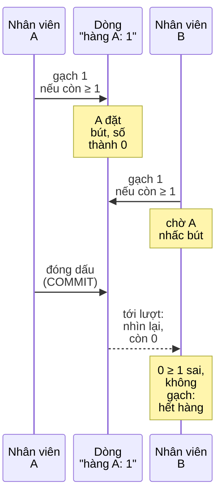

> [!tldr] Đọc nhanh
> - [[concepts/conditional-update|UPDATE có điều kiện]]: `UPDATE … SET stock = stock - 1 WHERE id = 1 AND stock >= 1`. Kiểm tra và trừ nằm trong **một câu**, không còn khe hở. Không dòng nào khớp nghĩa là hết hàng. Kết quả: 300 người, đúng 100 đơn, không cần retry.
> - Mỗi `UPDATE` tự lấy [[concepts/row-lock|khóa dòng]] và giữ tới khi transaction kết thúc. Người tới sau phải chờ.
> - [[concepts/re-check-after-lock|Đọc lại sau khi chờ khóa]]: ở Read Committed, người chờ được nhả ra sẽ chạy lại `WHERE` trên **phiên bản mới nhất** của dòng. Còn 1 suất, hai người cùng trừ: người sau thấy `0 >= 1` sai và không trừ.
> - Ở Repeatable Read, cùng câu đó lại bị hủy với `40001`: điều làm cách này đúng mà không cần retry là chính hành vi của Read Committed.
> - [[concepts/check-constraint|CHECK]] (`stock >= 0`) là lưới cuối: đoạn code nào quên điều kiện thì database vẫn từ chối (lỗi `23514`). Bảng tồn kho thường của flash-sale chưa có lưới này.

> [!info] Bối cảnh
> Ga 4 của **tuyến Transaction và khóa**. Ví dụ là **flash-sale**, trang bán hàng giảm giá giờ vàng. Lúc đặt hàng thường (không phải flash sale), server **giữ hàng** cho đơn đang chờ thanh toán: cột `reserved_stock` tăng, và chỉ được tăng khi `total_stock - reserved_stock` còn đủ. Ga 2 cho thấy cách "đọc rồi kiểm tra" bán quá; ga 3 cho thấy nâng isolation thì đúng nhưng phải retry rất nhiều. Bạn không cần biết NestJS hay code của dự án.

> [!abstract]- Từ điển nhanh cho bài này (bấm để mở)
> - **Read Committed, Repeatable Read, `40001`**: xem [[posts/2026-11-22-transactions-isolation|ga 3]]. **Phiên bản dòng (MVCC)**: xem [[posts/2026-11-22-transactions-acid|ga 1]].
> - **`rowCount`**: số dòng mà một câu `UPDATE`/`DELETE` vừa tác động. Thư viện `pg` trả về trong `result.rowCount`; Prisma `updateMany` trả `{ count }`.
> - **`RETURNING`**: phần thêm vào cuối `UPDATE`/`INSERT` để Postgres trả lại giá trị của dòng sau khi sửa, khỏi phải `SELECT` lại.
> - **Ràng buộc (constraint)**: luật khai báo trên bảng mà database tự kiểm tra mỗi lần ghi: `NOT NULL`, `UNIQUE`, khóa ngoại, `CHECK`.
> - **`ON CONFLICT DO NOTHING`**: `INSERT` gặp dòng trùng khóa duy nhất thì bỏ qua thay vì báo lỗi.

## Hình dung trước: gạch số ngay trên sổ

Hai nhân viên ở quầy vé không còn "liếc sổ rồi quay đi bán" nữa. Quy định mới: muốn bán thì **cầm bút đặt lên đúng dòng của hàng A** và gạch số ngay tại chỗ, chỉ khi số còn lớn hơn 0.

| Đời thường | Khái niệm |
|---|---|
| "Gạch 1 nếu còn ít nhất 1" là **một động tác**, không có chuyện xem trước rồi quay lại sau | [[concepts/conditional-update\|UPDATE có điều kiện]] |
| Bút đang đặt trên dòng thì người khác không gạch được dòng đó, phải chờ | [[concepts/row-lock\|Khóa dòng]] |
| Người chờ được tới lượt thì **nhìn lại con số hiện tại** trên dòng rồi mới quyết định gạch hay không | [[concepts/re-check-after-lock\|Đọc lại sau khi chờ khóa]] |
| Sổ in sẵn ô số không cho viết số âm, ai cố viết thì bị từ chối | [[concepts/check-constraint\|CHECK]] |



## Vấn đề: kiểm tra và trừ phải là một

Ga 2 cho thấy cả hai lỗi đều đến từ cùng một chỗ: **điều kiện "còn hàng" được kiểm tra ở một thời điểm, việc trừ xảy ra ở thời điểm khác**. Ga 3 vá bằng cách để Postgres phát hiện khi hai thời điểm đó lệch nhau rồi hủy transaction, và cái giá là hàng nghìn lần thử lại.

Mình từng nghĩ cách duy nhất khác là khóa dòng trước khi đọc (`SELECT … FOR UPDATE`, ga 5). Nhưng có một cách đơn giản hơn nhiều: đừng đọc lên app nữa. Đưa điều kiện vào chính câu ghi, để database kiểm tra và trừ trong cùng một bước, trên cùng một phiên bản dòng.

## Cơ chế

<figure class="figure-map" style="--ar: 3 / 4">
<div class="frame"><iframe data-archify="../diagrams/transactions-atomic-update/recheck.html" title="Còn 1 suất, hai câu UPDATE có điều kiện: Read Committed đọc lại và không trừ, Repeatable Read hủy" loading="lazy"></iframe></div>
<figcaption><span><b>Hình 1.</b> B chờ khóa dòng của A. Ở Read Committed, B chạy lại điều kiện trên phiên bản mới và không trừ; ở Repeatable Read, B bị hủy với 40001.</span><a href="../diagrams/transactions-atomic-update/recheck.html" target="_blank" rel="noopener">Mở toàn màn hình</a></figcaption>
</figure>

### UPDATE có điều kiện

Đây là hàm giữ hàng trong flash-sale, rút gọn. Toàn bộ logic "còn đủ hàng không" nằm trong mệnh đề `WHERE`:

```ts
// minh họa, không chạy trực tiếp (rút gọn từ StockService.reserveStock của flash-sale)
const updated = await tx.$queryRaw<Array<{ available_after: number }>>`
  UPDATE catalog.inventories
  SET reserved_stock = reserved_stock + ${qty}, updated_at = NOW()
  WHERE sku_id = ${skuId}::uuid
    AND total_stock >= reserved_stock + ${qty}
  RETURNING (total_stock - reserved_stock) AS available_after`;

if (updated.length === 0) {
  throw new ConflictException({ code: 'OUT_OF_STOCK', skuId, qty }); // HTTP 409
}
```

Ba điều làm nó đúng:

1. **Không có giá trị nào app tự tính.** `reserved_stock + qty` được tính trong database, trên đúng phiên bản dòng đang được sửa.
2. **Điều kiện và thao tác dính nhau.** Không tồn tại thời điểm nào mà điều kiện đã được kiểm tra còn thao tác chưa xảy ra.
3. **Kết quả nói lên quyết định.** Không dòng nào khớp (`updated.length === 0`) thì hoặc SKU không tồn tại, hoặc không đủ hàng. App không cần đọc trước để biết. `RETURNING` trả luôn số còn lại sau khi trừ để ghi vào sổ kho, khỏi một câu `SELECT` nữa.

Cùng mẫu này lặp lại khắp flash-sale: xác nhận bán (`WHERE reserved_stock >= qty`), dùng voucher (`WHERE usage_limit = 0 OR usage_count < usage_limit`), và số đã bán của flash sale.

Hàm này **không tự mở transaction**; nó nhận `tx` của người gọi. Sau câu `UPDATE` là một `INSERT` vào sổ kho với khóa idempotency `sha256(orderId:skuId:RESERVE)` và `ON CONFLICT DO NOTHING`, để một consumer RabbitMQ chạy lại cùng tin nhắn không ghi sổ hai lần (xem [[concepts/idempotent-consumer|idempotent consumer]]).

### Khóa dòng

Mỗi `UPDATE` tự lấy một [[concepts/row-lock|khóa dòng]] trên mọi dòng nó sửa, và **giữ tới khi transaction COMMIT hoặc ROLLBACK**, không phải tới khi câu lệnh xong. Khóa dòng không chặn người đọc (MVCC lo việc đó); nó chỉ chặn người khác muốn sửa, xóa hay khóa cùng dòng.

Tài liệu Postgres có bảng các chế độ khóa dòng. Ở đây chỉ cần hai: `UPDATE` thường lấy `FOR NO KEY UPDATE`; `DELETE` hay `UPDATE` đổi cột khóa thì lấy `FOR UPDATE`, chế độ mạnh nhất. Hai chế độ này đều xung đột với chính nó, nên hai câu `UPDATE` cùng một dòng luôn phải xếp hàng.

Điều này có hệ quả cho cả transaction: nếu sau câu `UPDATE` bạn còn làm việc lâu (ghi đơn, gọi dịch vụ khác), mọi người mua cùng SKU phải chờ hết khoảng đó. Ga 6 quay lại chuyện này.

### Đọc lại sau khi chờ khóa

Đây là chỗ mình thấy hay nhất. Tài liệu Postgres mô tả hành vi của `UPDATE` ở Read Committed khi dòng nó tìm thấy đang bị transaction khác sửa:

1. Chờ transaction kia COMMIT hoặc ROLLBACK.
2. Nếu kia ROLLBACK: dùng phiên bản cũ, như chưa có gì xảy ra.
3. Nếu kia COMMIT: lấy **phiên bản mới nhất** của dòng, **chạy lại điều kiện `WHERE`** trên đó. Còn khớp thì áp thao tác lên bản mới; không khớp thì bỏ qua dòng.

Bước 3 là [[concepts/re-check-after-lock|đọc lại sau khi chờ khóa]] (trong mã nguồn Postgres gọi là EvalPlanQual). Nhờ nó, câu `UPDATE … WHERE stock >= 1` của người thứ hai được đánh giá trên con số **sau** khi người thứ nhất đã trừ. Còn 1 suất: người thứ nhất trừ còn 0, người thứ hai thấy `0 >= 1` sai, không khớp dòng nào, `rowCount = 0`, hết hàng.

Cùng hành vi đó gây ra lost update ở ga 2. Khác biệt duy nhất là thao tác: `SET stock = 36` (hằng số app tính từ dữ liệu cũ) áp lên bản mới vẫn ra 36; còn `SET stock = stock - 1 WHERE stock >= 1` thì cả điều kiện lẫn phép tính đều dùng bản mới.

Ở Repeatable Read, bước 3 không xảy ra: transaction đã chụp ảnh trước khi dòng đổi, nên Postgres hủy nó với `40001` (ga 3). Cách sửa của ga này **dựa vào** Read Committed. Nâng isolation lên cho "chắc" lại biến một thao tác đang đúng mà không cần retry thành một thao tác cần retry.

Một giới hạn cần nhớ: đọc lại chỉ áp dụng cho **dòng đang bị sửa**. Nếu điều kiện của bạn phụ thuộc vào dòng khác (tổng số đơn của user, như write skew ở ga 3), `UPDATE` có điều kiện trên một dòng không cứu được.

### CHECK: lưới cuối trong database

UPDATE có điều kiện chỉ đúng khi **mọi** đoạn code ghi vào bảng đều nhớ điều kiện. Một job admin chỉnh tồn kho, một migration, một hàm mới viết vội: chỉ cần một chỗ quên `AND stock >= 1`. Một [[concepts/check-constraint|ràng buộc CHECK]] chuyển luật đó vào database:

```sql
ALTER TABLE items ADD CONSTRAINT items_stock_nonneg CHECK (stock >= 0);
```

Từ lúc đó, mọi câu ghi tạo ra dòng vi phạm đều bị từ chối với lỗi `23514` và transaction rollback, bất kể code nào gửi.

flash-sale dùng CHECK ở vài chỗ quan trọng: `sold_count <= allocated_stock` trên sản phẩm flash sale, `usage_count <= usage_limit` trên voucher, số tiền hoàn không vượt số tiền thanh toán. Nhưng bảng tồn kho thường `catalog.inventories` **chưa có CHECK nào** cho `reserved_stock` hay `total_stock`. Hiện tại mọi câu ghi đều có điều kiện nên dữ liệu vẫn đúng, và hàm nhả hàng còn dùng `GREATEST(reserved_stock - qty, 0)` để không xuống âm. Nhưng chính `GREATEST` lại có thể che một bug (nhả nhiều hơn đã giữ) thay vì làm nó lộ ra. Thêm `CHECK (reserved_stock >= 0 AND reserved_stock <= total_stock)` là một việc nhỏ đáng làm.

## Ví dụ chạy được

[atomic-update.ts](../code/transactions-atomic-update/atomic-update.ts) làm ba việc:

- **A.** 300 người, 100 suất, mỗi người một câu `UPDATE` có điều kiện rồi `INSERT` đơn;
- **B.** chậm lại để xem từng bước: còn 1 suất, session A trừ và giữ transaction mở 300 ms, session B gửi cùng câu; chạy ở Read Committed rồi Repeatable Read;
- **C.** thêm `CHECK (stock >= 0)`, rồi cho một câu `UPDATE` quên điều kiện chạy hai lần.

```bash
npm i pg
node atomic-update.ts
```

```ts
// Một câu duy nhất: chỉ trừ khi còn đủ hàng. Không có dòng nào khớp = hết hàng.
async function buy(buyer: number) {
  const c = await pool.connect();
  try {
    await c.query('BEGIN');
    const r = await c.query('UPDATE items SET stock = stock - 1 WHERE id = 1 AND stock >= 1 RETURNING stock');
    if (r.rowCount === 0) { await c.query('ROLLBACK'); return false; }
    await sleep(2);
    await c.query('INSERT INTO orders (item_id, buyer) VALUES (1, $1)', [buyer]);
    await c.query('COMMIT');
    return true;
  } finally { c.release(); }
}
```

```text
$ node atomic-update.ts
A. UPDATE có điều kiện: 100 người mua được, 100 đơn, tồn cuối 0, 489 ms

B. Còn 1 suất, hai session cùng trừ (READ COMMITTED)
    3 ms  A   UPDATE xong, 1 dòng, stock = 0; chưa COMMIT nên vẫn giữ khóa dòng
    3 ms  B   gửi cùng câu UPDATE…
  304 ms  B   …vẫn đang chờ khóa dòng của A
  304 ms  A   gửi COMMIT, nhả khóa
  308 ms  B   xong: 0 dòng khớp → hết hàng, không trừ
   tồn cuối: 0

B. Còn 1 suất, hai session cùng trừ (REPEATABLE READ)
    3 ms  A   UPDATE xong, 1 dòng, stock = 0; chưa COMMIT nên vẫn giữ khóa dòng
    3 ms  B   gửi cùng câu UPDATE…
  304 ms  B   …vẫn đang chờ khóa dòng của A
  304 ms  A   gửi COMMIT, nhả khóa
  308 ms  B   lỗi 40001: could not serialize access due to concurrent update
   tồn cuối: 0

C. Thêm CHECK (stock >= 0), rồi một đoạn code quên điều kiện "AND stock >= 1"
   lần 1: trừ được
   lần 2: lỗi 23514: new row for relation "items" violates check constraint "items_stock_nonneg"
```

Đọc kết quả:

- **A**: đúng 100 đơn, kho về 0, không ai bị lỗi, không retry nào. So với ga 3 (khoảng 1200 lần thử lại để ra cùng kết quả), đây là khác biệt giữa "phát hiện rồi làm lại" và "không để có gì phải phát hiện".
- **B, Read Committed**: B gửi `UPDATE` ở mili giây thứ 3 nhưng chỉ xong ở mili giây 308, ngay sau khi A commit. Nó không báo lỗi, chỉ báo 0 dòng khớp: điều kiện đã được chạy lại trên bản `stock = 0`.
- **B, Repeatable Read**: cùng câu, cùng thứ tự, nhưng B bị hủy. Đúng, nhưng app phải retry để biết là hết hàng.
- **C**: lần 1 trừ 1 xuống 0 hợp lệ. Lần 2 sẽ tạo `stock = -1`, nên Postgres từ chối dù câu `UPDATE` không có điều kiện nào.

## Hiểu lầm và bẫy hay gặp

- **"Phải `SELECT` trước để biết còn hàng không."** Không cần: `rowCount = 0` (hoặc `RETURNING` rỗng) đã là câu trả lời. Đọc trước chỉ mở lại khe hở của ga 2.
- **"Nâng lên Repeatable Read cho an toàn hơn."** Với UPDATE có điều kiện, nâng isolation biến "0 dòng khớp" thành lỗi `40001` phải retry. Cách này đúng **chính nhờ** Read Committed.
- **Đọc `rowCount` sai chỗ.** Prisma `update()` ném lỗi `P2025` khi không tìm thấy dòng, còn `updateMany()` trả `{ count: 0 }`. Điều kiện phức tạp thì dùng `updateMany` hoặc SQL thuần như flash-sale, và luôn kiểm tra số dòng.
- **Áp dụng cho luật nhiều dòng.** Đọc lại chỉ áp dụng cho dòng đang bị sửa. Giới hạn mỗi người (đếm đơn) hay tổng giỏ hàng nhiều SKU cần `UNIQUE`, Serializable, hoặc khóa (ga 5).
- **Làm việc lâu sau câu `UPDATE`.** Khóa dòng giữ tới COMMIT. Trừ kho xong rồi gọi API ngoài là bắt mọi người mua cùng SKU xếp hàng chờ API đó.
- **"Có điều kiện trong code rồi, CHECK là thừa."** CHECK bắt những đoạn code bạn chưa viết, do người khác viết, hoặc chạy ngoài app (script tay, migration). Nó rẻ và nằm ngay cạnh dữ liệu.
- **Dùng `GREATEST(x - q, 0)` để "an toàn".** Nó giữ số không âm nhưng nuốt mất bằng chứng của bug. Một CHECK làm bug lộ ra thành lỗi; `GREATEST` làm nó im lặng.

## Câu hỏi tự kiểm tra

> [!question]- Vì sao `UPDATE … SET stock = stock - 1 WHERE stock >= 1` không bán quá, còn "SELECT rồi UPDATE stock = stock - 1" thì có?
> Vì điều kiện và phép trừ nằm trong cùng một câu, được đánh giá trên cùng một phiên bản dòng (và đánh giá lại nếu phải chờ khóa). Cách hai bước kiểm tra điều kiện trên con số đã đọc từ trước, nên nhiều request cùng thấy "còn hàng".

> [!question]- Khóa dòng mà `UPDATE` lấy được giữ tới khi nào? Điều đó ảnh hưởng gì tới phần code chạy sau câu `UPDATE` trong cùng transaction?
> Tới khi transaction COMMIT hoặc ROLLBACK. Mọi việc chạy sau câu `UPDATE` trong transaction (ghi đơn, gọi dịch vụ) đều kéo dài thời gian người khác phải chờ để sửa cùng dòng.

> [!question]- Ở Read Committed, B chờ A rồi nhận 0 dòng. Ở Repeatable Read, B chờ A rồi nhận lỗi. Vì sao khác nhau?
> Read Committed cho phép B chạy lại `WHERE` trên phiên bản mới nhất sau khi A commit. Repeatable Read giữ B trên snapshot cũ; vì dòng đã đổi sau snapshot, cho B ghi tiếp là ghi dựa trên dữ liệu cũ, nên Postgres hủy B với `40001`.

> [!question]- UPDATE có điều kiện có giữ được luật "mỗi người tối đa 2 suất" không? Vì sao?
> Không, nếu luật đó được tính bằng cách đếm đơn trên bảng khác. Đọc lại sau khi chờ khóa chỉ áp dụng cho dòng đang bị sửa; hai transaction chèn hai đơn mới không sửa chung dòng nào (write skew ở ga 3).

> [!question]- Mọi câu ghi đã có điều kiện rồi. Kể hai lý do vẫn nên thêm CHECK.
> Bắt những câu ghi không đi qua code đó (script admin, migration, code mới viết quên điều kiện); và biến bug thành lỗi rõ ràng thay vì dữ liệu sai im lặng (như `GREATEST(x - q, 0)` che bug nhả quá số đã giữ).

## Tham khảo

- [PostgreSQL 16: Transaction Isolation, Read Committed](https://www.postgresql.org/docs/16/transaction-iso.html) (chờ, chạy lại `WHERE` trên phiên bản mới nhất)
- [PostgreSQL 16: Explicit Locking, Row-Level Locks](https://www.postgresql.org/docs/16/explicit-locking.html) (`UPDATE` lấy `FOR NO KEY UPDATE`, bảng xung đột)
- [PostgreSQL 16: UPDATE](https://www.postgresql.org/docs/16/sql-update.html) (`RETURNING`, số dòng bị ảnh hưởng)
- [PostgreSQL 16: Constraints](https://www.postgresql.org/docs/16/ddl-constraints.html) (`CHECK`)
