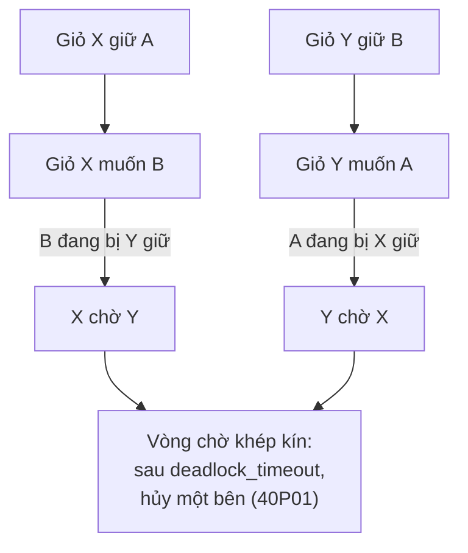

> [!tldr] Đọc nhanh
> - [[deadlock|Deadlock]]: giỏ X giữ khóa SKU A và chờ B, giỏ Y giữ B và chờ A. Không ai nhả được. Postgres chờ `deadlock_timeout` (mặc định 1 giây), phát hiện vòng chờ và hủy một bên với lỗi `40P01`.
> - [[lock-ordering|Khóa theo thứ tự]]: mọi đoạn code khóa nhiều dòng theo **cùng một thứ tự** thì không thể có vòng chờ. flash-sale sắp xếp `skuId` tăng dần trước khi giữ hàng cho cả giỏ. Kết quả: 20/20 giỏ xong, không lỗi.
> - [[transaction-retry|Retry]] lỗi `40P01`/`40001` có jitter là lưới an toàn cần có, nhưng không thay được việc khóa theo thứ tự: không sắp xếp mà retry tối đa 5 lần, vẫn chỉ 8/20 giỏ xong.
> - [[long-running-transaction|Transaction dài]]: một request giữ khóa SKU A trong 3 giây vì gọi cổng thanh toán bên trong transaction, mọi người mua A chờ đúng 3 giây.
> - [[lock-timeout|lock_timeout]] biến "chờ vô thời hạn" thành lỗi `55P03` sau một khoảng bạn chọn, để request thất bại nhanh thay vì kéo cả hệ thống treo theo.

> [!info] Bối cảnh
> Ga 6 của **tuyến Transaction và khóa**. Ví dụ là **flash-sale**, trang bán hàng giảm giá giờ vàng. Lúc thanh toán giỏ hàng nhiều sản phẩm, server giữ hàng cho **từng SKU** trong một transaction, mỗi SKU một câu `UPDATE` có điều kiện (ga 4). Hai người có giỏ chứa cùng các SKU, bấm thanh toán cùng lúc. Bạn không cần biết NestJS hay code của dự án.

> [!abstract]- Từ điển nhanh cho bài này (bấm để mở)
> - **Khóa dòng, UPDATE có điều kiện**: xem [[2026-11-22-transactions-atomic-update|ga 4]]. **`FOR UPDATE`, `NOWAIT`, `55P03`**: xem [[2026-11-22-transactions-locking|ga 5]]. **`40001`**: xem [[2026-11-22-transactions-isolation|ga 3]].
> - **SKU**: một biến thể cụ thể của sản phẩm (áo đỏ cỡ M). Tồn kho được tính theo SKU.
> - **Vòng chờ**: A chờ B, B chờ A (hoặc dài hơn: A chờ B, B chờ C, C chờ A).
> - **Backoff lũy thừa và jitter**: thử lại sau 50 ms, rồi tới 100, 200, 400 ms…, mỗi lần chọn ngẫu nhiên trong khoảng đó. Xem [[retries-with-backoff|retry với backoff]].
> - **`SET LOCAL`**: đổi một tham số Postgres chỉ cho transaction hiện tại.

## Hình dung trước: hai người, hai cánh cửa

Hai người cần đi qua hai phòng liền nhau, phòng A và phòng B, mỗi phòng chỉ một người được ở.

| Đời thường | Khái niệm |
|---|---|
| X đứng trong phòng A, cần sang B; Y đứng trong phòng B, cần sang A. Không ai chịu lùi | [[deadlock\|Deadlock]] |
| Bảo vệ đợi một lúc, thấy hai người kẹt nhau thì mời một người ra ngoài làm lại từ đầu | Postgres phát hiện, hủy một bên (`40P01`) |
| Quy định: ai cũng phải vào phòng A trước rồi mới tới B | [[lock-ordering\|Khóa theo thứ tự]] |
| Người bị mời ra đợi một lúc ngẫu nhiên rồi đi lại | [[transaction-retry\|Thử lại có jitter]] |
| Một người vào phòng A rồi **ngồi gọi điện 3 phút**, cả hàng sau lưng đứng chờ | [[long-running-transaction\|Transaction dài]] |
| Người xếp hàng tự đặt giới hạn: chờ quá nửa giây thì bỏ đi | [[lock-timeout\|lock_timeout]] |



## Vấn đề: mỗi câu đều đúng, cả hệ thống lại kẹt

Sau ga 4, mỗi lần giữ hàng là một câu `UPDATE` có điều kiện, đúng và nhanh. Một giỏ hàng nhiều SKU chỉ là chạy câu đó nhiều lần trong một transaction. Mình không thấy có gì có thể sai.

Cái sai nằm ở chỗ mỗi `UPDATE` giữ khóa dòng **tới cuối transaction** (ga 4). Một giỏ hai SKU giữ khóa A trong lúc đi lấy khóa B. Nếu một giỏ khác đang làm đúng điều ngược lại, hai transaction chờ nhau mãi mãi. Không câu lệnh nào sai; chỉ có thứ tự là sai.

Cùng lúc đó, có một kiểu kẹt khác không cần tới hai người: một transaction giữ khóa rồi đi làm việc khác lâu (gọi cổng thanh toán, gửi email, chờ một service chậm). Postgres không có giới hạn thời gian chờ khóa mặc định, nên mọi người tới sau chờ tới khi nó xong.

## Cơ chế

<figure class="figure-map" style="--ar: 3 / 4">
<div class="frame"><iframe data-archify="../diagrams/transactions-deadlock/deadlock.html" title="Hai giỏ hàng khóa SKU ngược thứ tự thì deadlock; sắp xếp thì xếp hàng" loading="lazy"></iframe></div>
<figcaption><span><b>Hình 1.</b> Khóa ngược thứ tự tạo vòng chờ và Postgres hủy một giỏ sau 1 giây; sắp xếp SKU thì giỏ thứ hai chờ ngay ở khóa đầu tiên và không ai bị hủy.</span><a href="../diagrams/transactions-deadlock/deadlock.html" target="_blank" rel="noopener">Mở toàn màn hình</a></figcaption>
</figure>

### Deadlock

Một [[deadlock|deadlock]] là một vòng chờ: mỗi transaction trong vòng đang giữ một khóa mà transaction kế tiếp cần. Tài liệu Postgres mô tả đúng ví dụ chuyển tiền giữa hai tài khoản, cập nhật theo hai thứ tự khác nhau.

Postgres xử lý như sau:

1. Một transaction phải chờ khóa. Ban đầu nó chỉ chờ, vì hầu hết các lần chờ đều tự hết.
2. Sau `deadlock_timeout` (mặc định **1 giây**), Postgres chạy bộ kiểm tra deadlock, một việc khá tốn kém nên không làm ngay.
3. Nếu thấy vòng chờ, nó hủy một transaction trong vòng với lỗi `40P01 deadlock detected`. Transaction nào bị hủy thì "khó đoán và không nên dựa vào".
4. Các transaction còn lại lấy được khóa và chạy tiếp.

Hệ quả: mỗi deadlock tốn ít nhất 1 giây chờ cho tất cả những người trong vòng, cộng một transaction bị hủy. Trong flash sale, một giây là rất lâu.

### Khóa theo thứ tự

Lời khuyên đầu tiên trong tài liệu Postgres: cách phòng deadlock tốt nhất là mọi ứng dụng lấy khóa trên nhiều đối tượng **theo một thứ tự nhất quán**. Nếu mọi giỏ đều khóa A trước B, thì giỏ nào lấy được A sẽ lấy được B; giỏ còn lại chờ ngay ở A, không giữ gì, nên không có vòng.

flash-sale làm đúng điều đó ở bước thanh toán:

```ts
// minh họa, không chạy trực tiếp (rút gọn từ CheckoutService của flash-sale)
// Giữ hàng ATOMIC qua StockService: sắp xếp skuId tăng dần để chống deadlock.
const sortedItems = [...group.items].sort((a, b) => a.skuId.localeCompare(b.skuId));
for (const item of sortedItems) {
  await stockService.reserveStock(tx, { skuId: item.skuId, qty: item.quantity, orderId });
}
```

Comment trong `StockService` nói lý do: giỏ [A, B] và [B, A] không sắp xếp sẽ deadlock; Postgres phát hiện và hủy một bên, "nhưng một cơn bão rollback ở quy mô flash sale là đắt". Consumer nhả hàng khi đơn bị hủy cũng sắp xếp như vậy, dù nhả hàng ít có nguy cơ hơn, để mọi đường đi qua bảng tồn kho cùng một thứ tự.

Thứ tự phải là **thứ tự toàn cục**, không phải "thứ tự trong giỏ". Và phải nhất quán giữa **mọi** đoạn code chạm vào cùng các dòng: một job admin cập nhật tồn kho theo thứ tự tên sản phẩm có thể deadlock với checkout sắp xếp theo `skuId`.

Lời khuyên thứ hai trong tài liệu: lấy khóa mạnh nhất cần thiết ngay từ lần đầu. Đọc bằng `FOR SHARE` rồi sau đó mới nâng lên `UPDATE` là một cách khác để hai transaction kẹt nhau trên cùng một dòng.

### Transaction dài

Một [[long-running-transaction|transaction dài]] là transaction mở lâu hơn mức cần, thường vì làm việc không liên quan tới database bên trong nó: gọi HTTP sang cổng thanh toán, gửi email, chờ một hàng đợi. Nó gây hại theo ba cách:

- **Giữ khóa**: mọi dòng đã sửa vẫn bị khóa. Ví dụ dưới: giữ khóa SKU A 3 giây thì mọi người mua A chờ 3 giây.
- **Giữ kết nối**: một kết nối trong pool bị chiếm suốt thời gian đó. Đủ nhiều transaction dài là pool cạn, các request không liên quan cũng phải chờ.
- **Giữ phiên bản cũ**: MVCC không dọn được phiên bản dòng nào mà transaction đang mở còn có thể cần, nên bảng phình ra.

Tài liệu Postgres gọi việc giữ transaction mở lâu (ví dụ chờ người dùng nhập) là "một ý tồi". Cách sửa thường là đổi chỗ: gọi API ngoài **trước** hoặc **sau** transaction, và dùng outbox để những việc phải xảy ra sau commit được làm một cách đáng tin cậy.

Prisma có một lưới riêng: interactive transaction mặc định bị hủy sau `timeout` 5 giây, và chờ lấy kết nối tối đa `maxWait` 2 giây. Cron hủy đơn quá hạn của flash-sale cố ý nâng `timeout` lên 30 giây cho lô 100 đơn; các transaction thanh toán giữ mặc định.

### lock_timeout và các giới hạn thời gian

Postgres có ba tham số giới hạn, **đều tắt (0) theo mặc định**:

| Tham số | Hủy khi | Lỗi |
|---|---|---|
| [[lock-timeout\|`lock_timeout`]] | một lần chờ khóa vượt quá thời gian này | `55P03` lock_not_available |
| `statement_timeout` | một câu lệnh chạy quá lâu (kể cả thời gian chờ khóa) | `57014` query_canceled |
| `idle_in_transaction_session_timeout` | session mở transaction mà ngồi không quá lâu | session bị đóng |

`lock_timeout` hợp cho đường đi nóng của người dùng: thà báo "đang đông, thử lại" sau 500 ms còn hơn treo request 30 giây. `idle_in_transaction_session_timeout` bắt đúng lỗi "mở transaction rồi đi gọi API": nếu app không gửi câu lệnh nào trong khoảng đó, Postgres đóng session và nhả mọi khóa. Đặt chúng bằng `SET LOCAL` cho từng transaction, hoặc ở mức role/database cho cả app.

### Thử lại có jitter

Có những lỗi mà "thử lại là được": `40P01` (deadlock) và `40001` (serialization failure, ga 3). Prisma gộp cả hai thành `P2034`. Một vòng [[transaction-retry|thử lại]] tử tế:

- thử lại **cả transaction** từ đầu, không phải câu lệnh lỗi;
- chỉ thử lại đúng những mã lỗi đó, không thử lại lỗi nghiệp vụ hay lỗi cú pháp;
- giới hạn số lần, và chờ một khoảng **lũy thừa có jitter** giữa các lần, để những người vừa đụng nhau không cùng thử lại một lúc;
- không có tác dụng phụ bên ngoài trong khối được thử lại.

Nhưng retry chỉ là lưới an toàn. Nếu nguyên nhân là thứ tự khóa, retry chỉ đẩy các giỏ vào lại đúng vòng chờ đó. Ví dụ dưới đo điều này.

## Ví dụ chạy được

[deadlock.ts](../code/transactions-deadlock/deadlock.ts) làm bốn việc:

- **A.** giỏ X = [A, B] và giỏ Y = [B, A], không sắp xếp, mỗi bước cách nhau 100 ms;
- **B.** cùng hai giỏ, sắp xếp SKU trước khi khóa;
- **C.** một request giữ khóa SKU A trong 3 giây (giả lập gọi cổng thanh toán trong transaction), ba người mua A, người thứ ba đặt `lock_timeout = 500ms`;
- **D.** 20 giỏ cùng lúc, xen kẽ [A, B] và [B, A]: không sắp xếp; không sắp xếp nhưng retry tối đa 5 lần có jitter; sắp xếp.

```bash
npm i pg
node deadlock.ts
```

```ts
// Giữ hàng cho cả giỏ trong một transaction: mỗi SKU một câu UPDATE có điều kiện.
async function reserveCart(name: string, skus: string[], gapMs = 100) {
  const c = await pool.connect();
  try {
    await c.query('BEGIN');
    for (const sku of skus) {
      await c.query('UPDATE inventories SET reserved = reserved + 1 WHERE sku = $1 AND total >= reserved + 1', [sku]);
      console.log(`${at()}  ${name}: đã khóa ${sku}`);
      await sleep(gapMs); // làm việc khác giữa hai SKU (tính giá, voucher…)
    }
    await c.query('COMMIT');
    console.log(`${at()}  ${name}: COMMIT`);
  } catch (e: any) {
    await c.query('ROLLBACK').catch(() => {});
    console.log(`${at()}  ${name}: lỗi ${e.code}: ${e.message.split('\n')[0]}`);
  } finally { c.release(); }
}
```

```text
$ node deadlock.ts
A. Giỏ X = [A, B], giỏ Y = [B, A], không sắp xếp
    2 ms  giỏ X: đã khóa A
    7 ms  giỏ Y: đã khóa B
 1106 ms  giỏ Y: đã khóa A
 1107 ms  giỏ X: lỗi 40P01: deadlock detected
 1210 ms  giỏ Y: COMMIT

B. Cùng hai giỏ, nhưng sắp xếp SKU tăng dần trước khi khóa
    2 ms  giỏ X: đã khóa A
  103 ms  giỏ X: đã khóa B
  207 ms  giỏ X: COMMIT
  208 ms  giỏ Y: đã khóa A
  311 ms  giỏ Y: đã khóa B
  415 ms  giỏ Y: COMMIT

C. Một request giữ khóa SKU A trong 3 giây (gọi API ngoài trong transaction)
    2 ms  chậm: đã khóa A, đang chờ cổng thanh toán…
  569 ms  người 3, lock_timeout 500ms: lỗi 55P03 sau 505 ms (canceling statement due to lock timeout)
 3008 ms  chậm: COMMIT
 3010 ms  người 1: mua được sau 2957 ms
 3012 ms  người 2: mua được sau 2948 ms

D. 20 giỏ cùng lúc, xen kẽ [A, B] và [B, A]
   không sắp xếp, không retry    : 1/20 giỏ xong (19× 40P01), 0 lần thử lại
   không sắp xếp, retry tối đa 5 : 8/20 giỏ xong (12× 40P01), 90 lần thử lại
   sắp xếp SKU, không retry      : 20/20 giỏ xong (không lỗi), 0 lần thử lại
```

Đọc kết quả:

- **A**: hai giỏ kẹt nhau từ mili giây thứ 7. Postgres im lặng chờ đúng `deadlock_timeout` 1 giây, rồi hủy giỏ X. Giỏ Y lấy được A ở 1106 ms và commit. Một giỏ thất bại, cả hai mất hơn một giây.
- **B**: giỏ Y chờ ngay ở khóa A (khóa đầu tiên), không giữ gì trong lúc chờ, nên chỉ xếp hàng sau giỏ X. Hai giỏ xong trong 415 ms, không ai bị hủy.
- **C**: người 1 và 2 chờ gần 3 giây, đúng bằng thời gian request chậm "gọi cổng thanh toán". Người 3 đặt `lock_timeout` nên bỏ cuộc sau 505 ms với `55P03` và có thể báo người dùng ngay.
- **D**: 20 giỏ ngược thứ tự tạo ra hàng loạt vòng chờ, 19 giỏ bị hủy. Retry tối đa 5 lần với jitter cứu thêm một ít, sau **90** lần thử lại, và 12 giỏ vẫn thất bại vì mỗi lần thử lại lại rơi vào vòng chờ mới. Sắp xếp SKU: 20/20, không một lần thử lại. Con số ở dòng giữa đổi mỗi lần chạy; hai dòng còn lại thì không.

## Hiểu lầm và bẫy hay gặp

- **"Postgres tự xử lý deadlock nên không cần lo."** Nó xử lý bằng cách hủy một transaction sau ít nhất 1 giây. Với flash sale, đó là một người mua thất bại và cả vòng chờ chậm đi một giây, nhân với số lần xảy ra.
- **"Có retry rồi thì deadlock không sao."** Ví dụ D: retry mà không sửa thứ tự thì vẫn 12/20 giỏ lỗi. Retry dành cho xung đột hiếm, không phải cho lỗi thiết kế.
- **Sắp xếp trong một chỗ, quên chỗ khác.** Thứ tự phải nhất quán giữa mọi đoạn code khóa cùng các dòng: checkout, nhả hàng, job đồng bộ tồn kho, công cụ admin.
- **Gọi API ngoài trong transaction.** Giữ khóa và kết nối trong suốt thời gian chờ mạng. Gọi trước hoặc sau transaction, hoặc đưa vào outbox.
- **Không đặt bất kỳ timeout nào.** `lock_timeout`, `statement_timeout` và `idle_in_transaction_session_timeout` đều mặc định 0, tức chờ vô hạn. Một request treo có thể kéo cả pool kết nối treo theo.
- **Giảm `deadlock_timeout` cho "phát hiện nhanh hơn".** Tài liệu Postgres nói 1 giây là "khoảng nhỏ nhất bạn nên dùng": kiểm tra deadlock tốn kém và hầu hết các lần chờ khóa đều tự hết.
- **Retry không có jitter.** Hai giỏ vừa deadlock nhau mà thử lại cùng lúc thì deadlock lại y hệt.

## Câu hỏi tự kiểm tra

> [!question]- Vì sao giỏ [A, B] và giỏ [B, A] có thể deadlock, còn hai giỏ [A, B] thì không?
> Mỗi `UPDATE` giữ khóa tới cuối transaction. Ngược thứ tự thì mỗi giỏ giữ một khóa mà giỏ kia cần, tạo vòng chờ. Cùng thứ tự thì giỏ tới sau chờ ngay ở khóa đầu tiên mà chưa giữ khóa nào, nên chỉ có xếp hàng.

> [!question]- Ở ví dụ A, vì sao lỗi deadlock xuất hiện sau khoảng 1100 ms chứ không phải ngay lập tức?
> Postgres chỉ chạy bộ kiểm tra deadlock sau khi một transaction đã chờ khóa được `deadlock_timeout`, mặc định 1 giây, vì việc kiểm tra tốn kém và hầu hết các lần chờ tự hết.

> [!question]- Retry tối đa 5 lần có jitter mà vẫn chỉ 8/20 giỏ xong. Điều đó nói gì về vai trò của retry?
> Retry chỉ là lưới an toàn cho xung đột hiếm. Khi nguyên nhân là thiết kế (thứ tự khóa ngược nhau), mỗi lần thử lại lại tạo vòng chờ mới; phải sửa nguyên nhân bằng cách khóa theo thứ tự.

> [!question]- Kể ba thứ mà một transaction mở quá lâu giữ lại, gây hại cho request khác.
> Khóa dòng (người sửa cùng dòng phải chờ), một kết nối trong pool (pool có thể cạn), và các phiên bản dòng cũ mà MVCC chưa dọn được (bảng phình ra).

> [!question]- Bạn muốn người mua thấy lỗi "đang đông, thử lại" sau tối đa nửa giây thay vì treo. Đặt gì, và lỗi trả về là gì?
> Đặt `SET LOCAL lock_timeout = '500ms'` trong transaction. Khi chờ khóa quá 500 ms, câu lệnh bị hủy với lỗi `55P03`, app bắt lỗi đó và trả thông báo cho người dùng.

## Tham khảo

- [PostgreSQL 16: Explicit Locking, Deadlocks](https://www.postgresql.org/docs/16/explicit-locking.html) (vòng chờ, khóa theo thứ tự nhất quán, lấy khóa mạnh nhất ngay từ đầu, cảnh báo transaction mở lâu)
- [PostgreSQL 16: Lock Management](https://www.postgresql.org/docs/16/runtime-config-locks.html) (`deadlock_timeout`, mặc định 1s)
- [PostgreSQL 16: Client Connection Defaults](https://www.postgresql.org/docs/16/runtime-config-client.html) (`lock_timeout`, `statement_timeout`, `idle_in_transaction_session_timeout`)
- [Prisma: Transactions](https://www.prisma.io/docs/orm/prisma-client/queries/transactions) (`timeout`, `maxWait`, lỗi `P2034`)
