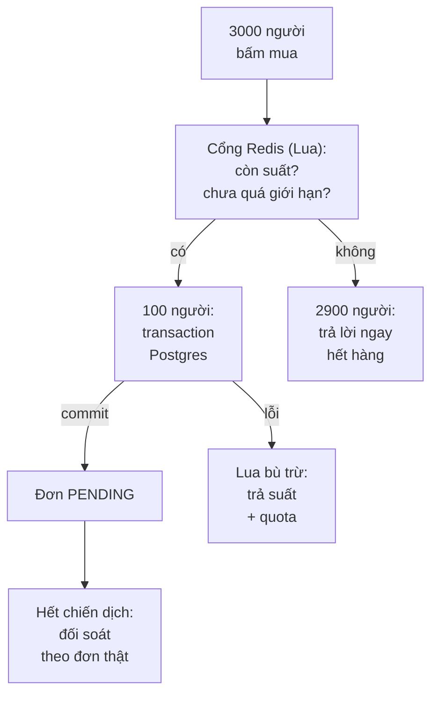

> [!tldr] Đọc nhanh
> - [[concepts/atomic-gate|Cổng nguyên tử]]: một script Lua trong Redis kiểm tra giới hạn mỗi người, trừ kho và ghi quota trong **một lần chạy** không ai chen được. 3000 người bấm, chỉ 100 người qua cổng, Postgres chỉ thấy 100 transaction thay vì 3000.
> - Postgres vẫn là **sổ sự thật**: đơn được tạo bằng UPDATE có điều kiện + INSERT trong một transaction (ga 4). Redis chỉ là bộ đếm để chặn sớm.
> - Hai nơi lưu cùng một con số thì sẽ lệch. [[concepts/compensation|Bù trừ]]: transaction Postgres lỗi thì một script Lua thứ hai trả suất và quota lại cho Redis. DB lỗi 10%: 13 lần bù trừ, cuối cùng vẫn đúng 100 đơn.
> - [[concepts/reconciliation|Đối soát]]: pod chết **giữa** Redis và Postgres thì không ai bù trừ, 3 suất "bốc hơi". Lúc chiến dịch kết thúc, flash-sale đếm đơn thật trong Postgres và sửa lại bộ đếm.
> - [[concepts/defense-in-depth|Phòng thủ nhiều lớp]]: Redis chặn, UPDATE có điều kiện chặn, và `CHECK (sold_count <= allocated_stock)` chặn nốt khi cả hai lớp trên có bug. Cuối bài là [[concepts/concurrency-checklist|checklist]] cho cả tuyến.

> [!info] Bối cảnh
> Ga 7, ga cuối của **tuyến Transaction và khóa**. Ví dụ là **flash-sale**, trang bán hàng giảm giá giờ vàng: mỗi chiến dịch dành riêng một số suất (`allocated_stock`) cho từng SKU; đúng giờ, hàng nghìn người được cho vào theo lượt và bấm mua. Mỗi người chỉ được mua tối đa vài suất mỗi SKU. Bạn không cần biết NestJS, Redis hay code của dự án.

> [!abstract]- Từ điển nhanh cho bài này (bấm để mở)
> - **UPDATE có điều kiện, CHECK**: xem [[posts/2026-11-22-transactions-atomic-update|ga 4]]. **Dòng nóng**: xem [[posts/2026-11-22-transactions-locking|ga 5]]. **Write skew**: xem [[posts/2026-11-22-transactions-isolation|ga 3]].
> - **Redis**: cơ sở dữ liệu nằm trong RAM, rất nhanh, xử lý từng lệnh một trên một luồng. Xem [[series/caching|tuyến Caching]].
> - **Lua script trong Redis**: một đoạn chương trình nhỏ gửi lên Redis bằng lệnh `EVAL`; Redis chạy trọn nó trước khi xử lý lệnh khác.
> - **`DECRBY` / `INCRBY`**: lệnh Redis trừ / cộng một số nguyên và trả về giá trị mới.
> - **Outbox**: bảng ghi sự kiện trong cùng transaction với dữ liệu, để gửi đi sau khi commit. Xem [[concepts/transactional-outbox|transactional outbox]].
> - **Nguồn sự thật (source of truth)**: nơi mà khi hai bản ghi mâu thuẫn, bạn tin nơi đó.

## Hình dung trước: buổi hòa nhạc có cổng soát vé

Một buổi hòa nhạc có 100 ghế và 3000 người muốn vào.

| Đời thường | Khái niệm |
|---|---|
| Cổng ngoài có một **máy đếm bấm tay**: đếm đủ 100 thì đóng cổng, ai chưa có vé quay về ngay | [[concepts/atomic-gate\|Cổng nguyên tử]] (Redis Lua) |
| Quầy bên trong ghi tên từng khách vào **sổ ghế chính thức**; chỉ người đã qua cổng mới tới quầy | Postgres, nguồn sự thật |
| Khách qua cổng nhưng quầy ghi sổ bị lỗi: bấm máy đếm lùi lại 1 để cổng mở cho người khác | [[concepts/compensation\|Bù trừ]] |
| Khách qua cổng rồi ngất trước khi tới quầy: máy đếm nói 100, sổ chỉ có 97. Cuối buổi, đếm lại sổ, sửa máy đếm | [[concepts/reconciliation\|Đối soát]] |
| Sổ ghế in sẵn đúng 100 dòng: dù cổng và quầy đều sai, không thể ghi khách thứ 101 | [[concepts/defense-in-depth\|Phòng thủ nhiều lớp]] (`CHECK`) |



## Vấn đề: một dòng, ba nghìn người

Sáu ga trước cho mình một cách đúng: một câu `UPDATE … WHERE sold < allocated` trong transaction. Nó đúng với 300 người, và nó vẫn đúng với 3000 người. Vấn đề là **mọi người đều phải tới đúng một dòng** đó (ga 5: dòng nóng). Mỗi transaction giữ khóa dòng tới khi commit; 3000 transaction xếp hàng qua một dòng thì 2900 người trong số đó xếp hàng chỉ để được nghe "hết hàng". Trong lúc đó họ chiếm kết nối database, và mọi phần khác của shop (xem sản phẩm, giỏ hàng thường) phải tranh kết nối với họ.

Ý tưởng của flash-sale: từ chối 2900 người **trước khi** họ chạm vào Postgres, bằng một bộ đếm trong Redis. Nhưng làm vậy là có hai nơi cùng lưu "còn bao nhiêu suất", và bài toán chuyển từ "chạy đồng thời" sang "hai nguồn dữ liệu lệch nhau".

## Cơ chế

<figure class="figure-map" style="--ar: 16 / 9">
<div class="frame"><iframe data-archify="../diagrams/transactions-flash-sale/gate.html" title="Redis chặn trước, Postgres giữ sự thật, bù trừ và đối soát" loading="lazy"></iframe></div>
<figcaption><span><b>Hình 1.</b> Redis từ chối phần lớn người mua trong RAM; chỉ người có suất mới mở transaction Postgres. Lỗi DB thì bù trừ Redis; lệch còn sót thì đối soát lúc chiến dịch kết thúc.</span><a href="../diagrams/transactions-flash-sale/gate.html" target="_blank" rel="noopener">Mở toàn màn hình</a></figcaption>
</figure>

### Cổng nguyên tử trong Redis

Redis xử lý lệnh trên một luồng, và một script Lua được chạy trọn trước khi lệnh khác được xử lý. Vì vậy một script vừa đọc vừa ghi nhiều key là một [[concepts/atomic-gate|thao tác nguyên tử]]: không có khe hở read-modify-write nào để chen vào, không cần khóa phân tán. Đây là script giữ suất của flash-sale, rút gọn:

```lua
-- KEYS[1] = flash:stock:{campaignId}:{skuId}
-- KEYS[2] = flash:user_limit:{campaignId}:{userId}:{skuId}
-- KEYS[3] = flash:campaign:{campaignId}  (JSON, có field "status")
local meta = redis.call('GET', KEYS[3])
if not meta or cjson.decode(meta).status ~= 'ACTIVE' then return -3 end   -- chiến dịch không chạy

local bought = tonumber(redis.call('GET', KEYS[2]) or '0')
if bought + tonumber(ARGV[1]) > tonumber(ARGV[2]) then return -2 end      -- vượt giới hạn mỗi người

if redis.call('DECRBY', KEYS[1], ARGV[1]) < 0 then                        -- trừ rồi mới kiểm tra
  redis.call('INCRBY', KEYS[1], ARGV[1])                                  -- âm: trả lại ngay
  return -1                                                               -- hết hàng
end
redis.call('INCRBY', KEYS[2], ARGV[1])                                    -- ghi quota
return 1
```

Hãy để ý cách script giữ giới hạn mỗi người: đọc quota rồi ghi quota, nhưng vì cả script là nguyên tử nên không có write skew như ga 3. Trong Postgres, cùng luật đó cần `UNIQUE`, Serializable hoặc khóa. Trong Redis, nó miễn phí, với điều kiện mọi key liên quan nằm trong cùng một script.

Kiểm tra trạng thái chiến dịch nằm trong script vì một lý do cụ thể: nếu admin kết thúc chiến dịch trong lúc người dùng đang mua, kiểm tra ở ngoài script sẽ có khe hở, và đơn tạo sau đó có thể vi phạm CHECK trong Postgres.

### Postgres là sổ sự thật

Qua được cổng, request mở một transaction Postgres làm năm việc: đọc thông tin sản phẩm flash sale, tạo đơn PENDING, tăng `sold_count` của sản phẩm flash sale, cập nhật số liệu tồn kho flash sale, và ghi một sự kiện outbox. Tất cả commit hoặc rollback cùng nhau (ga 1). Đơn trong Postgres là thứ được thanh toán, giao hàng, hoàn tiền; con số trong Redis chỉ để từ chối sớm.

Vì Redis đã chặn, chỉ khoảng 100 request tới được dòng nóng, nên thời gian giữ khóa không còn nhân lên theo số người bấm.

### Bù trừ khi Postgres lỗi

Redis đã trừ, rồi transaction Postgres lỗi (mất kết nối, timeout, vi phạm ràng buộc). Nếu không làm gì, suất đó biến mất khỏi Redis mà không có đơn nào. flash-sale bắt lỗi và chạy [[concepts/compensation|bù trừ]] bằng một script Lua thứ hai: cộng lại suất **và** trừ lại quota của người đó trong cùng một lần chạy. Comment trong code giải thích vì sao phải là một script: nếu tách hai lệnh mà lệnh thứ hai lỗi, suất đã trả nhưng quota vẫn cao, người đó bị khóa vĩnh viễn với lỗi "vượt giới hạn" dù chưa mua được gì. Script bù trừ còn chặn quota không xuống dưới 0.

Bù trừ là phiên bản thu nhỏ của mẫu saga: thay vì một transaction trải qua hai hệ thống (không có), mỗi hệ thống có transaction riêng và một thao tác "hoàn tác" cho trường hợp bước sau thất bại.

### Đối soát khi bù trừ cũng không chạy được

Bù trừ chạy trong khối `catch`. Nếu pod bị kill **giữa** lúc Redis trừ xong và lúc transaction Postgres commit, khối `catch` không bao giờ chạy. Redis đã trừ, Postgres không có đơn: một "suất ma". Trường hợp thứ hai: đơn bị hủy nhưng sự kiện hủy chưa tới consumer cập nhật Redis.

flash-sale xử lý bằng [[concepts/reconciliation|đối soát]] lúc chiến dịch kết thúc: dừng worker hàng chờ, đếm **đơn thật chưa hủy** trong Postgres cho từng SKU (đó là nguồn sự thật, không phải `sold_count` hay Redis), trong một transaction giữ khóa chiến dịch thì sửa bộ đếm cho khớp, trả phần chưa bán về kho thường, đổi trạng thái sang ENDED, rồi xóa các key Redis. Báo cáo đối soát ghi rõ từng SKU khớp hay phải sửa, và lệch bao nhiêu.

Làm lúc kết thúc là có chủ đích: lúc đó không còn request nào đang nằm giữa Redis và Postgres, nên con số đếm được là cuối cùng. Đối soát giữa chừng thì phải tính tới các request đang bay, nếu không sẽ "trả lại" một suất đang được một request hợp lệ dùng.

### Phòng thủ nhiều lớp

Ba lớp, mỗi lớp bắt lỗi của lớp trước:

| Lớp | Chặn | Nếu lớp này có bug |
|---|---|---|
| Lua trong Redis | 2900 người dư, vượt giới hạn mỗi người, chiến dịch đã kết thúc | lớp 2 vẫn chặn bán quá |
| UPDATE có điều kiện trong transaction | bán quá khi Redis lệch lên trên | lớp 3 vẫn chặn |
| `CHECK (sold_count <= allocated_stock)` | mọi câu ghi vi phạm, từ bất kỳ code nào | (không còn lớp nào: dữ liệu luôn đúng) |

Đó là [[concepts/defense-in-depth|phòng thủ nhiều lớp]]: không lớp nào được giả định là các lớp khác đúng. Lớp cuối nằm trong database vì database là chỗ duy nhất mọi đường ghi đều phải đi qua.

Một con đường khác cho cùng bài toán là cách của Shopify: bỏ Redis khỏi việc giữ hàng, mỗi suất là một dòng riêng trong MySQL, người mua khóa một dòng trống bằng `SKIP LOCKED` (ga 5). Không còn hai nguồn sự thật để đối soát, đổi lại database phải chịu toàn bộ lưu lượng. Xem [[posts/2026-11-21-shopify-flash-sale|Shopify xử lý flash sale thế nào]].

## Ví dụ chạy được

[flash-sale.ts](../code/transactions-flash-sale/flash-sale.ts) dựng một Redis và một Postgres, 100 suất, mỗi người tối đa 1 suất:

- **A.** 3000 người bấm mua cùng lúc: một lần đi thẳng vào Postgres (UPDATE có điều kiện), một lần qua cổng Lua trước;
- **B.** transaction Postgres lỗi ngẫu nhiên 10%, có bù trừ; ai chưa mua được thì bấm lại tới khi hết suất;
- **C.** 3 request bị "kill" ngay sau khi Lua trừ xong, rồi đối soát;
- **D.** một câu ghi lỗi cố đặt `sold` vượt `allocated`.

```bash
docker run -d --name tx-redis -p 56379:6379 redis:7-alpine
npm i pg ioredis
node flash-sale.ts
```

```ts
async function viaRedisGate(buyer: number, failRate: number, stats: { compensated: number }) {
  const userKey = `flash:user:c1:${buyer}:sku1`;
  const r = await redis.eval(PURCHASE, 2, STOCK_KEY, userKey, 1, MAX_PER_USER);
  if (r !== 1) return false; // hết hàng hoặc vượt giới hạn: không chạm DB
  try {
    return await writeOrder(buyer, failRate);
  } catch {
    await redis.eval(COMPENSATE, 2, STOCK_KEY, userKey, 1); // trả suất lại cho Redis
    stats.compensated++;
    return false;
  }
}
```

```text
$ node flash-sale.ts
A. 100 suất, 3000 người bấm mua cùng lúc

   thẳng vào DB    : 100 đơn, sold = 100, 3000 transaction tới Postgres, 337 ms
   có cổng Redis   : 100 đơn, sold = 100,  100 transaction tới Postgres, 177 ms

B. DB lỗi ngẫu nhiên 10%, người chưa mua được bấm lại (3 lượt)
   13 lần bù trừ; DB: 100 đơn, sold = 100; Redis còn 0; Redis + sold = 100 (phải bằng 100)

C. 3 pod chết giữa Redis và DB
   trước đối soát                    : Redis còn 0, DB sold = 97 → 3 suất "bốc hơi"
   đối soát (lúc không còn request dở): Redis còn 3, DB sold = 97; bán tiếp được 3 suất

D. Một đoạn code lỗi ghi sold vượt allocated → 23514: new row for relation "flash_items" violates check constraint "sold_le_allocated"
```

Đọc kết quả:

- **A**: cả hai cách đều đúng 100 đơn; ga 4 đã đảm bảo điều đó. Khác biệt là **3000 so với 100** transaction tới Postgres. Trên máy local, thời gian chỉ chênh gấp đôi; trên production, 2900 transaction thừa là 2900 lần chiếm kết nối và xếp hàng qua một dòng nóng, trong lúc phần còn lại của shop cũng cần database.
- **B**: 13 transaction lỗi, 13 lần bù trừ trả suất về Redis, những suất đó được bán lại cho người bấm lần sau. Bất biến `Redis còn + sold = 100` giữ đúng suốt.
- **C**: không có bù trừ, Redis báo hết hàng trong khi Postgres mới bán 97. Ba người mua thật bị từ chối oan. Đối soát lấy Postgres làm sự thật và trả 3 suất về. Ví dụ đối soát ngay vì đã biết chắc không còn request nào đang chạy; flash-sale đợi tới lúc chiến dịch kết thúc vì đúng lý do đó.
- **D**: không qua Redis, không có điều kiện `WHERE`, nhưng `CHECK` vẫn chặn.

## Checklist cho cả tuyến

[[concepts/concurrency-checklist|Checklist]] mình rút ra sau bảy ga, cho bất kỳ chỗ nào nhiều request cùng ghi:

1. Mọi thao tác nhiều bước nằm trong **một transaction**, truyền `tx` xuống thay vì để mỗi service tự mở (ga 1).
2. Không có **read-modify-write** trên dữ liệu dùng chung: không đọc lên app rồi ghi lại con số app tính (ga 2).
3. Biết mình đang chạy ở **mức isolation** nào; Postgres và Prisma mặc định Read Committed (ga 3).
4. Điều kiện nghiệp vụ trên một dòng nằm trong **`WHERE` của câu `UPDATE`**, và code luôn kiểm tra số dòng bị ảnh hưởng (ga 4).
5. Luật trải nhiều dòng (giới hạn mỗi người, không trùng lịch) có `UNIQUE`, Serializable hoặc khóa riêng; đừng tin `COUNT` rồi `INSERT` (ga 3).
6. Bất biến quan trọng có **`CHECK`** trong database (ga 4, 7).
7. Chọn khóa có chủ đích: một câu `UPDATE` nếu được; bi quan khi tranh chấp cao; lạc quan khi ít đụng nhau hoặc request dài; `SKIP LOCKED` cho hàng đợi; advisory lock cho "chỉ một pod" (ga 5).
8. Khóa nhiều dòng theo **một thứ tự toàn cục** (ga 6).
9. Không gọi API ngoài, không chờ người dùng **trong transaction**; đặt `lock_timeout` cho đường đi nóng (ga 6).
10. Retry `40001`/`40P01` cả transaction, có giới hạn và jitter, nhưng coi đó là lưới, không phải thiết kế (ga 3, 6).
11. Dòng nóng: chặn bớt người **trước** database (ga 7).
12. Có hai nơi lưu cùng một con số thì phải có **bù trừ** cho lỗi biết trước và **đối soát** cho lỗi không biết trước, với một nguồn sự thật được chọn rõ ràng (ga 7).

## Hiểu lầm và bẫy hay gặp

- **"Có Redis Lua rồi thì không cần transaction trong Postgres."** Redis chỉ là bộ đếm để chặn sớm. Đơn, thanh toán, hoàn tiền sống trong Postgres; transaction và CHECK ở đó vẫn là thứ giữ dữ liệu đúng.
- **"Lua script là transaction."** Nó nguyên tử với các lệnh Redis khác, nhưng không có rollback: lệnh nào đã chạy trong script thì đã có hiệu lực, kể cả khi script lỗi ở dòng sau. Script phải tự viết "trả lại" như `INCRBY` khi `DECRBY` ra âm.
- **Bù trừ bằng hai lệnh rời.** Trả suất rồi trả quota bằng hai lệnh: lệnh thứ hai lỗi là người dùng bị khóa vĩnh viễn. Gộp vào một script.
- **"Bù trừ là đủ, không cần đối soát."** Bù trừ chỉ chạy khi process còn sống để chạy nó. Pod bị kill, mạng tới Redis rớt đúng lúc: chỉ đối soát bắt được.
- **Đối soát giữa chừng mà quên request đang bay.** Đặt Redis bằng `allocated - sold` trong lúc vẫn có request đã trừ Redis mà chưa commit Postgres là trả lại một suất đang được dùng, và lại bán quá ở tầng Redis. Đối soát khi đã dừng nhận request, hoặc trừ đi số đang bay.
- **Lấy bộ đếm làm sự thật.** `sold_count` và Redis đều là bộ đếm có thể lệch. flash-sale đối soát theo **đơn thật chưa hủy**.
- **Key của một script nằm trên nhiều node Redis Cluster.** Script chỉ nguyên tử khi mọi key nằm trên cùng một node; với Redis Cluster, các key phải cùng hash slot (dùng hash tag `{campaignId}`), xem [[concepts/hash-slot|hash slot]].

## Câu hỏi tự kiểm tra

> [!question]- Cổng Redis không làm cho kết quả đúng hơn (cả hai cách ở ví dụ A đều 100 đơn). Vậy nó dùng để làm gì?
> Để giảm tải cho Postgres: 2900 người không có suất bị từ chối trong RAM thay vì mở transaction, chiếm kết nối và xếp hàng qua một dòng nóng chỉ để nghe "hết hàng".

> [!question]- Script Lua kiểm tra quota rồi ghi quota. Vì sao không bị write skew như ví dụ `COUNT` rồi `INSERT` ở ga 3?
> Redis chạy trọn script trước khi xử lý lệnh khác, nên giữa lúc đọc quota và lúc ghi quota không có request nào chen vào. Không có khe hở thì không có write skew.

> [!question]- Vì sao script bù trừ phải trả cả suất lẫn quota trong một lần chạy?
> Nếu tách thành hai lệnh và lệnh trả quota thất bại, suất đã được trả nhưng quota của người đó vẫn tính như đã mua, nên họ bị chặn "vượt giới hạn" mãi dù không có đơn nào.

> [!question]- Bù trừ nằm trong khối `catch`. Kể một tình huống nó không chạy, và hệ thống phát hiện chênh lệch bằng cách nào?
> Pod bị kill (hoặc mất điện) ngay sau khi Lua trừ xong và trước khi transaction Postgres commit: không có code nào chạy để bù trừ. Đối soát lúc chiến dịch kết thúc đếm đơn thật chưa hủy trong Postgres, so với bộ đếm, và sửa phần lệch.

> [!question]- Ba lớp chặn bán quá là gì, và vì sao lớp cuối phải nằm trong database?
> Lua trong Redis, UPDATE có điều kiện trong transaction, và `CHECK (sold_count <= allocated_stock)`. Lớp cuối nằm trong database vì đó là chỗ duy nhất mọi đường ghi đều phải đi qua, kể cả code bỏ qua hai lớp trên.

## Tham khảo

- [Redis: Scripting with Lua](https://redis.io/docs/latest/develop/programmability/eval-intro/) (script chạy nguyên tử, chặn mọi hoạt động khác của server trong lúc chạy). Chuyện không có rollback mình tự kiểm tra trên Redis 7.4: script `SET` một key rồi lỗi ở lệnh sau, key vẫn giữ giá trị mới.
- [Redis: Cluster specification](https://redis.io/docs/latest/operate/oss_and_stack/reference/cluster-spec/) (lệnh nhiều key, kể cả script, chỉ chạy khi mọi key cùng hash slot; hash tag `{…}`)
- [PostgreSQL 16: Transaction Isolation](https://www.postgresql.org/docs/16/transaction-iso.html)
- [PostgreSQL 16: Constraints](https://www.postgresql.org/docs/16/ddl-constraints.html) (`CHECK`)
- [Shopify Engineering: Scaling inventory reservations](https://shopify.engineering/scaling-inventory-reservations) (cách khác: mỗi suất một dòng, `SKIP LOCKED`)
