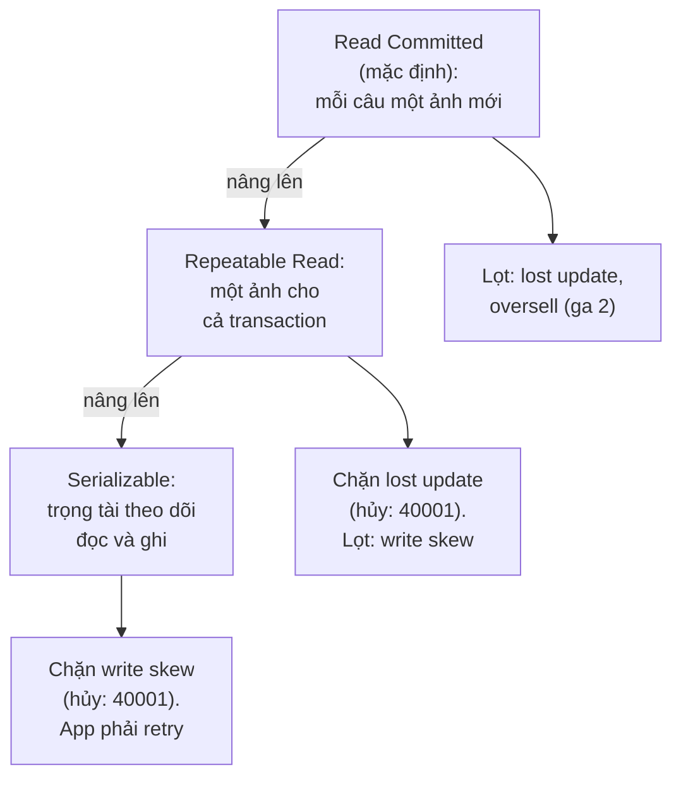

> [!tldr] Đọc nhanh
> - [[concepts/isolation-level|Isolation level]] quyết định một transaction thấy gì khi người khác đang ghi cùng lúc. Postgres có ba mức thật: Read Committed, Repeatable Read, Serializable.
> - [[concepts/read-committed|Read Committed]] (mặc định của Postgres và Prisma): **mỗi câu lệnh** thấy một ảnh mới của dữ liệu đã commit. Code "đọc, kiểm tra, ghi" ở ga 2 chạy ở mức này: 300 đơn cho 100 suất.
> - Repeatable Read của Postgres thực chất là [[concepts/snapshot-isolation|Snapshot Isolation]]: cả transaction thấy một ảnh duy nhất, và ai sửa dòng mà người khác đã sửa sau ảnh đó thì bị hủy. Hết bán quá, nhưng 293 trên 300 người nhận lỗi.
> - [[concepts/write-skew|Write skew]]: hai transaction đọc cùng dữ liệu rồi ghi vào **hai dòng khác nhau**, nên Snapshot Isolation không thấy xung đột. Ví dụ: giới hạn 2 suất mỗi người, hai tab cùng mua, user có 3 đơn.
> - [[concepts/serializable|Serializable]] chặn cả write skew bằng cách theo dõi ai đọc gì, ai ghi gì, rồi hủy một bên với [[concepts/serialization-failure|serialization failure]] (mã `40001`). Nó không khóa chờ; **app phải thử lại** cả transaction.

> [!info] Bối cảnh
> Ga 3 của **tuyến Transaction và khóa**. Ví dụ là **flash-sale**, trang bán hàng giảm giá giờ vàng: hàng nghìn người cùng giành vài trăm suất, và mỗi người chỉ được mua tối đa vài suất mỗi sản phẩm. Ga 2 đã tái hiện lỗi bán quá số hàng ở mức isolation mặc định; ga này thử nâng mức lên. Bạn không cần biết NestJS hay code của dự án.

> [!abstract]- Từ điển nhanh cho bài này (bấm để mở)
> - **Transaction, MVCC, phiên bản dòng**: xem [[posts/2026-11-22-transactions-acid|ga 1]]. **Lost update, read-modify-write, oversell**: xem [[posts/2026-11-22-transactions-race|ga 2]].
> - **Snapshot (ảnh chụp)**: danh sách transaction nào đã commit tại một thời điểm. Đọc theo snapshot nghĩa là chỉ thấy phiên bản dòng do các transaction trong danh sách đó tạo ra.
> - **`COUNT(*)`**: câu SQL đếm số dòng thỏa điều kiện, ví dụ số đơn của một người.
> - **SQLSTATE**: mã lỗi 5 ký tự chuẩn của SQL. `40001` là serialization failure, `40P01` là deadlock.
> - **Retry có jitter**: thử lại sau một khoảng chờ có thêm phần ngẫu nhiên để các request không cùng thử lại một lúc. Xem [[concepts/retries-with-backoff|retry với backoff]].

## Hình dung trước: nhân viên xem sổ thế nào

Quầy vé ở ga 2 vẫn hai nhân viên, một cuốn sổ. Câu hỏi bây giờ là: trong lúc mình đang làm một giao dịch, mình nhìn cuốn sổ ra sao?

| Đời thường | Khái niệm |
|---|---|
| Quy định về cách nhân viên được nhìn sổ trong lúc người khác đang ghi | [[concepts/isolation-level\|Isolation level]] |
| Mỗi lần liếc sổ là thấy bản mới nhất đã đóng dấu, hai lần liếc có thể thấy hai con số khác nhau | [[concepts/read-committed\|Read Committed]] |
| Đầu giao dịch **chụp ảnh** cả cuốn sổ và chỉ nhìn ảnh đó; lúc ghi, nếu dòng mình định sửa đã bị ai sửa sau khi chụp thì phải bỏ giao dịch | [[concepts/snapshot-isolation\|Snapshot Isolation]] |
| Hai nhân viên cùng nhìn ảnh "khách 7 đã mua 1 vé", mỗi người bán thêm 1 vé và ghi vào **hai dòng khác nhau**; không dòng nào bị sửa hai lần, nhưng khách có 3 vé | [[concepts/write-skew\|Write skew]] |
| Một **trọng tài** ghi lại ai đã nhìn dòng nào, ai đã ghi dòng nào; nếu không thể xếp hai giao dịch thành "người này trước, người kia sau" thì trọng tài hủy một giao dịch | [[concepts/serializable\|Serializable]] |
| Giao dịch bị hủy, nhân viên phải làm lại từ đầu | [[concepts/serialization-failure\|Serialization failure (40001)]] |



## Vấn đề: "nâng isolation lên là xong?"

Sau ga 2, phản xạ đầu tiên của mình là: lỗi do mức isolation thấp, vậy nâng lên Serializable cho chắc. Rồi mình đọc được hai lời đồn trái ngược: "Serializable khóa cả bảng, chậm lắm" và "Repeatable Read là đủ rồi". Cả hai đều sai theo những cách thú vị.

Bảng chuẩn SQL định nghĩa bốn mức qua ba hiện tượng (dirty read, non-repeatable read, phantom read). Bảng đó là thứ hay được chép lại nhất, và cũng gây hiểu lầm nhất: nó không nhắc tới lost update hay write skew, hai lỗi mà flash sale thật sự gặp. Muốn biết một mức chặn được gì, phải nhìn vào cách database cài đặt nó, không phải tên của nó.

## Cơ chế

<figure class="figure-map" style="--ar: 3 / 4">
<div class="frame"><iframe data-archify="../diagrams/transactions-isolation/write-skew.html" title="Hai tab cùng mua: Repeatable Read để lọt write skew, Serializable hủy một bên" loading="lazy"></iframe></div>
<figcaption><span><b>Hình 1.</b> Cùng hai transaction "đếm đơn rồi thêm đơn": ở Repeatable Read cả hai commit và user vượt giới hạn; ở Serializable, Postgres thấy không thể xếp chúng nối tiếp nhau và hủy một bên.</span><a href="../diagrams/transactions-isolation/write-skew.html" target="_blank" rel="noopener">Mở toàn màn hình</a></figcaption>
</figure>

### Ba mức thật trong Postgres

Bạn có thể yêu cầu bốn mức chuẩn, nhưng Postgres chỉ cài ba: Read Uncommitted chạy y hệt Read Committed, vì MVCC không bao giờ cho thấy phiên bản chưa commit. Bảng dưới gộp bảng trong tài liệu Postgres với kết quả của bộ kiểm thử Hermitage (Martin Kleppmann), bộ này thử từng loại bất thường trên database thật:

| Mức (tên trong Postgres) | Thực chất là | Chặn | Không chặn |
|---|---|---|---|
| Read Committed (mặc định) | mỗi câu một snapshot | dirty read | non-repeatable read, lost update, write skew |
| Repeatable Read | Snapshot Isolation | thêm: non-repeatable read, phantom, lost update | write skew |
| Serializable | Serializable Snapshot Isolation (SSI) | mọi bất thường | (không còn) |

Prisma không đổi gì: nếu bạn không truyền `isolationLevel`, nó dùng mức mặc định của database, tức Read Committed với Postgres. flash-sale có một chỗ ghi rõ `{ isolationLevel: 'ReadCommitted' }` (xử lý webhook thanh toán), còn lại là mặc định.

### Read Committed: mỗi câu một ảnh mới

Ở [[concepts/read-committed|Read Committed]], mỗi câu lệnh lấy một snapshot mới lúc nó bắt đầu. Hai câu `SELECT` trong cùng một transaction có thể thấy hai con số khác nhau nếu ở giữa có người commit. Đó là lý do code "đọc, kiểm tra, ghi" vỡ: con số ở câu `SELECT` và trạng thái lúc câu `UPDATE` chạy là hai thời điểm khác nhau.

Khi một `UPDATE` gặp dòng mà transaction khác đang sửa, nó **chờ** transaction kia kết thúc, rồi **chạy lại điều kiện `WHERE`** trên phiên bản mới nhất và áp thao tác lên đó. Hành vi này gây ra lost update cho code read-modify-write, nhưng lại là thứ làm cho cách sửa ở ga 4 đúng.

### Snapshot Isolation: một ảnh cho cả transaction

Ở Repeatable Read, snapshot được lấy **một lần** ở câu lệnh đầu tiên và dùng cho cả transaction. Postgres cài mức này thành [[concepts/snapshot-isolation|Snapshot Isolation]], mạnh hơn chuẩn yêu cầu (chặn cả phantom read).

Điểm quyết định nằm ở lúc ghi. Nếu transaction muốn `UPDATE`, `DELETE` hay khóa một dòng đã bị transaction khác sửa **sau** khi snapshot được chụp, Postgres không áp thao tác lên bản mới như Read Committed. Nó hủy transaction với lỗi:

```text
ERROR:  could not serialize access due to concurrent update
```

Lý do: transaction này đang tin vào một ảnh mà ở đó dòng chưa đổi; cho nó ghi tiếp là để nó ghi đè dựa trên thông tin cũ. Vì vậy lost update không thể xảy ra, và code ga 2 không còn bán quá. Nhưng mọi người tới sau đều bị hủy.

### Write skew: hai dòng khác nhau, một luật bị vi phạm

Snapshot Isolation chỉ phát hiện xung đột khi hai transaction ghi vào **cùng một dòng**. [[concepts/write-skew|Write skew]] là khi hai transaction đọc cùng một tập dữ liệu, quyết định dựa trên nó, rồi ghi vào **những dòng khác nhau**:

1. Luật: mỗi người tối đa 2 suất mỗi sản phẩm. User 7 đã có 1 đơn.
2. Tab 1 và tab 2 cùng bấm mua. Mỗi transaction chạy `SELECT count(*) FROM orders WHERE buyer = 7` và thấy 1.
3. 1 < 2, nên mỗi bên `INSERT` một đơn mới. Hai dòng mới, không dòng nào bị sửa hai lần.
4. Cả hai commit. User 7 có 3 đơn.

Không có lost update ở đây, chẳng ai ghi đè ai. Cái bị vi phạm là một **luật trải trên nhiều dòng** (tổng số đơn), và mỗi transaction đều kiểm tra luật đó trên một ảnh không còn đúng. Các ví dụ kinh điển cùng dạng: hai bác sĩ trực cùng xin nghỉ khi "vẫn còn người kia trực", hai người đặt cùng một phòng họp vào hai khung giờ chồng lên nhau.

Trong bảng của Berenson và cộng sự (1995), đây là hiện tượng A5B; Hermitage gọi là G2-item, và xác nhận Repeatable Read của Postgres để lọt nó.

### Serializable: trọng tài không khóa, chỉ hủy

[[concepts/serializable|Serializable]] hứa: kết quả của các transaction chạy đồng thời giống như **một thứ tự tuần tự nào đó** của chúng. Postgres cài bằng Serializable Snapshot Isolation (SSI): vẫn là Snapshot Isolation, cộng thêm việc ghi lại "transaction nào đã đọc dữ liệu gì" (khóa vị từ, hiện trong `pg_locks` với chế độ `SIReadLock`). Khi phát hiện một vòng phụ thuộc kiểu "T1 đọc thứ T2 ghi, T2 đọc thứ T1 ghi", nó hủy một bên:

```text
ERROR:  could not serialize access due to read/write dependencies among transactions
```

Hai điều trái với lời đồn:

- **Khóa của SSI không chặn ai cả**, nên chúng không thể gây deadlock. Serializable của Postgres không "khóa cả bảng"; nó để mọi người chạy rồi hủy kẻ có vấn đề.
- **Cái giá là phải thử lại.** Tài liệu Postgres nói thẳng: app dùng mức này phải sẵn sàng retry, và nên có một chỗ xử lý chung cho mọi lỗi `40001`.

### Serialization failure: thử lại cả transaction

[[concepts/serialization-failure|Serialization failure]] (SQLSTATE `40001`) không phải bug: đó là cách Snapshot Isolation và Serializable nói "transaction này không thể commit mà vẫn đúng, làm lại đi". Prisma báo nó (và deadlock) bằng mã lỗi `P2034`, và tài liệu Prisma có sẵn mẫu vòng lặp thử lại tối đa 5 lần chỉ cho mã đó.

Thử lại phải là thử lại **cả transaction từ đầu**, kể cả các câu `SELECT`: lần thử sau cần một snapshot mới. Và phải có giới hạn số lần cùng khoảng chờ ngẫu nhiên, nếu không thì hàng trăm request bị hủy sẽ cùng thử lại cùng lúc và lại đụng nhau. Ví dụ dưới cho thấy con số đó lớn tới mức nào khi mọi người tranh **một dòng**.

## Ví dụ chạy được

[isolation.ts](../code/transactions-isolation/isolation.ts) làm hai việc:

- **A.** chạy lại code "đọc, kiểm tra, ghi số app tính" của ga 2 (100 suất, 300 người) ở cả ba mức, rồi chạy lại hai mức cao **có** retry với jitter;
- **B.** tái hiện write skew: user 7 đã có 1 đơn, hai transaction cùng đếm rồi cùng thêm.

```bash
npm i pg
node isolation.ts
```

```ts
// Write skew: mỗi transaction đọc COUNT đơn của user rồi INSERT một đơn mới.
// Hai transaction ghi vào hai DÒNG KHÁC NHAU, nên không có xung đột ghi trên cùng một dòng.
await c.query(`BEGIN ISOLATION LEVEL ${level}`);
const { rows } = await c.query('SELECT count(*)::int AS n FROM orders WHERE buyer = 7');
await sleep(50); // hai tab cùng bấm "mua" gần như một lúc
if (rows[0].n >= 2) { await c.query('ROLLBACK'); return 'từ chối'; }
await c.query('INSERT INTO orders (item_id, buyer) VALUES (1, 7)');
await c.query('COMMIT');
```

```text
$ node isolation.ts
A. 100 suất, 300 người, code "đọc, kiểm tra, ghi số app tính"

mức              retry      đơn  tồn cuối    bỏ cuộc lần retry  thời gian
READ COMMITTED   không      300        92          0         0     308 ms
REPEATABLE READ  không        7        93        293         0      77 ms
SERIALIZABLE     không        7        93        293         0      66 ms
REPEATABLE READ  có         100         0          0      1200     475 ms
SERIALIZABLE     có         100         0          0      1206     451 ms

B. Write skew: user 7 đã có 1 đơn, hai tab cùng mua thêm 1

READ COMMITTED   ok | ok                user 7 có 3 đơn (giới hạn 2)
REPEATABLE READ  ok | ok                user 7 có 3 đơn (giới hạn 2)
SERIALIZABLE     ok | lỗi 40001         user 7 có 2 đơn (giới hạn 2)
```

Đọc kết quả:

- **Read Committed**: y như ga 2, 300 đơn cho 100 suất.
- **Repeatable Read và Serializable, không retry**: dữ liệu đúng (7 đơn, kho 93, khớp nhau), nhưng 293 người nhận lỗi `40001` và bỏ cuộc trong khi kho vẫn còn hàng. Đúng mà vô dụng.
- **Có retry**: bán đúng 100 suất, kho về 0. Cái giá là khoảng **1200 lần thử lại** cho 300 người, vì mọi người tranh đúng một dòng: mỗi lượt chỉ một người thắng, những người còn lại thua và làm lại. Thời gian chạy cũng gấp sáu lần lúc không retry.
- **Write skew**: Read Committed và Repeatable Read đều để user 7 có 3 đơn. Chỉ Serializable hủy một bên. Bên bị hủy, khi thử lại, sẽ đếm thấy 2 và từ chối đúng luật.

Bài học cho flash-sale: nâng isolation **đúng** nhưng biến một dòng tồn kho nóng thành một cơn bão retry. Ga 4 sửa lỗi bán quá theo hướng khác, không cần retry; còn giới hạn mỗi người thì flash-sale kiểm tra trong Redis bằng một script nguyên tử (ga 7), không bằng `COUNT` trong Postgres.

## Hiểu lầm và bẫy hay gặp

- **"Repeatable Read chặn được mọi thứ trừ phantom."** Đó là bảng của chuẩn SQL. Ở Postgres, Repeatable Read chặn cả phantom nhưng **để lọt write skew**, một lỗi bảng chuẩn không nhắc tới.
- **"Serializable khóa cả bảng nên chậm."** SSI của Postgres không chặn ai; nó hủy. Chậm hay không phụ thuộc vào số lần phải thử lại, mà số đó phụ thuộc vào mức tranh chấp. Một dòng nóng như tồn kho flash sale là trường hợp tệ nhất.
- **Nâng isolation mà không viết retry.** Lỗi `40001` sẽ đi thẳng ra người dùng thành lỗi 500, như 293 người ở dòng "không retry".
- **Retry chỉ câu lệnh lỗi thay vì cả transaction.** Sau `40001`, transaction đã hỏng; phải `ROLLBACK` rồi chạy lại từ câu đầu tiên để lấy snapshot mới.
- **Gửi email hay gọi API trong transaction có thể bị retry.** Mỗi lần thử lại sẽ gửi lại. Việc có tác dụng bên ngoài phải nằm ngoài khối được retry, hoặc đi qua outbox.
- **Trộn mức isolation.** Một transaction Serializable chỉ được bảo vệ khỏi các transaction cũng chạy Serializable. Transaction Read Committed chạy song song vẫn có thể tạo ra bất thường mà SSI không thấy.
- **Tưởng `UNIQUE` không liên quan.** Với write skew kiểu "mỗi người một suất", một ràng buộc `UNIQUE (campaign, buyer)` chặn được ngay ở mức Read Committed. Ràng buộc là cách rẻ nhất để biến luật nhiều dòng thành luật một chỉ mục.

## Câu hỏi tự kiểm tra

> [!question]- Ở Read Committed, hai câu `SELECT stock` liên tiếp trong cùng transaction có thể trả hai con số khác nhau không? Ở Repeatable Read thì sao?
> Read Committed: có, vì mỗi câu lấy snapshot mới và ở giữa có thể có người commit. Repeatable Read: không, cả transaction dùng một snapshot.

> [!question]- Vì sao Repeatable Read chặn được lost update ở ví dụ A nhưng không chặn được write skew ở ví dụ B?
> Lost update là hai transaction ghi cùng một dòng; Snapshot Isolation phát hiện dòng đã bị sửa sau snapshot và hủy người đến sau. Write skew ghi vào hai dòng khác nhau, nên không có xung đột ghi nào để phát hiện.

> [!question]- Serializable của Postgres có làm request phải chờ nhau không? Nó ngăn bất thường bằng cách nào?
> Khóa vị từ của SSI không chặn ai. Postgres ghi lại ai đọc gì, ai ghi gì, và khi phát hiện không thể xếp các transaction thành một thứ tự tuần tự, nó hủy một bên với `40001`.

> [!question]- Có retry, Serializable bán đúng 100 suất nhưng tốn khoảng 1200 lần thử lại. Vì sao lại nhiều thế?
> Vì cả 300 người tranh đúng một dòng tồn kho. Mỗi lượt chỉ một transaction commit được, các transaction khác đã đọc dòng đó đều bị hủy và làm lại, lặp lại cho tới khi hết hàng.

> [!question]- Luật "mỗi người tối đa 1 suất mỗi chiến dịch" có cách nào giữ đúng ở Read Committed mà không cần Serializable?
> Thêm ràng buộc `UNIQUE (campaign_id, buyer_id)` trên bảng đơn. Request thứ hai cố `INSERT` sẽ bị database từ chối, bất kể mức isolation.

## Tham khảo

- [PostgreSQL 16: Transaction Isolation](https://www.postgresql.org/docs/16/transaction-iso.html) (bảng hiện tượng, hành vi Read Committed khi cập nhật, lỗi của Repeatable Read, SSI và `40001`)
- [Hermitage: testing transaction isolation levels](https://github.com/ept/hermitage) (Postgres repeatable read là snapshot isolation, không chặn G2-item)
- [Berenson và cộng sự, A Critique of ANSI SQL Isolation Levels (1995)](https://www.microsoft.com/en-us/research/publication/a-critique-of-ansi-sql-isolation-levels/) (lost update, snapshot isolation, write skew)
- [Prisma: Transactions](https://www.prisma.io/docs/orm/prisma-client/queries/transactions) (`isolationLevel`, lỗi `P2034`, mẫu retry)
