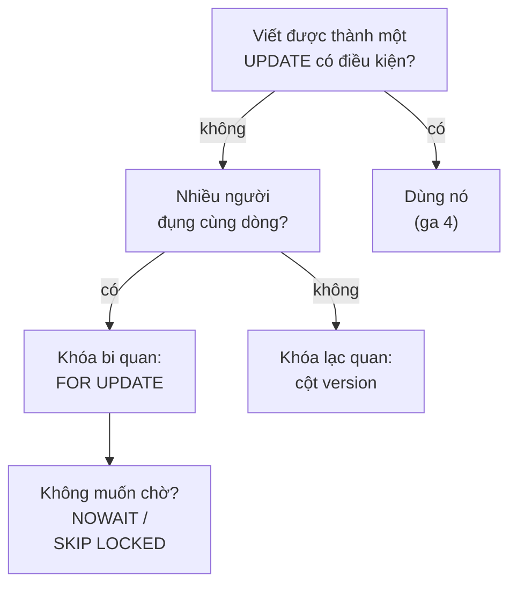

> [!tldr] Đọc nhanh
> - [[concepts/pessimistic-locking|Khóa bi quan]]: `SELECT … FOR UPDATE` khóa dòng **trước khi đọc**; ai tới sau xếp hàng chờ. Đúng, không retry, nhưng mọi người tranh cùng một dòng phải đi qua từng người một.
> - [[concepts/optimistic-locking|Khóa lạc quan]]: đọc không khóa, ghi kèm `WHERE version = <số đã đọc>`; 0 dòng khớp thì có người ghi trước, đọc lại và thử lại. Hợp khi ít đụng nhau. Trên một [[concepts/hot-row|dòng nóng]]: 300 người, 100 suất, khoảng **4100 transaction**.
> - [[concepts/skip-locked|NOWAIT và SKIP LOCKED]]: không chờ khóa. `NOWAIT` báo lỗi `55P03` ngay; `SKIP LOCKED` bỏ qua dòng đang bị khóa và lấy dòng khác, hợp cho bảng kiểu hàng đợi. flash-sale dùng nó cho cron hủy đơn quá hạn chạy trên nhiều pod.
> - [[concepts/advisory-lock|Advisory lock]]: khóa theo một con số do app đặt, không gắn với dòng nào. flash-sale dùng `pg_try_advisory_xact_lock` để chỉ một pod chạy job dọn dẹp mỗi giờ.
> - Ba cách trên cùng dòng tồn kho: UPDATE có điều kiện (ga 4) nhanh nhất; bi quan đứng thứ hai; lạc quan chậm nhất và tốn nhất.

> [!info] Bối cảnh
> Ga 5 của **tuyến Transaction và khóa**. Ví dụ là **flash-sale**, trang bán hàng giảm giá giờ vàng. Ngoài tồn kho, flash-sale còn nhiều chỗ phải chống ghi đè: chuyển trạng thái đơn (PENDING → PAID → SHIPPED…), sửa số lượng trong giỏ, một cron hủy đơn chưa thanh toán sau 15 phút chạy trên mọi pod. Không phải chỗ nào cũng viết được thành một câu `UPDATE`. Bạn không cần biết NestJS hay code của dự án.

> [!abstract]- Từ điển nhanh cho bài này (bấm để mở)
> - **Khóa dòng, UPDATE có điều kiện, `rowCount`**: xem [[posts/2026-11-22-transactions-atomic-update|ga 4]]. **Read Committed, `40001`**: xem [[posts/2026-11-22-transactions-isolation|ga 3]].
> - **Pod**: một bản chạy của server trong Kubernetes. flash-sale chạy nhiều pod giống hệt nhau, nên mọi cron cũng chạy trên mọi pod cùng lúc.
> - **Cron**: việc tự chạy theo lịch (mỗi phút, mỗi giờ).
> - **State machine (máy trạng thái)**: danh sách trạng thái của đơn và những bước chuyển hợp lệ giữa chúng.
> - **Hash**: hàm biến một chuỗi thành một con số; `hashtext('cleanup-cron')` của Postgres cho ra một số nguyên cố định.

## Hình dung trước: ba cách dùng chung một phòng họp

Văn phòng có một phòng họp, nhiều nhóm muốn dùng.

| Đời thường | Khái niệm |
|---|---|
| Treo biển "đang dùng" trước khi vào; nhóm khác thấy biển thì đứng ngoài chờ | [[concepts/pessimistic-locking\|Khóa bi quan]] (`FOR UPDATE`) |
| Không treo biển; cứ chuẩn bị, lúc vào thì xem sổ đặt phòng còn đúng phiên bản mình đã xem không; đã có người đặt thì quay về chuẩn bị lại | [[concepts/optimistic-locking\|Khóa lạc quan]] (cột `version`) |
| Thấy biển thì **không chờ**: hoặc bỏ đi ngay (NOWAIT), hoặc sang phòng trống bên cạnh (SKIP LOCKED) | [[concepts/skip-locked\|NOWAIT và SKIP LOCKED]] |
| Một tấm thẻ "người trực dọn dẹp tối nay" chỉ có một cái; ai cầm được thẻ thì dọn, không gắn với phòng nào | [[concepts/advisory-lock\|Advisory lock]] |
| Một phòng duy nhất mà cả công ty cùng muốn dùng lúc 9 giờ | [[concepts/hot-row\|Dòng nóng]] |



## Vấn đề: không phải lúc nào cũng có một câu UPDATE

Ga 4 làm mình hơi say: mọi thứ đều nên là một câu `UPDATE` có điều kiện! Rồi mình nhìn lại các chỗ khác trong flash-sale:

- Chuyển trạng thái đơn phải đọc trạng thái hiện tại, kiểm tra theo state machine (PENDING được sang PAID hay CANCELLED, nhưng SHIPPED thì không quay về PENDING), rồi ghi, rồi thêm một dòng lịch sử. Luật nằm trong code TypeScript, không nhét gọn vào `WHERE` được.
- Giỏ hàng: người dùng mở hai tab, sửa số lượng ở cả hai. Tab sau không được âm thầm đè tab trước.
- Cron hủy đơn quá hạn chạy mỗi phút **trên mọi pod**. Hai pod không được cùng hủy một đơn, và cũng không nên chờ nhau.

Những chỗ này cần một trong hai chiến lược khóa, cộng vài công cụ để khỏi phải chờ.

## Cơ chế

<figure class="figure-map" style="--ar: 3 / 4">
<div class="frame"><iframe data-archify="../diagrams/transactions-locking/pess-vs-opt.html" title="Khóa bi quan xếp hàng chờ, khóa lạc quan thua thì đọc lại và thử lại" loading="lazy"></iframe></div>
<figcaption><span><b>Hình 1.</b> Bi quan: B chờ A rồi đọc bản mới, không lãng phí lần thử nào. Lạc quan: B làm xong mới biết đã thua, phải đọc lại và làm lại.</span><a href="../diagrams/transactions-locking/pess-vs-opt.html" target="_blank" rel="noopener">Mở toàn màn hình</a></figcaption>
</figure>

### Khóa bi quan: SELECT … FOR UPDATE

[[concepts/pessimistic-locking|Khóa bi quan]] giả định xung đột sẽ xảy ra, nên khóa trước:

```sql
BEGIN;
SELECT stock FROM items WHERE id = 1 FOR UPDATE;   -- khóa dòng, người khác chờ ở đây
-- kiểm tra trong app, tính toán…
UPDATE items SET stock = 36 WHERE id = 1;
COMMIT;                                            -- nhả khóa
```

`FOR UPDATE` lấy khóa dòng mạnh nhất ngay lúc đọc. Request thứ hai gửi cùng câu sẽ **chờ** ở câu `SELECT`, và khi được nhả ra thì (ở Read Committed) nhận phiên bản mới nhất của dòng. Nhờ vậy, code read-modify-write của ga 2 trở nên đúng chỉ bằng cách thêm hai từ.

Cái giá: khóa giữ từ câu `SELECT` tới `COMMIT`, lâu hơn câu `UPDATE` có điều kiện (chỉ khóa từ lúc ghi). Mọi việc nằm giữa (kiểm tra, ghi đơn) đều thành thời gian người khác phải xếp hàng. Có hai bẫy được tài liệu Postgres cảnh báo:

- **`ORDER BY` với `FOR UPDATE` ở Read Committed** có thể trả dòng sai thứ tự: dòng được sắp trước rồi mới khóa, và giá trị cột sắp xếp có thể đã đổi trong lúc chờ.
- Transaction bị giữ mở chờ người dùng hay mạng là "một ý tồi", vì khóa không có hạn chót (ga 6).

### Khóa lạc quan: cột version

[[concepts/optimistic-locking|Khóa lạc quan]] giả định xung đột hiếm, nên không khóa gì cả lúc đọc. Mỗi dòng có thêm cột `version`, tăng 1 mỗi lần ghi. Lúc ghi, điều kiện là "version vẫn là số mình đã đọc":

```ts
// minh họa, không chạy trực tiếp (rút gọn từ OrderService.transition của flash-sale)
const order = await repo.findOneInTx(tx, orderId);          // đọc, không khóa
assertTransition(order.status, toStatus);                   // luật state machine trong code
const r = await tx.order.updateMany({
  where: { id: orderId, version: order.version },           // chỉ ghi nếu chưa ai ghi
  data: { status: toStatus, version: { increment: 1 } },
});
if (r.count === 0) throw new ConflictException({ code: 'ORDER_VERSION_MISMATCH' }); // HTTP 409
await tx.orderStatusHistory.create({ data: { orderId, fromStatus: order.status, toStatus } });
```

Thực chất đây là một UPDATE có điều kiện, chỉ khác là điều kiện không nói về nghiệp vụ ("còn hàng") mà nói về **sự thay đổi** ("chưa ai đụng vào"). Nó dựa đúng vào cơ chế ở ga 4: nếu hai request cùng ghi, request sau chờ khóa dòng, đọc lại thấy `version` đã tăng, và nhận 0 dòng.

flash-sale dùng khóa lạc quan cho:

- **Trạng thái đơn**: webhook thanh toán và cron hủy đơn quá hạn có thể chạm cùng một đơn PENDING gần như cùng lúc. Chỉ một bên thắng; bên kia nhận 409 và không ghi lịch sử sai.
- **Giỏ hàng**: frontend giữ `version` của từng món và gửi lại khi sửa. Hai tab sửa cùng lúc thì tab sau bị từ chối thay vì âm thầm đè tab trước. Ở đây khóa lạc quan là lựa chọn duy nhất hợp lý: không ai giữ khóa database trong lúc người dùng đang gõ.
- **Voucher**: vừa `version = <đã đọc>` vừa `usage_count < usage_limit`.

Khóa lạc quan hợp khi **ít đụng nhau** hoặc khi **khoảng giữa đọc và ghi dài** (người dùng sửa form). Nó tệ khi nhiều người cùng ghi một dòng: mỗi lượt chỉ một người thắng, những người khác đã làm hết phần việc rồi mới biết mình thua.

### Dòng nóng

Một [[concepts/hot-row|dòng nóng]] là dòng mà rất nhiều transaction cùng muốn ghi trong cùng một khoảng thời gian: tồn kho của sản phẩm flash sale, bộ đếm lượt dùng của voucher toàn sàn. Với dòng nóng, mọi chiến lược đều bị giới hạn bởi cùng một thứ: **chỉ một transaction được giữ khóa ghi tại một thời điểm**. Thông lượng tối đa xấp xỉ 1 chia cho thời gian giữ khóa. Muốn nhanh hơn chỉ có hai cách: giữ khóa ngắn hơn (UPDATE có điều kiện, không làm việc thừa trong transaction), hoặc **không để mọi request tới được dòng đó** (Redis chặn trước, ga 7). Ý tưởng tương tự "hot key" ở [[concepts/hot-key|tuyến Caching]].

### NOWAIT và SKIP LOCKED

Đôi khi chờ là sai. Postgres cho hai lựa chọn khi gặp dòng đang bị khóa:

- **`FOR UPDATE NOWAIT`**: báo lỗi `55P03` (lock_not_available) ngay lập tức. Hợp khi bạn muốn trả lời "đang có người xử lý, thử lại sau" thay vì treo request.
- **`FOR UPDATE SKIP LOCKED`**: bỏ qua những dòng đang bị khóa và trả về các dòng còn lại. Tài liệu Postgres nói rõ: cách này cho **một góc nhìn không nhất quán** về dữ liệu, không hợp cho việc thông thường, nhưng rất hợp để nhiều consumer cùng lấy việc từ một bảng kiểu hàng đợi.

Cron hủy đơn quá hạn của flash-sale là đúng trường hợp đó:

```ts
// minh họa, không chạy trực tiếp (rút gọn từ OrderExpiryService của flash-sale)
const expired = await tx.$queryRaw<Array<{ id: string }>>`
  SELECT id FROM trading.orders
  WHERE status = 'PENDING' AND created_at < ${cutoff}
  ORDER BY created_at
  FOR UPDATE SKIP LOCKED
  LIMIT 100`;
for (const { id } of expired) {
  await orderService.transition({ orderId: id, toStatus: 'CANCELLED', tx }); // cùng transaction
}
```

Mọi pod chạy câu này mỗi phút. Pod nào tới trước khóa 100 đơn cũ nhất; pod tới sau bỏ qua 100 đơn đó và lấy 100 đơn tiếp theo. Không pod nào chờ pod nào, không đơn nào bị hủy hai lần. Có 30 giây "ân hạn" trong `cutoff` để không tranh với webhook thanh toán tới sát hạn, và nếu vẫn tranh thì khóa lạc quan trong `transition()` quyết định ai thắng. Ga [[posts/2026-11-21-shopify-flash-sale|Shopify xử lý flash sale thế nào]] dùng cùng mẫu này cho chính việc giữ hàng: mỗi suất là một dòng, người mua khóa một dòng trống bằng `SKIP LOCKED`.

### Advisory lock

Một [[concepts/advisory-lock|advisory lock]] là khóa theo **một con số do app chọn**, không gắn với dòng hay bảng nào. Postgres chỉ giữ và nhả nó; ý nghĩa của con số là do app quy ước. Có hai loại:

- **Theo session** (`pg_advisory_lock`): giữ tới khi gọi unlock hoặc session đóng, **kể cả khi transaction rollback**. Dễ quên nhả, nhất là với connection pool.
- **Theo transaction** (`pg_advisory_xact_lock`): tự nhả khi transaction kết thúc, không có lệnh unlock. An toàn hơn cho code chạy qua pool.

Bản `pg_try_…` không chờ mà trả `true`/`false`. flash-sale dùng nó để job dọn khóa idempotency hết hạn chỉ chạy trên một pod mỗi giờ:

```sql
SELECT pg_try_advisory_xact_lock(hashtext('idempotency-cleanup-cron')) AS locked;
-- false: pod khác đang chạy, bỏ qua lượt này
-- true : xóa các dòng hết hạn; khóa tự nhả khi transaction COMMIT
```

Không cần Redis, không cần thư viện khóa phân tán: database mà mọi pod đều nối tới đã là trọng tài.

## Ví dụ chạy được

[locking.ts](../code/transactions-locking/locking.ts) làm ba việc:

- **A.** 300 người, 100 suất, cùng một dòng, theo ba cách: bi quan (`FOR UPDATE`), lạc quan (`version` + thử lại), UPDATE có điều kiện. Đếm số transaction đã chạy và thời gian;
- **B.** ba worker cùng lấy tối đa 3 việc `PENDING` từ bảng 9 việc, mỗi worker giữ transaction 200 ms rồi đánh dấu `DONE`, theo ba chế độ: chờ, `NOWAIT`, `SKIP LOCKED`;
- **C.** hai "pod" cùng chạy một cron, giành `pg_try_advisory_xact_lock`.

```bash
npm i pg
node locking.ts
```

```ts
// Lạc quan: đọc không khóa, ghi kèm "version vẫn như lúc tôi đọc"; thua thì đọc lại và thử lại.
const { rows } = await c.query('SELECT stock, version FROM items WHERE id = 1');
if (rows[0].stock < 1) return 'hết';
await sleep(WORK_MS);
const u = await c.query(
  'UPDATE items SET stock = $1, version = version + 1 WHERE id = 1 AND version = $2',
  [rows[0].stock - 1, rows[0].version]);
if (u.rowCount === 0) throw new Error('version-mismatch'); // ai đó ghi trước: hủy cả transaction
```

```text
$ node locking.ts
A. 100 suất, 300 người, cùng một dòng tồn kho

cách                     đơn  tồn cuối transaction   thời gian
bi quan (FOR UPDATE)     100         0        300      727 ms
lạc quan (version)       100         0       4093      772 ms
UPDATE có điều kiện      100         0        300      473 ms

B. Ba worker cùng lấy tối đa 3 việc PENDING, mỗi worker giữ transaction 200 ms
   FOR UPDATE (chờ)
     w1: lấy [1, 2, 3] sau 205 ms
     w2: lấy [4, 5, 6] sau 402 ms
     w3: lấy [7, 8, 9] sau 597 ms
   FOR UPDATE NOWAIT
     w1: lấy [1, 2, 3] sau 203 ms
     w2: lỗi 55P03 sau 4 ms (could not obtain lock on row in relation "jobs")
     w3: lỗi 55P03 sau 2 ms (could not obtain lock on row in relation "jobs")
   FOR UPDATE SKIP LOCKED
     w1: lấy [1, 2, 3] sau 205 ms
     w2: lấy [4, 5, 6] sau 204 ms
     w3: lấy [7, 8, 9] sau 205 ms

C. Hai pod cùng chạy cron dọn dẹp, giành pg_try_advisory_xact_lock
   pod-a: giành được khóa, dọn xong, khóa tự nhả khi COMMIT
   pod-b: pod khác đang chạy, bỏ qua lượt này
```

Đọc kết quả:

- **A**: cả ba đều đúng 100 đơn. Bi quan và UPDATE có điều kiện mỗi người chạy đúng một transaction; khác nhau ở thời gian vì bi quan giữ khóa suốt cả transaction, còn UPDATE có điều kiện chỉ giữ từ lúc ghi. Lạc quan cần khoảng **4100 transaction** (con số đổi mỗi lần chạy) cho 300 người: trên một dòng nóng, phần lớn công sức là làm rồi bỏ.
- **B, chờ**: w2 và w3 xếp hàng sau w1 (402 ms, 597 ms). Chúng không lấy lại việc 1–3: sau khi chờ, Postgres đọc lại dòng, thấy `status` đã là `DONE`, bỏ qua và lấy tiếp các việc sau (đúng cơ chế đọc lại của ga 4).
- **B, NOWAIT**: w2 và w3 thất bại trong vài mili giây thay vì treo.
- **B, SKIP LOCKED**: ba worker chạy song song, mỗi người 3 việc khác nhau, tất cả xong sau khoảng 200 ms. Đây là lý do cron hủy đơn của flash-sale dùng nó.
- **C**: đúng một pod chạy, pod kia bỏ qua ngay, không chờ.

## Hiểu lầm và bẫy hay gặp

- **"Khóa lạc quan luôn nhanh hơn vì không khóa."** Chỉ khi ít đụng nhau. Trên dòng nóng, ví dụ trên tốn gấp 13 lần số transaction của khóa bi quan. Lạc quan đổi thời gian chờ lấy công việc bị bỏ.
- **Quên kiểm tra `count` sau `updateMany`.** Khóa lạc quan chỉ là một điều kiện `WHERE`; nếu code không kiểm tra 0 dòng, nó âm thầm thành lost update như ga 2.
- **Giữ khóa bi quan qua thời gian chờ người dùng hay API ngoài.** `FOR UPDATE` không có hạn chót mặc định; một request treo là cả hàng người mua treo theo.
- **Dùng `SKIP LOCKED` cho việc không phải hàng đợi.** Nó cố tình trả về một góc nhìn thiếu dòng. Dùng để đếm tồn kho hay tính tổng là sai.
- **Advisory lock theo session qua connection pool.** Khóa đi theo kết nối, mà kết nối được trả về pool và người khác dùng tiếp; quên unlock là khóa treo vô thời hạn. Dùng bản `xact`.
- **Gọi `pg_advisory_lock(id)` trong câu có `LIMIT`.** Tài liệu Postgres cảnh báo hàm khóa có thể chạy trên nhiều dòng hơn `LIMIT` trả về; khóa trong một truy vấn con.
- **Tin rằng khóa lạc quan chặn write skew.** Nó chỉ chặn ghi đè trên **cùng dòng có version**. Luật trải trên nhiều dòng vẫn cần `UNIQUE`, Serializable hoặc khóa cả nhóm.

## Câu hỏi tự kiểm tra

> [!question]- Thêm hai từ `FOR UPDATE` vào câu `SELECT` của code ga 2 thì vì sao hết bán quá?
> Request thứ hai chờ ở câu `SELECT` cho tới khi request thứ nhất commit, rồi đọc phiên bản mới nhất. Khe hở giữa đọc và ghi vẫn còn, nhưng không ai khác được vào khe hở đó.

> [!question]- Vì sao khóa lạc quan cần khoảng 4100 transaction cho 300 người, còn khóa bi quan chỉ 300?
> Lạc quan để mọi người đọc và làm việc song song, rồi chỉ một người ghi thắng mỗi lượt; những người thua phải làm lại từ đầu. Bi quan bắt mọi người xếp hàng ngay từ lúc đọc, nên không ai làm việc thừa.

> [!question]- Giỏ hàng của flash-sale dùng khóa lạc quan chứ không dùng `FOR UPDATE`. Vì sao đó là lựa chọn đúng?
> Khoảng giữa đọc và ghi là lúc người dùng xem và sửa giỏ, có thể vài phút. Không thể giữ khóa database suốt khoảng đó; khóa lạc quan để frontend mang `version` theo và chỉ kiểm tra lúc ghi.

> [!question]- Ba pod chạy cron hủy đơn quá hạn cùng lúc. Với `FOR UPDATE` thường và với `FOR UPDATE SKIP LOCKED`, chuyện gì khác nhau?
> Với `FOR UPDATE` thường, pod 2 và 3 chờ pod 1 xong rồi mới lấy được lô kế tiếp, nên chạy tuần tự. Với `SKIP LOCKED`, mỗi pod bỏ qua các đơn đã bị khóa và lấy lô khác ngay, ba pod xử lý song song mà không đơn nào bị hủy hai lần.

> [!question]- Vì sao flash-sale dùng `pg_try_advisory_xact_lock` thay vì `pg_advisory_lock` cho cron dọn dẹp?
> Bản `xact` tự nhả khi transaction kết thúc, kể cả khi lỗi, nên không thể quên nhả trên một kết nối dùng chung qua pool. Bản `try` không chờ, nên pod không giành được thì bỏ qua lượt ngay.

## Tham khảo

- [PostgreSQL 16: Explicit Locking](https://www.postgresql.org/docs/16/explicit-locking.html) (chế độ khóa dòng, advisory lock theo session và theo transaction)
- [PostgreSQL 16: SELECT, The Locking Clause](https://www.postgresql.org/docs/16/sql-select.html) (`NOWAIT`, `SKIP LOCKED`, cảnh báo `ORDER BY` với `FOR UPDATE`)
- [PostgreSQL 16: Advisory Lock Functions](https://www.postgresql.org/docs/16/functions-admin.html) (`pg_try_advisory_xact_lock`)
- [Prisma: Optimistic concurrency control](https://www.prisma.io/docs/orm/prisma-client/queries/transactions) (cột `version` với `updateMany`)
