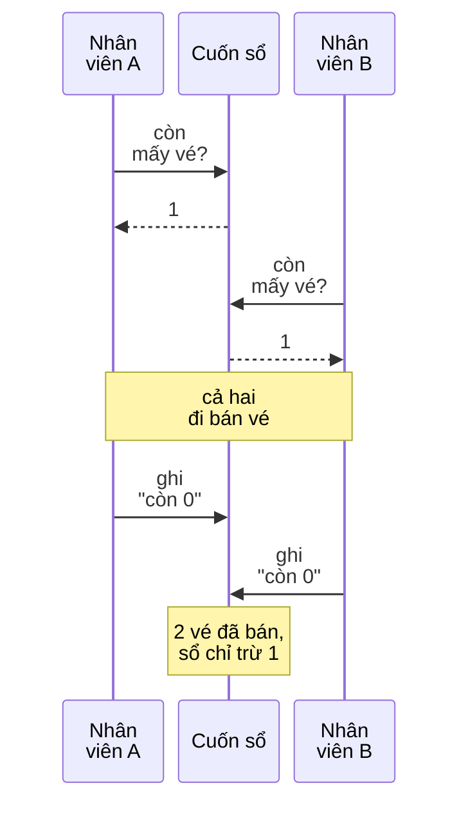

> [!tldr] Đọc nhanh
> - [[concepts/race-condition|Race condition]]: kết quả phụ thuộc vào thứ tự ngẫu nhiên mà các request chen nhau. Chạy một mình thì đúng, chạy cùng lúc thì sai.
> - Mẫu code gây lỗi là [[concepts/read-modify-write|read-modify-write]]: đọc tồn kho lên app, kiểm tra, tính số mới, ghi lại. Giữa lúc đọc và lúc ghi có một khe hở.
> - [[concepts/lost-update|Lost update]]: hai người cùng đọc 37, cùng ghi 36, kho chỉ giảm 1 dù bán 2. Trong ví dụ: 300 đơn, tồn kho cuối vẫn còn 86.
> - Đổi sang `stock = stock - 1` sửa được lost update nhưng **không** sửa được [[concepts/oversell|oversell]]: kiểm tra "còn hàng" vẫn tách rời với lúc trừ. Kết quả: 149 đơn cho 100 suất, tồn kho -49.
> - Tất cả xảy ra **bên trong transaction**, ở mức mặc định Read Committed. Transaction không tự chống race condition.

> [!info] Bối cảnh
> Ga 2 của **tuyến Transaction và khóa**. Ví dụ là **flash-sale**, trang bán hàng giảm giá giờ vàng: đúng 21:00, hàng nghìn người cùng bấm mua một sản phẩm chỉ có vài trăm suất. Mỗi lần bấm là một request, các request chạy song song trên nhiều kết nối tới cùng một Postgres. Bạn không cần biết NestJS hay code của dự án.

> [!abstract]- Từ điển nhanh cho bài này (bấm để mở)
> - **Transaction, COMMIT, ROLLBACK**: xem [[posts/2026-11-22-transactions-acid|ga 1]].
> - **Connection pool**: một nhóm kết nối tới database dùng chung cho nhiều request. Ví dụ dùng 50 kết nối, nên tối đa 50 transaction chạy cùng lúc.
> - **Read Committed**: mức isolation mặc định của Postgres; mỗi câu lệnh thấy dữ liệu đã commit tính tới lúc câu đó bắt đầu. Ga 3 nói kỹ.
> - **Đồng thời (concurrent)**: nhiều việc đang diễn ra trong cùng một khoảng thời gian, xen kẽ nhau, không nhất thiết đúng cùng một tích tắc.

## Hình dung trước: hai nhân viên, một cuốn sổ

Quầy vé ở ga 1 giờ có hai nhân viên. Sổ ghi "hàng A: còn 1 vé".

| Đời thường | Khái niệm |
|---|---|
| Hai nhân viên cùng liếc sổ, cùng bán, và ai nhanh tay hơn thì "thắng" một cách ngẫu nhiên | [[concepts/race-condition\|Race condition]] |
| Liếc sổ thấy 1, quay đi bán vé, quay lại ghi "còn 0" theo con số trong đầu | [[concepts/read-modify-write\|Read-modify-write]] |
| Cả hai cùng ghi "còn 0": sổ chỉ ghi nhận một lần bán, lần kia biến mất | [[concepts/lost-update\|Lost update]] |
| Hai khách cầm hai vé cho cùng một ghế | [[concepts/oversell\|Oversell]] |



## Vấn đề: "mình đã bọc trong transaction rồi mà"

Đoạn code mua hàng đầu tiên mình viết trông như sau, và mình khá tự tin vì nó nằm gọn trong một transaction:

```ts
// minh họa, không chạy trực tiếp
await prisma.$transaction(async (tx) => {
  const item = await tx.item.findUnique({ where: { id } });
  if (item.stock < 1) throw new Error('Hết hàng');
  await tx.order.create({ data: { itemId: id, buyerId } });
  await tx.item.update({ where: { id }, data: { stock: item.stock - 1 } });
});
```

Chạy thử bằng tay: mua 1 suất, tồn kho giảm 1, hết hàng thì báo lỗi. Test đơn vị cũng xanh. Vấn đề chỉ hiện ra khi hàng trăm request chạy **cùng lúc**, và chuyện đó đúng là chuyện duy nhất flash sale làm.

Ga 1 nói transaction hứa bốn chữ ACID, nhưng chữ I ở mức mặc định của Postgres (Read Committed) chỉ hứa một điều: **không thấy dữ liệu chưa commit của người khác**. Nó không hứa rằng con số mình đọc lúc đầu vẫn còn đúng lúc mình ghi.

## Cơ chế

<figure class="figure-map" style="--ar: 3 / 4">
<div class="frame"><iframe data-archify="../diagrams/transactions-race/lost-update.html" title="Hai người mua cùng đọc còn 1 suất rồi cùng ghi stock = 0" loading="lazy"></iframe></div>
<figcaption><span><b>Hình 1.</b> Cả hai request đọc "còn 1" trước khi ai kịp ghi, rồi cùng ghi con số đã cũ: hai đơn được tạo, kho chỉ giảm một lần.</span><a href="../diagrams/transactions-race/lost-update.html" target="_blank" rel="noopener">Mở toàn màn hình</a></figcaption>
</figure>

### Race condition

Một [[concepts/race-condition|race condition]] xảy ra khi kết quả phụ thuộc vào thứ tự mà các thao tác chạy đồng thời chen vào nhau, và có ít nhất một thứ tự cho kết quả sai. Với 300 request trên 50 kết nối, thứ tự chen nhau là ngẫu nhiên mỗi lần chạy. Vì thế lỗi kiểu này có ba đặc điểm khó chịu: không hiện ra khi test bằng tay, mỗi lần chạy ra một con số khác, và thường chỉ xuất hiện đúng lúc tải cao nhất.

### Read-modify-write: khe hở giữa đọc và ghi

Đoạn code ở trên theo mẫu [[concepts/read-modify-write|read-modify-write]]:

| Bước | Ở đâu | Việc |
|---|---|---|
| đọc | database → app | `SELECT stock` được 37 |
| kiểm tra, tính | trong app | 37 ≥ 1, số mới là 36 |
| ghi | app → database | `UPDATE … SET stock = 36` |

Giữa bước đọc và bước ghi, con số 37 chỉ còn sống trong biến của app. Database không biết app đang "giữ" nó; request khác vẫn đọc 37 và cũng tính ra 36. Khe hở này càng rộng khi giữa đọc và ghi có thêm việc: kiểm tra giá, voucher, giới hạn mỗi người, ghi đơn. Ví dụ dưới chèn 2 ms cho phần đó, và 2 ms là quá đủ.

Còn một biến thể nữa, gọi là **check-then-act** (kiểm tra rồi mới làm): bước ghi không dùng con số app tính nữa mà để database tự trừ (`stock = stock - 1`), nhưng **quyết định có trừ hay không** vẫn dựa trên con số đã đọc từ trước.

### Lost update

[[concepts/lost-update|Lost update]] là hậu quả của read-modify-write: hai transaction cùng đọc một giá trị, cùng ghi một giá trị tính từ nó, và lần ghi sau đè lên lần ghi trước như thể lần trước chưa từng xảy ra. Trong bảng phân loại bất thường của Berenson và cộng sự (1995), đây là hiện tượng **P4**. Bộ kiểm thử Hermitage xác nhận Read Committed của Postgres **không** chặn P4.

Vì sao Postgres để lần ghi thứ hai đè lên? Vì ở Read Committed, khi request B muốn `UPDATE` dòng mà A vừa sửa, B chờ A commit rồi **áp dụng thao tác của mình lên phiên bản mới nhất**. Thao tác của B là "đặt stock = 36", một hằng số app gửi xuống, nên áp lên bản mới nhất vẫn ra 36. Database làm đúng điều nó được bảo; chỉ là điều nó được bảo đã sai từ lúc app đọc.

### Oversell

[[concepts/oversell|Oversell]] (bán quá số hàng) là thứ người dùng và kế toán thật sự nhìn thấy: số đơn hợp lệ nhiều hơn số hàng có. Nó có thể đến từ lost update (kho không giảm đủ nên vẫn "còn hàng" cho người sau), hoặc từ check-then-act (kho giảm đúng, nhưng xuống dưới 0). Hai lỗi khác nhau, cách sửa khác nhau, và sửa một cái không sửa được cái kia. Ví dụ dưới đo cả hai.

## Ví dụ chạy được

[oversell.ts](../code/transactions-race/oversell.ts) tạo bảng `items` với 100 suất, rồi cho 300 người mua cùng lúc qua 50 kết nối, theo hai cách:

- **đọc rồi ghi số app tính**: `SELECT stock`, kiểm tra, chờ 2 ms, `INSERT` đơn, `UPDATE … SET stock = <số app tính>`;
- **kiểm tra rồi stock - 1**: giống hệt, nhưng bước cuối là `UPDATE … SET stock = stock - 1`.

Cả hai đều chạy trong `BEGIN … COMMIT` ở mức mặc định.

```bash
docker run -d --name tx-pg -e POSTGRES_PASSWORD=atlas -p 55432:5432 postgres:16-alpine
npm i pg
node oversell.ts
```

```ts
// Cách 1: đọc tồn kho, kiểm tra ở app, rồi ghi lại con số app tự tính.
async function buyReadModifyWrite(buyer: number) {
  const c = await pool.connect();
  try {
    await c.query('BEGIN');
    const { rows } = await c.query('SELECT stock FROM items WHERE id = 1');
    const stock: number = rows[0].stock;
    if (stock < 1) { await c.query('ROLLBACK'); return false; }
    await sleep(2); // kiểm tra giá, voucher, giới hạn mỗi người… mất vài mili giây
    await c.query('INSERT INTO orders (item_id, buyer) VALUES (1, $1)', [buyer]);
    await c.query('UPDATE items SET stock = $1 WHERE id = 1', [stock - 1]);
    await c.query('COMMIT');
    return true;
  } finally { c.release(); }
}
```

```text
$ node oversell.ts
100 suất, 300 người mua cùng lúc, Read Committed (mặc định)

cách                          đơn   tồn cuối   bán quá lần trừ bị mất
đọc rồi ghi số app tính       300         86       200            286
kiểm tra rồi stock - 1        149        -49        49              0
```

Đọc kết quả:

- **Đọc rồi ghi số app tính**: cả 300 người đều mua được, tức bán quá 200 suất. Tồn kho cuối lại là 86, chứ không phải -200: trong 300 lần trừ, 286 lần bị ghi đè mất. Hầu hết request đọc được một con số cao rồi ghi con số đó trừ 1, đè lên công sức của những request khác. Con số 86 đổi mỗi lần chạy; 300 đơn thì gần như luôn vậy.
- **Kiểm tra rồi stock - 1**: lost update biến mất (0 lần trừ bị mất, vì mỗi lần trừ được áp lên phiên bản mới nhất). Nhưng vẫn bán 149 đơn, và tồn kho xuống **-49**. Các request đọc "còn hàng" khi kho còn dương, rồi trừ sau khi kho đã về 0. Kho không còn nói dối về số đã bán, nhưng nó vẫn để bán quá.

Cả hai cách đều là code mà một người cẩn thận vẫn có thể viết ra, và cả hai đều nằm gọn trong transaction.

## Hiểu lầm và bẫy hay gặp

- **"Bọc trong transaction là hết race condition."** Ví dụ trên bác bỏ trực tiếp: 300 đơn cho 100 suất, mỗi đơn trong một transaction riêng. Transaction lo chuyện "tất cả hoặc không gì cả", không lo chuyện hai transaction cùng đọc một con số cũ.
- **"Dùng `stock = stock - 1` là đủ."** Sửa được lost update, không sửa được oversell. Điều kiện "còn hàng" phải được kiểm tra **cùng lúc** với việc trừ, trong database. Đó là ga 4.
- **"Prisma có `decrement` nên an toàn."** `data: { stock: { decrement: 1 } }` sinh ra `SET stock = stock - 1`, tức đúng cách thứ hai: hết lost update, vẫn oversell nếu điều kiện nằm ở một câu `findUnique` trước đó.
- **"Test pass thì code đúng."** Test đơn vị gọi hàm tuần tự, nên không bao giờ chen nhau. Race condition cần test đồng thời trên database thật, như ví dụ này.
- **"Hiếm khi xảy ra, chấp nhận được."** Xác suất chen nhau tăng theo số request đồng thời và độ rộng khe hở. Flash sale tối đa hóa cả hai: hàng nghìn người, cùng một sản phẩm, cùng một giây.
- **"Kiểm tra ở frontend là đủ."** Nút "Mua" bị khóa khi hết hàng chỉ giúp trải nghiệm; mọi request vẫn tới server cùng lúc với con số tồn kho cũ.

## Câu hỏi tự kiểm tra

> [!question]- Kể ba bước của mẫu read-modify-write, và chỉ ra khe hở nằm ở đâu.
> Đọc giá trị từ database lên app, tính giá trị mới trong app, ghi giá trị mới xuống. Khe hở là khoảng thời gian giữa đọc và ghi: database không biết app đang dựa vào con số đã đọc, nên request khác vẫn đọc cùng con số đó.

> [!question]- Ở cách 1, 300 người mua được nhưng tồn kho cuối là 86 thay vì -200. Vì sao?
> Vì lost update: phần lớn request ghi một hằng số tính từ con số cao chúng đọc được, đè lên lần trừ của request khác. 286 trong 300 lần trừ bị ghi đè mất, nên kho chỉ giảm 14.

> [!question]- Đổi sang `stock = stock - 1` thì lỗi nào hết, lỗi nào còn?
> Hết lost update (mỗi lần trừ áp lên phiên bản mới nhất). Còn oversell, vì quyết định "còn hàng" vẫn dựa trên con số đọc ở câu `SELECT` trước đó, nên nhiều request trừ dù kho đã về 0.

> [!question]- Vì sao Postgres ở Read Committed không chặn được lost update, dù nó có khóa dòng khi `UPDATE`?
> Khóa dòng chỉ bắt request sau chờ request trước commit, rồi áp thao tác của nó lên phiên bản mới nhất. Thao tác ở đây là "đặt stock = 36", một hằng số do app tính từ dữ liệu cũ, nên áp lên bản mới vẫn ra 36.

> [!question]- Đồng nghiệp bảo "chạy thử mua 10 lần liên tục, kho giảm đúng 10, vậy là không có lỗi". Bạn trả lời thế nào?
> Mua liên tục là chạy tuần tự, nên không bao giờ có hai request trong khe hở cùng lúc. Phải bắn hàng trăm request song song lên database thật mới thấy race condition.

## Tham khảo

- [PostgreSQL 16: Transaction Isolation](https://www.postgresql.org/docs/16/transaction-iso.html) (Read Committed: chờ rồi áp thao tác lên phiên bản mới nhất)
- [Hermitage: testing transaction isolation levels](https://github.com/ept/hermitage) (Postgres read committed không chặn P4 lost update)
- [Berenson và cộng sự, A Critique of ANSI SQL Isolation Levels (1995)](https://www.microsoft.com/en-us/research/publication/a-critique-of-ansi-sql-isolation-levels/) (định nghĩa lost update P4)
