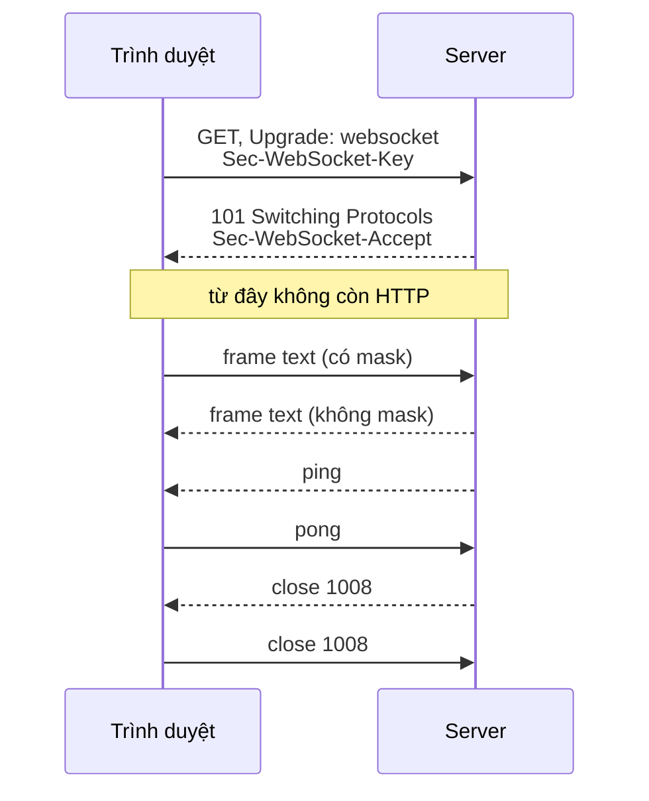

> [!tldr] Đọc nhanh
> - [[opening-handshake|Opening handshake]]: một `GET` HTTP/1.1 với `Upgrade: websocket` và một khóa ngẫu nhiên; server đáp `101` kèm `Sec-WebSocket-Accept = base64(SHA-1(khóa + một GUID cố định))`. Sau dòng trống đó, kết nối không còn nói HTTP.
> - Dữ liệu đi trong [[websocket-frame|frame]]: 2–14 byte đầu (FIN, opcode, MASK, độ dài) rồi payload. Opcode 1 text, 2 binary, 8 close, 9 ping, 10 pong.
> - [[masking|Masking]]: mọi frame client gửi lên phải XOR với 4 byte ngẫu nhiên. Không phải mã hóa; nó chặn một kiểu đầu độc cache của proxy cũ.
> - [[ping-pong|Ping/Pong]] phát hiện kết nối chết lặng lẽ. [[close-code|Close code]] cho biết vì sao đóng; 1006 nghĩa là đứt mà không có lời chào, và không bao giờ đi trên dây.
> - [[subprotocol|Subprotocol]] để hai bên thống nhất nội dung tin. Ngoài những thứ này, RFC 6455 không có gì nữa: không room, không ack, không tự nối lại.

> [!info] Bối cảnh
> Ga 2 của **tuyến WebSocket và Socket.IO**. Ví dụ là **flash-sale**, trang bán hàng giảm giá giờ vàng: trang hàng chờ mở một kết nối realtime để nhận "tới lượt bạn" và số hàng còn lại. Bài này chưa dùng thư viện nào: mình tự viết một server WebSocket bằng module `http` của Node để nhìn tận mắt các byte. Bạn không cần biết code dự án.

> [!abstract]- Từ điển nhanh cho bài này (bấm để mở)
> - **Polling, long polling, SSE, full-duplex**: xem [[2026-11-22-websocket-realtime-options|ga 1]].
> - **Byte, hex**: một byte là 8 bit, viết dạng hex là hai ký tự `00`–`ff` (`81` = 1000 0001).
> - **Bit**: một chữ số 0 hoặc 1. "Bit cao nhất" của byte là bit đầu bên trái.
> - **XOR**: phép "khác thì 1, giống thì 0" trên từng bit. XOR hai lần với cùng một khóa là ra lại giá trị cũ.
> - **SHA-1, base64**: SHA-1 biến một chuỗi thành 20 byte "dấu vân tay"; base64 viết các byte đó thành chữ in được.
> - **GUID**: một chuỗi định danh dài, ở đây là hằng số cố định ghi trong RFC.
> - **Proxy trung gian, cache của proxy**: máy chuyển tiếp nằm giữa (nginx, proxy công ty), có thể lưu lại response để trả cho người sau.
> - **UTF-8**: cách mã hóa chữ (kể cả tiếng Việt) thành byte.

## Hình dung trước: một cuộc gọi điện

WebSocket giống một cuộc điện thoại giữa trình duyệt và server.

| Đời thường | Khái niệm |
|---|---|
| Nhấc máy: "Alo, có phải cửa hàng không?", "Đúng rồi, tôi nghe được câu mật khẩu của anh" | [[opening-handshake\|Opening handshake]] |
| Mỗi câu nói là một đoạn tiếng, câu dài thì nói thành nhiều hơi | [[websocket-frame\|Frame]] (và fragment) |
| Khách nói qua một bộ đổi giọng ngẫu nhiên, để tổng đài cũ không tưởng nhầm là lệnh nội bộ | [[masking\|Masking]] |
| "Còn nghe không?", "Còn" | [[ping-pong\|Ping/Pong]] |
| Cúp máy kèm lý do: "hết giờ", "sai mật khẩu"; hay rớt sóng không kịp chào | [[close-code\|Close code]] (1000, 1008…; 1006) |
| Đầu cuộc gọi thống nhất nói tiếng Việt hay tiếng Anh | [[subprotocol\|Subprotocol]] |



## Vấn đề: "WebSocket" thật ra có những gì?

Mình từng nghĩ những thứ quen dùng với Socket.IO (đặt tên sự kiện, vào phòng, tự kết nối lại) là của WebSocket. Muốn biết chắc cái gì là của giao thức và cái gì là của thư viện, cách nhanh nhất là bỏ hết thư viện, tự viết một server theo RFC 6455 và xem có bao nhiêu thứ phải làm. Câu trả lời: rất ít. Và chính vì ít, nên Socket.IO mới có đất sống.

## Cơ chế

<figure class="figure-map" style="--ar: 3 / 4">
<div class="frame"><iframe data-archify="../diagrams/websocket-protocol/ws-life.html" title="Sơ đồ tuần tự: bắt tay HTTP, frame có mask, ping/pong và đóng kết nối với mã 1008" loading="lazy"></iframe></div>
<figcaption><span><b>Hình 1.</b> Một kết nối WebSocket gồm đúng ba phần: bắt tay bằng HTTP, trao đổi frame theo cả hai chiều, và đóng có mã lý do.</span><a href="../diagrams/websocket-protocol/ws-life.html" target="_blank" rel="noopener">Mở toàn màn hình</a></figcaption>
</figure>

### Opening handshake: bắt đầu bằng HTTP

**[[opening-handshake|Opening handshake]]** là một request HTTP/1.1 bình thường. Client mà mình tự viết server để nghe đã gửi:

```text
GET /flash-sale HTTP/1.1
upgrade: websocket
connection: upgrade
sec-websocket-version: 13
sec-websocket-key: qzgRpsTlKkdgxF5u/xLseQ==
sec-websocket-protocol: stock.v1, stock.v2
```

- `Upgrade: websocket` và `Connection: Upgrade`: xin đổi giao thức trên chính kết nối này.
- `Sec-WebSocket-Version: 13`: phiên bản duy nhất còn dùng.
- `Sec-WebSocket-Key`: 16 byte ngẫu nhiên, viết base64. Mỗi kết nối một khóa mới.
- Trình duyệt còn luôn gửi `Origin` (trang nào đang mở kết nối). Client của Node không gửi; ga 6 cho thấy vì sao server nên đọc header này.

Server đồng ý bằng:

```text
HTTP/1.1 101 Switching Protocols
Upgrade: websocket
Connection: Upgrade
Sec-WebSocket-Accept: xONuix1HQdWE8MtAOLKFMf0JUA4=
```

`Sec-WebSocket-Accept` được tính bằng cách nối khóa của client với một GUID cố định trong RFC (`258EAFA5-E914-47DA-95CA-C5AB0DC85B11`), băm SHA-1, rồi viết base64. Đây **không phải bảo mật**: ai cũng tính được. Mục đích là chứng minh server thật sự hiểu WebSocket, chứ không phải một server HTTP ngây thơ trả 101 hay một cache trả lại response cũ. Trình duyệt kiểm giá trị này; sai là hủy kết nối.

Sau dòng trống kết thúc response 101, kết nối TCP vẫn là kết nối cũ nhưng **hai bên ngừng nói HTTP**. Không còn header, không còn status code, chỉ còn frame. Đó là lý do mọi proxy ở giữa phải biết chuyển tiếp `Upgrade` (ga 5).

Hai biến thể đáng biết: trên HTTP/2, WebSocket không dùng `Upgrade` mà dùng `CONNECT` mở rộng (RFC 8441), và trên HTTP/3 cũng vậy (RFC 9220). Ý tưởng giữ nguyên: bắt đầu bằng HTTP rồi chở frame WebSocket.

### Frame: đơn vị của mọi thứ

Mọi dữ liệu sau handshake đi trong **[[websocket-frame|frame]]**. Đây là frame đầu tiên client gửi khi gọi `ws.send('mua')`, đọc từng byte:

```text
81 83 97 d2 5e 23 fa a7 3f
```

| Byte | Ý nghĩa |
|---|---|
| `81` = `1000 0001` | bit đầu FIN = 1 (đây là khúc cuối của tin), 3 bit dự phòng = 0, 4 bit cuối opcode = 1 (text) |
| `83` = `1000 0011` | bit đầu MASK = 1 (payload bị che), 7 bit còn lại = 3 (độ dài payload) |
| `97 d2 5e 23` | mask key, 4 byte ngẫu nhiên |
| `fa a7 3f` | payload "mua" đã bị che |

**Opcode** cho biết loại frame: `1` text (phải là UTF-8 hợp lệ), `2` binary, `0` khúc tiếp theo của một tin bị cắt, và ba loại điều khiển: `8` close, `9` ping, `10` pong.

**Độ dài** dùng ba cỡ để frame nhỏ thì header nhỏ: dưới 126 byte ghi thẳng trong 7 bit; từ 126 tới 65.535 byte thì 7 bit ghi `126` và 2 byte sau ghi độ dài thật; lớn hơn nữa thì ghi `127` và 8 byte sau. Một frame vì thế chỉ tốn 2 tới 14 byte header, so với vài trăm byte header của một request HTTP. Đó là chỗ WebSocket rẻ hơn polling.

**FIN và fragment**: một tin lớn có thể cắt thành nhiều frame, frame đầu mang opcode thật với FIN = 0, các frame sau mang opcode `0`, frame cuối FIN = 1. Frame điều khiển (ping, pong, close) được chen vào giữa các khúc, nhưng tự chúng không được cắt và payload tối đa 125 byte.

Lưu ý: **WebSocket là giao thức theo tin (message), không phải theo luồng byte**. Bên nhận luôn nhận trọn một tin như bên gửi đã gửi, không bị gộp hay xé như khi đọc thẳng từ TCP. Nhưng giao thức không nói gì về *nội dung* tin: JSON, tên sự kiện, hay gì khác là việc của bạn.

**Extension** có thể đổi cách dùng 3 bit dự phòng. Phổ biến nhất là `permessage-deflate` (RFC 7692), nén từng tin, thỏa thuận qua header `Sec-WebSocket-Extensions` lúc bắt tay. Nén tiết kiệm băng thông nhưng tốn CPU và bộ nhớ cho mỗi kết nối, nên ở server có hàng chục nghìn kết nối cần cân nhắc.

### Masking: client luôn che, server không bao giờ

**[[masking|Masking]]** là quy định lạ nhất của RFC 6455: **mọi frame client gửi lên phải có mask**, server nhận frame không mask phải đóng kết nối; ngược lại server **không được** che frame gửi xuống. Che bằng cách XOR từng byte payload với mask key, xoay vòng 4 byte: `fa XOR 97 = 6d` ('m'), `a7 XOR d2 = 75` ('u'), `3f XOR 5e = 61` ('a').

Đây **không phải mã hóa**: mask key nằm ngay trong frame, ai đọc được frame đều gỡ được. Bảo mật nội dung là việc của TLS (`wss://`). Lý do có masking nằm ở một nghiên cứu năm 2011 (Huang, Chen, Barth, Rescorla, Jackson): nếu JavaScript của kẻ tấn công chọn được chính xác các byte đi trên dây, nó có thể viết một frame trông y như một request HTTP. Một số proxy trong suốt đời cũ không hiểu `Upgrade`, đọc nhầm frame đó thành request, và lưu response giả vào cache cho mọi người dùng sau: đầu độc cache. Mask key ngẫu nhiên do trình duyệt chọn, mỗi frame một khóa, làm kẻ tấn công không còn kiểm soát được các byte thật sự đi qua proxy.

Server không phải che vì mã độc chạy ở phía trình duyệt, không ở phía server.

### Ping/Pong: còn sống không?

TCP không báo khi đầu bên kia biến mất lặng lẽ: điện thoại vào thang máy, Wi-Fi đổi mạng, NAT của nhà mạng xóa bảng. Kết nối "trông vẫn mở" cả chục phút trong khi không ai nghe. **[[ping-pong|Ping/Pong]]** giải quyết chuyện đó: một bên gửi frame ping (opcode 9, payload tùy ý tối đa 125 byte), bên kia **bắt buộc** trả pong (opcode 10) với cùng payload. Không thấy pong trong một khoảng thời gian thì coi kết nối đã chết và đóng nó.

Ping còn có tác dụng phụ quan trọng: proxy và load balancer thấy có dữ liệu chạy qua nên không cắt kết nối vì "im lặng quá lâu" (ga 5).

Một điểm hay bị bỏ qua: **API WebSocket của trình duyệt không có hàm gửi ping**. Trình duyệt tự trả pong khi nhận ping, nhưng JavaScript của trang không gửi ping được và cũng không thấy pong. Muốn client tự phát hiện mất kết nối, bạn phải làm heartbeat ở tầng ứng dụng (gửi một tin `{"type":"ping"}` bình thường). Socket.IO làm đúng như vậy (ga 3).

### Close code: cúp máy có lý do

Đóng kết nối đúng cách là một cuộc **bắt tay đóng**: một bên gửi frame close (opcode 8) mang 2 byte **[[close-code|mã đóng]]** và một lý do dạng chữ UTF-8 (tổng cộng không quá 125 byte); bên kia đáp lại một frame close; sau đó server đóng TCP. Phía JavaScript thấy `onclose` với `code`, `reason` và `wasClean = true`.

| Mã | Ý nghĩa | Ví dụ |
|---|---|---|
| 1000 | đóng bình thường | người dùng rời trang hàng chờ |
| 1001 | bên kia rời đi | server đang tắt, tab bị đóng |
| 1002 | lỗi giao thức | frame client không có mask |
| 1003 | kiểu dữ liệu không nhận | server chỉ nhận text mà nhận binary |
| 1007 | dữ liệu không hợp lệ | frame text không phải UTF-8 |
| 1008 | vi phạm chính sách | token hết hạn, không có quyền |
| 1009 | tin quá lớn | vượt giới hạn kích thước |
| 1011 | lỗi server | exception chưa bắt |
| 4000–4999 | tự đặt | mã riêng của ứng dụng |

Ba mã **không bao giờ được gửi trên dây**, chỉ dùng để báo cho ứng dụng: 1005 (đóng mà không có mã), 1006 (đứt bất thường, không có frame close nào) và 1015 (lỗi TLS). **1006 là mã quan trọng nhất trong thực tế**: pod chết, mạng rớt, proxy cắt. Nó là tín hiệu để kết nối lại; còn 1008 thì kết nối lại với cùng token cũng vô ích.

### Subprotocol: thống nhất nói tiếng gì

WebSocket chỉ chở byte; hai bên phải tự thống nhất định dạng. **[[subprotocol|Subprotocol]]** là cách thỏa thuận lúc bắt tay: client gửi danh sách trong `Sec-WebSocket-Protocol` (`stock.v1, stock.v2`), server chọn **đúng một** trong số đó và trả lại; `ws.protocol` phía client cho biết kết quả. Server trả một giá trị client không đề xuất thì trình duyệt hủy kết nối. Không trả gì thì nghĩa là "không dùng subprotocol nào".

Các subprotocol có tên tuổi: STOMP và MQTT (nhắn tin), `graphql-transport-ws` (GraphQL subscription), `wamp`. Với hệ thống tự viết, subprotocol là chỗ tốt để đánh **phiên bản định dạng tin**: client cũ xin `stock.v1`, client mới xin `stock.v2`, server phục vụ cả hai trong thời gian chuyển đổi.

Lưu ý bên lề: `Sec-WebSocket-Protocol` là header gần như duy nhất mà trình duyệt cho JavaScript tự đặt khi mở WebSocket. Vì thế có người nhét token vào đó; cách này chạy được nhưng là lạm dụng, ga 6 bàn cách xác thực đúng hơn.

### Những gì RFC 6455 không có

Đọc hết RFC, bạn sẽ không thấy: tên sự kiện, xác nhận đã nhận (ack) ở tầng ứng dụng, phòng hay nhóm, phát cho nhiều người, tự kết nối lại, phát bù tin bị lỡ, xác thực, hay cách chạy trên nhiều server. Tất cả là việc của ứng dụng hoặc của một thư viện. Socket.IO là một thư viện như vậy, và nó còn đi xa hơn: có giao thức riêng nằm trên WebSocket. Đó là ga 3.

## Ví dụ chạy được

[raw-websocket.ts](../code/websocket-protocol/raw-websocket.ts) là một server WebSocket viết tay bằng module `http` và `crypto` của Node, không thư viện nào. Client là `WebSocket` có sẵn trong Node 22+, cùng API với trình duyệt. Server in ra request bắt tay, tính `Sec-WebSocket-Accept`, đọc từng byte của frame đầu tiên, gửi ping, rồi đóng với mã 1008. Cuối cùng nó giả lập pod chết bằng cách hủy socket TCP.

```bash
node raw-websocket.ts
```

```ts
const GUID = '258EAFA5-E914-47DA-95CA-C5AB0DC85B11'; // hằng số cố định trong RFC 6455
const accept = (key: string) => createHash('sha1').update(key + GUID).digest('base64');

// đọc frame client → server
const fin = (buf[0] & 0x80) !== 0, opcode = buf[0] & 0x0f;
const masked = (buf[1] & 0x80) !== 0;
let len = buf[1] & 0x7f, off = 2;
if (len === 126) { len = buf.readUInt16BE(2); off = 4; }
else if (len === 127) { len = Number(buf.readBigUInt64BE(2)); off = 10; }
// … sau đó bỏ mặt nạ:
if (maskKey) for (let i = 0; i < data.length; i++) data[i] ^= maskKey[i % 4];
```

```text
$ node raw-websocket.ts
1) Kiểm tra công thức với ví dụ trong RFC 6455
   key "dGhlIHNhbXBsZSBub25jZQ==" → accept "s3pPLMBiTxaQ9kYGzzhZRbK+xOo="
   RFC ghi:                        "s3pPLMBiTxaQ9kYGzzhZRbK+xOo="

2) Request mở kết nối mà client gửi (một GET HTTP/1.1 bình thường)
   GET /flash-sale HTTP/1.1
   upgrade: websocket
   connection: upgrade
   sec-websocket-version: 13
   sec-websocket-key: qzgRpsTlKkdgxF5u/xLseQ==
   sec-websocket-protocol: stock.v1, stock.v2
   origin: (không có)
   → server trả 101, accept = xONuix1HQdWE8MtAOLKFMf0JUA4=, chọn subprotocol "stock.v2"

3) Client: onopen, protocol đã chọn = "stock.v2"

4) Frame đầu tiên client gửi lên, từng byte
   hex: 81 83 97 d2 5e 23 fa a7 3f 
   FIN=1  opcode=1 (text)  MASK=1  độ dài=3
   mask key: 97d25e23
   payload trên dây: faa73f  (đọc thẳng ra: "..?")
   sau khi XOR với mask key: "mua"

5) Server gửi ping "con-song-khong", client tự trả pong (opcode 10): "con-song-khong"
   (trong trình duyệt không có API để tự gửi ping; trình duyệt tự trả pong)

6) Độ dài payload: 5 byte → byte thứ 2 = 5; 300 byte → 126 + 2 byte độ dài; 70.000 byte → 127 + 8 byte

   server nhận close đáp lại: mã 1008
7) Client: onclose code=1008 reason="token hết hạn" wasClean=true

8) Dây đứt, không có frame close: code=1006 wasClean=false
   1006 không bao giờ được gửi trên dây; client tự gán khi kết nối mất bất thường
```

Đọc kết quả:

- **Phần 1**: công thức tính accept cho ra đúng giá trị ví dụ ghi trong RFC 6455.
- **Phần 2–3**: bắt tay chỉ là một `GET`. Server chọn `stock.v2` trong hai subprotocol client đề xuất, và client thấy đúng giá trị đó.
- **Phần 4**: payload "mua" đi trên dây thành `fa a7 3f`, đọc thẳng ra là rác; XOR với mask key mới ra chữ. Khóa và hex sẽ khác mỗi lần chạy vì khóa ngẫu nhiên.
- **Phần 5**: client trả pong tự động với đúng payload của ping, không cần dòng code nào.
- **Phần 7–8**: đóng có chủ đích thì client thấy mã và lý do, `wasClean=true`; dây đứt thì chỉ thấy 1006.

## Hiểu lầm và bẫy hay gặp

- **"WebSocket có room, sự kiện, tự kết nối lại."** RFC 6455 chỉ có bắt tay, frame text/binary, ping/pong và close. Mọi thứ khác là của thư viện.
- **"Masking là để bảo mật dữ liệu."** Mask key nằm ngay trong frame. Muốn bảo mật thì dùng `wss://` (TLS). Masking chỉ để chống đầu độc cache của proxy cũ.
- **"`Sec-WebSocket-Accept` chứng minh server đáng tin."** Ai cũng tính được. Nó chỉ chứng minh đầu bên kia hiểu giao thức WebSocket.
- **"Không thấy lỗi tức là kết nối còn sống."** TCP không báo khi đầu kia biến mất lặng lẽ. Phải có ping/pong hoặc heartbeat tầng ứng dụng, và phía trình duyệt chỉ làm được bằng heartbeat tự viết.
- **Thấy 1006 rồi đi tìm ai gửi mã 1006**: không ai gửi cả. Nó nghĩa là kết nối mất mà không có frame close, thường do mạng, proxy cắt vì im lặng, hoặc tiến trình server chết.
- **Kết nối lại sau mã 1008** với cùng token chỉ bị từ chối tiếp. Đọc mã đóng trước khi quyết định có nối lại không.
- **"WebSocket đọc từ TCP nên phải tự ghép tin."** WebSocket đã đóng khung theo tin; bên nhận nhận trọn tin. Chỉ khi viết server tầng thấp như ví dụ mới phải tự gom byte thành frame.

## Câu hỏi tự kiểm tra

> [!question]- Sau response 101, kết nối TCP có phải kết nối mới không? Hai bên còn gửi header HTTP không?
> Vẫn là kết nối TCP cũ, nhưng hai bên ngừng nói HTTP: không còn header hay status code, chỉ còn frame WebSocket. Vì vậy mọi proxy ở giữa phải hiểu và chuyển tiếp `Upgrade`.

> [!question]- Byte đầu của một frame là `81`, byte thứ hai là `83`. Frame này nói gì?
> `81`: FIN = 1, opcode = 1, tức một tin text trọn vẹn. `83`: MASK = 1 và độ dài 3 byte, nên đây là frame client gửi lên, theo sau là 4 byte mask key và 3 byte payload đã che.

> [!question]- Vì sao client phải che payload mà server thì không?
> Mã của kẻ tấn công chạy trong trình duyệt. Nếu nó chọn được chính xác các byte đi trên dây, nó có thể giả một request HTTP để lừa proxy cũ đầu độc cache. Mask key ngẫu nhiên của trình duyệt làm nó mất quyền đó. Server không chạy mã của kẻ tấn công nên không cần che.

> [!question]- Client nhận `onclose` với code 1006. Điều đó cho bạn biết gì, và có nên nối lại không?
> Kết nối mất mà không có frame close: mạng rớt, proxy cắt, server chết. 1006 không bao giờ được gửi trên dây, client tự gán. Đây là trường hợp nên nối lại (có chờ và ngẫu nhiên). Ngược lại với 1008, nối lại bằng cùng token là vô ích.

> [!question]- Trình duyệt có tự gửi ping được không? Nếu không, làm sao client phát hiện mất kết nối?
> Không, API WebSocket của trình duyệt chỉ tự trả pong. Client phải làm heartbeat ở tầng ứng dụng: định kỳ gửi một tin bình thường và chờ trả lời, quá hạn thì tự đóng và nối lại. Socket.IO có sẵn cơ chế này.

## Tham khảo

- [RFC 6455: The WebSocket Protocol](https://www.rfc-editor.org/rfc/rfc6455) (mục 4 handshake, 5 framing, 5.3 masking, 7.4 close codes, 10.3 lý do masking)
- [WHATWG WebSockets Standard](https://websockets.spec.whatwg.org/) (API trong trình duyệt: không có ping, `bufferedAmount`)
- [RFC 7692: Compression Extensions for WebSocket](https://www.rfc-editor.org/rfc/rfc7692) (`permessage-deflate`)
- [RFC 8441: Bootstrapping WebSockets with HTTP/2](https://www.rfc-editor.org/rfc/rfc8441) và RFC 9220 cho HTTP/3
- Huang, Chen, Barth, Rescorla, Jackson, [Talking to Yourself for Fun and Profit](https://www.adambarth.com/papers/2011/huang-chen-barth-rescorla-jackson.pdf), W2SP 2011
