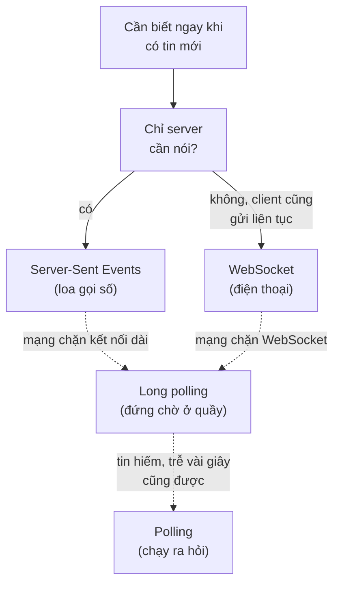
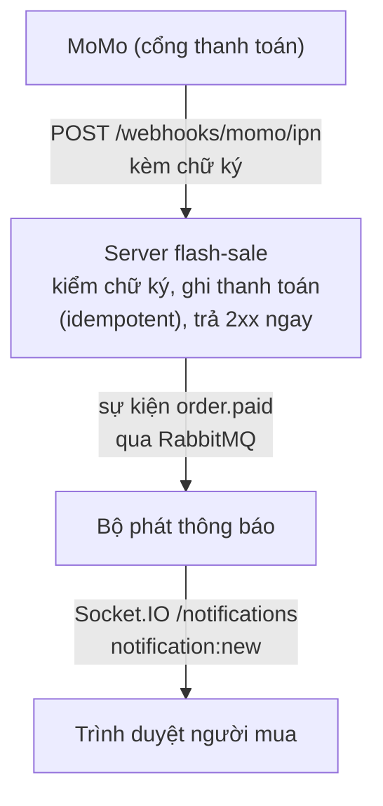

> [!tldr] Đọc nhanh
> - HTTP là hỏi-đáp: server chỉ được nói khi client hỏi. Muốn [[concepts/server-push|server chủ động báo tin]] thì phải lách quanh luật đó.
> - [[concepts/polling|Polling]] hỏi định kỳ: dễ nhất, nhưng tin trễ trung bình nửa chu kỳ và phần lớn request trả về rỗng. Trong ví dụ, hỏi mỗi 2 giây cho độ trễ trung bình khoảng 1 giây.
> - [[concepts/long-polling|Long polling]]: server giữ request lại tới khi có tin. Gần như tức thì, nhưng mỗi tin tốn một request mới.
> - [[concepts/server-sent-events|Server-Sent Events]]: một response HTTP không bao giờ kết thúc, server ghi từng sự kiện. Một chiều, có sẵn tự nối lại. Thường là đủ khi chỉ server cần nói.
> - WebSocket mở một kết nối [[concepts/full-duplex|full-duplex]] bằng một request HTTP duy nhất. Socket.IO là một **thư viện** dùng long polling và WebSocket bên dưới, không phải tên khác của WebSocket (ga 3).
> - [[concepts/webhooks|Webhooks]] hay được xếp chung bảng nhưng khác loại: đó là **server của bên khác gọi HTTP vào server của bạn** (MoMo báo "đã thanh toán"). Trình duyệt không nhận webhook được; server nhận xong phải chuyển tiếp xuống trình duyệt bằng một trong bốn cách trên.

> [!info] Bối cảnh
> Ga 1 của **tuyến WebSocket và Socket.IO**. Ví dụ là **flash-sale**, trang bán hàng giảm giá giờ vàng: đúng 21:00, hàng nghìn người cùng vào trang của một chiến dịch chỉ có vài trăm sản phẩm. Ai vào trước được xếp hàng chờ; khi tới lượt, server phải báo ngay "bạn có 5 phút để thanh toán", đồng thời cập nhật số hàng còn lại cho mọi người đang xem. Bạn không cần biết NestJS hay code của dự án.

> [!abstract]- Từ điển nhanh cho bài này (bấm để mở)
> - **HTTP request / response**: trình duyệt gửi một yêu cầu (request), server trả một câu trả lời (response). Xem ga [[posts/2026-11-18-api-foundations|Nền tảng API]].
> - **Kết nối TCP**: đường ống hai chiều giữa hai máy mà HTTP và WebSocket chạy bên trên. Mở một kết nối tốn vài vòng đi về qua mạng.
> - **Header**: các dòng `Tên: giá trị` đầu mỗi request và response (cookie, loại nội dung…), thường vài trăm byte.
> - **Độ trễ (latency)**: thời gian từ lúc sự kiện xảy ra ở server tới lúc trình duyệt biết.
> - **Proxy**: máy đứng giữa trình duyệt và server, chuyển tiếp request (nginx, load balancer, proxy công ty).
> - **HTTP/2**: phiên bản HTTP chở nhiều request song song trên một kết nối TCP.
> - **Cổng thanh toán, IPN**: dịch vụ nhận tiền thay bạn (MoMo, VNPay, Stripe). IPN là tên các cổng Việt Nam đặt cho webhook báo kết quả thanh toán.
> - **URL công khai**: địa chỉ mà máy bất kỳ trên Internet gọi tới được. Server có; trình duyệt của người dùng thì không.
> - **RabbitMQ**: hệ thống hàng đợi tin nhắn giữa các phần của backend. Xem [[series/rabbitmq|tuyến RabbitMQ]].

## Hình dung trước: chờ đồ ở quán cà phê

Bạn gọi món ở một quán đông khách và muốn biết ngay khi đồ xong. Có bốn cách để *bạn* biết, cộng một cách mà quán biết chuyện từ người khác:

| Đời thường | Khái niệm |
|---|---|
| Quán tự báo khi đồ xong, khách không cần hỏi | [[concepts/server-push\|Server push]] |
| Cứ hai phút lại chạy ra quầy hỏi "xong chưa?" | [[concepts/polling\|Polling]] |
| Ra quầy hỏi rồi **đứng chờ ở đó**, nhân viên trả lời khi đồ xong (hoặc sau 30 giây bảo "chưa, hỏi lại đi") | [[concepts/long-polling\|Long polling]] |
| Quán có **loa gọi số**: quán nói, khách chỉ nghe, không nói lại được | [[concepts/server-sent-events\|Server-Sent Events]] |
| Quán đưa bạn một **chiếc điện thoại**: hai bên nói lúc nào cũng được, cùng lúc cũng được | WebSocket, [[concepts/full-duplex\|full-duplex]] |
| Bạn trả tiền qua ví; **ví gọi điện cho quán** (không phải cho bạn) báo "khách bàn 5 đã trả". Quán nghe xong mới báo lại bạn bằng loa hay điện thoại | [[concepts/webhooks\|Webhooks]] |



## Vấn đề: HTTP không cho server nói trước

Mình từng nghĩ "realtime" là một công nghệ riêng mà dự án phải chọn ngay từ đầu, và Socket.IO là tên gọi khác của WebSocket. Hóa ra realtime chỉ là một câu hỏi: **làm sao để server báo tin cho trình duyệt mà không chờ trình duyệt hỏi?** HTTP được thiết kế theo kiểu hỏi-đáp: trình duyệt gửi request, server trả đúng một response, hết. Server không có cách nào tự gửi gì cho trình duyệt nếu trình duyệt không hỏi trước.

Với flash-sale, đó là vấn đề thật. Lúc 21:00:03 hàng chờ cấp lượt cho người thứ 512: nếu trang của người đó chỉ biết tin sau 10 giây, họ mất 10 giây trong 5 phút giữ hàng. Số hàng còn lại hiển thị trên trang cũng phải đổi theo từng đơn, không thì cả nghìn người bấm "mua" một món đã hết.

## Cơ chế

<figure class="figure-map" style="--ar: 3 / 4">
<div class="frame"><iframe data-archify="../diagrams/websocket-realtime-options/four-ways.html" title="Sơ đồ tuần tự: polling, long polling và WebSocket cùng chờ một sự kiện tồn kho" loading="lazy"></iframe></div>
<figcaption><span><b>Hình 1.</b> Cùng một sự kiện "tồn kho đổi": polling chỉ biết ở lần hỏi kế tiếp, long polling biết ngay nhưng phải hỏi lại, WebSocket chỉ cần một request lúc đầu.</span><a href="../diagrams/websocket-realtime-options/four-ways.html" target="_blank" rel="noopener">Mở toàn màn hình</a></figcaption>
</figure>

### Server push: đường đi ngược chiều

**[[concepts/server-push|Server push]]** là khi server tự gửi dữ liệu lúc có chuyện xảy ra. Cả bốn cách dưới đây đều nhằm làm việc đó; chúng khác nhau ở chỗ ai giữ kết nối, kết nối sống bao lâu, và mỗi tin tốn bao nhiêu.

Cần phân biệt với **HTTP/2 Server Push**, một tính năng khác hẳn: server gửi kèm file CSS, JS trước khi trình duyệt xin. Nó không đưa dữ liệu tới JavaScript của trang, và Chrome đã bỏ nó năm 2022. Đừng để cái tên làm nhầm.

### Polling: hỏi định kỳ

**[[concepts/polling|Polling]]** là cách ngây thơ nhất: mỗi N giây trình duyệt gửi `GET /queue/status`. Ưu điểm là không có gì mới để học: request thường, cache thường, đi qua mọi proxy và firewall, server không phải giữ trạng thái gì.

Cái giá có hai mặt, và chúng kéo ngược nhau:

- **Độ trễ**: một sự kiện xảy ra ngẫu nhiên giữa hai lần hỏi thì trung bình phải chờ N/2 giây, tệ nhất là N giây.
- **Lãng phí**: phần lớn request trả về "chưa có gì". 10.000 người hỏi mỗi 2 giây là 5.000 request mỗi giây, mỗi request mang vài trăm byte header và chạy qua cả chuỗi middleware xác thực, chỉ để nghe "chưa".

Giảm N thì đỡ trễ nhưng tốn hơn; tăng N thì rẻ nhưng chậm. Polling hợp khi tin hiếm và trễ vài giây không sao: trạng thái một đơn hàng đang giao, tiến độ xuất báo cáo.

### Long polling: hỏi rồi đứng chờ

**[[concepts/long-polling|Long polling]]** sửa độ trễ bằng một mẹo: server *không trả lời ngay*. Nếu chưa có gì mới, nó giữ request đó treo lại. Khi có sự kiện, nó trả lời request đang treo ngay lập tức; nếu hết thời gian chờ (thường 20–30 giây) mà vẫn chưa có gì, nó trả một response rỗng. Nhận xong, trình duyệt gửi ngay request tiếp theo. RFC 6202 mô tả kỹ thuật này và các vấn đề của nó.

Độ trễ gần như bằng không, và vẫn chỉ là HTTP thường. Nhưng:

- **Mỗi tin là một request mới**, kèm header và vòng xác thực. Tin dồn dập (tồn kho đổi mỗi 100 ms) thì long polling gần như thành polling tốc độ cao.
- **Khe hở giữa hai request**: tin xảy ra đúng lúc response cũ vừa trả mà request mới chưa tới thì server phải nhớ giùm. Vì vậy client gửi kèm "tôi đã nhận tới tin số mấy" (`after=3` trong ví dụ).
- **Server giữ rất nhiều request treo**, và khi chạy nhiều server, request sau phải tới đúng server đang nhớ phiên của mình. Ga 5 quay lại chuyện này với Socket.IO.

Long polling ít khi là lựa chọn đầu tiên ngày nay, nhưng nó là **đường lui**: Socket.IO bắt đầu mọi kết nối bằng long polling rồi mới thử WebSocket (ga 3), để vẫn chạy được sau những proxy chặn WebSocket.

### Server-Sent Events: một response không bao giờ kết thúc

**[[concepts/server-sent-events|Server-Sent Events]]** (SSE) dùng một request duy nhất mà server không bao giờ trả lời xong. Response có `Content-Type: text/event-stream`, và mỗi khi có tin, server ghi thêm vài dòng chữ:

```text
id: 42
event: stock_update
data: {"sku":"A1","left":41}

```

Một dòng trống kết thúc một sự kiện. Phía trình duyệt, chuẩn HTML có sẵn `EventSource`:

```ts
// minh họa, không chạy trực tiếp (chạy trong trình duyệt)
const es = new EventSource('/campaigns/c-21h/stream');
es.addEventListener('stock_update', (e) => render(JSON.parse(e.data)));
```

Điều hay nhất của SSE là những thứ có sẵn mà WebSocket không có: **trình duyệt tự kết nối lại** khi đứt, và gửi kèm header `Last-Event-ID` với id của tin cuối đã nhận, để server phát bù những tin bị lỡ. Server còn chỉnh được thời gian chờ nối lại bằng dòng `retry: 3000`. Vì là HTTP thường, SSE đi qua proxy, dùng cookie và xác thực sẵn có, và nén được bằng gzip.

Giới hạn:

- **Chỉ một chiều** server → client, và chỉ text (UTF-8). Client muốn gửi gì thì dùng request HTTP thường bên cạnh.
- **HTTP/1.1 giới hạn khoảng 6 kết nối mỗi tên miền** trong một trình duyệt, tính chung mọi tab. Mở trang ở 7 tab là tab thứ 7 treo. HTTP/2 chở nhiều luồng trên một kết nối nên không bị (trình duyệt và server thường cho phép khoảng 100 luồng song song).
- `EventSource` không cho đặt header tùy ý (như `Authorization`), nên thường xác thực bằng cookie.

Với flash-sale, phần lớn lưu lượng realtime là server → client (lượt thanh toán, tồn kho, kết quả đơn). SSE làm được hết những việc đó. Client chỉ gửi "tôi đang xem chiến dịch nào", việc mà một request HTTP thường làm được.

### WebSocket: một cuộc gọi hai chiều

**WebSocket** (RFC 6455, 2011) bắt đầu bằng một request HTTP có header `Upgrade: websocket`. Server đồng ý bằng `101 Switching Protocols`, và từ đó **cùng kết nối TCP ấy không còn nói HTTP nữa**: hai bên gửi các frame nhỏ (vài byte đầu, rồi dữ liệu) theo cả hai chiều, bất cứ lúc nào. Ga 2 mổ xẻ từng byte của quá trình này.

**[[concepts/full-duplex|Full-duplex]]** nghĩa là hai chiều độc lập: server đang đẩy tồn kho thì client vẫn gửi lệnh được, không ai phải chờ lượt. HTTP/1.1 là half-duplex theo kiểu hỏi-đáp; long polling và SSE chỉ giả lập chiều server → client.

Cái giá của WebSocket là bạn **tự lo những gì HTTP và SSE cho sẵn**: không tự nối lại, không phát bù tin bị lỡ, không có khái niệm "sự kiện tên gì", không có xác thực mỗi tin, và proxy, load balancer phải được cấu hình để chuyển tiếp `Upgrade`. Đó chính là khoảng trống mà Socket.IO lấp vào, và cũng là lý do người ta hay nhầm hai thứ là một.

### Còn Socket.IO?

Socket.IO **không phải là một cách thứ năm** ngang hàng với bốn cách trên. Nó là một thư viện (server Node.js và client cho nhiều nền tảng) dùng **long polling và WebSocket bên dưới**, rồi thêm lên trên tên sự kiện, xác nhận, phòng, tự kết nối lại. Nó có **giao thức riêng**, nên client WebSocket thuần không nói chuyện được với server Socket.IO. flash-sale dùng Socket.IO cho cả hàng chờ lẫn thông báo. Ga 3 và 4 là về nó.

### Còn webhooks?

Nhiều bài so sánh xếp **[[concepts/webhooks|webhooks]]** thành cột thứ năm cạnh polling, long polling, SSE và WebSocket. Xếp vậy dễ làm hiểu sai, vì webhook trả lời một câu hỏi khác. Bốn cách trên trả lời "**trình duyệt** biết tin mới bằng cách nào?". Webhook trả lời "**server của mình** biết chuyện xảy ra ở **hệ thống của người khác** bằng cách nào?".

Webhook là một request HTTP bình thường, chỉ đổi chiều: bạn đăng ký trước một URL với bên kia (cổng thanh toán, GitHub, nhà vận chuyển), và khi có sự kiện, **server của họ gửi `POST` tới URL đó**. Ở flash-sale, người mua trả tiền trên trang MoMo; server flash-sale không biết lúc nào xong, nên MoMo gọi `POST /webhooks/momo/ipn` kèm chữ ký.

Vì sao trình duyệt không nhận webhook được? Vì bên gửi phải gọi tới một **URL công khai, luôn sẵn sàng**. Trình duyệt của người dùng không có địa chỉ như vậy: nó nằm sau NAT của nhà mạng, đổi IP liên tục, tắt khi đóng tab, và không chạy server HTTP nào. Nên webhook luôn dừng ở server, và server phải **chuyển tiếp** tin cho trình duyệt bằng một trong bốn cách trên. flash-sale làm đúng chuỗi này:



Nếu không có webhook, server phải tự **polling** bên kia: cứ vài giây gọi API "đơn này trả tiền chưa?" của MoMo. Đúng những nhược điểm của polling ở trên, chỉ là giữa hai server. Webhook là phiên bản server-với-server của "đừng hỏi, để tôi báo".

Vì là HTTP từ Internet gọi vào, webhook có những luật riêng mà bốn cách kia không có:

- **Ai cũng gọi được URL đó**, nên phải xác thực bằng chữ ký (HMAC) trên đúng chuỗi byte gốc của body, kèm mốc thời gian để chống phát lại. Stripe còn cho phép lọc theo danh sách IP.
- **Bên gửi sẽ gửi lại** khi bạn trả lỗi hoặc trả lời chậm: Stripe thử lại tới 3 ngày, GitHub coi là thất bại nếu không có `2xx` trong 10 giây. Hệ quả: một sự kiện có thể tới **nhiều lần** và **không theo thứ tự**, nên xử lý phải idempotent (ghi lại id sự kiện đã xử lý).
- **Trả `2xx` ngay**, việc nặng đẩy vào hàng đợi, như flash-sale đẩy `order.paid` qua RabbitMQ.
- **Webhook có thể không bao giờ tới** (bên gửi hết lượt thử, endpoint của bạn sập lâu). Nên vẫn cần một job đối soát định kỳ hỏi lại API của bên kia, tức là quay về polling, nhưng làm lưới an toàn chứ không phải đường chính.

Chi tiết cách flash-sale kiểm chữ ký và chống xử lý trùng (hai lớp idempotency) nằm ở ga [[posts/2026-11-18-api-styles|Năm kiểu API]] của tuyến API.

### So sánh nhanh

| | Polling | Long polling | SSE | WebSocket | Webhook |
|---|---|---|---|---|---|
| Ai gọi ai | trình duyệt → server | trình duyệt → server | trình duyệt mở, server ghi | trình duyệt mở, hai bên gửi | server bên kia → server mình |
| Chiều tin | client hỏi | client hỏi | server → client | hai chiều | bên ngoài → server |
| Độ trễ | N/2 trung bình | gần 0 | gần 0 | gần 0 | gần 0 (khi tới được) |
| Request mỗi tin | (nhiều request rỗng) | 1 | 0 | 0 | 1 |
| Kết nối | ngắn | treo tới khi có tin | sống lâu | sống lâu | ngắn |
| Tự nối lại, phát bù | không cần | tự làm | có sẵn (`Last-Event-ID`) | tự làm | bên gửi tự gửi lại |
| Dữ liệu | bất kỳ | bất kỳ | text | text và binary | thường là JSON |
| Qua proxy cũ | luôn | luôn | thường được | đôi khi bị chặn | không liên quan (server với server) |

## Ví dụ chạy được

[compare.ts](../code/websocket-realtime-options/compare.ts) dựng một server có cả bốn đường (`/poll`, `/long-poll`, `/sse`, và WebSocket bằng thư viện `ws`), phát 5 sự kiện tồn kho ở các thời điểm cố định trong 6 giây. Bốn client chạy song song, đếm số request HTTP và đo độ trễ từ lúc sự kiện xảy ra tới lúc client nhận được. Client WebSocket là `WebSocket` có sẵn trong Node 22+, cùng API với trình duyệt.

```bash
npm i ws
node compare.ts
```

```ts
// long polling phía server: chưa có gì thì giữ request lại
const fresh = log.filter((e) => e.id > after);
if (fresh.length) return res.end(JSON.stringify(fresh));
const done = (e: Ev) => { clearTimeout(timer); waiting.delete(done); res.end(JSON.stringify([e])); };
const timer = setTimeout(() => { waiting.delete(done); res.end('[]'); }, LONG_POLL_HOLD);
waiting.add(done);

// SSE: một response không bao giờ kết thúc
res.writeHead(200, { 'content-type': 'text/event-stream', 'cache-control': 'no-cache' });
// … mỗi sự kiện:
res.write(`id: ${id}\ndata: ${JSON.stringify(e)}\n\n`);
```

```text
$ node compare.ts
5 sự kiện trong 6 giây

cách            request HTTP   nhận được   trễ trung bình   trễ lớn nhất
polling                3           4          1025 ms        1323 ms
long polling           6           5             3 ms           5 ms
SSE                    1           5             5 ms          10 ms
WebSocket              1           5             4 ms           7 ms
```

Đọc kết quả:

- **Polling** hỏi 3 lần (giây 0, 2, 4) và trễ trung bình khoảng 1 giây, đúng nửa chu kỳ 2 giây. Sự kiện thứ năm (giây 5,2) **chưa tới tay** khi hết 6 giây: lần hỏi kế tiếp mới thấy nó.
- **Long polling** gần như tức thì, nhưng tốn 6 request cho 5 sự kiện (5 lần được trả lời và một lần cuối còn treo). Tin càng dày, số request càng tăng theo.
- **SSE và WebSocket** đều chỉ tốn đúng một request HTTP lúc đầu và trễ vài mili giây. Khác biệt giữa chúng không nằm ở tốc độ mà ở chiều: SSE chỉ server → client.

## Hiểu lầm và bẫy hay gặp

- **"Socket.IO là WebSocket."** Socket.IO là thư viện có giao thức riêng, chạy trên long polling hoặc WebSocket. Client WebSocket thuần không nối được server Socket.IO (ga 3 chạy thử).
- **"Realtime thì phải WebSocket."** Phần lớn tính năng "realtime" là server → client: thông báo, tiến độ, giá. SSE làm được với ít thứ phải lo hơn (tự nối lại, phát bù, qua proxy, dùng cookie sẵn có).
- **"Polling rẻ vì đơn giản."** Đơn giản cho người viết, không rẻ cho server: phần lớn request vô ích, và giảm chu kỳ để đỡ trễ thì chi phí tăng tuyến tính.
- **"HTTP/2 Server Push thay được WebSocket."** Đó là tính năng đẩy file tĩnh vào cache trình duyệt, JavaScript không đọc được, và đã bị Chrome bỏ.
- **Mở SSE trên HTTP/1.1 ở nhiều tab** thì vượt giới hạn khoảng 6 kết nối mỗi tên miền và tab sau treo. Bật HTTP/2 hoặc gom về một kết nối dùng chung.
- **"Long polling lỗi thời, bỏ đi."** Nó vẫn là đường lui khi mạng công ty chặn WebSocket; Socket.IO giữ nó vì lý do đó.
- **"Dùng webhook để báo cho trình duyệt."** Không được: bên gửi webhook cần một URL công khai luôn sẵn sàng, trình duyệt không có. Webhook dừng ở server; server chuyển tiếp bằng SSE, WebSocket hay polling.
- **"Webhook tới đúng một lần, đúng thứ tự."** Bên gửi thử lại khi bạn trả lời chậm hay lỗi, nên cùng một sự kiện có thể tới nhiều lần và lộn thứ tự. Xử lý idempotent, trả `2xx` nhanh, và giữ job đối soát phòng khi webhook không tới.

## Câu hỏi tự kiểm tra

> [!question]- Vì sao HTTP thường không cho server báo tin trước?
> HTTP là hỏi-đáp: mỗi response phải trả lời một request client đã gửi. Server không có kênh nào để tự gửi dữ liệu khi client chưa hỏi. Mọi kỹ thuật realtime đều là cách giữ sẵn một request (long polling, SSE) hoặc đổi kết nối sang giao thức khác (WebSocket).

> [!question]- Polling mỗi 2 giây cho độ trễ trung bình bao nhiêu, và giảm xuống 0,5 giây thì phải trả giá gì?
> Trung bình khoảng 1 giây (nửa chu kỳ), tệ nhất 2 giây. Giảm xuống 0,5 giây thì số request tăng gấp 4, phần lớn vẫn trả về rỗng.

> [!question]- Long polling khác polling ở đâu, và vì sao nó vẫn tốn khi tin dồn dập?
> Server giữ request lại tới khi có tin thay vì trả lời ngay, nên độ trễ gần bằng không. Nhưng mỗi tin vẫn kết thúc một response và client phải gửi request mới, nên tin càng dày thì số request càng nhiều.

> [!question]- SSE có gì sẵn mà WebSocket không có?
> Trình duyệt tự kết nối lại, gửi `Last-Event-ID` để server phát bù tin bị lỡ, chỉnh được thời gian chờ bằng `retry:`, và vì là HTTP thường nên dùng được cookie, nén, proxy sẵn có. Đổi lại SSE chỉ một chiều và chỉ text.

> [!question]- Khi nào bạn chọn WebSocket thay vì SSE cho flash-sale?
> Khi client cũng phải gửi dữ liệu liên tục và nhanh trên cùng kênh (game, chat, kéo thả cộng tác), hoặc cần dữ liệu nhị phân. Nếu client chỉ thỉnh thoảng gửi lệnh, SSE cộng request HTTP thường là đủ.

> [!question]- Người mua trả tiền trên MoMo. Vì sao MoMo không báo thẳng cho trình duyệt của họ, và tin "đã thanh toán" đi tới trình duyệt theo đường nào?
> Webhook cần một URL công khai luôn sẵn sàng, còn trình duyệt nằm sau NAT, không có địa chỉ cố định và không chạy server HTTP. Nên MoMo gọi webhook vào server flash-sale; server kiểm chữ ký, ghi nhận thanh toán, đẩy sự kiện `order.paid` qua RabbitMQ, rồi bộ phát thông báo gửi `notification:new` xuống trình duyệt qua Socket.IO.

## Tham khảo

- [RFC 6455: The WebSocket Protocol](https://www.rfc-editor.org/rfc/rfc6455)
- [WHATWG HTML: Server-sent events](https://html.spec.whatwg.org/multipage/server-sent-events.html) (định dạng `text/event-stream`, `Last-Event-ID`, `retry`)
- [MDN: Using server-sent events](https://developer.mozilla.org/en-US/docs/Web/API/Server-sent_events/Using_server-sent_events) (giới hạn 6 kết nối trên HTTP/1.1)
- [RFC 6202: Known Issues and Best Practices for the Use of Long Polling and Streaming in Bidirectional HTTP](https://www.rfc-editor.org/rfc/rfc6202)
- [Socket.IO: How it works](https://socket.io/docs/v4/how-it-works/)
- [Stripe: Receive events in your webhook endpoint](https://docs.stripe.com/webhooks) (URL HTTPS công khai, chữ ký, gửi lại tới 3 ngày, không đảm bảo thứ tự, trùng lặp)
- [GitHub: Best practices for using webhooks](https://docs.github.com/en/webhooks/using-webhooks/best-practices-for-using-webhooks) (trả `2xx` trong 10 giây)
