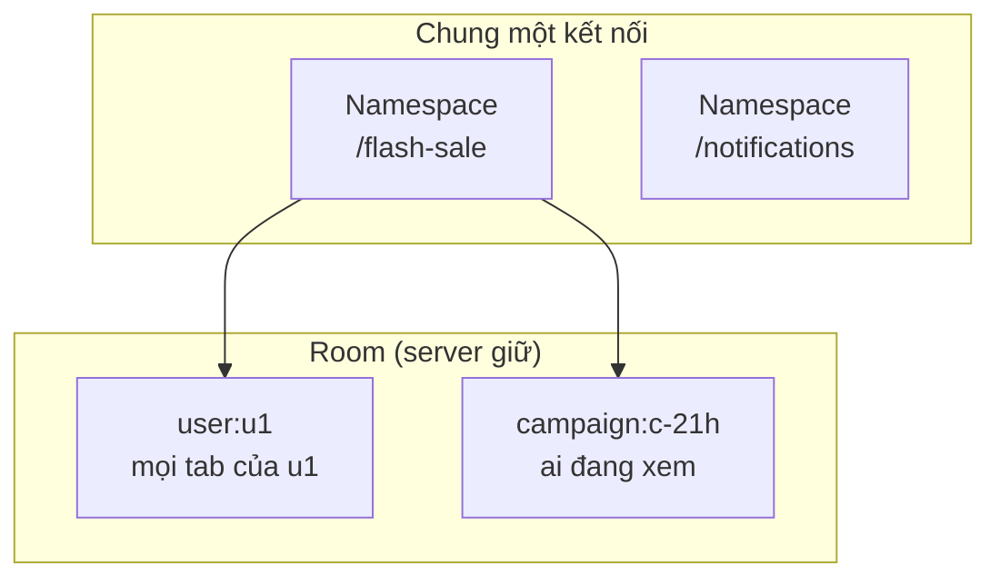

> [!tldr] Đọc nhanh
> - [[concepts/namespace|Namespace]] (`/flash-sale`, `/notifications`) chia server thành các kênh có middleware và handler riêng. [[concepts/room|Room]] là nhóm socket **chỉ server biết**; `to('user:u1').emit()` tới mọi tab của một người.
> - [[concepts/multiplexing|Multiplexing]]: hai lời gọi `io()` tới hai namespace cùng origin đi chung **một** kết nối, và option `transports` của lời gọi thứ hai **bị bỏ qua**. flash-sale rất có thể đang dính đúng bẫy này.
> - [[concepts/auto-reconnect|Auto reconnect]]: client chờ 1, 2, 4, 5, 5… giây (có ngẫu nhiên) rồi thử lại, mãi mãi. Đặt `reconnectionAttempts: 5` thì sau lần thứ năm client bỏ cuộc vĩnh viễn.
> - [[concepts/delivery-guarantee|Delivery guarantee]] mặc định là **at most once**: client mất kết nối thì đệm tin của nó lại, còn tin server gửi trong lúc đó là mất.
> - [[concepts/connection-state-recovery|Connection state recovery]] giữ id, room và tin bị lỡ trong một khoảng ngắn, nhưng không chạy với Redis adapter dạng Pub/Sub mà flash-sale đang dùng.

> [!info] Bối cảnh
> Ga 4 của **tuyến WebSocket và Socket.IO**. Ví dụ là **flash-sale**, trang bán hàng giảm giá giờ vàng: khi tới lượt, server đẩy `checkout_ready` cho đúng người đó (mọi tab họ đang mở), và đẩy `stock_update` cho mọi người đang xem một chiến dịch. Frontend mở hai kết nối Socket.IO: `/flash-sale` và `/notifications`. Bạn không cần biết NestJS hay React.

> [!abstract]- Từ điển nhanh cho bài này (bấm để mở)
> - **Engine.IO, transport, `transports: ['websocket']`, gói CONNECT, ack**: xem [[posts/2026-11-22-websocket-socketio|ga 3]].
> - **Origin**: phần `giao thức://tên miền:cổng` của URL. `https://api.shop.vn/flash-sale` và `https://api.shop.vn/notifications` cùng origin.
> - **Manager**: đối tượng trong `socket.io-client` giữ một kết nối Engine.IO và lo việc kết nối lại.
> - **React effect (`useEffect`)**: đoạn code React chạy sau khi giao diện được vẽ, thường để mở kết nối. Effect của component con chạy **trước** effect của component cha.
> - **At most once / at least once**: nhiều nhất một lần (có thể mất) / ít nhất một lần (có thể trùng). Xem [[concepts/at-least-once-delivery|ga RabbitMQ]].
> - **Adapter**: phần của Socket.IO quyết định một lần phát tin tới những socket nào; ga 5 nói kỹ.

## Hình dung trước: tòa nhà có tổng đài nội bộ

Tổng đài ở ga 3 giờ phục vụ một tòa nhà văn phòng.

| Đời thường | Khái niệm |
|---|---|
| Mỗi phòng ban có số máy lẻ riêng (bán hàng, chăm sóc khách) | [[concepts/namespace\|Namespace]] |
| Nhóm chat do lễ tân lập, ai được thêm vào thì nghe; người trong nhóm không xem được danh sách | [[concepts/room\|Room]] |
| Một đường dây vào tòa nhà chở cuộc gọi tới nhiều máy lẻ | [[concepts/multiplexing\|Multiplexing]] |
| Rớt máy thì điện thoại tự gọi lại sau 1 giây, 2 giây, 4 giây… | [[concepts/auto-reconnect\|Auto reconnect]] |
| Lễ tân đọc thông báo lúc bạn đang rớt máy: bạn không bao giờ nghe được | [[concepts/delivery-guarantee\|At most once]] |
| Lễ tân ghi âm 2 phút gần nhất, gọi lại kịp thì được nghe lại | [[concepts/connection-state-recovery\|Connection state recovery]] |



## Vấn đề: "WebSocket có room mà"

Mình từng nghĩ room, namespace và việc tự nối lại là tính năng của WebSocket. Ga 2 đã cho thấy RFC 6455 không có thứ nào trong số đó: chúng là của Socket.IO. Và khi đã là của một thư viện, chúng có những quy tắc riêng mà phải đọc mã nguồn mới thấy: option nào bị bỏ qua, tin nào bị mất, client bỏ cuộc lúc nào. Ba chuyện đó đều xảy ra được trong flash-sale.

## Cơ chế

<figure class="figure-map" style="--ar: 1 / 1">
<div class="frame"><iframe data-archify="../diagrams/websocket-rooms/rooms.html" title="Sơ đồ kiến trúc: ba nguồn sự kiện phát vào các room user:u1, campaign:c-21h và user:u2 trong hai namespace, room chuyển tin tới các tab" loading="lazy"></iframe></div>
<figcaption><span><b>Hình 1.</b> Server phát tin vào room, room chuyển tới mọi socket đang ở trong đó; một người có hai tab thì nhận ở cả hai, và không client nào biết mình đang ở phòng nào.</span><a href="../diagrams/websocket-rooms/rooms.html" target="_blank" rel="noopener">Mở toàn màn hình</a></figcaption>
</figure>

### Namespace: kênh theo đường dẫn

**[[concepts/namespace|Namespace]]** chia một server Socket.IO thành nhiều kênh logic theo đường dẫn. Mỗi namespace có middleware riêng (ví dụ xác thực), handler riêng, room riêng. flash-sale có hai:

- `/flash-sale`: `checkout_ready`, `stock_update`, `queue_position`, `campaign_ended`, `order_result`; client gửi lên `subscribe_campaign`.
- `/notifications`: `notification:new`, `notification:unread-count`, `notification:read`.

Phía client, namespace nằm trong URL: `io('https://api…/flash-sale')`. Đường dẫn này **không phải** đường dẫn HTTP; request thật luôn đi tới `/socket.io/` (đổi được bằng option `path`). Namespace chỉ xuất hiện trong gói CONNECT `40/flash-sale,` và trong mọi gói sau đó. NestJS gắn mỗi gateway vào một namespace qua `@WebSocketGateway({ namespace: '/flash-sale' })`.

### Room: nhóm chỉ server biết

**[[concepts/room|Room]]** là một nhóm socket do server quản lý. Server cho một socket vào phòng bằng `socket.join('campaign:c-21h')`, và phát cho cả phòng bằng `to('campaign:c-21h').emit(…)`. Vài điều cần biết:

- **Client không biết gì về room.** Không có API phía client để xem mình đang ở phòng nào hay tự vào phòng. Client chỉ gửi một sự kiện (`subscribe_campaign`), server quyết định cho vào phòng nào. Đây cũng là lớp phân quyền: đừng viết handler kiểu "client gửi tên phòng nào thì cho vào phòng đó".
- **Mỗi socket tự ở trong phòng mang id của nó**, nên `to(socketId).emit()` gửi cho riêng socket đó.
- **Phòng theo người dùng** là mẫu quan trọng nhất: lúc kết nối, sau khi xác thực, cho socket vào `user:<id>`. Người đó mở ba tab là ba socket trong cùng phòng, và `to('user:u1').emit('checkout_ready')` tới cả ba. flash-sale làm đúng như vậy trong `handleConnection`.
- **Room sống trong RAM của server và biến mất khi socket ngắt.** Nối lại là một socket mới (id mới), không ở phòng nào cả, phải `join` lại. Hook phía client của flash-sale gửi lại `subscribe_campaign` mỗi lần sự kiện `connect` xảy ra, chính vì lý do này.
- **Room không vượt qua ranh giới pod**: adapter mặc định chỉ biết socket trong RAM của pod hiện tại. Ga 5 sửa chuyện này bằng Redis adapter.

### Multiplexing: hai namespace, một kết nối, và option bị bỏ qua

**[[concepts/multiplexing|Multiplexing]]**: khi bạn gọi `io()` hai lần tới hai namespace của **cùng một origin**, `socket.io-client` không mở hai kết nối. Nó giữ một bộ nhớ đệm Manager theo origin, và lời gọi thứ hai dùng lại Manager của lời gọi thứ nhất. Đọc mã nguồn `socket.io-client` 4.8 (hàm `lookup`):

```ts
// trích từ socket.io-client 4.8.4, build/esm/index.js (rút gọn)
const sameNamespace = cache[id] && path in cache[id]['nsps'];
const newConnection = opts.forceNew || false === opts.multiplex || sameNamespace;
if (newConnection) io = new Manager(source, opts);
else { if (!cache[id]) cache[id] = new Manager(source, opts); io = cache[id]; }
```

Tiết kiệm được một kết nối. Nhưng có một hệ quả rất khó thấy: **option ở tầng kết nối** (`transports`, `path`, `reconnection*`, `timeout`…) **chỉ có hiệu lực ở lời gọi tạo ra Manager**. Lời gọi sau truyền option gì cũng bị bỏ qua lặng lẽ, không cảnh báo. Option ở tầng namespace như `auth` thì vẫn riêng cho từng namespace.

Giờ nhìn flash-sale:

- `SocketProvider` (bọc toàn bộ app, ở layout gốc) gọi `io(origin + '/flash-sale', { transports: ['websocket'], reconnectionAttempts: 5, … })`.
- `NotificationSocketBridge` (nằm sâu hơn, trong layout của các trang cần đăng nhập) gọi `io(origin + '/notifications', { auth })` với option mặc định.
- Cả hai lấy origin từ cùng biến môi trường `NEXT_PUBLIC_API_URL`, và cả hai mở kết nối trong một effect phụ thuộc vào `isAuthenticated`.

React chạy effect của **component con trước component cha**. `NotificationSocketBridge` là con cháu của `SocketProvider`, nên khi người dùng đăng nhập (hoặc tải trang khi đã đăng nhập), lời gọi `/notifications` chạy trước, tạo Manager với transport mặc định (polling rồi nâng cấp), và option `transports: ['websocket']` của `/flash-sale` bị bỏ qua. Cùng lúc, `reconnectionAttempts: 5` cũng không áp dụng (Manager dùng mặc định: thử mãi). Mình chưa đo trên bản chạy thật, nhưng ví dụ bên dưới tái hiện đúng thứ tự này và in ra transport thật sự được dùng.

Hệ quả nằm ở ga 5: còn long polling thì phải có sticky session, và ingress của flash-sale chạy 3 pod mà chưa bật sticky. Cách sửa: dùng chung một cấu hình cho cả hai namespace (một module tạo Manager duy nhất rồi gọi `manager.socket('/notifications', { auth })`), hoặc truyền `forceNew: true` để tách hẳn hai kết nối.

### Auto reconnect: gọi lại, nhưng có giới hạn không?

**[[concepts/auto-reconnect|Auto reconnect]]** là việc của Manager phía client. Khi kết nối đứt bất thường (1006, hết heartbeat, server tắt), nó chờ rồi thử lại với thời gian chờ tăng dần:

- `reconnectionDelay` 1000 ms, nhân đôi mỗi lần, tối đa `reconnectionDelayMax` 5000 ms: khoảng 1, 2, 4, 5, 5, 5… giây.
- `randomizationFactor` 0,5: mỗi lần chờ lệch ngẫu nhiên tới ±50%, để hàng nghìn client không cùng thử lại một lúc (ga 5).
- `reconnectionAttempts` mặc định **`Infinity`**.

Nếu đặt `reconnectionAttempts: 5` như cấu hình `/flash-sale` của flash-sale (nếu nó có hiệu lực, xem mục trên), thì tổng thời gian chờ chỉ khoảng 1 + 2 + 4 + 5 + 5 ≈ 17 giây. Một lần deploy hay Redis failover lâu hơn thế, client phát `reconnect_failed` và **không bao giờ tự thử lại nữa**, kể cả khi server đã lên. Người dùng phải tải lại trang mới nhận được `checkout_ready`. Nếu muốn giới hạn, thì phải có giao diện "mất kết nối, bấm để thử lại" đi kèm.

Hai trường hợp client **không** tự nối lại: bạn gọi `socket.disconnect()` ở client, hoặc **server chủ động** gọi `socket.disconnect()` (lý do `io server disconnect`). Trường hợp sau là có chủ đích: server đuổi (ví dụ token sai) thì client không nên lì lợm quay lại. Ga 5 dùng chi tiết này cho lúc pod tắt.

### Delivery guarantee: at most once

Tài liệu Socket.IO nói rõ **[[concepts/delivery-guarantee|bảo đảm giao tin]]** mặc định:

- **Thứ tự được giữ**, kể cả khi đang nâng cấp từ polling lên WebSocket.
- **At most once**: tin có thể mất. Kết nối đứt giữa chừng thì bên gửi không biết bên nhận đã nhận chưa, và không có gửi lại sau khi nối lại.
- **Client đệm, server không**: client đang mất kết nối mà gọi `emit` thì tin được đệm lại và gửi khi nối lại. Server thì **không có bộ đệm nào** cho client vắng mặt; tin phát vào phòng lúc đó chỉ tới những socket đang ở trong phòng.

Với flash-sale, đó là chuyện thật: hàng chờ cấp lượt cho người thứ 512 và phát `checkout_ready` vào `user:<id>` đúng lúc điện thoại của họ đang chuyển từ Wi-Fi sang 4G. Tin mất. Họ có 5 phút để thanh toán mà không biết. `stock_update` thì tự lành (tick sau phát lại số mới), nhưng `checkout_ready` và `order_result` thì không.

Muốn **at least once** cho chiều server → client, phải tự làm: mỗi tin có id, lưu vào database, client nhớ id cuối đã nhận và gửi kèm khi nối lại để server phát bù, và client bỏ qua tin trùng (hook thông báo của flash-sale đã lọc trùng theo `id` trong 60 giây, đúng hướng). Cách rẻ hơn và đủ dùng: **sau mỗi lần `connect`, gọi một API REST để lấy lại trạng thái** ("tôi có lượt thanh toán nào đang chờ không?"). Chiều client → server thì có sẵn: option `retries` cùng `ackTimeout` làm client gửi lại tới khi có ack.

### Connection state recovery: ghi âm 2 phút gần nhất

Socket.IO 4.6 thêm **[[concepts/connection-state-recovery|connection state recovery]]**. Bật ở server:

```ts
const io = new Server(httpServer, {
  connectionStateRecovery: { maxDisconnectionDuration: 2 * 60 * 1000 },
});
```

Server giữ lại trạng thái của socket vừa đứt (id, room, `socket.data`) và các tin phát cho nó trong tối đa 2 phút. Client nối lại kịp thì được trả lại tất cả, kèm các tin đã lỡ, và `socket.recovered === true`. Không kịp thì như kết nối mới.

Ba giới hạn:

- **Không phải lúc nào cũng thành công.** Vẫn phải có logic đồng bộ lại trạng thái, đúng như tài liệu nói.
- **Phụ thuộc adapter.** Chạy với adapter trong RAM (một pod), Redis **Streams** adapter, MongoDB adapter. **Không** chạy với Redis adapter dạng Pub/Sub, vì Pub/Sub không lưu tin. flash-sale đang dùng loại Pub/Sub (`@socket.io/redis-adapter`), nên muốn có recovery thì phải đổi sang `@socket.io/redis-streams-adapter`.
- **Server phải gửi ít nhất một tin** cho socket trước khi đứt để client có mốc offset. Và nếu bật `skipMiddlewares`, middleware xác thực bị bỏ qua khi khôi phục: người bị khóa trong lúc đứt vẫn quay lại được.

## Ví dụ chạy được

[rooms.ts](../code/websocket-rooms/rooms.ts) dựng một server có hai namespace, xác thực bằng `auth.user` và cho mỗi socket vào phòng `user:<id>`. Sau đó: hai lời gọi `io()` cùng origin, ba tab của hai người, cắt kết nối giữa chừng (có và không có recovery), và tắt hẳn server với `reconnectionAttempts: 5`.

```bash
npm i socket.io socket.io-client
node rooms.ts
```

```ts
// đúng thứ tự như flash-sale: /notifications tạo Manager trước
const notif = ioc(`${url}/notifications`, { auth: { user: 'u1' } });
const flash = ioc(`${url}/flash-sale`, { auth: { user: 'u1' }, transports: ['websocket'] });

// cắt đường truyền, rồi hai bên cùng gửi khi đang mất kết nối
c.emit('cart_add', 'SKU-9');                                       // client gửi
io.of('/flash-sale').to('user:u1').emit('order_result', { n: 2 }); // server gửi
```

```text
$ node rooms.ts
1) Hai lời gọi io() tới hai namespace của cùng một origin
   dùng chung Manager: true;  số kết nối Engine.IO ở server: 1
   transports mà lời gọi thứ hai thật sự dùng: ["polling","websocket","webtransport"] ← option ['websocket'] bị bỏ qua

2) Room chỉ tồn tại ở server
   phòng của một socket u2: ["TeB_aKno-ugmxfkbAAAE","user:u2","campaign:c-21h"]
   u1 tab A ← order_result
   u1 tab B ← order_result
   u2 ← stock_update

3) Mặc định: at most once
   client: mất kết nối, connected=false
   server nhận cart_add SKU-9 từ u1
   client: nối lại, recovered=false, giữ id cũ=false
   client đã nhận: order_result #1

4) Bật connectionStateRecovery (adapter trong RAM)
   client: mất kết nối, connected=false
   server nhận cart_add SKU-9 từ u1
   client: nối lại, recovered=true, giữ id cũ=true
   client đã nhận: order_result #1, order_result #2

5) Server tắt hẳn (deploy lâu), client đặt reconnectionAttempts: 5
   thử lại lần 1
   thử lại lần 2
   thử lại lần 3
   thử lại lần 4
   thử lại lần 5
   reconnect_failed: client bỏ cuộc vĩnh viễn, server có lên lại cũng không tự nối nữa
```

Đọc kết quả:

- **Phần 1**: một Manager, một kết nối Engine.IO cho hai namespace, và transport thật sự của `/flash-sale` là danh sách mặc định, không phải `['websocket']`.
- **Phần 2**: một socket ở trong phòng mang id của nó cộng hai phòng server cho vào. Phát vào `user:u1` tới cả hai tab của u1; phát vào `campaign:c-21h` chỉ tới u2, người đã đăng ký.
- **Phần 3**: tin client gửi lúc mất kết nối (`cart_add`) được đệm và tới server sau khi nối lại; tin server gửi lúc đó (`order_result #2`) mất hẳn, và socket mới có id mới.
- **Phần 4**: cùng sự cố, bật recovery thì client giữ id cũ và nhận bù `order_result #2`.
- **Phần 5**: thử năm lần rồi dừng hẳn.

## Hiểu lầm và bẫy hay gặp

- **"Room và namespace là của WebSocket."** Là của Socket.IO. WebSocket thuần muốn có thì tự viết (một `Map<roomName, Set<socket>>`).
- **"Client vào phòng bằng cách gửi tên phòng."** Room là quyết định của server; handler nhận tên phòng từ client mà không kiểm quyền là để người khác nghe lén phòng của người khác.
- **Gọi `io()` nhiều lần với option khác nhau cho cùng origin**: chỉ option của lời gọi đầu tiên có hiệu lực ở tầng kết nối. Gom về một nơi tạo kết nối, hoặc dùng `forceNew`.
- **"Nối lại thì vẫn ở phòng cũ."** Socket mới, id mới, không phòng nào. Phải join lại trên mỗi `connect` (trừ khi recovery thành công).
- **"Socket.IO đảm bảo tin tới."** At most once. Tin quan trọng phải có đường đồng bộ lại (REST sau mỗi `connect`) hoặc tự làm id + phát bù.
- **`reconnectionAttempts` nhỏ mà không có nút "thử lại"**: một lần deploy lâu là người dùng mất realtime tới khi tải lại trang.
- **Bật connection state recovery với Redis adapter Pub/Sub** và tưởng đã có: nó không chạy với adapter đó.

## Câu hỏi tự kiểm tra

> [!question]- Client có xem được mình đang ở những phòng nào không? Vì sao điều đó quan trọng cho bảo mật?
> Không, room chỉ tồn tại ở server. Vì vậy server là nơi duy nhất quyết định ai vào phòng nào, và phải kiểm quyền trước khi `join`, thay vì tin tên phòng client gửi lên.

> [!question]- Hai lời gọi `io('https://api.x/flash-sale', { transports: ['websocket'] })` và `io('https://api.x/notifications')` chạy theo thứ tự ngược lại. Transport của `/flash-sale` là gì?
> Danh sách mặc định (polling rồi nâng cấp), vì lời gọi `/notifications` tạo Manager trước và lời gọi sau dùng lại Manager đó, bỏ qua option tầng kết nối của nó.

> [!question]- Điện thoại mất kết nối 3 giây. Trong lúc đó client gọi `emit('cart_add')` và server phát `checkout_ready` vào phòng của user. Sau khi nối lại, tin nào tới?
> `cart_add` tới server vì client đệm tin khi mất kết nối. `checkout_ready` mất vì server không đệm cho client vắng mặt (at most once), trừ khi bật connection state recovery với adapter hỗ trợ.

> [!question]- Vì sao server gọi `socket.disconnect()` thì client không tự nối lại?
> Vì đó là server chủ động đuổi (lý do `io server disconnect`), thường do xác thực sai hay bị cấm; nếu client tự nối lại thì sẽ bị đuổi lặp vô hạn. Client chỉ tự nối lại khi kết nối đứt bất thường.

> [!question]- flash-sale dùng Redis adapter dạng Pub/Sub. Muốn có connection state recovery thì phải làm gì?
> Đổi sang adapter có lưu tin, ví dụ Redis Streams adapter (hoặc MongoDB adapter), rồi bật `connectionStateRecovery`. Vẫn giữ đường đồng bộ lại bằng REST cho trường hợp recovery không thành công.

## Tham khảo

- [Socket.IO: Namespaces](https://socket.io/docs/v4/namespaces/) và [Rooms](https://socket.io/docs/v4/rooms/)
- [Socket.IO: Client options](https://socket.io/docs/v4/client-options/) (`forceNew`, `multiplex`, `reconnection*`, `randomizationFactor`)
- [Socket.IO: Delivery guarantees](https://socket.io/docs/v4/delivery-guarantees)
- [Socket.IO: Connection state recovery](https://socket.io/docs/v4/connection-state-recovery)
- Mã nguồn `socket.io-client` 4.8.4: `lookup()` trong `build/esm/index.js`, `Manager` và `contrib/backo2.js`
- [React: useEffect](https://react.dev/reference/react/useEffect)
