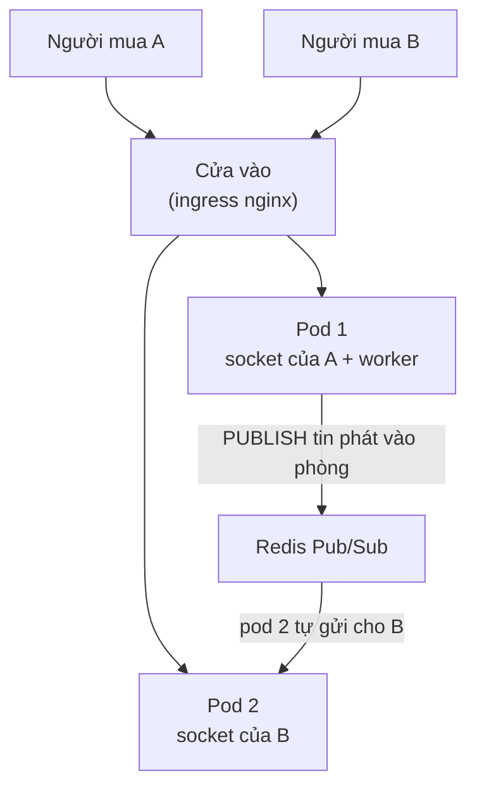

> [!tldr] Đọc nhanh
> - Mỗi pod chỉ biết socket trong RAM của nó. Hai bài toán khác nhau: **đường vào** (request của một phiên phải tới đúng pod) và **đường ra** (tin phát ở pod 1 phải tới người đang ở pod 2).
> - [[concepts/sticky-session|Sticky session]] lo đường vào. Bắt buộc khi còn long polling: tới nhầm pod là `400 Session ID unknown`. Chỉ dùng WebSocket thì không cần.
> - [[concepts/socket-io-adapter|Adapter]] lo đường ra. Redis adapter publish mỗi lần phát lên Redis Pub/Sub để mọi pod cùng gửi; mỗi pod cần hai kết nối Redis riêng.
> - [[reverse-proxy-upgrade|Proxy phải chuyển tiếp `Upgrade`]], và [[concepts/idle-timeout|idle timeout]] của mọi tầng phải dài hơn heartbeat (Socket.IO khuyên trên 45 giây; flash-sale đang đặt 30).
> - Pod tắt là mọi client của nó đứt cùng lúc: [[concepts/reconnect-storm|reconnect storm]]. Jitter rải lượt nối lại, và [[concepts/graceful-shutdown|graceful shutdown]] đóng kết nối có chủ đích trước khi tiến trình thoát.

> [!info] Bối cảnh
> Ga 5 của **tuyến WebSocket và Socket.IO**. Ví dụ là **flash-sale**, trang bán hàng giảm giá giờ vàng: backend chạy tối thiểu 3 pod trên Kubernetes (tự tăng tới 20 khi tải cao), sau một ingress nginx. Worker hàng chờ chạy ở một pod nhưng phải báo `checkout_ready` cho người dùng đang nối vào bất kỳ pod nào. Bạn không cần biết Kubernetes: mọi thuật ngữ có trong từ điển dưới đây.

> [!abstract]- Từ điển nhanh cho bài này (bấm để mở)
> - **Engine.IO, `sid`, long polling, upgrade, heartbeat**: xem [[posts/2026-11-22-websocket-socketio|ga 3]]. **Room, at most once, `io server disconnect`**: xem [[posts/2026-11-22-websocket-rooms|ga 4]].
> - **Pod**: một bản đang chạy của ứng dụng trong Kubernetes. Ba pod là ba tiến trình riêng, RAM riêng.
> - **Load balancer, ingress**: cửa vào chia request cho các pod. Ingress nginx là nginx chạy làm cửa vào của cụm Kubernetes.
> - **Redis Pub/Sub**: kiểu nhắn tin phát thanh của Redis, ai đang nghe kênh thì nhận, không lưu lại. Xem [[concepts/pubsub-invalidation|ga Caching]].
> - **SIGTERM, preStop, readiness**: Kubernetes báo pod sắp bị tắt bằng tín hiệu SIGTERM; `preStop` là lệnh chạy trước đó; readiness là "pod này nhận request được chưa".
> - **Header hop-by-hop**: header chỉ có nghĩa cho một chặng mạng, proxy không tự chuyển tiếp (`Connection`, `Upgrade`).
> - **File descriptor**: số hiệu hệ điều hành cấp cho mỗi kết nối mở; mỗi tiến trình có giới hạn.

## Hình dung trước: tổng đài có nhiều nhân viên

Tổng đài ở ga 3 giờ có ba nhân viên trực. Mỗi người có một cuốn sổ ghi các cuộc gọi mình đang giữ.

| Đời thường | Khái niệm |
|---|---|
| Khách gửi thư nhiều lần cho cùng một cuộc trao đổi: lễ tân phải chuyển về đúng người đang giữ hồ sơ | [[concepts/sticky-session\|Sticky session]] |
| Loa nội bộ giữa các nhân viên: "ai đang giữ khách xem chiến dịch 21h thì báo họ" | [[concepts/socket-io-adapter\|Adapter]] (Redis Pub/Sub) |
| Lễ tân tòa nhà phải biết "đây là cuộc gọi, nối máy", không xử lý như thư | [[concepts/reverse-proxy-upgrade\|Proxy chuyển tiếp Upgrade]] |
| Lễ tân tự cúp máy nếu đường dây im lặng 30 giây | [[concepts/idle-timeout\|Idle timeout]] |
| Một nhân viên nghỉ đột ngột, cả trăm khách cùng gọi lại một lúc | [[concepts/reconnect-storm\|Reconnect storm]] |
| Trước khi nghỉ, nhân viên báo từng khách "gọi lại số chung nhé" rồi mới rời bàn | [[concepts/graceful-shutdown\|Graceful shutdown]] |



## Vấn đề: chạy một pod thì ngon

Mình từng nghĩ chuyển từ một server lên ba pod chỉ là tăng `replicas`. Với REST thì gần đúng vậy: request nào tới pod nào cũng được. Với Socket.IO, có hai thứ gãy ngay:

1. Worker hàng chờ ở pod 1 gọi `to('user:u512').emit('checkout_ready')`. Người dùng u512 đang nối vào pod 2. Pod 1 không có socket nào của u512 trong RAM, nên tin **không tới ai cả**, và cũng không báo lỗi gì.
2. Client mở phiên bằng long polling: request 1 tới pod 1 và nhận `sid`; request 2 bị load balancer đưa tới pod 3, nơi chưa từng nghe tới `sid` đó.

Rồi tới những thứ không gãy ngay mà gãy lúc deploy: proxy cắt kết nối im lặng, cả nghìn client cùng nối lại, và client bỏ cuộc.

## Cơ chế

<figure class="figure-map" style="--ar: 1 / 1">
<div class="frame"><iframe data-archify="../diagrams/websocket-scaling/pods.html" title="Sơ đồ kiến trúc: hai người mua qua cửa vào tới ba pod, pod 1 publish lên Redis Pub/Sub, pod 2 và pod 3 nhận và gửi cho socket của mình" loading="lazy"></iframe></div>
<figcaption><span><b>Hình 1.</b> Cửa vào giữ mỗi phiên ở một pod; khi pod 1 phát tin vào một phòng, Redis adapter chuyển nó tới mọi pod để pod nào đang giữ socket trong phòng đó tự gửi.</span><a href="../diagrams/websocket-scaling/pods.html" target="_blank" rel="noopener">Mở toàn màn hình</a></figcaption>
</figure>

### Sticky session: đường vào

**[[concepts/sticky-session|Sticky session]]** là load balancer gắn một client với một pod cho cả phiên. Socket.IO cần nó vì một lý do cụ thể: **long polling là nhiều request HTTP riêng lẻ**, và chỉ pod đã cấp `sid` mới có phiên đó trong RAM. Tới nhầm pod, Engine.IO trả:

```text
HTTP 400 {"code":1,"message":"Session ID unknown"}
```

Client thấy lỗi, mở lại phiên, có khi lại tới nhầm pod. Người dùng thấy realtime chập chờn, nhất là ở bước nâng cấp: WebSocket mang `sid` của pod 1 nhưng tới pod 2.

Hai cách:

- **Bật sticky ở load balancer.** Với nginx thuần: `hash $remote_addr consistent;` hoặc `ip_hash;` trong `upstream`. Với ingress nginx của Kubernetes: annotation `nginx.ingress.kubernetes.io/affinity: "cookie"` (cookie do ingress cấp). Theo IP thì hỏng khi nhiều người dùng chung một IP (mạng công ty, nhà mạng di động dùng NAT) hoặc một người đổi IP giữa chừng. Theo cookie thì client phải gửi cookie cho request polling; khác origin thì phải bật `withCredentials: true`.
- **Bỏ long polling**: `transports: ['websocket']`. Cả phiên là một kết nối TCP duy nhất, đã tới pod nào thì ở pod đó tới khi đứt, không cần sticky. Đổi lại, mạng chặn WebSocket thì không kết nối được.

flash-sale chạy 3 pod và ingress **chưa bật sticky**. Client `/flash-sale` có đặt `transports: ['websocket']`, nên thoạt nhìn không cần. Nhưng như ga 4 đã chỉ ra, option đó rất có thể bị bỏ qua vì `/notifications` tạo Manager trước với transport mặc định. Nếu đúng vậy, cả hai namespace đang mở phiên bằng long polling qua ba pod không sticky. Ở môi trường dev chỉ có 1 pod nên không bao giờ thấy lỗi. Sửa ở một trong hai đầu: thống nhất `transports: ['websocket']` cho Manager dùng chung, hoặc bật cookie affinity (kèm `withCredentials`).

### Adapter: đường ra

Sticky session lo cho request của một phiên tới đúng pod. Nó **không** giúp tin phát ở pod 1 tới socket ở pod 2. Việc đó là của **[[concepts/socket-io-adapter|adapter]]**: thành phần của Socket.IO quyết định một lần `to(room).emit()` tới những socket nào. Adapter mặc định chỉ tra trong RAM của pod hiện tại.

**Redis adapter** (`@socket.io/redis-adapter`) làm thế này: mỗi lần phát vào phòng, pod gửi cho socket của chính nó *và* `PUBLISH` gói tin lên một kênh Redis (dạng `socket.io#/flash-sale#`). Mọi pod khác đang `SUBSCRIBE` kênh đó nhận gói, tra phòng trong RAM của mình, và gửi cho socket của mình. Nó cũng lo các thao tác cần cả cụm: `fetchSockets()`, `socketsJoin()`, `disconnectSockets()` trên mọi pod, và `serverSideEmit()` để pod nói chuyện với nhau.

flash-sale cài đúng như vậy, có giải thích kỹ vì sao cần **hai kết nối Redis riêng**:

```ts
// trích rút gọn từ RedisIoAdapter của flash-sale
async connectToRedis() {
  const pubClient = createClient({ url });
  const subClient = pubClient.duplicate();  // kết nối thứ hai
  await Promise.all([pubClient.connect(), subClient.connect()]);
  this.adapterConstructor = createAdapter(pubClient, subClient);
}
// main.ts: phải gắn TRƯỚC app.listen()
const redisIoAdapter = new RedisIoAdapter(app);
await redisIoAdapter.connectToRedis();
app.useWebSocketAdapter(redisIoAdapter);
```

Một kết nối Redis đã vào chế độ `SUBSCRIBE` thì không chạy được lệnh thường nữa. Dùng chung với client Redis của app là mọi `GET`, `SET` khác bị treo.

Những điều cần biết về Redis adapter:

- **Mỗi lần phát đi qua Redis**, kể cả khi mọi người nhận đều ở cùng pod. Phát tồn kho mỗi 100 ms cho 50 chiến dịch là 500 `PUBLISH` mỗi giây, mỗi gói tới **mọi** pod (Pub/Sub thường không biết pod nào quan tâm). Redis 7 có **sharded Pub/Sub** và adapter có `createShardedAdapter` để chia tải trên Redis Cluster.
- **Pub/Sub không lưu tin**: pod mất kết nối Redis vài giây là lỡ mọi tin phát trong lúc đó, và như ga 4 đã nói, không có connection state recovery. Redis Streams adapter thì lưu được.
- Các adapter khác: MongoDB, PostgreSQL (`LISTEN/NOTIFY`), cluster adapter (giữa các tiến trình Node trên cùng máy), và các dịch vụ có sẵn.

### Reverse proxy: chuyển tiếp Upgrade

Ga 2 đã nói `Upgrade` và `Connection` là header **hop-by-hop**: proxy không tự chuyển tiếp. Proxy HTTP/1.0 hay proxy mặc định của nginx (dùng HTTP/1.0 khi nói với upstream) sẽ nuốt mất chúng, server không thấy yêu cầu nâng cấp và trả 400, còn Socket.IO thì lặng lẽ ở lại long polling. **[[concepts/reverse-proxy-upgrade|Cấu hình nginx tối thiểu]]**:

```nginx
location /socket.io/ {
    proxy_pass http://flash_sale_api;
    proxy_http_version 1.1;                    # Upgrade chỉ có trong HTTP/1.1
    proxy_set_header Upgrade $http_upgrade;    # chuyển tiếp header của client
    proxy_set_header Connection "upgrade";
    proxy_set_header Host $host;
    proxy_read_timeout 60s;                    # xem mục kế tiếp
}
```

Ingress nginx của Kubernetes làm sẵn ba dòng giữa cho mọi route, không cần annotation. Load balancer của cloud (AWS ALB, Google Cloud Load Balancing) hỗ trợ WebSocket nhưng mỗi loại có idle timeout riêng.

Một hệ quả ít được nhắc: **mỗi kết nối WebSocket đi qua proxy chiếm một kết nối ở cả hai phía của proxy** (client → nginx và nginx → pod), mỗi phía một file descriptor, sống hàng giờ. 50.000 người xem chiến dịch là khoảng 100.000 file descriptor trên các pod nginx; giới hạn `worker_connections` và `ulimit -n` phải tính theo đó, không theo số request mỗi giây.

### Idle timeout: im lặng quá lâu là bị cắt

Mọi tầng giữa trình duyệt và pod đều có **[[concepts/idle-timeout|idle timeout]]**: không có dữ liệu chạy qua trong N giây thì cắt kết nối. nginx là `proxy_read_timeout` (mặc định 60 giây), load balancer của cloud có số riêng, NAT của nhà mạng di động có khi chỉ vài phút. Với kết nối realtime, "im lặng" là chuyện bình thường: không có ai mua thì không có tin.

Heartbeat sinh ra để giữ đường không im lặng. Quy tắc: **heartbeat phải ngắn hơn timeout nhỏ nhất trong chuỗi**. Tài liệu Socket.IO khuyên timeout của proxy lớn hơn `pingInterval + pingTimeout`, tức 45 giây với mặc định.

flash-sale đặt `proxy-read-timeout: "30"` trên ingress, và Socket.IO dùng mặc định `pingInterval` 25 giây. Với WebSocket, server gửi ping mỗi 25 giây, nginx thấy có dữ liệu từ upstream trước mốc 30 giây, nên kết nối vẫn sống. Nhưng chỉ dư **5 giây**: event loop của pod bận (GC lâu, một vòng lặp đồng bộ nặng) làm ping trễ hơn 5 giây là nginx cắt, client thấy `transport close` và nối lại. Với long polling, request treo tối đa đúng một `pingInterval`, cũng sát nút. Nâng timeout lên trên 45 giây (ví dụ 60) là an toàn hơn; timeout 30 giây đó vốn được đặt cho REST.

### Reconnect storm: cả nghìn người gọi lại một lúc

Kết nối realtime có một tính chất mà REST không có: **chúng chết cùng nhau**. Pod tắt (deploy, OOM, node bị rút) là mọi client đang nối vào nó mất kết nối trong cùng một mili giây. Nếu tất cả chờ đúng 1 giây rồi nối lại, các pod còn lại nhận một cú dồn: hàng nghìn bắt tay, hàng nghìn lần xác minh JWT, hàng nghìn `subscribe_campaign` và có khi hàng nghìn lần gọi REST để đồng bộ lại. Đó là **[[concepts/reconnect-storm|reconnect storm]]**, họ hàng của [[concepts/cache-stampede|cache stampede]].

Thuốc chữa là **jitter**: mỗi client chờ một khoảng ngẫu nhiên. `socket.io-client` có sẵn `randomizationFactor` 0,5, nên lần chờ đầu nằm trong khoảng 500–1500 ms thay vì đúng 1000 ms; lần sau nhân đôi, cũng có ngẫu nhiên. Trong ví dụ, 10.000 client không có jitter rơi trọn vào một khung 100 ms; có jitter thì trải ra 10 khung, khung đông nhất khoảng 1.000. Đừng đặt `randomizationFactor: 0` cho "dễ đoán".

Một tác dụng phụ khác cần biết: **kết nối không tự cân bằng lại**. Khi HPA thêm pod thứ 4 lúc tải cao, các kết nối đang có vẫn ở 3 pod cũ (một kết nối WebSocket sống tới khi đứt); pod mới chỉ nhận kết nối mới. CPU của 3 pod cũ vẫn cao trong khi pod mới rảnh. Một số hệ thống chủ động đóng rải rác một phần kết nối ở pod quá tải để client nối lại và được chia đều.

### Graceful shutdown: báo khách trước khi rời bàn

Khi Kubernetes tắt một pod, chuỗi việc lý tưởng cho kết nối realtime là:

1. **Ngừng nhận kết nối mới**: đánh dấu readiness là chưa sẵn sàng, chờ load balancer cập nhật (flash-sale chờ 15 giây ở `preStop`, rồi lật readiness khi nhận SIGTERM).
2. **Đóng kết nối realtime có chủ đích, rải dần**: đóng từng lô trong vài giây thay vì cả nghìn cái một lúc, để client nối sang pod khác theo nhịp.
3. **Rồi mới thoát** tiến trình.

Bước 2 có một bẫy, và ví dụ bên dưới chạy để thấy: **đóng bằng `socket.disconnect(true)` thì client Socket.IO không tự nối lại** (lý do `io server disconnect`, ga 4), người dùng mất realtime. Phải đóng ở tầng vận chuyển (`io.close()`, hoặc `socket.conn.close()` cho từng socket) để client thấy `transport close` và nối lại. Với WebSocket thuần, gửi frame close mã **1001** (going away) để client biết đây là server tắt, nên nối lại.

**[[concepts/graceful-shutdown|Graceful shutdown]]** của flash-sale đã có các bước dừng HTTP, chờ xử lý xong tin RabbitMQ, outbox, job, rồi đóng Prisma, trong 45 giây. Chưa có bước nào dành riêng cho Socket.IO, nên kết nối realtime chỉ đứt khi tiến trình thoát, tất cả cùng lúc. Jitter phía client đỡ được phần nào; thêm một bước đóng rải dần ở phase 1 sẽ êm hơn.

## Ví dụ chạy được

[two-pods.ts](../code/websocket-scaling/two-pods.ts) dựng hai "pod" Socket.IO trong cùng một tiến trình (hai server trên hai cổng). Phần 1 phát tin không có và có Redis adapter; phần 2 gửi request polling của một phiên tới nhầm pod; phần 3 so hai kiểu ngắt kết nối từ server; phần 4 tính lượt nối lại đầu tiên của 10.000 client theo đúng công thức của `socket.io-client`.

```bash
docker run -d --rm --name atlas-redis -p 6380:6379 redis:8
npm i socket.io socket.io-client @socket.io/redis-adapter redis
node two-pods.ts
```

```ts
const pub = createClient({ url: 'redis://localhost:6380' });
const sub = pub.duplicate();                       // kết nối riêng cho SUBSCRIBE
await Promise.all([pub.connect(), sub.connect()]);
io.adapter(createAdapter(pub, sub));

const a = ioc(`${p1.url}/flash-sale`, { transports: ['websocket'] }); // A vào pod 1
const b = ioc(`${p2.url}/flash-sale`, { transports: ['websocket'] }); // B vào pod 2
p1.io.of('/flash-sale').to('campaign:c-21h').emit('stock_update', { left: 12 }); // worker ở pod 1
```

```text
$ node two-pods.ts
1) Worker ở pod 1 phát stock_update cho phòng campaign:c-21h
   không có adapter: A (pod 1)
   Redis adapter:    A (pod 1), B (pod 2)

2) Long polling không có sticky session
   request 1 → pod 1: bắt tay, sid=jteHAXi2KdsZ4W7eAAAE
   request 2 → pod 2: HTTP 400 {"code":1,"message":"Session ID unknown"}
   cùng request đó tới đúng pod 1: HTTP 200 ok

3) Hai kiểu ngắt kết nối từ phía server
   socket.disconnect(true)    → client thấy "io server disconnect", số lần tự thử lại: 0
   io.close() khi pod tắt     → client thấy "transport close", số lần tự thử lại: 2

4) Pod tắt, 10.000 client cùng mất kết nối: lần thử lại đầu tiên rơi vào đâu?
   randomizationFactor 0  : trải trên 1 khung 100 ms, khung đông nhất 10000 kết nối
   randomizationFactor 0.5: trải trên 10 khung 100 ms, khung đông nhất 1047 kết nối
```

Đọc kết quả:

- **Phần 1**: không có adapter, B ở pod 2 không nhận gì và không có lỗi nào báo. Có Redis adapter, cả hai nhận.
- **Phần 2**: đúng lỗi của long polling không sticky. Cùng request gửi tới đúng pod thì chạy.
- **Phần 3**: `disconnect(true)` làm client bỏ đi hẳn (0 lần thử lại); đóng tầng vận chuyển thì client tự thử lại (2 lần, đúng giới hạn đặt trong ví dụ, vì pod đã tắt hẳn).
- **Phần 4**: con số khung đông nhất thay đổi chút ít mỗi lần chạy (ngẫu nhiên), nhưng luôn quanh 1.000, tức tải đỉnh giảm khoảng 10 lần.

## Hiểu lầm và bẫy hay gặp

- **"Có Redis adapter rồi thì không cần sticky session."** Adapter lo phát tin giữa các pod; sticky lo request của một phiên tới đúng pod. Còn long polling thì cần cả hai.
- **"Có sticky session rồi thì không cần adapter."** Sticky chỉ giữ client ở một pod; tin phát ở pod khác vẫn không tới.
- **"Chạy dev ổn thì production ổn."** Dev thường 1 pod: không bao giờ thấy `Session ID unknown` hay tin bị lạc pod. Thử với ít nhất 2 bản chạy trước khi lên.
- **Dùng chung client Redis của app cho adapter**: kết nối ở chế độ subscribe không chạy lệnh thường, mọi lệnh Redis khác bị treo.
- **Timeout proxy đặt cho REST (30 giây) áp luôn cho WebSocket**: sát với ping 25 giây. Đặt route realtime riêng với timeout trên 45 giây.
- **Đóng kết nối lúc tắt pod bằng `socket.disconnect(true)`**: client không tự nối lại. Đóng tầng vận chuyển, hoặc gửi close 1001 với WebSocket thuần.
- **Tắt jitter** (`randomizationFactor: 0`) để thời gian chờ "dễ đoán": cả nghìn client cùng quay lại trong một khung 100 ms.
- **Tăng pod để giảm tải kết nối**: kết nối cũ không tự chuyển sang pod mới.

## Câu hỏi tự kiểm tra

> [!question]- Sticky session và adapter giải quyết hai bài toán khác nhau nào?
> Sticky session lo đường vào: mọi request của một phiên tới đúng pod đang giữ phiên đó (cần khi có long polling). Adapter lo đường ra: tin phát vào phòng ở một pod tới được socket trong phòng đó ở mọi pod.

> [!question]- Vì sao `transports: ['websocket']` làm sticky session không còn cần thiết?
> Vì cả phiên chỉ là một kết nối TCP: load balancer chọn pod một lần lúc bắt tay, và mọi gói sau đi trên cùng kết nối tới cùng pod. Không còn request HTTP riêng lẻ nào có thể bị chia sang pod khác.

> [!question]- Vì sao Redis adapter cần hai kết nối Redis riêng cho mỗi pod?
> Kết nối đã vào chế độ subscribe chỉ nhận tin, không chạy được lệnh thường như `PUBLISH`. Nên cần một kết nối để publish và một để subscribe, và không được dùng chung với client Redis của ứng dụng.

> [!question]- Ingress cắt kết nối im lặng sau 30 giây, Socket.IO dùng `pingInterval` 25 giây. Có vấn đề gì không?
> Bình thường thì không, vì ping 25 giây đến trước mốc 30 giây. Nhưng chỉ dư 5 giây: ping trễ vì event loop bận là kết nối bị cắt. Tài liệu khuyên timeout của proxy trên `pingInterval + pingTimeout` (45 giây).

> [!question]- Lúc tắt pod, vì sao không nên đóng mọi socket bằng `socket.disconnect(true)`?
> Client Socket.IO coi đó là server chủ động đuổi (`io server disconnect`) và không tự nối lại, nên người dùng mất realtime. Phải đóng tầng vận chuyển (`io.close()` hay `socket.conn.close()`) để client nối lại sang pod khác, và nên rải dần để tránh reconnect storm.

## Tham khảo

- [Socket.IO: Using multiple nodes](https://socket.io/docs/v4/using-multiple-nodes/) (sticky session, cấu hình nginx, timeout trên 45 giây)
- [Socket.IO: Redis adapter](https://socket.io/docs/v4/redis-adapter/) và [Adapter](https://socket.io/docs/v4/adapter/)
- [nginx: WebSocket proxying](https://nginx.org/en/docs/http/websocket.html)
- [ingress-nginx: WebSockets](https://kubernetes.github.io/ingress-nginx/user-guide/miscellaneous/#websockets) và [cookie affinity](https://kubernetes.github.io/ingress-nginx/examples/affinity/cookie/)
- Mã nguồn `socket.io-client` 4.8.4: `contrib/backo2.js` (công thức thời gian chờ có jitter)
