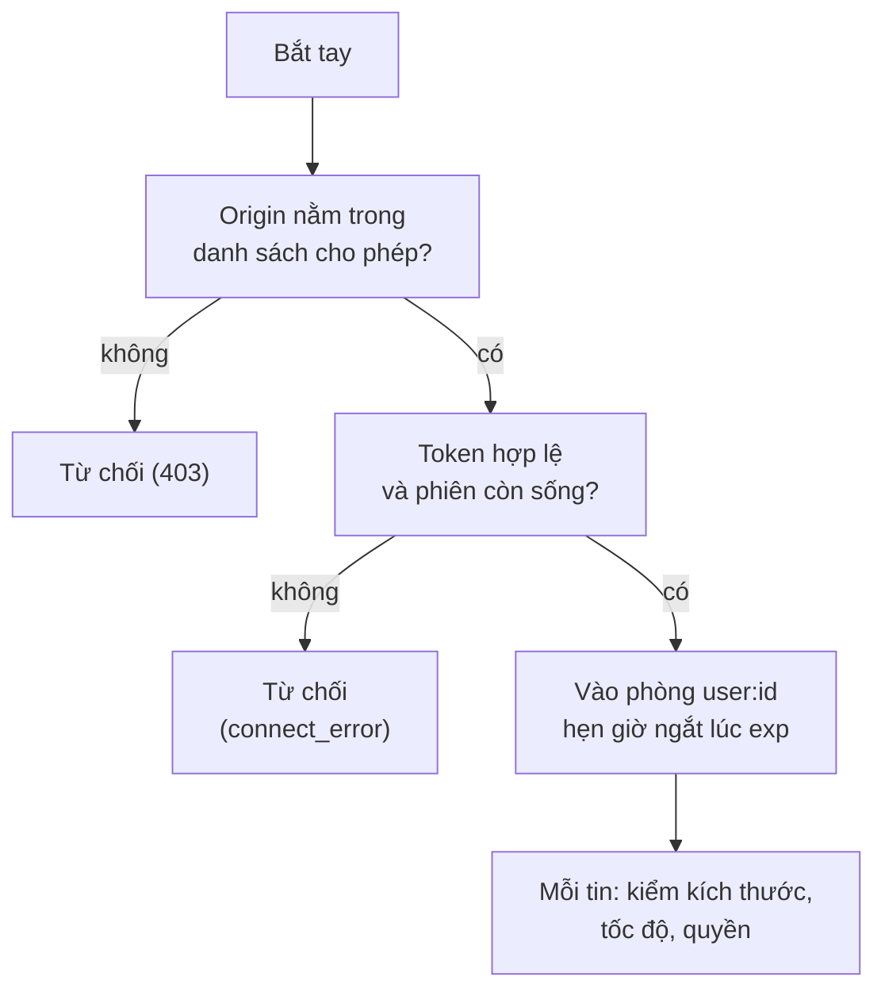

> [!tldr] Đọc nhanh
> - [[concepts/cross-site-websocket-hijacking|Cross-Site WebSocket Hijacking]]: WebSocket không chịu CORS. Trang lạ mở được kết nối tới server của bạn, trình duyệt tự gửi cookie. Option `cors` của Socket.IO **không chặn** chuyện này; phải kiểm `Origin` hoặc không xác thực bằng cookie.
> - [[concepts/handshake-authentication|Xác thực lúc bắt tay]]: token trong `auth` của Socket.IO (không nằm trong URL), kiểm cả chữ ký lẫn việc phiên còn sống.
> - [[concepts/long-lived-token|Token sống lâu hơn hạn]]: token được kiểm một lần, kết nối sống hàng giờ. Trong ví dụ, token hết hạn 1 giây rồi mà kết nối vẫn nhận tin. Hẹn giờ ngắt đúng `exp`, và ngắt socket khi người dùng đăng xuất.
> - [[concepts/backpressure|Backpressure]]: `send()` không chặn; client đọc chậm làm server giữ 18 MB cho một kết nối trong ví dụ. Kiểm `bufferedAmount`, bỏ tin cũ. [[concepts/message-size-limit|Giới hạn kích thước tin]]: Socket.IO mặc định 1 MB, `ws` mặc định 100 MiB.
> - Cuối bài: [[concepts/realtime-checklist|danh sách kiểm tra]] và cách chọn giữa SSE, WebSocket thuần, Socket.IO.

> [!info] Bối cảnh
> Ga 6, ga cuối của **tuyến WebSocket và Socket.IO**. Ví dụ là **flash-sale**, trang bán hàng giảm giá giờ vàng: kết nối realtime đẩy lượt thanh toán và kết quả đơn, tức thông tin của riêng từng người, và có thể mở suốt buổi tối. Frontend và API nằm trên hai tên miền khác nhau. Bạn không cần biết NestJS.

> [!abstract]- Từ điển nhanh cho bài này (bấm để mở)
> - **Handshake, `Origin`, close code**: xem [[posts/2026-11-22-websocket-protocol|ga 2]]. **Gói CONNECT, `auth`**: [[posts/2026-11-22-websocket-socketio|ga 3]]. **Room `user:<id>`**: [[posts/2026-11-22-websocket-rooms|ga 4]].
> - **Same-Origin Policy, CORS**: luật của trình duyệt ngăn JavaScript của trang này đọc response từ tên miền khác, trừ khi server cho phép bằng header CORS. Xem [[concepts/cors|CORS]].
> - **Cookie, SameSite**: cookie là dữ liệu trình duyệt tự gửi kèm request tới tên miền đã đặt nó; `SameSite` quyết định có gửi khi request xuất phát từ trang khác không.
> - **JWT, `exp`, phiên (`sid`)**: token đã ký có hạn dùng `exp`; flash-sale gắn mỗi token với một phiên đăng nhập lưu trong Redis. Xem [[posts/2026-11-18-api-security|Bảo mật API]].
> - **Middleware**: hàm chạy trước handler, ở đây là trước khi kết nối được chấp nhận.
> - **Bộ đệm (buffer)**: vùng RAM giữ dữ liệu đã gửi nhưng chưa đi được xuống mạng.

## Hình dung trước: đường dây nóng của ngân hàng

Kết nối realtime giống một đường dây nóng giữa khách và ngân hàng, mở suốt buổi.

| Đời thường | Khái niệm |
|---|---|
| Kẻ lạ bấm số từ máy của bạn; tổng đài nhận ra số máy quen nên cho vào, không hỏi ai đang cầm máy | [[concepts/cross-site-websocket-hijacking\|Cross-Site WebSocket Hijacking]] |
| Lúc nhấc máy, đọc mã khách hàng và tổng đài tra xem mã còn hiệu lực không | [[concepts/handshake-authentication\|Handshake authentication]] |
| Thẻ ra vào hết hạn lúc 21:15, nhưng người đã vào phòng lúc 21:00 thì vẫn ngồi đó | [[concepts/long-lived-token\|Long-lived token]] |
| Người nghe chép chậm, người đọc phải chờ hoặc bỏ bớt, không thì giấy nháp chất đống | [[concepts/backpressure\|Backpressure]] |
| Không nhận fax dài quá 10 trang | [[concepts/message-size-limit\|Message size limit]] |
| Danh sách kiểm tra trước khi mở đường dây cho khách | [[concepts/realtime-checklist\|Realtime checklist]] |



## Vấn đề: kết nối sống lâu thì chỗ hở cũng sống lâu

Mình từng nghĩ bảo mật cho WebSocket giống REST: có CORS, có guard JWT là xong. Nhưng ba giả định của REST không còn đúng: **WebSocket không chịu CORS**, **token chỉ được kiểm một lần** lúc bắt tay thay vì mỗi request, và **kết nối sống hàng giờ** trong khi người dùng có thể đăng xuất, bị khóa, hoặc mạng chậm tới mức không đọc kịp. Mỗi giả định sai mở một lỗ khác nhau.

## Cơ chế

<figure class="figure-map" style="--ar: 3 / 4">
<div class="frame"><iframe data-archify="../diagrams/websocket-security/cswsh.html" title="Sơ đồ tuần tự: trang lạ mở WebSocket qua trình duyệt của nạn nhân kèm cookie, server cho vào; hai cách chặn bằng kiểm Origin và token tường minh" loading="lazy"></iframe></div>
<figcaption><span><b>Hình 1.</b> Server xác thực bằng cookie mà không kiểm Origin thì trang lạ dùng được trình duyệt của bạn để nói chuyện với nó; kiểm Origin hoặc đòi token tường minh đều chặn được.</span><a href="../diagrams/websocket-security/cswsh.html" target="_blank" rel="noopener">Mở toàn màn hình</a></figcaption>
</figure>

### Cross-Site WebSocket Hijacking: CORS không cứu bạn

Với `fetch`, trình duyệt áp Same-Origin Policy: trang `evil.example` gửi được request tới `shop.example` nhưng **không đọc được response** nếu server không trả header CORS cho phép. WebSocket thì khác: chuẩn không áp Same-Origin Policy cho nó. Trang nào cũng mở được `new WebSocket('wss://api.shop.example')`, đọc được mọi tin server gửi xuống và gửi lên bất cứ gì. Thứ duy nhất trình duyệt làm là gửi kèm header `Origin: https://evil.example` để server tự quyết.

Nếu server xác thực bằng **cookie**, trình duyệt có thể tự đính kèm cookie của nạn nhân vào request bắt tay. Server thấy cookie hợp lệ, cho vào, và trang lạ giờ nghe được đơn hàng, thông báo, thậm chí gửi lệnh mua thay nạn nhân. Đó là **[[concepts/cross-site-websocket-hijacking|Cross-Site WebSocket Hijacking]]** (CSWSH), được Christian Schneider mô tả năm 2013; về bản chất là CSRF nhưng đọc được cả câu trả lời.

Hai điều hay bị hiểu sai:

- **Option `cors` của Socket.IO không chặn CSWSH.** Nó chỉ gắn header CORS vào các request HTTP polling, để trình duyệt chặn *đọc* response polling. Request nâng cấp lên WebSocket vẫn được chấp nhận từ bất kỳ Origin nào. Ví dụ bên dưới cho thấy: chỉ cấu hình `cors` thì trang lạ vẫn **vào được**.
- **SameSite giảm nhưng không xóa rủi ro.** Chrome mặc định coi cookie không ghi SameSite là `Lax`, và cookie `Lax` không được gửi kèm WebSocket mở từ một trang khác *site*. Nhưng cookie đặt `SameSite=None` (thường gặp khi frontend và API khác site), trình duyệt khác mặc định khác, và trang tấn công nằm trên một tên miền phụ cùng site (một trang blog `blog.shop.example` bị chèn mã) thì vẫn bị.

Cách chặn:

1. **Kiểm `Origin` lúc bắt tay**, so với danh sách cho phép, sai thì từ chối. Socket.IO: option `allowRequest(req, cb)`; thư viện `ws`: `verifyClient` hoặc kiểm trong sự kiện `upgrade`.
2. **Không xác thực bằng cookie đi kèm tự động**: dùng token mà JavaScript của trang phải tự gửi (Socket.IO `auth`). Trang lạ không đọc được token trong bộ nhớ của trang thật, nên không có gì để gửi.

flash-sale rơi vào trường hợp 2: cả hai gateway đọc token từ `handshake.auth.token` (hoặc header `Authorization` cho client không phải trình duyệt), không dựa vào cookie, nên CSWSH không lấy được danh tính người dùng. Kiểm `Origin` vẫn đáng thêm làm lớp thứ hai, vì client có bật `withCredentials` và các tính năng sau này có thể bắt đầu đọc cookie.

### Handshake authentication: kiểm gì, ở đâu

**[[concepts/handshake-authentication|Xác thực lúc bắt tay]]** là kiểm danh tính một lần khi kết nối mở, rồi gắn nó vào socket (`socket.data.userId`) cho mọi tin sau. Ba lựa chọn về *chỗ đặt* token:

| Chỗ đặt | Vấn đề |
|---|---|
| Query string `?token=…` | URL nằm trong log của proxy, load balancer, công cụ giám sát |
| Header `Authorization` | Trình duyệt không cho đặt header tùy ý cho WebSocket; chỉ client Node, app di động làm được |
| Socket.IO `auth: { token }` | Đi trong gói CONNECT, không nằm trong URL; đây là cách nên dùng |
| WebSocket thuần trong trình duyệt | Cookie (kèm kiểm Origin), hoặc lấy một **vé ngắn hạn** dùng một lần qua REST rồi gửi trong tin đầu tiên |

*Kiểm gì* cũng quan trọng như chỗ đặt. Guard HTTP của flash-sale kiểm ba thứ: chữ ký và hạn của JWT, loại token là `access`, và **phiên `sid` còn sống trong Redis** (đăng xuất là xóa phiên, token cũ lập tức vô dụng với REST). Hai gateway Socket.IO chỉ kiểm hai thứ đầu. Nghĩa là sau khi đăng xuất, access token cũ (sống tối đa 15 phút) vẫn **mở được kết nối realtime mới**, và kết nối đang mở thì không bị ngắt. Sửa: dùng chung một hàm xác thực cho guard HTTP và cho `handleConnection` (hoặc middleware `io.use()` của namespace), để hai cửa vào không bao giờ lệch nhau.

### Long-lived token: thẻ hết hạn, người vẫn trong phòng

Access token của flash-sale sống 15 phút. Một kết nối Socket.IO mở lúc 21:00 sống tới khi người dùng đóng tab, có thể là 23:00. Server chỉ kiểm token lúc 21:00. Từ 21:15 tới 23:00, kết nối được tin bằng một token đã hết hạn, kể cả khi trong lúc đó tài khoản bị khóa hay quyền bị đổi. Đó là **[[concepts/long-lived-token|token sống lâu hơn hạn của nó]]**.

Phía client của flash-sale đã làm một nửa: effect của `SocketProvider` phụ thuộc vào `accessToken`, nên mỗi lần token được làm mới, client đóng kết nối cũ và mở kết nối mới với token mới. Nhưng đó là thiện chí của client; một client sửa đổi thì không làm. Phía server cần tự bảo vệ:

- **Hẹn giờ ngắt đúng `exp`** lúc chấp nhận kết nối (`setTimeout(() => socket.disconnect(true), exp - now)`), xóa hẹn giờ khi socket ngắt. Client nối lại với token mới. Đây là cách ví dụ dùng.
- **Ngắt khi phiên bị thu hồi**: lúc đăng xuất hoặc khóa tài khoản, gọi `io.in('user:<id>').disconnectSockets(true)`; với Redis adapter lệnh này chạy trên mọi pod.
- **Cho làm mới token trên kết nối**: client gửi sự kiện `refresh_token` với token mới, server kiểm rồi đổi hạn, khỏi phải nối lại.
- **Kiểm quyền mỗi tin** cho các thao tác nhạy cảm, qua `socket.use()` (middleware cho từng gói tin đến), thay vì tin vào kết quả kiểm lúc bắt tay.

### Backpressure: người nghe chép không kịp

`socket.send()` của WebSocket **không bao giờ chặn**. Nếu client đọc chậm (mạng 3G yếu, tab ở chế độ nền bị trình duyệt hạn chế, máy yếu), dữ liệu dồn lại: đầu tiên trong bộ đệm TCP của hệ điều hành, sau đó trong RAM của tiến trình server. Trong ví dụ, server gửi 20.000 tin 1 KB cho một client đã ngừng đọc, và cuối cùng giữ **khoảng 18 MB** trong RAM chỉ cho một kết nối đó. Nhân với vài nghìn người xem chiến dịch trên mạng di động lúc 21:00, pod hết RAM và bị giết, kéo theo reconnect storm của ga 5.

**[[concepts/backpressure|Backpressure]]** là cơ chế để bên nhận chậm làm bên gửi chậm lại. WebSocket chuẩn chỉ cho bạn một con số: `bufferedAmount`, số byte đã gọi `send()` mà chưa xuống được mạng (có ở cả `ws` lẫn API trình duyệt). Cách dùng:

- **Kiểm trước khi gửi**: vượt ngưỡng thì bỏ tin, như ví dụ (đệm quá 1 MB thì bỏ). Hợp với dữ liệu mà chỉ bản mới nhất có nghĩa: tồn kho, vị trí hàng chờ.
- **Gộp tin**: thay vì gửi mỗi thay đổi, giữ bản mới nhất cho mỗi khóa (mỗi SKU) và gửi theo nhịp. Client chậm tự nhiên nhận ít tin hơn.
- **Ngắt client quá chậm** (đệm vượt ngưỡng cao trong một thời gian) với mã 1008 hoặc 1013 (thử lại sau), để nó nối lại và đồng bộ lại từ đầu.

Socket.IO không có backpressure tự động. Nó có `socket.volatile.emit()`: bỏ tin nếu kết nối hiện chưa sẵn sàng ghi, hợp cho tin tồn kho. Phía trình duyệt, API mới `WebSocketStream` (dùng streams nên có backpressure thật) mới có ở trình duyệt nhân Chromium.

### Message size limit: không nhận fax 100 trang

Bên nhận phải đệm **trọn một tin** trước khi giao cho handler. Không giới hạn kích thước là mời người khác gửi một tin vài trăm MB để làm cạn RAM của server, chỉ với một kết nối. **[[concepts/message-size-limit|Giới hạn kích thước tin]]** mặc định khác nhau rất xa:

| Thư viện | Option | Mặc định | Vượt thì |
|---|---|---|---|
| Socket.IO (Engine.IO) | `maxHttpBufferSize` | 1 MB (`1e6`) | cắt kết nối |
| `ws` | `maxPayload` | 100 MiB | đóng với mã 1009 |

flash-sale dùng mặc định của Socket.IO, hợp lý: tin lớn nhất client gửi là `{ campaignId }`. Nếu dùng `ws` trực tiếp, nên hạ `maxPayload` xuống cỡ vài chục KB. Kèm theo đó là **giới hạn tốc độ tin**: một client gửi 10.000 `subscribe_campaign` mỗi giây vẫn hợp lệ về kích thước. Rate limit cho REST không tự áp lên WebSocket; phải đếm trong middleware `socket.use()` hoặc ở handler, theo user, rồi ngắt kẻ vượt.

### Realtime checklist

**[[concepts/realtime-checklist|Danh sách kiểm tra]]** gom cả tuyến. Trước hết là chọn công cụ:

| Nếu | Chọn |
|---|---|
| Chỉ server → client (thông báo, tiến độ, giá) | **SSE**: tự nối lại, phát bù, HTTP thường (ga 1) |
| Hai chiều, client đa nền tảng hoặc đối tác nói chuẩn RFC 6455, cần nhẹ | **WebSocket thuần** (`ws`), tự viết heartbeat, nối lại, phát nhiều pod |
| Hai chiều, cần room, ack, tự nối lại, đường lui polling, phát qua nhiều pod | **Socket.IO**, mọi client dùng thư viện Socket.IO |
| Tin hiếm, trễ vài giây không sao | **Polling** vẫn là lựa chọn tốt nhất |

Rồi kiểm:

- [ ] Xác thực lúc bắt tay bằng cùng hàm với REST (chữ ký, loại token, phiên còn sống); token không nằm trong URL.
- [ ] Kiểm `Origin` lúc bắt tay; không dựa vào option `cors` để chặn trang lạ.
- [ ] Ngắt khi token hết hạn và khi phiên bị thu hồi (`disconnectSockets` theo phòng của user).
- [ ] Phân quyền khi `join` phòng; không cho client tự chọn tên phòng.
- [ ] Giới hạn kích thước tin và tốc độ tin theo user.
- [ ] Theo dõi `bufferedAmount` hoặc dùng `volatile` cho tin chỉ cần bản mới nhất; gộp tin dày.
- [ ] Heartbeat ngắn hơn idle timeout nhỏ nhất trong chuỗi proxy (Socket.IO: timeout proxy trên 45 giây).
- [ ] Hoặc chỉ WebSocket, hoặc sticky session; và kiểm `transports` thật sự đang dùng (ga 4).
- [ ] Adapter cho nhiều pod; biết nó có lưu tin hay không.
- [ ] Jitter khi nối lại; không giới hạn số lần thử, hoặc có nút "thử lại".
- [ ] Đóng kết nối có chủ đích và rải dần khi pod tắt, ở tầng vận chuyển (không `disconnect(true)`).
- [ ] Đường REST để đồng bộ lại sau mỗi `connect`, vì tin có thể mất (at most once).
- [ ] Đo: số kết nối mỗi pod, tốc độ nối lại, tin bị bỏ, RAM theo kết nối.

## Ví dụ chạy được

[security.ts](../code/websocket-security/security.ts) chạy bốn tình huống. Phần 1 giả lập trình duyệt bị trang `evil.example` điều khiển: client Socket.IO của Node gửi header `Origin` và `Cookie` như trình duyệt sẽ làm. Phần 2 dùng token có hạn 1 giây. Phần 3 gửi một tin 2 MB. Phần 4 dùng `ws` gửi 20.000 tin cho một client đã ngừng đọc socket.

```bash
npm i socket.io socket.io-client ws
node security.ts
```

```ts
// chặn trang lạ: kiểm Origin ngay lúc bắt tay
new Server(httpServer, {
  cors: { origin: SHOP, credentials: true },
  allowRequest: (req, cb) => cb(null, req.headers.origin === SHOP),
});

// token hết hạn giữa chừng: hẹn giờ ngắt đúng exp
io.use((s, next) => {
  const exp = Number(s.handshake.auth.exp);
  if (Date.now() >= exp) return next(new Error('TOKEN_EXPIRED'));
  setTimeout(() => s.disconnect(true), exp - Date.now());
  next();
});

// backpressure: đệm quá 1 MB thì bỏ tin
if (serverSide.bufferedAmount > 1_000_000) { dropped++; continue; }
serverSide.send(msg);
```

```text
$ node security.ts
1) Trang evil.example mở WebSocket tới server, trình duyệt tự đính kèm cookie phiên
   chỉ cấu hình cors                → VÀO ĐƯỢC
   cors + allowRequest kiểm Origin  → bị chặn (websocket error)
   token trong auth thay cho cookie → bị chặn (UNAUTHORIZED)

2) Token sống 1 giây, chỉ được kiểm lúc bắt tay
   không làm gì   : 2 giây sau, connected=true, vẫn nhận tin=true
   có hẹn giờ ngắt: 2 giây sau, connected=false, vẫn nhận tin=false

3) Client gửi một tin 2 MB, server để maxHttpBufferSize mặc định 1 MB
   server không xử lý (0 tin), cắt kết nối; client thấy "transport close"

4) Server gửi 20.000 tin 1 KB cho một client đã ngừng đọc
   không kiểm tra       : gửi 20000, bỏ 0, RAM server đang giữ cho client này ≈ 17.9 MB
   bỏ tin khi đệm > 1 MB: gửi 3523, bỏ 16477, RAM server đang giữ cho client này ≈ 0.0 MB
```

Đọc kết quả:

- **Phần 1**: chỉ có `cors` thì trang lạ mang cookie vào được. Kiểm Origin chặn ngay ở bắt tay; xác thực bằng token thì trang lạ không có token để gửi.
- **Phần 2**: không làm gì thì 1 giây sau khi token hết hạn, kết nối vẫn sống và vẫn nhận tin. Có hẹn giờ thì server tự ngắt đúng lúc.
- **Phần 3**: tin vượt 1 MB không bao giờ tới handler; kết nối bị cắt.
- **Phần 4**: không kiểm tra thì gần 18 MB nằm lại trong RAM của tiến trình. Có ngưỡng thì phần lớn tin bị bỏ; khoảng 3,5 MB đã gửi đi được hệ điều hành giữ trong bộ đệm TCP (trên máy local bộ đệm này lớn), nên RAM của tiến trình về gần 0. Con số cụ thể tùy hệ điều hành.

## Hiểu lầm và bẫy hay gặp

- **"Đã cấu hình CORS cho Socket.IO nên trang lạ không vào được."** `cors` chỉ áp cho request HTTP polling. Kiểm `Origin` bằng `allowRequest`, hoặc không xác thực bằng cookie.
- **"SameSite mặc định là Lax nên an toàn."** Không phải trình duyệt nào cũng mặc định Lax, cookie `SameSite=None` vẫn đi kèm, và trang cùng site (tên miền phụ) không bị chặn.
- **"Token đã kiểm lúc kết nối."** Một lần, cho cả kết nối sống hàng giờ. Hẹn giờ ngắt theo `exp`, ngắt khi phiên bị thu hồi.
- **Guard REST và handshake WebSocket kiểm khác nhau**: đăng xuất chặn được REST nhưng không chặn realtime. Dùng chung một hàm xác thực.
- **Đặt token trong query string** vì "dễ": nó nằm trong log của mọi proxy.
- **"`send()` lỗi thì mới có vấn đề."** `send()` không báo gì khi client chậm; RAM chỉ âm thầm tăng. Theo dõi `bufferedAmount`.
- **Dùng `ws` với `maxPayload` mặc định 100 MiB**: hạ xuống theo tin lớn nhất bạn thật sự cần.
- **Rate limit REST tưởng áp luôn cho WebSocket**: tin trên kết nối đã mở không đi qua middleware HTTP nào.

## Câu hỏi tự kiểm tra

> [!question]- Vì sao trang `evil.example` mở được WebSocket tới `api.shop.example`, trong khi `fetch` thì bị CORS chặn đọc response?
> Chuẩn WebSocket không áp Same-Origin Policy: trình duyệt cho mở kết nối và đọc mọi tin, chỉ gửi kèm header `Origin` để server tự quyết. Nếu server không kiểm `Origin` và xác thực bằng cookie đi kèm tự động, trang lạ dùng được phiên của nạn nhân.

> [!question]- Server Socket.IO đặt `cors: { origin: 'https://shop.example' }`. Như vậy đã chặn được CSWSH chưa?
> Chưa. Option đó chỉ gắn header CORS vào request polling; request nâng cấp WebSocket từ Origin khác vẫn được nhận. Phải kiểm `Origin` trong `allowRequest`, hoặc xác thực bằng token mà trang lạ không có.

> [!question]- Người dùng đăng xuất lúc 21:05. Kết nối Socket.IO mở lúc 21:00 của họ có bị ngắt không? Làm sao để chắc chắn có?
> Không tự ngắt, vì token chỉ được kiểm lúc bắt tay. Phải chủ động ngắt khi thu hồi phiên, ví dụ `io.in('user:<id>').disconnectSockets(true)` (chạy trên mọi pod nhờ adapter), và kiểm cả việc phiên còn sống lúc bắt tay để kết nối mới cũng bị từ chối.

> [!question]- `bufferedAmount` là gì, và bạn làm gì khi nó tăng mãi với một client?
> Số byte đã gọi `send()` nhưng chưa ghi được xuống mạng. Nó tăng mãi nghĩa là client đọc chậm hơn tốc độ gửi. Bỏ tin cũ (nếu chỉ bản mới nhất có nghĩa), gộp tin, hoặc ngắt client đó để nó nối lại và đồng bộ lại.

> [!question]- flash-sale chỉ cần server đẩy tin và client thỉnh thoảng gửi `subscribe_campaign`. Nếu làm lại từ đầu, SSE có đủ không?
> Về chức năng thì đủ: SSE đẩy được mọi sự kiện, tự nối lại và phát bù bằng `Last-Event-ID`, còn `subscribe_campaign` là một request REST bình thường. Socket.IO đáng giá ở room, adapter nhiều pod và client đã viết sẵn; với SSE, phần phát tin qua nhiều pod (ví dụ qua Redis Pub/Sub) phải tự làm.

## Tham khảo

- Christian Schneider, [Cross-Site WebSocket Hijacking](https://christian-schneider.net/blog/cross-site-websocket-hijacking/) (2013)
- [PortSwigger Web Security Academy: Cross-site WebSocket hijacking](https://portswigger.net/web-security/websockets/cross-site-websocket-hijacking)
- [OWASP: WebSocket Security Cheat Sheet](https://cheatsheetseries.owasp.org/cheatsheets/WebSocket_Security_Cheat_Sheet.html)
- [Socket.IO: Server options](https://socket.io/docs/v4/server-options/) (`allowRequest`, `maxHttpBufferSize`, `cors`) và [Middlewares](https://socket.io/docs/v4/middlewares/)
- [ws: API docs](https://github.com/websockets/ws/blob/master/doc/ws.md) (`maxPayload`, `verifyClient`, `bufferedAmount`)
- [WHATWG WebSockets Standard](https://websockets.spec.whatwg.org/) (`bufferedAmount`)
