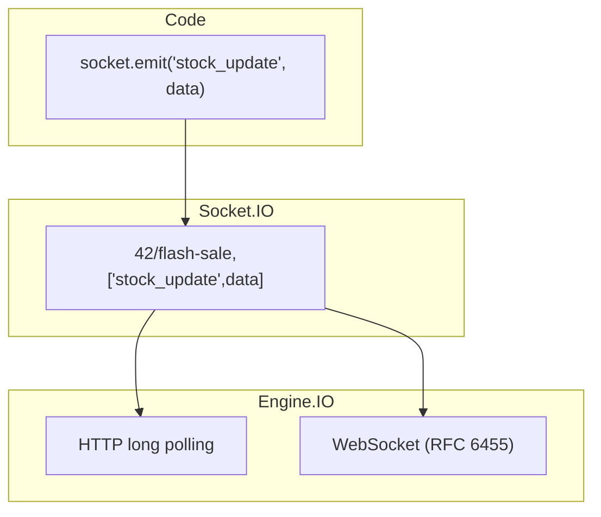

> [!tldr] Đọc nhanh
> - Socket.IO là **thư viện có giao thức riêng**, gồm hai tầng: [[concepts/engine-io|Engine.IO]] giữ một phiên (mã `sid`) qua long polling hoặc WebSocket; Socket.IO đặt sự kiện, namespace, ack lên trên.
> - [[concepts/transport-upgrade|Transport upgrade]]: mặc định Engine.IO mở phiên bằng một `GET` long polling, rồi thử WebSocket (`2probe` → `3probe`) và chuyển hẳn (`5`). Có thể bỏ bước polling bằng `transports: ['websocket']`.
> - [[concepts/heartbeat|Heartbeat]] của Engine.IO: server gửi ping mỗi 25 giây, client phải trả pong trong 20 giây. Đây không phải frame ping của RFC 6455.
> - Trên dây, `socket.emit('stock_update', data)` là chuỗi `42["stock_update",{…}]`: [[concepts/socket-io-packet|gói Socket.IO]] (2 = event) nằm trong gói Engine.IO (4 = message). [[concepts/acknowledgement|Ack]] thêm một mã số để trả lời đúng lần emit đó.
> - Hệ quả: client WebSocket thuần nối vào server Socket.IO nhận `0{"sid":…}` rồi bị đóng; client Socket.IO nối vào server WebSocket thuần thì chờ gói `0` mãi rồi báo `timeout`.

> [!info] Bối cảnh
> Ga 3 của **tuyến WebSocket và Socket.IO**. Ví dụ là **flash-sale**, trang bán hàng giảm giá giờ vàng: backend NestJS có hai "cổng realtime" dùng Socket.IO, `/flash-sale` (lượt thanh toán, tồn kho, kết quả đơn) và `/notifications` (thông báo); frontend Next.js dùng `socket.io-client`. Bạn không cần biết NestJS hay React: mọi đoạn code đều được giải thích.

> [!abstract]- Từ điển nhanh cho bài này (bấm để mở)
> - **Long polling, WebSocket, frame, ping/pong, handshake 101**: xem [[posts/2026-11-22-websocket-realtime-options|ga 1]] và [[posts/2026-11-22-websocket-protocol|ga 2]].
> - **Thư viện vs giao thức**: giao thức là luật hai bên phải theo (RFC 6455); thư viện là code cài vào dự án, có thể đặt thêm luật riêng của nó.
> - **NestJS gateway**: một lớp (class) trong NestJS gom các handler realtime, giống controller nhưng cho WebSocket. `@WebSocketGateway({ namespace })` là **decorator**: một chú thích đặt trên lớp để framework biết cách dùng nó.
> - **Handler**: hàm chạy khi nhận một sự kiện.
> - **JWT (access token)**: chuỗi đã ký chứng minh bạn là ai, xem ga [[posts/2026-11-18-api-security|Bảo mật API]].
> - **sid**: session id, mã phiên do server cấp.
> - **Callback**: hàm bạn truyền vào để được gọi lại khi có kết quả.

## Hình dung trước: tổng đài trên đường dây điện thoại

Ở ga 2, WebSocket là một đường dây điện thoại: chỉ truyền tiếng. Socket.IO là một **tổng đài** đặt lên đường dây đó.

| Đời thường | Khái niệm |
|---|---|
| Tổng đài lo việc giữ liên lạc: nếu chưa có điện thoại thì liên lạc bằng thư, có rồi thì chuyển sang gọi | [[concepts/engine-io\|Engine.IO]] |
| Bắt đầu bằng thư, gọi thử "alo, nghe rõ không?", rõ thì báo "từ giờ gọi điện nhé" | [[concepts/transport-upgrade\|Transport upgrade]] |
| Tổng đài cứ 25 giây hỏi "còn đó không?", 20 giây không trả lời thì coi như mất liên lạc | [[concepts/heartbeat\|Heartbeat]] |
| Mỗi câu được bỏ vào phong bì có mã loại thư, tên phòng, tên việc | [[concepts/socket-io-packet\|Gói tin Socket.IO]] |
| "Nhận được thì ký vào phiếu số 7 gửi lại" | [[concepts/acknowledgement\|Acknowledgement]] |
| Một chiếc điện thoại thường gọi vào tổng đài: nghe thấy tiếng nhưng không hiểu mật mã | WebSocket thuần ↔ Socket.IO |



## Vấn đề: "server dùng WebSocket mà client WebSocket không nối được"

Mình từng nghĩ backend flash-sale "chạy WebSocket", nên một app di động hay một công cụ kiểm thử chỉ cần `new WebSocket('wss://…')` là nói chuyện được. Thử thì thất bại: kết nối mở ra, nhận một chuỗi lạ `0{"sid":…}`, rồi bị đóng. Ngược lại, khi thử dùng `socket.io-client` để nối vào một server viết bằng thư viện `ws`, client cứ đứng chờ rồi báo `timeout`.

Tài liệu Socket.IO nói thẳng điều này: Socket.IO **không phải** một bản cài đặt WebSocket. Nó dùng WebSocket làm đường truyền khi có thể, nhưng thêm dữ liệu của riêng nó vào mỗi gói tin, nên client WebSocket thuần không nối được server Socket.IO, và client Socket.IO cũng không nối được server WebSocket thuần. Để hiểu vì sao, phải nhìn những gì thật sự chạy trên dây.

## Cơ chế

<figure class="figure-map" style="--ar: 3 / 4">
<div class="frame"><iframe data-archify="../diagrams/websocket-socketio/engineio-wire.html" title="Sơ đồ tuần tự: Engine.IO mở phiên bằng long polling, nâng cấp lên WebSocket, rồi Socket.IO gửi gói 40, 42, 43" loading="lazy"></iframe></div>
<figcaption><span><b>Hình 1.</b> Một kết nối Socket.IO trên dây: Engine.IO mở phiên và nâng cấp đường truyền trước, gói Socket.IO (40, 42, 43) chỉ đi bên trong gói message của Engine.IO.</span><a href="../diagrams/websocket-socketio/engineio-wire.html" target="_blank" rel="noopener">Mở toàn màn hình</a></figcaption>
</figure>

### Engine.IO: tầng giữ phiên

**[[concepts/engine-io|Engine.IO]]** là tầng dưới của Socket.IO. Việc của nó: mở một **phiên** giữa client và server, giữ phiên đó sống, và chở các gói tin qua đường truyền tốt nhất đang có. Hiện có ba đường truyền: HTTP long polling, WebSocket, và WebTransport (mới, phải bật riêng).

Mỗi gói Engine.IO bắt đầu bằng **một chữ số** cho biết loại:

| Số | Loại | Dùng khi |
|---|---|---|
| 0 | open | server mở phiên, kèm `sid` và cấu hình |
| 1 | close | đóng phiên |
| 2 | ping | kiểm tra còn sống (và `2probe` khi thử đường mới) |
| 3 | pong | trả lời ping (`3probe`) |
| 4 | message | chở dữ liệu của tầng trên (Socket.IO) |
| 5 | upgrade | chuyển hẳn sang đường mới |
| 6 | noop | không làm gì, dùng để giải phóng request polling đang treo |

Bắt tay của Engine.IO là một `GET` thường:

```text
GET /socket.io/?EIO=4&transport=polling
← 0{"sid":"oiULx1xl832xir-vAAAA","upgrades":["websocket"],"pingInterval":25000,
    "pingTimeout":20000,"maxPayload":1000000}
```

Server cấp `sid` (mã phiên), cho biết có thể nâng cấp lên `websocket`, và gửi cấu hình heartbeat cùng kích thước tối đa của một gói. Mọi request sau phải kèm `sid`. Chi tiết nhỏ nhưng quan trọng: phiên `sid` này **chỉ tồn tại trong RAM của đúng server đã cấp nó**. Ga 5 sẽ cho thấy chuyện gì xảy ra khi request sau tới một server khác.

### Transport upgrade: bắt đầu bằng thư, rồi mới gọi điện

Vì sao không mở WebSocket ngay? Vì có những mạng chặn WebSocket: proxy công ty, phần mềm diệt virus, một số firewall. Nếu chỉ thử WebSocket rồi thất bại thì người dùng phải chờ hết thời gian chờ mới biết. Engine.IO chọn cách chắc ăn: **mở phiên bằng long polling trước** (luôn chạy được), rồi mới thử WebSocket ở phía sau.

**[[concepts/transport-upgrade|Transport upgrade]]** diễn ra như sau:

| Bước | Ai gửi | Gói | Nghĩa |
|---|---|---|---|
| 1 | client | mở WebSocket tới `…&transport=websocket&sid=…` | cùng phiên, đường mới |
| 2 | client | `2probe` | thử: đường mới có chạy không? |
| 3 | server | `3probe` | chạy |
| 4 | server | `6` trả cho request polling đang treo | polling ơi, nghỉ đi |
| 5 | client | `5` | từ giờ chỉ dùng WebSocket |

Trong lúc chuyển, không gói nào bị mất hay đảo thứ tự: tài liệu Socket.IO đảm bảo thứ tự tin kể cả khi đang nâng cấp.

Bỏ được bước polling không? Được: `io(url, { transports: ['websocket'] })` mở WebSocket ngay từ đầu. Nhanh hơn một vòng đi về, và như ga 5 sẽ nói, không cần sticky session. Đổi lại, mạng nào chặn WebSocket thì người dùng không kết nối được. Client `/flash-sale` của flash-sale chọn đúng cách này:

```ts
// trích rút gọn từ SocketProvider của flash-sale (frontend)
const socket = io(`${baseUrl}/flash-sale`, {
  auth: { token: accessToken },   // token đi trong gói CONNECT, không nằm trong URL
  transports: ['websocket'],      // bỏ bước long polling
  reconnection: true,
  reconnectionAttempts: 5,
  reconnectionDelay: 1000,
});
```

(Ga 4 sẽ cho thấy option `transports` này có thể **bị bỏ qua** trong flash-sale, vì một lý do rất khó thấy.)

### Heartbeat: tổng đài hỏi "còn đó không?"

Ga 2 nói trình duyệt không gửi được ping WebSocket. Engine.IO tự làm **[[concepts/heartbeat|heartbeat]]** ở tầng ứng dụng, dùng gói `2` và `3` của chính nó, nên chạy được cả trên long polling:

- Server gửi `2` (ping) mỗi **`pingInterval`** (mặc định 25.000 ms).
- Client phải trả `3` (pong) trong **`pingTimeout`** (mặc định 20.000 ms). Không thấy thì server đóng phiên.
- Phía client cũng tính giờ: quá `pingInterval + pingTimeout` mà không thấy ping nào thì client tự coi là mất kết nối và bắt đầu nối lại.

Ở Engine.IO v3 (Socket.IO 2.x), chiều ngược lại: client gửi ping. Từ v4 server gửi, để phát hiện client đã chết nhanh hơn. Hai con số mặc định cũng quyết định cấu hình proxy (ga 5): proxy cắt kết nối im lặng sau 30 giây thì ping 25 giây vừa đủ giữ nó sống.

### Gói tin Socket.IO: phong bì trong phong bì

Socket.IO đặt **[[concepts/socket-io-packet|gói của nó]]** vào trong gói `4` (message) của Engine.IO. Chữ số thứ hai là loại gói Socket.IO:

| Số | Loại | Ví dụ trên dây |
|---|---|---|
| 0 | CONNECT | `40/flash-sale,{"token":…}` |
| 1 | DISCONNECT | `41/flash-sale,` |
| 2 | EVENT | `42/flash-sale,["stock_update",{…}]` |
| 3 | ACK | `43/flash-sale,7[{…}]` |
| 4 | CONNECT_ERROR | `44/flash-sale,{"message":"UNAUTHORIZED"}` |
| 5, 6 | BINARY_EVENT, BINARY_ACK | sự kiện có dữ liệu nhị phân, gửi kèm các frame binary |

Sau chữ số là namespace (bỏ qua nếu là `/`), một mã ack nếu có, rồi một mảng JSON `[tên sự kiện, dữ liệu…]`. Vậy dòng code `socket.emit('stock_update', { sku: 'A1', left: 41 })` trên dây thực sự là:

```text
42/flash-sale,["stock_update",{"sku":"A1","left":41}]
```

Đây là "mật mã tổng đài". Một client WebSocket thuần gửi `{"type":"subscribe"}` thì server Socket.IO không hiểu: nó không bắt đầu bằng một chữ số hợp lệ. Một server WebSocket thuần thì không bao giờ gửi `0{…}` nên client Socket.IO cứ chờ.

Chi tiết của bước CONNECT: token xác thực đi trong **gói `40`**, tức là bên trong kết nối đã mở, **không nằm trong URL**. URL thường bị ghi vào log của proxy và load balancer; gói CONNECT thì không. Đó là lý do nên dùng `auth: { token }` thay vì `query: { token }`.

### Acknowledgement: ký nhận cho đúng lần gửi

Sự kiện thường là "bắn rồi quên". **[[concepts/acknowledgement|Ack]]** biến một lần emit thành hỏi-đáp: truyền thêm một callback ở cuối, Socket.IO gắn một mã số vào gói (`42/flash-sale,7[…]`), bên nhận chạy handler rồi trả gói ACK cùng mã (`43/flash-sale,7[…]`), callback được gọi với kết quả.

```ts
// client: chờ server xác nhận đã vào phòng
const resp = await socket.timeout(5000).emitWithAck('subscribe_campaign', { campaignId });
```

Phía server, NestJS làm việc này tự động: giá trị handler trả về được gửi làm ack. Gateway của flash-sale:

```ts
// trích rút gọn từ FlashSaleGateway của flash-sale (backend NestJS)
@WebSocketGateway({ namespace: '/flash-sale' })
export class FlashSaleGateway {
  @SubscribeMessage('subscribe_campaign')       // handler cho sự kiện client gửi lên
  async onSubscribeCampaign(@ConnectedSocket() client: Socket, @MessageBody() body: { campaignId: string }) {
    if (!UUID_RE.test(body?.campaignId)) return { event: 'error', data: { reason: 'INVALID_CAMPAIGN_ID' } };
    await client.join(`campaign:${body.campaignId}`);
    return { event: 'subscribed', data: { campaignId: body.campaignId } }; // thành ack
  }
}
```

Ack chỉ xác nhận "bên kia đã chạy handler". Nó **không** làm Socket.IO thành giao nhận đảm bảo: mất kết nối giữa chừng thì callback không bao giờ được gọi (dùng `timeout()` để không chờ mãi), và server gửi xuống lúc client vắng mặt vẫn mất. Ga 4 nói kỹ chuyện này.

### Vậy khi nào đáng dùng Socket.IO?

Socket.IO cho bạn: đường lui long polling, heartbeat, tự kết nối lại, sự kiện có tên, ack, namespace, room, phát tin qua nhiều server bằng adapter, và client cho trình duyệt, Node, Java, Swift, Python… Cái giá: giao thức riêng (mọi client phải dùng thư viện Socket.IO tương thích phiên bản), vài byte thêm mỗi gói, và phụ thuộc vào một hệ sinh thái.

Dùng WebSocket thuần (`ws`, uWebSockets, hay WebSocket của framework) khi bạn cần đối tác nói chuẩn RFC 6455 (thiết bị IoT, client bên thứ ba), cần nhẹ tối đa, hoặc đã có giao thức tầng trên (MQTT, GraphQL subscription). Khi đó bạn tự viết heartbeat, kết nối lại và phát tin nhiều server.

## Ví dụ chạy được

[socketio-wire.ts](../code/websocket-socketio/socketio-wire.ts) dựng một server Socket.IO có namespace `/flash-sale`, rồi **nói chuyện với nó bằng tay**: `fetch` cho bước long polling và `WebSocket` thuần của Node cho bước nâng cấp, gửi đúng các chuỗi `2probe`, `5`, `40`, `42`. Cuối cùng nó thử hai cặp "khác thứ tiếng". `pingInterval` được rút xuống 1,5 giây để thấy ping trong lúc chạy.

```bash
npm i socket.io socket.io-client ws
node socketio-wire.ts
```

```ts
const open = await (await fetch(`${base}&transport=polling`)).text();   // 0{"sid":…}
const pending = fetch(`${base}&transport=polling&sid=${sid}`);         // long poll đang treo
const ws = new WebSocket(`ws://localhost:${port}/socket.io/?EIO=4&transport=websocket&sid=${sid}`);
ws.send('2probe');                       // thử đường mới
// … nhận 3probe, request polling đang treo được trả "6"
ws.send('5');                            // chuyển hẳn
ws.send('40/flash-sale,');               // vào namespace
ws.send('42/flash-sale,7["subscribe_campaign",{"campaignId":"c-21h"}]'); // emit có ack số 7
```

```text
$ node socketio-wire.ts
1) Bắt tay Engine.IO: một GET HTTP thường, chưa có WebSocket nào
   GET /socket.io/?EIO=4&transport=polling
   ← 0{"sid":"oiULx1xl832xir-vAAAA","upgrades":["websocket"],"pingInterval":1500,"pingTimeout":1000,"maxPayload":1000000}
   chữ "0" đầu = gói OPEN của Engine.IO; sid = mã phiên, phải gửi kèm mọi request sau

2) Nâng cấp lên WebSocket, làm bằng tay
   → 2probe   ← 3probe   (3 = PONG: đường WebSocket dùng được)
   long poll đang treo được server trả về: "6"   (6 = NOOP: polling, nghỉ đi)
   → 5        (UPGRADE: từ giờ chỉ dùng WebSocket)

3) Gói tin Socket.IO đi bên trong gói MESSAGE (4) của Engine.IO
   → 40/flash-sale,   ← 40/flash-sale,{"sid":"dGXWBVv3rOzKpv8OAAAA"}
   ← 43/flash-sale,7[{"event":"subscribed","data":{"campaignId":"c-21h"}}]
   ← 42/flash-sale,["stock_update",{"sku":"A1","left":41}]
   43/…7[…] = ACK cho lần emit số 7;  42/…["stock_update",…] = sự kiện server đẩy xuống
   … server tự gửi "2" (PING), client phải trả "3" trong pingTimeout

4) Hai bên nói khác thứ tiếng
   WebSocket thuần → server Socket.IO: nhận được "0{\"sid\":\"ePXddQVoV-NgVFuzAAAB\",\"upgrades\":[],\"pingInterval\":1500,\"pingTimeout\":1000,\"maxPayload\":1000000}" rồi bị đóng; handler "subscribe" không bao giờ chạy
   client Socket.IO → server ws thuần: kết nối TCP mở được (1 kết nối), nhưng connect_error: "timeout"
   (server ws thuần không bao giờ gửi gói OPEN "0{…}" nên client Socket.IO cứ chờ rồi bỏ cuộc)
```

Đọc kết quả:

- **Phần 1**: chưa có WebSocket nào, chỉ một `GET` trả về gói `0` với `sid`.
- **Phần 2**: đúng bốn bước nâng cấp. Request polling đang treo được giải phóng bằng `6` trước khi client gửi `5`.
- **Phần 3**: `40` mở namespace và nhận một `sid` riêng của Socket.IO (khác `sid` của Engine.IO). `43…7` là ack cho đúng lần emit số 7, `42` là sự kiện server đẩy xuống. Vài giây sau server tự gửi `2`.
- **Phần 4**: hai cặp "cùng là WebSocket" nhưng không ai hiểu ai. Mở WebSocket thẳng (không qua polling) thì `upgrades` là `[]` vì đã ở đường tốt nhất.

## Hiểu lầm và bẫy hay gặp

- **"Server Socket.IO là server WebSocket."** Nó là server Socket.IO, có thể dùng WebSocket làm đường truyền. Client phải là thư viện Socket.IO tương thích phiên bản (Socket.IO v3/v4 dùng Engine.IO v4; client v2 cũ không nối được server v4 trừ khi bật `allowEIO3`).
- **"Socket.IO luôn dùng WebSocket."** Mặc định nó bắt đầu bằng long polling, và nếu WebSocket bị chặn thì ở lại long polling suốt phiên. Mạng tệ thì người dùng vẫn chạy được, chỉ là bằng HTTP.
- **"Ping/pong của Socket.IO là ping/pong WebSocket."** Đó là gói `2`/`3` của Engine.IO, nằm trong frame text, chạy được cả trên polling.
- **Đặt token vào `query`**: URL có token sẽ nằm trong log của proxy, load balancer. Dùng `auth`, đi trong gói CONNECT.
- **"Ack nghĩa là tin chắc chắn tới."** Ack chỉ có khi kết nối còn; mất kết nối thì callback không bao giờ chạy. Luôn đặt `timeout()`.
- **Dùng Postman hay `wscat` thử server Socket.IO** rồi kết luận server hỏng: các công cụ WebSocket thuần không nói giao thức Socket.IO. Dùng client Socket.IO (Postman có loại request Socket.IO riêng).

## Câu hỏi tự kiểm tra

> [!question]- Client WebSocket thuần mở kết nối tới `/socket.io/?EIO=4&transport=websocket` và gửi `{"type":"subscribe"}`. Chuyện gì xảy ra?
> Kết nối WebSocket mở được, server gửi gói `0{"sid":…}` của Engine.IO. Nhưng chuỗi client gửi không phải gói Engine.IO hợp lệ (không bắt đầu bằng một chữ số loại gói), nên server đóng kết nối và không handler nào chạy.

> [!question]- Vì sao Engine.IO mặc định mở phiên bằng long polling rồi mới nâng cấp?
> Vì long polling luôn chạy được qua mọi proxy và firewall, còn WebSocket có thể bị chặn. Mở bằng polling trước thì người dùng có kết nối ngay; nâng cấp thành công thì chuyển sang WebSocket, thất bại thì vẫn ở lại polling.

> [!question]- Giải mã chuỗi `43/flash-sale,7[{"event":"subscribed"}]`.
> `4` là gói message của Engine.IO, `3` là gói ACK của Socket.IO, `/flash-sale` là namespace, `7` là mã của lần emit được trả lời, phần còn lại là dữ liệu handler trả về.

> [!question]- `pingInterval` 25 giây, `pingTimeout` 20 giây. Khi điện thoại mất sóng lặng lẽ, bao lâu sau server biết?
> Tối đa khoảng 45 giây: server gửi ping ở lần kế tiếp (tối đa 25 giây sau), rồi chờ pong thêm 20 giây trước khi đóng phiên.

> [!question]- Khi nào nên chọn WebSocket thuần thay vì Socket.IO?
> Khi client không thể dùng thư viện Socket.IO (thiết bị IoT, đối tác chỉ nói RFC 6455), khi cần nhẹ tối đa, hoặc đã có giao thức tầng trên như MQTT hay GraphQL subscription. Khi đó bạn tự lo heartbeat, kết nối lại và phát tin qua nhiều server.

## Tham khảo

- [Socket.IO: Introduction](https://socket.io/docs/v4/) (mục "What Socket.IO is not")
- [Socket.IO: How it works](https://socket.io/docs/v4/how-it-works/) (Engine.IO, upgrade, heartbeat)
- [Engine.IO protocol (v4)](https://socket.io/docs/v4/engine-io-protocol/) và [Socket.IO protocol (v5)](https://socket.io/docs/v4/socket-io-protocol/)
- [Socket.IO: Emitting events](https://socket.io/docs/v4/emitting-events/) (ack, `timeout`, `emitWithAck`)
- [NestJS: Gateways](https://docs.nestjs.com/websockets/gateways)
