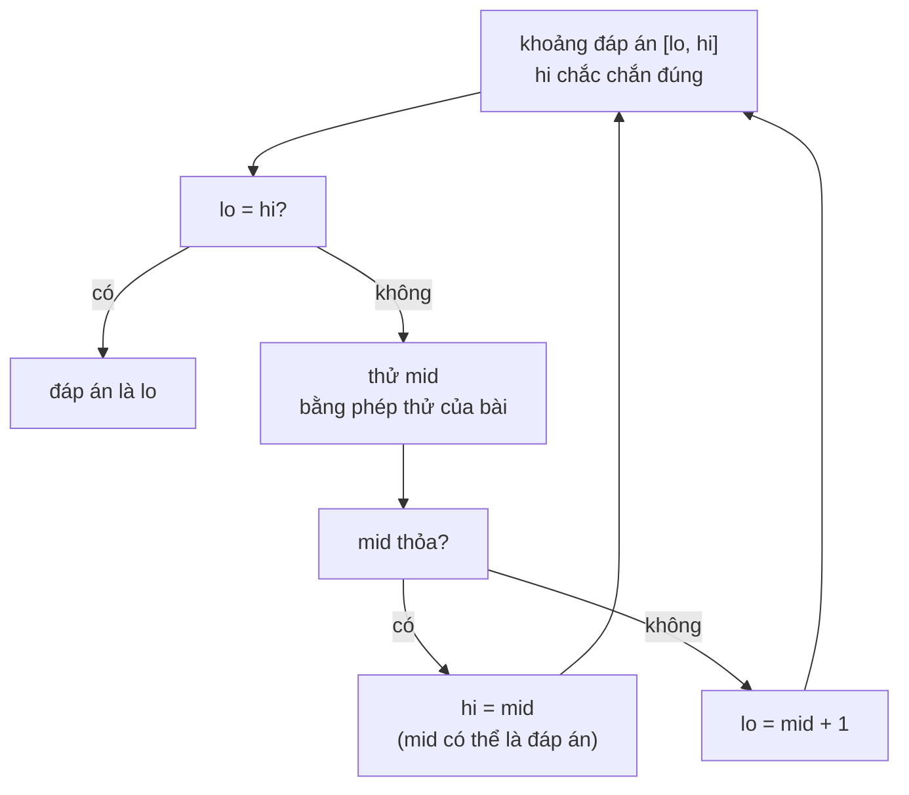

> [!tldr] Đọc nhanh
> - Pattern: [[concepts/search-on-the-answer|tìm kiếm nhị phân trên đáp án]]. Đề hỏi "giá trị nhỏ nhất sao cho làm được X". Đáp án nằm trong một khoảng biết trước, và câu hỏi "với giá trị k, có làm được X không?" có dạng sai…sai đúng…đúng ([[concepts/monotonic-predicate|vị từ đơn điệu]]). Chia đôi trên khoảng đó tìm ra ranh giới sau log₂(khoảng) lần thử.
> - Khuôn là [[concepts/lower-bound|cận dưới]] của ga 1: thử `mid` đúng thì `hi = mid` (giữ `mid`), sai thì `lo = mid + 1`, lặp khi `lo < hi`.
> - Koko Eating Bananas chia đôi trên **tốc độ**. Time Based Key-Value Store chia đôi trên **mốc thời gian** đã lưu, tìm mốc cuối cùng `<= t`. Median of Two Sorted Arrays chia đôi trên **vị trí cắt** mảng ngắn hơn.
> - Phần dễ sai không phải vòng lặp mà là phép thử: [[concepts/ceiling-division|chia làm tròn lên]] cho Koko, `<=` hay `<` cho Time Map, và các ô ±∞ ở mép cho Median.

> [!info] Bối cảnh
> Ga 2 của **tuyến NeetCode: Tìm kiếm và heap**. [[posts/2026-11-23-neetcode-binary-search|Ga 1]] tìm nhị phân trên mảng đã sắp, và kết thúc bằng một nhận xét: điều kiện thật sự không phải "mảng đã sắp" mà là "có một câu hỏi có/không đổi chiều một lần". Ga này dùng nhận xét đó khi không có mảng nào cả. Bạn cần khuôn [[concepts/binary-search|tìm kiếm nhị phân]], [[concepts/loop-invariant|bất biến vòng lặp]] và [[concepts/half-open-interval|khoảng nửa mở]] của ga 1.

> [!abstract]- Từ điển nhanh cho bài này (bấm để mở)
> - **Vị từ (predicate)**: hàm trả đúng hoặc sai. **Đơn điệu** khi đã đúng ở k thì đúng ở mọi giá trị lớn hơn. Xem [[concepts/monotonic-predicate|Monotonic Predicate]].
> - **Không gian đáp án**: mọi giá trị đáp án có thể nhận, ví dụ tốc độ từ 1 tới `max(piles)`.
> - **⌈x⌉**: làm tròn lên. Xem [[concepts/ceiling-division|Ceiling Division]].
> - **Trung vị (median)**: phần tử đứng giữa khi xếp tăng dần; số phần tử chẵn thì lấy trung bình hai phần tử giữa.
> - **Mốc thời gian (timestamp)**: một số nguyên tăng dần đánh dấu lúc ghi.
> - **±∞**: giá trị "nhỏ hơn mọi số" và "lớn hơn mọi số", dùng để khỏi viết ca riêng ở mép mảng. Xem [[concepts/sentinel-value|Sentinel Value]].

## Hình dung trước: đạp xe ra ga cho kịp tàu

Tàu chạy lúc 8 giờ, bạn muốn đạp xe nhẹ nhất mà vẫn kịp. Không ai thử mọi tốc độ từ 1 km/h. Bạn ước một tốc độ vừa phải, tính thử: kịp thì lần sau thử chậm hơn, trễ thì thử nhanh hơn. Đến ga, bạn nhìn bảng "các chuyến đã chạy" để biết chuyến gần nhất trước lúc mình đến. Ở cửa ga có hai hàng khách đã xếp theo chiều cao, và nhân viên cần biết người đứng giữa nếu gộp hai hàng, mà không bắt ai đổi chỗ.

| Đời thường | Khái niệm |
|---|---|
| Các tốc độ có thể đạp | không gian đáp án `[lo, hi]` |
| "Đạp tốc độ này có kịp tàu không?" | vị từ `feasible(k)` |
| Đã kịp ở tốc độ v thì nhanh hơn cũng kịp | tính đơn điệu |
| Tính thời gian đường đi cho mỗi tốc độ thử | phép thử, O(n) mỗi lần |
| Thử tốc độ giữa, bỏ một nửa | chia đôi trên đáp án |
| Tốc độ chậm nhất còn kịp | ranh giới: Koko Eating Bananas |
| Chuyến gần nhất đã chạy trước lúc bạn đến | mốc cuối cùng `<= t`: Time Based Key-Value Store |
| Lấy bao nhiêu người từ hàng ngắn để có nửa trái của hai hàng | vị trí cắt: Median of Two Sorted Arrays |



## Vấn đề: không có mảng để tìm

Bài [[problems/koko-eating-bananas|Koko Eating Bananas]] hỏi tốc độ ăn nhỏ nhất để hết n đống chuối trong h giờ. Không có mảng tốc độ nào; chỉ có cách tính "với tốc độ k, mất bao nhiêu giờ". Thử k = 1, 2, 3… thì số lần thử bằng chính đáp án: đo với 1 000 đống, đáp án 32 496 mất 35,2 ms, còn đống tới 10⁹ (đáp án khoảng 3,3 · 10⁸) thì ngoại suy ra khoảng 6 phút.

Nhưng câu trả lời của phép thử có thứ tự: tốc độ k kịp thì k + 1 cũng kịp. Dọc theo k, các câu trả lời là "trễ, …, trễ, kịp, …, kịp". Đó chính là "mảng" `false…false true…true`, chỉ có điều mỗi ô được tính khi cần. Tìm `true` đầu tiên là [[concepts/lower-bound|cận dưới]] của ga 1: 30 lần thử cho khoảng tới 10⁹, đo được 0,035 ms.

## Cơ chế

### Khuôn chung

<figure class="figure-map" style="--ar: 3 / 4">
<div class="frame"><iframe data-archify="../diagrams/neetcode-binary-search-answer/speed-search.html" title="Tìm tốc độ ăn nhỏ nhất bằng chia đôi" loading="lazy"></iframe></div>
<figcaption><span><b>Hình 1.</b> Koko Eating Bananas với đống [3, 6, 7, 11], h = 8: bốn lần thử thu khoảng tốc độ [1, 11] về [4, 4].</span><a href="../diagrams/neetcode-binary-search-answer/speed-search.html" target="_blank" rel="noopener">Mở toàn màn hình</a></figcaption>
</figure>

Bốn câu hỏi, trả lời theo thứ tự này:

1. **Đáp án nằm trong khoảng nào?** Tìm một `lo` chắc chắn không vượt đáp án và một `hi` chắc chắn thỏa. Koko: `lo = 1`, `hi = max(piles)` (mỗi đống 1 giờ, và đề hứa `h >= n`).
2. **Phép thử là gì, tốn bao nhiêu?** Koko: tổng ⌈p / k⌉ `<= h`, O(n).
3. **Phép thử có đơn điệu không?** Chứng minh trong một câu. Koko: k' > k thì mỗi đống mất không nhiều giờ hơn. Nếu không chứng minh được, chia đôi vẫn chạy và trả **một** ranh giới nào đó, không báo lỗi gì.
4. **Tìm `true` đầu tiên hay `false` cuối cùng?** "Nhỏ nhất sao cho được" là `true` đầu tiên: `hi = mid` khi thỏa. "Lớn nhất sao cho được" là `true` cuối cùng của dãy `true…true false…false`: `lo = mid` khi thỏa, và `mid` phải làm tròn **lên** để khỏi lặp mãi.

Chi phí là log₂(hi − lo) lần thử nhân chi phí một lần thử. Koko: O(n log max).

### Ba bài, ba khoảng đáp án

| Bài | Khoảng đáp án | Phép thử cho `mid` | Giữ nửa nào |
|---|---|---|---|
| [[problems/koko-eating-bananas\|Koko Eating Bananas]] | tốc độ `[1, max(piles)]` | tổng ⌈p / mid⌉ `<= h`? | kịp: `hi = mid`; trễ: `lo = mid + 1` |
| [[problems/time-based-key-value-store\|Time Based Key-Value Store]] | chỉ số `[0, len)` trong các mốc của một khóa | `ts[mid] > t`? | đúng: `hi = mid`; sai: `lo = mid + 1`; trả ô `lo − 1` |
| [[problems/median-of-two-sorted-arrays\|Median of Two Sorted Arrays]] | số phần tử `i` lấy từ mảng ngắn, `[0, m]` | `a[i − 1] > b[j]`, với `j = (m + n + 1) / 2 − i`? | đúng: lấy quá nhiều từ `a`, `hi = i − 1`; `b[j − 1] > a[i]`: lấy quá ít, `lo = i + 1` |

**Time Based Key-Value Store** lưu nhiều giá trị cho một khóa, mỗi giá trị kèm mốc thời gian, và `get(key, t)` trả giá trị có mốc **lớn nhất không vượt** `t`. Đề hứa mốc của các lần `set` tăng dần, nên chỉ cần nối thêm vào cuối danh sách là danh sách vẫn sắp. `get` là một lần chia đôi: tìm mốc đầu tiên `> t` (cận trên, `bisect_right`), rồi lùi một ô. Lùi tới trước ô 0 nghĩa là chưa có giá trị nào lúc `t`: trả chuỗi rỗng. Dễ sai ở dấu: dùng cận dưới (`bisect_left`, mốc đầu tiên `>= t`) rồi lùi một ô thì bỏ mất giá trị ghi **đúng** lúc `t`. Java có sẵn `TreeMap.floorEntry(t)`, trả đúng mục cần tìm.

**Median of Two Sorted Arrays** đòi O(log(m + n)), nên không được trộn hai mảng (O(m + n)). Ý chính: trung vị chia các phần tử thành nửa trái và nửa phải bằng nhau (lệch 1 khi tổng lẻ). Nếu nửa trái lấy `i` phần tử đầu của `a` thì phải lấy `j = (m + n + 1) / 2 − i` phần tử đầu của `b`. Cách cắt đúng khi mọi phần tử bên trái `<=` mọi phần tử bên phải, tức `a[i − 1] <= b[j]` và `b[j − 1] <= a[i]` (hai mảng đã sắp nên chỉ cần so hai cặp ở chỗ cắt). Khi `i` tăng, `a[i − 1]` tăng còn `b[j]` giảm, nên câu "`a[i − 1] > b[j]`?" đổi từ sai sang đúng đúng một lần: lại là vị từ đơn điệu, lần này trên vị trí cắt. Chia đôi trên `i` trong mảng ngắn hơn cho O(log min(m, n)). Khác Koko, vòng lặp này dùng khoảng đóng `[0, m]` và dừng sớm như bài 704: cách cắt đúng được nhận ra ngay khi gặp, nên không cần thu khoảng về một ô. Ở mép (`i = 0`, `i = m`, `j = 0`, `j = n`) ô không tồn tại được coi là −∞ hoặc +∞, để hai phép so sánh luôn viết được.

### Bên dưới năm ngôn ngữ

| | Chia đôi trên hàm | Mốc cuối cùng `<= t` | ±∞ | Bẫy riêng |
|---|---|---|---|---|
| TypeScript / JavaScript | tự viết | tự viết cận trên rồi lùi một ô | `-Infinity`, `Infinity` | chia cho 0 ra `Infinity`, không ném lỗi; `Math.max(...arr)` ném `RangeError` khi mảng quá dài (2 · 10⁵ phần tử trên Node 24) |
| Python | `bisect_left(range(lo, hi), True, key=f)` (3.10+) | `bisect_right(ts, t) − 1` | `float("-inf")`, `float("inf")` | `math.ceil(p / k)` sai khi p > 2⁵³; `bisect` với `key` cần 3.10 |
| Go | `sort.Search(n, f)` | `sort.Search(len, func(i) bool { return ts[i] > t }) − 1` | `math.Inf(-1)`, `math.Inf(1)` (phải đổi sang `float64`) | `sort.Search` luôn bắt đầu từ 0: tốc độ là `i + 1` |
| Java | tự viết | `TreeMap.floorEntry(t)` | `Long.MIN_VALUE`, `Long.MAX_VALUE` (dùng `long` để chắc chắn ngoài miền `int`) | tổng giờ nên là `long`; `hi = Integer.MAX_VALUE` cùng `(lo + hi) / 2` làm `mid` âm |

## Ví dụ chạy được

[TypeScript](../code/neetcode-binary-search-answer/answer-search-station.ts) · [Python](../code/neetcode-binary-search-answer/answer_search_station.py) · [Go](../code/neetcode-binary-search-answer/answer_search_station.go) · [Java](../code/neetcode-binary-search-answer/answer-search-station.java) · [JavaScript](../code/neetcode-binary-search-answer/answer-search-station.js)

Mỗi file giải cả ba bài và tự chạy 14 ca: ba ví dụ Koko của đề cùng một đống 10⁹; chuỗi lệnh của đề Time Map cùng hai ca "trước mốc đầu tiên" và "khóa chưa có"; năm ca Median, gồm một mảng rỗng, hai mảng toàn 0 và hai mảng không xen nhau.

```ts
// 875: tốc độ nhỏ nhất ăn hết trong h giờ. "Tốc độ k có kịp không?" sai rồi đúng đúng một lần khi k tăng.
function minEatingSpeed(piles: number[], h: number): number {
  const hours = (k: number) => piles.reduce((s, p) => s + Math.floor((p + k - 1) / k), 0);
  let lo = 1, hi = Math.max(...piles);
  while (lo < hi) {
    const mid = lo + Math.floor((hi - lo) / 2);
    if (hours(mid) <= h) hi = mid; // kịp: giữ mid, có thể là đáp án
    else lo = mid + 1;
  }
  return lo;
}

// 981: mỗi khóa giữ các mốc thời gian tăng dần. get tìm mốc cuối cùng <= t = (mốc đầu tiên > t) − 1.
class TimeMap {
  private store = new Map<string, { ts: number[]; vals: string[] }>();
  set(key: string, value: string, timestamp: number): void {
    let e = this.store.get(key);
    if (!e) this.store.set(key, (e = { ts: [], vals: [] }));
    e.ts.push(timestamp); // đề hứa timestamp tăng dần, nên push giữ mảng đã sắp
    e.vals.push(value);
  }
  get(key: string, timestamp: number): string {
    const e = this.store.get(key);
    if (!e) return "";
    let lo = 0, hi = e.ts.length; // tìm mốc đầu tiên > timestamp trên [lo, hi)
    while (lo < hi) {
      const mid = (lo + hi) >>> 1;
      if (e.ts[mid] <= timestamp) lo = mid + 1;
      else hi = mid;
    }
    return lo === 0 ? "" : e.vals[lo - 1];
  }
}

// 4: chia đôi trên vị trí cắt i của mảng ngắn hơn. Cắt đúng khi mọi phần tử bên trái <= mọi phần tử bên phải.
function findMedianSortedArrays(a: number[], b: number[]): number {
  if (a.length > b.length) [a, b] = [b, a];
  const m = a.length, n = b.length, half = (m + n + 1) >> 1;
  let lo = 0, hi = m;
  while (lo <= hi) {
    const i = (lo + hi) >> 1, j = half - i; // i phần tử của a và j phần tử của b nằm bên trái
    const aL = i > 0 ? a[i - 1] : -Infinity, aR = i < m ? a[i] : Infinity;
    const bL = j > 0 ? b[j - 1] : -Infinity, bR = j < n ? b[j] : Infinity;
    if (aL <= bR && bL <= aR) {
      return (m + n) % 2 ? Math.max(aL, bL) : (Math.max(aL, bL) + Math.min(aR, bR)) / 2;
    }
    if (aL > bR) hi = i - 1; // lấy quá nhiều từ a
    else lo = i + 1; // lấy quá ít từ a
  }
  throw new Error("mảng đầu vào chưa sắp");
}
```

```python
def min_eating_speed(piles: list[int], h: int) -> int:  # 875
    lo, hi = 1, max(piles)
    while lo < hi:
        mid = (lo + hi) // 2
        if sum(-(-p // mid) for p in piles) <= h:  # kịp: giữ mid
            hi = mid
        else:
            lo = mid + 1
    return lo

class TimeMap:  # 981: mốc thời gian của mỗi khóa tăng dần
    def __init__(self):
        self.ts = defaultdict(list)
        self.vals = defaultdict(list)

    def set(self, key: str, value: str, timestamp: int) -> None:
        self.ts[key].append(timestamp)
        self.vals[key].append(value)

    def get(self, key: str, timestamp: int) -> str:
        i = bisect_right(self.ts.get(key, []), timestamp)  # mốc đầu tiên > timestamp
        return self.vals[key][i - 1] if i else ""

def find_median_sorted_arrays(a: list[int], b: list[int]) -> float:  # 4: chia đôi trên vị trí cắt
    if len(a) > len(b):
        a, b = b, a
    m, n = len(a), len(b)
    half = (m + n + 1) // 2
    lo, hi = 0, m
    while lo <= hi:
        i = (lo + hi) // 2
        j = half - i
        a_l = a[i - 1] if i > 0 else float("-inf")
        a_r = a[i] if i < m else float("inf")
        b_l = b[j - 1] if j > 0 else float("-inf")
        b_r = b[j] if j < n else float("inf")
        if a_l <= b_r and b_l <= a_r:
            if (m + n) % 2:
                return max(a_l, b_l)
            return (max(a_l, b_l) + min(a_r, b_r)) / 2
        if a_l > b_r:
            hi = i - 1  # lấy quá nhiều từ a
        else:
            lo = i + 1
    raise ValueError("mảng đầu vào chưa sắp")
```

```go
func minEatingSpeed(piles []int, h int) int { // 875
	lo, hi := 1, slices.Max(piles)
	for lo < hi {
		mid := lo + (hi-lo)/2
		hours := 0
		for _, p := range piles {
			hours += (p + mid - 1) / mid
		}
		if hours <= h { // kịp: giữ mid
			hi = mid
		} else {
			lo = mid + 1
		}
	}
	return lo
}

type entry struct {
	ts   int
	vals string
}

type TimeMap struct{ store map[string][]entry } // 981: mốc của mỗi khóa tăng dần

func (t *TimeMap) Set(key, value string, timestamp int) {
	t.store[key] = append(t.store[key], entry{timestamp, value})
}

func (t *TimeMap) Get(key string, timestamp int) string {
	es := t.store[key]
	i := sort.Search(len(es), func(i int) bool { return es[i].ts > timestamp }) // mốc đầu tiên > timestamp
	if i == 0 {
		return ""
	}
	return es[i-1].vals
}

func findMedianSortedArrays(a, b []int) float64 { // 4: chia đôi trên vị trí cắt
	if len(a) > len(b) {
		a, b = b, a
	}
	m, n := len(a), len(b)
	half := (m + n + 1) / 2
	lo, hi := 0, m
	for lo <= hi {
		i := (lo + hi) / 2
		j := half - i
		aL, aR, bL, bR := math.Inf(-1), math.Inf(1), math.Inf(-1), math.Inf(1)
		if i > 0 {
			aL = float64(a[i-1])
		}
		if i < m {
			aR = float64(a[i])
		}
		if j > 0 {
			bL = float64(b[j-1])
		}
		if j < n {
			bR = float64(b[j])
		}
		if aL <= bR && bL <= aR {
			if (m+n)%2 == 1 {
				return math.Max(aL, bL)
			}
			return (math.Max(aL, bL) + math.Min(aR, bR)) / 2
		}
		if aL > bR {
			hi = i - 1 // lấy quá nhiều từ a
		} else {
			lo = i + 1
		}
	}
	panic("mảng đầu vào chưa sắp")
}
```

```java
static int minEatingSpeed(int[] piles, int h) { // 875
    int lo = 1, hi = Arrays.stream(piles).max().getAsInt();
    while (lo < hi) {
        int mid = lo + (hi - lo) / 2;
        long hours = 0; // tổng giờ có thể vượt int
        for (int p : piles) hours += (p + mid - 1) / mid;
        if (hours <= h) hi = mid; // kịp: giữ mid
        else lo = mid + 1;
    }
    return lo;
}

static class TimeMap { // 981: TreeMap.floorEntry trả mốc lớn nhất <= timestamp
    private final Map<String, TreeMap<Integer, String>> store = new HashMap<>();
    void set(String key, String value, int timestamp) {
        store.computeIfAbsent(key, k -> new TreeMap<>()).put(timestamp, value);
    }
    String get(String key, int timestamp) {
        TreeMap<Integer, String> t = store.get(key);
        if (t == null) return "";
        Map.Entry<Integer, String> e = t.floorEntry(timestamp);
        return e == null ? "" : e.getValue();
    }
}

static double findMedianSortedArrays(int[] a, int[] b) { // 4: chia đôi trên vị trí cắt
    if (a.length > b.length) { int[] t = a; a = b; b = t; }
    int m = a.length, n = b.length, half = (m + n + 1) / 2, lo = 0, hi = m;
    while (lo <= hi) {
        int i = (lo + hi) / 2, j = half - i;
        long aL = i > 0 ? a[i - 1] : Long.MIN_VALUE, aR = i < m ? a[i] : Long.MAX_VALUE;
        long bL = j > 0 ? b[j - 1] : Long.MIN_VALUE, bR = j < n ? b[j] : Long.MAX_VALUE;
        if (aL <= bR && bL <= aR) {
            if ((m + n) % 2 == 1) return Math.max(aL, bL);
            return (Math.max(aL, bL) + Math.min(aR, bR)) / 2.0;
        }
        if (aL > bR) hi = i - 1; // lấy quá nhiều từ a
        else lo = i + 1;
    }
    throw new IllegalArgumentException("mảng đầu vào chưa sắp");
}
```

```js
// 875: tốc độ nhỏ nhất ăn hết trong h giờ. "Tốc độ k có kịp không?" sai rồi đúng đúng một lần khi k tăng.
function minEatingSpeed(piles, h) {
  const hours = (k) => piles.reduce((s, p) => s + Math.floor((p + k - 1) / k), 0);
  let lo = 1, hi = Math.max(...piles);
  while (lo < hi) {
    const mid = lo + Math.floor((hi - lo) / 2);
    if (hours(mid) <= h) hi = mid; // kịp: giữ mid, có thể là đáp án
    else lo = mid + 1;
  }
  return lo;
}

// 981: mỗi khóa giữ các mốc thời gian tăng dần. get tìm mốc cuối cùng <= t = (mốc đầu tiên > t) − 1.
class TimeMap {
  store = new Map();
  set(key, value, timestamp) {
    let e = this.store.get(key);
    if (!e) this.store.set(key, (e = { ts: [], vals: [] }));
    e.ts.push(timestamp); // đề hứa timestamp tăng dần, nên push giữ mảng đã sắp
    e.vals.push(value);
  }
  get(key, timestamp) {
    const e = this.store.get(key);
    if (!e) return "";
    let lo = 0, hi = e.ts.length; // tìm mốc đầu tiên > timestamp trên [lo, hi)
    while (lo < hi) {
      const mid = (lo + hi) >>> 1;
      if (e.ts[mid] <= timestamp) lo = mid + 1;
      else hi = mid;
    }
    return lo === 0 ? "" : e.vals[lo - 1];
  }
}

// 4: chia đôi trên vị trí cắt i của mảng ngắn hơn. Cắt đúng khi mọi phần tử bên trái <= mọi phần tử bên phải.
function findMedianSortedArrays(a, b) {
  if (a.length > b.length) [a, b] = [b, a];
  const m = a.length, n = b.length, half = (m + n + 1) >> 1;
  let lo = 0, hi = m;
  while (lo <= hi) {
    const i = (lo + hi) >> 1, j = half - i; // i phần tử của a và j phần tử của b nằm bên trái
    const aL = i > 0 ? a[i - 1] : -Infinity, aR = i < m ? a[i] : Infinity;
    const bL = j > 0 ? b[j - 1] : -Infinity, bR = j < n ? b[j] : Infinity;
    if (aL <= bR && bL <= aR) {
      return (m + n) % 2 ? Math.max(aL, bL) : (Math.max(aL, bL) + Math.min(aR, bR)) / 2;
    }
    if (aL > bR) hi = i - 1; // lấy quá nhiều từ a
    else lo = i + 1; // lấy quá ít từ a
  }
  throw new Error("mảng đầu vào chưa sắp");
}
```


```text
answer-search-station 14/14 ca đúng
```

Python, Go, Java và JavaScript cũng in `14/14 ca đúng`.

## Hiểu lầm và bẫy hay gặp

- **"Phải có mảng đã sắp mới chia đôi được."** Chỉ cần một câu hỏi có/không đơn điệu trên một khoảng. Koko không có mảng; Median chia đôi trên vị trí cắt chứ không trên giá trị.
- **Không chứng minh tính đơn điệu.** Chia đôi trên một phép thử không đơn điệu vẫn trả kết quả, chỉ là kết quả sai. Viết ra một câu chứng minh trước khi code.
- **Thỏa mà vẫn bỏ `mid`.** Thói quen `hi = mid − 1` của bài 704 làm mất đáp án khi `mid` chính là ranh giới. Trang Koko chạy bản này: sai 6/10 ca.
- **Sai phép thử.** Koko chia làm tròn xuống thì đếm thiếu giờ (5/10 ca). Time Map dùng `>= t` thay cho `> t` thì bỏ mất giá trị ghi đúng lúc `t`.
- **Biên quá rộng hoặc vô nghĩa.** `lo = 0` làm phép thử chia cho 0; `hi = Integer.MAX_VALUE` làm `(lo + hi) / 2` tràn. Biên chặt (`1`, `max(piles)`) vừa đúng vừa ít lần thử hơn.
- **Median: chia đôi trên mảng dài hơn.** `j = half − i` có thể âm hoặc vượt `n`. Luôn đổi chỗ để `a` là mảng ngắn hơn.

## Câu hỏi tự kiểm tra

> [!question]- Đề: chở hàng bằng một con tàu trong `days` ngày, các kiện đi theo thứ tự, tìm sức chứa nhỏ nhất (LeetCode 1011). Khoảng đáp án và phép thử là gì?
> Khoảng `[max(weights), sum(weights)]`: nhỏ hơn kiện nặng nhất thì không chở nổi, bằng tổng thì một ngày là xong. Phép thử: xếp tham lam theo thứ tự, đầy thì sang ngày mới, đếm số ngày `<= days`? Sức chứa lớn hơn không bao giờ cần nhiều ngày hơn, nên đơn điệu.

> [!question]- Time Map có mốc `[1, 4, 9]`. `get(t = 4)` và `get(t = 3)` trả mục nào?
> Mốc đầu tiên `> 4` ở chỉ số 2, lùi một ô: mục có mốc 4. Mốc đầu tiên `> 3` ở chỉ số 1, lùi một ô: mục có mốc 1.

> [!question]- Median: `a = [1, 3]`, `b = [2]`. Chạy vòng chia đôi.
> `a` ngắn hơn? Không: đổi để `a = [2]`, `b = [1, 3]`, m = 1, n = 2, half = 2. `i = 0`, `j = 2`: `aL = −∞`, `aR = 2`, `bL = 3`, `bR = +∞`. `bL = 3 > aR = 2`: lấy quá ít từ `a`, `lo = 1`. `i = 1`, `j = 1`: `aL = 2`, `aR = +∞`, `bL = 1`, `bR = 3`. Thỏa; tổng lẻ, trung vị `max(2, 1) = 2`.

> [!question]- Vì sao "lớn nhất sao cho được" cần `mid` làm tròn lên?
> Nhánh thỏa gán `lo = mid`. Khi khoảng còn hai ô `[lo, lo + 1]`, `mid` làm tròn xuống bằng `lo`, và `lo = mid` không co khoảng: lặp mãi. Làm tròn lên cho `mid = lo + 1`, cả hai nhánh đều co.

## Tham khảo

- [NeetCode 150](https://neetcode.io/practice) (danh sách và nhóm bài)
- LeetCode: [875. Koko Eating Bananas](https://leetcode.com/problems/koko-eating-bananas/), [981. Time Based Key-Value Store](https://leetcode.com/problems/time-based-key-value-store/), [4. Median of Two Sorted Arrays](https://leetcode.com/problems/median-of-two-sorted-arrays/), [1011. Capacity To Ship Packages Within D Days](https://leetcode.com/problems/capacity-to-ship-packages-within-d-days/)
- [Python `bisect`](https://docs.python.org/3/library/bisect.html) (`bisect_right`, tham số `key`)
- [Go `sort.Search`](https://pkg.go.dev/sort#Search)
- [Java 21 `TreeMap.floorEntry`](https://docs.oracle.com/en/java/javase/21/docs/api/java.base/java/util/TreeMap.html#floorEntry(K))
- [C++ `std::partition_point`](https://en.cppreference.com/w/cpp/algorithm/partition_point) (chia đôi trên vị từ trong thư viện chuẩn C++)
