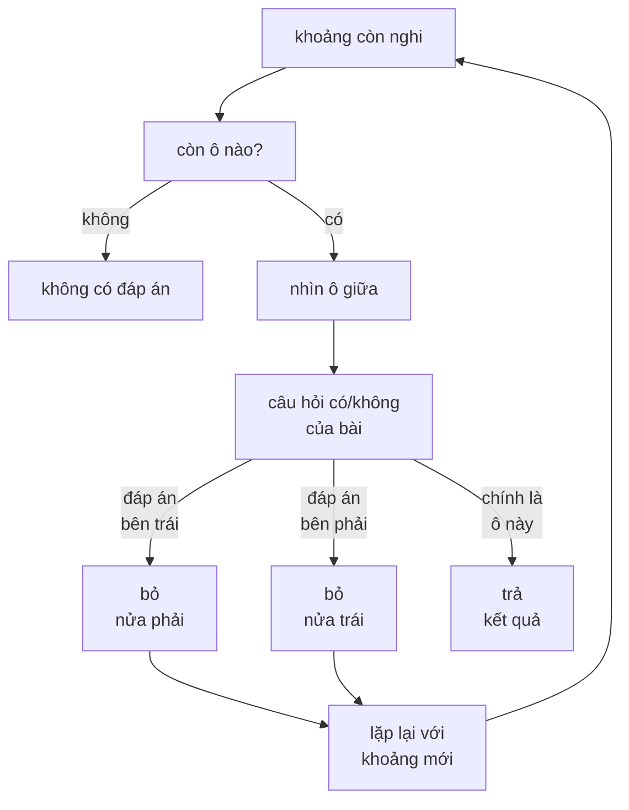

> [!tldr] Đọc nhanh
> - Pattern: [[concepts/binary-search|tìm kiếm nhị phân]]. Giữ một khoảng còn nghi, nhìn phần tử giữa, và dựa vào một câu hỏi có/không để bỏ hẳn một nửa. n phần tử chỉ cần khoảng log₂ n lần nhìn: 20 lần cho 10⁶.
> - Viết đúng nhờ [[concepts/loop-invariant|bất biến vòng lặp]] và một [[concepts/half-open-interval|quy ước khoảng]] giữ nhất quán: `[lo, hi]` đi với `lo <= hi` và `hi = mid − 1`; `[lo, hi)` đi với `lo < hi` và `hi = mid`.
> - Binary Search là khuôn gốc. Search a 2D Matrix đổi chỉ số k thành ô `(k / n, k % n)`. Find Minimum so `nums[mid]` với `nums[hi]` để biết điểm gãy ở bên nào. Search in Rotated Sorted Array tìm nửa nào còn tăng dần rồi hỏi `target` có trong nửa đó không.
> - Hai bẫy chung: `lo = mid` làm vòng lặp chạy mãi, và `(lo + hi) / 2` tràn `int` 32 bit ([[concepts/midpoint-overflow|tràn điểm giữa]]).
> - Ga này mở tuyến SRCH: 4 ga, 14 bài.

> [!info] Bối cảnh
> Ga 1 của **tuyến NeetCode: Tìm kiếm và heap**. Bảy ga của [[series/neetcode-arr|tuyến Mảng và chuỗi]] đều phải đọc hết dữ liệu ít nhất một lần, nên không bao giờ nhanh hơn O(n). Ở đây dữ liệu đã có thứ tự, và thứ tự cho phép trả lời mà bỏ qua gần hết mảng. Ý "bỏ phần chắc chắn không chứa đáp án" đã có ở [[posts/2026-11-23-neetcode-two-pointers|ga hai con trỏ]] ([[concepts/search-space-pruning|Search Space Pruning]]); ở đây mỗi bước bỏ một nửa thay vì một phần tử. Bạn chỉ cần biết vòng lặp và mảng.

> [!abstract]- Từ điển nhanh cho bài này (bấm để mở)
> - **Mảng đã sắp (sorted array)**: phần tử sau không nhỏ hơn phần tử trước.
> - **log₂ n**: số lần chia đôi n cho tới khi còn 1; log₂ 10⁶ ≈ 20. Xem [[concepts/big-o-notation|Big-O]].
> - **Bất biến (invariant)**: câu luôn đúng trước và sau mỗi vòng lặp. Xem [[concepts/loop-invariant|Loop Invariant]].
> - **Cận dưới (lower bound)**: vị trí đầu tiên có giá trị `>= target`; `bisect_left` trong Python. Xem [[concepts/lower-bound|Lower Bound]].
> - **Mảng xoay (rotated array)**: mảng tăng dần bị cắt ở một chỗ và hai đoạn đổi chỗ cho nhau: `[0, 1, 2, 4, 5, 6, 7]` thành `[4, 5, 6, 7, 0, 1, 2]`. Xem [[concepts/rotated-sorted-array|Rotated Sorted Array]].

## Hình dung trước: tra từ trong cuốn từ điển giấy

Tra từ "nhị phân" trong từ điển giấy, không ai lật từ trang 1. Mở khoảng giữa, thấy chữ "l", biết "n" ở nửa sau, bỏ nửa đầu. Mở giữa nửa sau, và cứ thế. Cuốn 1 000 trang chỉ cần khoảng 10 lần mở.

| Đời thường | Khái niệm |
|---|---|
| Các trang còn có thể chứa từ cần tra | khoảng còn nghi `[lo, hi]` |
| Mở trang ở giữa | `mid` |
| Chữ đầu trang đứng trước hay sau từ cần tra | câu hỏi có/không đặt cho `nums[mid]` |
| Bỏ hẳn nửa không thể chứa từ | `lo = mid + 1` hoặc `hi = mid − 1` |
| Từ điển xếp theo vần: cách tra mới đúng | mảng phải có thứ tự (hoặc ít nhất một câu hỏi đơn điệu) |
| Bộ từ điển nhiều tập, đánh số trang liên tục | Search a 2D Matrix: nhiều hàng đọc như một mảng |
| Có người tách cuốn từ điển làm đôi và đóng ngược | mảng xoay: Find Minimum, Search in Rotated Sorted Array |



## Vấn đề: đọc hết mảng tốn O(n) dù mảng đã có thứ tự

Tìm một số trong mảng tăng dần bằng cách đọc từng phần tử là O(n), và bỏ phí thông tin "đã sắp". Một lần so `nums[mid]` với `target` cho biết `target` không thể ở nửa bên kia. Trang [[problems/binary-search|Binary Search]] đo 10⁵ lần tìm: ở 10 000 phần tử, đọc tuần tự mất 607 ms, chia đôi mất 7,8 ms; lên 10⁶ phần tử, chia đôi vẫn chỉ 14 ms.

Khó không nằm ở ý tưởng mà ở chi tiết. Jon Bentley kể trong *Programming Pearls* rằng khoảng 90% lập trình viên chuyên nghiệp được ông giao viết tìm kiếm nhị phân đã nộp bản có lỗi. Ba bài sau của ga này còn khó hơn: mảng không còn tăng dần trọn vẹn, hoặc không còn là mảng một chiều.

## Cơ chế

### Khuôn chung

<figure class="figure-map" style="--ar: 3 / 4">
<div class="frame"><iframe data-archify="../diagrams/neetcode-binary-search/halving.html" title="Tìm kiếm nhị phân trên tám phần tử" loading="lazy"></iframe></div>
<figcaption><span><b>Hình 1.</b> Binary Search: tìm 15 thấy sau ba lần nhìn; tìm 4 thì khoảng còn nghi co tới rỗng, và đó là bằng chứng 4 không có mặt.</span><a href="../diagrams/neetcode-binary-search/halving.html" target="_blank" rel="noopener">Mở toàn màn hình</a></figcaption>
</figure>

```text
lo, hi = khoảng ban đầu
chừng nào khoảng còn ô:
    mid = lo + (hi − lo) / 2
    hỏi một câu có/không về mid
    bỏ nửa chắc chắn không chứa đáp án
```

Ba điểm làm khuôn này đúng:
1. **Một câu bất biến**, viết ra trước khi code. Với bài 704: "nếu `target` có mặt thì nó nằm trong `[lo, hi]`". Ra khỏi vòng với khoảng rỗng chính là bằng chứng `target` không có mặt.
2. **Một quy ước khoảng, giữ từ đầu đến cuối.** Khoảng đóng `[lo, hi]`: `hi = n − 1`, lặp khi `lo <= hi`, bỏ phải bằng `hi = mid − 1`. Khoảng nửa mở `[lo, hi)`: `hi = n`, lặp khi `lo < hi`, bỏ phải bằng `hi = mid`. Trộn hai quy ước là nguồn lỗi phổ biến nhất.
3. **Mỗi vòng khoảng phải co lại.** `lo = mid + 1` luôn co; `lo = mid` thì không co khi khoảng còn hai ô, vì `mid` làm tròn xuống bằng `lo`, và vòng lặp chạy mãi.

### Bốn bài, bốn câu hỏi

| Bài | Khoảng | Câu hỏi cho `mid` | Bỏ nửa nào |
|---|---|---|---|
| [[problems/binary-search\|Binary Search]] | `[0, n − 1]`, đóng | `nums[mid]` so với `target` | nhỏ hơn: bỏ trái; lớn hơn: bỏ phải; bằng: trả `mid` |
| [[problems/search-a-2d-matrix\|Search a 2D Matrix]] | `[0, m·n − 1]`, đóng | ô `(mid / n, mid % n)` so với `target` | như Binary Search |
| [[problems/find-minimum-in-rotated-sorted-array\|Find Minimum in Rotated Sorted Array]] | `[0, n − 1]`, lặp khi `lo < hi` | `nums[mid] > nums[hi]`? | có: điểm gãy bên phải, `lo = mid + 1`; không: `hi = mid` (giữ `mid`) |
| [[problems/search-in-rotated-sorted-array\|Search in Rotated Sorted Array]] | `[0, n − 1]`, đóng | nửa nào tăng dần, và `target` có trong nửa đó? | có: đi vào nửa đó; không: sang nửa kia |

**Search a 2D Matrix** có mỗi hàng tăng dần và phần tử đầu mỗi hàng lớn hơn phần tử cuối hàng trước. Đọc lần lượt từng hàng, ma trận là một mảng tăng dần dài `m·n`, nên chỉ cần đổi chỉ số: phần tử thứ k nằm ở hàng `k / n`, cột `k % n` (chia lấy phần nguyên và lấy dư cho số cột). Không cần chép ra mảng một chiều. Cách tìm hàng trước rồi tìm cột cũng O(log m + log n), cùng độ phức tạp với O(log(m·n)).

**Find Minimum** không có `target`. Mảng xoay gồm hai đoạn tăng dần, đoạn sau nhỏ hơn đoạn trước; phần tử nhỏ nhất là đầu đoạn sau. So `nums[mid]` với `nums[hi]`: lớn hơn nghĩa là `mid` thuộc đoạn trước và điểm gãy ở bên phải; nhỏ hơn nghĩa là `mid` thuộc đoạn sau và có thể chính là phần tử nhỏ nhất, nên `hi = mid` chứ không phải `mid − 1`. Bất biến: phần tử nhỏ nhất luôn nằm trong `[lo, hi]`. Vì `hi = mid` giữ lại `mid`, điều kiện lặp phải là `lo < hi`; với `lo <= hi`, khi `lo = hi = mid` vòng lặp không bao giờ dừng.

So với `nums[lo]` thay vì `nums[hi]` thì hỏng: mảng chưa xoay `[1, 2, 3]` có `nums[mid] > nums[lo]` nhưng phần tử nhỏ nhất ở bên **trái**.

**Search in Rotated Sorted Array** dùng một quan sát: cắt mảng xoay ở `mid`, ít nhất một trong hai nửa `[lo, mid]` và `[mid, hi]` tăng dần. `nums[lo] <= nums[mid]` thì nửa trái tăng dần, và `target` nằm trong nửa trái khi và chỉ khi `nums[lo] <= target < nums[mid]`. Nửa tăng dần là nửa duy nhất có thể kiểm tra "có chứa `target`" bằng hai phép so sánh; không chứa thì `target` (nếu có) ở nửa kia. Dấu `<=` trong `nums[lo] <= nums[mid]` cần cho ca `lo = mid` (khoảng còn hai ô): bỏ dấu bằng thì `[3, 1]` tìm 1 trả `-1`.

### Bên dưới năm ngôn ngữ

| | Tính `mid` | Thư viện chuẩn | Bẫy riêng |
|---|---|---|---|
| TypeScript / JavaScript | `(lo + hi) >>> 1` | không có | `>> 1` ép về int32 có dấu, sai khi `lo + hi` vượt 2³¹; ma trận cần `Math.floor(mid / n)`, vì `/` ra số thực |
| Python | `(lo + hi) // 2` | `bisect_left`, `bisect_right` | không tràn; `bisect` trả vị trí chèn, không trả `-1`; `divmod(mid, n)` cho cả hàng lẫn cột |
| Go | `lo + (hi-lo)/2` | `sort.Search`, `slices.BinarySearch` | `sort.Search` cần hàm đổi từ `false` sang `true` đúng một lần, nên không dùng thẳng được cho mảng xoay |
| Java | `lo + (hi - lo) / 2` | `Arrays.binarySearch` | `(lo + hi) / 2` tràn `int`; `Arrays.binarySearch` trả `-(vị trí chèn) − 1` khi không thấy, và kết quả không xác định trên mảng xoay |

## Ví dụ chạy được

[TypeScript](../code/neetcode-binary-search/binary-search-station.ts) · [Python](../code/neetcode-binary-search/binary_search_station.py) · [Go](../code/neetcode-binary-search/binary_search_station.go) · [Java](../code/neetcode-binary-search/binary-search-station.java) · [JavaScript](../code/neetcode-binary-search/binary-search-station.js)

Mỗi file giải cả bốn bài và tự chạy 14 ca, gồm mảng một phần tử, mảng chưa xoay `[11, 13, 15, 17]`, và mảng hai phần tử `[2, 1]`, `[3, 1]`.

```ts
// 704: khoảng đóng [lo, hi], dừng ngay khi gặp target.
function search(nums: number[], target: number): number {
  let lo = 0, hi = nums.length - 1;
  while (lo <= hi) {
    const mid = lo + ((hi - lo) >> 1);
    if (nums[mid] === target) return mid;
    if (nums[mid] < target) lo = mid + 1;
    else hi = mid - 1;
  }
  return -1;
}

// 74: ma trận m×n đọc theo hàng là một mảng tăng dần dài m·n; chỉ số k ứng với ô (k / n, k % n).
function searchMatrix(matrix: number[][], target: number): boolean {
  const n = matrix[0].length;
  let lo = 0, hi = matrix.length * n - 1;
  while (lo <= hi) {
    const mid = lo + ((hi - lo) >> 1);
    const v = matrix[Math.floor(mid / n)][mid % n];
    if (v === target) return true;
    if (v < target) lo = mid + 1;
    else hi = mid - 1;
  }
  return false;
}

// 153: so nums[mid] với nums[hi]. Lớn hơn thì điểm gãy (chỗ nhỏ nhất) nằm bên phải mid.
function findMin(nums: number[]): number {
  let lo = 0, hi = nums.length - 1;
  while (lo < hi) { // bất biến: phần tử nhỏ nhất luôn nằm trong [lo, hi]
    const mid = lo + ((hi - lo) >> 1);
    if (nums[mid] > nums[hi]) lo = mid + 1;
    else hi = mid; // mid có thể chính là phần tử nhỏ nhất, nên giữ nó lại
  }
  return nums[lo];
}

// 33: một trong hai nửa quanh mid luôn tăng dần; target nằm trong nửa đó thì đi vào, không thì sang nửa kia.
function searchRotated(nums: number[], target: number): number {
  let lo = 0, hi = nums.length - 1;
  while (lo <= hi) {
    const mid = lo + ((hi - lo) >> 1);
    if (nums[mid] === target) return mid;
    if (nums[lo] <= nums[mid]) { // nửa trái [lo, mid] tăng dần
      if (nums[lo] <= target && target < nums[mid]) hi = mid - 1;
      else lo = mid + 1;
    } else { // nửa phải [mid, hi] tăng dần
      if (nums[mid] < target && target <= nums[hi]) lo = mid + 1;
      else hi = mid - 1;
    }
  }
  return -1;
}
```

```python
def search(nums: list[int], target: int) -> int:  # 704
    lo, hi = 0, len(nums) - 1
    while lo <= hi:
        mid = (lo + hi) // 2
        if nums[mid] == target:
            return mid
        if nums[mid] < target:
            lo = mid + 1
        else:
            hi = mid - 1
    return -1

def search_matrix(matrix: list[list[int]], target: int) -> bool:  # 74: chỉ số k ứng với ô (k // n, k % n)
    n = len(matrix[0])
    lo, hi = 0, len(matrix) * n - 1
    while lo <= hi:
        mid = (lo + hi) // 2
        r, c = divmod(mid, n)
        if matrix[r][c] == target:
            return True
        if matrix[r][c] < target:
            lo = mid + 1
        else:
            hi = mid - 1
    return False

def find_min(nums: list[int]) -> int:  # 153: so với nums[hi] để biết điểm gãy ở bên nào
    lo, hi = 0, len(nums) - 1
    while lo < hi:
        mid = (lo + hi) // 2
        if nums[mid] > nums[hi]:
            lo = mid + 1
        else:
            hi = mid  # mid có thể là phần tử nhỏ nhất
    return nums[lo]

def search_rotated(nums: list[int], target: int) -> int:  # 33: một nửa quanh mid luôn tăng dần
    lo, hi = 0, len(nums) - 1
    while lo <= hi:
        mid = (lo + hi) // 2
        if nums[mid] == target:
            return mid
        if nums[lo] <= nums[mid]:  # nửa trái tăng dần
            if nums[lo] <= target < nums[mid]:
                hi = mid - 1
            else:
                lo = mid + 1
        else:  # nửa phải tăng dần
            if nums[mid] < target <= nums[hi]:
                lo = mid + 1
            else:
                hi = mid - 1
    return -1
```

```go
func search(nums []int, target int) int { // 704
	lo, hi := 0, len(nums)-1
	for lo <= hi {
		mid := lo + (hi-lo)/2
		if nums[mid] == target {
			return mid
		} else if nums[mid] < target {
			lo = mid + 1
		} else {
			hi = mid - 1
		}
	}
	return -1
}

func searchMatrix(matrix [][]int, target int) bool { // 74: chỉ số k ứng với ô (k / n, k % n)
	n := len(matrix[0])
	lo, hi := 0, len(matrix)*n-1
	for lo <= hi {
		mid := lo + (hi-lo)/2
		v := matrix[mid/n][mid%n]
		if v == target {
			return true
		} else if v < target {
			lo = mid + 1
		} else {
			hi = mid - 1
		}
	}
	return false
}

func findMin(nums []int) int { // 153: so với nums[hi] để biết điểm gãy ở bên nào
	lo, hi := 0, len(nums)-1
	for lo < hi {
		mid := lo + (hi-lo)/2
		if nums[mid] > nums[hi] {
			lo = mid + 1
		} else {
			hi = mid // mid có thể là phần tử nhỏ nhất
		}
	}
	return nums[lo]
}

func searchRotated(nums []int, target int) int { // 33: một nửa quanh mid luôn tăng dần
	lo, hi := 0, len(nums)-1
	for lo <= hi {
		mid := lo + (hi-lo)/2
		if nums[mid] == target {
			return mid
		}
		if nums[lo] <= nums[mid] { // nửa trái tăng dần
			if nums[lo] <= target && target < nums[mid] {
				hi = mid - 1
			} else {
				lo = mid + 1
			}
		} else { // nửa phải tăng dần
			if nums[mid] < target && target <= nums[hi] {
				lo = mid + 1
			} else {
				hi = mid - 1
			}
		}
	}
	return -1
}
```

```java
static int search(int[] nums, int target) { // 704
    int lo = 0, hi = nums.length - 1;
    while (lo <= hi) {
        int mid = lo + (hi - lo) / 2;
        if (nums[mid] == target) return mid;
        if (nums[mid] < target) lo = mid + 1;
        else hi = mid - 1;
    }
    return -1;
}

static boolean searchMatrix(int[][] matrix, int target) { // 74: chỉ số k ứng với ô (k / n, k % n)
    int n = matrix[0].length, lo = 0, hi = matrix.length * n - 1;
    while (lo <= hi) {
        int mid = lo + (hi - lo) / 2, v = matrix[mid / n][mid % n];
        if (v == target) return true;
        if (v < target) lo = mid + 1;
        else hi = mid - 1;
    }
    return false;
}

static int findMin(int[] nums) { // 153: so với nums[hi] để biết điểm gãy ở bên nào
    int lo = 0, hi = nums.length - 1;
    while (lo < hi) {
        int mid = lo + (hi - lo) / 2;
        if (nums[mid] > nums[hi]) lo = mid + 1;
        else hi = mid; // mid có thể là phần tử nhỏ nhất
    }
    return nums[lo];
}

static int searchRotated(int[] nums, int target) { // 33: một nửa quanh mid luôn tăng dần
    int lo = 0, hi = nums.length - 1;
    while (lo <= hi) {
        int mid = lo + (hi - lo) / 2;
        if (nums[mid] == target) return mid;
        if (nums[lo] <= nums[mid]) { // nửa trái tăng dần
            if (nums[lo] <= target && target < nums[mid]) hi = mid - 1;
            else lo = mid + 1;
        } else { // nửa phải tăng dần
            if (nums[mid] < target && target <= nums[hi]) lo = mid + 1;
            else hi = mid - 1;
        }
    }
    return -1;
}
```

```js
function search(nums, target) { // 704
  let lo = 0, hi = nums.length - 1;
  while (lo <= hi) {
    const mid = (lo + hi) >>> 1;
    if (nums[mid] === target) return mid;
    if (nums[mid] < target) lo = mid + 1;
    else hi = mid - 1;
  }
  return -1;
}

function searchMatrix(matrix, target) { // 74: chỉ số k ứng với ô (k / n, k % n)
  const n = matrix[0].length;
  let lo = 0, hi = matrix.length * n - 1;
  while (lo <= hi) {
    const mid = (lo + hi) >>> 1;
    const v = matrix[Math.floor(mid / n)][mid % n];
    if (v === target) return true;
    if (v < target) lo = mid + 1;
    else hi = mid - 1;
  }
  return false;
}

function findMin(nums) { // 153: so với nums[hi] để biết điểm gãy ở bên nào
  let lo = 0, hi = nums.length - 1;
  while (lo < hi) {
    const mid = (lo + hi) >>> 1;
    if (nums[mid] > nums[hi]) lo = mid + 1;
    else hi = mid; // mid có thể là phần tử nhỏ nhất
  }
  return nums[lo];
}

function searchRotated(nums, target) { // 33: một nửa quanh mid luôn tăng dần
  let lo = 0, hi = nums.length - 1;
  while (lo <= hi) {
    const mid = (lo + hi) >>> 1;
    if (nums[mid] === target) return mid;
    if (nums[lo] <= nums[mid]) { // nửa trái tăng dần
      if (nums[lo] <= target && target < nums[mid]) hi = mid - 1;
      else lo = mid + 1;
    } else { // nửa phải tăng dần
      if (nums[mid] < target && target <= nums[hi]) lo = mid + 1;
      else hi = mid - 1;
    }
  }
  return -1;
}
```


```text
binary-search-station 14/14 ca đúng
```

Python, Go, Java và JavaScript cũng in `14/14 ca đúng`.

## Hiểu lầm và bẫy hay gặp

- **"Tìm kiếm nhị phân chỉ dùng cho mảng đã sắp."** Nó cần một câu hỏi có/không mà đáp án đổi chiều đúng một lần dọc theo khoảng. Mảng xoay không sắp, nhưng câu "`nums[i] <= nums[n − 1]`?" sai rồi đúng đúng một lần, ở điểm gãy. Ga sau đẩy ý này xa hơn: tìm nhị phân trên chính đáp án.
- **Trộn hai quy ước khoảng.** Khởi tạo `hi = n − 1` rồi lặp với `lo < hi` bỏ sót ô cuối; trang [[problems/binary-search|Binary Search]] chạy bản này và nó sai 4/8 ca.
- **`hi = mid` với `lo <= hi`.** Khi `lo = hi`, `mid = lo`, và `hi = mid` không co khoảng. Find Minimum giữ `mid` lại, nên phải lặp với `lo < hi`.
- **`lo = mid`.** Lặp mãi khi khoảng còn hai ô. Chỉ an toàn khi `mid` làm tròn lên.
- **Find Minimum: so với `nums[lo]`.** Sai trên mảng chưa xoay. So với `nums[hi]`.
- **Rotated Search: `nums[lo] < nums[mid]` thay cho `<=`.** Sai khi khoảng còn hai ô và `mid = lo`.
- **Mảng có trùng.** Đề 153 và 33 cho phần tử khác nhau. Có trùng (bài 154, 81), `nums[mid] == nums[hi]` không cho biết điểm gãy ở bên nào, và ca tệ nhất trở lại O(n).

## Câu hỏi tự kiểm tra

> [!question]- Ma trận 3 × 4. Chỉ số k = 7 ứng với ô nào?
> Hàng `7 / 4 = 1`, cột `7 % 4 = 3`: ô `(1, 3)`, phần tử cuối của hàng thứ hai.

> [!question]- Chạy Find Minimum trên `[4, 5, 6, 7, 0, 1, 2]`, ghi `lo`, `hi`, `mid`.
> (0, 6, 3): 7 > 2, `lo = 4`. (4, 6, 5): 1 ≤ 2, `hi = 5`. (4, 5, 4): 0 ≤ 1, `hi = 4`. `lo = hi = 4`, trả `nums[4] = 0`.

> [!question]- Search in Rotated: `[4, 5, 6, 7, 0, 1, 2]` tìm 0. Lần nhìn đầu đi vào nửa nào, và vì sao?
> `mid = 3`, `nums[mid] = 7`. `nums[0] = 4 ≤ 7` nên nửa trái `[4, 5, 6, 7]` tăng dần. 0 không nằm trong `[4, 7)`, nên sang nửa phải: `lo = 4`.

> [!question]- Vì sao Find Minimum dùng `hi = mid` mà Binary Search dùng `hi = mid − 1`?
> Binary Search đã biết `nums[mid] != target`, nên loại được `mid`. Find Minimum chỉ biết `nums[mid] <= nums[hi]`, tức `mid` thuộc đoạn sau và **có thể** là phần tử nhỏ nhất; loại nó là loại oan đáp án.

## Tham khảo

- [NeetCode 150](https://neetcode.io/practice) (danh sách và nhóm bài)
- LeetCode: [704. Binary Search](https://leetcode.com/problems/binary-search/), [74. Search a 2D Matrix](https://leetcode.com/problems/search-a-2d-matrix/), [153. Find Minimum in Rotated Sorted Array](https://leetcode.com/problems/find-minimum-in-rotated-sorted-array/), [33. Search in Rotated Sorted Array](https://leetcode.com/problems/search-in-rotated-sorted-array/)
- Jon Bentley, *Programming Pearls* (2nd ed.), chương 4 "Writing Correct Programs" (tìm kiếm nhị phân và bất biến vòng lặp)
- Joshua Bloch, [Extra, Extra – Read All About It: Nearly All Binary Searches and Mergesorts are Broken](https://research.google/blog/extra-extra-read-all-about-it-nearly-all-binary-searches-and-mergesorts-are-broken/), Google Research blog, 2006
- [Python `bisect`](https://docs.python.org/3/library/bisect.html), [Go `sort.Search`](https://pkg.go.dev/sort#Search)
