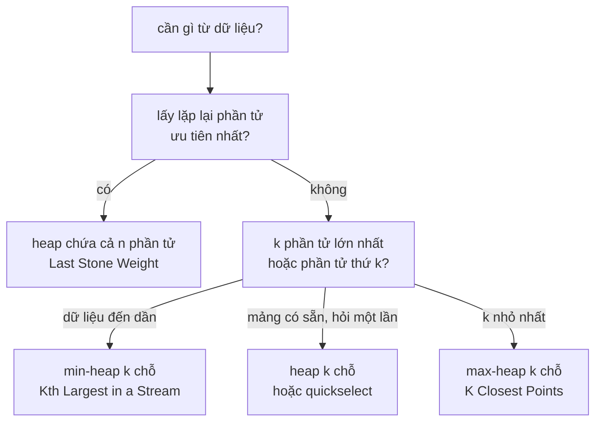

> [!tldr] Đọc nhanh
> - Pattern: [[concepts/heap|heap]]. Một cây nhị phân nằm trong mảng, cha không lớn hơn con, nên phần tử nhỏ nhất luôn ở ô 0. Đọc đỉnh O(1); thêm và lấy đỉnh O(log n) nhờ [[concepts/sift-up-sift-down|nổi lên và chìm xuống]]. Dựng từ n phần tử có sẵn chỉ O(n) ([[concepts/heapify|heapify]]).
> - Cách dùng thứ nhất, **lấy lặp lại phần tử ưu tiên nhất**: Last Stone Weight cần hai viên đá nặng nhất ở mỗi lượt, nên dùng max-heap chứa cả n viên.
> - Cách dùng thứ hai, **[[concepts/size-k-heap|heap k chỗ]]**: muốn k phần tử lớn nhất thì giữ min-heap k chỗ, đỉnh là ứng viên yếu nhất và cũng là số lớn thứ k (Kth Largest in a Stream, Kth Largest in an Array). Muốn k phần tử nhỏ nhất thì ngược lại (K Closest Points). O(n log k), bộ nhớ O(k).
> - So với đỉnh **trước** khi thêm: với 10⁶ số và k = 10, 6,6 ms so với 94,0 ms khi thêm mọi số rồi mới bỏ.
> - Mảng có sẵn và chỉ hỏi một lần thì [[concepts/quickselect|quickselect]] (O(n) trung bình) không phụ thuộc k: 12,0 ms ở k = 500 000, khi heap k chỗ đã chậm bằng sắp cả mảng.

> [!info] Bối cảnh
> Ga 3 của **tuyến NeetCode: Tìm kiếm và heap**. [[posts/2026-11-23-neetcode-binary-search|Ga 1]] và [[posts/2026-11-23-neetcode-binary-search-answer|ga 2]] tìm trên dữ liệu đã có thứ tự. Ga này giải bài toán khác: dữ liệu **không** có thứ tự, đến dần, và ta chỉ cần biết phần tử đứng đầu theo một tiêu chí, hoặc k phần tử đứng đầu. Heap đã xuất hiện một lần ở bài [[problems/top-k-frequent-elements|Top K Frequent Elements]] của tuyến Mảng và chuỗi; ở đây nó có ga riêng. Không cần biết gì về heap trước.

> [!abstract]- Từ điển nhanh cho bài này (bấm để mở)
> - **Heap (đống)**: cây nhị phân lưu trong mảng, cha ở ô i, hai con ở `2i + 1` và `2i + 2`. **Min-heap**: cha không lớn hơn con, nhỏ nhất ở đỉnh. **Max-heap**: ngược lại. Xem [[concepts/heap|Heap]].
> - **Hàng đợi ưu tiên (priority queue)**: kiểu dữ liệu "thêm vào, lấy ra phần tử ưu tiên nhất"; heap là cách cài đặt thường gặp nhất. Java gọi lớp heap của nó là `PriorityQueue`.
> - **Nổi lên, chìm xuống (sift up, sift down)**: đổi chỗ với cha hoặc với con nhỏ hơn cho tới khi cha không lớn hơn con. Xem [[concepts/sift-up-sift-down|Sift Up and Sift Down]].
> - **Top K**: k phần tử lớn nhất (hoặc nhỏ nhất) theo một tiêu chí. Xem [[concepts/size-k-heap|Size-K Heap]].
> - **Quickselect**: tìm phần tử thứ k bằng cách chia mảng quanh một chốt như quicksort nhưng chỉ đi tiếp vào một phía. Xem [[concepts/quickselect|Quickselect]].
> - **Bình phương khoảng cách**: x² + y². So khoảng cách tới gốc thì không cần căn, vì căn giữ nguyên thứ tự.

## Hình dung trước: câu lạc bộ cờ và hàng chờ thi đấu

Một câu lạc bộ cờ có hàng chục kỳ thủ, trình độ ai cũng khác. Ban tổ chức cần trả lời nhiều kiểu câu hỏi, và không lần nào họ xếp hạng lại cả câu lạc bộ. Họ chỉ giữ một hàng chờ mà người cần gọi luôn đứng đầu.

| Đời thường | Khái niệm |
|---|---|
| Hàng chờ mà người mạnh nhất luôn đứng đầu | max-heap, đỉnh ở ô 0 |
| Người mới vào hàng, chen lên trên những người yếu hơn mình | thêm, nổi lên, O(log n) |
| Gọi người đứng đầu; người khác dồn lên lấp chỗ | lấy đỉnh, chìm xuống, O(log n) |
| Hai người mạnh nhất đấu loại; hòa thì cả hai rời giải, không thì người thắng quay lại hàng với sức còn lại | Last Stone Weight: lấy hai đỉnh, thêm hiệu |
| Đội tuyển đúng k người; người yếu nhất đội đứng ở cửa; người mới chỉ đấu với người ở cửa | min-heap k chỗ: Kth Largest in a Stream, in an Array |
| Chọn k người nhà gần câu lạc bộ nhất đi chung xe; người ở xa nhất trong nhóm đứng ở cửa | max-heap k chỗ theo khoảng cách: K Closest Points |
| Xếp hạng lại toàn bộ câu lạc bộ | sắp cả mảng, O(n log n) |
| Chọn một người làm mốc, chia câu lạc bộ thành "mạnh hơn" và "yếu hơn", chỉ xét tiếp nhóm chứa vị trí cần tìm | quickselect, O(n) trung bình |



## Vấn đề: sắp xếp làm thừa việc

Muốn số lớn thứ k thì sắp cả mảng rồi đọc ô thứ k từ cuối: đúng, O(n log n). Nhưng sắp xếp trả lời **mọi** câu hỏi về thứ tự (ai đứng thứ 1, thứ 2, …, thứ n), trong khi ta chỉ cần một vị trí. Với 10⁶ số ngẫu nhiên, sắp cả mảng mất khoảng 290 ms dù k = 10.

Tệ hơn khi dữ liệu đến dần. Bài [[problems/kth-largest-element-in-a-stream|Kth Largest Element in a Stream]] hỏi lại sau **mỗi** số mới; sắp lại mỗi lần thì với 10⁴ số ban đầu và 10⁴ lần thêm, mất 1 562,8 ms. Và bài [[problems/last-stone-weight|Last Stone Weight]] thay đổi dữ liệu giữa chừng: mỗi lượt lấy ra hai viên và có thể bỏ lại một viên mới, nên một mảng đã sắp phải chèn lại đúng chỗ, O(n) mỗi lượt.

Cần một cấu trúc chỉ giữ **đúng lượng thứ tự đủ dùng**: biết ngay phần tử đứng đầu, và sửa lại rẻ khi thêm hoặc bớt. Đó là heap.

## Cơ chế

### Heap: thứ tự một phần trong một mảng

<figure class="figure-map" style="--ar: 3 / 4">
<div class="frame"><iframe data-archify="../diagrams/neetcode-heap-top-k/size-k-heap.html" title="Min-heap ba chỗ trả số lớn thứ ba của một luồng" loading="lazy"></iframe></div>
<figcaption><span><b>Hình 1.</b> Kth Largest Element in a Stream với k = 3: số nhỏ hơn đỉnh bị bỏ ngay; số lớn hơn thay đỉnh rồi chìm xuống, và đỉnh luôn là số lớn thứ ba.</span><a href="../diagrams/neetcode-heap-top-k/size-k-heap.html" target="_blank" rel="noopener">Mở toàn màn hình</a></figcaption>
</figure>

Min-heap chỉ hứa một điều: mỗi cha không lớn hơn hai con. Không hứa gì về hai anh em, hay về hai nhánh. Lời hứa yếu đó đủ để phần tử nhỏ nhất nằm ở gốc, và đủ rẻ để giữ:

- **Thêm**: đặt ở cuối mảng (lá mới), rồi **nổi lên**: còn nhỏ hơn cha thì đổi chỗ với cha.
- **Lấy đỉnh**: đưa phần tử cuối lên gốc, rồi **chìm xuống**: còn lớn hơn **con nhỏ hơn** thì đổi chỗ với con đó.
- **Thay đỉnh**: ghi đè gốc rồi chìm xuống một lần (`heapq.heapreplace`, `heap.Fix(h, 0)`).

Cây đầy đủ n phần tử cao ⌊log₂ n⌋, nên mỗi thao tác O(log n). Mảng không cần con trỏ: cha của ô i là `(i − 1) >> 1`. Dựng heap từ n phần tử có sẵn bằng cách cho chìm từ cha cuối cùng ngược về gốc ([[concepts/heapify|heapify]], Floyd 1964) chỉ tốn O(n): trang bài 703 đo 999 988 lần đổi chỗ với 10⁶ số giảm dần, so với 17 951 445 khi thêm lần lượt.

### Heap k chỗ: vì sao top k lớn nhất cần heap nhỏ

Để giữ k số lớn nhất của một luồng, câu hỏi duy nhất mỗi khi có số mới là "nó có mạnh hơn ứng viên **yếu nhất** trong top k không?". Ứng viên yếu nhất phải ở đỉnh để so trong O(1), nên heap là **min**-heap. Mạnh hơn thì thay đỉnh, O(log k); không thì bỏ, O(1). Đỉnh vừa là ứng viên yếu nhất, vừa là đáp án: số lớn thứ k.

Ngược lại, k phần tử **nhỏ** nhất (k điểm gần gốc nhất) cần **max**-heap k chỗ: đỉnh là điểm xa nhất trong nhóm, bị thay khi gặp điểm gần hơn. Nhầm chiều heap là lỗi phổ biến nhất của ga này; trang bài 703 chạy bản max-heap và nó đúng 1/8 ca.

### Bốn bài, hai cách dùng

| Bài | Heap gì | Chứa gì | Mỗi bước |
|---|---|---|---|
| [[problems/kth-largest-element-in-a-stream\|Kth Largest Element in a Stream]] | min-heap k chỗ | k số lớn nhất đã thấy | số mới lớn hơn đỉnh thì thay đỉnh; trả đỉnh |
| [[problems/last-stone-weight\|Last Stone Weight]] | max-heap cả n | mọi viên đá còn lại | lấy hai đỉnh y ≥ x; y > x thì thêm y − x |
| [[problems/k-closest-points-to-origin\|K Closest Points to Origin]] | max-heap k chỗ theo x² + y² | k điểm gần nhất đã thấy | điểm mới gần hơn đỉnh thì thay đỉnh |
| [[problems/kth-largest-element-in-an-array\|Kth Largest Element in an Array]] | min-heap k chỗ, hoặc quickselect | k số lớn nhất | như bài luồng, trên một mảng có sẵn |

**Kth Largest Element in a Stream** là bài neo: đúng khuôn heap k chỗ, và vì là luồng nên không có cách nào rẻ hơn. **Last Stone Weight** dùng heap theo cách thứ nhất: mỗi lượt cần hai viên nặng nhất, rồi có thể thêm lại một viên nhỏ hơn. Max-heap cho mỗi lượt O(log n), tổng O(n log n); Python không có max-heap nên đảo dấu. **K Closest Points to Origin** là heap k chỗ theo khoảng cách, chiều ngược lại: max-heap. So x² + y² thay vì căn, vừa nhanh vừa tránh sai số số thực. **Kth Largest Element in an Array** giống bài luồng nhưng mảng có sẵn, nên có thêm lựa chọn: [[concepts/quickselect|quickselect]].

### Heap, sắp xếp hay quickselect

Đo số lớn thứ k trong 10⁶ số ngẫu nhiên, trung vị 5 lần, Node 24 (min-heap viết tay của file ga):

| k | Sắp cả mảng | Heap: thêm mọi số rồi bỏ đỉnh | Heap: so với đỉnh trước | Quickselect |
|---|---|---|---|---|
| 10 | 290,2 ms | 94,0 ms | 6,6 ms | 10,9 ms |
| 1 000 | 286,4 ms | 322,7 ms | 8,8 ms | 7,1 ms |
| 500 000 | 295,5 ms | 371,0 ms | 295,9 ms | 12,0 ms |

Ba điều đọc ra từ bảng:

- **So với đỉnh trước khi thêm** quyết định tất cả. Với số ngẫu nhiên, sau vài nghìn số đầu hầu như số mới nào cũng nhỏ hơn đỉnh, nên bị bỏ sau một phép so sánh. Thêm rồi mới bỏ thì số nào cũng nổi lên rồi chìm xuống: chậm hơn 14 lần ở k = 10, và ở k = 1 000 còn chậm hơn cả sắp cả mảng.
- **Heap k chỗ tốt khi k nhỏ.** O(n log k) với k = n/2 không khác O(n log n): ở k = 500 000 heap ngang sắp xếp.
- **Quickselect không phụ thuộc k**, O(n) trung bình, nhưng cần cả mảng trong bộ nhớ, sửa mảng (ở đây chép ra trước), và có ca xấu O(n²) nếu chốt chọn tồi. Chốt ngẫu nhiên làm ca xấu gần như không xảy ra. Với luồng thì không dùng được: chưa có cả mảng để chia.

### Bên dưới năm ngôn ngữ

| | Heap có sẵn | Max-heap | Thay đỉnh | Bẫy riêng |
|---|---|---|---|---|
| TypeScript / JavaScript | không | tự viết, hoặc khóa âm | tự viết | `sort()` không truyền hàm so sánh thì so theo chuỗi: `[10, 2].sort()` là `[10, 2]` |
| Python | `heapq` trên `list` | đảo dấu (`-x`), hoặc tuple `(-d, x, y)` | `heapreplace` | tuple so phần tử thứ hai khi phần tử đầu bằng nhau: phần tử đó phải so được |
| Go | `container/heap` | đổi `Less` | `heap.Fix(h, 0)` | `Push`, `Pop` cần con trỏ; gọi `heap.Push(h, x)`, không phải `h.Push(x)` |
| Java | `PriorityQueue` | `Collections.reverseOrder()` | `poll` rồi `offer` | comparator `(a, b) -> b - a` tràn `int`; dùng `Integer.compare(b, a)` |

## Ví dụ chạy được

[TypeScript](../code/neetcode-heap-top-k/heap-station.ts) · [Python](../code/neetcode-heap-top-k/heap_station.py) · [Go](../code/neetcode-heap-top-k/heap_station.go) · [Java](../code/neetcode-heap-top-k/heap-station.java) · [JavaScript](../code/neetcode-heap-top-k/heap-station.js)

Mỗi file giải cả bốn bài và tự chạy 14 ca: ba chuỗi `add` cho bài luồng (ví dụ của đề, `nums` rỗng, số trùng), bốn ca Last Stone Weight (ví dụ của đề, một viên, hai viên bằng nhau vỡ hết, `[3, 7, 2]`), ba ca K Closest Points (hai ví dụ của đề và k = n; so sánh không kể thứ tự) và bốn ca Kth Largest in an Array (hai ví dụ của đề, một phần tử, số âm trùng). Bản TypeScript và JavaScript dùng một min-heap viết tay theo khóa: max-heap là khóa âm.

```ts
// Min-heap theo khóa: cha ở i, hai con ở 2i + 1 và 2i + 2. Muốn max-heap thì truyền khóa âm.
class Heap<T> {
  a: T[] = [];
  key: (x: T) => number;
  constructor(key: (x: T) => number) { this.key = key; }
  get size(): number { return this.a.length; }
  peek(): T { return this.a[0]; }
  push(x: T): void {
    const a = this.a, key = this.key;
    a.push(x);
    let i = a.length - 1;
    while (i > 0) { // nổi lên
      const p = (i - 1) >> 1;
      if (key(a[p]) <= key(a[i])) break;
      [a[p], a[i]] = [a[i], a[p]];
      i = p;
    }
  }
  pop(): T {
    const a = this.a, key = this.key, top = a[0], last = a.pop()!;
    if (a.length > 0) {
      a[0] = last;
      let i = 0; // chìm xuống
      for (;;) {
        const l = 2 * i + 1, r = l + 1;
        let m = i;
        if (l < a.length && key(a[l]) < key(a[m])) m = l;
        if (r < a.length && key(a[r]) < key(a[m])) m = r;
        if (m === i) break;
        [a[m], a[i]] = [a[i], a[m]];
        i = m;
      }
    }
    return top;
  }
}

// 703: min-heap giữ k số lớn nhất; đỉnh là số lớn thứ k.
class KthLargest {
  k: number;
  h = new Heap<number>((x) => x);
  constructor(k: number, nums: number[]) { this.k = k; for (const x of nums) this.add(x); }
  add(val: number): number {
    if (this.h.size < this.k) this.h.push(val);
    else if (val > this.h.peek()) { this.h.pop(); this.h.push(val); } // thay ứng viên yếu nhất
    return this.h.peek();
  }
}

// 1046: max-heap (khóa âm); mỗi lượt lấy hai viên nặng nhất, đập, bỏ phần dư lại vào heap.
function lastStoneWeight(stones: number[]): number {
  const h = new Heap<number>((x) => -x);
  for (const s of stones) h.push(s);
  while (h.size > 1) {
    const y = h.pop(), x = h.pop();
    if (y > x) h.push(y - x);
  }
  return h.size ? h.peek() : 0;
}

// 973: max-heap k chỗ theo bình phương khoảng cách; đỉnh là điểm xa nhất trong k điểm đang giữ.
function kClosest(points: number[][], k: number): number[][] {
  const d = (p: number[]) => p[0] * p[0] + p[1] * p[1]; // không cần căn: căn giữ thứ tự
  const h = new Heap<number[]>((p) => -d(p));
  for (const p of points) {
    h.push(p);
    if (h.size > k) h.pop(); // bỏ điểm xa nhất
  }
  return h.a;
}

// 215: min-heap k chỗ trên cả mảng; đỉnh là số lớn thứ k.
function findKthLargest(nums: number[], k: number): number {
  const h = new Heap<number>((x) => x);
  for (const x of nums) {
    if (h.size < k) h.push(x);
    else if (x > h.peek()) { h.pop(); h.push(x); } // chỉ số mạnh hơn đỉnh mới vào
  }
  return h.peek();
}
```

```python
class KthLargest:  # 703: min-heap giữ k số lớn nhất
    def __init__(self, k: int, nums: list[int]):
        self.k, self.h = k, []
        for x in nums:
            self.add(x)

    def add(self, val: int) -> int:
        if len(self.h) < self.k:
            heapq.heappush(self.h, val)
        elif val > self.h[0]:
            heapq.heapreplace(self.h, val)  # thay ứng viên yếu nhất
        return self.h[0]

def last_stone_weight(stones: list[int]) -> int:  # 1046: đảo dấu để có max-heap
    h = [-s for s in stones]
    heapq.heapify(h)
    while len(h) > 1:
        y, x = -heapq.heappop(h), -heapq.heappop(h)
        if y > x:
            heapq.heappush(h, -(y - x))
    return -h[0] if h else 0

def k_closest(points: list[list[int]], k: int) -> list[list[int]]:  # 973: max-heap k chỗ theo khoảng cách
    h = []
    for x, y in points:
        heapq.heappush(h, (-(x * x + y * y), x, y))
        if len(h) > k:
            heapq.heappop(h)  # bỏ điểm xa nhất
    return [[x, y] for _, x, y in h]

def find_kth_largest(nums: list[int], k: int) -> int:  # 215: min-heap k chỗ
    h = nums[:k]
    heapq.heapify(h)
    for x in nums[k:]:
        if x > h[0]:
            heapq.heapreplace(h, x)
    return h[0]
```

```go
// keyHeap là min-heap theo khóa: muốn max-heap thì cho khóa âm.
type keyHeap[T any] struct {
	a   []T
	key func(T) int
}

func (h *keyHeap[T]) Len() int           { return len(h.a) }

func (h *keyHeap[T]) Less(i, j int) bool { return h.key(h.a[i]) < h.key(h.a[j]) }

func (h *keyHeap[T]) Swap(i, j int)      { h.a[i], h.a[j] = h.a[j], h.a[i] }

func (h *keyHeap[T]) Push(x any)         { h.a = append(h.a, x.(T)) }

func (h *keyHeap[T]) Pop() any {
	x := h.a[len(h.a)-1]
	h.a = h.a[:len(h.a)-1]
	return x
}

type KthLargest struct { // 703: min-heap giữ k số lớn nhất
	k int
	h *keyHeap[int]
}

func NewKthLargest(k int, nums []int) *KthLargest {
	s := &KthLargest{k, &keyHeap[int]{key: func(x int) int { return x }}}
	for _, x := range nums {
		s.Add(x)
	}
	return s
}

func (s *KthLargest) Add(val int) int {
	if s.h.Len() < s.k {
		heap.Push(s.h, val)
	} else if val > s.h.a[0] { // thay ứng viên yếu nhất
		s.h.a[0] = val
		heap.Fix(s.h, 0)
	}
	return s.h.a[0]
}

func lastStoneWeight(stones []int) int { // 1046: max-heap bằng khóa âm
	h := &keyHeap[int]{a: slices.Clone(stones), key: func(x int) int { return -x }}
	heap.Init(h)
	for h.Len() > 1 {
		y, x := heap.Pop(h).(int), heap.Pop(h).(int)
		if y > x {
			heap.Push(h, y-x)
		}
	}
	if h.Len() == 0 {
		return 0
	}
	return h.a[0]
}

func kClosest(points [][]int, k int) [][]int { // 973: max-heap k chỗ theo bình phương khoảng cách
	h := &keyHeap[[]int]{key: func(p []int) int { return -(p[0]*p[0] + p[1]*p[1]) }}
	for _, p := range points {
		heap.Push(h, p)
		if h.Len() > k {
			heap.Pop(h) // bỏ điểm xa nhất
		}
	}
	return h.a
}

func findKthLargest(nums []int, k int) int { // 215: min-heap k chỗ
	h := &keyHeap[int]{key: func(x int) int { return x }}
	for _, x := range nums {
		if h.Len() < k {
			heap.Push(h, x)
		} else if x > h.a[0] { // chỉ số mạnh hơn đỉnh mới vào
			h.a[0] = x
			heap.Fix(h, 0)
		}
	}
	return h.a[0]
}
```

```java
static class KthLargest { // 703: min-heap (mặc định của PriorityQueue) giữ k số lớn nhất
    private final int k;
    private final PriorityQueue<Integer> pq = new PriorityQueue<>();
    KthLargest(int k, int[] nums) { this.k = k; for (int x : nums) add(x); }
    int add(int val) {
        if (pq.size() < k) pq.offer(val);
        else if (val > pq.peek()) { pq.poll(); pq.offer(val); } // thay ứng viên yếu nhất
        return pq.peek();
    }
}

static int lastStoneWeight(int[] stones) { // 1046: max-heap
    PriorityQueue<Integer> pq = new PriorityQueue<>(Collections.reverseOrder());
    for (int s : stones) pq.offer(s);
    while (pq.size() > 1) {
        int y = pq.poll(), x = pq.poll();
        if (y > x) pq.offer(y - x);
    }
    return pq.isEmpty() ? 0 : pq.peek();
}

static int[][] kClosest(int[][] points, int k) { // 973: max-heap k chỗ theo bình phương khoảng cách
    PriorityQueue<int[]> pq = new PriorityQueue<>(
        (p, q) -> Integer.compare(q[0] * q[0] + q[1] * q[1], p[0] * p[0] + p[1] * p[1]));
    for (int[] p : points) {
        pq.offer(p);
        if (pq.size() > k) pq.poll(); // bỏ điểm xa nhất
    }
    return pq.toArray(new int[0][]);
}

static int findKthLargest(int[] nums, int k) { // 215: min-heap k chỗ
    PriorityQueue<Integer> pq = new PriorityQueue<>();
    for (int x : nums) {
        if (pq.size() < k) pq.offer(x);
        else if (x > pq.peek()) { pq.poll(); pq.offer(x); } // chỉ số mạnh hơn đỉnh mới vào
    }
    return pq.peek();
}
```

```js
// Min-heap theo khóa: cha ở i, hai con ở 2i + 1 và 2i + 2. Muốn max-heap thì truyền khóa âm.
class Heap {
  a = [];
  constructor(key) { this.key = key; }
  get size() { return this.a.length; }
  peek() { return this.a[0]; }
  push(x) {
    const a = this.a, key = this.key;
    a.push(x);
    let i = a.length - 1;
    while (i > 0) { // nổi lên
      const p = (i - 1) >> 1;
      if (key(a[p]) <= key(a[i])) break;
      [a[p], a[i]] = [a[i], a[p]];
      i = p;
    }
  }
  pop() {
    const a = this.a, key = this.key, top = a[0], last = a.pop();
    if (a.length > 0) {
      a[0] = last;
      let i = 0; // chìm xuống
      for (;;) {
        const l = 2 * i + 1, r = l + 1;
        let m = i;
        if (l < a.length && key(a[l]) < key(a[m])) m = l;
        if (r < a.length && key(a[r]) < key(a[m])) m = r;
        if (m === i) break;
        [a[m], a[i]] = [a[i], a[m]];
        i = m;
      }
    }
    return top;
  }
}

// 703: min-heap giữ k số lớn nhất; đỉnh là số lớn thứ k.
class KthLargest {
  h = new Heap((x) => x);
  constructor(k, nums) { this.k = k; for (const x of nums) this.add(x); }
  add(val) {
    if (this.h.size < this.k) this.h.push(val);
    else if (val > this.h.peek()) { this.h.pop(); this.h.push(val); } // thay ứng viên yếu nhất
    return this.h.peek();
  }
}

// 1046: max-heap (khóa âm); mỗi lượt lấy hai viên nặng nhất, đập, bỏ phần dư lại vào heap.
function lastStoneWeight(stones) {
  const h = new Heap((x) => -x);
  for (const s of stones) h.push(s);
  while (h.size > 1) {
    const y = h.pop(), x = h.pop();
    if (y > x) h.push(y - x);
  }
  return h.size ? h.peek() : 0;
}

// 973: max-heap k chỗ theo bình phương khoảng cách; đỉnh là điểm xa nhất trong k điểm đang giữ.
function kClosest(points, k) {
  const d = (p) => p[0] * p[0] + p[1] * p[1]; // không cần căn: căn giữ thứ tự
  const h = new Heap((p) => -d(p));
  for (const p of points) {
    h.push(p);
    if (h.size > k) h.pop(); // bỏ điểm xa nhất
  }
  return h.a;
}

// 215: min-heap k chỗ trên cả mảng; đỉnh là số lớn thứ k.
function findKthLargest(nums, k) {
  const h = new Heap((x) => x);
  for (const x of nums) {
    if (h.size < k) h.push(x);
    else if (x > h.peek()) { h.pop(); h.push(x); } // chỉ số mạnh hơn đỉnh mới vào
  }
  return h.peek();
}
```


Kết quả `node heap-station.ts`, gồm phép đo ở trên:

```text
heap-station 14/14 ca đúng

Đo: số lớn thứ k trong 10⁶ số ngẫu nhiên (trung vị 5 lần)
k           sắp cả mảng   heap: thêm rồi bỏ   heap: so đỉnh trước   quickselect
10             290.2 ms             94.0 ms                6.6 ms        10.9 ms
1000           286.4 ms            322.7 ms                8.8 ms         7.1 ms
500000         295.5 ms            371.0 ms              295.9 ms        12.0 ms
```

Python, Go, Java và JavaScript cũng in `14/14 ca đúng`.

## Hiểu lầm và bẫy hay gặp

- **"Top k lớn nhất thì dùng max-heap."** Max-heap chứa cả n phần tử rồi lấy k lần cũng đúng, nhưng tốn O(n) bộ nhớ và O(n + k log n). Heap **k chỗ** cho top k lớn nhất là min-heap, vì đỉnh phải là ứng viên bị thay.
- **"Heap là mảng đã sắp."** Không: `[1, 5, 2, 9, 6]` là min-heap hợp lệ. Chỉ ô 0 chắc chắn là nhỏ nhất. Duyệt mảng heap theo thứ tự chỉ số không ra dãy tăng dần.
- **Thêm rồi mới bỏ.** Đúng nhưng chậm: so với đỉnh trước, số yếu hơn bị bỏ sau một phép so sánh. Chênh 14 lần ở k = 10 trong bảng đo.
- **Python: tuple có phần tử không so được.** `heappush(h, (d, point))` khi hai `d` bằng nhau sẽ so tới `point`; nếu `point` là đối tượng không có `<` thì `TypeError`. Thêm một số đếm làm phần tử thứ hai, hoặc tách tọa độ thành số như file ga.
- **Căn bậc hai không cần thiết.** So x² + y², không so `Math.sqrt(x² + y²)`: cùng thứ tự, khỏi số thực.
- **Quickselect với chốt cố định.** Chốt luôn là phần tử đầu thì mảng đã sắp cho O(n²). Chọn chốt ngẫu nhiên.

## Câu hỏi tự kiểm tra

> [!question]- Mảng `[3, 1, 6, 5, 2, 4]`. Heapify (min-heap) ra mảng nào? Bắt đầu chìm từ ô nào?
> n = 6, cha cuối cùng là ô 2 (giá trị 6, con là ô 5 giá trị 4): 6 > 4, đổi: `[3, 1, 4, 5, 2, 6]`. Ô 1 (giá trị 1, con 5 và 2): không đổi. Ô 0 (giá trị 3, con 1 và 4): đổi với 1: `[1, 3, 4, 5, 2, 6]`; ô 1 (giá trị 3, con 5 và 2): đổi với 2: `[1, 2, 4, 5, 3, 6]`.

> [!question]- Last Stone Weight `[2, 7, 4, 1, 8, 1]`: chạy max-heap.
> 8 và 7 → thêm 1: còn `[4, 2, 1, 1, 1]`. 4 và 2 → thêm 2: `[2, 1, 1, 1]`. 2 và 1 → thêm 1: `[1, 1, 1]`. 1 và 1 → vỡ cả hai: `[1]`. Đáp án 1.

> [!question]- K Closest Points với n = 10⁶ điểm, k = 10. Vì sao max-heap k chỗ tốt hơn sắp xếp theo khoảng cách, và khi nào thì không?
> O(n log k) với log k ≈ 3,3 so với O(n log n), log n ≈ 20, và bộ nhớ O(k). Khi k gần n thì log k ≈ log n, heap không còn lợi; khi đó quickselect theo khoảng cách cho O(n) trung bình.

> [!question]- Vì sao quickselect trung bình O(n) mà quicksort lại O(n log n)?
> Quicksort đệ quy vào **cả hai** phía, mỗi tầng tổng n công việc, log n tầng. Quickselect chỉ đi vào **một** phía: n + n/2 + n/4 + … ≈ 2n.

## Tham khảo

- [NeetCode 150](https://neetcode.io/practice) (danh sách và nhóm bài)
- LeetCode: [703. Kth Largest Element in a Stream](https://leetcode.com/problems/kth-largest-element-in-a-stream/), [1046. Last Stone Weight](https://leetcode.com/problems/last-stone-weight/), [973. K Closest Points to Origin](https://leetcode.com/problems/k-closest-points-to-origin/), [215. Kth Largest Element in an Array](https://leetcode.com/problems/kth-largest-element-in-an-array/)
- [Python `heapq`](https://docs.python.org/3/library/heapq.html) (min-heap, `heapify`, `heapreplace`, ghi chú về tuple và số đếm)
- [Go `container/heap`](https://pkg.go.dev/container/heap) (`heap.Interface`, `heap.Fix`, ví dụ `PriorityQueue`)
- [Java 21 `PriorityQueue`](https://docs.oracle.com/en/java/javase/21/docs/api/java.base/java/util/PriorityQueue.html)
- Robert W. Floyd, "Algorithm 245: Treesort 3", *Communications of the ACM* 7(12), 1964 (heapify từ dưới lên)
- C. A. R. Hoare, "Algorithm 65: Find", *Communications of the ACM* 4(7), 1961 (quickselect)
- Cormen, Leiserson, Rivest, Stein, *Introduction to Algorithms*, chương 6 "Heapsort" và chương 9 "Medians and Order Statistics"
