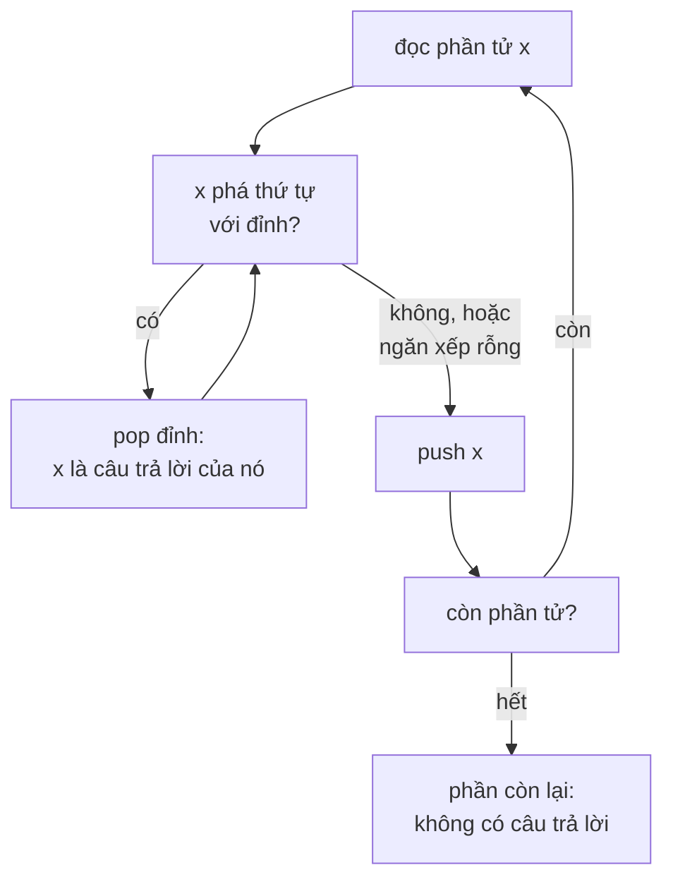

> [!tldr] Đọc nhanh
> - Pattern: [[concepts/monotonic-stack|ngăn xếp đơn điệu]]. Giữ các phần tử **còn chờ** trên một ngăn xếp luôn tăng (hoặc luôn giảm) từ đáy lên đỉnh. Phần tử mới phá thứ tự thì lấy đỉnh ra: phần tử mới chính là câu trả lời mà đỉnh đang chờ.
> - Mỗi phần tử vào một lần, ra tối đa một lần, nên cả thuật toán là O(n) dù có `while` trong `for` ([[concepts/aggregate-analysis|phân tích gộp]]).
> - Daily Temperatures: ngăn xếp giảm dần, lấy ra khi gặp [[concepts/next-greater-element|phần tử lớn hơn kế tiếp]]. Car Fleet: sắp xe theo vị trí, ngăn xếp thời gian tới đích tăng dần, xe nhanh hơn đoàn phía trước thì nhập đoàn. Largest Rectangle in Histogram: ngăn xếp tăng dần, lấy ra khi gặp cột **thấp hơn**, và lúc lấy ra thì biết cả hai biên của hình chữ nhật.
> - Hai câu hỏi phân biệt: **ngăn xếp tăng hay giảm**, và **lấy ra rồi tính gì**.
> - Ga này khép lại tuyến ARR: 7 ga, 27 bài.

> [!info] Bối cảnh
> Ga 7, ga cuối của **tuyến NeetCode: Mảng và chuỗi**. [[posts/2026-11-23-neetcode-stack|Ga 6, ngăn xếp]], giữ các việc dở dang theo thứ tự ngược lúc bắt đầu; ga này thêm một luật: các việc trên ngăn xếp luôn xếp theo một chiều. [[problems/sliding-window-maximum|Sliding Window Maximum]] ở ga 5 đã dùng cùng ý với một hàng đợi hai đầu ([[concepts/monotonic-deque|Monotonic Deque]]). Bạn chỉ cần biết vòng lặp, mảng và ngăn xếp.

> [!abstract]- Từ điển nhanh cho bài này (bấm để mở)
> - **Đơn điệu (monotonic)**: luôn tăng hoặc luôn giảm theo một chiều.
> - **Phần tử lớn hơn kế tiếp (next greater element)**: phần tử đầu tiên bên phải lớn hơn mình. Xem [[concepts/next-greater-element|Next Greater Element]].
> - **Phần tử canh (sentinel)**: một phần tử giả thêm vào đầu hay cuối để vòng lặp khỏi cần xử lý riêng ca biên. Xem [[concepts/sentinel-value|Sentinel Value]].
> - **Biểu đồ cột (histogram)**: các cột rộng 1 đặt sát nhau, chiều cao khác nhau.

## Hình dung trước: hàng người nhìn ra biển

Một hàng người đứng xếp theo thứ tự đến, ai cũng nhìn về phía trước. Một người chỉ "thấy" được người cao hơn mình đứng phía trước. Mỗi khi một người cao đến, những người thấp hơn đứng ngay sau họ đã có câu trả lời ("người cao hơn đầu tiên là người này") và rời hàng. Hàng còn lại luôn thấp dần từ người đến sớm nhất tới người đến muộn nhất.

| Đời thường | Khái niệm |
|---|---|
| Hàng người còn chờ câu trả lời | ngăn xếp các phần tử còn chờ |
| Hàng luôn xếp theo chiều cao | ngăn xếp đơn điệu |
| Người cao đến, người thấp hơn ở cuối hàng rời đi | `pop` khi phần tử mới phá thứ tự |
| Người rời hàng biết "ai cao hơn mình đầu tiên" | Daily Temperatures: ngày ấm hơn kế tiếp |
| Xe chạy nhanh đuổi kịp xe chậm phía trước thì đi cùng nhau | Car Fleet: nhập đoàn |
| Người rời hàng biết cả hai người thấp hơn mình gần nhất, hai bên | Largest Rectangle: hai biên của hình chữ nhật |



## Vấn đề: "phần tử đầu tiên bên phải thỏa điều kiện" tốn O(n²)

Cả ba bài đều hỏi, cho mỗi vị trí, về phần tử **gần nhất** về một phía thỏa một điều kiện so sánh: ngày ấm hơn kế tiếp, đoàn xe phía trước sẽ đuổi kịp, cột thấp hơn gần nhất hai bên. Cách thẳng là mỗi vị trí tự đi tìm: O(n) mỗi vị trí, O(n²) tổng cộng. Trang [[problems/daily-temperatures|Daily Temperatures]] đo: 309 ms ở 40 000 ngày giảm dần, so với 0,72 ms của ngăn xếp.

Lật câu hỏi lại: thay vì mỗi vị trí đi tìm câu trả lời, để **mỗi phần tử mới đi giải quyết** những vị trí đang chờ nó. Những vị trí đang chờ, nếu xếp đúng thứ tự, luôn được giải từ phần tử gần nhất trở ra, đúng kiểu ngăn xếp.

## Cơ chế

### Khuôn chung

<figure class="figure-map" style="--ar: 3 / 4">
<div class="frame"><iframe data-archify="../diagrams/neetcode-monotonic-stack/next-warmer.html" title="Ngăn xếp đơn điệu trên tám ngày nhiệt độ" loading="lazy"></iframe></div>
<figcaption><span><b>Hình 1.</b> Daily Temperatures: mỗi ngày ấm hơn lấy khỏi sổ những ngày đang chờ nó, từ đỉnh xuống.</span><a href="../diagrams/neetcode-monotonic-stack/next-warmer.html" target="_blank" rel="noopener">Mở toàn màn hình</a></figcaption>
</figure>

```text
với mỗi i:
    chừng nào ngăn xếp còn và a[i] phá thứ tự với a[đỉnh]:
        j = pop()
        ghi câu trả lời cho j, dùng i (và đỉnh mới nếu cần)
    push(i)
```

Ba điểm làm khuôn này đúng:
1. **Lưu chỉ số**, không lưu giá trị: câu trả lời thường là một khoảng cách hay một độ rộng.
2. **Thứ tự trên ngăn xếp** bảo đảm vòng `while` dừng đúng lúc: phần tử mới không phá thứ tự với đỉnh thì cũng không phá với ai bên dưới.
3. **Mỗi chỉ số vào một lần, ra tối đa một lần.** Tổng số lần `pop` qua mọi vòng không quá n, nên O(n). Trên 10⁶ ngày ngẫu nhiên, file đo đếm được 986 082 lần pop.

### Ba bài, hai câu hỏi

| Bài | Ngăn xếp (đáy → đỉnh) | Lấy ra khi | Lấy ra rồi tính gì |
|---|---|---|---|
| [[problems/daily-temperatures\|Daily Temperatures]] | chỉ số, nhiệt độ **giảm** | ngày mới ấm hơn **hẳn** đỉnh | `out[j] = i − j` |
| [[problems/car-fleet\|Car Fleet]] | thời gian tới đích của các đoàn, **tăng** | (không pop) xe mới tới đích sớm hơn hoặc bằng đoàn phía trước | xe nhập đoàn, không push; số đoàn là cỡ ngăn xếp |
| [[problems/largest-rectangle-in-histogram\|Largest Rectangle in Histogram]] | chỉ số, chiều cao **tăng** | cột mới **thấp hơn** đỉnh | diện tích `h[j] × (i − đỉnh mới − 1)` |

**Car Fleet** đổi trục: sắp xe theo vị trí từ gần đích nhất, rồi xét thời gian tới đích `(target − vị trí) / tốc độ`. Xe phía sau tới sớm hơn hoặc bằng xe phía trước thì đuổi kịp trước đích và nhập đoàn (không được vượt). Ngăn xếp chỉ giữ các đoàn, và thời gian của chúng tăng dần. Ở đây phần tử mới không pop ai; nó hoặc bị "nuốt" vào đoàn ở đỉnh, hoặc thành đoàn mới. Trong Python, Go và Java, chia số nguyên cho nhau sẽ làm tròn và có thể gộp nhầm hai đoàn; phải chia số thực.

**Largest Rectangle** dùng cả hai biên. Khi cột j bị lấy ra vì cột i thấp hơn, i là cột thấp hơn gần nhất **bên phải** j, còn đỉnh mới (sau khi lấy j) là cột thấp hơn gần nhất **bên trái** j. Hình chữ nhật cao `h[j]` kéo dài đúng giữa hai cột đó. Một cột cao 0 thêm vào cuối làm [[concepts/sentinel-value|phần tử canh]]: nó thấp hơn mọi cột, nên dọn sạch ngăn xếp mà không cần vòng lặp riêng sau cùng.

## Ví dụ chạy được

[TypeScript](../code/neetcode-monotonic-stack/monotonic-stack-station.ts) · [Python](../code/neetcode-monotonic-stack/monotonic_stack_station.py) · [Go](../code/neetcode-monotonic-stack/monotonic_stack_station.go) · [Java](../code/neetcode-monotonic-stack/monotonic-stack-station.java) · [JavaScript](../code/neetcode-monotonic-stack/monotonic-stack-station.js)

Mỗi file giải cả ba bài và tự chạy 9 ca, gồm `[70, 70, 71]` (hai ngày bằng nhau) và `[2, 2, 2]` (các cột bằng nhau).

```ts
// 739: ngăn xếp chỉ số, nhiệt độ giảm dần; ngày ấm hơn đến thì pop và ghi khoảng cách.
function dailyTemperatures(t: number[]): number[] {
  const out = new Array(t.length).fill(0);
  const stack: number[] = [];
  for (let i = 0; i < t.length; i++) {
    while (stack.length > 0 && t[i] > t[stack[stack.length - 1]]) {
      const j = stack.pop()!;
      out[j] = i - j;
    }
    stack.push(i);
  }
  return out;
}

// 853: xếp xe từ gần đích nhất; ngăn xếp giữ thời gian tới đích của từng đoàn, tăng dần từ đáy lên đỉnh.
function carFleet(target: number, position: number[], speed: number[]): number {
  const cars = position.map((p, i) => [p, (target - p) / speed[i]]).sort((a, b) => b[0] - a[0]);
  const fleets: number[] = [];
  for (const [, time] of cars) {
    if (fleets.length === 0 || time > fleets[fleets.length - 1]) fleets.push(time); // chậm hơn đoàn phía trước: đoàn mới
    // nhanh hơn hoặc bằng: đuổi kịp và nhập vào đoàn phía trước, không push
  }
  return fleets.length;
}

// 84: ngăn xếp chỉ số, chiều cao tăng dần; cột thấp hơn đến thì pop và tính hình chữ nhật của cột bị pop.
function largestRectangleArea(h: number[]): number {
  const stack: number[] = [];
  let best = 0;
  for (let i = 0; i <= h.length; i++) {
    const cur = i === h.length ? 0 : h[i]; // cột 0 ảo ở cuối: dọn sạch ngăn xếp
    while (stack.length > 0 && cur < h[stack[stack.length - 1]]) {
      const height = h[stack.pop()!];
      const left = stack.length > 0 ? stack[stack.length - 1] : -1; // cột thấp hơn gần nhất bên trái
      best = Math.max(best, height * (i - left - 1));
    }
    stack.push(i);
  }
  return best;
}
```

```python
def daily_temperatures(t: list[int]) -> list[int]:  # 739
    out = [0] * len(t)
    stack: list[int] = []
    for i, x in enumerate(t):
        while stack and x > t[stack[-1]]:
            j = stack.pop()
            out[j] = i - j
        stack.append(i)
    return out

def car_fleet(target: int, position: list[int], speed: list[int]) -> int:  # 853
    cars = sorted(zip(position, speed), reverse=True)  # gần đích nhất trước
    fleets: list[float] = []
    for p, s in cars:
        time = (target - p) / s  # / ra float; // sẽ làm tròn xuống và gộp nhầm hai đoàn
        if not fleets or time > fleets[-1]:
            fleets.append(time)
    return len(fleets)

def largest_rectangle_area(h: list[int]) -> int:  # 84
    stack: list[int] = []
    best = 0
    for i in range(len(h) + 1):
        cur = h[i] if i < len(h) else 0
        while stack and cur < h[stack[-1]]:
            height = h[stack.pop()]
            left = stack[-1] if stack else -1
            best = max(best, height * (i - left - 1))
        stack.append(i)
    return best
```

```go
// 739
func dailyTemperatures(t []int) []int {
	out := make([]int, len(t))
	stack := []int{}
	for i, x := range t {
		for len(stack) > 0 && x > t[stack[len(stack)-1]] {
			j := stack[len(stack)-1]
			stack = stack[:len(stack)-1]
			out[j] = i - j
		}
		stack = append(stack, i)
	}
	return out
}

// 853
func carFleet(target int, position, speed []int) int {
	idx := make([]int, len(position))
	for i := range idx {
		idx[i] = i
	}
	sort.Slice(idx, func(a, b int) bool { return position[idx[a]] > position[idx[b]] })
	fleets := []float64{}
	for _, i := range idx {
		time := float64(target-position[i]) / float64(speed[i]) // đổi sang float64 TRƯỚC khi chia: int/int cắt phần lẻ
		if len(fleets) == 0 || time > fleets[len(fleets)-1] {
			fleets = append(fleets, time)
		}
	}
	return len(fleets)
}

// 84
func largestRectangleArea(h []int) int {
	stack := []int{}
	best := 0
	for i := 0; i <= len(h); i++ {
		cur := 0
		if i < len(h) {
			cur = h[i]
		}
		for len(stack) > 0 && cur < h[stack[len(stack)-1]] {
			height := h[stack[len(stack)-1]]
			stack = stack[:len(stack)-1]
			left := -1
			if len(stack) > 0 {
				left = stack[len(stack)-1]
			}
			best = max(best, height*(i-left-1))
		}
		stack = append(stack, i)
	}
	return best
}
```

```java
// 739
static int[] dailyTemperatures(int[] t) {
    int[] out = new int[t.length];
    Deque<Integer> stack = new ArrayDeque<>();
    for (int i = 0; i < t.length; i++) {
        while (!stack.isEmpty() && t[i] > t[stack.peek()]) {
            int j = stack.pop();
            out[j] = i - j;
        }
        stack.push(i);
    }
    return out;
}

// 853
static int carFleet(int target, int[] position, int[] speed) {
    Integer[] idx = new Integer[position.length];
    for (int i = 0; i < idx.length; i++) idx[i] = i;
    Arrays.sort(idx, (a, b) -> position[b] - position[a]);
    Deque<Double> fleets = new ArrayDeque<>();
    for (int i : idx) {
        double time = (double) (target - position[i]) / speed[i]; // ép kiểu trước khi chia
        if (fleets.isEmpty() || time > fleets.peek()) fleets.push(time);
    }
    return fleets.size();
}

// 84
static int largestRectangleArea(int[] h) {
    Deque<Integer> stack = new ArrayDeque<>();
    int best = 0;
    for (int i = 0; i <= h.length; i++) {
        int cur = i == h.length ? 0 : h[i];
        while (!stack.isEmpty() && cur < h[stack.peek()]) {
            int height = h[stack.pop()];
            int left = stack.isEmpty() ? -1 : stack.peek();
            best = Math.max(best, height * (i - left - 1));
        }
        stack.push(i);
    }
    return best;
}
```

```js
// 739
function dailyTemperatures(t) {
  const out = new Array(t.length).fill(0);
  const stack = [];
  for (let i = 0; i < t.length; i++) {
    while (stack.length > 0 && t[i] > t[stack.at(-1)]) {
      const j = stack.pop();
      out[j] = i - j;
    }
    stack.push(i);
  }
  return out;
}

// 853
function carFleet(target, position, speed) {
  const cars = position.map((p, i) => [p, (target - p) / speed[i]]).sort((a, b) => b[0] - a[0]);
  const fleets = [];
  for (const [, time] of cars) if (fleets.length === 0 || time > fleets.at(-1)) fleets.push(time);
  return fleets.length;
}

// 84
function largestRectangleArea(h) {
  const stack = [];
  let best = 0;
  for (let i = 0; i <= h.length; i++) {
    const cur = i === h.length ? 0 : h[i];
    while (stack.length > 0 && cur < h[stack.at(-1)]) {
      const height = h[stack.pop()];
      const left = stack.length > 0 ? stack.at(-1) : -1;
      best = Math.max(best, height * (i - left - 1));
    }
    stack.push(i);
  }
  return best;
}
```


```text
$ node monotonic-stack-station.ts
9/9 ca đúng
```

Python, Go, Java và JavaScript cũng in `9/9 ca đúng`. Các phép đo và bản sai nằm ở trang của từng bài.

## Hiểu lầm và bẫy hay gặp

- **"`while` trong `for` là O(n²)."** Mỗi phần tử ra khỏi ngăn xếp tối đa một lần; đếm tổng số lần `pop`, không đếm số tầng vòng lặp.
- **Nhầm chiều của ngăn xếp.** Tìm phần tử **lớn hơn** kế tiếp thì ngăn xếp **giảm** (lấy ra khi gặp phần tử lớn hơn); tìm phần tử **nhỏ hơn** thì ngăn xếp **tăng**. Viết ra một ví dụ ba phần tử trước khi code.
- **Dùng `>=` khi đề nói "hẳn".** Daily Temperatures với `[70, 70, 71]` phải ra `[2, 1, 0]`. Ngược lại, Largest Rectangle cho kết quả đúng dù pop khi bằng hay không, vì cột bằng nhau cho cùng một hình chữ nhật ở lần pop sau.
- **Quên phần còn lại trên ngăn xếp.** Ở Daily Temperatures, chúng có đáp án 0 (đã khởi tạo sẵn). Ở Largest Rectangle, chúng vẫn chưa được tính diện tích, nên cần cột canh 0 ở cuối hoặc một vòng dọn riêng.
- **Car Fleet: chia số nguyên.** `(target − p) // s` trong Python hay `int / int` trong Go và Java làm tròn xuống; hai xe tới đích ở 2,5 và 2 giờ sẽ thành cùng 2 giờ và bị gộp nhầm.
- **JS: `stack[-1]`.** Là `undefined`, không phải đỉnh. Dùng `stack.at(-1)` hoặc `stack[stack.length - 1]`.

## Câu hỏi tự kiểm tra

> [!question]- Muốn tìm cho mỗi phần tử "phần tử nhỏ hơn gần nhất bên trái", dùng ngăn xếp chiều nào và đọc đáp án ở đâu?
> Ngăn xếp **tăng** từ đáy lên đỉnh. Với mỗi i, pop mọi đỉnh ≥ `a[i]`; đỉnh còn lại (nếu có) là phần tử nhỏ hơn gần nhất bên trái của i. Rồi push i.

> [!question]- Ở Largest Rectangle, cột j bị pop bởi cột i. Vì sao hình chữ nhật cao `h[j]` không thể rộng hơn `i − đỉnh mới − 1`?
> Cột i thấp hơn `h[j]` nên chặn bên phải; đỉnh mới là cột gần nhất bên trái thấp hơn `h[j]` (mọi cột giữa nó và j đã bị pop vì cao hơn hoặc bằng `h[j]`), nên chặn bên trái.

> [!question]- Car Fleet: `target = 10`, xe ở vị trí 6 tốc độ 2 và vị trí 0 tốc độ 5. Có bao nhiêu đoàn?
> Xe ở 6 tới sau `(10 − 6) / 2 = 2` giờ; xe ở 0 tới sau `10 / 5 = 2` giờ. Xe sau tới cùng lúc nên đuổi kịp đúng ở đích: một đoàn.

> [!question]- Vì sao tổng số lần pop không quá n?
> Mỗi chỉ số được push đúng một lần, và chỉ những gì đã push mới pop được. Số lần pop không thể vượt số lần push.

## Tham khảo

- [NeetCode 150](https://neetcode.io/practice) (danh sách và nhóm bài)
- LeetCode: [739. Daily Temperatures](https://leetcode.com/problems/daily-temperatures/), [853. Car Fleet](https://leetcode.com/problems/car-fleet/), [84. Largest Rectangle in Histogram](https://leetcode.com/problems/largest-rectangle-in-histogram/)
- Cormen, Leiserson, Rivest, Stein, *Introduction to Algorithms*, chương "Amortized Analysis" (ngăn xếp với `MULTIPOP`: lập luận gộp cho tổng số lần pop)
- [Java 21 `ArrayDeque`](https://docs.oracle.com/en/java/javase/21/docs/api/java.base/java/util/ArrayDeque.html) (thay cho lớp `Stack` cũ)
