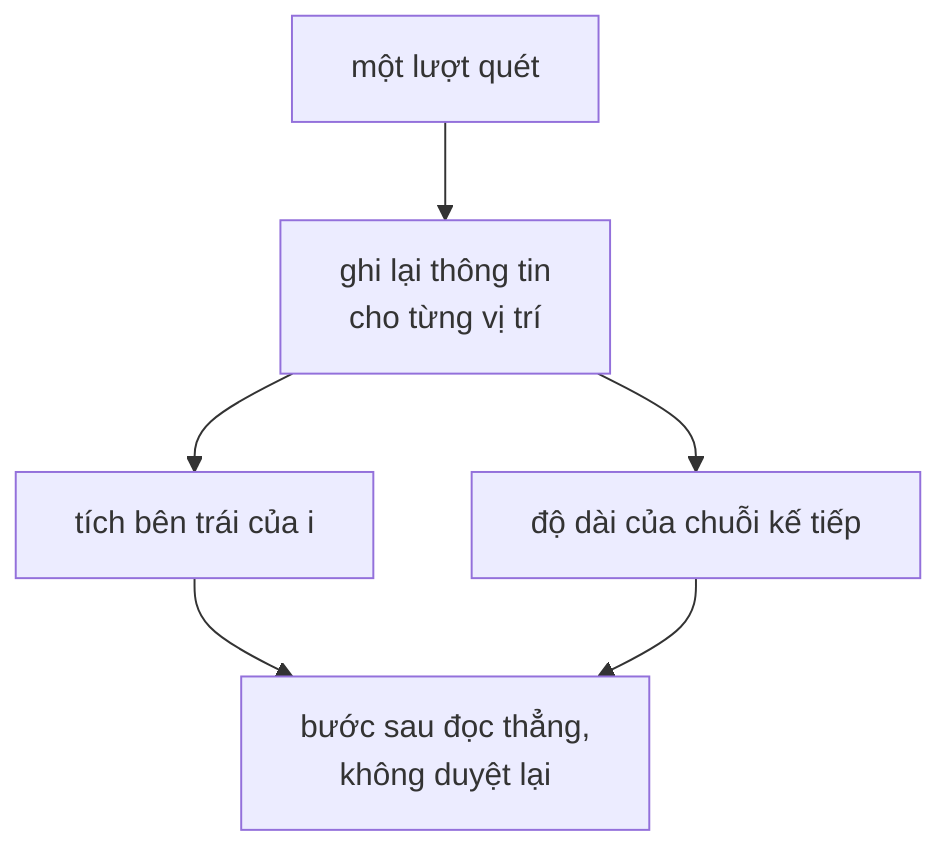

> [!tldr] Đọc nhanh
> - Pattern: **ghi trước để khỏi tìm sau**. Một lượt quét ghi lại đủ thông tin để bước tiếp theo trả lời thẳng, không phải duyệt lại hay đoán.
> - Product of Array Except Self: tích trừ i = tích **bên trái** × tích **bên phải**. Hai lượt quét ghi hai nửa đó ([[concepts/prefix-and-suffix-products|tích tiền tố, hậu tố]]), không cần phép chia.
> - Encode and Decode Strings: ghi **độ dài** trước mỗi chuỗi ([[concepts/length-prefix-encoding|tiền tố độ dài]]). Bộ giải mã biết cắt ở đâu mà không phải đoán dấu phân cách.
> - Hai cách "tự nhiên" đều hỏng ở ca biên: chia hỏng khi có số 0, dấu phân cách hỏng khi chuỗi chứa chính nó ([[concepts/delimiter-collision|Delimiter Collision]]).

> [!info] Bối cảnh
> Ga 3 của **tuyến NeetCode: Mảng và chuỗi**. Ga 1 và 2 dùng bảng băm để nhớ "đã gặp gì"; ga này thay bảng băm bằng **mảng phụ hoặc một con số ghi sẵn**: tích dồn từ một phía, hay độ dài đặt trước nội dung. Mỗi bài có trang riêng giải kỹ bằng năm ngôn ngữ. Bạn chỉ cần biết vòng lặp, mảng và chuỗi.

> [!abstract]- Từ điển nhanh cho bài này (bấm để mở)
> - **Tiền tố, hậu tố (prefix, suffix)**: đoạn đầu `a[0..i-1]` và đoạn cuối `a[i+1..n-1]` của mảng.
> - **Tổng tiền tố (prefix sum)**: mảng `P` với `P[i]` là tổng `a[0..i-1]`; tổng một đoạn bất kỳ là hiệu hai ô. Xem [[concepts/prefix-sum|Prefix Sum]].
> - **Biến chạy**: một biến cộng hay nhân dồn khi đi qua mảng, thay cho cả một mảng phụ.
> - **Thoát ký tự (escaping)**: đánh dấu một ký tự đặc biệt là "chữ thường". Xem [[concepts/escaping|Escaping]].

## Hình dung trước: sổ ghi chép của người đi đường

Bạn đi bộ dọc một con đường có n cột mốc. Ở mỗi cột, bạn ghi vào sổ "từ đầu đường tới đây đã đi bao xa". Sau này ai hỏi "từ cột 3 tới cột 7 bao xa", bạn lấy hai dòng trong sổ trừ nhau, không phải đi lại. Người đưa thư cũng làm vậy với một bó thư: ghi "bó này có 3 lá" lên trên, để người nhận khỏi phải đoán lá nào kết thúc ở đâu.

| Đời thường | Khái niệm |
|---|---|
| Ghi quãng đường đã đi ở mỗi cột mốc | tổng (tích) tiền tố |
| Một người khác đi từ cuối đường ngược lại, cũng ghi sổ | tích hậu tố |
| "Mọi đoạn trừ cột i" = phần trước cột i nối với phần sau cột i | tích trừ i = tiền tố × hậu tố |
| Nhãn "bó này có 3 lá" đặt trên cùng | tiền tố độ dài |
| Dùng tờ giấy trắng làm vách ngăn, mà trong thư lại có giấy trắng | dấu phân cách va chạm với nội dung |



## Vấn đề: cách tự nhiên hỏng ở ca biên

Cả hai bài đều có một lời giải "nghĩ ra ngay":
- **Product of Array Except Self**: nhân cả mảng rồi chia cho `nums[i]`. Có số 0 là hỏng: JS ra `NaN`, các ngôn ngữ khác ném lỗi chia cho 0. Đề cũng cấm phép chia.
- **Encode and Decode Strings**: nối các chuỗi bằng dấu phẩy. Chuỗi chứa dấu phẩy là hỏng, và `[]` với `[""]` cùng ra chuỗi rỗng.

Cả hai cách đều cố **suy ngược** ra thông tin đã mất: chia để gỡ một thừa số, tách chuỗi để đoán ranh giới. Pattern của ga là đừng làm mất thông tin ngay từ đầu: ghi nó xuống khi còn biết.

## Cơ chế

### Tích tiền tố và hậu tố

<figure class="figure-map" style="--ar: 3 / 4">
<div class="frame"><iframe data-archify="../diagrams/neetcode-prefix-suffix-encoding/prefix-suffix.html" title="Hai lượt tích tiền tố và hậu tố trên [1, 2, 3, 4]" loading="lazy"></iframe></div>
<figcaption><span><b>Hình 1.</b> Product of Array Except Self: lượt 1 ghi tích bên trái, lượt 2 nhân tích bên phải.</span><a href="../diagrams/neetcode-prefix-suffix-encoding/prefix-suffix.html" target="_blank" rel="noopener">Mở toàn màn hình</a></figcaption>
</figure>

Khuôn chung của tiền tố: `P[0]` là phần tử trung hòa (0 cho phép cộng, 1 cho phép nhân), và `P[i+1] = P[i] ⊕ a[i]`. Với phép cộng, tổng đoạn `a[l..r]` là `P[r+1] − P[l]`. Với phép nhân thì không trừ được (chia cho 0), nên muốn "mọi thứ trừ i" phải ghép **tiền tố từ trái** với **hậu tố từ phải**.

Khi mỗi ô tiền tố chỉ được dùng đúng một lần, theo đúng thứ tự quét, mảng phụ thu lại thành một **biến chạy**. Bản gộp của bài 238 ghi tiền tố vào mảng kết quả, rồi đi ngược với một biến `right`: không mảng phụ nào.

### Tiền tố độ dài

Mỗi chuỗi thành `<độ dài>#<nội dung>`. Bộ giải mã đọc chữ số tới dấu `#` đầu tiên, rồi lấy đúng chừng ấy ký tự mà không đọc bên trong. Vì phần độ dài chỉ có chữ số, dấu `#` đầu tiên luôn là ranh giới thật; dấu `#` trong nội dung không bao giờ được xem xét. HTTP `Content-Length` và hầu hết giao thức nhị phân làm đúng như vậy.

Cách còn lại là [[concepts/escaping|thoát ký tự]]: đổi `,` trong nội dung thành `/,` và `/` thành `//`. Cũng đúng, nhưng bộ giải mã phải đọc từng ký tự để biết ký tự nào đã bị thoát.

### Hai bài, một ý

| Bài | Ghi trước cái gì | Bước sau dùng nó thế nào |
|---|---|---|
| [[problems/product-of-array-except-self\|Product of Array Except Self]] | tích mọi số bên trái i (rồi bên phải i) | `out[i] = trái × phải`, không chia |
| [[problems/encode-and-decode-strings\|Encode and Decode Strings]] | độ dài của chuỗi kế tiếp | nhảy qua đúng chừng ấy ký tự |

Cả hai chạy O(n) với một hay hai lượt quét. Thứ ghi trước có kích thước nhỏ: một con số mỗi vị trí.

## Ví dụ chạy được

[TypeScript](../code/neetcode-prefix-suffix-encoding/prefix-suffix-encoding.ts) · [Python](../code/neetcode-prefix-suffix-encoding/prefix_suffix_encoding.py) · [Go](../code/neetcode-prefix-suffix-encoding/prefix_suffix_encoding.go) · [Java](../code/neetcode-prefix-suffix-encoding/prefix-suffix-encoding.java) · [JavaScript](../code/neetcode-prefix-suffix-encoding/prefix-suffix-encoding.js)

Mỗi file giải cả hai bài và tự chạy 7 ca, gồm `[]`, `[""]`, chuỗi chứa `#` và mảng có hai số 0.

```ts
// 271: ghi độ dài TRƯỚC nội dung, để người đọc biết cắt ở đâu mà không phải đoán dấu phân cách.
function encode(strs: string[]): string {
  return strs.map((s) => `${s.length}#${s}`).join("");
}

function decode(s: string): string[] {
  const out: string[] = [];
  for (let i = 0; i < s.length; ) {
    const h = s.indexOf("#", i);
    const n = Number(s.slice(i, h));
    out.push(s.slice(h + 1, h + 1 + n));
    i = h + 1 + n;
  }
  return out;
}

// 238: lượt trái → phải ghi tích tiền tố, lượt phải → trái nhân tích hậu tố.
function productExceptSelf(nums: number[]): number[] {
  const out = new Array(nums.length).fill(1);
  let left = 1;
  for (let i = 0; i < nums.length; i++) { out[i] = left; left *= nums[i]; }
  let right = 1;
  for (let i = nums.length - 1; i >= 0; i--) { out[i] *= right; right *= nums[i]; }
  return out;
}
```

```python
def encode(strs: list[str]) -> str:  # 271
    return "".join(f"{len(s)}#{s}" for s in strs)

def decode(s: str) -> list[str]:
    out, i = [], 0
    while i < len(s):
        h = s.index("#", i)
        n = int(s[i:h])
        out.append(s[h + 1 : h + 1 + n])
        i = h + 1 + n
    return out

def product_except_self(nums: list[int]) -> list[int]:  # 238
    out = [1] * len(nums)
    left = 1
    for i, x in enumerate(nums):
        out[i] = left
        left *= x
    right = 1
    for i in range(len(nums) - 1, -1, -1):
        out[i] *= right
        right *= nums[i]
    return out
```

```go
// 271
func encode(strs []string) string {
	var b strings.Builder
	for _, s := range strs {
		b.WriteString(strconv.Itoa(len(s)) + "#" + s)
	}
	return b.String()
}

func decode(s string) []string {
	out := []string{}
	for i := 0; i < len(s); {
		h := i + strings.IndexByte(s[i:], '#')
		n, _ := strconv.Atoi(s[i:h])
		out = append(out, s[h+1:h+1+n])
		i = h + 1 + n
	}
	return out
}

// 238
func productExceptSelf(nums []int) []int {
	out := make([]int, len(nums))
	left := 1
	for i, x := range nums {
		out[i] = left
		left *= x
	}
	right := 1
	for i := len(nums) - 1; i >= 0; i-- {
		out[i] *= right
		right *= nums[i]
	}
	return out
}
```

```java
// 271
static String encode(List<String> strs) {
    StringBuilder b = new StringBuilder();
    for (String s : strs) b.append(s.length()).append('#').append(s);
    return b.toString();
}

static List<String> decode(String s) {
    List<String> out = new ArrayList<>();
    for (int i = 0; i < s.length(); ) {
        int h = s.indexOf('#', i);
        int n = Integer.parseInt(s.substring(i, h));
        out.add(s.substring(h + 1, h + 1 + n));
        i = h + 1 + n;
    }
    return out;
}

// 238
static int[] productExceptSelf(int[] nums) {
    int[] out = new int[nums.length];
    int left = 1;
    for (int i = 0; i < nums.length; i++) { out[i] = left; left *= nums[i]; }
    int right = 1;
    for (int i = nums.length - 1; i >= 0; i--) { out[i] *= right; right *= nums[i]; }
    return out;
}
```

```js
// 271
const encode = (strs) => strs.map((s) => `${s.length}#${s}`).join("");

function decode(s) {
  const out = [];
  for (let i = 0; i < s.length; ) {
    const h = s.indexOf("#", i);
    const n = Number(s.slice(i, h));
    out.push(s.slice(h + 1, h + 1 + n));
    i = h + 1 + n;
  }
  return out;
}

// 238
function productExceptSelf(nums) {
  const out = new Array(nums.length).fill(1);
  let left = 1;
  for (let i = 0; i < nums.length; i++) { out[i] = left; left *= nums[i]; }
  let right = 1;
  for (let i = nums.length - 1; i >= 0; i--) { out[i] *= right; right *= nums[i]; }
  return out;
}
```


```text
$ node prefix-suffix-encoding.ts
7/7 ca đúng
```

Python, Go, Java và JavaScript cũng in `7/7 ca đúng`. Các phép đo (vét cạn O(n²) so với hai lượt, độ dài của emoji trong từng ngôn ngữ) nằm ở trang của từng bài.

## Hiểu lầm và bẫy hay gặp

- **"Tiền tố chỉ dùng cho tổng."** Mọi phép kết hợp được đều dùng được: tổng, tích, max, XOR. Chỉ phép **đảo được** (cộng, XOR) mới lấy được một đoạn giữa bằng hiệu hai tiền tố; tích và max cần ghép tiền tố với hậu tố.
- **Bắt đầu tiền tố bằng phần tử đầu thay vì phần tử trung hòa.** `P[0]` là tổng (tích) của không phần tử nào: 0 hoặc 1. Lệch một ô là lệch cả mảng.
- **"Dấu phân cách hiếm thì đủ an toàn."** Nếu đầu vào có thể chứa mọi ký tự, không ký tự nào đủ hiếm.
- **Đếm độ dài khác đơn vị ở hai đầu.** JS và Java đếm đơn vị UTF-16, Python đếm code point, Go đếm byte. Xem [[problems/encode-and-decode-strings|Encode and Decode Strings]].
- **"O(1) bộ nhớ" tính cả mảng kết quả.** LeetCode quy ước không tính đầu ra.

## Câu hỏi tự kiểm tra

> [!question]- Với `a = [3, 1, 4, 1, 5]`, viết mảng tổng tiền tố P và dùng nó tính tổng `a[1..3]`.
> `P = [0, 3, 4, 8, 9, 14]`. Tổng `a[1..3] = P[4] − P[1] = 9 − 3 = 6` (1 + 4 + 1).

> [!question]- Vì sao bài 238 không làm được như tổng đoạn, tức "tích toàn bộ chia tích một ô"?
> Phép nhân không đảo được khi có số 0: tích toàn bộ đã là 0 và không còn chứa tích các số còn lại. Ghép tiền tố với hậu tố tránh phải đảo.

> [!question]- Ghi độ dài trước nội dung và ghi một ký tự kết thúc sau nội dung khác nhau ở đâu khi giải mã?
> Có độ dài, bộ giải mã nhảy thẳng qua nội dung. Có ký tự kết thúc, nó phải đọc từng ký tự để tìm, và nội dung phải được thoát để không chứa ký tự đó.

> [!question]- Mảng phụ tiền tố thu lại thành một biến được khi nào?
> Khi mỗi ô tiền tố chỉ được đọc đúng một lần, theo đúng thứ tự đã tính ra nó. Nếu cần hỏi nhiều đoạn bất kỳ (như tổng đoạn), phải giữ cả mảng.

## Tham khảo

- [NeetCode 150](https://neetcode.io/practice) (danh sách và nhóm bài)
- LeetCode: [238. Product of Array Except Self](https://leetcode.com/problems/product-of-array-except-self/), [271. Encode and Decode Strings](https://leetcode.com/problems/encode-and-decode-strings/)
- [RFC 9110, §8.6 Content-Length](https://www.rfc-editor.org/rfc/rfc9110#section-8.6) (độ dài đặt trước nội dung)
- [RFC 8259, §7 Strings](https://www.rfc-editor.org/rfc/rfc8259#section-7) (JSON thoát `"` và `\`)
