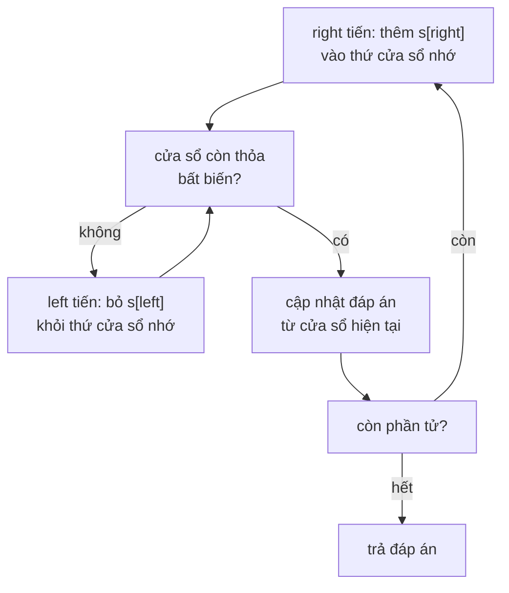

> [!tldr] Đọc nhanh
> - Pattern: bài hỏi về **đoạn liên tiếp** tốt nhất (dài nhất, ngắn nhất, lời nhất) thì giữ một cửa sổ `[left, right]`. Đầu phải thêm từng phần tử; đầu trái tiến khi cửa sổ phá [[concepts/window-invariant|bất biến]]. Hai đầu chỉ tiến, nên tổng O(n) thay vì O(n²) đoạn.
> - Ba câu hỏi phân biệt sáu bài: **bất biến là gì** (không lặp ký tự, đủ chữ của t, số chữ phải thay ≤ k), **cửa sổ co giãn hay cố định**, và **cửa sổ phải nhớ gì** (một số, một sổ vị trí, một bảng đếm, một hàng đợi đơn điệu).
> - Best Time to Buy and Sell Stock: chỉ nhớ [[concepts/running-minimum|giá thấp nhất]]. Longest Substring: [[concepts/last-seen-index|sổ vị trí gần nhất]]. Permutation in String: cửa sổ [[concepts/fixed-size-window|cố định]] và bảng đếm. Sliding Window Maximum: [[concepts/monotonic-deque|hàng đợi đơn điệu]].
> - Bẫy hay gặp nhất: đầu trái **lùi lại** (`"abba"`), và co cửa sổ bằng `if` khi phải dùng `while` (hay ngược lại).

> [!info] Bối cảnh
> Ga 5 của **tuyến NeetCode: Mảng và chuỗi**. [[posts/2026-11-23-neetcode-two-pointers|Ga 4, hai con trỏ]], đặt hai chỉ số ở hai đầu và cho chúng đi **về phía nhau**; ga này cho cả hai đi **cùng chiều**, và dùng lại bảng đếm của [[posts/2026-11-22-neetcode-counting-keys|ga 2]]. Mỗi bài có một trang riêng giải kỹ bằng năm ngôn ngữ. Bạn chỉ cần biết vòng lặp, mảng, chuỗi và Map.

> [!abstract]- Từ điển nhanh cho bài này (bấm để mở)
> - **Đoạn liên tiếp (subarray, substring)**: các phần tử đứng liền nhau. Khác với dãy con, vốn được bỏ phần tử ở giữa.
> - **Cửa sổ trượt (sliding window)**: đoạn `[left, right]` mà hai đầu chỉ tiến. Xem [[concepts/sliding-window|Sliding Window]].
> - **Bất biến (invariant)**: điều cửa sổ luôn thỏa sau mỗi bước. Xem [[concepts/window-invariant|Window Invariant]].
> - **Bảng đếm**: đếm số lần mỗi ký tự trong cửa sổ; xem [[concepts/counting-array|Counting Array]] ở ga 2.
> - **Hàng đợi hai đầu (deque)**: danh sách thêm và bớt được ở cả hai đầu trong O(1).

## Hình dung trước: khung ảnh trên băng chuyền

Hàng hóa chạy qua trên một băng chuyền. Bạn cầm một khung ảnh đặt trên băng và chỉ được làm hai việc: kéo mép phải để thêm món mới vào khung, hoặc kéo mép trái để bỏ món cũ ra. Không mép nào được kéo lùi. Bạn muốn tìm khung "tốt nhất" theo một luật nào đó.

| Đời thường | Khái niệm |
|---|---|
| Khung ảnh trên băng chuyền | cửa sổ `[left, right]` |
| Kéo mép phải thêm một món | `right++` |
| Kéo mép trái bỏ một món | `left++` |
| Luật khung phải thỏa ("không hai món cùng màu") | bất biến |
| Khung cỡ cố định, chỉ trượt | cửa sổ cố định (Permutation in String, Sliding Window Maximum) |
| Tờ ghi chú gắn trên khung: số món mỗi màu, món nào nặng nhất | thứ cửa sổ phải nhớ |
| Không bao giờ kéo lùi | O(n): mỗi món vào khung một lần, ra một lần |



## Vấn đề: thử mọi đoạn liên tiếp tốn O(n²)

Một mảng dài n có n(n+1)/2 đoạn liên tiếp. Thử hết, mỗi đoạn kiểm thêm O(1) nếu khéo, thì vẫn O(n²): với n = 10⁵ là khoảng 5·10⁹ đoạn. Phép đo ở [[problems/best-time-to-buy-and-sell-stock|Best Time to Buy and Sell Stock]] cho thấy vét cạn mất 585 ms ở n = 40 000, trong khi một lượt mất dưới 1 ms.

Cửa sổ trượt dựa trên một quan sát: với nhiều bài, nếu đoạn `[left, right]` đã **hỏng** (có ký tự lặp, quá nhiều chữ phải thay) thì mọi đoạn dài hơn chứa nó cũng hỏng, và nếu đoạn đã **tốt** thì không cần thử đoạn con của nó. Nhờ vậy `right` không bao giờ phải quay lại, và `left` cũng không.

## Cơ chế

### Khuôn chung

<figure class="figure-map" style="--ar: 3 / 4">
<div class="frame"><iframe data-archify="../diagrams/neetcode-sliding-window/window.html" title="Cửa sổ không lặp ký tự trên pwwkew" loading="lazy"></iframe></div>
<figcaption><span><b>Hình 1.</b> Longest Substring trên <code>"pwwkew"</code>: đầu phải đọc từng ký tự, sổ vị trí trả lời "đã gặp chưa", đầu trái nhảy khi có ký tự lặp.</span><a href="../diagrams/neetcode-sliding-window/window.html" target="_blank" rel="noopener">Mở toàn màn hình</a></figcaption>
</figure>

```text
left = 0
for right in 0..n-1:
    thêm a[right] vào trạng thái của cửa sổ
    while cửa sổ phá bất biến:        # cửa sổ co giãn
        bỏ a[left] khỏi trạng thái; left += 1
    cập nhật đáp án bằng [left, right]
```

Vòng `while` nằm trong `for` nhưng tổng số lần `left` tiến không quá n, nên cả vòng lặp là O(n) ([[concepts/aggregate-analysis|phân tích gộp]], cùng lập luận với ga 1). Với **cửa sổ cố định** dài k, `while` thành một bước: thêm `a[right]` và bỏ `a[right − k]` cùng lúc.

### Sáu bài, ba câu hỏi

| Bài | Bất biến (hoặc mục tiêu) | Cỡ cửa sổ | Cửa sổ nhớ gì |
|---|---|---|---|
| [[problems/best-time-to-buy-and-sell-stock\|Best Time to Buy and Sell Stock]] | `left` là ngày giá thấp nhất tới giờ | co giãn | một số: giá ở `left` |
| [[problems/longest-substring-without-repeating-characters\|Longest Substring Without Repeating Characters]] | không ký tự nào lặp | co giãn, tìm dài nhất | sổ vị trí gần nhất của mỗi ký tự |
| [[problems/longest-repeating-character-replacement\|Longest Repeating Character Replacement]] | độ dài − số lần chữ nhiều nhất ≤ k | co giãn, tìm dài nhất | bảng đếm 26 chữ và `maxFreq` |
| [[problems/permutation-in-string\|Permutation in String]] | cửa sổ là một hoán vị của s1 | cố định, dài \|s1\| | hai bảng đếm và số chữ khớp |
| [[problems/minimum-window-substring\|Minimum Window Substring]] | cửa sổ chứa đủ mọi chữ của t | co giãn, tìm **ngắn** nhất | bảng "còn thiếu" và số chữ còn thiếu |
| [[problems/sliding-window-maximum\|Sliding Window Maximum]] | (trả max của mọi cửa sổ dài k) | cố định, dài k | hàng đợi chỉ số, giá trị giảm dần |

Hai hướng tìm khác nhau đáng để ý:
- **Tìm dài nhất** (Longest Substring, Character Replacement): mở rộng cho tới khi hỏng, co cho tới khi tốt lại, cập nhật đáp án **sau** khi co.
- **Tìm ngắn nhất** (Minimum Window): mở rộng cho tới khi **tốt**, rồi co **chừng nào còn tốt**, cập nhật đáp án **trong** lúc co.

### Hai chỗ tinh tế

**Character Replacement không cần giảm `maxFreq`.** Khi `left` tiến, số lần của chữ nhiều nhất có thể giảm, nhưng code vẫn giữ `maxFreq` cũ. Điều đó không sai vì đáp án chỉ tăng khi tìm được cửa sổ có `maxFreq` **lớn hơn** kỷ lục; `maxFreq` cũ chỉ làm cửa sổ trượt với độ dài không đổi thay vì co lại, mà cửa sổ ngắn hơn thì không bao giờ là đáp án mới. Vì vậy ở bài này `if` là đủ, không cần `while`: cửa sổ không bao giờ co, chỉ trượt hoặc dài ra.

**Sliding Window Maximum cần một hàng đợi đơn điệu.** Bảng đếm không trả lời được "max của cửa sổ" khi phần tử lớn nhất trượt ra. [[concepts/monotonic-deque|Hàng đợi đơn điệu]] giữ chỉ số theo giá trị giảm dần: phần tử mới đẩy bỏ mọi phần tử nhỏ hơn ở cuối (chúng không bao giờ còn là max khi phần tử mới còn trong cửa sổ), và đầu hàng bị bỏ khi trượt ra ngoài. Đầu hàng luôn là max. Mỗi chỉ số vào và ra hàng đợi một lần: O(n).

Trang của từng bài đi sâu hơn: [[problems/longest-repeating-character-replacement|Longest Repeating Character Replacement]] giữ một [[concepts/non-shrinking-window|cửa sổ không co]] và chứng minh vì sao `maxFreq` không cần giảm; [[problems/permutation-in-string|Permutation in String]] trượt một cửa sổ cố định dài \|s1\| và so bảng đếm, hoặc đếm số ô khớp; [[problems/minimum-window-substring|Minimum Window Substring]] đo biến `missing` nhanh hơn so cả bảng đếm khoảng 45 lần; [[problems/sliding-window-maximum|Sliding Window Maximum]] chứng minh hàng đợi đơn điệu là O(n) bằng phân tích gộp và đo `shift()` của JS chậm gần 900 lần ở ca tệ nhất.

## Ví dụ chạy được

[TypeScript](../code/neetcode-sliding-window/sliding-window.ts) · [Python](../code/neetcode-sliding-window/sliding_window.py) · [Go](../code/neetcode-sliding-window/sliding_window.go) · [Java](../code/neetcode-sliding-window/sliding-window.java) · [JavaScript](../code/neetcode-sliding-window/sliding-window.js)

Mỗi file giải cả sáu bài và tự chạy 12 ca, hai ca mỗi bài. Dưới đây là Longest Substring (tìm dài nhất) và Minimum Window Substring (tìm ngắn nhất), hai hướng của cùng một khuôn.

```ts
// 3: bất biến "không ký tự nào lặp"; nhảy left qua lần gặp trước nếu nó nằm trong cửa sổ.
function lengthOfLongestSubstring(s: string): number {
  const last = new Map<string, number>();
  let left = 0, best = 0;
  for (let right = 0; right < s.length; right++) {
    const prev = last.get(s[right]);
    if (prev !== undefined && prev >= left) left = prev + 1;
    last.set(s[right], right);
    best = Math.max(best, right - left + 1);
  }
  return best;
}

// 76: mở rộng tới khi đủ mọi ký tự của t, rồi co từ trái chừng nào còn đủ.
function minWindow(s: string, t: string): string {
  const need = new Map<string, number>();
  for (const c of t) need.set(c, (need.get(c) ?? 0) + 1);
  let missing = t.length, left = 0, bestL = 0, bestLen = Infinity;
  for (let right = 0; right < s.length; right++) {
    const r = s[right];
    if (need.has(r)) { if (need.get(r)! > 0) missing--; need.set(r, need.get(r)! - 1); }
    while (missing === 0) {
      if (right - left + 1 < bestLen) { bestLen = right - left + 1; bestL = left; }
      const l = s[left++];
      if (need.has(l)) { need.set(l, need.get(l)! + 1); if (need.get(l)! > 0) missing++; }
    }
  }
  return bestLen === Infinity ? "" : s.slice(bestL, bestL + bestLen);
}
```

```python
def length_of_longest_substring(s: str) -> int:  # 3
    last: dict[str, int] = {}
    left = best = 0
    for right, ch in enumerate(s):
        if last.get(ch, -1) >= left:
            left = last[ch] + 1
        last[ch] = right
        best = max(best, right - left + 1)
    return best

def min_window(s: str, t: str) -> str:  # 76
    need, missing = Counter(t), len(t)
    left, best = 0, (0, float("inf"))
    for right, ch in enumerate(s):
        if need[ch] > 0:
            missing -= 1
        need[ch] -= 1
        while missing == 0:
            if right - left + 1 < best[1]:
                best = (left, right - left + 1)
            need[s[left]] += 1
            if need[s[left]] > 0:
                missing += 1
            left += 1
    return "" if best[1] == float("inf") else s[best[0] : best[0] + best[1]]
```

```go
// 3
func lengthOfLongestSubstring(s string) int {
	var last [128]int // vị trí + 1
	left, best := 0, 0
	for right := 0; right < len(s); right++ {
		left = max(left, last[s[right]])
		last[s[right]] = right + 1
		best = max(best, right-left+1)
	}
	return best
}

// 76
func minWindow(s, t string) string {
	var need [128]int
	for i := 0; i < len(t); i++ {
		need[t[i]]++
	}
	missing, left, bestL, bestLen := len(t), 0, 0, math.MaxInt
	for right := 0; right < len(s); right++ {
		if need[s[right]] > 0 {
			missing--
		}
		need[s[right]]--
		for missing == 0 {
			if right-left+1 < bestLen {
				bestL, bestLen = left, right-left+1
			}
			need[s[left]]++
			if need[s[left]] > 0 {
				missing++
			}
			left++
		}
	}
	if bestLen == math.MaxInt {
		return ""
	}
	return s[bestL : bestL+bestLen]
}
```

```java
// 3
static int lengthOfLongestSubstring(String s) {
    int[] last = new int[128];
    int left = 0, best = 0;
    for (int right = 0; right < s.length(); right++) {
        left = Math.max(left, last[s.charAt(right)]);
        last[s.charAt(right)] = right + 1;
        best = Math.max(best, right - left + 1);
    }
    return best;
}

// 76
static String minWindow(String s, String t) {
    int[] need = new int[128];
    for (char c : t.toCharArray()) need[c]++;
    int missing = t.length(), left = 0, bestL = 0, bestLen = Integer.MAX_VALUE;
    for (int right = 0; right < s.length(); right++) {
        if (need[s.charAt(right)]-- > 0) missing--;
        while (missing == 0) {
            if (right - left + 1 < bestLen) { bestLen = right - left + 1; bestL = left; }
            if (++need[s.charAt(left++)] > 0) missing++;
        }
    }
    return bestLen == Integer.MAX_VALUE ? "" : s.substring(bestL, bestL + bestLen);
}
```

```js
// 3: bất biến "không ký tự nào lặp"; nhảy left qua lần gặp trước nếu nó nằm trong cửa sổ.
function lengthOfLongestSubstring(s) {
  const last = new Map();
  let left = 0, best = 0;
  for (let right = 0; right < s.length; right++) {
    const prev = last.get(s[right]);
    if (prev !== undefined && prev >= left) left = prev + 1;
    last.set(s[right], right);
    best = Math.max(best, right - left + 1);
  }
  return best;
}

// 76: mở rộng tới khi đủ mọi ký tự của t, rồi co từ trái chừng nào còn đủ.
function minWindow(s, t) {
  const need = new Map();
  for (const c of t) need.set(c, (need.get(c) ?? 0) + 1);
  let missing = t.length, left = 0, bestL = 0, bestLen = Infinity;
  for (let right = 0; right < s.length; right++) {
    const r = s[right];
    if (need.has(r)) { if (need.get(r) > 0) missing--; need.set(r, need.get(r) - 1); }
    while (missing === 0) {
      if (right - left + 1 < bestLen) { bestLen = right - left + 1; bestL = left; }
      const l = s[left++];
      if (need.has(l)) { need.set(l, need.get(l) + 1); if (need.get(l) > 0) missing++; }
    }
  }
  return bestLen === Infinity ? "" : s.slice(bestL, bestL + bestLen);
}
```


```text
$ node sliding-window.ts
12/12 ca đúng
```

Python, Go, Java và JavaScript chạy cùng 12 ca và đều in `12/12 ca đúng`. Phép đo nằm ở từng trang bài: [[problems/best-time-to-buy-and-sell-stock|Best Time to Buy and Sell Stock]] đo vét cạn O(n²) với một lượt, [[problems/longest-substring-without-repeating-characters|Longest Substring]] đo co bằng Set với nhảy bằng sổ vị trí.

## Hiểu lầm và bẫy hay gặp

- **Để đầu trái lùi lại.** Nhảy `left` tới lần gặp trước mà không kiểm lần đó còn trong cửa sổ: `"abba"` ra 3. Dùng `left = max(left, …)`.
- **Dùng `if` khi cần `while`, hoặc ngược lại.** Longest Substring với Set và Minimum Window phải co nhiều bước; Character Replacement co đúng một bước.
- **Cập nhật đáp án sai chỗ.** Tìm dài nhất thì cập nhật sau khi co; tìm ngắn nhất thì cập nhật trong lúc co, trước khi bỏ `s[left]`.
- **Dùng cửa sổ cho bài không có tính đơn điệu.** Tìm đoạn có tổng bằng k khi mảng có số âm: thêm phần tử có thể làm tổng giảm, nên "hỏng thì dài hơn cũng hỏng" không còn đúng. Bài đó cần [[concepts/prefix-sum|tổng tiền tố]] và bảng băm. File [negative-numbers.ts](../code/neetcode-sliding-window/negative-numbers.ts) đếm số đoạn có tổng đúng bằng k: với `[3, 4, 7, 2, -3, 1, 4, 2]` và k = 7, vét cạn và tổng tiền tố đều ra 4, cửa sổ chỉ ra 2; với `[1, -1, 0]` và k = 0, đáp án là 3, cửa sổ ra 1. Với mảng toàn số dương như `[1, 2, 3]`, cả ba cách cùng ra 2.
- **`shift()` trên mảng JS làm hàng đợi.** `shift` là O(n) mỗi lần; dùng một con trỏ đầu như trong code trên, hoặc `deque` của Python, `ArrayDeque` của Java.

## Câu hỏi tự kiểm tra

> [!question]- Vì sao vòng `while` trong khuôn chung không làm tổng thời gian thành O(n²)?
> Mỗi lần `while` chạy, `left` tiến một bước, và `left` không bao giờ vượt quá n. Tổng số bước `while` qua toàn bộ thuật toán ≤ n.

> [!question]- Permutation in String khác Longest Substring ở câu hỏi nào trong ba câu hỏi?
> Cỡ cửa sổ: Permutation in String dùng cửa sổ cố định dài \|s1\|, nên mỗi bước thêm một ký tự và bỏ một ký tự, không cần `while`.

> [!question]- Ở Minimum Window Substring, vì sao đáp án được cập nhật bên trong vòng co, không phải sau đó?
> Vì bài tìm cửa sổ **ngắn nhất còn thỏa** điều kiện. Sau vòng co, cửa sổ đã vừa mất một ký tự cần thiết, tức không còn thỏa.

> [!question]- Một bài hỏi "đoạn liên tiếp dài nhất có tổng ≤ k" với mảng có cả số âm. Cửa sổ trượt có dùng được không?
> Không chắc chắn: thêm một số âm làm tổng giảm, nên một cửa sổ hỏng có thể tốt lại khi dài thêm. Tính chất đơn điệu mà cửa sổ trượt dựa vào bị mất.

## Tham khảo

- [NeetCode 150](https://neetcode.io/practice) (danh sách và nhóm bài)
- LeetCode: [121. Best Time to Buy and Sell Stock](https://leetcode.com/problems/best-time-to-buy-and-sell-stock/), [3. Longest Substring Without Repeating Characters](https://leetcode.com/problems/longest-substring-without-repeating-characters/), [424. Longest Repeating Character Replacement](https://leetcode.com/problems/longest-repeating-character-replacement/), [567. Permutation in String](https://leetcode.com/problems/permutation-in-string/), [76. Minimum Window Substring](https://leetcode.com/problems/minimum-window-substring/), [239. Sliding Window Maximum](https://leetcode.com/problems/sliding-window-maximum/)
- [Python: `collections.deque`](https://docs.python.org/3/library/collections.html#collections.deque) (thêm, bớt hai đầu O(1)) và [`Counter`](https://docs.python.org/3/library/collections.html#collections.Counter) (so bằng nhau bỏ qua khóa bằng 0 từ 3.10)
- [Java 21 `ArrayDeque`](https://docs.oracle.com/en/java/javase/21/docs/api/java.base/java/util/ArrayDeque.html)
- [MDN: `Array.prototype.shift`](https://developer.mozilla.org/en-US/docs/Web/JavaScript/Reference/Global_Objects/Array/shift)
