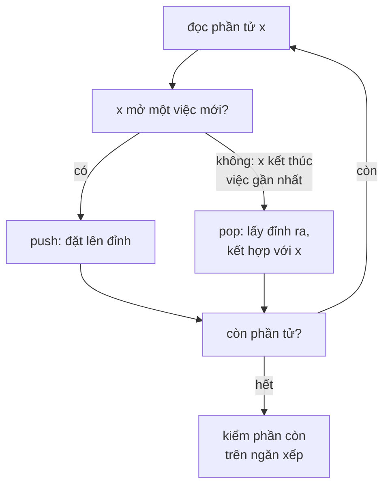

> [!tldr] Đọc nhanh
> - Pattern: khi thứ **mở sau cùng** phải được **xử lý trước tiên** (ngoặc lồng nhau, phép tính chờ toán hạng, lựa chọn chờ quay lui), giữ các việc dở dang trong một [[concepts/stack|ngăn xếp]]. Đỉnh luôn là việc dở dang gần nhất; `push` và `pop` đều O(1).
> - Valid Parentheses: đỉnh là ngoặc mở gần nhất chưa đóng ([[concepts/bracket-matching|khớp cặp]]). Min Stack: mỗi tầng nhớ kèm giá trị nhỏ nhất tới tầng đó ([[concepts/auxiliary-min-stack|ngăn xếp phụ cho min]]). Evaluate Reverse Polish Notation: đỉnh là các toán hạng đang chờ ([[concepts/reverse-polish-notation|ký pháp Ba Lan ngược]]). Generate Parentheses: chuỗi đang dựng là ngăn xếp các lựa chọn ([[concepts/backtracking|quay lui]]).
> - Câu hỏi phân biệt: **đặt gì lên đỉnh**, và **khi nào lấy ra**.
> - Bẫy: lấy từ ngăn xếp rỗng, đảo vế toán hạng khi trừ và chia, và phép chia làm tròn khác nhau giữa các ngôn ngữ (Python `-7 // 2 = -4`, đề cần `-3`).

> [!info] Bối cảnh
> Ga 6 của **tuyến NeetCode: Mảng và chuỗi**. [[posts/2026-11-23-neetcode-sliding-window|Ga 5, cửa sổ trượt]], nhớ một đoạn liên tiếp có hai đầu chỉ tiến; ga này nhớ những thứ **chưa xong** theo thứ tự ngược với lúc chúng bắt đầu. Ga 7 sẽ dùng chính ngăn xếp này cho "phần tử lớn hơn kế tiếp". Bạn chỉ cần biết vòng lặp, mảng và hàm.

> [!abstract]- Từ điển nhanh cho bài này (bấm để mở)
> - **Ngăn xếp (stack)**: danh sách chỉ thêm và lấy ở một đầu. Vào sau thì ra trước (LIFO). Xem [[concepts/stack|Stack]].
> - **Ký pháp Ba Lan ngược (RPN)**: viết toán tử sau hai toán hạng: `3 4 +` thay cho `3 + 4`. Không cần ngoặc. Xem [[concepts/reverse-polish-notation|Reverse Polish Notation]].
> - **Quay lui (backtracking)**: thử một lựa chọn, đi tiếp, rồi gỡ lựa chọn đó ra để thử lựa chọn khác. Xem [[concepts/backtracking|Backtracking]].
> - **Đệ quy**: hàm tự gọi chính nó. Mỗi lần gọi chờ lần gọi bên trong xong mới chạy tiếp, nên máy tính giữ chúng trong một ngăn xếp gọi hàm (call stack).

## Hình dung trước: chồng đĩa trong bếp

Người rửa bát xếp đĩa sạch thành một chồng. Người phục vụ chỉ lấy được đĩa **trên cùng**, tức đĩa vừa được đặt lên sau cùng. Không ai rút đĩa ở giữa chồng.

| Đời thường | Khái niệm |
|---|---|
| Chồng đĩa | ngăn xếp |
| Đặt đĩa lên trên / lấy đĩa trên cùng | `push` / `pop` |
| Đĩa trên cùng | đỉnh: việc dở dang gần nhất |
| Hộp lồng nhau phải đóng từ trong ra | Valid Parentheses |
| Dán lên mỗi đĩa tờ giấy "đĩa nhỏ nhất từ đây xuống" | Min Stack |
| Gom nguyên liệu lên bàn, có công thức thì lấy hai món trên cùng ra trộn | Evaluate Reverse Polish Notation |
| Đặt thử một món, không hợp thì nhấc ra thử món khác | Generate Parentheses (quay lui) |



## Vấn đề: thứ cần nhớ là thứ tự, không phải số lượng

Valid Parentheses cho thấy rõ nhất: đếm số ngoặc mở là chưa đủ. Một bộ đếm chung cho `"(]"` qua; ba bộ đếm riêng cho `"([)]"` qua. Lúc gặp `)`, câu hỏi đúng là "ngoặc mở **gần nhất** chưa đóng là gì?", và bộ đếm không trả lời được.

Câu "gần nhất chưa xong" lặp lại ở cả bốn bài: toán tử cần **hai toán hạng gần nhất**, giá trị nhỏ nhất sau khi `pop` là giá trị nhỏ nhất **của phần còn lại**, quay lui gỡ **lựa chọn gần nhất**. Một mảng chỉ thêm và bớt ở cuối trả lời câu đó trong O(1).

## Cơ chế

### Khuôn chung

<figure class="figure-map" style="--ar: 3 / 4">
<div class="frame"><iframe data-archify="../diagrams/neetcode-stack/matching.html" title="Ngăn xếp kiểm hai chuỗi ngoặc" loading="lazy"></iframe></div>
<figcaption><span><b>Hình 1.</b> Valid Parentheses: ngoặc mở lên đỉnh, ngoặc đóng phải khớp đỉnh.</span><a href="../diagrams/neetcode-stack/matching.html" target="_blank" rel="noopener">Mở toàn màn hình</a></figcaption>
</figure>

1. Đi qua đầu vào một lần.
2. Phần tử **mở** một việc: `push`.
3. Phần tử **kết thúc** việc gần nhất: `pop`, kiểm tra hoặc kết hợp với nó. Trước khi `pop`, hỏi ngăn xếp có rỗng không.
4. Hết đầu vào: phần còn lại trên ngăn xếp là kết quả (RPN) hoặc là lỗi (ngoặc chưa đóng).

Mỗi phần tử vào ngăn xếp một lần và ra tối đa một lần, nên cả lượt là O(n).

### Bốn bài, hai câu hỏi

| Bài | Đặt gì lên đỉnh | Lấy ra khi nào |
|---|---|---|
| [[problems/valid-parentheses\|Valid Parentheses]] | ngoặc mở | gặp ngoặc đóng: đỉnh phải cùng loại |
| Min Stack | cặp (giá trị, min tới tầng này) | `pop` của người dùng; min mới là min đã lưu ở tầng dưới |
| Evaluate Reverse Polish Notation | số | gặp toán tử: lấy hai số, đẩy kết quả lại |
| Generate Parentheses | ký tự vừa thử thêm | sau khi thử xong nhánh đó (quay lui) |

**Min Stack.** Đề muốn `getMin` trong O(1). Một biến `min` duy nhất hỏng khi `pop` đúng phần tử nhỏ nhất: không biết min mới là gì. Cách sửa: mỗi tầng lưu kèm min **tính tới tầng đó**. Sau `pop`, tầng bên dưới đã có sẵn min của phần còn lại. Tốn gấp đôi bộ nhớ, đổi lại mọi thao tác O(1).

**Evaluate Reverse Polish Notation.** `["2", "1", "+", "3", "*"]` là `(2 + 1) · 3 = 9`. Gặp toán tử thì lấy hai số trên đỉnh: số lấy ra **trước** là vế **phải**. Với `+` và `*` đảo vế không sao, với `-` và `/` thì sai. Phép chia phải **làm tròn về 0** (`-7 / 2 = -3`): Go và Java chia `int` đúng như vậy, JS cần `Math.trunc`, còn Python `//` làm tròn **xuống** ra `-4`.

**Generate Parentheses.** Liệt kê mọi chuỗi n cặp ngoặc hợp lệ. Thêm `(` khi số ngoặc mở còn dưới n, thêm `)` khi số ngoặc đóng còn ít hơn số mở. Mỗi lần thử là `push` một ký tự vào chuỗi đang dựng, thử xong là `pop`. Hai điều kiện đó bảo đảm chỉ sinh chuỗi hợp lệ, nên không cần sinh cả 2²ⁿ chuỗi rồi lọc. Số kết quả là số Catalan: 5 với n = 3, 14 với n = 4.

## Ví dụ chạy được

[TypeScript](../code/neetcode-stack/stack-station.ts) · [Python](../code/neetcode-stack/stack_station.py) · [Go](../code/neetcode-stack/stack_station.go) · [Java](../code/neetcode-stack/stack-station.java) · [JavaScript](../code/neetcode-stack/stack-station.js)

Mỗi file giải cả bốn bài và tự chạy 10 ca, gồm `"(("`, `["-7", "2", "/"]` và số chuỗi với n = 4.

```ts
// 20: ngoặc đóng phải khớp với ngoặc mở gần nhất chưa đóng, tức đỉnh ngăn xếp.
function isValid(s: string): boolean {
  const open: Record<string, string> = { ")": "(", "]": "[", "}": "{" };
  const st: string[] = [];
  for (const ch of s) {
    if (!(ch in open)) st.push(ch);
    else if (st.pop() !== open[ch]) return false;
  }
  return st.length === 0;
}

// 155: mỗi tầng ngăn xếp nhớ kèm giá trị nhỏ nhất tính tới tầng đó.
class MinStack {
  private st: [number, number][] = []; // [giá trị, min tới tầng này]
  push(x: number) { this.st.push([x, this.st.length ? Math.min(x, this.getMin()) : x]); }
  pop() { this.st.pop(); }
  top() { return this.st[this.st.length - 1][0]; }
  getMin() { return this.st[this.st.length - 1][1]; }
}

// 150: số thì đẩy vào; toán tử thì lấy hai số trên đỉnh (số lấy ra SAU là vế trái).
function evalRPN(tokens: string[]): number {
  const st: number[] = [];
  for (const t of tokens) {
    if (!"+-*/".includes(t) || t.length > 1) { st.push(Number(t)); continue; } // "-11" là số, không phải phép trừ
    const b = st.pop()!, a = st.pop()!;
    st.push(t === "+" ? a + b : t === "-" ? a - b : t === "*" ? a * b : Math.trunc(a / b)); // chia làm tròn về 0
  }
  return st[0];
}

// 22: quay lui; chuỗi đang dựng chính là ngăn xếp các lựa chọn, thêm ký tự rồi bỏ đi.
function generateParenthesis(n: number): string[] {
  const out: string[] = [];
  const cur: string[] = [];
  const go = (open: number, close: number) => {
    if (cur.length === 2 * n) { out.push(cur.join("")); return; }
    if (open < n) { cur.push("("); go(open + 1, close); cur.pop(); }
    if (close < open) { cur.push(")"); go(open, close + 1); cur.pop(); }
  };
  go(0, 0);
  return out;
}
```

```python
def is_valid(s: str) -> bool:  # 20
    open_ = {")": "(", "]": "[", "}": "{"}
    st: list[str] = []
    for ch in s:
        if ch not in open_:
            st.append(ch)
        elif not st or st.pop() != open_[ch]:
            return False
    return not st

class MinStack:  # 155: mỗi tầng nhớ kèm min tới tầng đó
    def __init__(self):
        self.st: list[tuple[int, int]] = []

    def push(self, x: int) -> None:
        self.st.append((x, min(x, self.st[-1][1]) if self.st else x))

    def pop(self) -> None:
        self.st.pop()

    def top(self) -> int:
        return self.st[-1][0]

    def get_min(self) -> int:
        return self.st[-1][1]

def eval_rpn(tokens: list[str]) -> int:  # 150
    st: list[int] = []
    for t in tokens:
        if t not in ("+", "-", "*", "/"):
            st.append(int(t))
            continue
        b, a = st.pop(), st.pop()
        if t == "+":
            st.append(a + b)
        elif t == "-":
            st.append(a - b)
        elif t == "*":
            st.append(a * b)
        else:
            st.append(int(a / b))  # KHÔNG dùng a // b: // làm tròn xuống (-7 // 2 = -4), đề cần làm tròn về 0 (-3)
    return st[0]

def generate_parenthesis(n: int) -> list[str]:  # 22
    out: list[str] = []
    cur: list[str] = []

    def go(open_: int, close: int) -> None:
        if len(cur) == 2 * n:
            out.append("".join(cur))
            return
        if open_ < n:
            cur.append("(")
            go(open_ + 1, close)
            cur.pop()
        if close < open_:
            cur.append(")")
            go(open_, close + 1)
            cur.pop()

    go(0, 0)
    return out
```

```go
// 20
func isValid(s string) bool {
	open := map[rune]rune{')': '(', ']': '[', '}': '{'}
	st := []rune{}
	for _, ch := range s {
		want, isClose := open[ch]
		if !isClose {
			st = append(st, ch)
		} else if len(st) == 0 || st[len(st)-1] != want {
			return false
		} else {
			st = st[:len(st)-1]
		}
	}
	return len(st) == 0
}

// 155: mỗi tầng nhớ kèm min tới tầng đó.
type MinStack struct{ st [][2]int }

func (m *MinStack) Push(x int) {
	lo := x
	if len(m.st) > 0 {
		lo = min(x, m.GetMin())
	}
	m.st = append(m.st, [2]int{x, lo})
}

func (m *MinStack) Pop()        { m.st = m.st[:len(m.st)-1] }

func (m *MinStack) Top() int    { return m.st[len(m.st)-1][0] }

func (m *MinStack) GetMin() int { return m.st[len(m.st)-1][1] }

// 150
func evalRPN(tokens []string) int {
	st := []int{}
	for _, t := range tokens {
		n, err := strconv.Atoi(t)
		if err == nil { // Atoi đọc được "-11" là số; "-" một mình thì lỗi, tức là toán tử
			st = append(st, n)
			continue
		}
		a, b := st[len(st)-2], st[len(st)-1]
		st = st[:len(st)-2]
		switch t {
		case "+":
			st = append(st, a+b)
		case "-":
			st = append(st, a-b)
		case "*":
			st = append(st, a*b)
		default:
			st = append(st, a/b) // chia số nguyên trong Go làm tròn về 0, đúng ý đề
		}
	}
	return st[0]
}

// 22
func generateParenthesis(n int) []string {
	out := []string{}
	cur := make([]byte, 0, 2*n)
	var gen func(open, close int)
	gen = func(open, close int) {
		if len(cur) == 2*n {
			out = append(out, string(cur))
			return
		}
		if open < n {
			cur = append(cur, '(')
			gen(open+1, close)
			cur = cur[:len(cur)-1]
		}
		if close < open {
			cur = append(cur, ')')
			gen(open, close+1)
			cur = cur[:len(cur)-1]
		}
	}
	gen(0, 0)
	return out
}
```

```java
// 20
static boolean isValid(String s) {
    Deque<Character> st = new ArrayDeque<>();
    for (char ch : s.toCharArray()) {
        char want = switch (ch) { case ')' -> '('; case ']' -> '['; case '}' -> '{'; default -> 0; };
        if (want == 0) st.push(ch);
        else if (st.isEmpty() || st.pop() != want) return false;
    }
    return st.isEmpty();
}

// 155: mỗi tầng nhớ kèm min tới tầng đó.
static class MinStack {
    private final Deque<int[]> st = new ArrayDeque<>();
    void push(int x) { st.push(new int[] {x, st.isEmpty() ? x : Math.min(x, getMin())}); }
    void pop() { st.pop(); }
    int top() { return st.peek()[0]; }
    int getMin() { return st.peek()[1]; }
}

// 150
static int evalRPN(String[] tokens) {
    Deque<Integer> st = new ArrayDeque<>();
    for (String t : tokens) {
        switch (t) {
            case "+", "-", "*", "/" -> {
                int b = st.pop(), a = st.pop();
                st.push(switch (t) { case "+" -> a + b; case "-" -> a - b; case "*" -> a * b; default -> a / b; }); // int chia: làm tròn về 0
            }
            default -> st.push(Integer.parseInt(t));
        }
    }
    return st.pop();
}

// 22
static List<String> generateParenthesis(int n) {
    List<String> out = new ArrayList<>();
    gen(n, 0, 0, new StringBuilder(), out);
    return out;
}

static void gen(int n, int open, int close, StringBuilder cur, List<String> out) {
    if (cur.length() == 2 * n) { out.add(cur.toString()); return; }
    if (open < n) { cur.append('('); gen(n, open + 1, close, cur, out); cur.deleteCharAt(cur.length() - 1); }
    if (close < open) { cur.append(')'); gen(n, open, close + 1, cur, out); cur.deleteCharAt(cur.length() - 1); }
}
```

```js
// 20
function isValid(s) {
  const open = { ")": "(", "]": "[", "}": "{" };
  const st = [];
  for (const ch of s) {
    if (!(ch in open)) st.push(ch);
    else if (st.pop() !== open[ch]) return false;
  }
  return st.length === 0;
}

// 155: mỗi tầng nhớ kèm min tới tầng đó.
class MinStack {
  st = [];
  push(x) { this.st.push([x, this.st.length ? Math.min(x, this.getMin()) : x]); }
  pop() { this.st.pop(); }
  top() { return this.st.at(-1)[0]; }
  getMin() { return this.st.at(-1)[1]; }
}

// 150
function evalRPN(tokens) {
  const st = [];
  for (const t of tokens) {
    if (!["+", "-", "*", "/"].includes(t)) { st.push(Number(t)); continue; }
    const b = st.pop(), a = st.pop();
    st.push(t === "+" ? a + b : t === "-" ? a - b : t === "*" ? a * b : Math.trunc(a / b)); // Math.floor(-3.5) = -4, sai
  }
  return st[0];
}

// 22
function generateParenthesis(n) {
  const out = [], cur = [];
  const go = (open, close) => {
    if (cur.length === 2 * n) { out.push(cur.join("")); return; }
    if (open < n) { cur.push("("); go(open + 1, close); cur.pop(); }
    if (close < open) { cur.push(")"); go(open, close + 1); cur.pop(); }
  };
  go(0, 0);
  return out;
}
```


```text
$ python3 stack_station.py
10/10 ca đúng
-7 // 2 = -4, int(-7 / 2) = -3
```

Dòng thứ hai là lý do file Python dùng `int(a / b)` thay cho `a // b`. TypeScript, Go, Java và JavaScript cũng in `10/10 ca đúng`. Phép đo ngăn xếp so với cách xóa cặp lặp lại nằm ở trang [[problems/valid-parentheses|Valid Parentheses]].

## Hiểu lầm và bẫy hay gặp

- **Lấy từ ngăn xếp rỗng.** Python ném `IndexError`, Java ném `NoSuchElementException`, Go panic, JS trả `undefined` lặng lẽ. Luôn hỏi rỗng trước khi `pop` khi đầu vào có thể sai.
- **Đảo vế khi trừ và chia.** Trong RPN, số lấy ra trước là vế phải: `a = pop()` sau `b = pop()`.
- **Python `//` cho số âm.** Làm tròn xuống chứ không về 0. Dùng `int(a / b)` (đủ chính xác với số 32 bit) hoặc tự xử lý dấu.
- **Min Stack với một biến min.** Hỏng ngay khi `pop` phần tử nhỏ nhất.
- **Java `Stack`.** Tài liệu khuyên dùng `ArrayDeque`; không phải vì chậm (đo trên trang Valid Parentheses gần như ngang nhau) mà vì `Stack` kế thừa `Vector` và cho truy cập vào giữa.
- **Quay lui mà quên gỡ lựa chọn.** Thiếu `pop` sau lời gọi đệ quy thì chuỗi đang dựng dài mãi và kết quả sai.

## Câu hỏi tự kiểm tra

> [!question]- Tính `["4", "13", "5", "/", "+"]` và ghi ngăn xếp sau mỗi token.
> `[4]` → `[4, 13]` → `[4, 13, 5]` → gặp `/`: 13 / 5 = 2, `[4, 2]` → gặp `+`: `[6]`. Kết quả 6.

> [!question]- Min Stack: đẩy 5, 3, 7, 3 rồi `pop` hai lần. `getMin` bây giờ là bao nhiêu, và tầng nào cho biết?
> Còn lại 5, 3; `getMin` = 3, đọc từ tầng của số 3 (lưu cặp (3, 3)). Tầng của số 7 lưu (7, 3) và tầng trên cùng lưu (3, 3) đã bị lấy ra.

> [!question]- Vì sao Generate Parentheses chỉ cho thêm `)` khi số `)` ít hơn số `(`?
> Để mọi tiền tố có số `)` không vượt số `(`. Đó đúng là điều kiện để không ngoặc đóng nào thiếu ngoặc mở, nên mọi chuỗi đủ 2n ký tự đều hợp lệ.

> [!question]- Đệ quy liên quan gì tới ngăn xếp?
> Mỗi lời gọi hàm được đặt lên ngăn xếp gọi hàm và chỉ bị lấy ra khi trả về. Lời gọi sau cùng xong trước tiên: chính là LIFO. Vì vậy mọi thuật toán đệ quy đều viết lại được bằng một ngăn xếp tự quản.

## Tham khảo

- [NeetCode 150](https://neetcode.io/practice) (danh sách và nhóm bài)
- LeetCode: [20. Valid Parentheses](https://leetcode.com/problems/valid-parentheses/), [155. Min Stack](https://leetcode.com/problems/min-stack/), [150. Evaluate Reverse Polish Notation](https://leetcode.com/problems/evaluate-reverse-polish-notation/), [22. Generate Parentheses](https://leetcode.com/problems/generate-parentheses/)
- [Python: Binary arithmetic operations](https://docs.python.org/3/reference/expressions.html#binary-arithmetic-operations) (`//` là chia rồi làm tròn xuống)
- [Java 21 `Stack`](https://docs.oracle.com/en/java/javase/21/docs/api/java.base/java/util/Stack.html) (khuyên dùng `Deque`)
- [OEIS A000108: Catalan numbers](https://oeis.org/A000108) (số chuỗi ngoặc hợp lệ với n cặp)
