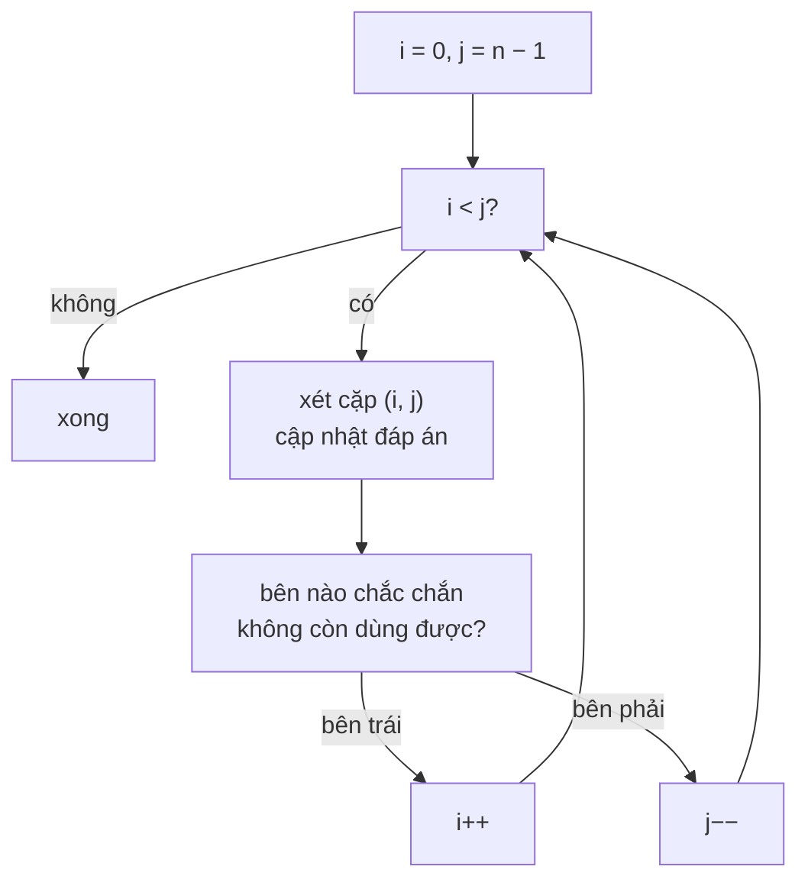

> [!tldr] Đọc nhanh
> - Pattern: `i` ở đầu, `j` ở cuối; mỗi bước dời **đúng một** con trỏ vào trong. Tối đa n − 1 bước, O(n) thời gian, O(1) bộ nhớ.
> - Điều kiện duy nhất: phải **chứng minh** được phần tử bị bỏ không thuộc đáp án nào ([[concepts/search-space-pruning|cắt không gian tìm kiếm]]). Mỗi bài có một lý do riêng: hai đầu phải khớp (palindrome), mảng đã sắp xếp (Two Sum II, 3Sum), hay cột thấp hơn quyết định (hai bài về nước).
> - 3Sum biến bài ba số thành n lần bài hai số ([[concepts/k-sum-reduction|k-Sum Reduction]]) và [[concepts/duplicate-skipping|bỏ trùng bằng thứ tự]], không cần Set.
> - Trapping Rain Water mang theo hai giá trị khi đi (max bên trái, max bên phải), thay cho hai mảng [[concepts/prefix-maximum|max tiền tố]] và hậu tố.
> - Bẫy chung: dời nhầm con trỏ. Bài nước mà dời cột cao thì ra 8 thay vì 49 ngay ở ví dụ của đề.

> [!info] Bối cảnh
> Ga 4 của **tuyến NeetCode: Mảng và chuỗi**. [[posts/2026-11-22-neetcode-hash-lookup|Ga 1]] trả lời "đã gặp x chưa?" bằng bảng băm và tốn O(n) bộ nhớ; ga này đổi bộ nhớ lấy **thứ tự**: khi dữ liệu có cấu trúc (đã sắp xếp, hay có công thức đơn điệu), hai con trỏ trả lời cùng câu hỏi với O(1) bộ nhớ. Ý max tiền tố dùng lại [[posts/2026-11-23-neetcode-prefix-suffix-encoding|ga 3]]. Mỗi bài có trang riêng giải kỹ bằng năm ngôn ngữ.

> [!abstract]- Từ điển nhanh cho bài này (bấm để mở)
> - **Con trỏ**: ở đây chỉ là một biến chỉ số (`i`, `j`), không phải con trỏ bộ nhớ của C.
> - **Không gian tìm kiếm**: mọi ứng viên có thể là đáp án; với cặp `(i, j)` là n(n − 1)/2 cặp.
> - **Bất biến**: điều luôn đúng ở mỗi vòng, ví dụ "nếu có đáp án thì nó nằm trong đoạn `[i, j]`".
> - **Mảng tăng dần**: mỗi phần tử không nhỏ hơn phần tử trước. Xem [[concepts/sort-then-scan|Sort Then Scan]].

## Hình dung trước: hai người khiêng hàng lên cân

Một kho xếp các thùng từ nhẹ đến nặng. Cần hai thùng nặng tổng cộng đúng bằng mức cân. Một người đứng ở đầu nhẹ, một người ở đầu nặng, mỗi lần đặt hai thùng trước mặt lên cân. Thiếu thì người đầu nhẹ đổi sang thùng kế tiếp; thừa thì người đầu nặng đổi.

| Đời thường | Khái niệm |
|---|---|
| Hai người ở hai đầu dãy thùng | `i = 0`, `j = n − 1` |
| Cân thiếu: thùng nhẹ không đủ, kể cả với thùng nặng nhất còn lại | bỏ `nums[i]`, `i++` |
| Cân thừa: thùng nặng quá, kể cả với thùng nhẹ nhất còn lại | bỏ `nums[j]`, `j−−` |
| Mỗi lần cân loại vĩnh viễn một thùng | tối đa n − 1 bước |
| Đổi luật cân (đọc chữ, đo nước) nhưng vẫn hai người đi vào giữa | năm bài, một khuôn |



## Vấn đề: n²/2 cặp, nhưng phần lớn có thể gạch bỏ

Hầu hết bài ga này hỏi về **một cặp** vị trí: hai đầu của palindrome, hai số có tổng bằng target, hai cột của bể nước. Thử mọi cặp là n(n − 1)/2 lần, tức O(n²): với n = 20 000, Container With Most Water vét cạn mất 639 ms.

Hãy nghĩ về bảng n × n mọi cặp. Hai con trỏ đứng ở góc `(0, n − 1)`. Nếu chứng minh được `nums[i]` không ghép được với **bất kỳ** ai còn lại, ta gạch cả hàng i chỉ bằng một phép so. n − 1 lần gạch là hết bảng.

## Cơ chế

### Khuôn chung

<figure class="figure-map" style="--ar: 3 / 4">
<div class="frame"><iframe data-archify="../diagrams/neetcode-two-pointers/converging.html" title="Hai con trỏ trên [1, 3, 4, 6, 8, 11], target 10" loading="lazy"></iframe></div>
<figcaption><span><b>Hình 1.</b> Two Sum II trên <code>[1, 3, 4, 6, 8, 11]</code>, target 10: mỗi lần so loại hẳn một số, năm bước là tìm thấy.</span><a href="../diagrams/neetcode-two-pointers/converging.html" target="_blank" rel="noopener">Mở toàn màn hình</a></figcaption>
</figure>

1. Đặt `i = 0`, `j = n − 1`.
2. Xét cặp `(i, j)`: so, tính, hay ghi đáp án.
3. Dời **một** con trỏ, bên mà ta chứng minh được đã hết tác dụng.
4. Lặp tới khi `i ≥ j`.

Bước 3 là toàn bộ cái khó. Dời sai bên thì vẫn chạy, vẫn O(n), chỉ là ra sai, và thường vẫn qua vài ca dễ.

### Lý do được bỏ một bên

| Bài | Bỏ bên nào | Vì sao an toàn |
|---|---|---|
| [[problems/valid-palindrome\|Valid Palindrome]] | bên đang trỏ vào ký tự không phải chữ-số; hoặc cả hai sau khi so khớp | ký tự rác không tham gia; cặp đã khớp không cần xét lại |
| [[problems/two-sum-ii-input-array-is-sorted\|Two Sum II]] | thiếu thì `i`, thừa thì `j` | mảng tăng dần: số nhỏ nhất cộng số lớn nhất vẫn thiếu thì số nhỏ nhất vô dụng |
| [[problems/3sum\|3Sum]] | như Two Sum II, cho mỗi neo `a` | sắp xếp trước; bỏ thêm neo trùng và `b` trùng |
| [[problems/container-with-most-water\|Container With Most Water]] | cột thấp hơn | cột thấp quyết định mực nước; ghép với cột gần hơn chỉ hẹp đáy |
| [[problems/trapping-rain-water\|Trapping Rain Water]] | bên có max nhỏ hơn | mực nước bên đó đã biết chắc, vì bên kia có bờ cao hơn |

Valid Palindrome không cần sắp xếp; Container và Trapping Rain Water làm trên mảng **không** sắp xếp. Hai con trỏ không đòi thứ tự; nó đòi một **lý do** để bỏ.

### 3Sum: giảm về hai số, bỏ trùng nhờ thứ tự

Sắp xếp, rồi với mỗi `a = nums[i]`, chạy Two Sum II trên đoạn bên phải với target `−a`. n lần O(n): tổng O(n²), so với O(n³) của vét cạn. Mảng đã sắp xếp nên các bộ ba trùng luôn đứng cạnh nhau: bỏ neo bằng neo trước đó, và sau mỗi lần tìm thấy thì nhảy `b` qua các giá trị bằng nhau. Bỏ bước này thì `[-1, 0, 1, 2, -1, -4]` ra `[-1, 0, 1]` hai lần.

### Trapping Rain Water: mang theo hai giá trị

Nước trên cột i là `min(L[i], R[i]) − h[i]`, với `L`, `R` là max tiền tố và max hậu tố. Hai mảng đó tốn O(n) bộ nhớ. Hai con trỏ chỉ giữ `leftMax` và `rightMax`: nếu `leftMax < rightMax` thì `R[i] ≥ rightMax > leftMax`, nên mực nước ở i là `leftMax` dù chưa biết `R[i]`. Đo ở n = 10⁶: hai mảng 18,4 ms, hai con trỏ 3,8 ms.

### Hai con trỏ hay bảng băm

| | Bảng băm (ga 1) | Hai con trỏ (ga này) |
|---|---|---|
| Cần dữ liệu có thứ tự? | không | cần một lý do để bỏ một bên (thường là thứ tự) |
| Bộ nhớ phụ | O(n) | O(1) |
| Giữ được chỉ số gốc? | có | mất, nếu phải sắp xếp trước |
| Đo Two Sum II, n = 10⁶ | 99,8 ms | 1,2 ms |

## Ví dụ chạy được

[TypeScript](../code/neetcode-two-pointers/two-pointers.ts) · [Python](../code/neetcode-two-pointers/two_pointers.py) · [Go](../code/neetcode-two-pointers/two_pointers.go) · [Java](../code/neetcode-two-pointers/two-pointers.java) · [JavaScript](../code/neetcode-two-pointers/two-pointers.js)

Mỗi file giải cả năm bài bằng cùng một khuôn và tự chạy 11 ca. Dưới đây là ba bài cho thấy ba lý do bỏ khác nhau: thứ tự (167), công thức `min` (11), và giá trị mang theo (42).

```ts
// 167: tổng nhỏ thì tăng i, tổng lớn thì giảm j. Chỉ số đếm từ 1.
function twoSumSorted(nums: number[], target: number): number[] {
  for (let i = 0, j = nums.length - 1; i < j; ) {
    const s = nums[i] + nums[j];
    if (s === target) return [i + 1, j + 1];
    if (s < target) i++; else j--;
  }
  return [];
}

// 11: dời cột thấp hơn; cột thấp ghép với cột nào gần hơn cũng không thể tốt hơn.
function maxArea(h: number[]): number {
  let best = 0;
  for (let i = 0, j = h.length - 1; i < j; ) {
    best = Math.max(best, (j - i) * Math.min(h[i], h[j]));
    if (h[i] < h[j]) i++; else j--;
  }
  return best;
}

// 42: bên có max nhỏ hơn thì mực nước ở bên đó đã chắc chắn.
function trap(h: number[]): number {
  let total = 0, lm = 0, rm = 0;
  for (let i = 0, j = h.length - 1; i < j; ) {
    lm = Math.max(lm, h[i]);
    rm = Math.max(rm, h[j]);
    if (lm < rm) total += lm - h[i++];
    else total += rm - h[j--];
  }
  return total;
}
```

```python
def two_sum_sorted(nums: list[int], target: int) -> list[int]:  # 167
    i, j = 0, len(nums) - 1
    while i < j:
        s = nums[i] + nums[j]
        if s == target:
            return [i + 1, j + 1]
        if s < target:
            i += 1
        else:
            j -= 1
    return []

def max_area(h: list[int]) -> int:  # 11
    i, j, best = 0, len(h) - 1, 0
    while i < j:
        best = max(best, (j - i) * min(h[i], h[j]))
        if h[i] < h[j]:
            i += 1
        else:
            j -= 1
    return best

def trap(h: list[int]) -> int:  # 42
    i, j, lm, rm, total = 0, len(h) - 1, 0, 0, 0
    while i < j:
        lm, rm = max(lm, h[i]), max(rm, h[j])
        if lm < rm:
            total += lm - h[i]
            i += 1
        else:
            total += rm - h[j]
            j -= 1
    return total
```

```go
// 167
func twoSumSorted(nums []int, target int) []int {
	for i, j := 0, len(nums)-1; i < j; {
		s := nums[i] + nums[j]
		if s == target {
			return []int{i + 1, j + 1}
		}
		if s < target {
			i++
		} else {
			j--
		}
	}
	return nil
}

// 11
func maxArea(h []int) int {
	best := 0
	for i, j := 0, len(h)-1; i < j; {
		best = max(best, (j-i)*min(h[i], h[j]))
		if h[i] < h[j] {
			i++
		} else {
			j--
		}
	}
	return best
}

// 42
func trap(h []int) int {
	total, lm, rm := 0, 0, 0
	for i, j := 0, len(h)-1; i < j; {
		lm, rm = max(lm, h[i]), max(rm, h[j])
		if lm < rm {
			total += lm - h[i]
			i++
		} else {
			total += rm - h[j]
			j--
		}
	}
	return total
}
```

```java
// 167
static int[] twoSumSorted(int[] nums, int target) {
    for (int i = 0, j = nums.length - 1; i < j; ) {
        int s = nums[i] + nums[j];
        if (s == target) return new int[] {i + 1, j + 1};
        if (s < target) i++; else j--;
    }
    return new int[0];
}

// 11
static int maxArea(int[] h) {
    int best = 0;
    for (int i = 0, j = h.length - 1; i < j; ) {
        best = Math.max(best, (j - i) * Math.min(h[i], h[j]));
        if (h[i] < h[j]) i++; else j--;
    }
    return best;
}

// 42
static int trap(int[] h) {
    int total = 0, lm = 0, rm = 0;
    for (int i = 0, j = h.length - 1; i < j; ) {
        lm = Math.max(lm, h[i]);
        rm = Math.max(rm, h[j]);
        if (lm < rm) total += lm - h[i++];
        else total += rm - h[j--];
    }
    return total;
}
```

```js
// 167
function twoSumSorted(nums, target) {
  for (let i = 0, j = nums.length - 1; i < j; ) {
    const s = nums[i] + nums[j];
    if (s === target) return [i + 1, j + 1];
    if (s < target) i++; else j--;
  }
  return [];
}

// 11
function maxArea(h) {
  let best = 0;
  for (let i = 0, j = h.length - 1; i < j; ) {
    best = Math.max(best, (j - i) * Math.min(h[i], h[j]));
    if (h[i] < h[j]) i++; else j--;
  }
  return best;
}

// 42
function trap(h) {
  let total = 0, lm = 0, rm = 0;
  for (let i = 0, j = h.length - 1; i < j; ) {
    lm = Math.max(lm, h[i]);
    rm = Math.max(rm, h[j]);
    if (lm < rm) total += lm - h[i++];
    else total += rm - h[j--];
  }
  return total;
}
```


```text
$ node two-pointers.ts
11/11 ca đúng
```

Python, Go, Java và JavaScript chạy cùng 11 ca và đều in `11/11 ca đúng`. Mỗi trang bài có thêm vét cạn, các cách trung gian, một bản sai và phép đo.

## Hiểu lầm và bẫy hay gặp

- **"Hai con trỏ chỉ dùng cho mảng đã sắp xếp."** Container With Most Water và Trapping Rain Water làm trên mảng chưa sắp xếp. Cái cần là một lý do để bỏ một bên.
- **Dời nhầm con trỏ.** Container With Most Water dời cột cao: 4/7 ca, sai ngay ví dụ đầu. Dời cả hai một lúc cũng có thể bỏ lỡ cặp `(i, j − 1)`.
- **Quên bỏ trùng ở 3Sum, hoặc bỏ sai chỗ.** So neo với phần tử **sau** thay vì phần tử trước làm mất các bộ như `[-1, -1, 2]`.
- **JS: `sort()` không có hàm so sánh.** Mảng "đã sắp xếp" theo chuỗi không tăng dần theo số, và lập luận bỏ một bên sụp.
- **Dùng hash map "cho chắc".** Đúng, nhưng đề Two Sum II cấm O(n) bộ nhớ, và chậm hơn khoảng 80 lần ở 10⁶ phần tử.

## Câu hỏi tự kiểm tra

> [!question]- Điều kiện chung để một bài dùng được hai con trỏ từ hai đầu là gì?
> Ở mỗi cặp `(i, j)` phải chứng minh được ít nhất một trong hai phần tử không thuộc đáp án nào trong đoạn còn lại. Khi đó bỏ nó không làm mất đáp án.

> [!question]- Ở Two Sum II, vì sao khi tổng nhỏ hơn target thì bỏ `nums[i]` chứ không bỏ `nums[j]`?
> `nums[j]` là số lớn nhất còn lại. Nếu `nums[i]` cộng với nó vẫn thiếu thì `nums[i]` cộng với ai cũng thiếu. Không có lập luận tương tự cho `nums[j]`: nó vẫn có thể ghép với một số lớn hơn `nums[i]`.

> [!question]- 3Sum chạy hai con trỏ n lần. Vì sao tổng là O(n²) chứ không phải O(n² log n)?
> Sắp xếp O(n log n) chỉ làm một lần; n lần hai con trỏ, mỗi lần O(n), là O(n²). O(n²) lớn hơn O(n log n), nên tổng là O(n²).

> [!question]- Trapping Rain Water: hai mảng max và hai con trỏ đều O(n). Hai con trỏ tiết kiệm được gì?
> Bộ nhớ O(n) của hai mảng, và thời gian ghi 2n phần tử. Đo ở n = 10⁶: 18,4 ms so với 3,8 ms.

## Tham khảo

- [NeetCode 150](https://neetcode.io/practice) (danh sách và nhóm bài)
- LeetCode: [125. Valid Palindrome](https://leetcode.com/problems/valid-palindrome/), [167. Two Sum II](https://leetcode.com/problems/two-sum-ii-input-array-is-sorted/), [15. 3Sum](https://leetcode.com/problems/3sum/), [11. Container With Most Water](https://leetcode.com/problems/container-with-most-water/), [42. Trapping Rain Water](https://leetcode.com/problems/trapping-rain-water/)
- [ECMAScript 2025: SortCompare](https://tc39.es/ecma262/2025/#sec-sortcompare) (`sort()` không hàm so sánh thì so chuỗi)
- Cormen, Leiserson, Rivest, Stein, *Introduction to Algorithms*, phần bất biến vòng lặp (loop invariant) dùng để chứng minh thuật toán đúng
