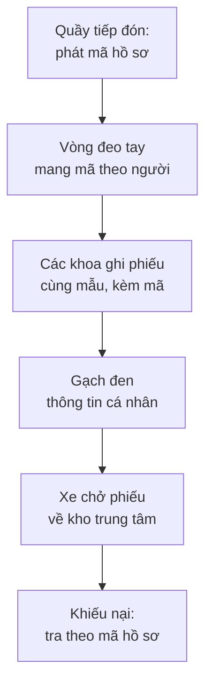
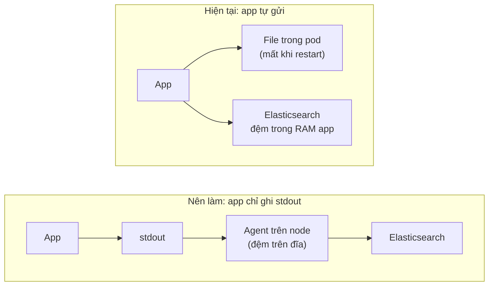

> [!tldr] Đọc nhanh
> - [[concepts/structured-logging|Log có cấu trúc]]: mỗi dòng log là một object JSON có các trường cố định, nên kho log lọc và tính được. Flash-sale làm đúng điều này, trừ một trường: thời gian xử lý ghi thành chuỗi `"12ms"`, và chuỗi thì không tính p95 được.
> - [[concepts/correlation-id|Mã theo dõi request]] được gắn ở cửa, cất vào [[concepts/async-local-storage|AsyncLocalStorage]] và trả lại cho người mua. Nhưng chỉ 2 class tự đọc mã đó khi ghi log; **92 class** khác dùng logger của NestJS, và mọi dòng chúng ghi đều không có mã.
> - [[concepts/pii-redaction|Che dữ liệu cá nhân]] chạy trước mọi nơi ghi, nhưng chạy thử thì thấy: email trong câu message lọt nguyên, `Error` biến thành `{}`, và một object có vòng tham chiếu làm **chính lệnh ghi log ném lỗi**.
> - [[concepts/log-levels|Mức log]] bị khóa ở `info`: biến `LOG_LEVEL` có trong cấu hình deploy nhưng code không đọc, nên 28 dòng `debug`/`verbose` không bao giờ in ra.
> - [[concepts/log-shipping|Đường gửi log]]: app tự đẩy log vào Elasticsearch với bộ đệm không giới hạn, còn Grafana thì đọc một index mà app không ghi vào.

> [!info] Bối cảnh
> Ví dụ là **flash-sale**, dự án riêng của mình: một shop bán giảm giá theo giờ, đúng giờ mở bán thì hàng nghìn người cùng giành vài trăm suất hàng. Backend viết bằng NestJS, chạy nhiều bản sao (pod) sau một load balancer. Khi một người báo "tôi bị trừ tiền mà không thấy đơn", thứ duy nhất để lần lại chuyện đã xảy ra là log. Bạn không cần biết NestJS hay đã đọc code của dự án; đoạn code trong bài đã được rút gọn và đổi tên.

> [!abstract]- Từ điển nhanh cho bài này (bấm để mở)
> - **Log**: dòng chữ chương trình tự ghi ra khi chạy để sau này người đọc lại biết nó đã làm gì.
> - **Pod**: một bản sao của backend đang chạy. Flash-sale có nhiều pod, nên log của một request nằm ở pod nào là chuyện may rủi.
> - **Middleware**: đoạn code chạy trước mọi request, trước cả code xử lý. **Interceptor** (NestJS): đoạn code bọc quanh code xử lý, thấy được cả lúc bắt đầu lẫn lúc xong. **Exception filter**: chỗ bắt mọi lỗi chưa ai bắt để trả lời người dùng. Xem thêm [[posts/2026-11-18-api-architecture|ga Kiến trúc API]].
> - **Winston**: thư viện ghi log phổ biến của Node.js. **Transport**: một nơi winston ghi log tới (màn hình, file, Elasticsearch). **Format**: một bước biến đổi dòng log trước khi ghi.
> - **Elasticsearch**: cơ sở dữ liệu chuyên tìm kiếm, hay dùng làm kho log. **Kibana**, **Grafana**: giao diện web để tìm và vẽ biểu đồ từ kho đó. **Logstash**: trạm trung chuyển nhận log, sửa rồi đẩy vào Elasticsearch.
> - **PII** (Personally Identifiable Information): dữ liệu nhận ra được một người: email, số điện thoại, số CCCD, địa chỉ, cả token đăng nhập.
> - **stdout / stderr**: hai "ống" chữ mặc định mà mọi chương trình có; container gom cả hai lại làm log.
> - **Trace**: bản ghi đường đi của một request qua nhiều dịch vụ, mỗi đoạn là một **span**. Flash-sale dùng OpenTelemetry cho phần này và nối trace qua [[concepts/transactional-outbox|outbox]] và RabbitMQ.

## Hình dung trước: hồ sơ bệnh án ở một bệnh viện lớn

Một bệnh nhân vào viện, đi qua quầy tiếp đón, phòng xét nghiệm, khoa nội, nhà thuốc. Mỗi nơi ghi vài dòng vào sổ của mình. Ba tuần sau bệnh nhân khiếu nại, và bệnh viện phải dựng lại đúng chuyện đã xảy ra với **người này**.

| Đời thường | Khái niệm |
|---|---|
| Mọi khoa ghi theo cùng một mẫu phiếu: giờ, khoa, việc làm, kết quả, chứ không viết văn xuôi | [[concepts/structured-logging\|Log có cấu trúc]] |
| Phiếu đóng dấu "khẩn", "thường", "ghi chú": ngày thường chỉ lưu khẩn và thường | [[concepts/log-levels\|Mức log]] |
| Quầy tiếp đón phát một **mã hồ sơ**, mọi phiếu ở mọi khoa đều ghi mã đó | [[concepts/correlation-id\|Mã theo dõi request]] |
| Mã hồ sơ in trên **vòng đeo tay**: khoa nào cũng đọc được mà không phải hỏi lại quầy | [[concepts/async-local-storage\|AsyncLocalStorage]] |
| Trước khi gửi hồ sơ ra ngoài, gạch đen số CCCD và số điện thoại | [[concepts/pii-redaction\|Che dữ liệu cá nhân]] |
| Xe chở phiếu từ các khoa về **kho lưu trữ trung tâm** để tra cứu một chỗ | [[concepts/log-shipping\|Đường gửi log]] |



Bài này soi vào flash-sale theo đúng thứ tự đó, và ở mỗi bước hỏi: phiếu có mang mã không, có lọt thông tin cá nhân không, và có tới được kho không.

## Vấn đề: 20:00:03, ba nghìn request, một người khiếu nại

Lúc 20:00 mở bán, ba pod nhận khoảng 3000 request trong vài giây. Mỗi request đi qua bảo vệ, giữ kho trong Redis, ghi đơn trong Postgres, rồi gửi sự kiện qua RabbitMQ. Mười phút sau một người mua gửi ảnh chụp màn hình lỗi "Internal server error".

Nếu log chỉ là những câu kiểu `Reserve stock failed for SKU-A`, thì trong cùng giây đó có hàng trăm câu giống hệt nhau, nằm rải trên ba pod. Không có cách nào biết câu nào thuộc về người này. Muốn trả lời được, mỗi dòng log cần ba thứ:

1. **Trường rõ ràng** để lọc (`statusCode = 500`, `url = /orders`), chứ không phải một câu văn để grep.
2. **Một mã chung** cho mọi dòng của cùng một request, và người mua cũng có mã đó trong tay.
3. **Một nơi tập trung** chứa log của mọi pod, giữ đủ lâu, và không chứa email hay token của ai.

Flash-sale đã xây đủ cả ba phần. Phần còn lại của bài là xem mỗi phần làm việc ra sao, rồi chạy thử để thấy chỗ nào chưa kín.

## Cơ chế

<figure class="figure-map" style="--ar: 4 / 5">
<div class="frame"><iframe data-archify="../diagrams/flash-sale-logging/log-path.html" title="Một dòng log của flash-sale đi từ request tới kho log" loading="lazy"></iframe></div>
<figcaption><span><b>Hình 1.</b> Quầy phát mã cất mã vào ngữ cảnh request; interceptor và filter ghi log kèm mã, còn service ghi qua logger của NestJS thì không có mã. Winston che PII rồi ghi ra console, file và Elasticsearch.</span><a href="../diagrams/flash-sale-logging/log-path.html" target="_blank" rel="noopener">Mở toàn màn hình</a></figcaption>
</figure>

### 1. Log có cấu trúc: phiếu theo mẫu, không phải văn xuôi

Mình từng nghĩ log là `console.log` thêm giờ ở đầu. Hóa ra thứ làm log dùng được ở quy mô lớn là **mỗi dòng là một object có trường cố định**, thường in ra dạng JSON trên một dòng. Kho log hiểu từng trường, nên lọc `statusCode >= 500` hay tính thời gian xử lý trung bình theo `url` là một câu truy vấn, không phải một biểu thức grep.

Ở flash-sale, interceptor (bọc quanh mọi request HTTP) ghi một dòng tổng kết sau mỗi request:

```ts
// rút gọn từ interceptor ghi log của flash-sale
this.logger.info('HTTP Request', {
  correlationId,          // mã theo dõi request
  method, url, statusCode,
  duration: `${duration}ms`,   // ← chuỗi, không phải số
  userId,
  // không log req.body: body có thể chứa PII
});
```

Ở môi trường production dòng này ra dạng `{"level":"info","message":"HTTP Request","correlationId":"req-…","statusCode":201,"duration":"12ms",…}`. Lúc chạy máy cá nhân thì đổi sang dạng có màu cho dễ đọc (`nestLike`). Đây là cách làm đúng: dạng dễ đọc cho người, JSON cho máy.

Một trường bị lệch là `duration`. Ghi `"12ms"` là ghi một **chuỗi**. Elasticsearch tự đoán kiểu từ dòng đầu tiên nó gặp và lưu chuỗi thành `text`/`keyword`. Trên kiểu đó không tính được phân vị (percentile), còn sắp xếp thì so từng chữ cái, nên `"100ms"` đứng trước `"20ms"`. Ví dụ ở dưới đo trên 10 000 request giả: p95 thật là 542 ms, còn sắp xếp theo chuỗi cho ra `8ms`. Sửa rất rẻ: ghi `durationMs: 12`, đặt đơn vị trong tên trường.

### 2. Mức log: khẩn, thường, ghi chú

Mỗi dòng log mang một mức. Winston dùng bảng mức của npm, số càng nhỏ càng nghiêm trọng:

| Mức | Số | Flash-sale dùng khi |
|---|---|---|
| `error` | 0 | Lỗi server (5xx), lỗi chưa ai bắt |
| `warn` | 1 | Lỗi phía người gọi (4xx), message thiếu mã sự kiện |
| `info` | 2 | Mỗi request xong, mỗi sự kiện nghiệp vụ |
| `http`, `verbose` | 3, 4 | (hầu như không dùng) |
| `debug` | 5 | Chi tiết để gỡ lỗi |
| `silly` | 6 | (không dùng) |

Logger có một **ngưỡng**: dòng nào có số lớn hơn ngưỡng thì bị bỏ ngay, không tốn công format hay ghi. Syslog ([RFC 5424](https://www.rfc-editor.org/rfc/rfc5424#section-6.2.1)) có bảng 8 mức riêng, nhưng ý tưởng giống nhau.

Interceptor của flash-sale chia đúng: lỗi 4xx là `warn` (người dùng gửi sai, không cần ai thức dậy), lỗi 5xx là `error` (server có vấn đề). Stack trace chỉ kèm theo khi lỗi 5xx và không phải production.

Chỗ hở nằm ở ngưỡng. Cấu hình winston không đặt `level`, nên ngưỡng là mặc định `info`. Cấu hình deploy trên Kubernetes có `LOG_LEVEL: "info"`, nhưng tìm cả thư mục `src` không có dòng nào đọc biến này. Kết quả: 28 lệnh `logger.debug`/`logger.verbose` rải trong code không bao giờ in ra. Ngày có sự cố cũng không bật lên được nếu không sửa code rồi deploy lại.

### 3. Mã theo dõi request: một mã cho cả hành trình

**Correlation id** là một chuỗi ngẫu nhiên gắn cho request ngay từ cửa, có mặt trong mọi dòng log của request đó và được trả lại cho người gọi. Flash-sale làm việc này bằng một middleware chạy trước mọi route:

```ts
// rút gọn từ middleware gắn mã của flash-sale
const correlationId = req.headers['x-correlation-id'] || `req-${randomUUID()}`;
res.setHeader('X-Correlation-ID', correlationId);         // trả mã cho người gọi
RequestContext.run({ correlationId, ip, userAgent, startTime }, next);
```

Có ba điểm hay:

- Nếu phía trước (API gateway, app di động) đã có mã, mã đó được dùng tiếp, nên một hành trình qua nhiều dịch vụ chung một mã.
- Body lỗi trả về cũng có `correlationId`. Ảnh chụp màn hình lỗi của người mua chứa sẵn chìa khóa để tra log.
- Bảng audit (ai sửa giá, ai hủy đơn) cũng lưu `correlationId`, nên nối được từ một thay đổi trong DB về đúng request đã gây ra nó.

Còn hai chỗ chưa đúng:

- **Mã từ header được tin hoàn toàn.** Không kiểm độ dài, không kiểm ký tự, rồi được ghi vào header phản hồi, vào log và vào bảng audit. JSON tự escape dấu xuống dòng nên không giả được một dòng log mới, nhưng vẫn nên chỉ nhận mã khớp một mẫu như `^[A-Za-z0-9-]{8,64}$` ([OWASP Logging Cheat Sheet](https://cheatsheetseries.owasp.org/cheatsheets/Logging_Cheat_Sheet.html) xếp mục này vào "dữ liệu từ ngoài vào log").
- **Correlation id và trace id là hai mã khác nhau.** OpenTelemetry của flash-sale tự sinh một trace id theo chuẩn [W3C Trace Context](https://www.w3.org/TR/trace-context/) (header `traceparent`) và nối được trace qua outbox và RabbitMQ. Nhưng dòng log không ghi trace id, nên từ một dòng log không nhảy sang trace của nó được. Pipeline Logstash của dự án thậm chí đã có sẵn bước đổi `trace.id` thành `trace_id`, chỉ là app chưa bao giờ gửi trường đó. [Mô hình dữ liệu log của OpenTelemetry](https://opentelemetry.io/docs/specs/otel/logs/data-model/) đặt `TraceId` và `SpanId` thành trường chuẩn của mỗi bản ghi log chính vì lý do này.

### 4. AsyncLocalStorage: vòng đeo tay của request

Câu hỏi đầu tiên của mình: service giữ kho nằm sâu năm tầng gọi hàm, làm sao nó biết mã của request hiện tại mà không phải truyền tham số qua cả năm tầng? Câu trả lời là `AsyncLocalStorage` trong module `node:async_hooks`.

`als.run(store, fn)` chạy `fn` và gắn `store` vào **mọi việc bất đồng bộ sinh ra từ đó**: các `await`, `setTimeout`, callback của Promise. Ở bất kỳ đâu trong chuỗi đó, `als.getStore()` trả về đúng store ấy. Hai request chạy xen kẽ trên cùng một luồng vẫn mỗi bên thấy store của mình, vì Node.js theo dõi việc nào sinh ra việc nào chứ không theo dõi "luồng".

Hai điều mình phải chạy thử mới tin:

- **Ngữ cảnh đi theo nơi một việc được tạo ra, không theo nơi dữ liệu đi tới.** Một `setInterval` tạo lúc khởi động app (ngoài mọi request) sẽ chạy mãi với store rỗng, kể cả khi nó đang xử lý dữ liệu do một request đẩy vào hàng đợi. Ví dụ ở dưới in ra `"correlationId":"unknown"` cho đúng trường hợp đó. Đây cũng là lý do outbox của flash-sale tự lưu `traceparent` vào một cột rồi khôi phục lại khi gửi, chứ không trông vào ngữ cảnh.
- **Đọc sớm thì chắc hơn đọc muộn.** Service audit của flash-sale đọc mã ngay dòng đầu, trước mọi `await`, và có comment nói rõ lý do. Với `AsyncLocalStorage` hiện đại thì `await` không làm mất ngữ cảnh, nhưng thư viện dùng callback hay pool tự viết thì có thể làm mất. Đọc một lần ở đầu hàm là thói quen rẻ.

Chi phí đo trên Node 24: thêm `als.run` vào một request có một `await` tốn khoảng 0,15 µs. Một request flash-sale thật tốn cỡ mili giây, nên phần này không đáng kể.

Chỗ hở lớn nhất của cả hệ thống nằm ở đây. Mã có trong ngữ cảnh, nhưng **chỉ những ai tự đọc nó mới ghi được nó**. Trong code chỉ có 2 class lấy logger winston qua DI và tự thêm `correlationId` (interceptor, filter), còn **92 class** tự tạo logger bằng `new Logger('TênClass')` của NestJS. NestJS chuyển các lệnh đó sang winston với đúng một trường phụ là `context` (tên class). Những dòng như "giữ kho thất bại", "outbox gửi lỗi", "consumer bỏ qua message trùng" đều không có mã. Cách sửa là cho logger tự đọc mã: một format winston chèn `RequestContext.getCorrelationId()` vào mọi dòng, đặt trước bước che PII. Như vậy không chỗ gọi nào phải nhớ.

### 5. Che dữ liệu cá nhân: gạch đen trước khi gửi đi

Log được giữ lâu, được copy sang nhiều nơi, và có nhiều người đọc hơn database. Email hay token nằm trong log là lộ dữ liệu, dù không ai "hack" gì. Flash-sale có một danh sách tên trường PII dùng chung cho log, audit và xóa tài khoản (`email`, `phone`, `cccd`, `password`, `token`, `refreshToken`, `address`…). Một format winston duyệt đệ quy dòng log và thay giá trị của các trường đó:

```ts
// rút gọn từ bộ che PII của flash-sale
function maskPiiDeep(input) {
  if (input === null || typeof input !== 'object') return input;
  if (Array.isArray(input)) return input.map(maskPiiDeep);
  const out = {};
  for (const [k, v] of Object.entries(input))
    out[k] = PII.has(k) ? maskValue(k, v) : maskPiiDeep(v);   // an.nguyen@… → an***@…
  return out;
}
```

Format này đứng **đầu tiên** trong chuỗi format của mỗi transport, và interceptor không bao giờ log `req.body`. Hướng làm là đúng. Nhưng chạy thử với chính winston 3.19 mà dự án dùng, mình gặp bốn chỗ lọt:

| Trường hợp | Kết quả thật | Vì sao |
|---|---|---|
| Email nằm trong câu message | Lọt nguyên `an.nguyen@example.com` | Chỉ xét **tên trường**, chuỗi message không bị quét |
| `{ err: new Error('…') }` | Ghi ra `"err":{}` | `message`, `stack` của Error không liệt kê được (non-enumerable), `Object.entries` bỏ qua chúng |
| Object có vòng tham chiếu | Lệnh `logger.info(...)` **ném `RangeError`** | Đệ quy không có điểm dừng; winston-transport ném lại lỗi của format cho người gọi |
| Mọi dòng log | Mất khóa `Symbol(level)` | `Object.entries` bỏ khóa Symbol; mức log bị xóa trước khi tới transport |

Dòng thứ ba nặng nhất: một lệnh ghi log, vốn chỉ để quan sát, lại biến một request đang chạy tốt thành lỗi 500. Dòng thứ tư hiện chưa gây hại, vì dự án không cấu hình gì dựa vào khóa đó. Nhưng mình đã thử bật `stderrLevels: ['error']` của transport Console: có bộ che thì dòng `error` chạy sang **stdout**, bỏ bộ che thì nó vào stderr như mong đợi.

Bản sửa ở ví dụ dưới duyệt bằng `Reflect.ownKeys` (giữ khóa Symbol), nhớ object đã thăm bằng `WeakSet` (cắt vòng), đọc riêng `name`/`message` của `Error`, và quét chuỗi bằng một regex email. Nó chậm hơn: 1,68 µs so với 0,62 µs mỗi dòng log. Đó là cái giá rất nhỏ để lệnh ghi log không bao giờ ném lỗi. Danh sách `PII_LOG_ONLY_MASK` (che IP chỉ trong log) có định nghĩa nhưng không ai dùng; hiện không lộ IP vì interceptor không ghi IP, nhưng hằng số đó đang hứa một điều code không làm.

### 6. Đường gửi log: từ ba pod về một kho

Flash-sale ghi mỗi dòng log ra ba nơi (và nơi thứ tư nếu có Elasticsearch):

| Transport | Nội dung | Ghi chú |
|---|---|---|
| Console | Tất cả từ `info` trở lên | JSON ở production |
| `logs/error.log` | Chỉ `error` | Xoay vòng 10 MB × 5 file |
| `logs/combined.log` | Tất cả | Xoay vòng 50 MB × 10 file |
| Elasticsearch | Tất cả, khi có `LOG_ELASTICSEARCH_URL` | Data stream `logs-app-flash-sale` |

Cách này có ba vấn đề, đều do **app tự gửi log**:

- **File trong container không phải kho.** Pod không gắn volume cho `logs/`, nên file mất khi pod khởi động lại. Mỗi pod giữ tới 550 MB log trên đĩa tạm mà không ai đọc.
- **Bộ đệm không giới hạn.** Transport Elasticsearch gom log thành lô và gửi mỗi 2 giây. Khi Elasticsearch chết, nó giữ log trong RAM để gửi lại. Mặc định của thư viện là `buffering: true, bufferLimit: null`, tức không có trần. Với 2000 dòng/giây, mỗi dòng ~400 byte, một phút Elasticsearch chết là 46 MB RAM, và con số đó tiếp tục tăng. Đúng lúc flash sale đông nhất, sự cố của kho log có thể làm chính backend hết bộ nhớ.
- **Grafana tìm sai chỗ.** Datasource log của Grafana đọc `logs-flash-sale-*`, là index do Logstash tạo. App lại ghi thẳng vào data stream `logs-app-flash-sale`, còn trong repo không có thành phần nào gửi log vào Logstash (không Filebeat, không gửi TCP). Grafana sẽ không thấy dòng log nào của app.

Cách mà [The Twelve-Factor App](https://12factor.net/logs) đề xuất, và Kubernetes giả định sẵn: app **chỉ ghi ra stdout**, coi log là một dòng sự kiện, không tự lo lưu hay gửi. Một agent chạy trên mỗi node (Filebeat, Fluent Bit, Vector) đọc log của container rồi gửi đi, có bộ đệm trên đĩa và tự thử lại. Khi đó kho log chết thì chỉ agent phải chờ, còn app không hay biết.



## Ví dụ chạy được

Ba file, không cần cài thư viện, chạy bằng Node 24 (`node file.ts`).

**[pii-mask.ts](../code/flash-sale-logging/pii-mask.ts)** chép lại bộ che PII của flash-sale (rút gọn), cho chạy qua bốn dòng log rồi so với bản sửa:

```text
1) PII nằm trong metadata
  gốc: {"level":"info","message":"login","email":"an***@example.com","token":"********"}  | level Symbol: undefined
  sửa: {"level":"info","message":"login","email":"an***@example.com","token":"********"}  | level Symbol: info

2) PII nằm trong chính câu message
  gốc: {"level":"warn","message":"gửi mail tới an.nguyen@example.com thất bại"}  | level Symbol: undefined
  sửa: {"level":"warn","message":"gửi mail tới an***@example.com thất bại"}  | level Symbol: warn

3) Error làm metadata
  gốc: {"level":"error","message":"lưu đơn lỗi","err":{}}  | level Symbol: undefined
  sửa: {"level":"error","message":"lưu đơn lỗi","err":{"name":"Error","message":"timeout khi ghi bảng orders"}}  | level Symbol: error

4) Object có vòng tham chiếu
  gốc: NÉM RangeError: Maximum call stack size exceeded
  sửa: {"level":"info","message":"đơn mới","order":{"id":"o-1","self":"[vòng tham chiếu]"}}  | level Symbol: info

gốc: 0.62 µs mỗi dòng log

sửa: 1.68 µs mỗi dòng log
```

Mình cũng chạy lại bốn trường hợp này với winston 3.19 thật của dự án, kết quả giống hệt, kể cả chuyện lệnh `logger.info` ném `RangeError` ra cho code gọi nó.

**[request-context.ts](../code/flash-sale-logging/request-context.ts)** cho ba request chạy xen kẽ: một request mang mã hợp lệ, một request không có mã, một request mang header bẩn. Mỗi bước được ghi hai lần, một lần bằng logger thường và một lần bằng logger tự đọc ngữ cảnh. Cuối cùng là một timer tạo ngoài mọi request:

```text
{"msg":"giữ kho SKU-B"}
{"msg":"giữ kho SKU-B","correlationId":"req-9f7d7997"}
{"msg":"giữ kho SKU-C"}
{"msg":"giữ kho SKU-C","correlationId":"req-447369b0"}
{"msg":"giữ kho SKU-A"}
{"msg":"giữ kho SKU-A","correlationId":"client-abc-12345"}
{"msg":"ghi đơn SKU-B","correlationId":"req-9f7d7997"}
{"msg":"ghi đơn SKU-C","correlationId":"req-447369b0"}
{"msg":"ghi đơn SKU-A","correlationId":"client-abc-12345"}
{"msg":"flush SKU-A,SKU-B","correlationId":"unknown"}
không ALS: 0.11 µs mỗi request
có ALS   : 0.25 µs mỗi request
```

Các dòng của ba request xen kẽ nhau, nhưng logger tự đọc ngữ cảnh vẫn gán đúng mã cho từng dòng. Header bẩn (`xin chào\n{"level":"error"}`) bị bỏ, nên request đó nhận mã mới. Logger thường (giống logger của 92 class kia) ghi ra dòng không ai nối được. Mã `req-…` sinh ngẫu nhiên nên mỗi lần chạy sẽ khác.

**[structured-fields.ts](../code/flash-sale-logging/structured-fields.ts)** sinh 10 000 thời gian xử lý (90% nhanh, 10% chậm, dùng bộ sinh ngẫu nhiên mulberry32 có seed cố định), tính p95 theo hai cách, in ra ngưỡng mức log, và mô phỏng một phút Elasticsearch chết:

```text
p95 đúng (số):           542 ms
p95 khi sắp xếp chuỗi:  8ms
"100ms" < "20ms" theo chữ? true
ngưỡng info : error=ghi warn=ghi info=ghi http=bỏ verbose=bỏ debug=bỏ silly=bỏ
ngưỡng debug: error=ghi warn=ghi info=ghi http=ghi verbose=ghi debug=ghi silly=bỏ
đệm không giới hạn: 120000 dòng ≈ 45.8 MB trong RAM, vẫn tăng tiếp
đệm giới hạn 20000: 20000 dòng ≈ 7.6 MB, bỏ 100000 dòng và đếm được số bỏ
```

## Soi lại flash-sale: bảy chỗ hở, xếp theo độ nặng

| # | Chỗ hở | Hậu quả | Sửa |
|---|---|---|---|
| 1 | Bộ che PII đệ quy không cắt vòng | Ghi log một object vòng làm request lỗi 500 | `WeakSet` các object đã thăm |
| 2 | 92 class dùng Nest Logger, log không có mã | Không lần được "giữ kho lỗi" về người mua nào | Format winston tự chèn `correlationId` từ ngữ cảnh |
| 3 | PII trong message, `Error` thành `{}` | Lộ email; mất nội dung lỗi | Quét chuỗi bằng regex; đọc riêng `name`, `message`, `stack` |
| 4 | Đệm Elasticsearch không giới hạn, app tự gửi | Kho log chết kéo theo backend hết RAM | Chỉ ghi stdout, để agent trên node gửi đi |
| 5 | Grafana đọc index của Logstash, app ghi data stream khác | Bảng log trong Grafana trống | Thống nhất một đích ghi |
| 6 | `LOG_LEVEL` không ai đọc; `duration` là chuỗi | Không bật được `debug` khi có sự cố; không tính được p95 | `level: process.env.LOG_LEVEL ?? 'info'`; `durationMs` dạng số |
| 7 | Lỗi 500 ghi hai lần, lần thứ hai thiếu mã | Đếm lỗi gấp đôi; một dòng mồ côi | Chỉ ghi ở một nơi (filter), có kèm mã |

Chỗ thứ 7 đến từ thứ tự chạy của NestJS: lỗi đi ngược qua interceptor trước (interceptor ghi `HTTP Server Error` có mã), rồi mới tới exception filter (filter ghi thêm `Unhandled exception`, không có mã). Comment trong filter còn viết "để có correlationId", nhưng object được ghi thì không có trường đó.

### Đã sửa (commit `7445e40`, ngày 24/11/2026)

Sau khi bài lên, mình sửa chỗ hở 1, 2, 3 và 7, cùng `LOG_LEVEL` và `durationMs` của chỗ 6. Chỗ 4 và 5 (đường gửi log, Grafana) còn nguyên vì cần đổi hạ tầng chứ không chỉ đổi code. Toàn bộ 966 test của backend đều qua, trong đó có 22 test mới.

**Mã request cho mọi dòng log, không sửa class nào.** Cách đầu tiên mình nghĩ tới là một format winston đọc `RequestContext`. Nhưng format chạy trong luồng stream của winston: khi một transport ghi chậm (file, Elasticsearch), dòng log nằm chờ trong bộ đệm và format chạy **sau đó**, lúc ngữ cảnh đã là của request khác hoặc không còn. Như vậy mã có thể sai, và mã sai còn tệ hơn không có mã. Đọc mã nguồn `logger.log()` của winston thì thấy `defaultMeta` được gộp vào dòng log bằng `Object.assign` **ngay trong lệnh gọi**, đồng bộ, trước khi dòng log vào stream. `Object.assign` đọc cả getter, nên chỉ cần:

```ts
// rút gọn từ cấu hình logger của flash-sale
export const requestContextMeta = {
  get correlationId() {
    return RequestContext.get()?.correlationId;   // đọc tại chỗ gọi, trong đúng request
  },
};
winston.createLogger({ level: resolveLogLevel(), defaultMeta: requestContextMeta, transports });
```

92 class dùng Nest Logger giờ tự có mã. Mã truyền tay qua meta (ví dụ consumer lấy mã từ message) vẫn thắng, vì winston gộp meta sau `defaultMeta`. Ngoài request thì getter trả `undefined` và JSON bỏ trường đó. Test cho hai request xen kẽ và cho logger của NestJS đều in đúng mã.

**Bộ che PII không bao giờ ném lỗi.** Bản mới làm đúng như ví dụ ở trên (`Reflect.ownKeys`, đọc riêng `Error`, quét email trong mọi chuỗi kể cả stack), với một chỗ khác: `WeakSet` chỉ giữ **tổ tiên trên đường đang duyệt**. Object được thêm vào lúc đi xuống và xóa đi lúc quay lên. Nếu giữ mọi object đã thăm như bản trong ví dụ, thì `{ buyer: user, payer: user }` sẽ có `payer` bị ghi thành `[Circular]`, dù không có vòng nào. Bộ che cũng dùng chung cho bảng audit, nên email nằm trong chuỗi ở `oldValue`/`newValue` giờ cũng bị che.

**Mỗi lỗi 500 một dòng, và vẫn có stack ở production.** Interceptor đánh dấu lỗi nó đã ghi vào một `WeakSet`. Filter chỉ ghi lỗi 500 chưa được đánh dấu: đó là lỗi ném từ middleware hay guard, những chỗ chạy trước interceptor nên interceptor không thấy. Bỏ hẳn dòng của filter thì sẽ mất các lỗi này. Trước đây ở production chỉ filter ghi stack; giờ interceptor ghi stack cho mọi lỗi 5xx ở mọi môi trường. Stack chỉ nằm trong log, không trả về client, và email trong stack cũng bị che.

**Mức log và thời gian xử lý.** Logger đọc `LOG_LEVEL`; Joi chỉ nhận 7 mức hợp lệ, nên giá trị sai làm app báo lỗi ngay lúc khởi động. Interceptor ghi `durationMs` dạng số thay cho `duration: "12ms"`.

## Hiểu lầm và bẫy hay gặp

- **"Log JSON là đủ có cấu trúc."** JSON chỉ là định dạng. Có cấu trúc nghĩa là **cùng một ý luôn nằm ở cùng một trường, cùng một kiểu**. `"12ms"` ở dòng này và `12` ở dòng khác thì kho log không gộp được.
- **"Có correlation id ở middleware là mọi dòng log có mã."** Mã nằm trong ngữ cảnh, không tự nằm trong log. Chỉ logger nào đọc ngữ cảnh mới ghi được nó, và ở flash-sale chỉ có 2 class làm vậy, còn 92 class thì không.
- **"Correlation id thay được trace."** Correlation id chỉ trả lời câu hỏi "những dòng nào thuộc cùng request". Trace trả lời thêm: mỗi bước tốn bao lâu, bước nào gọi bước nào. Hai thứ bổ sung cho nhau, và nối được với nhau khi log ghi thêm `trace_id`.
- **"Che PII theo tên trường là xong."** Dữ liệu cá nhân hay lọt qua câu message dựng bằng template string (`` `gửi mail tới ${email} thất bại` ``) và qua `Error.message`. Bộ che phải quét cả chuỗi, và tốt nhất là đừng đưa PII vào message ngay từ đầu.
- **"Ghi log không thể làm hỏng request."** Format ném lỗi thì winston ném lại cho người gọi; transport có bộ đệm không giới hạn thì ăn hết RAM. Code log phải được viết với yêu cầu **không bao giờ ném lỗi, không bao giờ chặn request**.
- **"Ghi ra file cho chắc."** Trong container, file nằm trên đĩa tạm của pod. Không có volume và không có ai đọc thì file đó chỉ tốn đĩa.
- **"Bật `debug` ở production cho đủ thông tin."** Log tốn tiền theo dung lượng và tăng theo lưu lượng. Đúng giờ flash sale, lưu lượng gấp trăm lần ngày thường. Mức log phải đổi được lúc chạy (biến môi trường hay cờ), chứ không cố định trong code.

## Câu hỏi tự kiểm tra

> [!question]- Người mua gửi ảnh lỗi có `correlationId: req-7c1e…`. Với code hiện tại, bạn tìm được những dòng log nào của request đó, và không tìm được dòng nào?
> Tìm được dòng tổng kết của interceptor (`HTTP Server Error`, có mã) và bản ghi audit nếu request đó sửa dữ liệu. Không tìm được dòng `Unhandled exception` của filter (không có mã) và mọi dòng service ghi qua Nest Logger (giữ kho, ghi đơn, outbox). Muốn tìm những dòng đó phải đoán theo thời gian và pod.

> [!question]- Vì sao một `setInterval` tạo lúc khởi động ghi ra `correlationId: "unknown"`, kể cả khi dữ liệu nó xử lý do một request đẩy vào?
> AsyncLocalStorage gắn ngữ cảnh vào **việc bất đồng bộ lúc nó được tạo**. Timer được tạo ngoài mọi `als.run`, nên mọi lần nó chạy đều có store rỗng. Dữ liệu đi qua một mảng dùng chung không mang theo ngữ cảnh. Muốn giữ mã thì phải lưu mã cùng dữ liệu, như outbox lưu `traceparent` vào một cột.

> [!question]- Bộ che PII chỉ chậm đi khoảng 1 µs mỗi dòng. Vậy cái giá thật của việc không sửa nó là gì?
> Một object vòng trong metadata làm lệnh ghi log ném `RangeError`, biến request đang đúng thành lỗi 500. Một `Error` trong metadata thành `{}`, nên đúng lúc cần đọc lỗi thì log trống. Một email trong message lọt nguyên vào kho log, nơi có nhiều người đọc và giữ lâu hơn database.

> [!question]- Elasticsearch chết 5 phút đúng lúc mở bán. Chuyện gì xảy ra với backend hiện tại, và với cách "chỉ ghi stdout + agent"?
> Hiện tại: mỗi pod giữ mọi dòng log chưa gửi trong RAM, không có trần. 2000 dòng/giây × 300 giây ≈ 230 MB mỗi pod, cộng dồn với tải của chính đợt mở bán, có thể làm pod bị giết vì hết bộ nhớ. Với agent: app vẫn ghi stdout như thường, agent đệm trên đĩa của node và gửi bù khi Elasticsearch sống lại. App không biết gì về sự cố.

> [!question]- Ghi `duration: "12ms"` có gì sai, khi mắt người đọc vẫn hiểu?
> Kho log coi đó là chuỗi: không tính được trung bình hay p95, và sắp xếp theo chữ thì `"100ms"` đứng trước `"20ms"`. Trường số tên `durationMs` thì vừa người đọc được vừa máy tính được.

## Tham khảo

- [winston](https://github.com/winstonjs/winston) (mức log kiểu npm, mặc định `level: 'info'`, format, transport) và [mã nguồn `winston-transport`](https://github.com/winstonjs/winston-transport/blob/master/modern.js) (`_write` lọc theo `info[LEVEL]`, chạy format, ném lại lỗi của format). Mình đọc bản 4.9.0 cài trong dự án.
- [winston-elasticsearch](https://github.com/vanthome/winston-elasticsearch) (gửi theo lô mỗi `flushInterval` 2 giây, `buffering: true`, `bufferLimit: null` mặc định). Mình đọc `index.js` và `bulk_writer.js` bản 0.19.0.
- [Node.js: Asynchronous context tracking](https://nodejs.org/api/async_context.html) (`AsyncLocalStorage.run`, `getStore`).
- [NestJS: Logger](https://docs.nestjs.com/techniques/logger) (thay logger mặc định bằng một logger khác); cách `nest-winston` chuyển lệnh của Nest Logger sang winston mình đọc trong mã nguồn bản 1.10.2.
- [OWASP Logging Cheat Sheet](https://cheatsheetseries.owasp.org/cheatsheets/Logging_Cheat_Sheet.html) (không log dữ liệu nhạy cảm, kiểm tra dữ liệu từ ngoài trước khi ghi).
- [The Twelve-Factor App: Logs](https://12factor.net/logs) (app ghi stdout, môi trường lo việc gom và gửi).
- [W3C Trace Context](https://www.w3.org/TR/trace-context/) (`traceparent`) và [OpenTelemetry Logs Data Model](https://opentelemetry.io/docs/specs/otel/logs/data-model/) (`TraceId`, `SpanId` trong bản ghi log).
- [RFC 5424, mục 6.2.1](https://www.rfc-editor.org/rfc/rfc5424#section-6.2.1) (8 mức nghiêm trọng của syslog).
- Mọi chỗ hở trong bài mình kiểm trên code flash-sale ở commit hiện tại. Bốn hành vi của bộ che PII mình chạy lại với winston 3.19.0 của dự án.
